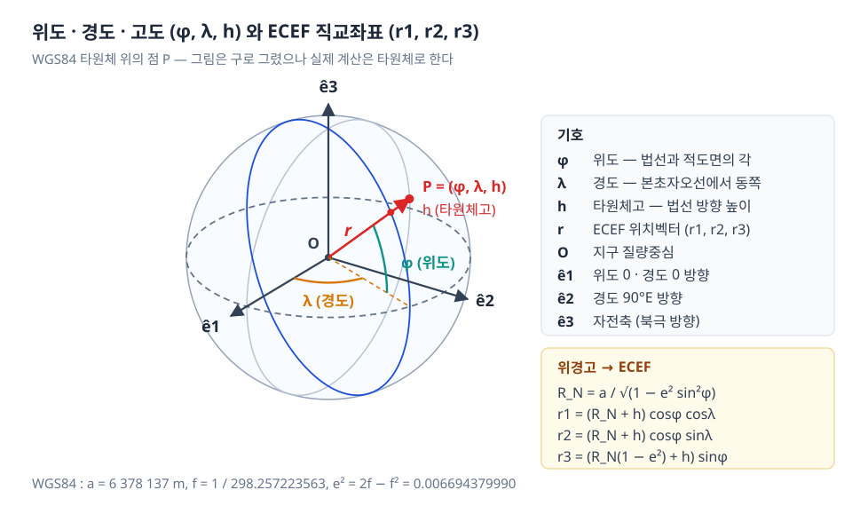
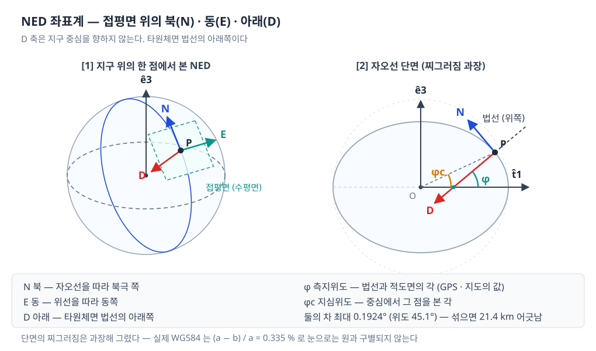
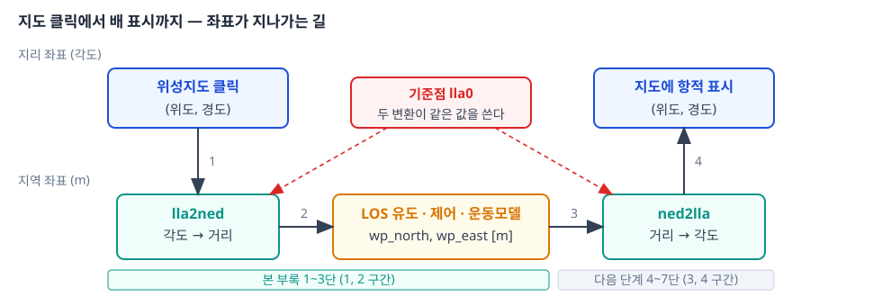
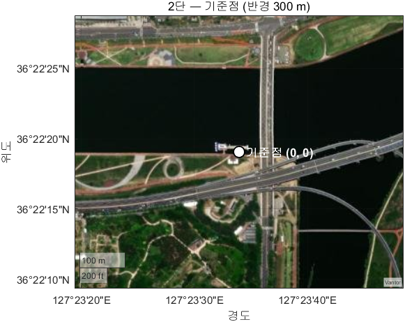
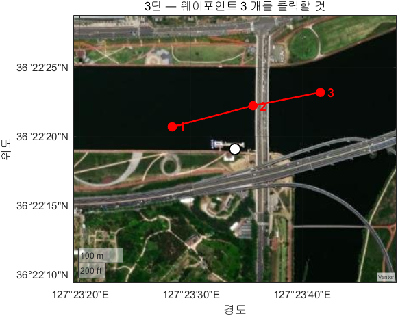
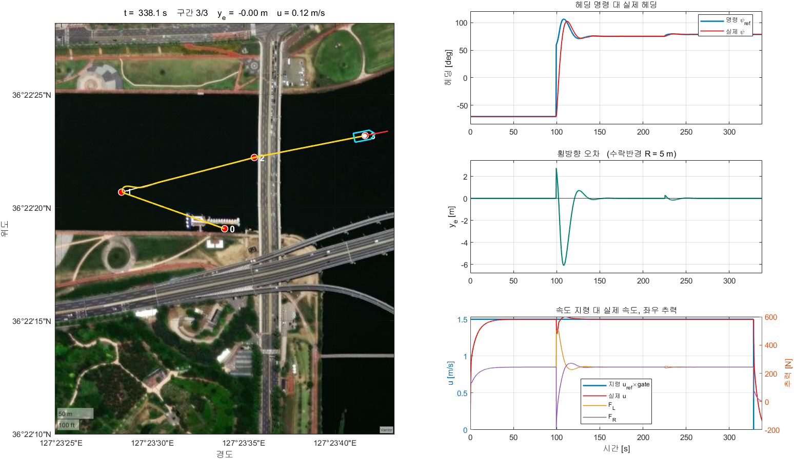
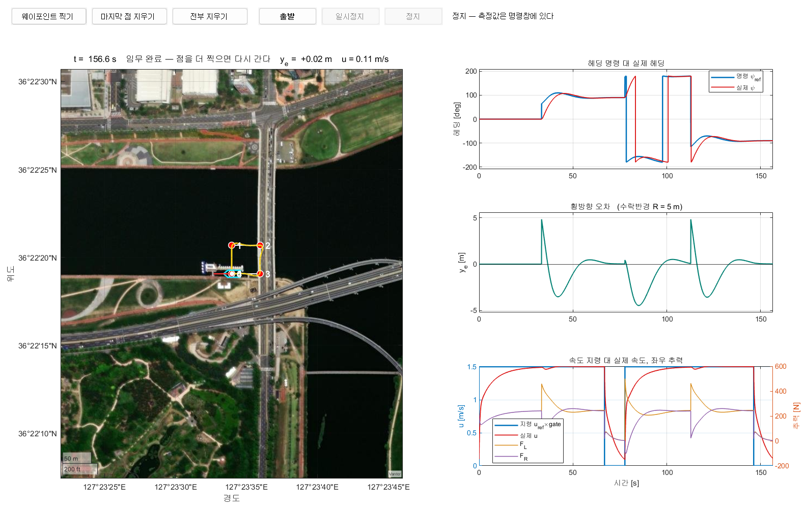

# 부록 A2 · 위성지도 GCS 실습 (1\~5단)

> [!important] 이번 학기 **녹화 강의 영상**은 여기에 올라감 — 수업에서 놓친 부분은 영상으로 확인할 것
> **<https://youtube.com/playlist?list=PLK_f1-krzJG8>**
>
> - 매주 수업 뒤 그 주차 영상이 이 재생목록에 추가됨
> - 아래 "참조 강의" 는 **지난 학기까지의 선수 과목**이고, 이 재생목록은 **이번 학기 본 수업** 녹화임

> [!important] 참조 강의 — 본 과목이 전제하는 배경
> <span style="font-size:0.88em">아래 다섯 과목은 **본 과목 담당 교수가 직접 강의한 것**이며, 본 과목이 전제하는 배경 지식에 해당함. 학부 기초에서 대학원 과정까지 이어지므로 부족한 지점부터 시작하면 됨. 본 문서에서 쓰는 좌표계·기호·유도 과정은 아래 강의에서 상세히 다루므로, 선수 지식이 부족한 경우 먼저 보고 돌아올 것</span>
>
> | # | 과목 | 수준 | 언어 | 영상 | 자료·코드 |
> |---|---|---|---|---|---|
> | 1 | **제어공학** — 전달함수, 되먹임, 안정도, 근궤적, PID. 모든 것의 토대 | 학부 | 한국어 | [재생목록](https://youtube.com/playlist?list=PLFaUxNRM4BvJMpF9HZS-Mp8tDv9dTdglk) | [드라이브](https://drive.google.com/drive/folders/1TNIPDNtS_Iy8li-olka5WJslSXDYf0aT) |
> | 2 | **제어시스템설계** — 해석이 아니라 설계. 사양 결정, 루프 정형화, 이산 구현 | 학부 | 한국어 | [재생목록](https://youtube.com/playlist?list=PLFaUxNRM4BvIGroZ5rgn7x08F7C79d9WZ) | [드라이브](https://drive.google.com/drive/folders/11m5Xxl_PHJvxgHghLSP-jhCpmRpbvoXh) |
> | 3 | **캡스톤디자인** — 본 과목의 지난 학기 강의. 이동체 프로젝트를 처음부터 끝까지 | 학부 | 한국어 | [재생목록](https://youtube.com/playlist?list=PLFaUxNRM4BvLu7L0pDoLzDXTv8mm6rCmj) | [드라이브](https://drive.google.com/drive/folders/1haIQejlJfrdhtOuof-MpffR9ydVscXZS) |
> | 4 | **제어공학특론** — 좌표계, 6자유도 운동방정식, 회전행렬과 오일러각, 선형화와 트림 | 대학원 | 영어 | [재생목록](https://youtube.com/playlist?list=PLFaUxNRM4BvJmvF2ljx4KM5dj1P5jEcw0) | [드라이브](https://drive.google.com/drive/folders/1GUxbbONl916lNd0ggnFnXrNwNkd13-2-) |
> | 5 | **센서신호처리 및 융합** — 센서 모델, 잡음, 추정, 다중센서 융합 | 대학원 | 영어 | [재생목록](https://youtube.com/playlist?list=PLFaUxNRM4BvK-aP2Gdoyp5-AWvMn7Fo8E) | [드라이브](https://drive.google.com/drive/folders/1MEVJP7TzMcm8w6TZwUjhWJtL34WeNY3u) |
>
> <span style="font-size:0.88em">**MATLAB·Simulink 가 처음이라면 4주차 실습 전에 아래를 끝낼 것.** 본 과목의 제어기 실습은 전부 Simulink 로 진행함. Onramp 는 무료이며 각각 몇 시간이면 끝남</span>
>
> | 도구 | 시작 지점 |
> |---|---|
> | MATLAB | [MATLAB Onramp](https://matlabacademy.mathworks.com/kr/details/matlab-onramp/gettingstarted) · [Core MATLAB Skills](https://matlabacademy.mathworks.com/details/core-matlab-skills/lpmlcms) |
> | Simulink | [Simulink Onramp](https://matlabacademy.mathworks.com/kr/details/simulink-onramp/simulink) · 담당 교수 Simulink 강의 [1부](https://youtu.be/a-afHg_fSaU) · [2부](https://youtu.be/070Yn0Hw5a0) |

> [!important] 강의자료 저장소 — 처음 한 번만 `git clone`, 그 뒤로는 `git pull`
>
> | 저장소 | 주소 | 받는 자리 (WSL) |
> |---|---|---|
> | 강의자료 — 주차 문서 · Simulink 모델 · MATLAB 스크립트 | **<https://github.com/wkyouncnu/Capstone-Design>** | `~/Capstone-Design` |
> | ROS 2 예제 패키지 `usv_basics` — 2주차부터 쓰는 노드 코드 | **<https://github.com/wkyouncnu/usv_basics>** | `~/capstone_ws/src/usv_basics` |
>
> | 언제 | 명령 (VS Code 의 WSL 창 터미널) | 하는 일 |
> |---|---|---|
> | 처음 한 번 | `cd ~ && git clone https://github.com/wkyouncnu/Capstone-Design.git` | 강의자료 전체를 받음 (약 770 MB · 2026-10-16 실측 1분 40초) |
> | 처음 한 번 | `mkdir -p ~/capstone_ws/src && cd ~/capstone_ws/src && git clone https://github.com/wkyouncnu/usv_basics.git` | 예제 패키지를 받음. 이어서 `cd ~/capstone_ws && colcon build --symlink-install` |
> | 매주 수업 전 | `cd ~/Capstone-Design && git pull` · `cd ~/capstone_ws/src/usv_basics && git pull` | **바뀐 파일만** 받음. 다시 clone 하지 않음 |
> | 무엇이 바뀌었는지 | `git log --oneline -10` · `git show --stat HEAD` | 교수가 갱신한 내역을 확인 |
>
> - 두 저장소 모두 공개 — 로그인 없이 받아짐
> - 주차 문서는 `~/Capstone-Design/1_2026-2학기_강의자료/10-주차별-강의자료/` 에 있음. MATLAB 은 같은 폴더를 `\\wsl.localhost\Ubuntu-22.04\home\<사용자명>\Capstone-Design\...` 로 엶
> - `usv_basics` 를 받은 뒤 새 노드가 생겼으면 `colcon build --symlink-install` 을 한 번 더 돌림
> - 본인이 고친 파일 때문에 `git pull` 이 멈추면 `git stash` 로 치워 두고 다시 받음 → [[강의자료는-한-번-받고-git-pull-로-갱신한다]]

- **과목**: 캡스톤디자인 (2026-2) · 충남대학교 자율운항시스템공학과
- **이번 부록 학습 내용**: 위성지도 위에서 **웨이포인트를 클릭으로 찍고**, 그 위경도를 배가 쓰는 **NED 좌표**로 내림
- **구성**: 1부 이론 (좌표계) · 2부 실습 1\~5단

> [!important] 시작 전 확인
> - **강의자료부터 갱신**: VS Code WSL 창 터미널에서 `cd ~/Capstone-Design && git pull`
> - MATLAB **R2024b** 와 **Navigation Toolbox** 가 설치되어 있을 것 (`lla2ned` 가 여기 있음)
> - **인터넷 연결 필요** — 위성 사진은 실시간으로 받아 그림
> - 5주차 LOS 유도 실습(`W05_simulink`)을 먼저 해 두면 3단 결과를 바로 이어 쓸 수 있음

> [!note] 이번 부록에서는 ROS 도 Gazebo 도 VRX 도 쓰지 않는다
> - WSL 도, 배도 필요 없음. **MATLAB 하나만** 켜면 됨
> - 학습 대상은 **위경도와 NED 사이의 변환**, 그리고 **지도를 입력 장치로 쓰는 법**임
> - 4\~5단에서 Simulink 모델을 쓰지만 **5주차에서 쓴 것과 같은 오프라인 모델**임
> - 실제 수역·장애물이 있는 VRX 연동은 **다음 단계**에서 다룸

---

## 이 부록을 마치면 할 수 있어야 하는 것

1. WGS84 가 무엇을 정하는 표준인지, 정의 상수 두 개가 무엇인지 말한다
2. 위도·경도·고도를 타원체면과 법선으로 정의하고, 그림 위에서 가리킨다
3. 위경도를 거리처럼 쓰면 안 되는 이유를 축척 수치로 설명한다
4. 기준점 `lla0` 하나를 정하고, 그 기준점의 NED 세 축이 어떻게 정의되는지 말한다
5. `lla2ned` · `ned2lla` 로 위경도와 NED 를 서로 바꾼다
6. 두 함수의 **내부 수식**을 적고, 손으로 계산해 함수 결과와 대조한다
7. `'flat'` 과 `'ellipsoid'` 중 무엇을 쓸지 **거리를 근거로** 고른다
8. MATLAB 지리축(`geoaxes`)에 위성지도를 띄우고 원하는 범위를 지정한다
9. 지도를 클릭해 웨이포인트를 만들고, W05 모델이 쓰는 `wp_north` · `wp_east` 로 변환한다
10. 클릭한 웨이포인트로 Simulink 모델을 **실시간으로** 돌리고, 배와 항적을 위성지도 위에서 본다
11. 주행 결과를 횡방향 오차·헤딩 오차·최근접 거리의 **수치로** 평가한다
12. 버튼과 콜백으로 **막지 않는** GCS 화면을 만들고, 주행 중에 임무를 바꾼다
13. 돌아가는 Simulink 모델에 값을 반영하는 절차(`assignin` → `'update'`)를 설명한다

## 준비물

| 항목 | 내용 |
|---|---|
| MATLAB | R2024b 이상 |
| 툴박스 | Navigation Toolbox (`lla2ned`, `ned2lla`) |
| 툴박스 | Simulink (4\~5단 실시간 주행) |
| 인터넷 | 위성 베이스맵 타일 수신용 |
| 실습 폴더 | `10-주차별-강의자료/A2_gcs/` |
| 선수 자료 | 5주차 `W05_simulink/` — 4\~5단이 이 모델을 그대로 가져다 씀 |

> [!note] 지리축 `geoaxes` 자체는 기본 MATLAB 기능임
> - 별도 툴박스 없이 쓸 수 있음
> - 툴박스가 필요한 것은 **좌표 변환** `lla2ned` 쪽임

---

# 1부 · 이론

> [!important] 1부는 **읽고 끝내는 절이 아님** — 절마다 돌려 볼 예제가 붙어 있음
> - 예제 파일은 실습 폴더 `10-주차별-강의자료/A2_gcs/` 에 `A2_ex1_…` \~ `A2_ex7_…` 로 들어 있음
> - 각 예제의 머리말에 **입력과 출력이 무엇인지** 적혀 있음 — `help` 로 먼저 읽을 것
> - 전체 목록은 1-10 의 표에 정리돼 있음

- 예제를 돌리기 전 폴더 이동 (MATLAB 명령창)

```matlab
cd(fullfile('10-주차별-강의자료','A2_gcs'))
```

- 예제 하나를 읽고 돌리는 방식

```matlab
help A2_ex1_wgs84
A2_ex1_wgs84
```

- 일곱 개를 한꺼번에 돌릴 때만 `A2_ex_all` 을 씀

## 1-1. 위경도를 그대로 쓰면 안 되는 이유

- GPS 가 주는 값은 **각도**임 — 위도(latitude), 경도(longitude), 단위는 도(degree)
- 배의 제어기가 쓰는 값은 **거리**임 — 북쪽으로 몇 m, 동쪽으로 몇 m
- 각도 1도가 몇 m 인지는 **위도마다, 방향마다 다름**

### 용어 정리

| 용어 | 뜻 | 비유 |
|---|---|---|
| 위도 (latitude) | 적도에서 북/남으로 얼마나 올라갔는가 | 지구를 가로로 자른 선의 번호 |
| 경도 (longitude) | 본초자오선에서 동/서로 얼마나 돌았는가 | 지구를 세로로 자른 선의 번호 |
| 고도 (altitude) | 타원체면에서 위로 얼마나 떠 있는가 | 해발 높이와 비슷하나 기준면이 다름 |
| NED | North-East-Down. 북·동·아래 세 방향의 **거리** 좌표 | 운동장 한 귀퉁이를 원점으로 삼은 줄자 |
| 기준점 `lla0` | NED 좌표계의 원점이 될 한 점의 위경도 | 줄자의 0 눈금을 어디에 놓을지 |

- 본 부록의 기준점에서 실제로 잰 축척

| 항목 | 값 |
|---|---|
| 위도 $1 \times 10^{-5}$ ° | 북쪽으로 **1.1097 m** |
| 경도 $1 \times 10^{-5}$ ° | 동쪽으로 **0.8974 m** |
| 위도 1 ° | 110 965.9 m |
| 경도 1 ° | 89 738.4 m |

- **같은 1도인데 북쪽 거리와 동쪽 거리가 다름** — 위도가 높아질수록 경도선 사이가 좁아지기 때문임
- 결론: 위경도 숫자를 빼서 거리로 쓰면 틀림. 반드시 변환해야 함

## 1-2. WGS84 — 지구의 모양을 정한 표준

- **WGS84** = World Geodetic System 1984. 1984 년에 확정된 **전 지구 측지 기준계**
- GPS 가 방송하는 좌표, 구글·네이버 위성지도의 좌표, MATLAB `lla2ned` 의 기본 기준계가 모두 이것임

### 왜 표준이 필요한가

- "위도 36.3719625 도" 라는 숫자 하나로는 지구상의 한 점이 정해지지 않음
- **어느 모양의 지구 위에서 잰 각인가**를 함께 정해야 점이 결정됨
- 같은 위경도 숫자라도 기준계가 다르면 **수백 m 어긋난 자리**를 가리킴
  - 예: 한국의 옛 측지계(Bessel 1841 기반)와 WGS84 는 같은 지점의 위경도 표기가 다름

### WGS84 가 정하는 네 가지

| 항목 | 내용 |
|---|---|
| 기준 타원체 | 지구의 모양을 **회전타원체 하나**로 정의 — 긴반지름 $a$, 편평률 $f$ |
| 원점 | 지구의 **질량중심** (geocentric) |
| 축 방향 | $\hat e_3$ = 자전축(북극), $\hat e_1$ = 본초자오선과 적도면이 만나는 방향 |
| 중력장 모델 | 지오이드(평균 해수면)를 기술 — 표고와 타원체고의 차를 줄 때 쓰임 |

- 본 부록에서 쓰는 것은 앞의 세 가지임. 중력장 모델은 쓰지 않음

### 정의 상수는 두 개뿐

- 두 개만 정해 두고 나머지는 전부 유도됨

| 기호 | 이름 | 값 | 성격 |
|---|---|---|---|
| $a$ | 긴반지름 (적도 반지름) | 6 378 137 m | **정의값** |
| $f$ | 편평률 (flattening) | 1 / 298.257223563 | **정의값** |
| $b$ | 짧은반지름 (극 반지름) | 6 356 752.3142 m | 유도값 |
| $e^2$ | 이심률 제곱 | 0.006694379990 | 유도값 |

$$
b = a(1-f), \qquad e^2 = 2f - f^2 = 1 - \frac{b^2}{a^2}
$$

- 지구가 얼마나 찌그러져 있는가

| 항목 | 값 |
|---|---|
| 적도와 극의 반지름 차 $a-b$ | 21 384.7 m (= 21.4 km) |
| 비율 $(a-b)/a$ | 0.335 % |
| 지름 30 cm 지구본으로 깎았을 때의 차 | **1.0 mm** |

> [!note] 그림으로는 구와 구별되지 않으나 무시하면 안 된다
> - 반지름의 0.335 % 는 눈으로 볼 수 없는 차이임 — 그래서 아래 그림들은 지구를 구로 그렸음
> - 그러나 21.4 km 는 거리로 환산하면 무시할 수 없음
> - 타원체 대신 구를 가정해 계산하면 위치가 수백 m 단위로 어긋남

### 예제 1 — WGS84 상수 직접 확인

- 입력: 없음
- 출력: 화면 출력 (정의 상수 · 유도값 · 찌그러진 정도)

```matlab
A2_ex1_wgs84
```

- 정상 출력 (일부)

```
[정의 상수]  이 두 개가 WGS84 가 정한 값이다
  긴반지름  a = 6378137 m        (적도 방향)
  편평률    f = 1/298.257223563

[유도값]  위 두 개에서 계산되는 값
  짧은반지름 b = a(1-f)      = 6356752.3142 m
  이심률제곱 e^2 = 2f - f^2  = 0.006694379990
  이심률     e              = 0.081819190843
  적도-극 반지름 차 a - b    = 21384.7 m  (= 21.4 km)
  찌그러진 비율 (a-b)/a      = 0.00335  (= 0.335 %)
```

## 1-3. 위도 · 경도 · 고도의 정의



### 그림 읽는 법

| 그림의 요소 | 무엇을 뜻하는가 |
|---|---|
| 원점 O | 지구의 질량중심. 모든 좌표의 출발점 |
| $\hat e_1, \hat e_2, \hat e_3$ | **ECEF** 직교축. 지구에 붙어서 지구와 함께 자전함 |
| 파란 타원 | 점 P 가 놓인 **자오선** (경도가 같은 선) |
| 회색 점선 타원 | **적도** |
| 주황 호 $\lambda$ | 경도 — 본초자오선에서 동쪽으로 돈 각 |
| 청록 호 $\varphi$ | 위도 — 타원체면 **법선**이 적도면과 이루는 각 |
| 빨간 화살표 $\vec r$ | O 에서 P 까지의 위치벡터. 성분이 $(r_1, r_2, r_3)$ |
| 빨간 작은 점 | 타원체면 위의 점. P 는 거기서 법선 방향으로 $h$ 만큼 떠 있음 |

### 세 값의 정의

| 값 | 기호 | 정의 | 범위 |
|---|---|---|---|
| 위도 | $\varphi$ | 타원체면의 법선과 **적도면**이 이루는 각 | $-90$ \~ $+90$ ° |
| 경도 | $\lambda$ | 점의 자오선면과 **본초자오선면**이 이루는 각 | $-180$ \~ $+180$ ° |
| 고도 | $h$ | 타원체면에서 **법선 방향**으로 떠 있는 높이 | m |

> [!warning] 고도 $h$ 는 해발고도가 아니다
> - $h$ 는 **타원체고** — 수학적으로 정의된 WGS84 타원체면을 기준으로 잼
> - 지도의 해발고도는 **지오이드**(평균 해수면)를 기준으로 잼
> - 한국 근해에서 두 기준면의 차는 약 20\~25 m 임
> - 본 부록은 수면 위에서만 움직이므로 $h = 0$ 으로 고정하고 쓰지 않음

### ECEF — 각도를 직교좌표로 바꾼 중간 단계

- **ECEF** = Earth-Centered, Earth-Fixed. 지구 중심이 원점이고 지구에 고정된 직교좌표계

| 축 | 방향 |
|---|---|
| $\hat e_1$ | 적도면 위, 경도 0 ° (본초자오선) 방향 |
| $\hat e_2$ | 적도면 위, 경도 90 ° E 방향 |
| $\hat e_3$ | 자전축, 북극 방향 |

- 세 축 모두 지구에 **붙어서 같이 돎** — 그래서 Earth-Fixed 임
- 위경고를 ECEF 로 바꾸는 식

$$
R_N = \frac{a}{\sqrt{1 - e^2 \sin^2\varphi}}
$$

$$
\begin{aligned}
r_1 &= (R_N + h)\cos\varphi\cos\lambda \\
r_2 &= (R_N + h)\cos\varphi\sin\lambda \\
r_3 &= \bigl(R_N(1-e^2) + h\bigr)\sin\varphi
\end{aligned}
$$

| 기호 | 뜻 |
|---|---|
| $R_N$ | **묘유선 곡률반경** (prime vertical radius) — 법선이 자전축까지 닿는 길이 |
| $(1-e^2)$ | $r_3$ 에만 붙음. 타원체가 극 방향으로 눌린 효과 |

> [!note] $r_3$ 에만 $(1-e^2)$ 가 붙는 이유
> - 법선을 아래로 연장하면 **지구 중심을 지나지 않고** 자전축을 가로지름 (1-4 의 단면 그림)
> - 그 어긋남이 수직 성분에만 나타나므로 $r_3$ 에만 계수가 붙음
> - $e^2 = 0$ (완전한 구) 을 넣으면 계수가 사라져 익숙한 구면 좌표식이 됨

### 예제 2 — 위경고 → ECEF

- 입력: `lla` = `[위도 경도 고도]` (생략하면 본 부록 기준점)
- 출력: 화면 출력 (중간값 $R_N$, ECEF 세 성분, `lla2ecef` 와의 차)

```matlab
A2_ex2_lla2ecef
```

- 정상 출력 (일부)

```
[중간값]
  R_N (묘유선 곡률반경) = 6385658.2114 m
    - 적도에서 a = 6378137 m 와 같고, 극으로 갈수록 커진다

[출력]  ECEF 좌표
  x =   -3122386.3121 m
  y =   +4084980.6304 m
  z =   +3761503.9561 m
  |r| = 6370657.3479 m   (지구 중심에서 이 점까지의 직선거리)

[대조]  MATLAB lla2ecef
  손식과의 차 = 0.000e+00 m  -> 같은 식이다
```

- 손으로 쓴 식과 MATLAB 함수의 차가 **정확히 0** — 위 수식이 MATLAB 이 쓰는 식 그대로임

## 1-4. 측지위도와 지심위도 — 위도는 두 가지가 있다



### 그림 읽는 법

| 그림의 요소 | 무엇을 뜻하는가 |
|---|---|
| 패널 [1] 청록 평행사변형 | 점 P 에서의 **접평면**. NED 의 수평면임 |
| 패널 [1] N (파랑) | 북 — 자오선을 따라 북극 쪽 |
| 패널 [1] E (청록) | 동 — 위선을 따라 동쪽 |
| 패널 [1] D (빨강) | 아래 — 접평면에 수직, 타원체 안쪽 |
| 패널 [2] 회색 점선 원 | 비교용 **정확한 구**. 타원과 겹쳐 그림 |
| 패널 [2] 타원 | 자오선 단면. **찌그러짐을 과장해** 그렸음 |
| 패널 [2] 청록 호 $\varphi$ | 측지위도 — 법선이 적도면과 이루는 각 |
| 패널 [2] 주황 호 $\varphi_c$ | 지심위도 — 중심에서 그 점을 본 각 |
| 두 호의 꼭짓점이 다름 | 법선이 **중심을 지나지 않는다**는 사실이 그림에 드러남 |

### 두 위도의 정의

| 이름 | 기호 | 어디서 잰 각인가 |
|---|---|---|
| **측지위도** geodetic | $\varphi$ | 타원체면의 **법선** — 적도면 |
| 지심위도 geocentric | $\varphi_c$ | 중심에서 그 점을 본 선 — 적도면 |

- 타원체면 위의 점($h = 0$)에서 둘의 관계

$$
\tan\varphi_c = (1 - e^2)\tan\varphi
$$

### 예제 3 — 두 위도의 차를 직접 잰다

- 입력: 없음
- 출력: 화면 출력 (위도 0 \~ 90 ° 에서 두 위도의 차, 차가 최대인 위도)

```matlab
A2_ex3_latitude
```

- 정상 출력 (일부)

```
   측지위도[d]     지심위도[d]      차[deg]      차[분]
     0.0000000       0.0000000     0.000000       0.000
    15.0000000      14.9040671     0.095933       5.756
    30.0000000      29.8336358     0.166364       9.982
    36.3719625      36.1883834     0.183579      11.015
    45.0000000      44.8075768     0.192423      11.545
    60.0000000      59.8330762     0.166924      10.015
    75.0000000      74.9035075     0.096493       5.790
    90.0000000      90.0000000     0.000000       0.000
  - 차이가 가장 큰 곳은 위도 45.1 도이며 그때 0.1924 도 = 11.55 분이다
    남북으로 21.4 km 어긋난 자리를 가리킨다
```

> [!warning] 두 위도를 섞으면 21.4 km 어긋난다
> - 각도로는 0.19 ° 에 불과해 눈에 띄지 않음
> - 거리로 환산하면 **21.4 km** — 오류 메시지 없이 전혀 다른 자리를 가리킴
> - 적도와 극에서는 둘이 같으므로, 적도 근처에서 검증하면 이 오류가 드러나지 않음
> - GPS · 구글 지도 · `lla2ned` 가 쓰는 값은 전부 **측지위도**임

## 1-5. NED 좌표계의 정의와 기준점

- NED 는 **기준점 하나를 정해야** 성립하는 좌표계임
- 기준점의 타원체면에 **접평면**을 붙이고, 그 평면 위에서 거리로 재는 직교좌표계

| 축 | 방향 | 기호 |
|---|---|---|
| $x$ | 북(North) — 자오선을 따라 북극 쪽 | `xNorth` |
| $y$ | 동(East) — 위선을 따라 동쪽 | `yEast` |
| $z$ | **아래(Down)** — 접평면에 수직, 타원체 안쪽 | `zDown` |

> [!warning] $z$ 축이 아래를 향한다
> - 수면 **위**에 있으면 $z$ 는 **음수**임
> - 고도 10 m 상공 = `zDown = -10`
> - 부호를 반대로 쓰면 오류 메시지 없이 결과만 뒤집힘

> [!warning] D 축은 지구 중심을 향하지 않는다
> - D 는 "중심을 향하는 방향" 이 아니라 **타원체면 법선의 아래쪽**임
> - 법선을 연장하면 중심을 지나지 않고 자전축을 가로지름 (1-4 패널 [2])
> - 이것이 측지위도와 지심위도가 갈리는 이유와 같은 사실임

### 세 축을 ECEF 성분으로 쓰면

- 기준점 $(\varphi_0, \lambda_0)$ 에서 세 단위벡터를 ECEF 성분으로 적은 것이 곧 **회전행렬**임

$$
R_{\text{ECEF} \to \text{NED}} =
\begin{bmatrix}
-\sin\varphi_0\cos\lambda_0 & -\sin\varphi_0\sin\lambda_0 & \cos\varphi_0 \\
-\sin\lambda_0 & \cos\lambda_0 & 0 \\
-\cos\varphi_0\cos\lambda_0 & -\cos\varphi_0\sin\lambda_0 & -\sin\varphi_0
\end{bmatrix}
$$

| 행 | 무엇 |
|---|---|
| 1 행 | 북(N) 단위벡터 |
| 2 행 | 동(E) 단위벡터 — 세 번째 성분이 0 임 (동쪽은 자전축 성분이 없음) |
| 3 행 | 아래(D) 단위벡터. 부호를 뒤집으면 ENU 의 Up 이 됨 |

- 회전행렬이므로 $\det R = 1$, $R R^{\mathsf T} = I$ 가 성립함 — 예제 6 에서 숫자로 확인함

### 본 부록의 기준점

| 항목 | 값 |
|---|---|
| 위치 | 갑천 자전거길, 대전광역시 |
| 위도 | 36.3719625 ° N |
| 경도 | 127.3927656 ° E |
| 고도 `alt0` | 0 m |

> [!note] 기준점 고도를 0 으로 둔 근거
> - `'flat'` 방식에서 `alt0` 을 0 과 50 m 로 바꿔 실측한 결과, 수평 좌표(N, E)의 차는 **정확히 0** 이었음
> - 바뀌는 것은 D 성분뿐임
> - 즉 `alt0 = 0` 은 추측이 아니라 **영향이 없음을 확인한 선택**임

## 1-6. `lla2ned` 와 `ned2lla`

- MATLAB Navigation Toolbox 가 제공하는 변환 함수 한 쌍

```matlab
xyzNED = lla2ned(lla, lla0, method)
lla    = ned2lla(xyzNED, lla0, method)
```

| 인자 | 내용 |
|---|---|
| `lla` | `[위도 경도 고도]` — 도, 도, m |
| `xyzNED` | `[xNorth yEast zDown]` — 전부 m |
| `lla0` | 기준점. `1×3` |
| `method` | `'flat'` 또는 `'ellipsoid'` |

| 함수 | 하는 일 | 본 부록에서 쓰는 자리 |
|---|---|---|
| `lla2ned` | 위경고 → NED. **내려가기** | 지도에서 클릭한 웨이포인트를 모델 입력으로 바꿈 |
| `ned2lla` | NED → 위경고. **올라오기** | 배의 NED 위치를 지도에 찍기 위해 되돌림 |

- 공식 문서
  - `lla2ned` — <https://kr.mathworks.com/help/nav/ref/lla2ned.html>
  - `ned2lla` — <https://kr.mathworks.com/help/nav/ref/ned2lla.html>

> [!warning] 세 번째 인자는 생략할 수 없다
> - 함수 내부가 `narginchk(3,3)` 이라 기본값이 없음
> - `lla2ned(p, lla0)` 로 부르면 오류가 남

- 여러 점을 한 번에 변환 가능 — `lla` 가 `N×3` 이면 결과도 `N×3`
- 반복문을 쓰지 않는 것이 더 빠르고 짧음

### 두 함수는 서로의 역함수인가

- `ned2lla` 는 `lla2ned` 와 **같은 곡률반경**을 쓰고 나눗셈을 곱셈으로 바꾼 것뿐임
- 그래서 왕복(위경고 → NED → 위경고)은 부동소수점 한계까지 맞음

### 예제 7 — 왕복 변환

- 입력: `lla` = `N×3` (생략하면 기준점 둘레의 다섯 점, 55 m \~ 14 km)
- 출력: 화면 출력 (왕복한 뒤의 좌표와 처음 값과의 차를 m 로 환산한 값)

```matlab
A2_ex7_roundtrip
```

- 정상 출력 (일부)

```
[출력]  method = 'flat'
     점      위도[deg]      경도[deg]  고도[m]      x_n[m]     y_n[m]   z_n[m]  왕복오차[m]
     1     36.3724625    127.3932656     0.0      55.483     44.869    0.000   0.000e+00
     5     36.4719625    127.4927656     0.0   11096.591   8973.838    0.000   0.000e+00
  최대 왕복 오차 = 0.000e+00 m

[출력]  method = 'ellipsoid'
     1     36.3724625    127.3932656     0.0      55.483     44.869    0.000   0.000e+00
     5     36.4719625    127.4927656    -0.0   11101.317   8962.334   15.981   1.764e-09
  최대 왕복 오차 = 1.764e-09 m
```

> [!warning] 왕복이 0 이라고 평면 가정이 맞는 것은 아니다
> - 왕복 오차는 기준점에서 14 km 떨어진 점에서도 0 임
> - 두 함수가 **한 쌍으로 일관된다**는 뜻일 뿐임
> - 평면 가정의 오차는 `'flat'` 과 `'ellipsoid'` 를 **서로 비교**해야 드러남 (1-8)
> - 같은 점의 `x_n` 이 11 096.591 m 와 11 101.317 m 로 **4.7 m 다름** — 이것이 실제 차임

## 1-7. 두 함수의 내부 수식

> [!note] 수식을 적어 두는 이유
> - 함수를 블랙박스로 쓰면 왜 틀렸는지 알 수 없음
> - 아래 식은 MATLAB 함수의 결과와 **자릿수까지 일치함을 확인한 것**임 (예제 5·6)

### 곡률반경이 두 개 필요하다

- 타원체는 방향마다 휘는 정도가 다르므로 곡률반경이 두 개임

| 기호 | 이름 | 어느 방향의 곡률 | 식 |
|---|---|---|---|
| $R_N$ | 묘유선 곡률반경 | **동서** 방향 | $\dfrac{a}{\sqrt{1-e^2\sin^2\varphi}}$ |
| $R_M$ | 자오선 곡률반경 | **남북** 방향 | $\dfrac{a(1-e^2)}{\left(1-e^2\sin^2\varphi\right)^{3/2}}$ |

- 둘의 관계

$$
R_M = R_N \cdot \frac{1-e^2}{1-e^2\sin^2\varphi}
$$

#### 예제 4 — 곡률반경과 1 도의 길이

- 입력: 없음
- 출력: 화면 출력 (위도별 $R_N$·$R_M$, 위도 1 °·경도 1 ° 의 길이, `lla2ned` 와의 대조)

```matlab
A2_ex4_curvature
```

- 정상 출력 (일부)

```
[예제 4 출력 1]  곡률반경
     위도[deg]          R_N[m]          R_M[m]    R_N-R_M[m]
      0.0000      6378137.00      6335439.33      42697.67
     36.3720      6385658.21      6357878.35      27779.86
     75.0000      6398149.53      6395262.32       2887.21

[예제 4 출력 2]  1 도가 몇 m 인가
     위도[deg]      위도 1도[m]      경도 1도[m]    비[동/북]
      0.0000      110574.3      111319.5      1.0067
     36.3720      110965.9       89738.4      0.8087
     75.0000      111618.4       28902.0      0.2589

[예제 4 대조]  기준점에서 1e-5 도
  손식   : 북 1.109659 m / 동 0.897384 m
  lla2ned: 북 1.109659 m / 동 0.897384 m
  차     : 북 3.522e-10 m / 동 2.849e-10 m
```

- 읽는 법
  - $R_N$ 과 $R_M$ 은 **적도에서 가장 많이 다르고**(42.7 km) 극으로 갈수록 가까워짐
  - 위도 1 ° 의 길이는 위도가 높아질수록 **조금씩 늘어남** (110.57 → 111.62 km)
  - 경도 1 ° 의 길이는 위도가 높아질수록 **크게 줄어듦** (111.32 → 28.90 km)
  - 1-1 의 축척 표가 여기서 나온 값임

### `'flat'` 의 내부 수식

- 네 줄이면 끝남

$$
\begin{aligned}
R_N &= \frac{a}{\sqrt{1-e^2\sin^2\varphi_0}}, \qquad
R_M = R_N\,\frac{1-e^2}{1-e^2\sin^2\varphi_0} \\[4pt]
x_n &= \frac{\varphi - \varphi_0}{\operatorname{atan2d}(1, R_M)} \\[4pt]
y_n &= \frac{\lambda - \lambda_0}{\operatorname{atan2d}(1,\; R_N\cos\varphi_0)} \\[4pt]
z_n &= -(h - h_0)
\end{aligned}
$$

| 항 | 읽는 법 |
|---|---|
| $\operatorname{atan2d}(1, R_M)$ | 남북으로 1 m 간 것이 몇 도인가 |
| $\operatorname{atan2d}(1, R_N\cos\varphi_0)$ | 동서로 1 m 간 것이 몇 도인가 |
| 나눗셈 | "몇 도 차이인가" 를 "몇 m 인가" 로 바꿈 |
| $-(h-h_0)$ | 위로 올라가면 $z_n$ 이 음수 — D 축이 아래라서 |

> [!important] 평면 근사의 전부가 이 식 안에 있다
> - 두 곡률반경을 **기준점 위도 $\varphi_0$ 에서만** 계산하고 그 뒤로 바꾸지 않음
> - 즉 "기준점 주변에서는 지구가 평평하다" 는 가정이 곧 **$\varphi$ 대신 $\varphi_0$ 를 쓰는 것**임
> - 그래서 기준점에서 멀어질수록 오차가 커짐

#### 예제 5 — `'flat'` 식을 손으로 다시 계산

- 입력: `lla` = `N×3` (생략하면 기준점 둘레의 네 점)
- 출력: 화면 출력 (중간값 $R_N$·$R_M$, 손식과 `lla2ned(...,'flat')` 의 대조표)

```matlab
A2_ex5_flat_formula
```

- 정상 출력 (일부)

```
[예제 5 중간값]
  R_N = 6385658.2114 m ; R_M = 6357878.3515 m
  atan2d(1, R_M)            = 9.011776625019e-06 deg
  atan2d(1, R_N cos(lat0))  = 1.114350414254e-05 deg

[예제 5 출력]  손식 vs lla2ned(...,'flat')
     점      손 x_n[m]     손 y_n[m]     ML x_n[m]    ML y_n[m]          차[m]
     1      110.9659       0.0000      110.9659       0.0000     0.000e+00
     4     1109.6591     897.3838     1109.6591     897.3838     0.000e+00
  최대 차 = 0.000e+00 m
```

- 손으로 쓴 식과 MATLAB 함수가 **비트 단위로 같음** — 위 수식이 실제 구현임

### `'ellipsoid'` 의 내부 수식

- 세 단계로 돎

| 단계 | 하는 일 |
|---|---|
| 1 | 점과 기준점을 각각 **ECEF** 로 바꿈 (1-3 의 식) |
| 2 | 두 ECEF 벡터의 **차**를 구함 |
| 3 | 기준점의 **회전행렬**을 곱해 NED 로 돌림 (1-5) |

$$
\begin{bmatrix} x_n \\ y_n \\ z_n \end{bmatrix}
= R_{\text{ECEF} \to \text{NED}}(\varphi_0, \lambda_0)\;
\bigl(\vec r - \vec r_0\bigr)
$$

- 근사가 **한 군데도 없음** — 두 점을 모두 타원체 위에서 정확히 계산함
- 대가는 $z_n$ 임: 접평면에서 보면 멀리 있는 점이 곡률만큼 **떠오름** (1-8)

#### 예제 6 — `'ellipsoid'` 식을 손으로 다시 계산

- 입력: `lla` = `N×3` (생략하면 기준점 둘레의 네 점)
- 출력: 화면 출력 (기준점 ECEF, 회전행렬과 그 검사, 손식과 `lla2ned(...,'ellipsoid')` 의 대조표)

```matlab
A2_ex6_ellipsoid_formula
```

- 정상 출력 (일부)

```
[예제 6 중간값 2]  ECEF -> NED 회전행렬 R
  [ +0.360130  -0.471153  +0.805184 ]
  [ -0.794491  -0.607276  +0.000000 ]
  [ +0.488969  -0.639712  -0.593025 ]
  det(R) = +1.000000000000
  R*R' - I 의 최대값 = 2.220e-16

[예제 6 출력]
     점      손 x_n[m]     손 y_n[m]   손 z_n[m]          차[m]
     1      110.9659      -0.0000     0.0010     0.000e+00
     4     1109.7065     897.2689     0.1599     1.137e-13
  최대 차 = 1.137e-13 m
```

- 읽는 법
  - 2 행 3 열이 **정확히 0** — 동쪽 단위벡터는 자전축 성분이 없음
  - $\det R = 1$, $RR^{\mathsf T} - I \approx 10^{-16}$ — 제대로 된 회전행렬임
  - 1 번 점의 $z_n$ 이 0.0010 m — 55 m 거리에서 이미 곡률 항이 1 mm 나타남

## 1-8. `'flat'` 과 `'ellipsoid'` 중 무엇을 쓰는가

| 방식 | 가정 |
|---|---|
| `'flat'` | 지구를 평면으로 보고, 곡률반경을 **기준점 위도에서만** 계산 |
| `'ellipsoid'` | WGS84 타원체를 그대로 사용. 근사 없음 |

- 두 방식의 차를 거리를 늘려 가며 실측한 결과 (성분 분리)

| 원점에서 거리 | 수평 차 | 상대오차 | 수직 항 |
|---|---|---|---|
| 100 m | 0.0000 m | 0.1 ppm | 0.0008 m |
| 300 m | 0.0001 m | 0.2 ppm | 0.0071 m |
| 500 m | 0.0002 m | 0.4 ppm | 0.0197 m |
| 1 km | 0.0008 m | 0.8 ppm | 0.0786 m |
| 2 km | 0.0031 m | 1.5 ppm | 0.3146 m |
| 5 km | 0.0199 m | 4.0 ppm | 1.9661 m |

- 두 성분의 성격이 완전히 다름

| 성분 | 크기 | 원인 |
|---|---|---|
| 수평 차 | 5 km 에서도 **2 cm** | 평면 근사의 실제 오차 |
| 수직 항 | 5 km 에서 **1.97 m** | 지구 곡률 $L^2/(2R)$ |

> [!note] 수직 항이 왜 생기는가
> - `'ellipsoid'` 의 NED 는 기준점에 붙인 **접평면 직교좌표**임
> - 수평으로 $L$ 만큼 간 점은 타원체면에서 아래로 휘어 내려가므로, 접평면에서 보면 $L^2/(2R)$ 만큼 **떠오른** 점이 됨
> - $R = 6\,371$ km 를 넣으면 $5000^2/(2 \times 6.371\times10^6) = 1.96$ m — 실측값 1.9661 m 와 일치함

$$
\Delta z \;\approx\; \frac{L^2}{2R}
$$

- **본 과목의 선택: `'flat'`**
  - 코스 규모가 수백 m 이므로 수평 오차는 1 mm 미만임
  - 배가 수면 위에서만 움직이므로 수직 항은 쓰지 않음
  - 참조 구현(지난 학기 VRX 스크립트)도 `'flat'` 만 사용함
- 수 km 이상으로 넓히면 **방식을 다시 고를 것**

## 1-9. 전체 흐름



| 번호 | 단계 | 쓰는 함수 |
|---|---|---|
| 1 | 지도를 클릭해 위경도를 얻음 | `ginput` |
| 2 | 위경도를 NED 로 내림 | `lla2ned` |
| 3 | NED 웨이포인트를 유도·제어기에 넣음 | W05 모델 |
| 4 | 배의 NED 위치를 다시 위경도로 올림 | `ned2lla` |
| 5 | 지도 위에 항적을 그림 | `geoplot` |

- 1\~5 전부가 본 문서의 범위임
- 4\~5단에서는 이 다섯 단계가 **매 제어 주기마다** 돌아감
- 5단은 1 번의 `ginput` 이 창의 `WindowButtonDownFcn` 으로 바뀜 — 나머지는 같음

## 1-10. 직접 해 보는 예제 7 개

- 폴더: `10-주차별-강의자료/A2_gcs/`
- 전부 **함수**이므로 작업공간 변수를 지우지 않음. 어느 순서로 불러도 됨

| # | 파일 | 입력 | 출력 | 무엇을 확인하는가 |
|---|---|---|---|---|
| 1 | `A2_ex1_wgs84` | 없음 | 화면 | WGS84 정의 상수와 지구가 찌그러진 정도 |
| 2 | `A2_ex2_lla2ecef` | `lla` (`1×3`, 생략 가능) | 화면 | 위경고 → ECEF 식이 `lla2ecef` 와 같음 |
| 3 | `A2_ex3_latitude` | 없음 | 화면 | 측지위도와 지심위도의 차, 최대 11.55 분 |
| 4 | `A2_ex4_curvature` | 없음 | 화면 | $R_N$·$R_M$ 과 1 도의 길이, `lla2ned` 와 대조 |
| 5 | `A2_ex5_flat_formula` | `lla` (`N×3`, 생략 가능) | 화면 | `'flat'` 내부 식을 손으로 재현 |
| 6 | `A2_ex6_ellipsoid_formula` | `lla` (`N×3`, 생략 가능) | 화면 | `'ellipsoid'` 내부 식과 회전행렬 검사 |
| 7 | `A2_ex7_roundtrip` | `lla` (`N×3`, 생략 가능) | 화면 | 왕복 변환이 맞는가, 왕복으로 못 잡는 오차 |
| — | `A2_ex_all` | 없음 | 화면 | 1\~7 을 차례로 실행 |

- 입력을 직접 주는 예

```matlab
A2_ex2_lla2ecef([36.3800 127.4000 25])
A2_ex7_roundtrip([36.3800 127.4000 25])
```

> [!tip] 각 예제 머리말에 "직접 해 볼 것" 이 붙어 있다
> - `help A2_ex3_latitude` 로 읽을 수 있음
> - 예: 이심률을 0 으로 바꾸면(완전한 구) 두 위도가 어떻게 되는가
> - 예: `ned2lla` 에 **다른 기준점**을 주면 결과가 어떻게 어긋나는가
> - 수치를 바꿔 보고 **왜 그렇게 바뀌는지 설명할 수 있어야** 1부를 이해한 것임

---

# 2부 · 실습

## 2-1. 파일 구성

- 실습 폴더: `10-주차별-강의자료/A2_gcs/`

| 파일 | 무엇 |
|---|---|
| `A2_setup.m` | **기준점과 설정 한 곳** — 다른 모든 스크립트가 맨 처음 부름 |
| `A2_openmap.m` | 지도 축을 만들어 돌려주는 도우미 함수 |
| `A2_ex1_wgs84.m` \~ `A2_ex7_roundtrip.m` | **1부 이론 예제 일곱 개** — 입력·출력이 머리말에 적혀 있음 |
| `A2_ex_all.m` | 예제 1\~7 을 차례로 실행 |
| `A2_ex_lla0.m` | 예제가 공통으로 쓰는 기준점 — `A2_setup.m` 과 같은 값 |
| `A2_1_refpoint_todo.m` / `_done.m` | 1단 — 숫자만. 지도 없음 |
| `A2_2_map_todo.m` / `_done.m` | 2단 — 위성지도와 기준점 |
| `A2_3_click_todo.m` / `_done.m` | 3단 — 클릭으로 웨이포인트 만들기 |
| `A2_4_live_todo.m` / `_done.m` | 4단 — 클릭한 웨이포인트로 실시간 주행 |
| `A2_live_setup.m` | 4단 설정 — 5주차 제어 설정 위에 기준점과 웨이포인트를 얹음 |
| `A2_build_live_model.m` | 4단 모델 생성 — `W05_0_offline.slx` → `A2_live.slx` |
| `A2_animate_map.m` | 4단 화면 — 위성지도 위의 배·항적과 오른쪽 그래프 |
| `mission_points.mat` | 3단이 저장하는 웨이포인트 — 예시 한 벌이 함께 배포됨. 실행하면 덮어씀 |
| `A2_live.slx` | 4단이 자동 생성하는 모델. 손으로 고치지 않음 |
| `A2_5_gui_todo.m` / `_done.m` | 5단 — 버튼 달린 GCS 화면. 돌면서 점을 더 찍음 |
| `A2_gui_setup.m` | 5단 설정 — `WP_MAX` · `T_run` · 기준점 · 그림 간격 |
| `A2_gui_panel.m` | 5단 창 — 버튼 · 지도축 · 오른쪽 세 칸을 만드는 곳 |
| `A2_build_gui_model.m` | 5단 모델 생성 — `W05_0_offline.slx` → `A2_gui.slx` |
| `A2_animate_gui.m` | 5단 화면 갱신 — 창은 만들지 않고 이미 있는 축에 그림 |
| `A2_gui_report.m` | 5단 측정값 표 — '정지' 를 누르면 불림 |
| `A2_gui.slx` | 5단이 자동 생성하는 모델. 손으로 고치지 않음 |

> [!important] `_todo` 를 먼저 풀고, 막히면 `_done` 을 연다
> - `_todo` 파일에는 빈칸(TODO)이 있고, 채우지 않고 돌리면 **어느 TODO 가 비었는지 알려 주고 멈춤**
> - `_done` 을 먼저 열면 배우는 것이 없음

- MATLAB 현재 폴더를 `A2_gcs` 로 옮기고 시작함

```matlab
cd 10-주차별-강의자료/A2_gcs
```

## 2-2. 1단 — 기준점과 좌표 변환 (지도 없음)

- 지도를 띄우기 전에 **숫자만** 본다. 지도가 끼면 무엇이 틀렸는지 알기 어려움

```matlab
A2_1_refpoint_done
```

- 정상 출력

```
=== 1단 · 기준점과 좌표 변환 ===

기준점 lla0 = [36.3719625  127.3927656  0.0]

[1] 축척
  1e-5 deg  = 북 1.1097 m / 동 0.8974 m
  위도 1 deg = 110965.9 m
  경도 1 deg = 89738.4 m
  -> 위도와 경도의 m 환산값이 다르다. 각도를 거리처럼 쓰면 안 되는 이유다

[2] 왕복
  넣은 NED   : N  300.000  E  200.000  D    0.000
  위경도     : 36.3746660 , 127.3949943
  돌아온 NED : N  300.000  E  200.000  D    0.000
  왕복 오차  : 3.335e-10 m
```

- 확인할 것

| 항목 | 기준 |
|---|---|
| 왕복 오차 | `1e-9 m` 미만이면 정상 — 변환 자체는 손실이 없음 |
| 북쪽 300 m 가 위도로 | 약 `+0.0027 °` |
| 동쪽 200 m 가 경도로 | 약 `+0.0022 °` |

- 이어지는 `[3]` 평면 가정의 오차, `[4]` 기준점 고도의 영향은 1부 1-8 과 같은 숫자가 나옴

> [!tip] 왕복 오차가 왜 0 이 아닌가
> - 부동소수점 계산의 반올림일 뿐임
> - `3.335e-10 m` = 0.3 나노미터. 원자 크기보다 작음

## 2-3. 2단 — 위성지도를 띄우고 기준점 찍기

```matlab
A2_2_map_done
```

- 화면에 보이는 것



| 보이는 것 | 뜻 |
|---|---|
| 위성 사진 | 인터넷에서 받아 온 베이스맵 타일 |
| 가운데 흰 점 | 기준점 — NED 좌표로 `(0, 0)` |
| 축 눈금 | 도·분·초 표기의 위도·경도 |
| 왼쪽 아래 축척 막대 | 100 m / 200 ft |

- 정상 출력

```
[1] 지도 범위
  요청 위도 : [36.369259  36.374666]
  실제 위도 : [36.369259  36.374666]
  요청 경도 : [127.389423  127.396109]
  실제 경도 : [127.388728  127.396804]

[2] 실제 범위를 m 로
  남서 꼭짓점 : N   -300.0  E   -362.4
  북동 꼭짓점 : N    300.0  E    362.4
  지도 크기   : 북 600.0 m x 동 724.7 m
```

> [!warning] 요청한 범위와 실제 범위가 다르다
> - `geolimits` 는 **창의 가로세로 비율을 지키려고** 요청값보다 넓게 잡음
> - 위 출력에서 위도는 그대로인데 경도만 넓어졌음 (요청 `±300 m` → 실제 `±362.4 m`)
> - 검증할 때는 반드시 **되읽은 값**을 쓸 것

```matlab
[LA, LO] = geolimits(gx);     % 실제 적용된 범위
```

- 지도 범위를 m 로 지정하는 요령 — 각도를 손으로 나누지 않음

```matlab
sw = ned2lla([-span_m, -span_m, 0], lla0, 'flat');
ne = ned2lla([ span_m,  span_m, 0], lla0, 'flat');
geolimits(gx, [sw(1) ne(1)], [sw(2) ne(2)]);
```

- 위도와 경도의 m 환산이 다르므로(1-1), **같은 각도를 더하면 정사각형이 되지 않음**. 변환 함수에 맡김

> [!caution] 인터넷이 없으면 위성 사진이 나오지 않는다
> - `'satellite'` 베이스맵은 **미리 받아 둘 수 없음** — 실행할 때마다 타일을 내려받음
> - 인터넷이 없으면 `A2_openmap` 이 경고를 내고 `'darkwater'` (MATLAB 에 들어 있는 기본 지도)로 자동 대체함
> - 위성 사진은 안 보이지만 **좌표 계산과 클릭은 그대로 동작함**

## 2-4. 3단 — 지도를 클릭해 웨이포인트 만들기

```matlab
A2_3_click_done
```

- 실행하면 지도가 뜨고 **MATLAB 이 멈춘 것처럼 보임** — 클릭을 기다리는 중임
- 지도 위를 세 번 클릭하면 빨간 점과 번호가 찍히고 경로가 이어짐



> [!important] `ginput` 은 위도가 먼저 돌아온다
> ```matlab
> [lat, lon] = ginput(1);     % 첫째가 위도, 둘째가 경도
> ```
> - 보통의 축에서는 `[x, y]` 지만 **지리축에서는 `[위도, 경도]`** 임
> - 순서를 바꿔 받으면 오류 메시지 없이 엉뚱한 자리에 점이 찍힘

- 정상 출력 (클릭 위치에 따라 숫자는 달라짐)

```
지도 위에서 웨이포인트 3 개를 차례로 클릭할 것
  (클릭할 때까지 MATLAB 은 기다린다 — ginput 은 블로킹이다)

  1 번째 클릭 : 36.3724118 , 127.3911974
  2 번째 클릭 : 36.3728374 , 127.3932165
  3 번째 클릭 : 36.3731054 , 127.3949023

저장함 : ...\A2_gcs\mission_points.mat

[웨이포인트]
    #            위도             경도        N[m]        E[m]
    1    36.3724118    127.3911974       49.86     -140.73
    2    36.3728374    127.3932165       97.09       40.46
    3    36.3731054    127.3949023      126.83      191.74

[구간 거리]
  1 -> 2 :  187.24 m
  2 -> 3 :  154.18 m
  기준점 -> 1 :  149.30 m
```

- 읽는 법

| 열 | 뜻 |
|---|---|
| 위도·경도 | 클릭한 자리의 지리 좌표 |
| N | 기준점에서 **북쪽으로** 몇 m — 음수면 남쪽 |
| E | 기준점에서 **동쪽으로** 몇 m — 음수면 서쪽 |

- 위 예에서 1번 점의 E 가 `-140.73` 이므로 기준점보다 **서쪽**에 있음. 지도에서도 왼쪽에 찍혀 있음

### 변환은 반복문 없이 한 줄로 한다

```matlab
wp_ned = lla2ned(wp_lla, lla0, 'flat');   % wp_lla 는 N x 3
```

- `lla2ned` 는 `N×3` 입력을 그대로 받아 `N×3` 을 돌려줌
- 점이 100 개여도 같은 한 줄임

### W05 모델이 쓰는 이름으로 맞춘다

```matlab
wp_north = wp_ned(:,1).';
wp_east  = wp_ned(:,2).';
```

- 5주차 `W05_setup.m` 이 쓰는 변수 이름과 **글자 하나까지 같음**
- 따라서 이 두 줄의 결과를 그대로 넣으면 LOS 유도 모델이 돈다

> [!tip] 한 번 찍은 점을 다시 쓴다
> - 매번 새로 클릭하면 실험 조건이 달라져 결과를 비교할 수 없음
> - 스크립트 머리의 `USE_SAVED` 를 `true` 로 바꾸면 `mission_points.mat` 을 다시 읽음
> ```matlab
> USE_SAVED = true;
> ```

## 2-5. 4단 — 클릭한 웨이포인트로 실시간 주행

> [!important] 이 단이 부록 A2 의 목적지임
> - 지도에서 찍은 점이 **그대로** Simulink 유도부의 웨이포인트가 됨
> - 모델이 도는 동안 배와 항적이 **위성지도 위에** 실시간으로 그려짐
> - 헤딩 명령과 실제 헤딩을 **같은 화면에서 나란히** 봄

```matlab
A2_4_live_done
```

- 3단에서 저장한 `mission_points.mat` 을 읽으므로 **3단을 먼저 돌려야 함**
- 500 m 경로를 실시간으로 도므로 **약 5분 30초** 걸림. 중간에 창을 닫지 않음



### 화면 읽는 법

| 위치 | 색 | 무엇 |
|---|---|---|
| 지도 | 흰 선 | 계획 경로 — 클릭한 점을 이은 것 |
| 지도 | 빨간 점 + 번호 | 웨이포인트. `0` 은 출발점 |
| 지도 | 노란 선 | 지나온 항적 |
| 지도 | 청록 선 | 선체 — 뱃머리가 향한 쪽이 보임 |
| 지도 | 빨간 짧은 선 | 현재 헤딩 방향 |
| 오른쪽 위 | 파랑 / 빨강 | 헤딩 **명령** psi_ref / **실제** 헤딩 psi |
| 오른쪽 가운데 | 청록 | 횡방향 오차 y_e — 계획 경로에서 옆으로 벗어난 거리 |
| 오른쪽 아래 | 4색 | 속도 지령·실제 속도·좌우 추력 |

- 지도 제목에 현재 시각·구간 번호·횡방향 오차·속도가 함께 뜸

### 파일 구성

| 파일 | 무엇 |
|---|---|
| `A2_live_setup.m` | 5주차 제어 설정 + 기준점 + 클릭한 웨이포인트를 한 번에 깖 |
| `A2_build_live_model.m` | 5주차 오프라인 모델에서 `A2_live.slx` 를 **자동 생성** |
| `A2_animate_map.m` | 위성지도 위에 배·항적·그래프를 그리는 함수 |
| `A2_4_live_todo.m` / `_done.m` | 4단 실행 스크립트 |
| `A2_live.slx` | 생성된 모델 — **손으로 고치지 않음.** 지우면 다시 만들어짐 |

> [!important] 모델을 새로 그리지 않고 **5주차 모델을 그대로 가져옴**
> - `A2_build_live_model` 이 `W05_0_offline.slx` 를 복사해 그림 함수 이름 하나만 바꿈
> - 제어기·추진기·운동모델·이득은 **5주차에서 검증한 것과 같음**
> - 따라서 결과가 달라졌다면 원인은 **웨이포인트뿐**임 — 비교가 가능해짐
> - 5주차 원본 파일은 건드리지 않음

### 출발점을 0번 웨이포인트로 넣는 이유

- 5주차 유도부는 `wp(k)` 에서 `wp(k+1)` 로 가는 구간을 따라감
- 클릭한 점만 넣으면 1번 점이 **목표가 아니라 첫 구간의 시작점**이 되어 버림
- `A2_live_setup` 이 맨 앞에 `(0, 0)`(= 기준점)을 끼워 넣음

```matlab
wp_north = [0, wp_clicked(:,1).'];
wp_east  = [0, wp_clicked(:,2).'];
```

- 결과: 클릭 3개 + 출발점 1개 = **경로 점 4개, 구간 3개**

### 실시간으로 돌리는 한 줄

```matlab
set_param(m, 'EnablePacing', 'on', 'PacingRate', '1');
```

- 페이싱을 끄면 수백 배 빨리 돌아 **화면을 볼 수 없음**
- `PacingRate` 는 **문자열**로 줌
- 요청한 배율이 그대로 나오지는 않음 — 실행 끝에 **실효 배율**을 출력해 확인함

> [!warning] 배율을 높인다고 그만큼 빨라지지 않음
> - 요청 10 배로 돌렸을 때 실효 **5.26 배**에 그침 (기준 환경 실측)
> - 그림 그리기가 따라오지 못하면 모델이 기다림
> - 결과만 빨리 보고 싶을 때만 올리고, 제출용 측정은 **1 배**로 함

### 정상 출력

```
=== 4단 · 실시간 주행 ===
페이싱 1.0 배 — 예상 소요 시간 327 s

[측정]
  실행 시간          : 시뮬 338.2 s / 벽시계 343.9 s  -> 실효 0.983 배
  완주 시각          : 328.2 s  (최소 소요 327.1 s 의 1.00 배)
  평균 |y_e|         : 전 구간 0.238 m / 초기 20 s 제외 0.253 m
  최대 |y_e|         : 6.095 m
  헤딩 오차 RMS      : 전 구간 12.20 deg / 초기 20 s 제외 12.59 deg
  최대 |헤딩 오차|   : 130.59 deg
  평균 속도          : 1.499 m/s  (지령 1.50 m/s)

[웨이포인트 최근접 거리]
    #        최근접[m]         그때[s]
    0          0.00           0.0
    1          1.42         102.4
    2          0.03         228.7
    3          4.99         328.2
  수락반경 R = 5 m
```

### 측정값 읽기 — 숫자가 말하는 것

| 숫자 | 읽는 법 |
|---|---|
| 실효 **0.983 배** | 요청 1 배를 거의 그대로 따라감. 실시간으로 본 것이 맞음 |
| 완주 **328.2 s** | 최소 소요 327.1 s 의 **1.00 배** — 멀리 돌아간 구간이 없음 |
| 평균 횡방향 오차 **0.238 m** | 전 구간 평균. 계획 경로에서 평균 24 cm 안쪽에 붙어 감 |
| 최대 횡방향 오차 **6.095 m** | 수락반경 5 m 보다 큼 — **한 지점에서만** 벌어진 값임 |
| 헤딩 오차 RMS **12.20 deg** | 직선 구간이 아니라 **선회 한 번**이 올린 값 |
| 최대 헤딩 오차 **130.59 deg** | 명령이 계단처럼 꺾인 순간. 배가 즉시 돌 수는 없음 |
| 최근접 **1.42 / 0.03 / 4.99 m** | 세 점 모두 수락반경 5 m 안으로 들어감 = 전 구간 완주 |

> [!note] 최대 오차가 한 지점에만 몰리는 이유
> - 1번 웨이포인트에서 경로가 **145.88 °** 꺾임 (구간 방위 −70.49 ° → 75.39 °)
> - 2번에서는 **3.49 °** 만 꺾임
> - 즉 급선회는 전 구간에 한 번뿐이며, 최대 횡방향 오차 6.095 m 와 최대 헤딩 오차 130.59 deg 는 **모두 이 한 번에서 나온 값**임
> - 지도의 1번 점 주변에 **고리 모양 항적**이 보이는 것이 그 흔적임

> [!warning] 오프라인 모델에는 육지가 없다
> - 본 단계의 운동모델은 **지면·수심·장애물을 모르는** 평면 모델임
> - 지도에서 둑이나 다리 위를 지나는 경로를 찍어도 그대로 지나감
> - 지도 위에 그려진다고 해서 그 경로가 **항행 가능한 경로는 아님**
> - 실제 수역 판정은 VRX 연동 단계에서 다룸

### 측정은 구간을 밝혀서 쓴다

- 평균 횡방향 오차를 **전 구간**과 **초기 20 s 제외** 두 가지로 냄
- 이유: 출발 직후에는 정지 상태에서 속도를 올리는 과도구간이 섞임
- 과제 제출 시 **어느 구간의 값인지 반드시 적을 것** → [[측정하지-않은-성공은-성공이-아니다]]

---

## 2-6. 5단 — 버튼을 갖춘 GCS 화면

> [!important] 4단은 **찍고 나서 돌렸고**, 5단은 **돌면서 찍는다**
> - 배가 가는 중에 지도를 눌러 **임무를 바꿈** — 경로가 늘어나고 배가 그리로 따라감
> - 출발 · 일시정지 · 정지를 **버튼**으로 함
> - 실제 지상관제소(GCS) 화면이 왜 버튼과 콜백으로 만들어지는지를 직접 겪는 단계임

```matlab
A2_5_gui_done
```

- 3단의 `mission_points.mat` 이 **필요 없음** — 창을 띄운 뒤 지도에서 바로 찍음
- 창을 먼저 닫으면 모델이 뒤에서 계속 돎. **'정지' 를 먼저 누름**



### 4단과 무엇이 다른가

| 항목 | 4단 | 5단 |
|---|---|---|
| 클릭 받기 | `ginput` — MATLAB 을 **막는** 함수 | 창의 `WindowButtonDownFcn` 콜백 |
| 실행 | `sim()` 한 번 | **'출발' 버튼** (`SimulationCommand`) |
| 임무 변경 | 못 함 | **실행 중에 점 추가 · 취소 · 전부 지우기** |
| 정지 | AutoStop 블록이 알아서 | **'정지' 버튼** |
| 측정값 | `sim()` 이 돌려준 결과에서 | 베이스 워크스페이스의 `out` 에서 |

### 쓰는 순서

1. **웨이포인트 찍기** 를 누름 (눌린 상태로 둠)
2. 위성지도를 눌러 점을 찍음 (최대 `WP_MAX` = 10 개)
3. **출발** — 배가 1번 점을 향해 떠남
4. 가는 중에 지도를 더 누름 — 경로가 늘어나고 배가 따라감
5. **정지** — 멈추고 측정값이 명령창에 표로 나옴

### 화면 읽는 법

- 지도와 오른쪽 세 칸은 **4단과 같음** (§2-5 의 표 참조)
- 5단에서 새로 생긴 것

| 위치 | 무엇 | 하는 일 |
|---|---|---|
| 창 맨 위 | **웨이포인트 찍기** | 눌린 동안에만 지도 클릭이 점으로 들어감 |
| 창 맨 위 | **마지막 점 지우기** / **전부 지우기** | 점을 되돌림. 출발점(0번)은 남음 |
| 창 맨 위 | **출발** / **일시정지** / **정지** | 모델 명령 세 가지 |
| 버튼 오른쪽 | 상태줄 | 마지막 동작의 결과 — 찍은 점의 위경도와 N·E 값이 여기 뜸 |
| 지도 제목 | `구간 k/n` | 점을 더 찍으면 **n 이 바로 늘어남** |
| 지도 제목 | `임무 완료 — 점을 더 찍으면 다시 간다` | 마지막 점에 닿은 뒤의 표시 |

### 요점 1 — `ginput` 을 버리는 이유

- `ginput` 은 클릭을 기다리는 동안 MATLAB **전체를 막음**
- 모델이 돌아가는 중에는 쓸 수 없음 → 클릭과 주행을 동시에 할 방법이 없음
- 대신 창에 콜백을 걸어 둠. 클릭이 일어난 **그때만** 함수가 불림

```matlab
set(fig, 'WindowButtonDownFcn', @on_click);
disableDefaultInteractivity(gx);     % 지도 자체의 끌기·확대를 끔
```

> [!warning] `disableDefaultInteractivity` 를 빼면 콜백이 불리지 않음
> - `geoaxes` 는 기본적으로 마우스 조작을 **자기가 먼저 가져감**
> - 끄지 않으면 지도만 움직이고 점이 찍히지 않음 — **오류 메시지는 없음**

- 클릭 위치는 `gx.CurrentPoint` 에서 읽음. **1열이 위도, 2열이 경도**임 (`ginput` 과 같은 순서)

### 요점 2 — 돌아가는 모델에 값을 밀어 넣는 법

- 베이스 워크스페이스의 `wp_north` · `wp_east` · `n_wp` 가 임무의 **유일한 원본**임
- 값을 고치는 것만으로는 **안 됨** — 돌아가는 모델은 옛 값을 계속 씀

```matlab
assignin('base', 'wp_north', wpx);
assignin('base', 'wp_east',  wpy);
assignin('base', 'n_wp',     n);
set_param(mdl, 'SimulationCommand', 'update');   % 이 한 줄이 5단의 심장
```

- `update` 를 보내야 Constant 블록이 새 값을 **다시 읽음**
- 빼먹으면 화면의 계획 경로만 바뀌고 배는 옛 점으로 감 — **오류 없이 틀림**

### 요점 3 — 버튼은 곧 모델 명령이다

| 버튼 | 명령 |
|---|---|
| 출발 | `set_param(mdl,'SimulationCommand','start')` |
| 일시정지 / 계속 | `'pause'` / `'continue'` |
| 정지 | `'stop'` |

- `start` 는 **기다리지 않고 돌아옴** — 그래서 버튼을 눌러도 MATLAB 이 멈추지 않음
- 돌아온 직후 상태를 읽으면 아직 `stopped` 임. 상한을 둔 대기 후에 버튼 상태를 맞춤
- 버튼으로 돌리면 `sim()` 처럼 결과를 받을 자리가 없음 → 모델에 걸어 둠

```matlab
set_param(mdl, 'ReturnWorkspaceOutputs', 'on', ...
               'ReturnWorkspaceOutputsName', 'out');
```

- '정지' 로 **중간에 끊어도** `out` 이 만들어짐 (기준 환경 실측 확인)

### 고정 길이 버퍼를 쓰는 이유

> [!important] 실행 중에 배열의 **길이**를 바꾸면 Simulink 가 거부함
> - 오류: `Simulink:Parameters:InvParamSetting`
> - 값은 바꿀 수 있어도 **치수는 못 바꿈**

- 그래서 웨이포인트 배열을 **처음부터 `WP_MAX` = 10 칸**으로 잡아 둠
- 유효한 점의 개수는 **따로** 스칼라 `n_wp` 로 넘김
- 점을 찍으면 빈 칸을 채우고 `n_wp` 만 1 늘림 → 길이는 10 으로 고정
- 유도부는 앞 `n_wp` 개만 읽으므로 뒤 칸의 값은 지우지 않아도 됨

```matlab
wpx(n+1) = d(1);          % 배열을 늘리지 않음. 빈 칸을 채움
wpy(n+1) = d(2);
```

### 모델은 5주차 것을 그대로 쓴다

- `A2_build_gui_model` 이 `W05_0_offline.slx` 에서 파생시킴 — 제어·추진기·운동모델은 **5주차와 동일**
- 바뀐 것 세 가지뿐

| 무엇 | 왜 |
|---|---|
| 유도부에 `n_wp` 입력 추가 | 유효 점 개수를 매 주기 읽어야 함 |
| 그림 함수 교체 (`A2_animate_gui`) | 창을 새로 만들지 않고 **GUI 창의 축에** 그림 |
| AutoStop 블록 주석 처리 | 임무가 끝나도 **멈추지 않아야** 점을 더 찍을 수 있음 |

> [!note] 임무가 끝난 뒤 모델이 계속 도는 것은 의도된 동작임
> - 종료 시각은 `T_run` = 900 s 가 상한임
> - 다 끝냈으면 **'정지' 를 눌러 멈춤** — 그때 측정값이 나옴

### 파일 구성

| 파일 | 무엇 |
|---|---|
| `A2_5_gui_todo.m` / `_done.m` | 5단 실행 함수. 빈칸 4개 |
| `A2_gui_setup.m` | 5단 설정 — `WP_MAX` · `T_run` · 기준점 · 그림 간격 |
| `A2_gui_panel.m` | 창 · 버튼 · 지도축 · 오른쪽 세 칸을 **만드는** 곳 |
| `A2_build_gui_model.m` | 5주차 모델 → `A2_gui.slx` 자동 생성 |
| `A2_animate_gui.m` | 실행 중 매 주기 화면 갱신 (창은 만들지 않음) |
| `A2_gui_report.m` | '정지' 후 측정값 표. 손으로 다시 불러도 됨 |
| `A2_gui.slx` | 생성된 모델 — **손으로 고치지 않음.** 지우면 다시 만들어짐 |

- 5단은 **함수**임 (4단까지는 스크립트). 콜백을 쓰려면 함수여야 함

### 정상 출력

- 아래는 기준 환경 실측값임 — 50 m 정사각 폐곡선을 **점 3개로 출발한 뒤 2개를 더 찍은** 실행

```
[측정]  구간 = 처음부터 gate 가 마지막으로 1 이었던 시각까지
  기록 길이          : 156.6 s  (주행 구간 146.3 s)
  계획 경로 길이     : 200.00 m  (점 5 개, 최소 소요 133.3 s)
  평균 |y_e|         : 전 구간 1.014 m / 초기 20 s 제외 1.174 m
  최대 |y_e|         : 4.853 m
  헤딩 오차 RMS      : 전 구간 17.75 deg / 초기 20 s 제외 19.10 deg
  최대 |헤딩 오차|   : 87.61 deg
  평균 속도          : 1.368 m/s  (지령 1.50 m/s)

[웨이포인트 최근접 거리]
    #        최근접[m]         그때[s]
    0          0.00           0.0
    1          0.79          36.4
    2          0.03          78.5
    3          0.75         115.9
    4          4.97         146.3
  수락반경 R = 5 m —  R 보다 큰 점은 지나치지 않고 돌아 나간 것이다

[임무 변경]  실행 중에 점을 더 찍어 다시 출발한 횟수 = 1
  1 회 : t = 77.7 s 에 gate 가 0 -> 1
  이것이 5단의 요점이다 — 임무가 끝난 뒤에도 배가 다시 움직였다
```

### 측정값 읽기 — 숫자가 말하는 것

| 숫자 | 읽는 법 |
|---|---|
| `[임무 변경] … 횟수 = 1` | **5단이 동작했다는 증거**. 임무가 끝난 뒤 배가 다시 떠났음 |
| 그 시각 **77.7 s** | 점 3개 임무가 66.9 s 에 끝났고, 10.8 s 뒤에 점을 더 찍음 |
| 기록 156.6 s / 주행 146.3 s | 차 10.3 s 는 임무가 끝난 뒤 제자리에 떠 있던 시간 |
| 경로 **200.00 m** = 50 m × 4 | **마지막 임무 기준** 길이임. 중간에 늘어난 만큼 포함됨 |
| 평균 \|y_e\| **1.014 m** | 4단(0.238 m)보다 큼 — 50 m 변의 폐곡선은 **꺾이는 각이 90 °** 로 잦음 |
| 최대 \|y_e\| **4.853 m** | 수락반경 5 m 안 — 한 번도 경로를 크게 벗어나지 않음 |
| 최근접 **0.79 / 0.03 / 0.75 / 4.97 m** | 네 점 모두 수락반경 안. **나중에 찍은 3·4번 점도 포함**임 |
| 평균 속도 **1.368 m/s** | 지령 1.50 보다 낮음 — 선회마다 속도가 떨어짐 |

> [!note] 4단보다 오차가 큰 것은 제어기가 나빠진 것이 아님
> - 제어기 · 이득 · 운동모델은 4단과 **글자 하나까지 같음**
> - 달라진 것은 **경로의 모양뿐** — 4단은 완만한 3구간, 5단은 90 ° 네 번
> - 측정값을 비교할 때는 **경로가 같은지 먼저 볼 것**

---

# 마무리

## 이번 부록 요약

| 항목 | 내용 |
|---|---|
| 기준계 | WGS84 — 정의값 $a$ = 6 378 137 m, $f$ = 1/298.257223563 |
| 지구의 모양 | $b$ = 6 356 752.3142 m · $a-b$ = 21.4 km · $(a-b)/a$ = 0.335 % |
| 위도 두 종류 | 측지위도와 지심위도의 차 최대 **0.1924 °** (위도 45.1 °) = 21.4 km |
| 곡률반경 | 기준점에서 $R_N$ = 6 385 658.21 m · $R_M$ = 6 357 878.35 m |
| 기준점 | 36.3719625 N, 127.3927656 E, 고도 0 (갑천) |
| 축척 | 위도 1 ° = 110 965.9 m · 경도 1 ° = 89 738.4 m |
| 변환 함수 | `lla2ned` · `ned2lla`, 세 번째 인자 필수 |
| 내부 수식 확인 | 손식과 함수의 차 — `'flat'` **0 m** · `'ellipsoid'` 1.137e-13 m |
| 1부 예제 | `A2_ex1_wgs84` \~ `A2_ex7_roundtrip` 일곱 개 (`A2_ex_all` 로 일괄) |
| 선택한 방식 | `'flat'` — 수백 m 코스에서 수평 오차 1 mm 미만 |
| 왕복 오차 | `3.335e-10 m` |
| 지도 | `geoaxes` + `geobasemap('satellite')`, 기본 MATLAB 기능 |
| 범위 지정 | `geolimits` 는 종횡비 때문에 넓어짐 — 되읽을 것 |
| 클릭 입력 | `ginput(1)` → **(위도, 경도)** 순 |
| 결과 | `wp_north` · `wp_east` — W05 모델에 그대로 들어감 |
| 4단 모델 | `W05_0_offline.slx` 를 복사해 그림 함수만 교체 — 제어는 5주차와 동일 |
| 실시간 | `EnablePacing` + `PacingRate`(문자열). 요청 1 배 → 실효 **0.983 배** |
| 4단 측정 | 완주 328.2 s · 평균 횡방향 오차 0.238 m · 헤딩 오차 RMS 12.20 deg |
| 4단 최근접 | 1.42 / 0.03 / 4.99 m — 세 점 모두 수락반경 5 m 안 |
| 5단 클릭 | `ginput` 대신 창의 `WindowButtonDownFcn` — 막지 않으므로 주행 중에도 받음 |
| 5단 반영 | `assignin` 3개 + `SimulationCommand` `'update'` — 빼면 옛 점으로 감 |
| 5단 버퍼 | `WP_MAX` = 10 칸 고정 + 스칼라 `n_wp`. 실행 중 **길이** 변경은 거부됨 |
| 5단 버튼 | `'start'` · `'pause'` / `'continue'` · `'stop'` 세 가지 모델 명령 |
| 5단 측정 | 기록 156.6 s · 평균 횡방향 오차 1.014 m · 헤딩 오차 RMS 17.75 deg |
| 5단 최근접 | 0.79 / 0.03 / 0.75 / 4.97 m — 나중에 찍은 점까지 네 점 모두 반경 안 |
| 5단 증거 | `[임무 변경] 횟수 = 1` — t = 77.7 s 에 임무가 끝난 배가 다시 떠남 |

## 수업 진도 체크

> [!important] 다음 단계를 따라가기 위한 최소 조건

### 이론 이해

- [ ] WGS84 가 정하는 것이 무엇이고, 정의 상수가 왜 두 개뿐인지 설명할 수 있다
- [ ] 위도 1 °와 경도 1 °의 m 환산이 왜 다른지 설명할 수 있다
- [ ] 위도 · 경도 · 고도를 **타원체면과 법선**으로 정의할 수 있다 (그림을 보지 않고)
- [ ] 측지위도와 지심위도의 차이와, 섞으면 몇 km 어긋나는지 말할 수 있다
- [ ] NED 의 D 축이 **지구 중심을 향하지 않는다**는 것을 법선으로 설명할 수 있다
- [ ] NED 의 $z$ 축이 아래를 향한다는 것과, 수면 위가 음수라는 것을 말할 수 있다
- [ ] `'flat'` 이 곡률반경을 **기준점 위도에서만** 계산한다는 것을 식으로 가리킬 수 있다
- [ ] 왕복 오차가 0 이어도 평면 근사의 오차를 알 수 없는 이유를 설명할 수 있다
- [ ] `'flat'` 을 고른 근거를 **거리와 오차 수치로** 댈 수 있다
- [ ] 출발점을 0번 웨이포인트로 끼워 넣는 이유를 설명할 수 있다
- [ ] 페이싱을 켜지 않으면 화면을 볼 수 없는 이유를 설명할 수 있다
- [ ] `ginput` 을 5단에서 쓸 수 없는 이유를 **'막는 함수'** 라는 말로 설명할 수 있다
- [ ] 베이스 워크스페이스 값만 고치면 안 되는 이유와 `'update'` 의 역할을 말할 수 있다
- [ ] 웨이포인트 배열을 고정 길이로 잡고 `n_wp` 를 따로 넘기는 이유를 설명할 수 있다

### 실습 완료

- [ ] 1부 예제 `A2_ex1_wgs84` \~ `A2_ex7_roundtrip` 을 **하나씩** 돌려 봤다
- [ ] 예제 5·6 에서 손식과 MATLAB 함수의 차가 0 에 붙는 것을 직접 확인했다
- [ ] `A2_1_refpoint_todo` 의 TODO 세 개를 채워 `_done` 과 같은 출력을 냈다
- [ ] `A2_2_map_todo` 를 채워 위성지도에 기준점을 찍었다
- [ ] `A2_3_click_todo` 를 채워 웨이포인트 3개를 클릭으로 만들었다
- [ ] `mission_points.mat` 의 저장 시각이 갱신됐다
- [ ] `A2_4_live_todo` 의 TODO 세 개를 채워 실시간 주행을 끝까지 돌렸다
- [ ] 위성지도 위에서 배가 계획 경로를 따라가는 것을 **눈으로** 확인했다
- [ ] `A2_5_gui_todo` 의 빈칸 네 개를 채워 버튼 GCS 화면을 띄웠다
- [ ] 출발 · 일시정지 · 계속 · 정지 네 버튼이 모두 듣는 것을 확인했다
- [ ] **주행 중에** 점을 더 찍어 배가 새 점으로 가는 것을 확인했다
- [ ] '정지' 를 눌러 `A2_gui_report` 의 측정 표를 받았다

### 관찰 기록

- [ ] 2단에서 요청한 지도 범위와 실제 범위의 차를 숫자로 적었다
- [ ] 3단에서 만든 웨이포인트의 N·E 값과 구간 거리를 적었다
- [ ] 4단의 실효 페이싱 배율을 적었다 (요청값과 함께)
- [ ] 4단의 평균·최대 횡방향 오차와 헤딩 오차 RMS 를 **구간을 밝혀** 적었다
- [ ] 각 웨이포인트 최근접 거리를 수락반경 5 m 와 비교해 적었다
- [ ] 5단에서 점을 더 찍은 **시각**과 그때 지도 제목의 구간 수가 어떻게 바뀌었는지 적었다
- [ ] 5단 측정 표의 `[임무 변경] 횟수` 를 적었다

### 신고 사항

- [ ] 위성 사진이 뜨지 않았다면(인터넷 문제) 그 사실을 적었다

## 과제 A2

> [!important] 제출물: MATLAB 스크립트 1개 + 결과 그림 5장 + 표 2개

### 요구사항

1. 기준점 `lla0` 을 **본인이 고른 다른 장소**로 바꿀 것 (Google Maps 에서 좌표를 읽어 옴)
2. 그 기준점에서 1단을 다시 돌려 **축척 표**를 만들 것 (위도·경도 1 ° 의 m 환산)
3. 위성지도를 띄우고 웨이포인트를 **5개** 클릭해 폐곡선 경로를 만들 것
4. 웨이포인트 표(위도·경도·N·E)와 **구간 거리 합계**를 낼 것
5. 같은 웨이포인트를 `'flat'` 과 `'ellipsoid'` 두 방식으로 변환해 **차이를 m 로** 제출할 것
6. 그 경로로 4단을 **페이싱 1 배**로 끝까지 돌리고, 완주 직후 화면을 그림으로 낼 것
7. 주행 측정값을 표로 낼 것 — 완주 시각 · 평균/최대 횡방향 오차 · 헤딩 오차 RMS · 각 웨이포인트 최근접 거리
8. 최대 횡방향 오차가 **어느 웨이포인트에서** 나왔는지 밝히고, 그 지점의 **선회각(deg)** 과 함께 설명할 것
9. 5단을 띄워 **점 3개로 출발한 뒤 주행 중에 2개를 더 찍고**, 그 결과를 낼 것
   - 더 찍기 **직전** 화면과 **배가 새 점에 닿은 뒤** 화면, 두 장을 그림으로 낼 것
   - 측정 표의 `[임무 변경]` 줄(횟수와 시각)을 그대로 붙일 것

### 평가 배점

| 항목 | 배점 | 기준 |
|---|---|---|
| 기준점 변경과 축척 표 | 12 | 본인 기준점의 위도·경도 1 ° 환산값이 맞는가 |
| 지도 표시 | 8 | 기준점과 5개 웨이포인트가 지도 위에 보이는가 |
| NED 변환 표 | 8 | 위경도 → N·E 변환이 맞는가 |
| **검증 — 왕복 오차** | **15** | `lla2ned` → `ned2lla` 왕복 오차를 **수치로** 제출했는가 |
| **검증 — 두 방식 비교** | **15** | `'flat'` 과 `'ellipsoid'` 의 차를 **수평·수직 성분으로 나누어** 제출했는가 |
| 4단 실시간 주행 | 12 | 본인 경로로 완주했고 화면에 항적이 남았는가 |
| **검증 — 주행 측정값** | **15** | 측정값을 **구간을 밝혀** 표로 냈고, 최대 오차 지점을 선회각으로 설명했는가 |
| **검증 — 주행 중 임무 변경** | **10** | 그림 두 장과 `[임무 변경]` 줄로 **주행 중에 바뀌었음**을 보였는가 |
| 코드 가독성 | 5 | 반복문 없이 `N×3` 일괄 변환을 썼는가 |

- 검증 항목 합계 **55%** — 숫자 없는 "잘 됐습니다" 는 인정하지 않음 → [[측정하지-않은-성공은-성공이-아니다]]

## 막혔을 때

| 증상 | 원인 | 해결 |
|---|---|---|
| `정의되지 않은 함수 'lla2ned'` | Navigation Toolbox 없음 | `ver` 로 설치 목록 확인. 없으면 담당 교수에게 신고 |
| `narginchk` 오류 | 세 번째 인자(`'flat'`)를 빠뜨림 | `lla2ned(p, lla0, 'flat')` 로 세 인자 모두 전달 |
| `정의되지 않은 함수 'A2_ex1_wgs84'` | 현재 폴더가 `A2_gcs` 가 아님 | `cd(fullfile('10-주차별-강의자료','A2_gcs'))` |
| 예제 2 에서 `lla2ecef` 대조가 빠짐 | Navigation Toolbox 없음 | 손식 결과만 출력됨. 정상 동작임 |
| 지도가 회색·단색으로만 나옴 | 인터넷 없음 → `darkwater` 로 대체됨 | 네트워크 확인. 좌표 계산은 그대로 동작함 |
| 점이 엉뚱한 자리에 찍힘 | `ginput` 반환 순서를 `[lon, lat]` 로 받음 | **첫째가 위도**임 |
| MATLAB 이 멈춘 것 같음 | `ginput` 이 클릭을 기다리는 중 | 지도 창을 클릭. 취소하려면 지도 창을 닫음 |
| `TODO n 을 먼저 채울 것` | `_todo` 의 빈칸을 안 채움 | 해당 TODO 블록을 채움 |
| 지도 범위가 요청과 다름 | 종횡비 보정 | 정상임. `geolimits(gx)` 로 되읽어 사용 |
| 웨이포인트가 매번 달라짐 | 매 실행마다 새로 클릭함 | `USE_SAVED = true` 로 두고 저장본 사용 |
| 4단에서 `mission_points.mat` 없음 | 3단을 아직 안 돌림 | `A2_3_click_done` 을 먼저 실행 |
| 4단 화면이 순식간에 끝남 | 페이싱이 꺼져 있음 | `set_param(m,'EnablePacing','on', ...)` 확인 |
| 실효 배율이 요청값보다 훨씬 낮음 | 그림 그리기가 모델을 붙잡음 | 정상임. 측정용은 1 배로 돌림 |
| 모델이 저장 안 됨 오류 | `A2_live` 가 열린 채 수정돼 있음 | 창을 닫거나 `A2_build_live_model(true)` 로 다시 만듦 |
| 배가 출발점에서 엉뚱한 쪽으로 감 | 0번 웨이포인트가 빠짐 | `A2_live_setup` 을 거치지 않고 직접 변수를 넣었는지 확인 |
| `기준점이 바뀌었다` 경고 | 3단 저장 당시와 `lla0` 이 다름 | 3단을 같은 기준점에서 다시 실행 |
| 5단에서 지도를 눌러도 점이 안 찍힘 | **웨이포인트 찍기** 가 눌려 있지 않음 | 그 버튼을 먼저 누름 (눌린 상태로 둠) |
| 버튼은 눌렸는데 지도만 움직임 | `disableDefaultInteractivity` 가 안 걸림 | `A2_gui_panel` 을 고쳤는지 확인. 창을 닫고 다시 띄움 |
| 점을 더 찍었는데 배가 옛 점으로 감 | `SimulationCommand` `'update'` 를 안 보냄 | `push_mission` 의 `update` 한 줄 확인 (빈칸 2) |
| `Simulink:Parameters:InvParamSetting` | 실행 중에 배열 **길이**를 바꿈 | 고정 길이 버퍼의 빈 칸을 채우고 `n_wp` 만 늘림 |
| `자리가 찼다 (WP_MAX = 10)` | 점을 10개까지 찍음 | **전부 지우기** 로 비우거나 `A2_gui_setup` 의 `WP_MAX` 를 올림 |
| 창을 닫았는데 MATLAB 이 바쁨 | 모델이 뒤에서 계속 돎 | `set_param('A2_gui','SimulationCommand','stop')` |
| 측정 표가 `측정할 로그가 없다` | 출발 직후에 정지해 로그가 비었음 | 다시 출발해 몇 구간 돌린 뒤 정지 |
| 5단이 순식간에 끝남 | 페이싱이 꺼져 있음 | `EnablePacing` 확인. 5단은 **1 배 고정**임 |

## 참고 자료

- MathWorks `lla2ned` 문서 (Navigation Toolbox) — <https://kr.mathworks.com/help/nav/ref/lla2ned.html>
- MathWorks `ned2lla` 문서 (Navigation Toolbox) — <https://kr.mathworks.com/help/nav/ref/ned2lla.html>
- MathWorks `lla2ecef` 문서 (Navigation Toolbox) — <https://kr.mathworks.com/help/nav/ref/lla2ecef.html>
- MathWorks `geoaxes` · `geobasemap` · `geolimits` 문서 (기본 MATLAB)
- 5주차 [[W05_웨이포인트_유도_atan2와_LOS]] — `wp_north` · `wp_east` 를 쓰는 모델
- MathWorks `EnablePacing` · `PacingRate` 문서 (Simulink 시뮬레이션 페이싱)
- MathWorks `SimulationCommand` 문서 — `start` · `pause` · `continue` · `stop` · `update`
- MathWorks `WindowButtonDownFcn` · `disableDefaultInteractivity` 문서 (기본 MATLAB)
- [[ENU와-NED를-섞으면-조용히-틀린다]]

## 다음 단계

> [!note] 1\~5단이 모두 완료됨
> | 단 | 무엇 | 상태 |
> |---|---|---|
> | 1\~3 | 기준점 · 위성지도 · 클릭 웨이포인트 | 완료 |
> | 4 | 클릭한 웨이포인트로 **실시간 주행** — 지도 위의 배·항적·헤딩 | 완료 |
> | 5 | **버튼을 갖춘 GCS 화면** — 주행 중 임무 변경 · 출발/일시정지/정지 | 완료 |
> | 그 다음 | VRX 연동 — 실제 수역·장애물이 있는 시뮬레이터로 같은 임무 | 미정 |

- 4단은 당초 계획의 4\~6단(재생 · 실시간 표시 · 모델 연동)을 **한 단으로 합친 것**임
  - 재생을 따로 둘 이유가 없었음 — 실시간 표시가 되면 재생은 같은 코드의 특수한 경우임
- 5단은 당초 계획의 7단(GCS 화면)에 해당함
  - 4단까지로도 "지도에서 찍어 돌린다" 는 끝남
  - 5단이 더하는 것은 **주행 중에 임무를 바꾸는 것** 하나임 — 실제 GCS 가 하는 일이 이것임
