# 부록 A3 · 아지무스 추진기와 순수 횡이동 (1\~4단)

> [!important] 이번 학기 **녹화 강의 영상**은 여기에 올라감 — 수업에서 놓친 부분은 영상으로 확인할 것
> **<https://youtube.com/playlist?list=PLK_f1-krzJG8>**
>
> - 매주 수업 뒤 그 주차 영상이 이 재생목록에 추가됨
> - 아래 "참조 강의" 는 **지난 학기까지의 선수 과목**이고, 이 재생목록은 **이번 학기 본 수업** 녹화임

> [!important] 참조 강의 — 본 과목이 전제하는 배경
> <span style="font-size:0.88em">아래 다섯 과목은 **본 과목 담당 교수가 직접 강의한 것**이며, 본 과목이 전제하는 배경 지식에 해당함. 학부 기초에서 대학원 과정까지 이어지므로 부족한 지점부터 시작하면 됨. 본 문서에서 쓰는 좌표계·기호·유도 과정은 아래 강의에서 상세히 다루므로, 선수 지식이 부족한 경우 먼저 보고 돌아올 것</span>
>
> | # | 과목 | 수준 | 언어 | 영상 | 자료·코드 |
> |---|---|---|---|---|---|
> | 1 | **제어공학** — 전달함수, 되먹임, 안정도, 근궤적, PID. 모든 것의 토대 | 학부 | 한국어 | [재생목록](https://youtube.com/playlist?list=PLFaUxNRM4BvJMpF9HZS-Mp8tDv9dTdglk) | [드라이브](https://drive.google.com/drive/folders/1TNIPDNtS_Iy8li-olka5WJslSXDYf0aT) |
> | 2 | **제어시스템설계** — 해석이 아니라 설계. 사양 결정, 루프 정형화, 이산 구현 | 학부 | 한국어 | [재생목록](https://youtube.com/playlist?list=PLFaUxNRM4BvIGroZ5rgn7x08F7C79d9WZ) | [드라이브](https://drive.google.com/drive/folders/11m5Xxl_PHJvxgHghLSP-jhCpmRpbvoXh) |
> | 3 | **캡스톤디자인** — 본 과목의 지난 학기 강의. 이동체 프로젝트를 처음부터 끝까지 | 학부 | 한국어 | [재생목록](https://youtube.com/playlist?list=PLFaUxNRM4BvLu7L0pDoLzDXTv8mm6rCmj) | [드라이브](https://drive.google.com/drive/folders/1haIQejlJfrdhtOuof-MpffR9ydVscXZS) |
> | 4 | **제어공학특론** — 좌표계, 6자유도 운동방정식, 회전행렬과 오일러각, 선형화와 트림 | 대학원 | 영어 | [재생목록](https://youtube.com/playlist?list=PLFaUxNRM4BvJmvF2ljx4KM5dj1P5jEcw0) | [드라이브](https://drive.google.com/drive/folders/1GUxbbONl916lNd0ggnFnXrNwNkd13-2-) |
> | 5 | **센서신호처리 및 융합** — 센서 모델, 잡음, 추정, 다중센서 융합 | 대학원 | 영어 | [재생목록](https://youtube.com/playlist?list=PLFaUxNRM4BvK-aP2Gdoyp5-AWvMn7Fo8E) | [드라이브](https://drive.google.com/drive/folders/1MEVJP7TzMcm8w6TZwUjhWJtL34WeNY3u) |
>
> <span style="font-size:0.88em">**MATLAB·Simulink 가 처음이라면 4주차 실습 전에 아래를 끝낼 것.** 본 과목의 제어기 실습은 전부 Simulink 로 진행함. Onramp 는 무료이며 각각 몇 시간이면 끝남</span>
>
> | 도구 | 시작 지점 |
> |---|---|
> | MATLAB | [MATLAB Onramp](https://matlabacademy.mathworks.com/kr/details/matlab-onramp/gettingstarted) · [Core MATLAB Skills](https://matlabacademy.mathworks.com/details/core-matlab-skills/lpmlcms) |
> | Simulink | [Simulink Onramp](https://matlabacademy.mathworks.com/kr/details/simulink-onramp/simulink) · 담당 교수 Simulink 강의 [1부](https://youtu.be/a-afHg_fSaU) · [2부](https://youtu.be/070Yn0Hw5a0) |

> [!important] 강의자료 저장소 — 처음 한 번만 `git clone`, 그 뒤로는 `git pull`
>
> | 저장소 | 주소 | 받는 자리 (WSL) |
> |---|---|---|
> | 강의자료 — 주차 문서 · Simulink 모델 · MATLAB 스크립트 | **<https://github.com/wkyouncnu/Capstone-Design>** | `~/Capstone-Design` |
> | ROS 2 예제 패키지 `usv_basics` — 2주차부터 쓰는 노드 코드 | **<https://github.com/wkyouncnu/usv_basics>** | `~/capstone_ws/src/usv_basics` |
>
> | 언제 | 명령 (VS Code 의 WSL 창 터미널) | 하는 일 |
> |---|---|---|
> | 처음 한 번 | `cd ~ && git clone https://github.com/wkyouncnu/Capstone-Design.git` | 강의자료 전체를 받음 (약 770 MB · 2026-10-16 실측 1분 40초) |
> | 매주 수업 전 | `cd ~/Capstone-Design && git pull` | **바뀐 파일만** 받음. 다시 clone 하지 않음 |
> | 무엇이 바뀌었는지 | `git log --oneline -10` · `git show --stat HEAD` | 교수가 갱신한 내역을 확인 |
>
> - 주차 문서는 `~/Capstone-Design/1_2026-2학기_강의자료/10-주차별-강의자료/` 에 있음. MATLAB 은 같은 폴더를 `\\wsl.localhost\Ubuntu-22.04\home\<사용자명>\Capstone-Design\...` 로 엶
> - 본인이 고친 파일 때문에 `git pull` 이 멈추면 `git stash` 로 치워 두고 다시 받음 → [[강의자료는-한-번-받고-git-pull-로-갱신한다]]

- **과목**: 캡스톤디자인 (2026-2) · 충남대학교 자율운항시스템공학과
- **이번 부록 학습 내용**: 선미 추진기 **둘을 돌려(아지무스)** 전후·좌우·선회를 함께 내는 **추력 배분**, 그리고 선수각을 고정한 채 옆으로만 가는 **순수 횡이동**
- **구성**: 1부 이론 (기하 · 배분 · 도달 가능 집합) · 2부 실습 1\~4단

> [!important] 시작 전 확인
> - **강의자료부터 갱신**: VS Code WSL 창 터미널에서 `cd ~/Capstone-Design && git pull`
> - MATLAB **R2024b** 와 **Simulink** 가 설치되어 있을 것. 추가 툴박스는 필요하지 않음
> - 5주차(`W05_simulink`) · 6주차(`W06_simulink`) 를 먼저 해 둘 것 — 본 부록은 두 주차와 **같은 과업**을 추진기 배치만 바꿔 다시 푸는 구성임
> - **Gazebo(VRX) 는 쓰지 않음** — 본 부록은 오프라인 운동모델만 다룸 (2-8 절)

> [!important] 이번 부록 실행 요약 — MATLAB 하나만 켜면 됨. 이 여섯 줄이 전부임
> 자세한 설명은 2부. 아래는 2026-11-12 기준 환경에서 그대로 쳐서 확인한 순서임
>
> ```matlab
> cd(fullfile('10-주차별-강의자료','A3_azimuth'))
> ```
>
> ```matlab
> build_a3_models
> ```
>
> ```matlab
> A3_1_crab_run
> ```
>
> ```matlab
> A3_2_pose_run
> ```
>
> ```matlab
> A3_3_dock_run
> ```
>
> ```matlab
> A3_4_limit_run
> ```
>
> | 이럴 때 | 할 것 |
> |---|---|
> | 도달 가능 집합 그림만 다시 | `A3_envelope` — 설정이 깔려 있지 않으면 기본값으로 그림 |
> | 문서에 실린 결과 그림을 전부 다시 | `A3_shots` — `img/A3_r*.png` 와 `img/A3_env.png` 를 다시 찍음 |
> | 모델을 열어 직접 **Run** 버튼으로 돌림 | 그대로 눌러도 됨. 모델의 `InitFcn` 이 자기 단의 설정을 스스로 깖 |
> | 모델을 망가뜨림 | `build_a3_models` 한 줄로 전부 다시 만들어짐 |
> | 배치가 흐트러짐 | `tidy_layout('A3_1_crab')` |

> [!note] 본 부록이 다루는 기체 — 선수추진기가 **없던** 원래의 WAM-V
> - 추진기는 **선미 둘뿐**임. 6주차에서 더한 선수추진기는 없음
> - 대신 두 추진기가 **회전(아지무스)** 함 — 선외기를 좌우로 틀어 추력 방향을 바꾸는 것과 같음
> - 설계 전제로 회전 범위를 **±45°** 로 제한함. URDF 자체는 ±180° 를 허용하지만, 기계적 간섭과 호스 꺾임을 고려해 보수적으로 잡은 값임
> - 묻는 것은 하나임 — **선수추진기 없이도 6주차와 같은 과업이 되는가**

---

## 이 부록을 마치면 할 수 있어야 하는 것

1. 고정 추진기와 아지무스 추진기의 차이를 **미지수 개수**로 설명한다
2. 추진기 하나의 추력을 $F_x$ · $F_y$ 두 성분으로 쪼개고, 그 성분으로 $X$ · $Y$ · $N$ 을 쓴다
3. 선미 추진기 둘의 배치 상수 $b$ · $L$ 을 URDF 에서 찾아 적는다
4. 배분 행렬 $\mathbf{B}$ 를 쓰고, 수도인버스 해를 **닫힌식 네 줄**로 적는다
5. 순수 횡이동의 방향각과 추력을 **손으로 계산**해 23.40° · 1.2591 배를 얻는다
6. 순수 횡이동에서 요 모멘트가 **구조적으로 0** 이 되는 과정을 두 항의 상쇄로 보인다
7. 추력 반전이 왜 선택이 아니라 **필수**인지 수치로 설명한다
8. 방향각 한계 $|\delta| \le \delta_{\max}$ 를 $F_x$ · $F_y$ 의 **선형 부등식**으로 바꾼다
9. $\mathbf{B}$ 의 영공간이 1차원이고 그 벡터가 $[0\ 1\ 0\ -1]^\mathsf{T}$ 임을 확인한다
10. 영공간 한 자유도를 써서 각도 포화를 피하는 보정을 설명한다
11. ±45° 한계가 만드는 **쐐기 구간**의 경계를 닫힌식으로 구하고 그림 위에서 가리킨다
12. 이 배가 옆으로 낼 수 있는 **최대 횡속도**를 항력식에서 구하고 실측과 대조한다
13. 순수 횡이동 중 선수각 유지를 **조류를 걸어** 검증한다 — 조류 없는 결과는 증명이 되지 못하는 이유를 말한다
14. 위치·선수각 $(x,\ y,\ \psi)$ 셋을 동시에 세우고, 마지막 오차 가운데 **타성의 몫**을 분리한다
15. 단계 전이 접안을 돌리고, 단계를 나누지 않은 경우와 **수치로** 견준다
16. 한계를 하나씩 바꿔 **무엇을 빼면 깨지는가**를 표로 정리한다

## 준비물

| 항목 | 내용 |
|---|---|
| MATLAB | R2024b 이상 |
| 툴박스 | Simulink (추가 툴박스 불필요) |
| 실습 폴더 | `10-주차별-강의자료/A3_azimuth/` |
| 선수 자료 | 5주차 `W05_simulink/` — 고정 추진기 둘 (부족구동) |
| 선수 자료 | 6주차 `W06_simulink/` — 선수추진기를 더한 완전구동. **운동모델과 게인이 같음** |
| 기체 제원 | 3주차 `W03_vrx_lite/wamv_lite.urdf` — 추진기 관절 좌표의 원본 |

> [!note] 6주차와 **게인이 같다**
> - 질량·관성·항력계수·제어 게인을 6주차 `W06_setup.m` 에서 그대로 가져옴
> - 바꾼 것은 **추진기 배치와 배분 하나**임
> - 따라서 본 부록의 수치를 6주차 수치와 그대로 견줄 수 있음

---

# 1부 · 이론

## 1-1 5·6주차와 무엇이 다른가

| | 5주차 | 6주차 | 본 부록 (A3) |
|---|---|---|---|
| 추진기 | 선미 고정 2 | 선미 고정 2 + 선수 1 | 선미 **아지무스** 2 |
| 낼 수 있는 힘 | $X$, $N$ | $X$, $Y$, $N$ | $X$, $Y$, $N$ |
| 구동 성질 | 부족구동 | 완전구동 | 완전구동 (단, **각도 한계 있음**) |
| 미지수 | 2 (추력 둘) | 3 (추력 셋) | **4** (추력 둘 + 각도 둘) |
| 배분식 | 선형 · 정방 | 선형 · 정방 | **비선형** → 선형화 후 수도인버스 |
| 옆으로 가기 | 불가 | 선수추진기로 | **추진기를 틀어서** |

- 핵심 차이는 **미지수가 식보다 많아진 것**임
  - 식은 셋 ($X$ · $Y$ · $N$), 미지수는 넷 → **자유도 하나가 남음**
  - 6주차는 식 셋 · 미지수 셋이라 해가 하나로 정해짐
  - 남는 자유도 하나가 본 부록의 주인공임 — 1-6 절

> [!note] 용어 — 아지무스 추진기 (azimuth thruster)
> - 추진기 자체가 수직축을 중심으로 **회전**하는 방식임
> - 선외기 모터를 좌우로 틀어 배를 조종하는 것과 원리가 같음
> - 실선에서는 예인선·해양작업지원선이 이 방식을 씀 (상품명 Azipod 등)
> - 방향각(azimuth angle) $\delta$ 를 **제어 입력으로 함께 내보내는 것**이 고정 추진기와의 유일한 차이임

## 1-2 방향각이 생기면 미지수가 넷이 된다

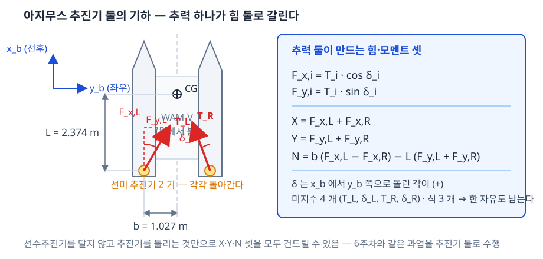

| 기호 | 뜻 | 값 · 출처 |
|---|---|---|
| $b$ | 선체 중심선에서 추진기까지의 **반폭** | 1.027135 m (`wamv_lite.urdf`) |
| $L$ | 무게중심에서 추진기까지의 **전후 거리** | 2.373776 m (`wamv_lite.urdf`) |
| $T_i$ | 추진기 $i$ 의 추력 크기 | $|T_i| \le 500$ N |
| $\delta_i$ | 추진기 $i$ 의 **방향각** | $|\delta_i| \le 45°$ (설계 전제) |

- 추진기 하나가 내는 힘을 선체 좌표 두 성분으로 쪼갬

$$F_{x,i} = T_i \cos\delta_i, \qquad F_{y,i} = T_i \sin\delta_i$$

- 선체에 걸리는 **렌치** 세 성분

$$X = F_{x,L} + F_{x,R}$$

$$Y = F_{y,L} + F_{y,R}$$

$$N = b\,(F_{x,L} - F_{x,R}) - L\,(F_{y,L} + F_{y,R})$$

- $N$ 식의 두 항을 따로 읽을 것

| 항 | 무엇이 만드는 모멘트 | 부호 |
|---|---|---|
| $b\,(F_{x,L} - F_{x,R})$ | 좌우 **전후 추력의 차이** — 한쪽을 더 밀어 돌림 | 좌측이 크면 $+$ |
| $-L\,(F_{y,L} + F_{y,R})$ | **선미에 걸리는 횡력** — 선미가 밀리면 선수가 반대로 돌아감 | 우현으로 밀면 $-$ |

> [!warning] 선미 횡력은 반드시 선수를 돌린다
> - 추진기가 무게중심이 아니라 **선미 $L$ = 2.374 m 뒤**에 있음
> - 옆으로 밀면 그 힘이 그대로 **모멘트 팔 $L$** 을 얻음
> - 따라서 "횡력만 내고 선회는 내지 않기" 는 두 추진기를 **따로** 써야만 됨 — 1-4 절

- 미지수 네 개 ($T_L$, $\delta_L$, $T_R$, $\delta_R$) 에 식 세 개 → **한 자유도가 남음**

## 1-3 배분 — 수도인버스 하나로 끝난다

- 방향각이 식 안에서 $\cos$ · $\sin$ 으로 들어가므로 식 자체는 **비선형**임
- 그러나 **$F_x$ · $F_y$ 를 미지수로 보면 완전히 선형**임 — 이것이 이 배분을 간단하게 만드는 전부임

$$\mathbf{u} = \begin{bmatrix} F_{x,L} & F_{y,L} & F_{x,R} & F_{y,R} \end{bmatrix}^\mathsf{T}, \qquad
\boldsymbol{\tau} = \begin{bmatrix} X \\ Y \\ N \end{bmatrix} = \mathbf{B}\,\mathbf{u}$$

$$\mathbf{B} = \begin{bmatrix} 1 & 0 & 1 & 0 \\ 0 & 1 & 0 & 1 \\ b & -L & -b & -L \end{bmatrix}$$

- 최소 노름 해는 수도인버스 하나로 끝남

$$\mathbf{u} = \mathbf{B}^{+}\,\boldsymbol{\tau}$$

- 이 해를 손으로 풀면 **닫힌식 네 줄**이 나옴 — 반복 계산도, 최적화 풀이도 필요하지 않음

$$C = \frac{L\,Y + N}{2b}$$

$$F_{x,L} = \frac{X}{2} + C, \qquad F_{x,R} = \frac{X}{2} - C, \qquad F_{y,L} = F_{y,R} = \frac{Y}{2}$$

- 코드도 네 줄임 (`parts/azAllocFcn.m`)

```matlab
C    = (l_thr*Yd + Nd) / (2*half_beam);
FxL  = Xd/2 + C;
FxR  = Xd/2 - C;
FyL  = Yd/2;   FyR = Yd/2;
```

- 이어서 **극좌표로 바꾸면** 실제 지령이 나옴

```matlab
TL = hypot(FxL, FyL);   dL = atan2(FyL, FxL);
TR = hypot(FxR, FyR);   dR = atan2(FyR, FxR);
```

> [!important] 교수 질문 (c) 에 대한 답 — 배분은 가장 간단한 꼴로 끝난다
> - 행렬 하나와 닫힌식 네 줄. 반복 풀이·QP·최적화 솔버가 **없음**
> - 추가로 들어가는 것은 1-6 절의 **한 줄 보정**뿐임
> - MATLAB Function 블록 하나에 전부 들어감 → 코드 생성에도 걸림돌이 없음

## 1-4 순수 횡이동 — 23.40° 와 추력 반전

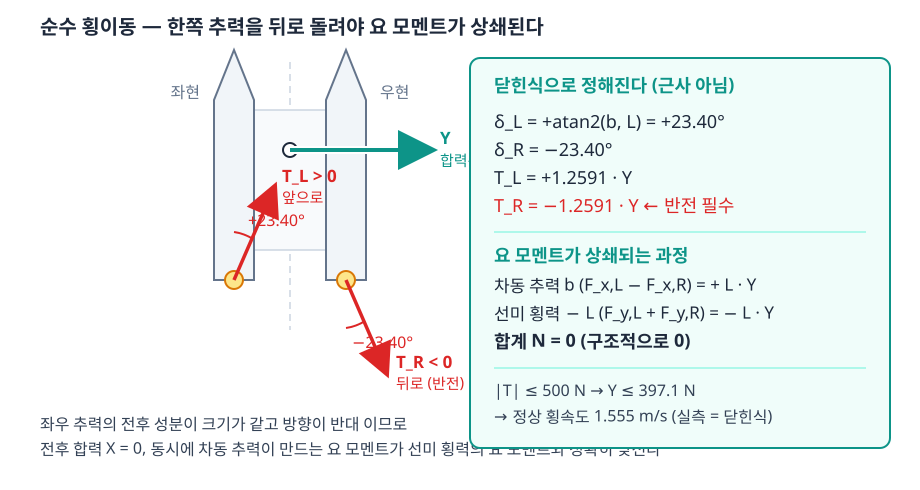

- 순수 횡이동 = $X = 0$, $N = 0$, $Y \ne 0$ 을 요구하는 경우임
- 닫힌식에 그대로 넣으면

$$C = \frac{L\,Y}{2b}, \qquad F_{x,L} = +\frac{L\,Y}{2b}, \quad F_{x,R} = -\frac{L\,Y}{2b}, \quad F_{y,L} = F_{y,R} = \frac{Y}{2}$$

- 극좌표로 바꾸면 방향각과 추력이 **$Y$ 와 무관한 상수**로 정해짐

$$\delta_L = +\arctan\frac{b}{L} = +23.3982°, \qquad \delta_R = -23.3982°$$

$$T_L = +k_T\,Y, \qquad T_R = -k_T\,Y, \qquad k_T = \frac{\sqrt{b^2+L^2}}{2b} = 1.259069$$

| 읽는 법 | 뜻 |
|---|---|
| 두 방향각의 **부호가 반대** | 좌현 추진기는 앞-우현, 우현 추진기는 뒤-우현을 향함 |
| 두 추력의 **부호가 반대** | 한쪽은 밀고 한쪽은 **당김** → 추력 반전이 필수 |
| $k_T = 1.259$ | 횡력 1 N 을 내려면 추진기마다 1.259 N 이 필요함 — 비용 26 % |
| 23.40° 는 고정 | $Y$ 를 키워도 각도는 바뀌지 않음. 추력 크기만 커짐 |

### 요 모멘트가 구조적으로 0 이 되는 과정

- $N$ 식의 두 항을 각각 계산

| 항 | 값 |
|---|---|
| 차동 추력 $b\,(F_{x,L}-F_{x,R})$ | $b \cdot 2 \cdot \dfrac{L\,Y}{2b} = +L\,Y$ |
| 선미 횡력 $-L\,(F_{y,L}+F_{y,R})$ | $-L \cdot Y = -L\,Y$ |
| 합계 $N$ | $\mathbf{0}$ |

> [!important] 순수 횡이동의 선수각 오차 0 은 **제어가 잘 된 결과가 아니다**
> - 두 항이 **정확히 상쇄**되므로 요 모멘트는 애초에 발생하지 않음
> - 즉 흔들 것이 없는 상태에서 "흔들리지 않는다" 를 관측한 것임
> - **외란을 걸어야 검증이 됨** — 2-3 절에서 조류 0.6 m/s 를 걸어 다시 잼

### 낼 수 있는 최대 횡력과 최대 횡속도

- 추력 한계 $|T| \le 500$ N 을 $k_T$ 로 나눔

$$Y_{\max} = \frac{500}{1.259069} = 397.1\ \text{N}$$

- 정상 횡속도는 항력식 $Y_v\,v + Y_{vv}\,v|v| = Y_{\max}$ 의 해임 ($Y_v = Y_{vv} = 100$)

$$v_{ss} = \frac{-Y_v + \sqrt{Y_v^2 + 4\,Y_{vv}\,Y_{\max}}}{2\,Y_{vv}} = 1.555\ \text{m/s}$$

- **실측 1.555 m/s · 닫힌식 1.555 m/s · 차이 0.000 m/s** (2-3 절)

## 1-5 ±45° 한계는 요구 공간에 쐐기를 만든다

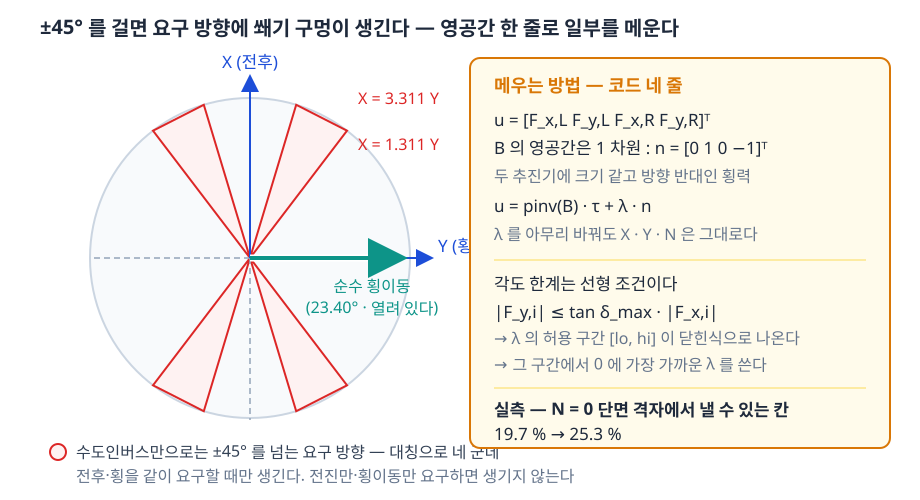

- 각도 한계는 **선형 부등식**으로 바뀜 — 이것이 다루기 쉬운 이유임

$$|\delta_i| \le \delta_{\max} \iff |F_{y,i}| \le \tan\delta_{\max}\,|F_{x,i}|$$

- 수도인버스 해를 넣고 $N = 0$ 단면에서 풀면 **쐐기 경계**가 닫힌식으로 나옴

$$\frac{X}{Y} = 2\left(\frac{L}{2b} \mp \frac{\tan\delta_{\max}}{2}\right) \;\Rightarrow\; 1.3111 \;\sim\; 3.3111$$

| 요구 | 가능한가 |
|---|---|
| 전진만 ($Y = 0$) | 가능 — 방향각 0° |
| 횡이동만 ($X = 0$) | 가능 — 방향각 23.40° |
| 전진 + 횡이동, $1.3111\,Y < X < 3.3111\,Y$ | **불가** — 수도인버스 해가 45° 를 넘음 |
| 그 밖 | 가능 |

- 방향으로 읽으면 $\theta = \arctan(Y/X)$ 가 **16.8° \~ 37.3°** 구간임
- 대칭으로 **네 군데**에 생김 (전진·후진 × 좌·우)

> [!warning] 쐐기에 들어가도 오류 메시지는 뜨지 않는다
> - 배분은 계산을 끝내고 값을 내보냄. 다만 **각도가 한계에서 잘림**
> - 잘린 각도로 난 힘은 요구한 힘이 아님 → 배가 요구와 다르게 움직임
> - 따라서 **요구한 $\tau$ 와 실제로 난 $\tau$ 의 차이("못 낸 힘")를 항상 함께 기록**해야 함
> - 본 부록의 모든 실행이 이 값을 출력함 → [[측정하지-않은-성공은-성공이-아니다]]

## 1-6 남는 자유도 하나 — 영공간 한 줄 보정

- $\mathbf{B}$ 의 영공간은 **1차원**이고, 그 벡터는 다음 하나임

$$\mathbf{n} = \begin{bmatrix} 0 & 1 & 0 & -1 \end{bmatrix}^\mathsf{T}$$

- 뜻: 좌현에 $+\lambda$, 우현에 $-\lambda$ 의 **횡력을 더해도** $X$ · $Y$ · $N$ 이 하나도 바뀌지 않음
  - $Y$ 는 더해져 0, $N$ 의 선미 횡력 항도 더해져 0
- 따라서 해 전체는 한 변수 $\lambda$ 의 직선임

$$\mathbf{u}(\lambda) = \mathbf{B}^{+}\boldsymbol{\tau} + \lambda\,\mathbf{n}$$

- 각도 한계 두 개를 $\lambda$ 에 대한 부등식으로 풀면 **허용 구간 $[\lambda_{lo},\ \lambda_{hi}]$** 가 나옴
- 그 구간에서 **0 에 가장 가까운 값**을 고름 (추력을 괜히 키우지 않음)

```matlab
lam = min(max(0, lo), hi);          % 구간 안에서 0 에 가장 가까운 값
if lo > hi, lam = (lo + hi)/2; end  % 구간이 비면 애초에 낼 수 없는 요구
```

| 효과 | 수치 (실측 · 2-7 절) |
|---|---|
| $N = 0$ 단면 격자에서 낼 수 있는 칸 (수도인버스 그대로) | 19.7 % |
| 영공간 한 줄 보정을 더한 뒤 | **25.3 %** |

- 코드로는 **세 줄**이 늘어난 것이 전부임 — 질문 (c) 의 "가장 간단하게" 를 지킴

## 1-7 배분 사슬 전체

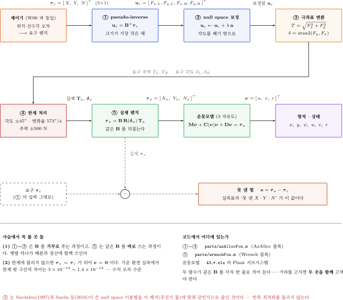

| 칸 | 하는 일 | 유의 사항 |
|---|---|---|
| 요구 $\boldsymbol{\tau}$ | 제어기가 낸 $X$ · $Y$ · $N$ | — |
| $\mathbf{B}^{+}\boldsymbol{\tau}$ | 닫힌식 네 줄 | 반복 없음 |
| 영공간 보정 $\lambda$ | 각도 포화를 피함 | 구간이 비면 낼 수 없는 요구 |
| 극좌표 변환 | $T_i$ · $\delta_i$ | $|\delta| \le 90°$ 로 접고 $T < 0$ 을 허용 |
| 추력 한계 | $|T| \le 500$ N | 좌우를 **같은 비율**로 줄임 (방향 유지) |
| 변화율 제한 | 모터가 돌아가는 속도 | URDF 값 10 rad/s = 573 °/s |
| 실제 난 $\boldsymbol{\tau}$ | $\mathbf{B}\,\mathbf{u}_{\text{실제}}$ | 요구와의 차이가 "못 낸 힘" |

> [!note] 방향각을 ±90° 로 접는 이유
> - $\delta = 170°$ 와 "$\delta = -10°$ 에 추력 반전" 은 **같은 힘**임
> - 뒤쪽을 택하면 모터가 한 바퀴 돌 필요가 없어짐 — 각도 기억도 필요 없음
> - `atan2(Fy, Fx)` 가 ±180° 를 내면 추력 부호를 뒤집어 ±90° 안으로 접음
> - 접은 뒤 변화율 제한을 걸면 각도가 끊기지 않음

## 1-8 이 부록이 답하는 세 질문

| # | 질문 | 어디서 | 답 (2부의 실측 요약) |
|---|---|---|---|
| (a) | 순수 횡이동 중 선수각이 유지되는가, 흔들리는가 | 2-3 | 조류 0.6 m/s 를 걸고도 **RMS 0.0015°** — 유지됨 |
| (b) | 6주차처럼 $(x,\ y,\ \psi)$ 셋을 세울 수 있는가 | 2-4 | **됨** — 26.0 s 에 도착, 마지막 선수각 오차 0.00° |
| (c) | 배분을 가장 간단하게 유지할 수 있는가 | 1-3 · 1-6 | **됨** — 수도인버스 닫힌식 + 영공간 한 줄 |

---

# 2부 · 실습

## 2-1 폴더와 파일

- 실습 폴더로 이동 (MATLAB 명령창)

```matlab
cd(fullfile('10-주차별-강의자료','A3_azimuth'))
```

| 파일 | 하는 일 |
|---|---|
| `A3_setup.m` | 제원·게인·한계를 base 워크스페이스에 깖. **모든 실행의 출발점** |
| `build_a3_models.m` | 모델 셋을 **전부 다시 만듦** (`tidy_layout` 두 번 포함) |
| `A3_1_crab.slx` | 1단 — 순수 횡이동 |
| `A3_2_pose.slx` | 2단 — 위치·선수각 유지 |
| `A3_3_dock.slx` | 3단 — 단계 전이 접안 |
| `A3_1_crab_run.m` \~ `A3_4_limit_run.m` | 단마다 **한 줄로 돌리는 실행 스크립트** |
| `A3_plot.m` | 결과 그림과 지표를 냄. 네 실행 스크립트가 같이 씀 |
| `A3_envelope.m` | ±45° **도달 가능 집합**을 격자로 재고 그림 |
| `A3_shots.m` | 본 문서에 실린 결과 그림을 다시 찍음 |
| `parts/` | 모델 생성 조각 (`addAzAlloc.m`, `azAllocFcn.m` 등) |

> [!tip] 실행 스크립트의 머리말을 먼저 읽을 것
> - `help A3_1_crab_run` 으로 읽힘
> - 무엇을 재는지, 어떤 값을 보면 되는지 머리말에 적혀 있음

- 모델을 새로 만듦 (한 번만. 모델을 망가뜨렸을 때도 이 한 줄)

```matlab
build_a3_models
```

## 2-2 모델 구조 — 6주차와 한 블록만 다르다

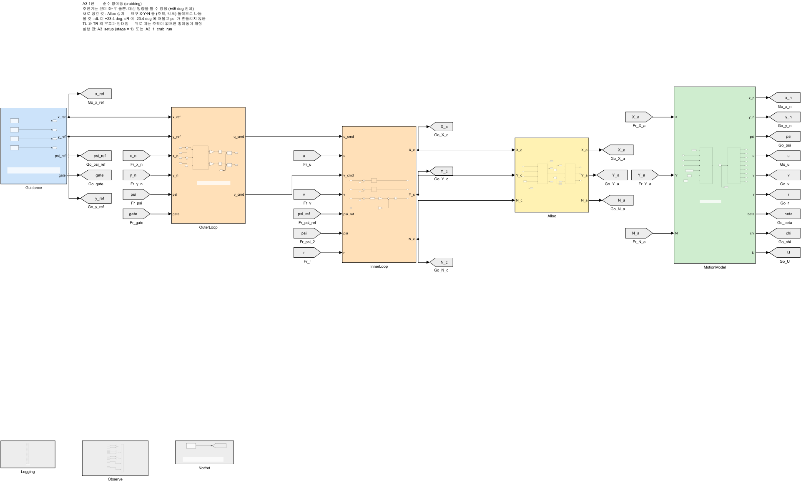

| 색 | 블록 | 6주차와 비교 |
|---|---|---|
| 파랑 | `Guidance` — 목표점·목표 선수각 | 같음 |
| 주황 | `OuterLoop` · `InnerLoop` — 위치 P → 속도 PI, 선수각 P–D | **게인까지 같음** |
| 노랑 | `Alloc` — 추력 배분 | **여기만 다름** |
| 초록 | `MotionModel` — 3자유도 운동모델 | 같음 (선형 + 2차 항력) |
| 회색 | `Logging` · `Animate` | 같음 |

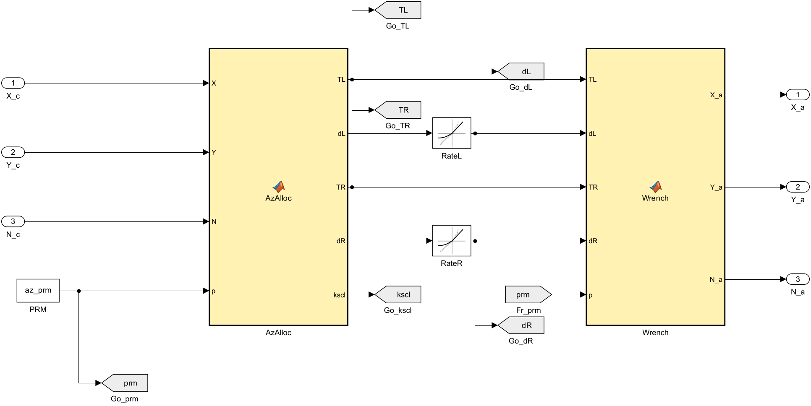

- 바뀐 블록은 `Alloc` 하나임
  - 6주차: 추력 셋을 내는 선형 배분
  - 본 부록: 추력 둘 + **방향각 둘**을 내는 배분 (1-7 절의 사슬)

> [!important] 운동모델을 손대지 않은 것이 이 비교의 전제
> - 질량 226.5 kg · 관성 653 kg·m² · 항력계수 전부 6주차 값
> - 따라서 본 부록의 수치 차이는 **배분 때문**이라고 말할 수 있음

## 2-3 1단 — 순수 횡이동 (질문 a)

```matlab
A3_1_crab_run
```

- 과업: 선수각 0° 를 유지한 채 **동쪽으로 12 m** 이동
- 스크립트가 **세 번** 돌림 — 기준 · 추력 한계까지 · 조류를 걸고

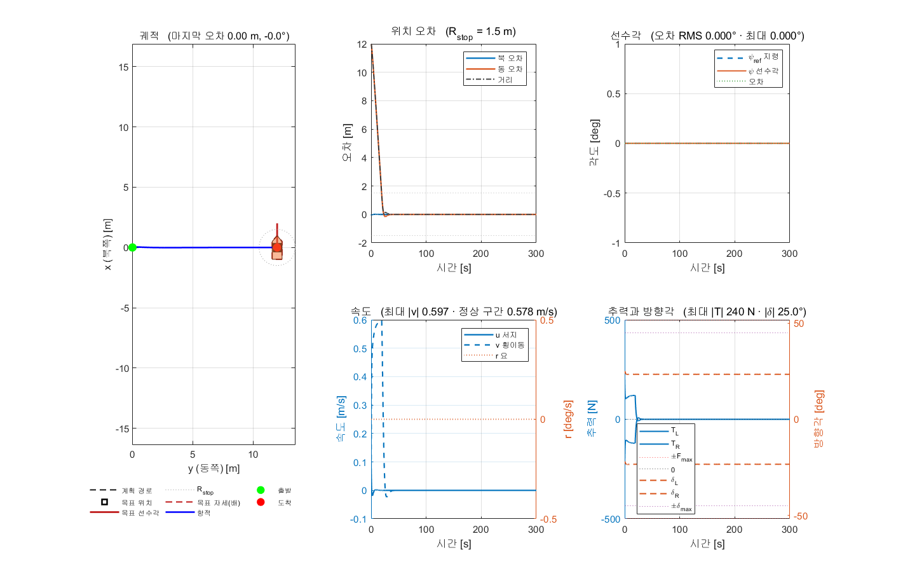

### 첫 번째 — 기준 (조류 없음)

| 항목 | 실측 | 읽는 법 |
|---|---|---|
| 선수각 오차 RMS | **0.0000°** | 1-4 절의 상쇄가 그대로 나타남 |
| 선수각 오차 최대 | 0.0000° | |
| 방향각 평균 | **23.401°** | 닫힌식 23.398° 와 일치 |
| 방향각 최대 | 25.001° | 가감속 구간에서만 벗어남 |
| 횡속도 정상 구간 | 0.578 m/s | 지령 한계 0.60 m/s |
| 마지막 $|x_n|$ | 0.0000 m | 전후로 밀리지 않음 |
| 최대 $|T|$ | 240.5 N | 한계 500 N |
| 각도 포화 · 추력 포화 | 0.0 % · 0.0 % | 한계에 닿지 않음 |
| 못 낸 힘 | $X$ 0.00 · $Y$ 0.00 N · $N$ 0.00 N·m | 요구를 그대로 냄 |

- 방향각 실측 23.401° 가 닫힌식 $\arctan(b/L)$ = 23.398° 와 맞음 → 배분이 의도대로 동작함

### 두 번째 — 추력 한계까지 밀었을 때

- 속도 지령 한계를 3.0 m/s 로 풀고 목표를 200 m 로 멀리 둠

| 항목 | 값 |
|---|---|
| 실측 정상 횡속도 | **1.555 m/s** |
| 닫힌식 (1-4 절) | 1.555 m/s |
| 차이 | 0.000 m/s |
| 이때 최대 $|T|$ | 500.0 N (한계에 붙음) |
| 선수각 오차 RMS | 0.0000° |

> [!tip] 이 대조가 이 실습의 핵심 검증임
> - 닫힌식과 시뮬레이션이 **독립적으로** 같은 값을 냄
> - 배분·운동모델·항력계수 어느 쪽에 오타가 있어도 이 값이 어긋남

### 세 번째 — 조류를 걸었을 때 (질문 a 의 실제 답)

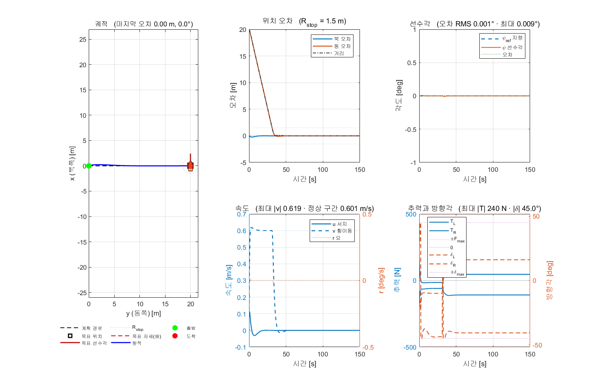

- 조류 **0.6 m/s · 45° (NED)** — 선수각을 비틀려는 외란을 일부러 넣음

| 항목 | 조류 없음 | 조류 0.6 m/s · 45° |
|---|---|---|
| 선수각 오차 RMS | 0.0000° | **0.0015°** |
| 선수각 오차 최대 | 0.0000° | 0.0092° |
| 방향각 평균 | 23.401° | **26.540°** |
| 방향각 최대 | 25.001° | **45.00°** (한계) |
| 각도 포화 | 0.0 % | **3.4 %** |
| 못 낸 힘 $X$ · $Y$ · $N$ | 0.00 · 0.00 · 0.00 | 0.55 N · 1.01 N · 2.97 N·m |
| 마지막 $|x_n|$ | 0.0000 m | 0.000 m |

> [!important] 질문 (a) 에 대한 답 — 선수각은 유지됨
> - 외란을 건 상태에서도 선수각 오차 **RMS 0.0015° · 최대 0.0092°** 임
> - 조류가 더한 전진 성분을 상쇄하느라 방향각이 23.40° → 26.54° 로 기울어짐
> - 전체 시간의 **3.4 %** 는 45° 한계에 붙음 → ±45° 전제가 **처음으로 걸리는 지점**임
> - 못 낸 힘은 $Y$ 1.01 N 수준 (요구의 1 % 미만) — 과업 수행에는 영향이 없음

## 2-4 2단 — 위치·선수각 유지 (질문 b)

```matlab
A3_2_pose_run
```

- 과업: $(x_n,\ y_n)$ = (30, 20) m 에 **선수각 45°** 로 서서 멈춤
- 6주차 5단과 **같은 과업 · 같은 게인**임

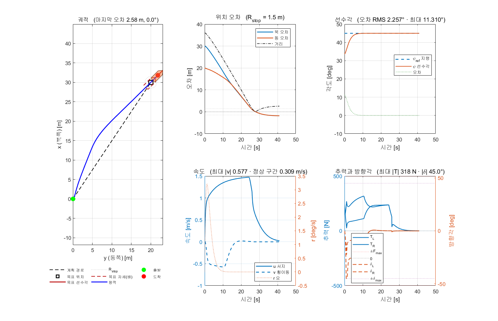

| 항목 | 실측 |
|---|---|
| 도착 시각 | **26.0 s** |
| 도착 순간 위치 오차 | 1.483 m (판정선 1.5 m) |
| 그 뒤 타성 | $+1.093$ m |
| 마지막 위치 오차 | 2.576 m |
| 마지막 10 초 평균 | 2.206 m · **0.00°** |
| 선수각 오차 RMS · 최대 | 2.2574° · 11.3099° |
| 최대 $|T|$ | 317.7 N |
| 각도 포화 · 추력 포화 | 1.5 % · 0.0 % |
| 못 낸 힘 | $X$ 0.00 · $Y$ 0.00 N · $N$ 0.00 N·m |

> [!warning] 마지막 위치 오차 2.576 m 는 배분의 잘못이 아니다
> - 도착 판정이 걸리면 속도 지령이 0 이 됨. **제동력을 걸지 않음**
> - 따라서 배는 항력으로만 멈추며, 그 사이 1.093 m 를 더 감
> - 6주차의 도착 판정을 그대로 쓴 결과이며 두 주차에서 동일하게 나타남
> - 배분 성능을 볼 값은 **도착 순간 오차(1.483 m)** 와 **못 낸 힘(0.00)** 임

### 목표 선수각을 바꿔 가며

- 목표점 방향(33.7°)과 목표 선수각이 **얼마나 어긋나는가**가 난이도를 정함

| 목표 $\psi$ | 도착 [s] | 도착 순간 오차 [m] | 마지막 10 초 [m] | $\psi$ 오차 RMS [°] | 최대 $\delta$ [°] | 각도 포화 [%] |
|---|---|---|---|---|---|---|
| 0° | 30.9 | 1.484 | 0.970 | 6.479 | 45.00 | 5.0 |
| 45° | **26.0** | 1.483 | 2.206 | **2.257** | 45.00 | 1.5 |
| 90° | 45.9 | 1.476 | 0.595 | 9.569 | 45.00 | 2.8 |

- 세 경우 모두 도착하고 마지막 선수각 오차는 0.000° 임
- 어긋남이 클수록 느려지고 각도 포화가 늘어남 — 1-5 절의 쐐기를 밟기 때문임

> [!important] 질문 (b) 에 대한 답 — 셋을 동시에 세울 수 있다
> - 세 목표 선수각 모두에서 도착 판정이 걸리고 선수각을 끝까지 유지함
> - 선수추진기 없이 **6주차와 같은 과업**이 수행됨

## 2-5 3단 — 단계 전이 접안

```matlab
A3_3_dock_run
```

- 선석 (40.0, 45.0) m · 선수각 0° · 댈 현 우현
- 접근점 (40.0, 60.0) m — 선석에서 15 m 떨어진 자리

| 단계 | 하는 일 | 선수각 |
|---|---|---|
| 1 | 접근점으로 간다 | 가는 방향 (저항이 작음) |
| 2 | 접근점에 머물며 선수각만 돌린다 | 접안 선수각으로 |
| 3 | 선수각을 지킨 채 **옆걸음으로** 선석에 들어간다 | 고정 |

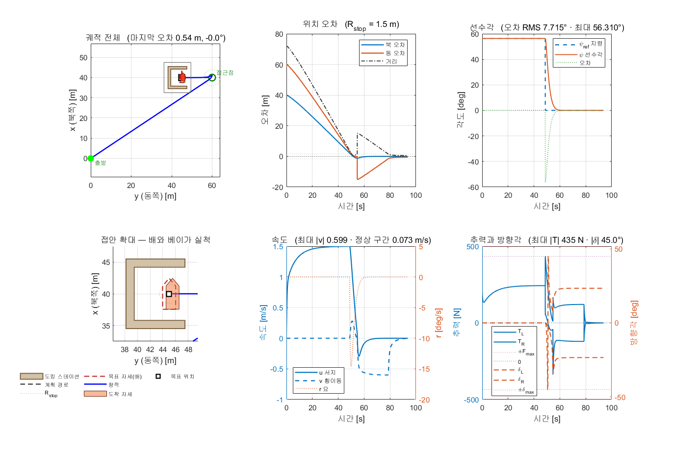

| 항목 | 실측 |
|---|---|
| 단계 1 도달 (접근점) | 48.7 s |
| 단계 2 도달 (선수각 정렬) | 54.7 s |
| 단계 3 도달 (선석) | **78.7 s** |
| 마지막 위치 오차 | 0.545 m (판정선 1.5 m) |
| 마지막 10 초 | 0.591 m · **0.000°** |
| 최대 $|T|$ | 434.8 N |
| 각도 포화 · 추력 포화 | 0.5 % · 0.0 % |
| 못 낸 힘 | $X$ 0.81 · $Y$ 1.49 N · $N$ 4.37 N·m |

- **옆걸음 구간만** 따로 잼 (단계 3 · 54.7 \~ 78.7 s) — 이 구간이 아지무스 추진기의 몫임

| 항목 | 실측 | 대조 |
|---|---|---|
| 선수각 오차 RMS | 0.953° | 24 초간 선수각을 지킴 |
| 선수각 오차 최대 | 4.981° | |
| 방향각 평균 | **23.38°** | 닫힌식 23.40° 와 일치 |
| 횡속도 평균 | 0.565 m/s | 지령 0.60 m/s |

### 단계를 나누지 않으면 — `dock_on = 0`

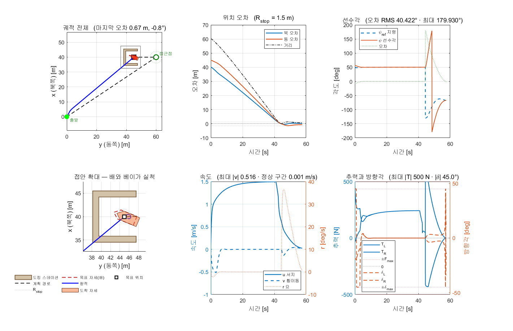

| 경우 | 마지막 10 초 위치 [m] | 마지막 10 초 선수각 [°] | $\psi$ RMS [°] | 각도 포화 [%] | 추력 포화 [%] |
|---|---|---|---|---|---|
| 세 단계 (`dock_on = 1`) | 0.591 | **0.000** | 7.715 | 0.5 | 0.0 |
| 직행 (`dock_on = 0`) | 1.007 | **43.916** | 40.422 | 5.3 | 3.1 |

- 직행은 선석에 **43.9° 비스듬히** 닿음 — 접안이라 부를 수 없는 결과임
- 직행의 못 낸 힘은 $N$ **143.32 N·m** 에 달함 (세 단계는 4.37 N·m)

> [!important] 과업을 단계로 나누는 것이 배분보다 먼저다
> - 같은 배·같은 게인·같은 배분으로 결과가 이만큼 갈림
> - 요구를 **한 번에 셋 다** 내려고 하면 쐐기 구간에 들어감 (1-5 절)
> - 단계로 나누면 각 구간의 요구가 단순해져 쐐기를 피함

## 2-6 4단 — 무엇을 빼면 깨지는가

```matlab
A3_4_limit_run
```

- 설정값을 **하나씩만** 바꿔 같은 과업을 다시 돌림. 새 모델을 만들지 않음

| 바꾼 것 | 설정 | 뜻 |
|---|---|---|
| 추력 반전 금지 | `rev_on = 0` | 추진기가 앞으로만 밂 |
| 각도 한계 ±15° | `d_max_deg = 15` | 설계 전제를 더 보수적으로 |
| 변화율 30 °/s | `d_rate_deg = 30` | 모터가 느리게 돌아감 (기본 573 °/s) |
| 영공간 보정 끔 | `split_on = 0` | 수도인버스 그대로 — 가장 간단한 배분 |

### 1단 과업 (순수 횡이동 12 m) 에서

| 바꾼 것 | $\psi$ RMS [°] | $\psi$ 최대 [°] | 횡속도 [m/s] | 최대 $\delta$ [°] | 각도 포화 [%] | 못 낸 힘 [N] |
|---|---|---|---|---|---|---|
| 기준 | 0.000 | 0.000 | 0.578 | 25.00 | 0.0 | 0.00 |
| **추력 반전 금지** | **174.197** | 180.000 | 0.172 | 45.00 | 50.8 | **1826.39** |
| **각도 한계 ±15°** | **17.444** | 107.494 | 0.373 | 15.00 | 88.3 | **309.97** |
| 변화율 30 °/s | 0.000 | 0.000 | 0.578 | 25.00 | 0.0 | 0.00 |
| 영공간 보정 끔 | 0.000 | 0.000 | 0.578 | 25.00 | 0.0 | 0.00 |

- **추력 반전 금지** — 과업이 성립하지 않음
  - 1-4 절에서 우현 추력이 $-1.259\,Y$ 였음. 반전을 막으면 이 해를 낼 수 없음
  - 배가 12 m 목표에서 **408.7 m** 떨어진 자리까지 밀려가고 선수각이 180° 돌아감
  - 추력 포화 99.7 % — 전 구간에서 한계에 붙어 있음
- **각도 한계 ±15°** — 순수 횡이동 자체가 불가능해짐
  - 필요한 방향각이 23.40° 인데 한계가 15° 임
  - 전체 시간의 88.3 % 를 한계에 붙어 보냄
- **변화율 · 영공간 보정** — 1단에서는 차이가 없음
  - 순수 횡이동의 방향각은 상수이므로 변화율이 걸릴 일이 없음
  - 순수 횡이동의 영공간 보정량은 0 이므로 꺼도 같은 해임

### 2단 과업 (위치·선수각) 에서

| 바꾼 것 | 도착 [s] | 위치 오차 [m] | $\psi$ RMS [°] | 최대 $\delta$ [°] | 각도 포화 [%] | 못 낸 힘 [N] |
|---|---|---|---|---|---|---|
| 기준 | 26.0 | 2.206 | 2.257 | 45.00 | 1.5 | 0.00 |
| 추력 반전 금지 | 26.0 | 2.206 | 2.257 | 45.00 | 1.5 | 0.00 |
| **각도 한계 ±15°** | 26.1 | 2.207 | 2.876 | 15.00 | **24.2** | **45.71** |
| **변화율 30 °/s** | 26.1 | 2.214 | 2.386 | 44.29 | 0.0 | **23.07** |
| **영공간 보정 끔** | 26.0 | 2.203 | 2.286 | 45.00 | 1.8 | **30.44** |

> [!important] 한 과업만 돌리면 절반을 놓친다
> - 1단은 요구가 $Y$ 하나뿐임 → **추력 반전**의 필요성이 드러남
> - 2단은 요구가 $X$ · $Y$ · $N$ 셋임 → **영공간 보정 · 변화율**의 값어치가 드러남
> - 두 과업을 모두 돌려야 네 한계의 역할이 전부 보임

- **영공간 보정을 끄면** 못 낸 힘이 0.00 → 30.44 N 으로 늘어남 — 1-6 절 한 줄 보정의 값어치
- **변화율을 1/20 로 낮추면** 각도가 45° 에 닿지 못하고 (최대 44.29°) 못 낸 힘 23.07 N 이 생김
- 네 경우 모두 **도착은 함** — 오류 메시지 없이 성능만 깎임. 그래서 못 낸 힘을 기록해야 함

## 2-7 ±45° 도달 가능 집합

```matlab
A3_envelope
```

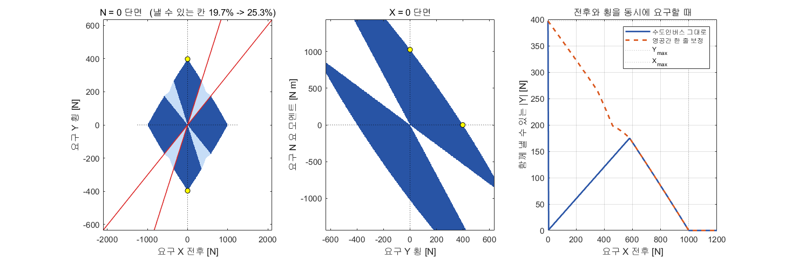

| 항목 | 값 |
|---|---|
| 반폭 $b$ · 거리 $L$ | 1.027135 m · 2.373776 m |
| 추력 한계 · 각도 한계 | 500 N · ±45° |
| 횡력 환산비 $k_T$ | 1.259069 N/N |
| 순수 횡이동 방향각 | 23.3982° |
| 낼 수 있는 한계 $X$ | 1000 N |
| 낼 수 있는 한계 $Y$ | **397.1 N** |
| 낼 수 있는 한계 $N$ | 1027.1 N·m |
| 쐐기 구간 $X/Y$ | 1.3111 \~ 3.3111 |
| $N = 0$ 단면 격자 — 수도인버스 그대로 | 19.7 % |
| $N = 0$ 단면 격자 — 영공간 보정 뒤 | **25.3 %** |
| 영공간 차원 · 벡터 | 1 · $[0\ 1\ 0\ -1]^\mathsf{T}$ |

> [!important] 이 표가 설계 전제 ±45° 의 값어치를 정한다
> - 세 축을 **동시에** 크게 요구하면 ±45° 를 넘음 — 격자의 3/4 가 닿지 않음
> - 그러나 실제 과업(1\~3단)의 요구는 한계보다 훨씬 작음 — 최대 $|T|$ 가 240.5 \~ 434.8 N
> - 즉 **±45° 는 본 과목의 과업에 충분함**. 한계에 닿는 경우는 외란이 걸릴 때의 3.4 % 수준임
> - 각도 한계를 ±15° 로 줄이면 순수 횡이동 자체가 불가능해짐 (2-6 절)

## 2-8 Gazebo(VRX) 연동 — 다음 단계

> [!note] 본 절은 **자리만 잡아 둔 것**임 — 아직 실행하지 않음
> - 1\~4단은 전부 **오프라인 운동모델**임. Gazebo 를 띄우지 않음
> - 오프라인 결과를 먼저 확정한 뒤 VRX 로 넘어가는 순서임
> - 따라서 본 절에는 **측정값을 적지 않음**. 실행 뒤 갱신 예정임

- VRX 연동에서 확인할 것 (예정)

| # | 확인할 것 |
|---|---|
| 1 | `wamv/thrusters/<side>/pos` 로 방향각 지령이 실제로 전달되는지 |
| 2 | 방향각 관절의 응답 속도가 URDF 값(10 rad/s)과 맞는지 |
| 3 | 순수 횡이동의 방향각이 실제로 23.40° 부근인지 |
| 4 | 오프라인 대비 횡속도·선수각 오차의 이격 |
| 5 | 파랑·바람 외란에서 각도 포화 비율 |

> [!note] URDF 수정은 필요하지 않음
> - 3주차 `W03_vrx_lite/wamv_lite.urdf` 의 선미 추진기 관절은 이미 `revolute` · `axis 0 0 1` · 한계 ±π 임
> - 방향각 지령 토픽 `wamv/thrusters/<side>/pos` 도 이미 존재함
> - 본 부록의 ±45° 는 **제어기 쪽 설계 전제**이며, URDF 한계와는 별개임

---

## 이번 부록 요약

| 묻는 것 | 답 | 근거 (실측) |
|---|---|---|
| 순수 횡이동의 방향각 | 고정값 23.40° | 실측 평균 23.401° |
| 순수 횡이동의 추력 | 횡력의 1.259 배 · **부호 반대** | 반전 금지 시 408.7 m 이탈 |
| 횡이동 중 선수각 | 유지됨 | 조류를 걸고 RMS 0.0015° |
| 최대 횡력 · 최대 횡속도 | 397.1 N · 1.555 m/s | 닫힌식과 차이 0.000 m/s |
| $(x,\ y,\ \psi)$ 동시 유지 | 됨 | 26.0 s 도착 · 마지막 선수각 0.00° |
| 접안 | 됨 (단계를 나눌 때) | 78.7 s · 0.591 m · 0.000° |
| 배분의 복잡도 | 닫힌식 네 줄 + 한 줄 보정 | 반복 풀이 없음 |
| ±45° 전제 | 본 과목 과업에 충분 | 과업 중 각도 포화 0.0 \~ 5.3 % |
| 반드시 필요한 것 | **추력 반전** | 금지하면 과업 자체가 불가 |

## 수업 진도 체크

> [!important] 다음 단계(VRX 연동)를 따라가기 위한 최소 조건

### 이론 이해

- [ ] 아지무스 추진기에서 미지수가 넷, 식이 셋임을 말할 수 있다
- [ ] $N$ 식의 두 항(차동 추력 · 선미 횡력)을 각각 설명할 수 있다
- [ ] 순수 횡이동의 방향각 $\arctan(b/L)$ = 23.40° 를 손으로 계산했다
- [ ] 순수 횡이동에서 $N$ 이 구조적으로 0 이 되는 상쇄를 적을 수 있다
- [ ] 영공간 벡터 $[0\ 1\ 0\ -1]^\mathsf{T}$ 가 무엇을 바꾸지 않는지 말할 수 있다

### 실습 완료

- [ ] `build_a3_models` 가 오류 없이 끝났다
- [ ] `A3_1_crab_run` 의 방향각 평균이 23.4° 부근으로 나왔다
- [ ] `A3_1_crab_run` 의 실측 횡속도와 닫힌식 차이가 0.01 m/s 이내다
- [ ] `A3_2_pose_run` 에서 도착 판정이 걸렸다
- [ ] `A3_3_dock_run` 에서 단계 세 개가 모두 올라갔다
- [ ] `A3_4_limit_run` 의 표 두 개를 받았다
- [ ] `A3_envelope` 의 도달 가능 집합 그림을 봤다

### 관찰 기록

- [ ] 조류를 걸었을 때 방향각 평균이 몇 도로 기울었는지 적었다
- [ ] 추력 반전을 금지했을 때 배가 어디로 갔는지 적었다
- [ ] 각도 한계를 ±15° 로 줄였을 때 각도 포화 비율을 적었다
- [ ] 네 실행의 **못 낸 힘** 값을 전부 적었다

### 신고 사항

- [ ] `build_a3_models` 가 특정 단에서 멈추면 단 번호와 오류 메시지를 보고했다
- [ ] 수치가 본 문서의 값과 1 % 이상 어긋나면 어느 항목인지 보고했다

## 과제 A3

> [!important] 제출물 — MATLAB 출력 표 네 개 + 그림 두 장 + 고찰 1쪽

### 요구사항

1. **1단 재현과 조류 쓸기**
   - 조류 속도를 0 · 0.3 · 0.6 · 0.9 m/s 네 경우로 돌림 (방향은 45° 고정)
   - 선수각 오차 RMS · 방향각 평균 · 각도 포화 % · 못 낸 힘 을 **표 하나**로 제출
   - 각도 포화가 처음 0 을 넘는 조류 속도를 찾아 적음
2. **닫힌식 손계산 대조**
   - $\arctan(b/L)$ · $k_T$ · $Y_{\max}$ · $v_{ss}$ 를 **손으로** 계산해 과정을 적음
   - 실측값과 나란히 적고 차이를 명기함
3. **2단 선수각 쓸기**
   - 목표 선수각을 본인이 고른 네 값으로 돌림 (0 \~ 180° 안에서)
   - 도착 시각 · 도착 순간 오차 · $\psi$ RMS · 각도 포화 를 표로 제출
   - 가장 느린 경우와 가장 빠른 경우의 차이를 쐐기 구간으로 설명함
4. **도달 가능 집합**
   - 각도 한계를 ±30° · ±45° · ±60° 로 바꿔 `A3_envelope` 를 세 번 돌림
   - 쐐기 구간 $X/Y$ 경계를 **닫힌식으로 먼저 계산**하고 그림과 대조함
   - $N = 0$ 단면에서 낼 수 있는 칸 비율의 변화를 표로 적음
5. **고찰** (1쪽)
   - 본인 설계에서 각도 한계를 몇 도로 잡을 것인지, **수치를 근거로** 정함
   - 추력 반전을 허용할 수 없는 기체라면 어떤 과업을 포기해야 하는지 적음

### 평가 배점표

| 항목 | 배점 |
|---|---|
| 1단 조류 네 경우 표 — 수치가 모두 채워졌는가 | 15 |
| 2단 선수각 네 경우 표 — 수치가 모두 채워졌는가 | 15 |
| 도달 가능 집합 그림 세 장 | 10 |
| **검증 — 닫힌식 손계산과 실측을 대조했는가** (요구사항 2·4) | **20** |
| **검증 — 못 낸 힘을 네 경우 모두 기록했는가** (요구사항 1) | **15** |
| 고찰 — 각도 한계를 **수치를 근거로** 정했는가 | 15 |
| 고찰 — 추력 반전 제약의 영향을 적었는가 | 10 |

- **검증 항목이 35 %** 임 → [[측정하지-않은-성공은-성공이-아니다]]
- "잘 됐다" · "거의 같다" 는 인정하지 않음. **숫자와 단위**로 적을 것

## 막혔을 때

| 증상 | 원인 | 해결 |
|---|---|---|
| `build_a3_models` 가 중간에 멈춤 | 모델이 열린 채 잠겨 있음 | `bdclose all` 뒤 다시 실행 |
| 방향각이 23.4° 가 아니라 다른 값 | 앞 실습의 `A3_override` 가 남아 있음 | `setappdata(0,'A3_override',[])` 뒤 다시 실행 |
| 각도 한계가 45° 가 아니라 15° 로 찍힘 | 4단 실행이 `d_max_deg` 를 남김 | `A3_setup` 을 다시 돌림 (덮어쓰기를 지우고) |
| 실측 횡속도가 1.555 m/s 와 어긋남 | 운동모델의 항력계수가 바뀜 | `A3_setup` 출력의 `낼 수 있는 한계` 줄을 확인 |
| 선수각이 180° 돌아가 버림 | 추력 반전이 꺼져 있음 (`rev_on = 0`) | 2-6 절의 표와 같은 증상임. `rev_on = 1` 로 돌림 |
| 도착은 했는데 마지막 오차가 2 m 를 넘음 | 도착 뒤 **타성** | 2-4 절의 경고 상자. 배분 문제가 아님 |
| 못 낸 힘이 0 이 아닌데 오류가 없음 | 한계에 걸려 요구를 그대로 못 냄 | 각도 포화 · 추력 포화 비율을 함께 볼 것 |
| 그림이 창 하나에 겹쳐 그려짐 | `A3_fig` 가 같은 창을 재사용함 | 정상 동작임. 창을 닫고 다시 돌리면 새로 그림 |
| 블록 배치가 흐트러짐 | 학생이 모델을 편집함 | `tidy_layout('A3_1_crab')` 또는 `build_a3_models` |

## 참고 자료

| 자료 | 내용 |
|---|---|
| 5주차 `W05_simulink/` | 고정 추진기 둘 — 부족구동의 한계 |
| 6주차 `W06_simulink/` | 선수추진기를 더한 완전구동. **본 부록의 대조군** |
| 3주차 `W03_vrx_lite/wamv_lite.urdf` | 추진기 관절 좌표 · 회전 한계 · 속도 한계의 원본 |
| [[측정하지-않은-성공은-성공이-아니다]] | 검증 수치를 요구하는 이유 |
| [[ENU와-NED를-섞으면-조용히-틀린다]] | 좌표계 표기 규약 |
| Fossen, *Handbook of Marine Craft Hydrodynamics and Motion Control* | 추력 배분 (thrust allocation) 장 — 수도인버스와 영공간 |

## 다음 단계

- 본 부록의 오프라인 결과를 Gazebo(VRX) 에서 재현함 (2-8 절)
- 확인 순서: 방향각 토픽 전달 → 관절 응답 속도 → 순수 횡이동 방향각 → 오프라인 대비 이격
