# 부록 A3 · 아지무스 추진기로 위치 제어 (1\~4단)

> [!important] 이번 학기 **녹화 강의 영상**은 여기에 올라감 — 수업에서 놓친 부분은 영상으로 확인할 것
> **<https://youtube.com/playlist?list=PLK_f1-krzJG8>**
>
> - 매주 수업 뒤 그 주차 영상이 이 재생목록에 추가됨
> - 아래 "참조 강의" 는 **지난 학기까지의 선수 과목**이고, 이 재생목록은 **이번 학기 본 수업** 녹화임

> [!important] 참조 강의 — 본 과목이 전제하는 배경
> <span style="font-size:0.88em">아래 다섯 과목은 **본 과목 담당 교수가 직접 강의한 것**이며, 본 과목이 전제하는 배경 지식에 해당함. 학부 기초에서 대학원 과정까지 이어지므로 부족한 지점부터 시작하면 됨. 본 문서에서 쓰는 좌표계·기호·유도 과정은 아래 강의에서 상세히 다루므로, 선수 지식이 부족한 경우 먼저 보고 돌아올 것</span>
>
> | # | 과목 | 수준 | 언어 | 영상 | 자료·코드 |
> |---|---|---|---|---|---|
> | 1 | **제어공학** — 전달함수, 되먹임, 안정도, 근궤적, PID. 모든 것의 토대 | 학부 | 한국어 | [재생목록](https://youtube.com/playlist?list=PLFaUxNRM4BvJMpF9HZS-Mp8tDv9dTdglk) | [드라이브](https://drive.google.com/drive/folders/1TNIPDNtS_Iy8li-olka5WJslSXDYf0aT) |
> | 2 | **제어시스템설계** — 해석이 아니라 설계. 사양 결정, 루프 정형화, 이산 구현 | 학부 | 한국어 | [재생목록](https://youtube.com/playlist?list=PLFaUxNRM4BvIGroZ5rgn7x08F7C79d9WZ) | [드라이브](https://drive.google.com/drive/folders/11m5Xxl_PHJvxgHghLSP-jhCpmRpbvoXh) |
> | 3 | **캡스톤디자인** — 본 과목의 지난 학기 강의. 이동체 프로젝트를 처음부터 끝까지 | 학부 | 한국어 | [재생목록](https://youtube.com/playlist?list=PLFaUxNRM4BvLu7L0pDoLzDXTv8mm6rCmj) | [드라이브](https://drive.google.com/drive/folders/1haIQejlJfrdhtOuof-MpffR9ydVscXZS) |
> | 4 | **제어공학특론** — 좌표계, 6자유도 운동방정식, 회전행렬과 오일러각, 선형화와 트림 | 대학원 | 영어 | [재생목록](https://youtube.com/playlist?list=PLFaUxNRM4BvJmvF2ljx4KM5dj1P5jEcw0) | [드라이브](https://drive.google.com/drive/folders/1GUxbbONl916lNd0ggnFnXrNwNkd13-2-) |
> | 5 | **센서신호처리 및 융합** — 센서 모델, 잡음, 추정, 다중센서 융합 | 대학원 | 영어 | [재생목록](https://youtube.com/playlist?list=PLFaUxNRM4BvK-aP2Gdoyp5-AWvMn7Fo8E) | [드라이브](https://drive.google.com/drive/folders/1MEVJP7TzMcm8w6TZwUjhWJtL34WeNY3u) |
>
> <span style="font-size:0.88em">**MATLAB·Simulink 가 처음이라면 4주차 실습 전에 아래를 끝낼 것.** 본 과목의 제어기 실습은 전부 Simulink 로 진행함. Onramp 는 무료이며 각각 몇 시간이면 끝남</span>
>
> | 도구 | 시작 지점 |
> |---|---|
> | MATLAB | [MATLAB Onramp](https://matlabacademy.mathworks.com/kr/details/matlab-onramp/gettingstarted) · [Core MATLAB Skills](https://matlabacademy.mathworks.com/details/core-matlab-skills/lpmlcms) |
> | Simulink | [Simulink Onramp](https://matlabacademy.mathworks.com/kr/details/simulink-onramp/simulink) · 담당 교수 Simulink 강의 [1부](https://youtu.be/a-afHg_fSaU) · [2부](https://youtu.be/070Yn0Hw5a0) |

> [!important] 강의자료 저장소 — 처음 한 번만 `git clone`, 그 뒤로는 `git pull`
>
> | 저장소 | 주소 | 받는 자리 (WSL) |
> |---|---|---|
> | 강의자료 — 주차 문서 · Simulink 모델 · MATLAB 스크립트 | **<https://github.com/wkyouncnu/Capstone-Design>** | `~/Capstone-Design` |
> | ROS 2 예제 패키지 `usv_basics` — 2주차부터 쓰는 노드 코드 | **<https://github.com/wkyouncnu/usv_basics>** | `~/capstone_ws/src/usv_basics` |
>
> | 언제 | 명령 (VS Code 의 WSL 창 터미널) | 하는 일 |
> |---|---|---|
> | 처음 한 번 | `cd ~ && git clone https://github.com/wkyouncnu/Capstone-Design.git` | 강의자료 전체를 받음 (약 770 MB · 2026-10-16 실측 1분 40초) |
> | 매주 수업 전 | `cd ~/Capstone-Design && git pull` | **바뀐 파일만** 받음. 다시 clone 하지 않음 |
> | 무엇이 바뀌었는지 | `git log --oneline -10` · `git show --stat HEAD` | 교수가 갱신한 내역을 확인 |
>
> - 주차 문서는 `~/Capstone-Design/1_2026-2학기_강의자료/10-주차별-강의자료/` 에 있음. MATLAB 은 같은 폴더를 `\\wsl.localhost\Ubuntu-22.04\home\<사용자명>\Capstone-Design\...` 로 엶
> - 본인이 고친 파일 때문에 `git pull` 이 멈추면 `git stash` 로 치워 두고 다시 받음 → [[강의자료는-한-번-받고-git-pull-로-갱신한다]]

- **과목**: 캡스톤디자인 (2026-2) · 충남대학교 자율운항시스템공학과
- **이번 부록 학습 내용**: 선미 추진기 **둘을 돌려(아지무스)** 전후·좌우·선회를 함께 내는 **추력 배분**, 그리고 선수각을 고정한 채 옆으로만 가는 **순수 횡이동**
- **구성**: 1부 이론 (기하 · 배분 · 도달 가능 집합) · 2부 실습 1\~4단

> [!important] 시작 전 확인
> - **강의자료부터 갱신**: VS Code WSL 창 터미널에서 `cd ~/Capstone-Design && git pull`
> - MATLAB **R2024b** 와 **Simulink** 가 설치되어 있을 것. 추가 툴박스는 필요하지 않음
> - 5주차(`W05_simulink`) · 6주차(`W06_simulink`) 를 먼저 해 둘 것 — 본 부록은 두 주차와 **같은 과업**을 추진기 배치만 바꿔 다시 푸는 구성임
> - **Gazebo(VRX) 는 쓰지 않음** — 본 부록은 오프라인 운동모델만 다룸 (2-11 절)

> [!important] 이번 부록 실행 요약 — MATLAB 하나만 켜면 됨. 이 여섯 줄이 전부임
> 자세한 설명은 2부. 아래는 2026-11-12 기준 환경에서 그대로 쳐서 확인한 순서임
>
> ```matlab
> cd(fullfile('10-주차별-강의자료','A3_azimuth'))
> ```
>
> ```matlab
> build_a3_models
> ```
>
> ```matlab
> A3_1_crab_run
> ```
>
> ```matlab
> A3_2_pose_run
> ```
>
> ```matlab
> A3_3_dock_run
> ```
>
> ```matlab
> A3_4_limit_run
> ```
>
> | 이럴 때 | 할 것 |
> |---|---|
> | 도달 가능 집합 그림만 다시 | `A3_envelope` — 설정이 깔려 있지 않으면 기본값으로 그림 |
> | 문서에 실린 결과 그림을 전부 다시 | `A3_shots` — `img/A3_r*.png` 와 `img/A3_env.png` 를 다시 찍음 |
> | 모델을 열어 직접 **Run** 버튼으로 돌림 | 그대로 눌러도 됨. 모델의 `InitFcn` 이 자기 단의 설정을 스스로 깖 |
> | 모델을 망가뜨림 | `build_a3_models` 한 줄로 전부 다시 만들어짐 |
> | 배치가 흐트러짐 | `tidy_layout('A3_1_crab')` |

> [!note] 본 부록이 다루는 기체 — 선수추진기가 **없던** 원래의 WAM-V
> - 추진기는 **선미 둘뿐**임. 6주차에서 더한 선수추진기는 없음
> - 대신 두 추진기가 **회전(아지무스)** 함 — 선외기를 좌우로 틀어 추력 방향을 바꾸는 것과 같음
> - 설계 전제로 회전 범위를 **±45°** 로 제한함. URDF 자체는 ±180° 를 허용하지만, 기계적 간섭과 호스 꺾임을 고려해 보수적으로 잡은 값임
> - 묻는 것은 하나임 — **선수추진기 없이도 6주차와 같은 위치 제어가 되는가**
> - 답은 **된다** 임. 근거와 단서는 1-14 절(결론)에 모아 두었음

---

## 이 부록을 마치면 할 수 있어야 하는 것

1. 고정 추진기와 아지무스 추진기의 차이를 **미지수 개수**로 설명한다
2. 추진기 하나의 추력을 $F_x$ · $F_y$ 두 성분으로 쪼개고, 그 성분으로 $X$ · $Y$ · $N$ 을 쓴다
3. 선미 추진기 둘의 배치 상수 $b$ · $L$ 을 URDF 에서 찾아 적는다
4. 배분 행렬 $\mathbf{B}$ 를 쓰고, pseudo-inverse 해 $\mathbf{u}_e = \mathbf{B}^{+}\boldsymbol{\tau}$ 를 **행렬 한 줄**로 적는다
5. 순수 횡이동의 방향각과 추력을 **손으로 계산**해 23.40° · 1.2591 배를 얻는다
6. 순수 횡이동에서 요 모멘트가 **구조적으로 0** 이 되는 과정을 두 항의 상쇄로 보인다
7. 추력 반전이 왜 선택이 아니라 **필수**인지 수치로 설명한다
8. 방향각 한계 $|\delta| \le \delta_{\max}$ 를 $F_x$ · $F_y$ 의 **선형 부등식**으로 바꾼다
9. $\mathbf{B}$ 의 null space 가 1차원이고 그 벡터가 $[0\ 1\ 0\ -1]^\mathsf{T}$ 임을 확인한다
10. null space 한 자유도를 써서 각도 포화를 피하는 보정을 설명한다
11. ±45° 한계가 만드는 **쐐기 구간**의 경계를 닫힌식으로 구하고 그림 위에서 가리킨다
12. 이 배가 옆으로 낼 수 있는 **최대 횡속도**를 항력식에서 구하고 실측과 대조한다
13. 순수 횡이동 중 선수각 유지를 **조류를 걸어** 검증한다 — 조류 없는 결과는 증명이 되지 못하는 이유를 말한다
14. 위치·선수각 $(x,\ y,\ \psi)$ 셋을 동시에 세우고, 마지막 오차 가운데 **타성의 몫**을 분리한다
15. 단계 전이 접안을 돌리고, 단계를 나누지 않은 경우와 **수치로** 견준다
16. 한계를 하나씩 바꿔 **무엇을 빼면 깨지는가**를 표로 정리한다
17. 6주차의 정방 $\mathbf{B}_6$ 와 본 부록의 $3\times4$ $\mathbf{B}$ 를 견주어, **운동모델의 입구가 어디서 바뀌었는지** 코드로 가리킨다
18. 이 배분이 어느 문헌의 어느 식에서 왔는지 **1 대 1 로 대응**시키고, 문헌과 다르게 둔 곳을 말한다

## 준비물

| 항목 | 내용 |
|---|---|
| MATLAB | R2024b 이상 |
| 툴박스 | Simulink (추가 툴박스 불필요) |
| 실습 폴더 | `10-주차별-강의자료/A3_azimuth/` |
| 선수 자료 | 5주차 `W05_simulink/` — 고정 추진기 둘 (부족구동) |
| 선수 자료 | 6주차 `W06_simulink/` — 선수추진기를 더한 완전구동. **운동모델과 게인이 같음** |
| 기체 제원 | 3주차 `W03_vrx_lite/wamv_lite.urdf` — 추진기 관절 좌표의 원본 |

> [!note] 6주차와 **게인이 같다**
> - 질량·관성·항력계수·제어 게인을 6주차 `W06_setup.m` 에서 그대로 가져옴
> - 바꾼 것은 **추진기 배치와 배분 하나**임
> - 따라서 본 부록의 수치를 6주차 수치와 그대로 견줄 수 있음

---

# 1부 · 이론

> [!important] 1부를 읽는 순서 — 모든 절이 **식 하나**를 조금씩 고쳐 쓴 것임
> | 절 | 식 | 한 줄 요지 |
> |---|---|---|
> | 1-2 | $\boldsymbol{\tau} = \mathbf{B}\,\mathbf{R}(\boldsymbol{\delta})\,\mathbf{T}$ | 아지무스가 되면서 운동모델 입구가 바뀐 곳 |
> | 1-3 | $\mathbf{B}\,\mathbf{u}_e = \boldsymbol{\tau}$ | 각도를 성분으로 펴면 식이 선형이 됨 |
> | 1-4 | $\mathbf{u}_e = \mathbf{B}^{+}\boldsymbol{\tau}$ | pseudo-inverse 한 줄로 푸는 최소 노름 해 |
> | 1-7 | $\mathbf{u}_e = \mathbf{B}^{+}\boldsymbol{\tau} + \lambda\,\mathbf{n}$ | 남는 자유도로 각도를 한계 안으로 밂 |
> | 1-10 | $\boldsymbol{\tau}_a = \mathbf{B}\,\mathbf{R}(\boldsymbol{\delta}_a)\,\mathbf{T}_a$ | 같은 $\mathbf{B}$ 를 되감아 실제로 난 힘을 확인 |
>
> - 1부의 모든 수식은 **행렬 꼴**로 적음. 손으로 풀어 둔 스칼라 식은 참고로만 붙임
> - 코드(`parts/azAllocFcn.m` · `parts/wrenchFcn.m`)도 **같은 기호로 같은 행렬 연산**을 함

## 1-1 5·6주차와 무엇이 다른가

| | 5주차 | 6주차 | 본 부록 (A3) |
|---|---|---|---|
| 추진기 | 선미 고정 2 | 선미 고정 2 + 선수 1 | 선미 **아지무스** 2 |
| 낼 수 있는 힘 | $X$, $N$ | $X$, $Y$, $N$ | $X$, $Y$, $N$ |
| 구동 성질 | 부족구동 | 완전구동 | 완전구동 (단, **각도 한계 있음**) |
| 미지수 | 2 (추력 둘) | 3 (추력 셋) | **4** (추력 둘 + 각도 둘) |
| 배분식 | 선형 · 정방 | 선형 · 정방 | **비선형** → 성분으로 펴서 선형 |
| 옆으로 가기 | 불가 | 선수추진기로 | **추진기를 틀어서** |

- 핵심 차이는 **미지수가 식보다 많아진 것**임
  - 식은 셋 ($X$ · $Y$ · $N$), 미지수는 넷 → **자유도 하나가 남음**
  - 6주차는 식 셋 · 미지수 셋이라 해가 하나로 정해짐
  - 남는 자유도 하나가 본 부록의 주인공임 — 1-7 절

> [!note] 용어 — 아지무스 추진기 (azimuth thruster)
> - 추진기 자체가 수직축을 중심으로 **회전**하는 방식임
> - 선외기 모터를 좌우로 틀어 배를 조종하는 것과 원리가 같음
> - 실선에서는 예인선·해양작업지원선이 이 방식을 씀 (상품명 Azipod 등)
> - 방향각(azimuth angle) $\delta$ 를 **제어 입력으로 함께 내보내는 것**이 고정 추진기와의 유일한 차이임

> [!note] 용어 — 추력 배분 (control allocation / thrust allocation)
> - 제어기는 **힘과 모멘트**를 요구함 — "앞으로 이만큼, 옆으로 이만큼, 돌지 않게"
> - 추진기가 받는 지령은 **추력과 각도**임 — 힘·모멘트를 직접 받지 못함
> - 둘 사이를 옮기는 계산이 추력 배분임. 제어기와 추진기 **사이에만** 들어감
> - 본 부록은 제어기를 손대지 않음. 6주차의 제어기를 그대로 두고 **배분만** 바꿈

## 1-2 운동모델이 바뀐 곳 — 고정 추진기에서 아지무스로

> [!important] 바뀐 것은 **배분 상자와 운동모델의 입구**뿐임
> 3자유도 운동방정식(저항 · 코리올리 · NED 변환)은 6주차와 **글자 하나까지 같음**

### 세 배치의 제어 입력

| 주차 | 제어 입력 벡터 | 성질 |
|---|---|---|
| 5주차 | $\mathbf{T} = [\,F_L\ \ F_R\,]^\mathsf{T}$ | 선형 · 미지수 2 · 식 2 ($X$, $N$) |
| 6주차 | $\mathbf{T} = [\,F_L\ \ F_R\ \ F_B\,]^\mathsf{T}$ | 선형 · 미지수 3 · 식 3 |
| 본 부록 | $[\,T_L\ \ \delta_L\ \ T_R\ \ \delta_R\,]^\mathsf{T}$ | **비선형** · 미지수 4 · 식 3 |

- 6주차의 렌치 관계는 **상수 정방행렬 하나**였음

$$\boldsymbol{\tau} = \mathbf{B}_6\,\mathbf{T}, \qquad
\mathbf{B}_6 = \begin{bmatrix} 1 & 1 & 0 \\ 0 & 0 & 1 \\ b & -b & l_3 \end{bmatrix}, \qquad
\mathbf{T} = \begin{bmatrix} F_L \\ F_R \\ F_B \end{bmatrix}$$

- $\mathbf{B}_6$ 는 $3\times3$ 정방이고 $\det \mathbf{B}_6 = -2b \ne 0$ → **해가 하나로 정해짐**
  - $l_3 = 0.75$ m (선수추진기의 전후 위치) · $|F_B| \le 250$ N (`W06_setup.m`)
  - 배분은 역행렬 한 번임 — 고를 것이 없음

### 추진기 하나가 내는 힘 — 고정과 아지무스

| | 고정 추진기 (5·6주차) | 아지무스 추진기 (본 부록) |
|---|---|---|
| 전후 성분 | $F_{x,i} = F_i$ | $F_{x,i} = T_i\cos\delta_i$ |
| 횡 성분 | $F_{y,i} = 0$ | $F_{y,i} = T_i\sin\delta_i$ |
| 성질 | 추력에 **선형** | 각도와 추력의 **곱** → 비선형 |

$$\begin{bmatrix} F_{x,i} \\ F_{y,i} \end{bmatrix}
= T_i \begin{bmatrix} \cos\delta_i \\ \sin\delta_i \end{bmatrix}$$

- 고정 추진기는 위 식에 $\delta_i \equiv 0$ 을 넣은 **특수한 경우**임
- 즉 5·6주차의 배분식은 본 부록 식의 부분집합임 — 새로운 물리가 생긴 것이 아님

### 아지무스에서의 렌치 — 행렬 두 개의 곱

$$\boldsymbol{\tau} = \mathbf{B}\,\mathbf{R}(\delta_L,\delta_R)\,\mathbf{T},
\qquad \mathbf{T} = \begin{bmatrix} T_L \\ T_R \end{bmatrix}$$

$$\mathbf{B} = \begin{bmatrix} 1 & 0 & 1 & 0 \\ 0 & 1 & 0 & 1 \\ b & -L & -b & -L \end{bmatrix},
\qquad
\mathbf{R}(\delta_L,\delta_R) = \begin{bmatrix}
\cos\delta_L & 0 \\ \sin\delta_L & 0 \\ 0 & \cos\delta_R \\ 0 & \sin\delta_R \end{bmatrix}$$

| 행렬 | 무엇을 담는가 | 바뀌는가 |
|---|---|---|
| $\mathbf{B}$ ($3\times4$) | **기하만** — 추진기가 어디 붙어 있는지 | 상수. 한 번 적으면 끝 |
| $\mathbf{R}$ ($4\times2$) | **각도만** — 추진기가 어디를 향하는지 | 매 스텝 바뀜 |

- 아지무스의 비선형성은 **전부 $\mathbf{R}$ 안에만** 있음
- 배분이 하는 일은 $\mathbf{R}$ 과 $\mathbf{T}$ 를 한꺼번에 찾는 것이고, 그것이 어려운 이유도 이것뿐임
- 1-3 절의 요지는 **$\mathbf{R}\mathbf{T}$ 를 하나의 미지수 묶음으로 보는 것**임

### 코드에서 바뀐 파일 — 셋뿐

| 역할 | 6주차 | 본 부록 (A3) |
|---|---|---|
| 배분 | `W06_simulink/parts/allocFcn.m`<br>`Alloc(X,Y,N,p)` → `FL, FR, FB` | `A3_azimuth/parts/azAllocFcn.m`<br>`AzAlloc(X,Y,N,alloc,p)` → `TL, dL, TR, dR` |
| 추진기 → 렌치 환산 | 운동방정식 본문에서 세 줄로 직접 합함 | `parts/wrenchFcn.m` 의 `Wrench` 상자<br>**운동모델 안**, `EOM` 바로 앞 |
| 운동모델 입구 | `addMotionModel.m`<br>`EOM(s, FL, FR, FB, …)` | `addMotionModelXYN.m`<br>`EOM(s, X, Y, N, …)` |

- 6주차 운동모델은 운동방정식 본문에서 힘을 합쳤음

```matlab
X = FL + FR;
Y = FB;
N = (FL - FR)*b_h + l3*FB;
```

- 본 부록도 합치는 일을 **운동모델 안**에서 함. 다만 세 줄짜리 수식이 아니라 행렬 한 줄임

```matlab
B  = [ 1,  0,  1,  0; ...
       0,  1,  0,  1; ...
       b, -L, -b, -L];
ue = [TL*cos(dL); TL*sin(dL); TR*cos(dR); TR*sin(dR)];
tau_a = B*ue;
```

- 그 결과가 운동방정식의 입력임

```matlab
function xdot = EOM(s, X, Y, N, V_c, beta_c, p)
```

> [!important] 추력을 렌치로 바꾸는 계산은 **운동모델 안**에 둠
> - 선체가 실제로 받는 힘은 **추진기가 지금 내고 있는 추력과 각도**에서만 나옴. 제어기가 무엇을 요구했는지는 선체가 알지 못함
> - 각도·추력·변화율 한계를 모두 지난 **뒤의** 값으로 환산되므로 `X_a` 가 곧 선체가 받은 힘임
> - 요구 렌치($X_c$ · $Y_c$ · $N_c$)는 배분기 입구에서, 실제 렌치($X_a$ · $Y_a$ · $N_a$)는 운동모델 출구에서 나옴 — 두 지점이 갈려 있어야 1-10 절의 대조가 뜻을 가짐
> - 환산을 배분기 쪽에 두면 요구와 실제가 같은 상자에서 나와, 한계에 걸린 순간에도 둘이 겹쳐 보임
> - 6주차 모델과 비교할 때는 `EOM` 본문(저항 · $vr$ · $-ur$ · NED 변환)만 보면 됨 — 같은 글자임

### WAM-V 자체는 고쳐야 하는가 — 아니오

| 항목 | VRX 원본 값 | 본 부록의 전제 |
|---|---|---|
| 추진기 관절 종류 | `revolute` (`engine.xacro`) | 그대로 씀 |
| 관절 한계 | $\pm\pi$ rad | 제어기 쪽에서 $\pm45°$ 로 **좁혀 씀** |
| 관절 속도 한계 | `velocity="10"` rad/s | 573 °/s 로 옮겨 씀 |
| 각도 지령 토픽 | `<ns>/thrusters/<name>/pos` | 그대로 씀 |

- **URDF·xacro 수정이 필요하지 않음** — VRX 의 선미 추진기 관절은 처음부터 회전 관절임
- 고정 추진기처럼 보였던 것은 각도 지령을 **0 으로 두었기 때문**임
- 상세는 1-11 절

## 1-3 배분 문제의 행렬 꼴 — 확장 추력 벡터

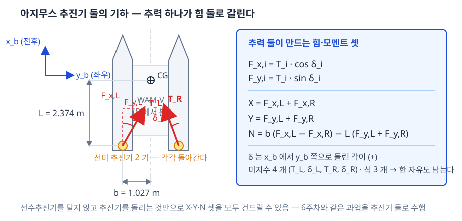

| 기호 | 뜻 | 값 · 출처 |
|---|---|---|
| $b$ | 선체 중심선에서 추진기까지의 **반폭** | 1.027135 m (`wamv_lite.urdf`) |
| $L$ | 무게중심에서 추진기까지의 **전후 거리** | 2.373776 m (`wamv_lite.urdf`) |
| $T_i$ | 추진기 $i$ 의 추력 크기 | $\lvert T_i\rvert \le 500$ N |
| $\delta_i$ | 추진기 $i$ 의 **방향각** | $\lvert\delta_i\rvert \le 45°$ (설계 전제) |

### 각도를 미지수에서 빼낸다 — extended force representation

- 미지수를 $(T_i,\ \delta_i)$ 로 두면 $T\cos\delta$ 꼴이라 **비선형**임
- 같은 힘을 성분 $(F_{x,i},\ F_{y,i})$ 로 두면 **더하기만 남음** → 완전히 선형
- 이렇게 펴 놓은 벡터를 **확장 추력 벡터**(extended force vector)라 함

$$\mathbf{u}_e = \begin{bmatrix} F_{x,L} \\ F_{y,L} \\ F_{x,R} \\ F_{y,R} \end{bmatrix}
= \mathbf{R}(\delta_L,\delta_R)\begin{bmatrix} T_L \\ T_R \end{bmatrix} \in \mathbb{R}^4,
\qquad
\boldsymbol{\tau} = \begin{bmatrix} X \\ Y \\ N \end{bmatrix} \in \mathbb{R}^3$$

$$\boxed{\ \mathbf{B}\,\mathbf{u}_e = \boldsymbol{\tau}\ }$$

- **이 한 줄이 배분 문제의 전부임.** 나머지 절은 이 식을 푸는 방법과 한계를 다룸
- 근사가 아님 — 같은 물리를 다른 변수로 적은 것임

### 배치행렬 $\mathbf{B}$ 를 열로 읽는다

$$\mathbf{B} = \begin{bmatrix} 1 & 0 & 1 & 0 \\ 0 & 1 & 0 & 1 \\ b & -L & -b & -L \end{bmatrix}$$

| 열 | 그 성분이 1 N 일 때 생기는 $[X\ Y\ N]^\mathsf{T}$ | 읽는 법 |
|---|---|---|
| 1 ($F_{x,L}$) | $[\,1\ \ 0\ \ +b\,]^\mathsf{T}$ | 좌현을 앞으로 밀면 우선회 모멘트 $+b$ |
| 2 ($F_{y,L}$) | $[\,0\ \ 1\ \ -L\,]^\mathsf{T}$ | 선미를 우현으로 밀면 선수는 반대로 |
| 3 ($F_{x,R}$) | $[\,1\ \ 0\ \ -b\,]^\mathsf{T}$ | 우현을 앞으로 밀면 좌선회 |
| 4 ($F_{y,R}$) | $[\,0\ \ 1\ \ -L\,]^\mathsf{T}$ | 2 열과 같음 (좌우 같은 거리 $L$) |

- 모멘트 열은 $\mathbf{r}\times\mathbf{F}$ 에서 나옴 — 좌현 $(x,y)=(-L,\,-b)$ · 우현 $(-L,\,+b)$
- 3 행만 따로 보면 모멘트가 **두 몫**으로 갈림

| 항 | 무엇이 만드는 모멘트 | 부호 |
|---|---|---|
| $b\,(F_{x,L} - F_{x,R})$ | 좌우 **전후 추력의 차이** — 한쪽을 더 밀어 돌림 | 좌측이 크면 $+$ |
| $-L\,(F_{y,L} + F_{y,R})$ | **선미에 걸리는 횡력** — 선미가 밀리면 선수가 반대로 돌아감 | 우현으로 밀면 $-$ |

> [!warning] 선미 횡력은 반드시 선수를 돌린다
> - 추진기가 무게중심이 아니라 **선미 $L$ = 2.374 m 뒤**에 있음
> - 옆으로 밀면 그 힘이 그대로 **모멘트 팔 $L$** 을 얻음
> - 따라서 "횡력만 내고 선회는 내지 않기" 는 두 추진기를 **따로** 써야만 됨 — 1-5 절

### 식보다 미지수가 많다

- $\mathbf{B}$ 는 $3\times4$ · 계수(rank) 3 → **행 완전계수**이므로 해는 반드시 존재함
- 미지수 4 − 식 3 = **자유도 1** → 해가 하나가 아니라 **직선 하나**임

$$\mathbf{u}_e(\lambda) = \mathbf{u}_e^{\ast} + \lambda\,\mathbf{n}, \qquad
\mathbf{B}\,\mathbf{n} = \mathbf{0}, \qquad \lambda \in \mathbb{R}$$

- 이 상태를 **overactuated** (과구동) 라 함 — 배분 방식이 여럿 생기는 까닭임
- 어느 $\lambda$ 를 고르든 $\boldsymbol{\tau}$ 는 하나도 틀리지 않음 (1-7 · 1-8 절)

## 1-4 pseudo-inverse — 최소 노름 해를 행렬 한 줄로

- 해가 직선이면 **하나를 골라야 함.** 고르는 기준을 식으로 세움
- 기준: 추력 제곱합(에너지에 해당)을 가장 작게 하는 점

$$\min_{\mathbf{u}_e} \ \mathbf{u}_e^\mathsf{T}\mathbf{W}\,\mathbf{u}_e
\qquad \text{subject to} \qquad \boldsymbol{\tau} - \mathbf{B}\,\mathbf{u}_e = \mathbf{0}$$

- 라그랑주 승수 $\boldsymbol{\lambda}\in\mathbb{R}^3$ 를 붙여 제약을 흡수함

$$\mathcal{L}(\mathbf{u}_e,\boldsymbol{\lambda})
= \mathbf{u}_e^\mathsf{T}\mathbf{W}\,\mathbf{u}_e
+ \boldsymbol{\lambda}^\mathsf{T}\!\left(\boldsymbol{\tau} - \mathbf{B}\,\mathbf{u}_e\right)$$

- 정류 조건 $\partial\mathcal{L}/\partial\mathbf{u}_e = \mathbf{0}$ · $\partial\mathcal{L}/\partial\boldsymbol{\lambda} = \mathbf{0}$ 를 풀면

$$\mathbf{u}_e = \mathbf{B}_W^{+}\,\boldsymbol{\tau}, \qquad
\mathbf{B}_W^{+} = \mathbf{W}^{-1}\mathbf{B}^\mathsf{T}
\left(\mathbf{B}\,\mathbf{W}^{-1}\mathbf{B}^\mathsf{T}\right)^{-1}$$

- 좌·우가 **같은 추진기이고 좌우 대칭**이면 $\mathbf{W} = \mathbf{I}$ 로 두어도 됨
- 그러면 위 식이 곧 **Moore–Penrose pseudo-inverse** 가 됨

$$\boxed{\ \mathbf{u}_e = \mathbf{B}^{+}\boldsymbol{\tau}, \qquad
\mathbf{B}^{+} = \mathbf{B}^\mathsf{T}\left(\mathbf{B}\,\mathbf{B}^\mathsf{T}\right)^{-1}\ }$$

- $\mathbf{B}$ 가 행 완전계수이므로 $\mathbf{B}\mathbf{B}^\mathsf{T}$ 는 가역임 — 역이 항상 존재함
- 코드도 **이 식 그대로 한 줄**임 (`parts/azAllocFcn.m`)

```matlab
tau = [X; Y; N];
B   = [ 1,  0,  1,  0; ...
        0,  1,  0,  1; ...
        b, -L, -b, -L];
ue  = B' * ((B*B') \ tau);
```

> [!note] 코드가 행렬 꼴을 그대로 유지하는 이유
> - 기하가 고정이므로 $\mathbf{B}^{+}$ 를 손으로 풀어 상수 넷을 적어 두어도 결과는 같음
> - 그러나 그러면 **강의자료의 식과 코드가 서로 다른 꼴**이 되어 대조가 안 됨
> - $3\times3$ 선형계 한 번은 비용이 무시할 수준임 (한 스텝에 수십 플롭)
> - 추진기를 늘리거나 위치를 바꿀 때 **$\mathbf{B}$ 한 줄만** 고치면 됨

- 참고로 손으로 풀어 두면 $\mathbf{B}^{+}$ 는 상수 행렬임

$$\mathbf{B}^{+} = \frac{1}{2}
\begin{bmatrix}
1 & L/b & 1/b \\
0 & 1 & 0 \\
1 & -L/b & -1/b \\
0 & 1 & 0
\end{bmatrix}
\quad\Longrightarrow\quad
\mathbf{u}_e = \frac{1}{2}
\begin{bmatrix}
X + (L\,Y + N)/b \\
Y \\
X - (L\,Y + N)/b \\
Y
\end{bmatrix}$$

- 읽는 법: 전후력은 **반씩**, 횡력도 **반씩**, 모멘트는 전후력의 **차이**로 만듦
- 코드의 행렬 한 줄과 이 상수 행렬은 **같은 값**임 — 실측 차이 $10^{-16}$ 수준

### 라그랑주 승수법 — 원리부터

- 풀려는 문제의 꼴

$$\min_{\mathbf{u}_e} \ J(\mathbf{u}_e) = \tfrac{1}{2}\,\mathbf{u}_e^\mathsf{T}\mathbf{u}_e
\qquad \text{subject to} \qquad \mathbf{B}\,\mathbf{u}_e = \boldsymbol{\tau}$$

- 제약이 없으면 답은 $\mathbf{u}_e = \mathbf{0}$ 임 — 아무것도 밀지 않는 것이 가장 쌈
- 제약 $\mathbf{B}\mathbf{u}_e = \boldsymbol{\tau}$ 가 그 답을 막음. 요구한 렌치는 반드시 내야 함
- 따라서 **제약을 지키는 점들 중에서** 가장 작은 것을 찾는 문제가 됨

- 원리 — 왜 승수를 붙이는가

| 보는 방식 | 내용 |
|---|---|
| 기하 | 제약을 만족하는 점의 모임은 4 차원 공간 안의 **직선** 하나 (1-3 절) |
| 조건 | 그 직선 위에서 $J$ 가 가장 낮은 곳에서는 **직선 방향으로 더 내려갈 데가 없음** |
| 다시 쓰면 | $\nabla J$ 에 직선 방향 성분이 없음 → $\nabla J$ 가 제약면에 **수직** |
| 수직의 표현 | 제약면의 수직 방향은 제약식의 계수, 즉 $\mathbf{B}$ 의 **행들**이 만드는 방향임 |
| 결론 | $\nabla J = \mathbf{B}^\mathsf{T}\boldsymbol{\lambda}$ — 이 비례상수 $\boldsymbol{\lambda}$ 가 라그랑주 승수임 |

- 승수는 **제약식 하나에 하나씩** 붙음
  - 요구가 $X \cdot Y \cdot N$ 셋이므로 $\boldsymbol{\lambda} \in \mathbb{R}^{3}$ — **3행 1열**
  - 미지수는 넷, 승수는 셋. 풀어야 하는 연립방정식이 넷에서 셋으로 줄어듦
- 즉 승수를 붙이는 것은 "제약이 있는 문제" 를 "제약이 없는 문제" 로 바꾸어 적는 장치임

$$\mathcal{L}(\mathbf{u}_e,\boldsymbol{\lambda})
= \underbrace{\tfrac{1}{2}\,\mathbf{u}_e^\mathsf{T}\mathbf{u}_e}_{\text{작게 하고 싶은 것}}
\; - \; \underbrace{\boldsymbol{\lambda}^\mathsf{T}\!\left(\mathbf{B}\,\mathbf{u}_e - \boldsymbol{\tau}\right)}_{\text{지켜야 하는 것}}$$

> [!note] 부호와 계수 $\tfrac{1}{2}$ 는 결과를 바꾸지 않는다
> - $-\boldsymbol{\lambda}^\mathsf{T}(\mathbf{B}\mathbf{u}_e-\boldsymbol{\tau})$ 로 적든 $+\boldsymbol{\lambda}^\mathsf{T}(\boldsymbol{\tau}-\mathbf{B}\mathbf{u}_e)$ 로 적든 같은 식임
> - $\boldsymbol{\lambda}$ 의 부호만 뒤집히고 $\mathbf{u}_e$ 는 그대로 나옴
> - $\tfrac{1}{2}$ 를 붙이는 것은 미분에서 2 가 상쇄되게 하려는 것뿐임

### 미분 과정을 한 줄씩

- 미분할 변수 둘. 각각 $\mathbf{0}$ 으로 둠 (정류 조건)

- (1) $\mathbf{u}_e$ 로 미분 — 항별로 봄

| 항 | $\partial/\partial\mathbf{u}_e$ | 근거 |
|---|---|---|
| $\tfrac{1}{2}\mathbf{u}_e^\mathsf{T}\mathbf{u}_e$ | $\mathbf{u}_e$ | 스칼라 판 $\tfrac{1}{2}x^2 \to x$ 와 같음 |
| $-\boldsymbol{\lambda}^\mathsf{T}\mathbf{B}\,\mathbf{u}_e$ | $-\mathbf{B}^\mathsf{T}\boldsymbol{\lambda}$ | $\mathbf{a}^\mathsf{T}\mathbf{u}$ 를 $\mathbf{u}$ 로 미분하면 $\mathbf{a}$. 여기서 $\mathbf{a}^\mathsf{T} = \boldsymbol{\lambda}^\mathsf{T}\mathbf{B}$ 이므로 $\mathbf{a} = \mathbf{B}^\mathsf{T}\boldsymbol{\lambda}$ |
| $+\boldsymbol{\lambda}^\mathsf{T}\boldsymbol{\tau}$ | $\mathbf{0}$ | $\mathbf{u}_e$ 가 들어 있지 않음 |

$$\frac{\partial\mathcal{L}}{\partial\mathbf{u}_e}
= \mathbf{u}_e - \mathbf{B}^\mathsf{T}\boldsymbol{\lambda} = \mathbf{0}
\qquad\Longrightarrow\qquad
\boxed{\ \mathbf{u}_e = \mathbf{B}^\mathsf{T}\boldsymbol{\lambda}\ }$$

- 이 한 줄이 라그랑주법의 핵심 결과임
  - 미지수 넷짜리 $\mathbf{u}_e$ 를 미지수 **셋짜리** $\boldsymbol{\lambda}$ 로 바꾸어 적었음
  - 뜻: 최적해는 $\mathbf{B}$ 의 **행들이 만드는 방향**만으로 이루어짐
  - 따라서 최적해에는 null space 성분이 **없음** — 1-7 절이 이 사실을 그대로 씀

- (2) $\boldsymbol{\lambda}$ 로 미분 — 제약식이 되돌아옴

$$\frac{\partial\mathcal{L}}{\partial\boldsymbol{\lambda}}
= -\left(\mathbf{B}\,\mathbf{u}_e - \boldsymbol{\tau}\right) = \mathbf{0}
\qquad\Longrightarrow\qquad
\mathbf{B}\,\mathbf{u}_e = \boldsymbol{\tau}$$

- (3) 둘을 합침 — (1) 을 (2) 에 대입

$$\mathbf{B}\left(\mathbf{B}^\mathsf{T}\boldsymbol{\lambda}\right) = \boldsymbol{\tau}
\qquad\Longrightarrow\qquad
\left(\mathbf{B}\mathbf{B}^\mathsf{T}\right)\boldsymbol{\lambda} = \boldsymbol{\tau}
\qquad\Longrightarrow\qquad
\boldsymbol{\lambda} = \left(\mathbf{B}\mathbf{B}^\mathsf{T}\right)^{-1}\boldsymbol{\tau}$$

- $\mathbf{B}\mathbf{B}^\mathsf{T}$ 는 $3\times3$ — 풀 것이 **셋짜리 연립방정식 하나**로 줄었음
- 다시 (1) 에 넣으면 pseudo-inverse 가 나옴

$$\mathbf{u}_e = \mathbf{B}^\mathsf{T}\boldsymbol{\lambda}
= \mathbf{B}^\mathsf{T}\left(\mathbf{B}\mathbf{B}^\mathsf{T}\right)^{-1}\boldsymbol{\tau}
= \mathbf{B}^{+}\boldsymbol{\tau}$$

> [!important] 코드 한 줄의 각 조각이 위 세 단계다
> ```matlab
> ue = B' * ((B*B') \ tau);
> %           \_____________/   (3) lambda = inv(B*B')*tau  — 3x1 을 푼다
> %      \__/                   (1) ue = B'*lambda
> ```
> - 역행렬을 따로 만들지 않고 `\` 로 푸는 이유 — $3\times3$ 선형계 한 번이 역행렬보다 싸고 정확함

### 손으로 푸는 예제 1 — 미지수 둘, 식 하나

> [!note] 종이와 펜으로 2 분. 승수가 무엇인지만 보는 예제임

- 문제: 두 사람이 **합쳐 $10$ N** 을 밀어야 함. 각자의 힘 제곱합을 가장 작게 하려면 얼마씩 미는가

$$\min \ \tfrac{1}{2}\left(x_1^2 + x_2^2\right)
\qquad \text{subject to} \qquad x_1 + x_2 = 10$$

- 행렬 꼴로는 $\mathbf{A} = \begin{bmatrix}1 & 1\end{bmatrix}$ (1행 2열), 요구는 스칼라 $10$

- 1단계 — 라그랑지안을 적음

$$\mathcal{L}(x_1,x_2,\lambda)
= \tfrac{1}{2}\left(x_1^2 + x_2^2\right) - \lambda\left(x_1 + x_2 - 10\right)$$

- 2단계 — 세 번 미분해 $0$ 으로 둠

$$\frac{\partial\mathcal{L}}{\partial x_1} = x_1 - \lambda = 0
\quad\Longrightarrow\quad x_1 = \lambda$$

$$\frac{\partial\mathcal{L}}{\partial x_2} = x_2 - \lambda = 0
\quad\Longrightarrow\quad x_2 = \lambda$$

$$\frac{\partial\mathcal{L}}{\partial\lambda} = -\left(x_1 + x_2 - 10\right) = 0
\quad\Longrightarrow\quad x_1 + x_2 = 10$$

- 3단계 — 대입
  - 앞의 둘을 뒤에 넣음: $\lambda + \lambda = 10 \ \Rightarrow \ \lambda = 5$
  - 따라서 $x_1 = x_2 = 5$, 노름 $\lVert\mathbf{x}\rVert = \sqrt{50} = 7.0711$

- 4단계 — 정말 최소인지 다른 해와 비교

| $\mathbf{x}^\mathsf{T}$ | $x_1+x_2$ | $\lVert\mathbf{x}\rVert$ | 비고 |
|---|---|---|---|
| $[\,5,\ 5\,]$ | $10$ | **$7.0711$** | 라그랑주 해 |
| $[\,6,\ 4\,]$ | $10$ | $7.2111$ | |
| $[\,8,\ 2\,]$ | $10$ | $8.2462$ | |
| $[\,10,\ 0\,]$ | $10$ | $10.0000$ | 한 사람만 밂 |
| $[\,0,\ 10\,]$ | $10$ | $10.0000$ | |

- 다섯 모두 식을 만족함. 노름이 가장 작은 것은 라그랑주 해 하나임
- 기하로 보면
  - 제약은 직선 $x_1+x_2=10$, 비용은 원 $x_1^2+x_2^2 = r^2$
  - 원을 키우다가 직선에 **처음 닿는** 점이 답임 → 접점
  - 접점에서 원의 법선 $\nabla J = \mathbf{x}$ 와 직선의 법선 $\mathbf{A}^\mathsf{T} = [1,1]^\mathsf{T}$ 가 같은 방향
  - 그 비례상수가 $\lambda$ 임 — $\mathbf{x} = \lambda\,\mathbf{A}^\mathsf{T}$ 가 곧 $\mathbf{u}_e = \mathbf{B}^\mathsf{T}\boldsymbol{\lambda}$ 의 1 차원 판

- pseudo-inverse 로도 같은 답

$$\mathbf{A}^{+} = \mathbf{A}^\mathsf{T}\left(\mathbf{A}\mathbf{A}^\mathsf{T}\right)^{-1}
= \begin{bmatrix}1\\1\end{bmatrix}\cdot\frac{1}{2}
= \begin{bmatrix}0.5\\0.5\end{bmatrix}
\qquad
\mathbf{x} = \mathbf{A}^{+}\cdot 10 = \begin{bmatrix}5\\5\end{bmatrix}$$

### 손으로 푸는 예제 2 — 미지수 넷, 식 셋 (요구가 3행 1열)

> [!note] 손풀이용 기하 — 분수가 떨어지도록 반올림한 값임
> | 기호 | 손풀이 값 | 실제 WAM-V |
> |---|---|---|
> | $b$ | $1$ m | $1.027135$ m |
> | $L$ | $2$ m | $2.373776$ m |
>
> 실제 값으로도 과정은 똑같음. 손으로는 분수가 지저분해져 계산 실수만 늘어남

- 1단계 — 행렬과 요구를 적음

$$\mathbf{B} = \begin{bmatrix}
1 & 0 & 1 & 0 \\
0 & 1 & 0 & 1 \\
1 & -2 & -1 & -2
\end{bmatrix}
\qquad
\boldsymbol{\tau} = \begin{bmatrix} X \\ Y \\ N \end{bmatrix}
= \begin{bmatrix} 0 \\ 100 \\ 0 \end{bmatrix}$$

- 단위는 $X \cdot Y$ 가 N, $N$ 이 N·m
- 미지수는 $\mathbf{u}_e = [\,F_{x,L},\ F_{y,L},\ F_{x,R},\ F_{y,R}\,]^\mathsf{T}$ — **4행 1열**

- 2단계 — $\mathbf{B}\mathbf{B}^\mathsf{T}$ 를 손으로 곱함 (행끼리의 내적 여섯 번)

| 성분 | 계산 | 값 |
|---|---|---|
| $(1,1)$ | $1^2+0^2+1^2+0^2$ | $2$ |
| $(1,2)$ | $0+0+0+0$ | $0$ |
| $(1,3)$ | $1(1) + 0 + 1(-1) + 0$ | $0$ |
| $(2,2)$ | $0+1^2+0+1^2$ | $2$ |
| $(2,3)$ | $0 + 1(-2) + 0 + 1(-2)$ | $-4$ |
| $(3,3)$ | $1^2+2^2+1^2+2^2$ | $10$ |

$$\mathbf{B}\mathbf{B}^\mathsf{T} = \begin{bmatrix}
2 & 0 & 0 \\ 0 & 2 & -4 \\ 0 & -4 & 10 \end{bmatrix}$$

- **첫 행·첫 열이 비어 있음** → $3\times3$ 이 $1\times1$ 과 $2\times2$ 로 쪼개짐
  - 손으로 뒤집을 수 있는 이유임
  - 물리로 읽으면 전후력 $X$ 는 횡력·모멘트와 **서로 간섭하지 않음** (좌우 대칭의 결과)

- 3단계 — 역행렬

| 조각 | 계산 |
|---|---|
| $1\times1$ | $1/2 = 0.5$ |
| $2\times2$ 행렬식 | $2(10) - (-4)^2 = 20 - 16 = 4$ |

$$\begin{bmatrix} 2 & -4 \\ -4 & 10 \end{bmatrix}^{-1}
= \frac{1}{4}\begin{bmatrix} 10 & 4 \\ 4 & 2 \end{bmatrix}
= \begin{bmatrix} 2.5 & 1 \\ 1 & 0.5 \end{bmatrix}$$

$$\left(\mathbf{B}\mathbf{B}^\mathsf{T}\right)^{-1} = \begin{bmatrix}
0.5 & 0 & 0 \\ 0 & 2.5 & 1 \\ 0 & 1 & 0.5 \end{bmatrix}$$

- 4단계 — 승수 $\boldsymbol{\lambda}$ (3행 1열)

$$\boldsymbol{\lambda} = \left(\mathbf{B}\mathbf{B}^\mathsf{T}\right)^{-1}\boldsymbol{\tau}
= \begin{bmatrix} 0.5 & 0 & 0 \\ 0 & 2.5 & 1 \\ 0 & 1 & 0.5 \end{bmatrix}
\begin{bmatrix} 0 \\ 100 \\ 0 \end{bmatrix}
= \begin{bmatrix} 0 \\ 250 \\ 100 \end{bmatrix}$$

- 5단계 — 해 $\mathbf{u}_e$ (4행 1열).  $\mathbf{B}^\mathsf{T}$ 는 $\mathbf{B}$ 의 열을 행으로 세운 것임

$$\mathbf{u}_e = \mathbf{B}^\mathsf{T}\boldsymbol{\lambda}
= \begin{bmatrix}
1 & 0 & 1 \\ 0 & 1 & -2 \\ 1 & 0 & -1 \\ 0 & 1 & -2
\end{bmatrix}
\begin{bmatrix} 0 \\ 250 \\ 100 \end{bmatrix}
= \begin{bmatrix} 100 \\ 50 \\ -100 \\ 50 \end{bmatrix}\ \text{N}$$

- 줄별 계산

| 줄 | 계산 | 값 |
|---|---|---|
| $F_{x,L}$ | $1(0) + 0(250) + 1(100)$ | $100$ |
| $F_{y,L}$ | $0(0) + 1(250) - 2(100)$ | $50$ |
| $F_{x,R}$ | $1(0) + 0(250) - 1(100)$ | $-100$ |
| $F_{y,R}$ | $0(0) + 1(250) - 2(100)$ | $50$ |

- 6단계 — 검산. 구한 해를 $\mathbf{B}$ 에 **되돌려** 넣음

| 확인할 것 | 계산 | 결과 |
|---|---|---|
| 전후력 $X$ | $100 + (-100)$ | $0$ — 요구와 같음 |
| 횡력 $Y$ | $50 + 50$ | $100$ — 요구와 같음 |
| 모멘트 $N$ | $1(100) - 2(50) - 1(-100) - 2(50)$ | $100-100+100-100 = 0$ — 요구와 같음 |
| 노름 | $\sqrt{100^2+50^2+100^2+50^2} = \sqrt{25000}$ | $158.11$ N |

- 1-5 절의 닫힌식과도 맞음 — $\mathbf{u}_e = \dfrac{Y}{2}\left[\,L/b,\ 1,\ -L/b,\ 1\,\right]^\mathsf{T} = 50\left[\,2,\ 1,\ -2,\ 1\,\right]^\mathsf{T}$

- 7단계 — 추진기 지령으로 되돌림 (polar 변환)

| 추진기 | 성분 $(F_x, F_y)$ | $T = \sqrt{F_x^2+F_y^2}$ | $\delta = \operatorname{atan2}(F_y,F_x)$ | 접기 뒤 |
|---|---|---|---|---|
| 좌현 | $(100,\ 50)$ | $111.803$ N | $26.565°$ | 그대로 |
| 우현 | $(-100,\ 50)$ | $111.803$ N | $153.435°$ | $-111.803$ N, $-26.565°$ |

- 우현은 $\lvert\delta\rvert > 90°$ 이므로 **뒤로 밀고 반대로 틂** 으로 바꿔 적음 (1-9 절 규칙 (a))
- 두 각도 모두 $\pm45°$ 안 → 이 요구는 설계 전제 안에서 그대로 낼 수 있음

### 승수 $\boldsymbol{\lambda}$ 의 뜻 — 요구를 1 N 늘리면

- $\boldsymbol{\lambda}$ 는 계산 중간에 생겼다 사라지는 값이 아님. 읽을 수 있는 뜻이 있음
- 최소 노름 해에서의 비용을 요구만으로 다시 적으면

$$J^{*}(\boldsymbol{\tau}) = \tfrac{1}{2}\lVert\mathbf{u}_e\rVert^2
= \tfrac{1}{2}\,\boldsymbol{\tau}^\mathsf{T}\left(\mathbf{B}\mathbf{B}^\mathsf{T}\right)^{-1}\boldsymbol{\tau}
\qquad\Longrightarrow\qquad
\frac{\partial J^{*}}{\partial\boldsymbol{\tau}}
= \left(\mathbf{B}\mathbf{B}^\mathsf{T}\right)^{-1}\boldsymbol{\tau} = \boldsymbol{\lambda}$$

- 즉 $\lambda_i$ 는 **요구 $i$ 를 한 단위 늘릴 때 늘어나는 비용**임
- 예제 2 의 숫자로 확인 (`A3_pinv_example` 출력)

| 항목 | 값 |
|---|---|
| $\tfrac{1}{2}\lVert\mathbf{u}_e\rVert^2$ | $12500$ |
| $\tfrac{1}{2}\boldsymbol{\tau}^\mathsf{T}(\mathbf{B}\mathbf{B}^\mathsf{T})^{-1}\boldsymbol{\tau}$ | $12500$ — 같은 값 |
| $\partial J^{*}/\partial X$ (수치미분) | $0.0000$ = $\lambda_1$ |
| $\partial J^{*}/\partial Y$ | $250.0000$ = $\lambda_2$ |
| $\partial J^{*}/\partial N$ | $100.0000$ = $\lambda_3$ |

- 읽는 법: 이 요구에서 횡력을 $1$ N 더 요구하면 $\tfrac{1}{2}\lVert\mathbf{u}_e\rVert^2$ 가 $250$ 만큼 늘어남
- $\lambda_1 = 0$ 인 이유 — 요구 $X = 0$ 이므로 전후 방향으로는 아직 대가를 치르지 않고 있음

### `pinv` 는 같은 것인가 — 세 가지 풀이법

- 결론부터: 이 문제에서 **`pinv(B)*tau` 는 라그랑주 해와 같음**
- 그러나 `B\tau` (역슬래시) 는 **다른 해**임. 섞어 쓰면 오류 없이 다른 결과가 나옴

| MATLAB | 무엇을 푸는가 | 예제 2 에서의 결과 | 노름 |
|---|---|---|---|
| `B'*((B*B')\tau)` | 라그랑주법 그대로 (정규방정식) | $[\,100,\ 50,\ -100,\ 50\,]$ | $158.1139$ |
| `pinv(B)*tau` | Moore–Penrose 역, SVD 로 계산 | **같은 값** (차이 $2.8\times10^{-14}$) | $158.1139$ |
| `B\tau` | 최소제곱 · QR — $0$ 이 많은 해를 고름 | $[\,100,\ 100,\ -100,\ 0\,]$ | $173.2051$ |

- `pinv` 와 값이 같은 이유
  - $\mathbf{B}$ 가 **행 완전계수**임 ($\operatorname{rank} \mathbf{B} = 3$, 행이 셋)
  - 이때 Moore–Penrose 역의 닫힌식이 정확히 $\mathbf{B}^\mathsf{T}(\mathbf{B}\mathbf{B}^\mathsf{T})^{-1}$ 임
  - 계수가 떨어지면 (추진기 하나가 멈춘 경우 등) $\mathbf{B}\mathbf{B}^\mathsf{T}$ 가 특이해져 이 닫힌식은 깨지지만 `pinv` 는 값을 냄
  - 본 모델은 추진기 둘이 항상 살아 있다고 보므로 닫힌식으로 충분함

> [!warning] 역슬래시 `B\tau` 를 쓰면 안 되는 이유
> - 역슬래시도 $\mathbf{B}\mathbf{u}_e = \boldsymbol{\tau}$ 를 **만족함** — 요구는 그대로 남
> - 그러나 추력 제곱합이 최소가 아님 ($173.21$ 대 $158.11$ — 약 $10\%$ 더 씀)
> - 성분 하나를 $0$ 으로 몰아 두므로 **한쪽 추진기에 힘이 쏠림** → 각도·추력 한계에 더 빨리 물림
> - 배분기는 `pinv` 도 역슬래시도 쓰지 않고 정규방정식 한 줄로 적어 두었음 — 강의자료의 식과 코드가 같은 꼴로 남게 하려는 것임

### MATLAB 으로 검증 — `A3_pinv_example`

- 위 손풀이를 그대로 숫자로 확인하는 스크립트를 넣어 두었음. 종이에 먼저 풀고 돌려 볼 것

```matlab
>> A3_pinv_example
```

- 출력 (발췌) — 손풀이 값과 숫자가 같아야 함

```
=== 예제 2 : 미지수 넷, 식 셋 — 횡방향 요구 ===
  B*B' =
        2.0    0.0    0.0
        0.0    2.0   -4.0
        0.0   -4.0   10.0
  라그랑주 승수  lam = [0 250 100]      (손풀이 [0 250 100])
  최소 노름 해   ue  = [100 50 -100 50]   (손풀이 [100 50 -100 50])
  노름          |ue| = 158.1139            (손풀이 sqrt(25000) = 158.1139)
  되짚어 본 요구  B*ue = [0 100 0]      (요구 [0 100 0])
  추진기 지령    좌현 T =  111.803 N, delta =  26.565 deg
                 우현 T = -111.803 N, delta = -26.565 deg   (뒤로 밂 — 90 deg 접기)
```

- 스크립트가 하는 일 넷

| 하는 일 | 내용 |
|---|---|
| 예제 셋을 풂 | 예제 1 · 2 (위) 와 예제 3 (1-7 절) 을 손풀이 값과 나란히 찍음 |
| 풀이법 비교 | `pinv` · 역슬래시와의 차이를 숫자로 보여 줌 |
| 승수의 뜻 확인 | $\partial(\tfrac{1}{2}\lVert\mathbf{u}_e\rVert^2)/\partial\tau_i = \lambda_i$ 를 수치미분으로 확인 |
| 검산 | `assert` 아홉 개로 끝맺음 — 하나라도 틀리면 그 자리에서 멈춤 |

- 숫자를 변수로 받아 쓰려면

```matlab
E = A3_pinv_example;
```

| 꺼내는 값 | 뜻 |
|---|---|
| `E.ex2.lam` | 예제 2 의 승수 $[0;\ 250;\ 100]$ |
| `E.ex2.ue` | 예제 2 의 최소 노름 해 |
| `E.ex3.k` | 예제 3 의 null space 보정량 $50$ |
| `E.cmp.u_bsl` | 역슬래시가 내놓는 다른 해 |

> [!tip] 과제로 쓰는 법
> - $\boldsymbol{\tau}$ 를 다른 값으로 바꾸어 손으로 다시 풀고, 스크립트의 `tau2` 를 같은 값으로 고쳐 맞는지 본다
> - 손풀이와 다르면 거의 항상 $\mathbf{B}\mathbf{B}^\mathsf{T}$ 의 $(2,3)$ 성분 **부호**에서 틀린다
> - 기하를 실제 값 ($b = 1.027135$, $L = 2.373776$) 으로 바꾸면 분수가 떨어지지 않는다 — 스크립트 머리의 `bb`, `LL` 만 고치면 확인된다

### 성분을 지령으로 되돌림 — polar 변환

- 추진기가 받는 것은 성분이 아니라 (추력, 각도) 임. $\mathbf{R}$ 을 거꾸로 감음

$$\begin{bmatrix} T_i \\ \delta_i \end{bmatrix} =
\begin{bmatrix} \sqrt{F_{x,i}^2 + F_{y,i}^2} \\[2pt]
\operatorname{atan2}\!\left(F_{y,i},\ F_{x,i}\right) \end{bmatrix}$$

```matlab
[TL, dL] = az_polar(ue(1), ue(2), Fmax, dmax, rev);
[TR, dR] = az_polar(ue(3), ue(4), Fmax, dmax, rev);
```

> [!important] 질문 (c) 에 대한 답 — 배분은 가장 간단한 꼴로 끝난다
> - 행렬 하나와 선형계 한 줄. 반복 풀이 · QP · 최적화 솔버가 **없음**
> - 추가로 들어가는 것은 1-7 절의 **아홉 줄 보정**뿐임
> - MATLAB Function 블록 하나에 전부 들어감 → 코드 생성에도 걸림돌이 없음

## 1-5 순수 횡이동은 위치 제어의 한 경우다

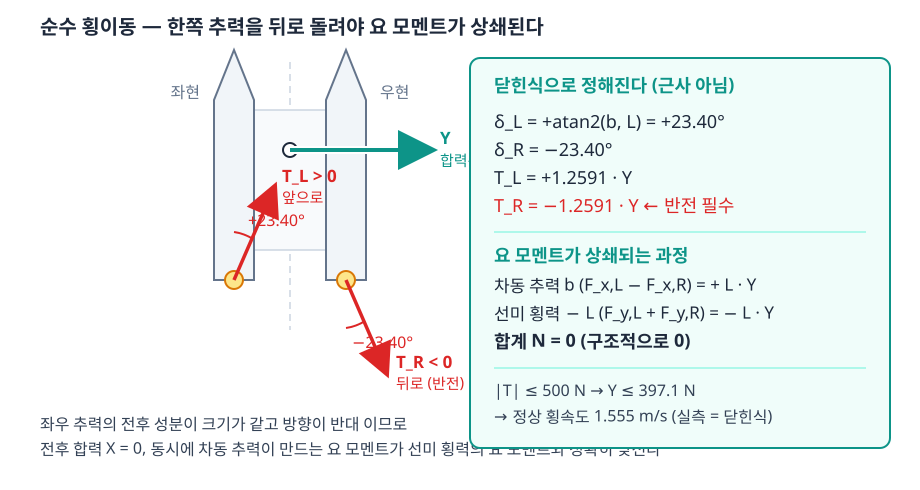

> [!important] 순수 횡이동과 위치 제어는 **다른 과업이 아님**
> | | 위치 제어 (2단) | 순수 횡이동 (1단) |
> |---|---|---|
> | 목표 | $(x_{ref},\ y_{ref},\ \psi_{ref})$ 셋 | 같음 |
> | 다른 점 | — | $\Delta x = 0$ · $\Delta\psi = 0$ 인 **특수한 목표값** |
> | 제어기 | 외측 PD + 내측 PD | **같은 블록** |
> | 배분 | `AzAlloc` | **같은 블록** |
>
> - 1단과 2단은 같은 모델 구조로 돌아감. 바뀌는 것은 목표값 세 개뿐임 (2-3 · 2-4 절)
> - 따라서 1단은 특수 기능이 아니라 **위치 제어에서 배분이 가장 까다로운 방향**임
> - 까다로운 이유: $X \to 0$ 일 때 각도 요구가 가장 커짐 (1-6 절의 쐐기)

### 요구를 식에 넣는다

- 순수 횡이동 = $X = 0$ · $N = 0$ · $Y \ne 0$ 을 요구하는 경우임

$$\boldsymbol{\tau} = \begin{bmatrix} 0 \\ Y \\ 0 \end{bmatrix}
\quad\Longrightarrow\quad
\mathbf{u}_e = \mathbf{B}^{+}\boldsymbol{\tau}
= \frac{Y}{2}\begin{bmatrix} L/b \\ 1 \\ -L/b \\ 1 \end{bmatrix}$$

- polar 로 되돌리면 방향각과 추력이 **$Y$ 와 무관한 상수**로 정해짐

$$\delta_L = \operatorname{atan2}(1,\ L/b) = \arctan\frac{b}{L} = +23.3982°,
\qquad \delta_R = -23.3982°$$

$$T_L = +k_T\,Y, \qquad T_R = -k_T\,Y, \qquad
k_T = \frac{\sqrt{b^2+L^2}}{2b} = 1.259069$$

| 읽는 법 | 뜻 |
|---|---|
| 두 방향각의 **부호가 반대** | 좌현 추진기는 앞-우현, 우현 추진기는 뒤-우현을 향함 |
| 두 추력의 **부호가 반대** | 한쪽은 밀고 한쪽은 **당김** → 추력 반전이 필수 |
| $k_T = 1.259$ | 횡력 1 N 을 내려면 추진기마다 1.259 N 이 필요함 — 비용 26 % |
| 23.40° 는 고정 | $Y$ 를 키워도 각도는 바뀌지 않음. 추력 크기만 커짐 |

> [!note] 우현 각도가 $-23.40°$ 가 되는 과정
> - $F_{x,R} < 0$ 이므로 $\operatorname{atan2}$ 는 $156.60°$ 를 내놓음
> - 그 각도는 $\pm45°$ 밖임. 그러나 **$180°$ 돌린 방향으로 뒤로 미는 것**과 같은 힘임
> - 그래서 $\delta_R = -23.40°$ · $T_R < 0$ 으로 바꿔 적음 (1-9 절 `az_polar` 의 규칙 (a))
> - 추력 반전을 금지하면 이 해를 낼 수 없음 → 2-6 절에서 실측으로 확인

### 요 모멘트가 구조적으로 0 이 되는 과정

- $\mathbf{B}$ 의 3 행과 $\mathbf{u}_e$ 를 그대로 곱함

$$\begin{bmatrix} b & -L & -b & -L \end{bmatrix}
\cdot \frac{Y}{2}\begin{bmatrix} L/b \\ 1 \\ -L/b \\ 1 \end{bmatrix}
= \frac{Y}{2}\left(L - L + L - L\right) = 0$$

| 항 | 값 |
|---|---|
| 차동 추력 $b\,(F_{x,L}-F_{x,R})$ | $+L\,Y$ |
| 선미 횡력 $-L\,(F_{y,L}+F_{y,R})$ | $-L\,Y$ |
| 합계 $N$ | $\mathbf{0}$ |

> [!important] 순수 횡이동의 선수각 오차 0 은 **제어가 잘 된 결과가 아니다**
> - 두 항이 **정확히 상쇄**되므로 요 모멘트는 애초에 발생하지 않음
> - 즉 흔들 것이 없는 상태에서 "흔들리지 않는다" 를 관측한 것임
> - **외란을 걸어야 검증이 됨** — 2-3 절에서 조류 0.6 m/s 를 걸어 다시 잼

### 낼 수 있는 최대 횡력과 최대 횡속도

- 추력 한계 $\lvert T\rvert \le 500$ N 을 $k_T$ 로 나눔

$$Y_{\max} = \frac{500}{1.259069} = 397.1\ \text{N}$$

- 정상 횡속도는 항력식 $Y_v\,v + Y_{vv}\,v\lvert v\rvert = Y_{\max}$ 의 해임 ($Y_v = Y_{vv} = 100$)

$$v_{ss} = \frac{-Y_v + \sqrt{Y_v^2 + 4\,Y_{vv}\,Y_{\max}}}{2\,Y_{vv}} = 1.555\ \text{m/s}$$

- **실측 1.555 m/s · 닫힌식 1.555 m/s · 차이 0.000 m/s** (2-3 절)

## 1-6 ±45° 한계는 요구 공간에 쐐기를 만든다

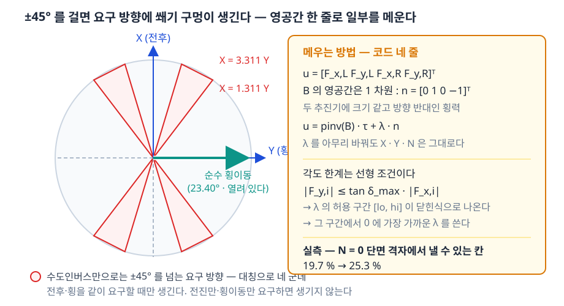

- 각도 한계는 성분으로 쓰면 **선형 부등식**이 됨 — 이것이 다루기 쉬운 이유임

$$\lvert\delta_i\rvert \le \delta_{\max}
\quad\Longleftrightarrow\quad
\lvert F_{y,i}\rvert \le \tan\delta_{\max}\,\lvert F_{x,i}\rvert$$

- pseudo-inverse 해를 넣고 $N = 0$ 단면에서 풀면 **쐐기 경계**가 닫힌식으로 나옴

$$\frac{X}{Y} = 2\left(\frac{L}{2b} \mp \frac{\tan\delta_{\max}}{2}\right)
\;\Rightarrow\; 1.3111 \;\sim\; 3.3111$$

| 요구 | 가능한가 |
|---|---|
| 전진만 ($Y = 0$) | 가능 — 방향각 0° |
| 횡이동만 ($X = 0$) | 가능 — 방향각 23.40° |
| 전진 + 횡이동, $1.3111\,Y < X < 3.3111\,Y$ | **불가** — pseudo-inverse 해가 45° 를 넘음 |
| 그 밖 | 가능 |

- 방향으로 읽으면 $\theta = \arctan(Y/X)$ 가 **16.8° \~ 37.3°** 구간임
- 대칭으로 **네 군데**에 생김 (전진·후진 × 좌·우)

### 낼 수 없는 각도를 요구받았을 때 — 각도만 깎는다

- 처리는 한 가지임 — **각도를 한계에 세우고 추력은 그대로** 씀

$$\delta_i \;\leftarrow\; \operatorname{clip}(\delta_i,\ -\delta_{\max},\ +\delta_{\max}),
\qquad T_i \;\text{는 건드리지 않음}$$

- $\pm45°$ 안에서 풀리는 요구에는 **아무 일도 일어나지 않음** (자를 것이 없음)
- 갈리는 것은 한계를 넘긴 경우뿐임. 4단 실습에서 각도 한계를 $\pm15°$ 로 좁혀 봄

| 각도 한계를 $\pm15°$ 로 좁힌 1단 | 실측값 |
|---|---|
| 목표 도달 | 0.003 m — **도달함** |
| 선수각 RMS | 45.632° — 순수 횡이동이 깨짐 |
| 최대 추력 | 259.5 N |
| 각도 한계에 붙은 시간 | 80.7 % |
| 못 낸 힘 (최대) | $X$ 309.97 N · $Y$ 248.88 N · $N$ 884.77 N·m |

- 각도만 깎으면 **힘은 계속 나가되 방향이 틀림** — 배는 움직이지만 요구대로 움직이지 않음
- 그 틀어진 양이 "못 낸 힘" 으로 **수치에 남음**. 이것이 각도만 깎는 쪽을 택한 이유임
- 추력까지 0 으로 끊는 처리도 있음 (Sarda et al. 2016, Fig. 22). 안전하지만 왜 못 갔는지가 그래프에 0 으로만 남아 교육적으로 불리함 → 1-13 절

> [!warning] 쐐기에 들어가도 오류 메시지는 뜨지 않는다
> - 배분은 계산을 끝내고 값을 내보냄. 다만 **각도가 한계에서 잘림**
> - 잘린 각도로 난 힘은 요구한 힘이 아님 → 배가 요구와 다르게 움직임
> - 따라서 **요구한 $\boldsymbol{\tau}$ 와 실제로 난 $\boldsymbol{\tau}_a$ 의 차이("못 낸 힘")를 항상 함께 기록**해야 함
> - 본 부록의 모든 실행이 이 값을 출력함 → [[측정하지-않은-성공은-성공이-아니다]]

## 1-7 남는 자유도 하나 — null space 보정

> [!important] 이 절의 요지 — 네 문장
> - pseudo-inverse 해는 **각도 한계를 모른 채** 답 하나를 고름
> - 그런데 답은 하나가 아님. 같은 $X$ · $Y$ · $N$ 을 내는 배분이 **직선 하나만큼** 있음 (1-3 절)
> - 그 직선 위를 미끄러뜨려 **각도만** 한계 안으로 밀어 넣는 것이 null space 보정임
> - 요구한 렌치는 **한 숫자도 바뀌지 않음** — 바뀌는 것은 두 추진기가 일을 나누는 방식뿐임

### 1단계 — 먼저 숫자 하나로, 무엇이 터지는가

- 요구: $X = 200$ N (앞으로), $Y = 100$ N (우현으로), $N = 0$ (돌지 않게)
- 1-4 절의 pseudo-inverse 를 그대로 적용한 결과

| 양 | 좌현 (L) | 우현 (R) |
|---|---|---|
| $F_x$ [N] | 215.55 | **−15.55** |
| $F_y$ [N] | 50.00 | 50.00 |
| 방향각 $\delta$ | $13.06°$ | $-72.72°$ |
| 추력 $T$ [N] | 221.28 | −52.36 (뒤로 밂) |

- 우현 추진기가 $-72.72°$ 를 요구받음 — **설계 전제 $\pm45°$ 밖**임
- 터진 이유는 힘이 모자라서가 **아님**

| 원인 | 수치 |
|---|---|
| 우현의 가로 성분이 거의 0 | $F_{x,R} = -15.55$ N |
| 그런데 세로 성분은 그대로 | $F_{y,R} = 50.00$ N = $Y/2$ |
| 작은 가로 위에 큰 세로가 올라감 | $\delta = \arctan(50/{-}15.55) \to 90°$ 쪽으로 치솟음 |

- 즉 **횡력을 두 대가 똑같이 반씩 나눠 받은 것**이 터진 원인임
- 그러면 다음 질문 — 왜 꼭 반씩 나뉘는가

### 2단계 — 왜 횡력이 꼭 반씩 나뉘는가 (최소 노름의 뒷면)

- pseudo-inverse 는 "추력 제곱합이 가장 작은 해" 를 고름 (1-4 절)
- 최소 노름 해의 성질 — **null space 방향 성분이 0** 인 해임

$$\mathbf{n}^\mathsf{T}\mathbf{u}_e = 0
\quad\Longleftrightarrow\quad
F_{y,L} - F_{y,R} = 0
\quad\Longleftrightarrow\quad
F_{y,L} = F_{y,R} = \frac{Y}{2}$$

- 따라서 $F_{y,L} = F_{y,R}$ 은 **기하가 강요한 것이 아니라 최소 노름이 고른 것**임
- 그 기준에는 각도 한계가 들어 있지 않음 → **고칠 여지가 남아 있음**
- 여기서 처음 나온 $\mathbf{n}$ 이 무엇인지부터 정리함

### 3단계 — null space 가 무엇인가 (정의부터)

> [!note] null space = **"아무 일도 일어나지 않는" 배분들의 모임**
> - 배분 $\mathbf{n}$ 을 넣었는데 렌치가 $\mathbf{0}$ 으로 나오는 경우를 모은 것
> - $\mathrm{null}(\mathbf{B}) = \{\,\mathbf{n} \in \mathbb{R}^4 : \mathbf{B}\mathbf{n} = \mathbf{0}\,\}$
> - 한국어로는 영공간 · 핵(kernel). 본 부록은 문헌 표기를 따라 null space 로 적음
> - 거기 든 벡터는 어떤 해에 **얼마든지 더해도** 렌치를 바꾸지 않음

- 차원은 계수·차원 정리(rank–nullity theorem)로 바로 나옴

$$\dim\mathrm{null}(\mathbf{B}) = 4 - \operatorname{rank}\mathbf{B} = 4 - 3 = 1$$

| 숫자 | 어디서 왔는가 |
|---|---|
| 4 | 미지수 개수 — 추진기 둘 × 성분 둘 |
| 3 | 식 개수 = $\mathbf{B}$ 의 계수 — $X$ · $Y$ · $N$ 셋이 서로 독립임 |
| 1 | **남는 자유도 하나** — 이것이 쓸 수 있는 여유임 |

- 1 차원이므로 **방향 하나만** 찾으면 끝임. 손으로 세 줄에 풀림

$$\mathbf{B}\mathbf{n} = \mathbf{0}
\;\Longrightarrow\;
\begin{cases}
n_1 + n_3 = 0 & (X\ \text{행}) \\[2pt]
n_2 + n_4 = 0 & (Y\ \text{행}) \\[2pt]
b\,n_1 - L\,n_2 - b\,n_3 - L\,n_4 = 0 & (N\ \text{행})
\end{cases}$$

- 앞 두 줄에서 $n_3 = -n_1$, $n_4 = -n_2$. 이것을 세 번째 줄에 넣음

$$b\,n_1 - L\,n_2 + b\,n_1 + L\,n_2 = 2b\,n_1 = 0
\quad\Longrightarrow\quad n_1 = 0
\quad\Longrightarrow\quad n_3 = 0$$

- $n_2$ 는 어떤 값이어도 되므로 1 로 둠 (방향만 쓰므로 크기는 뜻이 없음)

$$\boxed{\;\mathbf{n} = \begin{bmatrix} 0 & 1 & 0 & -1 \end{bmatrix}^\mathsf{T},
\qquad \mathbf{B}\,\mathbf{n} = \mathbf{0}\;}$$

### 4단계 — 그 벡터가 실제로 뜻하는 것 (기하)

| 성분 | 값 | 뜻 |
|---|---|---|
| $n_1$ | 0 | 좌현 **전후력은 건드리지 않음** |
| $n_2$ | $+1$ | 좌현에 **우현 쪽** 횡력을 더함 |
| $n_3$ | 0 | 우현 **전후력은 건드리지 않음** |
| $n_4$ | $-1$ | 우현에 **좌현 쪽** 횡력을 더함 |

- 세 가지가 동시에 성립하므로 렌치가 안 바뀜

| 왜 안 바뀌는가 | 이유 |
|---|---|
| $X$ | 전후력을 하나도 건드리지 않음 |
| $Y$ | 두 횡력이 크기가 같고 방향이 반대 → 합이 0 |
| $N$ | 두 추진기가 **같은 전후 위치**($x = -L$)에 있음 → 모멘트 팔이 같아 서로 지워짐 |

> [!note] 비유 — 상자를 맞밀기
> - 두 사람이 상자의 좌·우에서 **서로를 향해** 같은 힘으로 밂
> - 상자는 꿈쩍하지 않음. 그런데 두 사람의 **팔 방향은 바뀜**
> - 배분에서 바뀌는 것이 딱 그 "팔 방향", 곧 **방향각**임
> - 공짜로 쓸 수 있는 여유가 하나 있다는 말이 이 뜻임

> [!warning] null space 는 **추진기 배치가 만든 것**임
> - $\mathbf{n}$ 이 이 꼴인 까닭은 두 추진기가 같은 전후 위치에 있기 때문임
> - 한 대가 선수에 있으면 (1-11 절의 T 배치) 맞밀기가 요 모멘트를 만들어 버림 → null space 방향이 달라짐
> - 즉 "맞밀기가 공짜" 인 것은 **WAM-V 선미 2 기 배치의 성질**임. 배치를 바꾸면 다시 풀어야 함

### 5단계 — 해 전체는 직선 하나

$$\mathbf{u}_e(\lambda) = \mathbf{B}^{+}\boldsymbol{\tau} + \lambda\,\mathbf{n},
\qquad \lambda \in \mathbb{R}$$

- 어떤 $\lambda$ 를 넣어도 요구가 그대로 나옴 — 두 줄로 확인됨

$$\mathbf{B}\mathbf{u}_e(\lambda)
= \underbrace{\mathbf{B}\mathbf{B}^{+}\boldsymbol{\tau}}_{=\ \boldsymbol{\tau}}
\;+\; \lambda\underbrace{\mathbf{B}\mathbf{n}}_{=\ \mathbf{0}}
\;=\; \boldsymbol{\tau}$$

| 기하로 읽으면 | |
|---|---|
| 요구를 만족하는 점 전체 | 4 차원 공간의 **직선 하나** |
| $\mathbf{B}^{+}\boldsymbol{\tau}$ | 그 직선에서 **원점에 가장 가까운 점** (= 추력 제곱합 최소) |
| $\lambda$ | 그 점에서 직선을 따라 **얼마나 미끄러졌는가** |
| 각도 한계 | 그 직선 위에서 **쓸 수 있는 토막**을 잘라 냄 |

- 각도 한계를 넣으면 "원점에 가장 가까운 점" 이 가장 좋은 점이라는 보장이 사라짐
- 쓸 수 있는 토막이 어디인지만 알면 됨 → 다음 단계

### 6단계 — 각도 한계를 $\lambda$ 의 1 차 부등식으로 바꾼다

- 1-6 절의 부등식을 다시 씀 ($t = \tan\delta_{\max}$, $\pm45°$ 면 $t = 1$)

$$\lvert\delta_i\rvert \le \delta_{\max}
\quad\Longleftrightarrow\quad
\lvert F_{y,i}\rvert \le t\,\lvert F_{x,i}\rvert$$

> [!important] 여기가 닫힌식이 나오는 자리
> - $\mathbf{n}$ 의 1 · 3 번 성분이 0 이므로 **$\lambda$ 는 $F_x$ 를 건드리지 않음**
> - 따라서 부등식 오른쪽은 $\lambda$ 와 무관한 **상수**임
> - 왼쪽만 $\lambda$ 의 1 차식 → 절댓값 부등식 하나가 곧 **구간 하나**가 됨

- 좌현 ($F_{y,L} \to F_{y,L} + \lambda$)

$$\lvert F_{y,L} + \lambda\rvert \le t\,\lvert F_{x,L}\rvert
\quad\Longleftrightarrow\quad
-t\lvert F_{x,L}\rvert - F_{y,L} \;\le\; \lambda \;\le\; t\lvert F_{x,L}\rvert - F_{y,L}$$

- 우현 ($F_{y,R} \to F_{y,R} - \lambda$)

$$\lvert F_{y,R} - \lambda\rvert \le t\,\lvert F_{x,R}\rvert
\quad\Longleftrightarrow\quad
F_{y,R} - t\lvert F_{x,R}\rvert \;\le\; \lambda \;\le\; F_{y,R} + t\lvert F_{x,R}\rvert$$

- 두 구간의 **교집합**이 쓸 수 있는 $\lambda$ 전부임

$$\lambda_{lo} = \max\!\left(-t\lvert F_{x,L}\rvert - F_{y,L},\;\; F_{y,R} - t\lvert F_{x,R}\rvert\right)$$

$$\lambda_{hi} = \min\!\left(t\lvert F_{x,L}\rvert - F_{y,L},\;\; F_{y,R} + t\lvert F_{x,R}\rvert\right)$$

- 반복 계산도, 최적화 풀이기도, 수치 미분도 필요하지 않음 — **최댓값·최솟값 한 번씩**이 전부임

### 7단계 — 그 구간에서 어느 값을 고르는가

$$\lambda^{\ast} = \operatorname{clip}\!\left(0,\ \lambda_{lo},\ \lambda_{hi}\right)
= \min\!\left(\max(0,\ \lambda_{lo}),\ \lambda_{hi}\right)$$

- 뜻: 구간 안에서 **0 에 가장 가까운 값**

| 경우 | 고르는 값 | 왜 |
|---|---|---|
| $0$ 이 구간 안 | $\lambda^{\ast} = 0$ | 보정이 필요 없음 — pseudo-inverse 해가 이미 한계 안임 |
| 구간이 0 보다 위 | $\lambda^{\ast} = \lambda_{lo}$ | 꼭 필요한 만큼만 밂 |
| 구간이 0 보다 아래 | $\lambda^{\ast} = \lambda_{hi}$ | 같은 이유 |
| 구간이 빔 ($\lambda_{lo} > \lambda_{hi}$) | $\lambda^{\ast} = (\lambda_{lo}+\lambda_{hi})/2$ | 어떤 $\lambda$ 도 두 대를 동시에 만족시키지 못함 → **고르게 잘리게** 함 |

- $\lambda = 0$ 이 추력 제곱합 최소이므로, **각도를 맞추는 데 꼭 필요한 만큼만** 움직이는 것이 이 선택의 뜻임
- 구간이 비는 경우에만 못 낸 힘이 생김. 그 값이 1-10 절의 대조 그림에 그대로 남음

### 8단계 — 평면에서 보면 점 두 개가 반대로 미끄러진다

- 추진기 하나의 상태를 $(F_x,\ F_y)$ 평면의 **점 하나**로 그림
- 각도 한계는 그 평면에서 원점을 꼭지로 한 **부채꼴**임 (기울기 $\pm t$ 사이)
- $\lambda$ 를 키우면

| 점 | 어디로 | 왜 |
|---|---|---|
| 좌현 점 | **위로** 올라감 | $F_y$ 에 $+\lambda$ |
| 우현 점 | **같은 양만큼 아래로** | $F_y$ 에 $-\lambda$ |
| 가로 위치 | 둘 다 **고정** | $\lambda$ 가 $F_x$ 를 건드리지 않음 → 수직선 위를 미끄러짐 |

- 두 점이 각자의 부채꼴 안에 **동시에** 드는 $\lambda$ 토막이 $[\lambda_{lo},\ \lambda_{hi}]$ 임
- 1 단계의 숫자에서는 한쪽이 넉넉하고 한쪽이 빡빡함 → **빡빡한 쪽이 구간을 정함**

| 쪽 | 허용 구간 | 넉넉한가 |
|---|---|---|
| 좌현 | $-265.55 \le \lambda \le 165.55$ | $F_x$ 가 커서 넉넉함 |
| 우현 | $34.45 \le \lambda \le 65.55$ | $F_x$ 가 작아 **빡빡함** |
| 교집합 | $34.45 \le \lambda \le 65.55$ | 우현이 정함 |
| 고르는 값 | $\lambda^{\ast} = 34.45$ | 구간 안에서 0 에 가장 가까움 |

### 9단계 — 숫자 하나로 다시, 보정이 한 일

| 양 | 보정 전 | 보정 후 ($\lambda^{\ast} = 34.45$) |
|---|---|---|
| $F_{x,L}$ · $F_{y,L}$ [N] | 215.55 · 50.00 | 215.55 · **84.45** |
| $F_{x,R}$ · $F_{y,R}$ [N] | −15.55 · 50.00 | −15.55 · **15.55** |
| $\delta_L$ | $13.06°$ | $21.39°$ |
| $\delta_R$ | $-72.72°$ — **한계 밖** | $-45.00°$ — **한계 위** |
| $T_L$ · $T_R$ [N] | 221.28 · −52.36 | 231.50 · −22.00 |
| 실제로 난 $X$ · $Y$ · $N$ | 각도를 자르므로 요구와 다름 | **200.00 · 100.00 · 0.00** — 요구 그대로 |

- 좌현이 횡력을 더 받고($50 \to 84.45$) 우현이 덜 받음($50 \to 15.55$) — 합은 100 N 그대로임
- 그 결과 우현 각도가 $-72.72° \to -45.00°$ 로 들어옴
- **요구한 렌치는 소수점까지 그대로임** — 직접 확인해 볼 것

```matlab
b = 1.027135;  L = 2.373776;
B  = [1 0 1 0; 0 1 0 1; b -L -b -L];
ue = B'*((B*B')\[200; 100; 0]);        % 보정 전
u2 = ue + 34.4467*[0; 1; 0; -1];       % 보정 후
disp((B*u2)')                          % 200  100  0
```

### 손으로 푸는 예제 3 — 보정량을 직접 구한다

> [!note] 1-4 절의 손풀이 기하를 그대로 씀 ($b = 1$ m, $L = 2$ m) — 분수가 떨어져 종이에서 끝남
> - 위 9단계의 숫자는 실제 기하로 잰 값임. 아래는 같은 과정을 손으로 따라가는 판임
> - 이 절의 $\lambda^{\ast}$ 는 null space 보정량임. 1-4 절의 라그랑주 승수 $\boldsymbol{\lambda}$ 와 **이름만 같고 다른 양**임 (`A3_pinv_example` 은 `k` 로 적어 구분함)

- 1단계 — 요구를 정함

$$\boldsymbol{\tau} = \begin{bmatrix} X \\ Y \\ N \end{bmatrix}
= \begin{bmatrix} 100 \\ 200 \\ -200 \end{bmatrix}$$

- 전진하면서 우현으로 밀고 동시에 좌선회를 요구하는 경우임

- 2단계 — 승수와 최소 노름 해 (1-4 절의 $(\mathbf{B}\mathbf{B}^\mathsf{T})^{-1}$ 을 재사용)

$$\boldsymbol{\lambda} = \begin{bmatrix} 0.5 & 0 & 0 \\ 0 & 2.5 & 1 \\ 0 & 1 & 0.5 \end{bmatrix}
\begin{bmatrix} 100 \\ 200 \\ -200 \end{bmatrix}
= \begin{bmatrix} 50 \\ 300 \\ 100 \end{bmatrix}
\qquad
\mathbf{u}_e = \mathbf{B}^\mathsf{T}\boldsymbol{\lambda}
= \begin{bmatrix} 150 \\ 100 \\ -50 \\ 100 \end{bmatrix}\ \text{N}$$

- 검산: $X = 150 - 50 = 100$ · $Y = 100 + 100 = 200$ · $N = 150 - 200 + 50 - 200 = -200$ — 모두 요구와 같음
- 노름 $\lVert\mathbf{u}_e\rVert = \sqrt{45000} = 212.132$ N

- 3단계 — 각도를 봄. 한쪽이 한계를 넘음

| 추진기 | $(F_x, F_y)$ | $T$ [N] | 접기 전 $\delta$ | 접기 후 | 판정 |
|---|---|---|---|---|---|
| 좌현 | $(150,\ 100)$ | $180.278$ | $33.690°$ | 그대로 | $\pm45°$ 안 |
| 우현 | $(-50,\ 100)$ | $111.803$ | $116.565°$ | $-111.803$ N, $-63.435°$ | **한계 밖** |

- 4단계 — 한계를 $\lambda^{\ast}$ 의 **1차 부등식 둘**로 바꿈 (6단계의 방법)
  - null space 벡터는 $\mathbf{n} = [\,0,\ 1,\ 0,\ -1\,]^\mathsf{T}$ — $F_x$ 는 건드리지 않고 $F_y$ 만 주고받음
  - 보정 뒤: $F_{y,L} = 100 + \lambda^{\ast}$, $F_{y,R} = 100 - \lambda^{\ast}$
  - $\lvert\delta\rvert \le 45°$ 는 $\lvert F_y\rvert \le \lvert F_x\rvert \tan 45° = \lvert F_x\rvert$ 와 같음

| 추진기 | $\lvert F_x\rvert$ | 조건 | 풀면 |
|---|---|---|---|
| 좌현 | $150$ | $\lvert 100 + \lambda^{\ast}\rvert \le 150$ | $-250 \le \lambda^{\ast} \le 50$ |
| 우현 | $50$ | $\lvert 100 - \lambda^{\ast}\rvert \le 50$ | $50 \le \lambda^{\ast} \le 150$ |

- 두 구간이 겹치는 곳은 $\lambda^{\ast} = 50$ **한 점뿐**임
- 즉 이 요구에서는 고를 여지가 없음 — 7단계의 "경계에 딱 붙는 값" 이 유일한 해가 되는 경우임

- 5단계 — 보정해 다시 봄

$$\mathbf{u}_e^{\ast} = \begin{bmatrix} 150 \\ 100 \\ -50 \\ 100 \end{bmatrix}
+ 50\begin{bmatrix} 0 \\ 1 \\ 0 \\ -1 \end{bmatrix}
= \begin{bmatrix} 150 \\ 150 \\ -50 \\ 50 \end{bmatrix}\ \text{N}$$

| 양 | 보정 전 | 보정 후 ($\lambda^{\ast} = 50$) |
|---|---|---|
| $F_{y,L}$ · $F_{y,R}$ [N] | $100$ · $100$ | $150$ · $50$ |
| $\delta_L$ | $33.690°$ | $45.000°$ — 경계 위 |
| $\delta_R$ | $-63.435°$ — 한계 밖 | $-45.000°$ — 경계 위 |
| $T_L$ · $T_R$ [N] | $180.278$ · $-111.803$ | $212.132$ · $-70.711$ |
| 노름 $\lVert\mathbf{u}_e\rVert$ | $212.132$ | $223.607$ — **늘어남** |
| 실제로 난 $X \cdot Y \cdot N$ | — | $100 \cdot 200 \cdot -200$ — 요구 그대로 |

- 보정은 노름을 **늘림** ($212.1 \to 223.6$, 약 $5.4\%$). 그 대가로 각도가 쐐기 안으로 들어옴
- 2단계의 해가 최소 노름이었으므로 노름이 줄어드는 보정은 있을 수 없음 — 3단계의 설명과 같음

- 6단계 — 보정하지 않고 **각도만 깎으면** 얼마를 못 내는가 (1-6 절의 처리)

| 처리 | 우현 지령 | 실제로 난 $[\,X,\ Y,\ N\,]$ | 못 낸 양 $\mathbf{e} = \boldsymbol{\tau}_a - \boldsymbol{\tau}_c$ |
|---|---|---|---|
| 각도만 깎음 (`alloc = 1`) | $T = -111.803$ N, $\delta = -45°$ | $[\,70.943,\ 179.057,\ -129.057\,]$ | $[\,-29.06,\ -20.94,\ +70.94\,]$ |
| null space 보정 (`alloc = 2`) | $T = -70.711$ N, $\delta = -45°$ | $[\,100,\ 200,\ -200\,]$ | $[\,0,\ 0,\ 0\,]$ |

- 각도만 깎으면 **요 모멘트가 가장 크게 망가짐** ($-200 \to -129.06$, $35\%$ 손실)
- 깎인 각도만큼 힘의 방향이 틀어지므로 세 축이 **한꺼번에** 어긋남 — 어느 하나만 줄어드는 것이 아님

- 7단계 — MATLAB 으로 검산

```matlab
E = A3_pinv_example;
E.ex3.k        % 50        — 손으로 구한 보정량
E.ex3.ue_corr'    % 150 150 -50 50
E.ex3.short_nocorr'   % -29.057 -20.943 70.943   — 각도만 깎았을 때 못 낸 양
```

### 코드 — 보정은 아홉 줄

```matlab
if alloc > 1.5
    nz = [0; 1; 0; -1];
    td = tan(dmax);
    lo = max(-td*abs(ue(1)) - ue(2),  ue(4) - td*abs(ue(3)));
    hi = min( td*abs(ue(1)) - ue(2),  ue(4) + td*abs(ue(3)));
    if lo <= hi
        lam = min(max(0, lo), hi);     % 구간 안에서 0 에 가장 가까운 값
    else
        lam = (lo + hi)/2;             % 구간이 비면 가운데 — 덜 넘긴다
    end
    ue = ue + lam*nz;
end
```

- 행렬 역산도, 반복도 없음. **곱셈과 비교뿐**이라 코드 생성(codegen)에도 그대로 올라감
- 질문 (c) "가장 간단하게" 의 답이 이 아홉 줄임

### 효과 — 실측

| 항목 | 수치 |
|---|---|
| $N = 0$ 단면 격자에서 낼 수 있는 칸 (보정 없음) | 19.7 % |
| null space 보정을 더한 뒤 | **25.3 %** |
| 2단 과업(위치·선수각)에서 못 낸 힘 — 보정 없음 | 30.44 N |
| 같은 과업 — 보정 뒤 | **0.00 N** |
| 1단 과업(순수 횡이동) — 보정 전후 | 둘 다 0.00 N (보정량이 0 이므로) |

> [!important] 한 줄로 정리
> - null space 보정은 **요구를 깎아 각도를 맞추는 것이 아님**
> - 요구를 그대로 두고 **두 추진기가 일을 나누는 비율만** 바꾸는 것임
> - 그 여유가 있는 까닭은 미지수가 넷, 식이 셋이기 때문임 → [[측정하지-않은-성공은-성공이-아니다]]

## 1-8 배분 방식 둘 — 같은 직선 위의 서로 다른 점

> [!important] 두 방식은 **같은 요구를 똑같이 만족한다.** 갈리는 것은 각도다
> - 식 셋에 미지수 넷이므로 해는 점이 아니라 **직선 하나**임 (1-7 절)
> - 어느 방식을 쓰든 $X$ · $Y$ · $N$ 은 하나도 틀리지 않고 그대로 나옴
> - 다른 것은 그 직선 위의 **어느 점에 앉느냐**이고, 그 자리가 $\lvert\delta\rvert \le 45°$ 안인지를 결정함
> - 그래서 "어느 배분이 옳은가" 는 **각도 한계를 넣고 나서야** 답이 생기는 질문임

| `alloc` | 이름 | 직선 위에서 고르는 점 | 더해지는 코드 |
|---|---|---|---|
| 1 | pseudo-inverse | 원점에 가장 가까운 점 (추력 제곱합 최소) | 한 줄 |
| 2 | pseudo-inverse + null space 보정 | 1 번 점을 **각도 한계 안으로** 밀어 넣은 점 | 아홉 줄 |

- `A3_setup.m` 의 `alloc_mode` 하나로 갈아 끼움
- `AzAlloc` 에는 기하 묶음 `az_prm` 과 **따로** 들어감 — 기하가 아니라 **선택**이므로 섞지 않음

```matlab
alloc_mode = 2;     % 1 = pseudo-inverse, 2 = + null space 보정
```

### 어느 것을 쓰는가 — 실측이 고른다 (2-10 절)

| 방식 | 1단 순수 횡이동 | 2단 위치·선수각 | 판정 |
|---|---|---|---|
| 1 pseudo-inverse | 통과 — 못 낸 힘 0.00 N | **30.44 N 을 못 냄** (각도 포화 1.8 %) | 2단에서 손실 |
| 2 + null space 보정 | 통과 — 0.00 N | 통과 — **0.00 N** (포화 1.5 %) | **둘 다 통과** |

- 본 부록의 기본값은 `alloc_mode = 2` 임
- 1단에서는 둘이 **완전히 같은 값**을 냄 — 1-5 절의 해가 이미 $\pm23.40°$ 안이라 보정량이 0 이기 때문임
- 한 과업만 돌리면 보정의 값어치가 보이지 않음 — **두 과업을 같이 봐야** 표의 마지막 줄이 생김

## 1-9 `AzAlloc` 을 네 걸음으로 읽는다

> [!note] 한 줄 요약 — 각도를 **미지수에서 빼서** 선형으로 풀고, 맨 마지막에 각도로 되돌림


**그림 읽는 법**

| 칸 | 무엇을 그렸는가 | 읽는 법 |
|---|---|---|
| (가) | 방향각 $\delta$ 의 **부호 정의**와 $\pm45°$ 쐐기 | 선수 방향($x_b$)에서 우현 쪽($y_b$)으로 재는 각임. 파란 부채꼴 안이 서보가 갈 수 있는 범위임 |
| (나) | 쐐기 밖 각도를 **접는** 과정 (규칙 (a)) | 주황 화살표가 내야 할 힘임. 초록 점선이 접은 뒤의 노즐 방향임 — 힘은 그대로이고 적는 법만 바뀜 |
| (다) | `az_polar` 이 거치는 **네 규칙의 순서** | 파랑·흰색은 요구를 지킴. **붉은 칸 둘이 요구를 깎는 자리**임 |

### 각도 부호 — 세 줄로 끝남

> [!important] $\delta$ 는 **노즐이 향한 쪽이 아니라 힘이 향한 쪽**임

| $\delta$ | 힘의 방향 | 쓰는 곳 |
|---|---|---|
| $0$ | 선수 쪽 — 앞으로 밂 | 직진 |
| $+$ | 우현 쪽으로 기울어 밂 | 우현으로 밀 때 |
| $-$ | 좌현 쪽으로 기울어 밂 | 좌현으로 밀 때 |

- 추력 $T$ 의 부호는 **방향을 통째로 뒤집음** — 같은 $\delta$ 에서 $T < 0$ 이면 화살표가 정반대를 가리킴
- 따라서 **한 힘을 적는 방법이 언제나 둘**임

$$(T,\ \delta) \quad\text{와}\quad (-T,\ \delta \mp 180°) \quad\text{는 같은 힘임}$$

- 그림 (나) 가 보이는 것이 그 둘 중 **쐐기에 가까운 쪽을 고르는 일**임 — 그것이 규칙 (a) 의 전부임

> [!note] 왜 이런 정의를 골랐는가
> - 배분이 내놓는 것은 성분 $(F_x, F_y)$ 임. $\delta = \operatorname{atan2}(F_y, F_x)$ 한 줄로 바로 얻어짐
> - 노즐 각으로 정의했다면 프로펠러 역회전 여부에 따라 $180°$ 를 더하고 빼는 처리가 식 전체에 퍼짐

### 입력과 출력 — 단위까지

| 구분 | 이름 | 단위 | 뜻 |
|---|---|---|---|
| 입력 | `X` | N | 서지 방향 요구력 — 선체고정 $x$ (뱃머리 쪽 $+$) |
| 입력 | `Y` | N | 스웨이 방향 요구력 — 선체고정 $y$ (우현 쪽 $+$) |
| 입력 | `N` | N·m | 요 방향 요구 모멘트 — 선체고정 $z$ (우선회 $+$) |
| 입력 | `alloc` | — | 배분 방식. 1 = pseudo-inverse, 2 = + null space 보정 (1-8 절) |
| 입력 | `p` | — | 기하·한계 묶음, 5 개짜리 열벡터 (`A3_setup.m` 의 `az_prm`) |
| 출력 | `TL` | N | 좌현 추진기 추력. **음수면 뒤로 밂** |
| 출력 | `dL` | rad | 좌현 추진기 방향각. 0 = 똑바로 뒤로 밂(전진), $+$ = 우현 쪽 |
| 출력 | `TR` | N | 우현 추진기 추력 |
| 출력 | `dR` | rad | 우현 추진기 방향각 |

> [!note] `alloc` 을 `p` 에 넣지 않은 이유
> - `p` 는 **선체가 가진 것** — 기하와 하드웨어 한계임. 배를 바꾸면 바뀜
> - `alloc` 은 **배분기를 어떻게 쓸지에 대한 선택**임. 배는 그대로인데 설계자가 고르는 값임
> - 둘을 한 벡터에 섞으면 몇 번 칸이 무엇인지 세어 가며 읽어야 함 → 따로 받음

- 기하·한계 묶음 `p` 의 다섯 칸

| 칸 | 이름 | 단위 | 값 | 뜻 |
|---|---|---|---|---|
| `p(1)` | `b` | m | 1.027135 | 중심선 → 추진기, 가로 거리 (half beam) |
| `p(2)` | `L` | m | 2.373776 | 무게중심 → 추진기, 뒤쪽 거리 |
| `p(3)` | `Fmax` | N | 500 | 추진기 한 대의 추력 한계 |
| `p(4)` | `dmax` | rad | $45°$ | 방향각 한계 (설계 전제) |
| `p(5)` | `rev` | 0/1 | 1 | 1 = 추력 반전 허용, 0 = 금지 |

### 네 걸음

| 걸음 | 코드 | 하는 일 | 왜 거기 있는가 |
|---|---|---|---|
| 0 | `tau = [X;Y;N]` · `B = […]` | 요구와 기하를 행렬로 적음 | 이후 전부가 이 두 기호로만 쓰임 |
| 1 | `ue = B'*((B*B')\tau)` | 최소 노름 해 (1-4 절) | 각도를 미지수에서 빼면 **선형**이 됨 |
| 2 | `ue = ue + lam*nz` | 각도만 한계 안으로 밂 | null space 라 요구가 바뀌지 않음 (1-7 절). `alloc = 2` 일 때만 |
| 3 | `az_polar` 를 두 번 | 성분 → (크기, 각도) · 접기 · 한계 | 추진기가 받는 지령의 꼴로 되돌림 |

- 전부 **곱셈·덧셈·비교**뿐임. 반복도, 최적화 풀이기도, 되돌림(iteration)도 없음
- 질문 (c) "가장 간단하게" 의 답이 이 네 걸음임

### 비유 — 상자를 미는 두 사람

- 상자를 **옆으로** 밀고 싶고, 동시에 **돌지 않게** 하려 함
- 두 사람이 상자 뒤쪽 좌·우 손잡이를 잡고 있음 (추진기 둘)
- 각자 **어느 방향으로 얼마만큼** 밀지 정하는 일이 배분임
  - 방향 + 크기 = 두 사람이니 **정할 것이 넷**
  - 요구는 "옆으로 이만큼 · 앞뒤로 이만큼 · 돌지 않게" **셋**
- 정할 것이 넷인데 조건이 셋 → 답이 하나로 정해지지 않고 **한 줄로 늘어선 답**이 됨
- 각도 한계가 그 줄 가운데 **팔이 꺾이지 않는 범위**만 남김
- 사람의 팔이 ±45° 밖으로 꺾이지 않는다는 조건이 곧 `d_max` 임

### 왜 성분으로 푸는가 — 한 번 더

| 미지수를 무엇으로 두는가 | 식의 꼴 | 풀이 |
|---|---|---|
| $(T_i,\ \delta_i)$ | $T\cos\delta$ · $T\sin\delta$ — **곱이 섞임** | 비선형 → 반복 풀이 필요 |
| $(F_{x,i},\ F_{y,i})$ | 더하기만 남음 | **선형** → pseudo-inverse 한 줄 |

- 각도는 마지막에 $\delta = \operatorname{atan2}(F_y,\ F_x)$ 로 되돌리면 됨
- 즉 **같은 물리를 다른 변수로 적은 것**이 전부임 — 근사가 아님

### `az_polar` 의 네 규칙

- 순서와 각 규칙이 하는 일은 **이 절 첫머리 그림의 (다) 칸**에 그려 두었음. (a) 의 접기는 (나) 칸임

| 규칙 | 코드 | 뜻 |
|---|---|---|
| (a) 뒤쪽 90° 접기 | $\lvert\delta\rvert > 90°$ 면 $\delta \mathrel{-}= \operatorname{sign}(\delta)\pi$, $T \mathrel{\cdot}= -1$ | "반대로 틀고 뒤로 민다" 로 바꿔 적음. 모터가 반 바퀴 돌지 않음 |
| (b) 반전 금지 | `rev < 0.5` 면 (a) 를 되돌림 | 뒤로 밀지 못하면 각도가 한계를 한참 넘어 (c) 에서 잘림 |
| (c) 각도 한계 | $\delta \leftarrow \operatorname{clip}(\delta,\ -d_{\max},\ +d_{\max})$ | **추력은 건드리지 않음** (1-6 절). 자른 만큼이 그대로 못 낸 힘이 됨 |
| (d) 추력 한계 | $T \leftarrow \operatorname{clip}(T,\ -F_{\max},\ +F_{\max})$ | 넘친 만큼이 못 낸 힘으로 남음. 요구 전체를 비율로 줄이지 **않음** |

> [!warning] (c)·(d) 는 요구를 깎는 자리임 — 조용히 깎음
> - 오류도 경고도 뜨지 않음. 잘렸다는 사실은 **1-10 절의 대조 그림에서만** 보임
> - 요구 전체를 같은 비율로 줄이는 처리(공통 배율)를 두지 않았음 — 어느 축이 왜 모자랐는지가 그림에서 지워지기 때문임

## 1-10 요구한 렌치와 실제로 난 렌치 — 어긋나는 원인은 셋뿐이다

> [!important] 배분 사슬은 **되감아 확인해야** 끝남
> - 제어기 요구 $\boldsymbol{\tau}_c$ → 배분 → 추진기 지령 → **한계** → 실제 렌치 $\boldsymbol{\tau}_a$
> - 운동모델에 넣는 것은 $\boldsymbol{\tau}_a$ 임. $\boldsymbol{\tau}_c$ 를 넣으면 **한계 없는 배**를 돌리는 셈임
> - 같은 $\mathbf{B}$ 를 양방향으로 씀 — 배분은 거꾸로(pseudo-inverse), 확인은 바로(곱하기)

$$\boldsymbol{\tau}_a = \mathbf{B}\,\mathbf{R}(\delta_{a,L},\delta_{a,R})
\begin{bmatrix} T_{a,L} \\ T_{a,R} \end{bmatrix},
\qquad
\mathbf{e} = \boldsymbol{\tau}_a - \boldsymbol{\tau}_c$$

- 아래 첨자 $a$ 는 **변화율 제한을 지난 뒤의 실제 값**임 (지령이 아님)

### `Wrench` 의 입력과 출력

> [!important] `Wrench` 는 **운동모델 안**에 있음 (`MotionModel/Wrench`)
> - 선체가 받는 힘은 **추진기가 지금 내고 있는 추력과 각도**에서만 나옴
> - 배분기 쪽에 두면 요구와 실제가 같은 상자에서 나와, 한계에 걸린 순간에도 둘이 겹쳐 보임
> - 요구 렌치는 **배분기 입구**, 실제 렌치는 **운동모델 출구** — 두 지점이 갈려 있어야 이 절의 대조가 뜻을 가짐

| 구분 | 이름 | 단위 | 뜻 |
|---|---|---|---|
| 입력 | `TL` · `TR` | N | 추력. **Rate Limiter 뒤**의 값 |
| 입력 | `dL` · `dR` | rad | 방향각. **Rate Limiter 뒤**의 값 |
| 입력 | `p` | — | `az_prm`. 이 함수는 `p(1)` · `p(2)` 만 씀 |
| 출력 | `X_a` | N | 실제로 난 서지력 (achieved) |
| 출력 | `Y_a` | N | 실제로 난 스웨이력 |
| 출력 | `N_a` | N·m | 실제로 난 요 모멘트 |

- 배분식은 **등식**임. 한계가 하나도 물리지 않으면 차이는 기계 정밀도임
  - 실측 $10^{-14} \sim 10^{-12}$ N — 두 방식 모두 같음
- 따라서 $\mathbf{e} \ne \mathbf{0}$ 이면 원인은 아래 셋 가운데 하나임. **네 번째는 없음**

| # | 원인 | 걸리는 곳 | 어떻게 남는가 |
|---|---|---|---|
| 1 | 각도 한계 $\lvert\delta\rvert > 45°$ | `az_polar` 의 (c) | 각도만 잘림 — 힘은 나가되 **방향이 틀림** |
| 2 | 추력 한계 $\lvert T\rvert > 500$ N | `az_polar` 의 (d) | 넘친 만큼이 **그대로** 못 낸 힘이 됨 |
| 3 | 각도 변화율 한계 573 °/s | `RateL` · `RateR` 블록 | 뒤쫓는 중이라 **시간차**로 어긋남 |

- 셋 모두 **요구 전체를 비율로 줄이는 처리를 두지 않았음** — 어느 축이 왜 모자랐는지가 그림에서 지워지기 때문임

> [!warning] 3 번은 한계에 **붙어 있지 않아도** 생긴다
> - 변화율 제한이 묶는 것은 각도의 **값**이 아니라 각도가 변하는 **속도**임
> - 지령 각도가 ±45° 사이를 튀면 실제 각도는 내내 뒤쫓는 중임
> - 한계에 붙은 적이 한 번도 없어도 요구와 어긋남
> - 4단 실습의 "변화율 30 deg/s · 2단 과업" 실측 — **각도 포화 0.0 %** 인데 못 낸 힘 **23.07 N**, 변화율 한계에 붙은 시간 4.3 %
> - 이 구간을 세지 않으면 "배분식이 틀렸다" 로 오진함 — 각도도 추력도 한계에 닿지 않았으므로 원인이 보이지 않음

- `A3_check` 가 셋을 **따로 세고 색으로 갈라** 보여줌 (2-9 절)
  - 한계가 안 물린 구간의 차이 → 0 이 아니면 **식이 틀린 것**
  - 한계가 물린 구간의 차이 → **한계 때문**. 성격이 전혀 다름

## 1-11 WAM-V 의 다른 추진기 배치 — H · T · X

> [!note] 본 절의 값은 VRX 원본 xacro 에서 **직접 읽은 것**임
> - 경로: `vrx/vrx_urdf/wamv_gazebo/urdf/thruster_layouts/`
> - 배치는 xacro 인자 하나로 고름 — `thruster_config:=H | T | X`
> - `vrx_gz/model.py` 가 기본으로 `thruster_config:=H` 를 넘김

| 배치 | 추진기 | 위치 $(x,\ y,\ z)$ [m] | 설치 방향 (yaw) | 파일 |
|---|---|---|---|---|
| **H** (기본값) | `left` · `right` | $(-2.373776,\ \pm 1.027135,\ 0.318237)$ | 0° | `wamv_aft_thrusters.xacro` |
| **T** | 위 둘 + `lateral` | `lateral` 은 $(0,\ 0,\ 0.318237)$ | `lateral` 만 90° (1.5707 rad) | `wamv_t_thrusters.xacro` |
| **X** | `*_rear` 둘 + `*_front` 둘 | 선미 $(-2.373776,\ \pm 1.027135,\ 0.318237)$ · 선수 $(1.6,\ \pm 0.7,\ 0.25)$ | 선미 ±45° · 선수 ∓45° (0.785 rad) | `wamv_x_thrusters.xacro` |

- 본 부록의 기하는 **H 배치 그대로**임 — $L = 2.373776$ m · $b = 1.027135$ m

### 배분 관점에서 넷을 비교

| 배치 | 미지수 | 식 | 배분의 성격 | 순수 횡이동 | 각도 포화 |
|---|---|---|---|---|---|
| H · 방향 고정 | 2 | 3 | **부족구동** — $Y$ 를 아예 못 냄 | 불가 | 해당 없음 |
| H · 아지무스 (**본 부록**) | 4 | 3 | 비선형 → 성분으로 펴서 선형 | 됨 | 있음 (±45°) |
| T | 3 | 3 | **고정 선형** — 상수 행렬의 역 하나 (6주차와 같은 꼴) | 됨 | 없음 |
| X | 4 | 3 | **고정 선형** — 상수 $\mathbf{B}$ 의 pseudo-inverse | 됨 | 없음 |

> [!important] "더 간단한 방식" 의 답에 가장 가까운 것은 X 배치다
> - 추진기 넷을 ±45° 로 **고정**해 두면 각도가 미지수에서 사라짐
> - $\mathbf{B}$ 가 상수 $3 \times 4$ 행렬이 되므로 배분은 **상수 행렬 한 번 곱하기**임
> - 각도 한계·변화율 한계가 **원리적으로 없음** — 1-10 절의 원인 1·3 이 사라짐
> - 대가 셋
>   - 추진기가 둘에서 넷으로 늘어남 (하드웨어 비용)
>   - 전진 추력의 $\cos 45° = 0.707$ 만 쓰임 — 직진 효율이 떨어짐
>   - 선수에 추진기 둘을 더 달아야 함 — 기존 선체 개조가 필요함
> - 반대로 아지무스는 **선체를 그대로 두고** 같은 자유도를 얻는 방식임

> [!important] VRX 의 추진기 관절은 배치와 무관하게 **이미 회전 관절**임
> - `wamv_description/urdf/thrusters/engine.xacro` 의 `*_chassis_engine_joint`
>   - `type="revolute"` · `axis xyz="0 0 1"` · `limit lower="-pi" upper="pi" effort="10" velocity="10"`
> - `wamv_gazebo_thruster_config.xacro` 가 그 관절에 `JointPositionController` 를 붙이고 토픽 `<namespace>/thrusters/<name>/pos` 를 엶
> - 즉 **H 배치에서도 방향각 지령이 그대로 들어감** — 본 부록의 전제는 URDF 수정 없이 성립함
> - 본 부록의 변화율 573 °/s 는 이 `velocity="10"` (rad/s) 을 옮긴 값임
> - ±45° 는 URDF 한계(±180°)가 아니라 **제어기 쪽 설계 전제**임

## 1-12 배분 사슬 전체

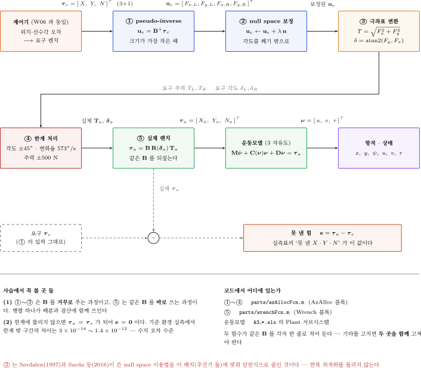

| 칸 | 식 | 유의 사항 |
|---|---|---|
| 요구 렌치 | $\boldsymbol{\tau}_c = [X_c\ Y_c\ N_c]^\mathsf{T}$ | 제어기가 낸 값. 본 부록은 손대지 않음 |
| 최소 노름 해 | $\mathbf{u}_e = \mathbf{B}^{+}\boldsymbol{\tau}_c$ | 선형계 한 줄. 반복 없음 |
| null space 보정 | $\mathbf{u}_e \mathrel{+}= \lambda^{\ast}\mathbf{n}$ | 구간이 비면 낼 수 없는 요구 |
| polar 변환 | $T_i = \lVert\cdot\rVert$ · $\delta_i = \operatorname{atan2}$ | $\lvert\delta\rvert \le 90°$ 로 접고 $T < 0$ 을 허용 |
| 각도 한계 | $\lvert\delta_i\rvert \le \delta_{\max}$ | **각도만** 자름. 추력은 건드리지 않음 |
| 추력 한계 | $\lvert T_i\rvert \le 500$ N | 넘친 만큼이 못 낸 힘으로 남음. 비율로 줄이지 않음 |
| 변화율 제한 | $\lvert\dot\delta_i\rvert \le 573$ °/s | URDF 값 10 rad/s 를 옮긴 것 |
| 실제 렌치 | $\boldsymbol{\tau}_a = \mathbf{B}\,\mathbf{R}(\boldsymbol{\delta}_a)\,\mathbf{T}_a$ | **운동모델 안**에서 계산. 요구와의 차이가 "못 낸 힘" |
| 운동모델 | $\dot{\mathbf{s}} = f(\mathbf{s},\ \boldsymbol{\tau}_a)$ | 들어가는 것은 $\boldsymbol{\tau}_a$ — 요구가 아님 |

> [!note] 방향각을 ±90° 로 접는 이유
> - $\delta = 170°$ 와 "$\delta = -10°$ 에 추력 반전" 은 **같은 힘**임
> - 뒤쪽을 택하면 모터가 한 바퀴 돌 필요가 없어짐 — 각도 기억도 필요 없음
> - $\operatorname{atan2}(F_y,\ F_x)$ 가 ±180° 를 내면 추력 부호를 뒤집어 ±90° 안으로 접음
> - 접은 뒤 변화율 제한을 걸면 각도가 끊기지 않음

## 1-13 문헌 근거 — 어느 줄이 어느 식에서 왔는가

> [!important] 본 부록의 배분은 **새로 만든 알고리즘이 아님**
> - 아래 문헌의 표준 절차를 "추진기 두 대 · 각도 한계 ±45°" 라는 조건에 맞춰 닫힌식으로 적은 것임
> - 특히 **[1] 의 6 절 전체가 `AzAlloc` 의 원본**임 — WAM-V USV16 에 아지무스 추진기 둘을 단 같은 구성임

### 원문에서 확인한 1 차 문헌

| # | 문헌 | 본 부록에서 쓰는 곳 |
|---|---|---|
| [1] | E. I. Sarda, H. Qu, I. R. Bertaska, K. D. von Ellenrieder, "Station-keeping control of an unmanned surface vehicle exposed to current and wind disturbances," *Ocean Engineering* **127** (2016) 305–324 | **6 절 전체** — 배치행렬, 확장 추력 벡터, pseudo-inverse, 각도 포화 처리 |
| [2] | O. J. Sørdalen, "Optimal thrust allocation for marine vessels," *Control Engineering Practice* **5**(9) (1997) 1223–1231 | 배치행렬 $\mathbf{B}$ 의 일반형. [1] 이 식 (47) 에서 인용 |
| [3] | O. K. Kjerstad, R. Skjetne, B. O. Berge, "Constrained nullspace-based thrust allocation for heading prioritized stationkeeping," *POAC* 2013, Espoo | 1-7 절의 null space 보정 |
| [4] | X. Vicent, M. R. Dhanak, "Performance and comparison of PID-based techniques for USV navigation," *OCEANS 2024 – Halifax*, IEEE | 같은 절차를 VRX 의 WAM-V 16 에 적용한 예 (±45° 명시) |
| [5] | P. Jin, W. Li, Y. Yang, C. Shan, Y. Zhang, *Applied Sciences* **15** (2025) 4213 | 식 (8)–(10) — 두 추진기의 각도를 하나로 묶는 가정. 본 부록이 **쓰지 않는** 쪽의 근거 |
| [6] | T. I. Fossen, *Handbook of Marine Craft Hydrodynamics and Motion Control*, 2nd ed., Wiley, 2021 | Control Allocation 장 — 교과서 수준의 정리 |

### 1 대 1 대응 — 식과 코드

| 본 부록 | 코드 | 문헌 |
|---|---|---|
| $\mathbf{u}_e$ 확장 추력 벡터 (1-3 절) | `ue` | [1] 식 (45) (48) — 그 논문은 $\mathbf{f}$ 로 씀 |
| $\mathbf{B}$ 배치행렬 (1-3 절) | `B` | [1] 식 (47) (49) — 그 논문은 $\mathbf{T}$ 로 씀 · [2] 가 원형 |
| $\boldsymbol{\tau} = \mathbf{B}\mathbf{u}_e$ (1-3 절) | `tau = B*ue` | [1] 식 (46) |
| 라그랑주 최소화 (1-4 절) | — | [1] 식 (50) (51) |
| $\mathbf{B}^{+} = \mathbf{B}^\mathsf{T}(\mathbf{B}\mathbf{B}^\mathsf{T})^{-1}$ (1-4 절) | `B'*((B*B')\tau)` | [1] 식 (52) |
| polar 변환 · 180° 접기 (1-9 절) | `az_polar` (a) | [1] 6.3 절 |
| 각도 포화 처리 (1-6 절) | `az_polar` (c) | [1] Fig. 22 |
| null space 보정 (1-7 절) | `lam`, `nz` | [3] |
| 추력 포화 처리 (1-9 절) | `az_polar` (d) | [1] 6.3 절 |
| ±45° 각도 한계 | `d_max_deg = 45` | [1] 하드웨어 절 · [4] |

### 문헌과 일부러 다르게 둔 곳 — 둘

| 항목 | 문헌 | 본 부록 | 왜 |
|---|---|---|---|
| 각도 포화 처리 | [1] Fig. 22 — 낼 수 없는 각도면 **추력을 0 으로** 끊음 | **각도만 자르고 추력은 유지** | 못 낸 힘이 수치로 남아야 학습이 됨. 추력을 0 으로 끊으면 왜 못 갔는지가 그래프에 0 으로만 남음 (1-6 절) |
| 각도를 묶는 가정 | [5] 는 두 추진기의 각도를 하나로 묶음 ($\delta_L = \delta_R$) | 두 각도를 **따로** 둠 | 묶으면 $\mathbf{B}$ 가 요구에 따라 변하고, 순수 횡이동에서 요구를 만족시킬 각도 자체가 없어짐 (1-5 절) |

- 두 곳 모두 **의도한 차이**임
- 그 밖의 식·절차·기호는 문헌을 그대로 따름

## 1-14 결론 — 선미 아지무스 둘로 위치 제어가 되는가

> [!important] 한 줄 답 — **된다.** 선수추진기 없이, 선미 추진기 둘을 틀어 $(x,\ y,\ \psi)$ 셋을 동시에 세운다

- 이유는 하나임 — 추진기 둘을 **돌릴 수 있게 되는 순간 미지수가 2 에서 4 로 늘어남**
  - 고정 추진기 둘: 미지수 $2$ · 식 $3$ → 부족구동. $X$ · $N$ 만 내고 $Y$ 는 못 냄 (5주차)
  - 아지무스 추진기 둘: 미지수 $4$ · 식 $3$ → **완전구동 + 남는 자유도 하나** (본 부록)
  - 선수추진기를 더한 6주차: 미지수 $3$ · 식 $3$ → 완전구동, 남는 자유도 없음
- 즉 **아지무스 둘은 6주차와 같은 일을 하고, 자유도가 하나 더 남는다**

### 세 질문에 대한 답

| # | 질문 | 어디서 | 답 |
|---|---|---|---|
| (a) | 순수 횡이동 중 선수각이 유지되는가, 흔들리는가 | 1-5 · 2-3 | **유지됨.** 두 추진기의 요 모멘트가 **구조적으로 상쇄**됨 — 게인으로 눌러 둔 것이 아님. 조류를 걸고도 흔들리지 않음 |
| (b) | 6주차처럼 $(x,\ y,\ \psi)$ 셋을 세울 수 있는가 | 2-4 · 2-5 | **됨.** 목표점에 서고, 선수각을 따로 지정할 수 있으며, 단계 전이 접안까지 됨 |
| (c) | 배분을 가장 간단하게 유지할 수 있는가 | 1-4 · 1-7 | **됨.** pseudo-inverse **한 줄** + null space 보정 **아홉 줄**. 반복 최적화·QP 없음 |

### 순수 횡이동은 특별한 과업이 아님

> [!note] 위치 제어가 주제이고, 순수 횡이동은 그 **한 경우**임

- 위치 제어기가 내놓는 요구는 언제나 $\boldsymbol{\tau} = [\,X,\ Y,\ N\,]^\mathsf{T}$ 세 성분임
- 배분은 그 셋을 받아 풀 뿐, $X$ 가 $0$ 인지 아닌지 **알지 못함**
- 순수 횡이동은 그 가운데 $X = 0$ · $N = 0$ 인 **한 점**임 — 손으로 끝까지 풀 수 있어 예제로 쓸 뿐임 (1-5 절)
- 2부의 1단이 그 한 점, 2단 이후가 **일반적인 위치 제어**임

### 공짜는 아님 — 단서 셋

| 단서 | 무슨 뜻인가 | 어디서 |
|---|---|---|
| **±45° 쐐기** | 요구 $(X,\ Y)$ 의 방향에 제한이 생김. 옆으로 미는 힘이 앞뒤로 미는 힘보다 크면 낼 수 없음 | 1-6 · 2-6 |
| **추력 반전이 필수** | 뒤로 밀지 못하면 쐐기가 절반으로 줄고 제어가 깨짐 | 1-9 · 2-6 |
| **서보의 유한한 속도** | 각도 변화율이 느리면 요구를 따라가지 못함. 본 부록은 $573\ °/\text{s}$ 를 전제함 | 2-6 |

- 셋 가운데 **하나라도 빠지면 깨짐** — 무엇을 빼면 어떻게 깨지는지는 2-6 절의 표 둘에 수치로 있음

### 6주차(선수추진기)와 견주면

| 항목 | 6주차 — 선수추진기 | 본 부록 — 선미 아지무스 |
|---|---|---|
| 미지수 · 식 | $3$ · $3$ | $4$ · $3$ |
| 배분 | 정방 역행렬 | pseudo-inverse + null space |
| 기체 개조 | 선수에 추진기 **추가** | 선미 추진기에 **서보 추가** |
| 횡력의 출처 | 선수추진기 하나 | 선미 둘의 **$y$ 성분 합** |
| 제약 | 없음 (설계 전제 안에서) | **±45° 쐐기** |
| 남는 자유도 | 없음 | **하나** — 각도 포화를 피하는 데 씀 |

> [!tip] 어느 쪽이 낫다는 결론은 내지 않음
> - 본 부록이 보이는 것은 **둘 다 된다**는 것과, 그 대신 치르는 값이 서로 다르다는 것임
> - 선택은 기체를 어떻게 개조할 수 있는가에 달림 — 추진기를 더할 것인가, 서보를 달 것인가

---

# 2부 · 실습

## 2-1 폴더와 파일

- 실습 폴더로 이동 (MATLAB 명령창)

```matlab
cd(fullfile('10-주차별-강의자료','A3_azimuth'))
```

| 파일 | 하는 일 |
|---|---|
| `A3_setup.m` | 제원·게인·한계를 base 워크스페이스에 깖. **모든 실행의 출발점** |
| `build_a3_models.m` | 모델 셋을 **전부 다시 만듦** (`tidy_layout` 두 번 포함) |
| `A3_1_crab.slx` | 1단 — 순수 횡이동 |
| `A3_2_pose.slx` | 2단 — 위치·선수각 유지 |
| `A3_3_dock.slx` | 3단 — 단계 전이 접안 |
| `A3_1_crab_run.m` \~ `A3_4_limit_run.m` | 단마다 **한 줄로 돌리는 실행 스크립트** |
| `A3_plot.m` | 결과 그림과 지표를 냄. 네 실행 스크립트가 같이 씀 |
| `A3_envelope.m` | ±45° **도달 가능 집합**을 격자로 재고 그림 |
| `A3_shots.m` | 본 문서에 실린 결과 그림을 다시 찍음 |
| `A3_pinv_example.m` | 1-4 · 1-7 절의 **손풀이 예제 셋**을 숫자로 검산 (시뮬레이션 없음) |
| `parts/` | 모델 생성 조각 (`addAzAlloc.m`, `azAllocFcn.m` 등) |

> [!tip] 실행 스크립트의 머리말을 먼저 읽을 것
> - `help A3_1_crab_run` 으로 읽힘
> - 무엇을 재는지, 어떤 값을 보면 되는지 머리말에 적혀 있음

- 모델을 새로 만듦 (한 번만. 모델을 망가뜨렸을 때도 이 한 줄)

```matlab
build_a3_models
```

## 2-2 모델 구조 — 6주차와 한 블록만 다르다

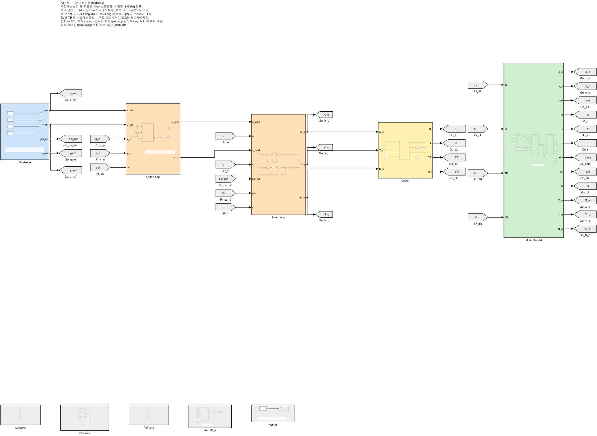

| 색 | 블록 | 6주차와 비교 |
|---|---|---|
| 파랑 | `Guidance` — 목표점·목표 선수각 | 같음 |
| 주황 | `OuterLoop` · `InnerLoop` — 위치 P → 속도 PI, 선수각 P–D | **게인까지 같음** |
| 노랑 | `Alloc` — 추력 배분 | **여기만 다름** |
| 초록 | `MotionModel` — 3자유도 운동모델 | 같음 (선형 + 2차 항력) |
| 회색 | `Logging` · `Animate` | 같음 |

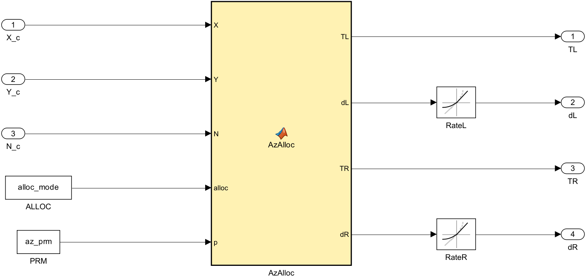

- 바뀐 블록은 `Alloc` 하나임
  - 6주차: 추력 셋을 내는 선형 배분
  - 본 부록: 추력 둘 + **방향각 둘**을 내는 배분 (1-12 절의 사슬)

> [!important] 운동모델을 손대지 않은 것이 이 비교의 전제
> - 질량 226.5 kg · 관성 653 kg·m² · 항력계수 전부 6주차 값
> - 따라서 본 부록의 수치 차이는 **배분 때문**이라고 말할 수 있음

## 2-3 1단 — 순수 횡이동 (질문 a)

```matlab
A3_1_crab_run
```

- 과업: 선수각 0° 를 유지한 채 **동쪽으로 12 m** 이동
- 스크립트가 **세 번** 돌림 — 기준 · 추력 한계까지 · 조류를 걸고

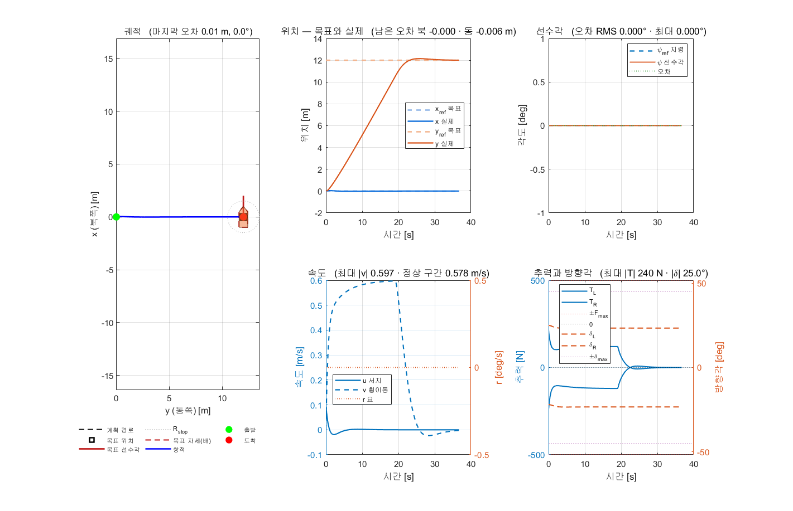

### 첫 번째 — 기준 (조류 없음)

| 항목 | 실측 | 읽는 법 |
|---|---|---|
| 선수각 오차 RMS | **0.0000°** | 1-5 절의 상쇄가 그대로 나타남 |
| 선수각 오차 최대 | 0.0000° | |
| 방향각 평균 | **23.401°** | 닫힌식 23.398° 와 일치 |
| 방향각 최대 | 25.001° | 가감속 구간에서만 벗어남 |
| 횡속도 정상 구간 | 0.578 m/s | 지령 한계 0.60 m/s |
| 마지막 $|x_n|$ | 0.0000 m | 전후로 밀리지 않음 |
| 최대 $|T|$ | 240.5 N | 한계 500 N |
| 각도 포화 · 추력 포화 | 0.0 % · 0.0 % | 한계에 닿지 않음 |
| 못 낸 힘 | $X$ 0.00 · $Y$ 0.00 N · $N$ 0.00 N·m | 요구를 그대로 냄 |

- 방향각 실측 23.401° 가 닫힌식 $\arctan(b/L)$ = 23.398° 와 맞음 → 배분이 의도대로 동작함

### 두 번째 — 추력 한계까지 밀었을 때

- 속도 지령 한계를 3.0 m/s 로 풀고 목표를 200 m 로 멀리 둠

| 항목 | 값 |
|---|---|
| 실측 정상 횡속도 | **1.555 m/s** |
| 닫힌식 (1-5 절) | 1.555 m/s |
| 차이 | 0.000 m/s |
| 이때 최대 $|T|$ | 500.0 N (한계에 붙음) |
| 선수각 오차 RMS | 0.0022° |

> [!tip] 이 대조가 이 실습의 핵심 검증임
> - 닫힌식과 시뮬레이션이 **독립적으로** 같은 값을 냄
> - 배분·운동모델·항력계수 어느 쪽에 오타가 있어도 이 값이 어긋남

### 세 번째 — 조류를 걸었을 때 (질문 a 의 실제 답)

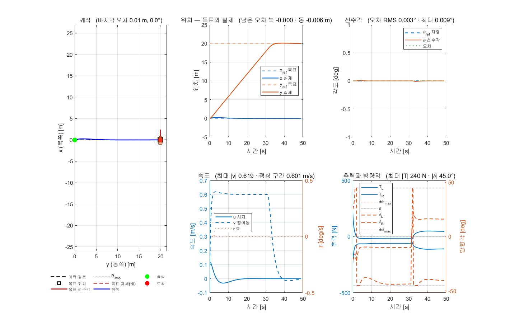

- 조류 **0.6 m/s · 45° (NED)** — 선수각을 비틀려는 외란을 일부러 넣음

| 항목 | 조류 없음 | 조류 0.6 m/s · 45° |
|---|---|---|
| 선수각 오차 RMS | 0.0000° | **0.0026°** |
| 선수각 오차 최대 | 0.0000° | 0.0092° |
| 방향각 평균 | 23.401° | **26.540°** |
| 방향각 최대 | 25.001° | **45.00°** (한계) |
| 각도 포화 | 0.0 % | **10.3 %** |
| 못 낸 힘 $X$ · $Y$ · $N$ | 0.00 · 0.00 · 0.00 | 0.55 N · 1.01 N · 2.97 N·m |
| 마지막 $|x_n|$ | 0.0000 m | 0.000 m |

> [!important] 질문 (a) 에 대한 답 — 선수각은 유지됨
> - 외란을 건 상태에서도 선수각 오차 **RMS 0.0026° · 최대 0.0092°** 임
> - 조류가 더한 전진 성분을 상쇄하느라 방향각이 23.40° → 26.54° 로 기울어짐
> - 전체 시간의 **10.3 %** 는 45° 한계에 붙음 → ±45° 전제가 **처음으로 걸리는 지점**임
> - 못 낸 힘은 $Y$ 1.01 N 수준 (요구의 1 % 미만) — 과업 수행에는 영향이 없음

## 2-4 2단 — 위치·선수각 유지 (질문 b)

```matlab
A3_2_pose_run
```

- 과업: $(x_n,\ y_n)$ = (30, 20) m 에 **선수각 45°** 로 서서 멈춤
- 6주차 5단과 **같은 과업 · 같은 게인**임

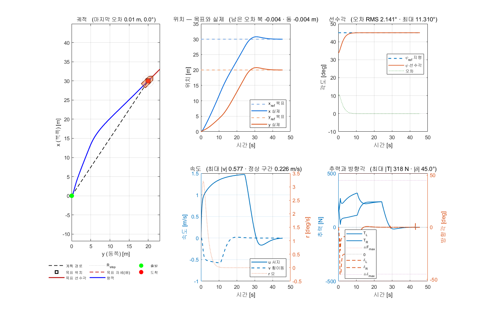

| 항목 | 실측 |
|---|---|
| 도착 시각 | **30.6 s** |
| 도착 순간 위치 오차 | 1.091 m (판정선 1.5 m) |
| 그 뒤 변화 | $-1.085$ m — 더 좁힘 |
| 마지막 위치 오차 | **0.006 m** |
| 마지막 10 초 평균 | 0.134 m · **0.00°** |
| 선수각 오차 RMS · 최대 | 2.1406° · 11.3099° |
| 최대 $|T|$ | 317.7 N |
| 각도 포화 · 추력 포화 | 1.3 % · 0.0 % |
| 못 낸 힘 | $X$ 0.00 · $Y$ 0.00 N · $N$ 0.00 N·m |

> [!note] 도착 뒤에도 오차가 **더 줄어드는** 것이 정상임
> - 도착 판정은 **기록일 뿐** 고리를 끊지 않음 — 위치 고리가 그 자리를 계속 잡음
> - 1.091 m (도착 순간) → 0.006 m (마지막) 로 좁혀짐
> - 제자리 유지(DP)가 곧 정지임. 도착하면 속도 지령을 끊는 구조로 만들면 **제동력만 사라지고** 쌓인 적분항이 남아 목표점을 지나침

### 목표 선수각을 바꿔 가며

- 목표점 방향(33.7°)과 목표 선수각이 **얼마나 어긋나는가**가 난이도를 정함

| 목표 $\psi$ | 도착 [s] | 도착 순간 오차 [m] | 마지막 10 초 [m] | $\psi$ 오차 RMS [°] | 최대 $\delta$ [°] | 각도 포화 [%] |
|---|---|---|---|---|---|---|
| 0° | 36.6 | 0.182 | 0.019 | 6.111 | 45.00 | 4.2 |
| 45° | **30.6** | 1.091 | 0.134 | **2.141** | 45.00 | 1.3 |
| 90° | 51.2 | 0.124 | 0.024 | 9.178 | 45.00 | 2.6 |

- 세 경우 모두 도착하고 마지막 선수각 오차는 0.000° 임
- 어긋남이 클수록 느려지고 각도 포화가 늘어남 — 1-6 절의 쐐기를 밟기 때문임

> [!important] 질문 (b) 에 대한 답 — 셋을 동시에 세울 수 있다
> - 세 목표 선수각 모두에서 도착 판정이 걸리고 선수각을 끝까지 유지함
> - 선수추진기 없이 **6주차와 같은 과업**이 수행됨

## 2-5 3단 — 단계 전이 접안

```matlab
A3_3_dock_run
```

- 선석 (40.0, 45.0) m · 선수각 0° · 댈 현 우현
- 접근점 (40.0, 60.0) m — 선석에서 15 m 떨어진 자리

| 단계 | 하는 일 | 선수각 |
|---|---|---|
| 1 | 접근점으로 간다 | 가는 방향 (저항이 작음) |
| 2 | 접근점에 머물며 선수각만 돌린다 | 접안 선수각으로 |
| 3 | 선수각을 지킨 채 **옆걸음으로** 선석에 들어간다 | 고정 |

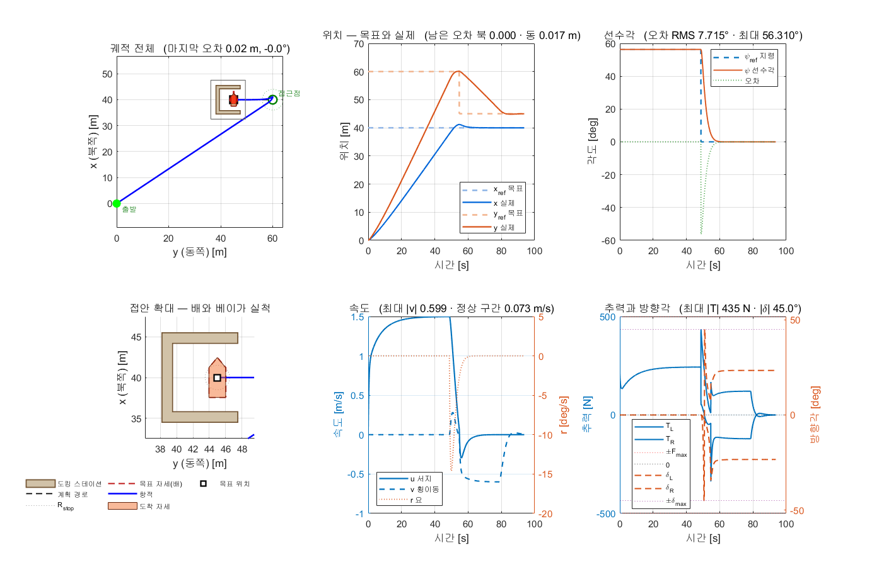

| 항목 | 실측 |
|---|---|
| 단계 1 도달 (접근점) | 48.7 s |
| 단계 2 도달 (선수각 정렬) | 54.7 s |
| 단계 3 도달 (선석) | **78.7 s** |
| 마지막 위치 오차 | 0.017 m (판정선 1.5 m) |
| 마지막 10 초 | 0.087 m · **0.000°** |
| 최대 $|T|$ | 434.8 N |
| 각도 포화 · 추력 포화 | 0.5 % · 0.0 % |
| 못 낸 힘 | $X$ 0.81 · $Y$ 1.49 N · $N$ 4.37 N·m |

- **옆걸음 구간만** 따로 잼 (단계 3 · 54.7 \~ 78.7 s) — 이 구간이 아지무스 추진기의 몫임

| 항목 | 실측 | 대조 |
|---|---|---|
| 선수각 오차 RMS | 0.953° | 24 초간 선수각을 지킴 |
| 선수각 오차 최대 | 4.981° | |
| 방향각 평균 | **23.38°** | 닫힌식 23.40° 와 일치 |
| 횡속도 평균 | 0.565 m/s | 지령 0.60 m/s |

### 단계를 나누지 않으면 — `dock_on = 0`

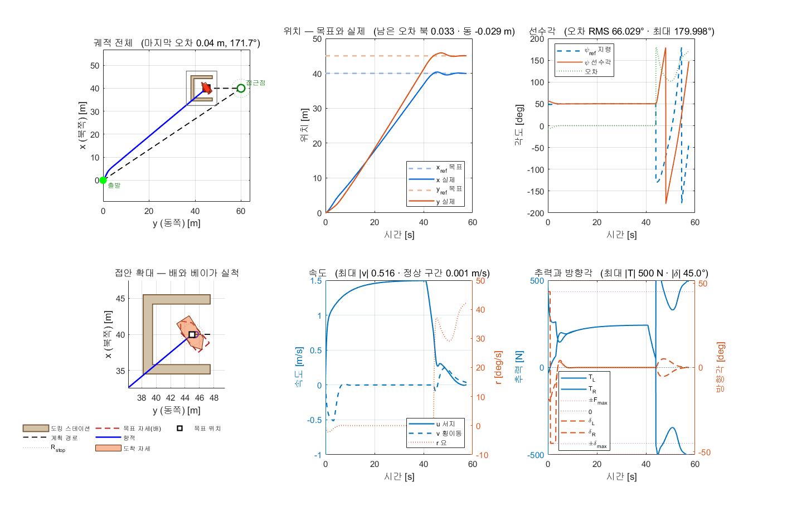

| 경우 | 마지막 10 초 위치 [m] | 마지막 10 초 선수각 [°] | $\psi$ RMS [°] | 각도 포화 [%] | 추력 포화 [%] |
|---|---|---|---|---|---|
| 세 단계 (`dock_on = 1`) | 0.087 | **0.000** | 7.715 | 0.5 | 0.0 |
| 직행 (`dock_on = 0`) | 0.279 | **84.563** | 66.029 | 5.0 | 5.6 |

- 직행은 선석에 **84.6° 비스듬히** 닿음 — 접안이라 부를 수 없는 결과임
- 직행의 못 낸 힘은 $N$ **97.23 N·m** 에 달함 (세 단계는 4.37 N·m)

> [!important] 과업을 단계로 나누는 것이 배분보다 먼저다
> - 같은 배·같은 게인·같은 배분으로 결과가 이만큼 갈림
> - 요구를 **한 번에 셋 다** 내려고 하면 쐐기 구간에 들어감 (1-6 절)
> - 단계로 나누면 각 구간의 요구가 단순해져 쐐기를 피함

## 2-6 4단 — 무엇을 빼면 깨지는가

```matlab
A3_4_limit_run
```

- 설정값을 **하나씩만** 바꿔 같은 과업을 다시 돌림. 새 모델을 만들지 않음
- 여섯 경우를 돌림 — 아래 넷과 **배분 방식 둘** (배분 둘은 2-10 절에서 따로 봄)

| 바꾼 것 | 설정 | 뜻 |
|---|---|---|
| 추력 반전 금지 | `rev_on = 0` | 추진기가 앞으로만 밂 |
| 각도 한계 ±15° | `d_max_deg = 15` | 설계 전제를 더 보수적으로 |
| 변화율 30 °/s | `d_rate_deg = 30` | 모터가 느리게 돌아감 (기본 573 °/s) |
| 배분 방식 | `alloc_mode = 1` · `2` | 1-8 절의 둘. 결과는 2-10 절 |

### 1단 과업 (순수 횡이동 12 m) 에서

| 바꾼 것 | $\psi$ RMS [°] | $\psi$ 최대 [°] | 횡속도 [m/s] | 최대 $\delta$ [°] | 각도 포화 [%] | 변화율 [%] | 못 낸 힘 [N] |
|---|---|---|---|---|---|---|---|
| 기준 | 0.000 | 0.000 | 0.578 | 25.00 | 0.0 | 0.0 | 0.00 |
| **추력 반전 금지** | **169.768** | 180.000 | 0.420 | 45.00 | 50.9 | 70.3 | **1889.92** |
| **각도 한계 ±15°** | **45.632** | 107.494 | 0.373 | 15.00 | 80.7 | 3.6 | **309.97** |
| 변화율 30 °/s | 0.000 | 0.000 | 0.578 | 25.00 | 0.0 | 0.0 | 0.00 |
| 배분1 pseudo-inverse | 0.000 | 0.000 | 0.578 | 25.00 | 0.0 | 0.0 | 0.00 |
| 배분2 +null space | 0.000 | 0.000 | 0.578 | 25.00 | 0.0 | 0.0 | 0.00 |

- **추력 반전 금지** — 과업이 성립하지 않음
  - 1-5 절에서 우현 추력이 $-1.259\,Y$ 였음. 반전을 막으면 이 해를 낼 수 없음
  - 300 s 안에 끝내지 못하고, 12 m 목표에서 **418.3 m** 떨어진 자리까지 밀려가며 선수각이 180° 돌아감
  - 추력 포화 99.7 % — 전 구간에서 한계에 붙어 있음
- **각도 한계 ±15°** — 순수 횡이동 자체가 불가능해짐
  - 필요한 방향각이 23.40° 인데 한계가 15° 임
  - 전체 시간의 80.7 % 를 한계에 붙어 보냄
- **변화율** — 1단에서는 차이가 없음
  - 순수 횡이동의 방향각은 상수이므로 변화율이 걸릴 일이 없음
- **배분 둘** — 1단에서는 **값이 완전히 같음**
  - 순수 횡이동의 pseudo-inverse 해가 이미 $\pm23.40°$ 안이므로 보정량이 0 임

### 2단 과업 (위치·선수각) 에서

| 바꾼 것 | 도착 [s] | 마지막 10 초 [m] | $\psi$ RMS [°] | 최대 $\delta$ [°] | 각도 포화 [%] | 추력 포화 [%] | 변화율 [%] | 못 낸 힘 [N] |
|---|---|---|---|---|---|---|---|---|
| 기준 | 30.6 | 0.134 | 2.141 | 45.00 | 1.3 | 0.0 | 0.0 | 0.00 |
| **추력 반전 금지** | **미완료** | **494.813** | 7.535 | 45.00 | 35.6 | **89.4** | 67.9 | **1999.15** |
| **각도 한계 ±15°** | 30.7 | 0.134 | 2.727 | 15.00 | **21.7** | 0.0 | 0.0 | **45.71** |
| **변화율 30 °/s** | 30.7 | 0.131 | 2.262 | 44.29 | 0.0 | 0.0 | **4.3** | **23.07** |
| **배분1 pseudo-inverse** | 30.7 | 0.130 | 2.167 | 45.00 | 1.6 | 0.0 | 0.0 | **30.44** |
| 배분2 +null space | 30.6 | 0.134 | 2.141 | 45.00 | 1.3 | 0.0 | 0.0 | 0.00 |

> [!important] 한 과업만 돌리면 절반을 놓친다
> - 1단은 요구가 $Y$ 하나뿐임 → **추력 반전**의 필요성이 드러남
> - 2단은 요구가 $X$ · $Y$ · $N$ 셋임 → **null space 보정 · 변화율**의 값어치가 드러남
> - 두 과업을 모두 돌려야 한계 넷과 배분 둘의 역할이 전부 보임

- **변화율을 1/20 로 낮추면** 각도가 45° 에 닿지 못하고 (최대 44.29°) 못 낸 힘 23.07 N 이 생김
  - 각도 포화는 0.0 % 임 — 한계에 **붙지 않았는데도** 못 냈다는 뜻임 (1-10 절의 원인 3)
- **추력 반전 금지**는 2단에서도 과업을 깨뜨림 — 300 s 안에 도착하지 못하고 **494.8 m** 밀려남
  - 추력 포화 89.4 % · 못 낸 힘 1999 N — 1단과 같은 결론임
- 나머지 셋(각도 한계 · 변화율 · 배분1)은 **도착은 함** — 오류 메시지 없이 성능만 깎임. 그래서 못 낸 힘을 기록해야 함

## 2-7 ±45° 도달 가능 집합

```matlab
A3_envelope
```

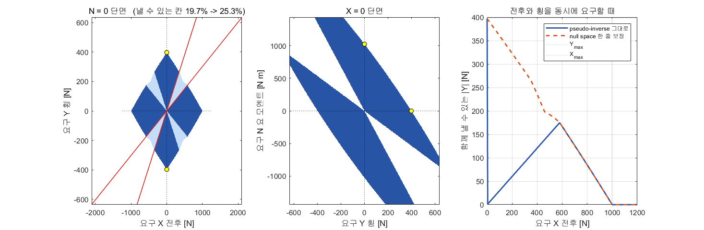

| 항목 | 값 |
|---|---|
| 반폭 $b$ · 거리 $L$ | 1.027135 m · 2.373776 m |
| 추력 한계 · 각도 한계 | 500 N · ±45° |
| 횡력 환산비 $k_T$ | 1.259069 N/N |
| 순수 횡이동 방향각 | 23.3982° |
| 낼 수 있는 한계 $X$ | 1000 N |
| 낼 수 있는 한계 $Y$ | **397.1 N** |
| 낼 수 있는 한계 $N$ | 1027.1 N·m |
| 쐐기 구간 $X/Y$ | 1.3111 \~ 3.3111 |
| $N = 0$ 단면 격자 — pseudo-inverse 그대로 | 19.7 % |
| $N = 0$ 단면 격자 — null space 보정 뒤 | **25.3 %** |
| null space 차원 · 벡터 | 1 · $[0\ 1\ 0\ -1]^\mathsf{T}$ |

> [!important] 이 표가 설계 전제 ±45° 의 값어치를 정한다
> - 세 축을 **동시에** 크게 요구하면 ±45° 를 넘음 — 격자의 3/4 가 닿지 않음
> - 그러나 실제 과업(1\~3단)의 요구는 한계보다 훨씬 작음 — 최대 $|T|$ 가 240.5 \~ 434.8 N
> - 즉 **±45° 는 본 과목의 과업에 충분함**. 한계에 닿는 경우는 외란이 걸릴 때의 10.3 % 수준임
> - 각도 한계를 ±15° 로 줄이면 순수 횡이동 자체가 불가능해짐 (2-6 절)

## 2-8 돌아가는 동안 보는 화면 — 애니메이트 창

- 모델을 돌리면 `Animate` 상자가 창을 하나 띄우고 **매 스텝 다시 그림**
- 그리는 코드는 `A3_animate.m` 임. 손으로 부를 일은 없음
- 켜고 끄기는 `A3_setup.m` 의 두 값으로 함

| 값 | 뜻 |
|---|---|
| `animate = 1` | 실시간 화면을 켬. `0` 이면 그리지 않음 (빠름) |
| `animate_every` | 몇 **시뮬레이션 초**마다 다시 그릴지. 기본 0.25 s. 키우면 가벼워짐 |

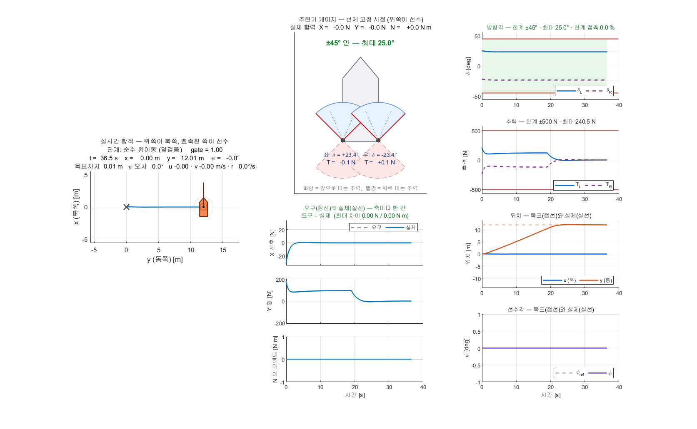

### 아홉 칸을 읽는 법

| 칸 | 보이는 것 | 무엇을 확인하는가 |
|---|---|---|
| 왼쪽 큰 칸 | 항적 · 목표 자세 · 선체 · **추진기 화살표 둘** | 화살표 방향이 곧 방향각, 길이가 곧 추력 크기 |
| 가운데 위 | **추진기 게이지** — 선체 기준 방향각과 ±45° 쐐기 | 바늘이 쐐기 안에 있는지. 밖으로 나가면 포화임 |
| 가운데 아래 1 | $X$ 전후력 — **요구(점선)와 실제(실선)** | 두 선이 겹쳐 있어야 정상임 |
| 가운데 아래 2 | $Y$ 횡력 — 요구와 실제 | 벌어진 폭이 곧 못 낸 몫임 |
| 가운데 아래 3 | $N$ 요 모멘트 — 요구와 실제 | 어느 축이 모자랐는지가 칸으로 갈림 |
| 오른쪽 1 | $\delta_L$ · $\delta_R$ 과 ±45° 띠 | 띠를 넘는 순간이 보임 |
| 오른쪽 2 | $T_L$ · $T_R$ 과 ±500 N 띠 | 추력 한계에 붙는 순간 |
| 오른쪽 3 | **위치** — $x_{\mathrm{ref}}$ · $x$ · $y_{\mathrm{ref}}$ · $y$ (점선이 목표) | 목표에 붙는지, 어느 축이 늦는지 |
| 오른쪽 4 | **선수각** — $\psi_{\mathrm{ref}}$ · $\psi$ (점선이 목표) | 횡이동 중 흔들리지 않는지 (질문 a) |

> [!note] 가운데 아래를 **한 칸이 아니라 축마다 세 칸**으로 쪼갠 까닭
> - 차이 하나만 그리면 "모자랐다" 는 사실만 남고 **얼마에 대해 모자랐는지**가 지워짐
> - 요구 300 N 에서 30 N 을 못 낸 것과 요구 30 N 에서 30 N 을 못 낸 것은 전혀 다른 사건임
> - $X$ · $Y$ · $N$ 은 단위도 크기도 다름 — 한 칸에 겹치면 작은 축이 보이지 않음

> [!note] 속도 $u$ · $v$ 를 칸에서 뺀 까닭
> - 이 창이 답해야 하는 것은 **요구를 냈는가**(가운데 아래)와 **목표에 갔는가**(오른쪽 3·4) 둘임
> - 횡속도의 수치는 끝난 뒤 `A3_plot` 의 표와 2-3 절에서 확인함

> [!important] 게이지를 항적 칸과 **따로** 둔 까닭
> - 항적 칸의 화살표는 **지구에 고정된** 방향이라 배가 돌면 같이 돔
> - 각도 한계 ±45° 는 **선체에 고정된** 양임 — 선체 기준으로 봐야 읽힘
> - 게이지에는 쐐기를 **앞뒤로 둘** 그려 둠
>   - 뒤쪽 쐐기는 추력을 **음수**로 줄 때 닿는 방향임
>   - 순수 횡이동에서 한쪽 바늘이 뒤쪽 쐐기로 넘어가는 것이 곧 "추력 반전이 필수" 라는 뜻임

### 화살표 읽는 법

| 보이는 것 | 뜻 |
|---|---|
| 화살표가 길다 | 추력이 크다 |
| 화살표가 빨갛다 | **뒤로 미는 중**임 ($T < 0$) |
| 두 화살표가 서로 벌어져 있다 | 횡력을 내는 중임 (순수 횡이동의 ∓23.40°) |
| 두 화살표가 같은 쪽을 본다 | 전진·후진 또는 선회 중임 |
| 바늘이 쐐기 경계에 붙어 멈춘다 | **각도 포화** — 요구를 못 내고 있음 |

> [!tip] 각도 한계 ±15° 로 줄이고 1단을 다시 돌려 볼 것
> - 바늘이 쐐기 경계에 붙어 떨어지지 않음
> - 가운데 아래 세 칸에서 실선이 점선에서 떨어짐 — 요구를 못 내고 있다는 뜻임

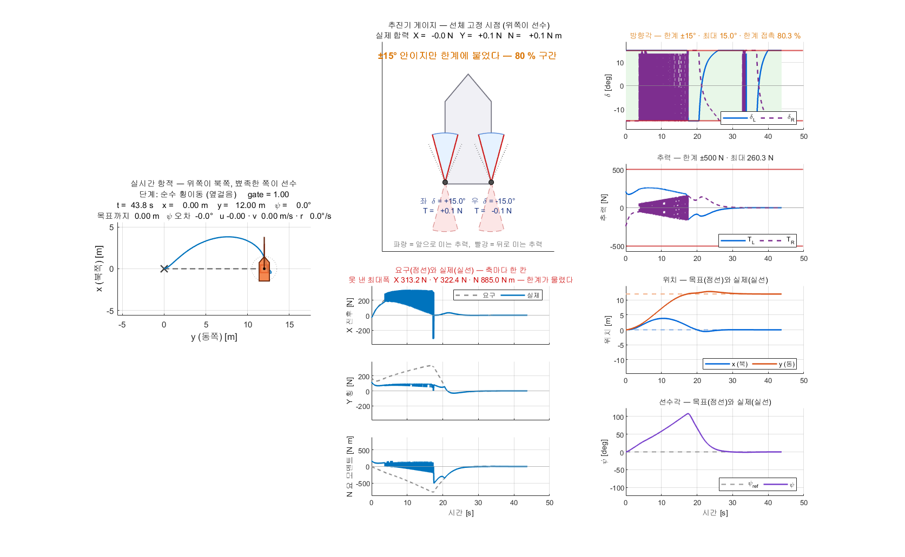

## 2-9 끝난 뒤 보는 점검 그림 — 요구 대비 실제

- 네 실행 스크립트가 결과 그림과 **점검 그림**을 같이 띄움
- 그리는 코드는 `A3_check.m` 임. 값만 받고 싶으면 아래 한 줄

```matlab
C = A3_check(out, '1단 · 순수 횡이동')
```

- 점검 그림은 **여덟 칸**임

| 칸 | 보이는 것 |
|---|---|
| 1 | $\delta_L$ · $\delta_R$ 시간 그래프 + ±45° 띠. 제목이 넘었는지를 그대로 알려줌 |
| 2 | 방향각 **분포** — 한계선을 넘는 막대가 없어야 함 |
| 3 | 추력 벡터 전체를 **쐐기 안에** 겹쳐 그림 |
| 4 | 글자 칸 — 점검 결과 세 줄, 원인별 시간 비율, 최대 차이 |
| 5\~7 | $X$ · $Y$ · $N$ 축마다 **요구(점선)와 실제(실선)** |
| 8 | 못 낸 몫과 **원인** — 각도·추력·변화율을 색으로 가름 |

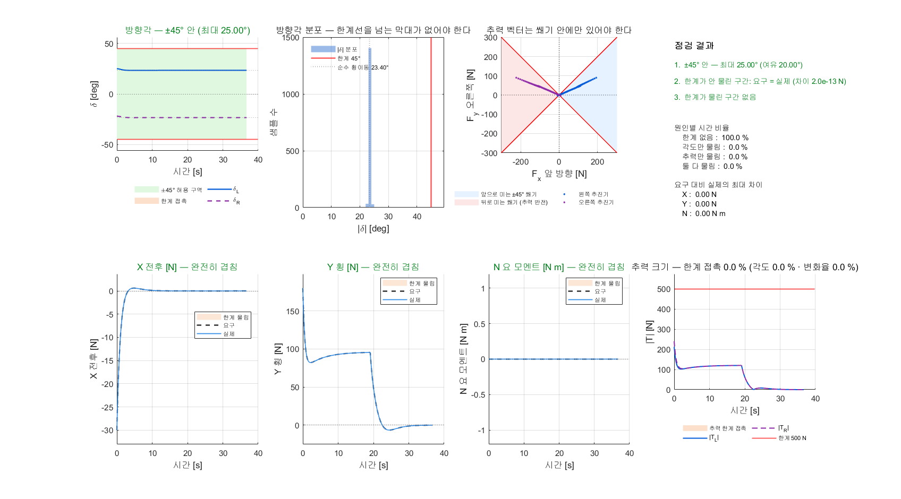

- 1단 기준 실행에서는 5\~7 칸의 점선과 실선이 **완전히 겹침**
  - 한계가 안 물린 구간의 최대 차이 $10^{-13}$ N 대 — 1-10 절의 등식이 그대로 확인됨

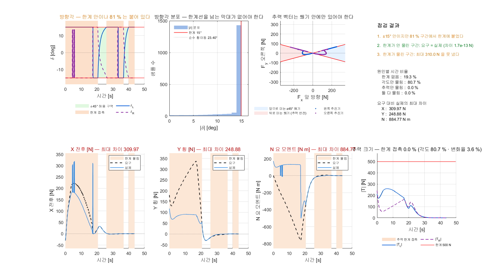

- 각도 한계를 ±15° 로 줄이면
  - 1 칸의 선이 한계선에 **눌려 평평해짐**
  - 5\~7 칸의 실선이 점선에서 떨어짐
  - 8 칸이 떨어진 구간을 **주황(각도 한계)** 으로 칠함

> [!important] 먼저 볼 것은 4 칸의 두 번째 줄이다
> - "한계가 안 물린 구간: 요구 = 실제" → 배분식이 등식으로 풀렸다는 뜻임
> - 이 줄이 빨강이면 **모델을 의심할 것**. 게인 탓이 아님
> - 세 번째 줄이 주황이면 한계 때문임 — 고칠 곳은 배분이 아니라 **한계값 또는 과업**임

## 2-10 배분 방식 둘을 같은 과업으로 비교

```matlab
A3_4_limit_run
```

- `A3_4_limit_run` 이 여섯 경우를 **같은 모델·같은 과업**으로 돌림
  - 기준 · 추력 반전 금지 · 각도 한계 ±15° · 변화율 30 °/s · 배분 1 · 배분 2
- 손으로 비교하려면 설정 한 줄만 바꿔 돌리면 됨

```matlab
A3_override = struct('alloc_mode', 1);   % 1 pseudo-inverse · 2 + null space 보정
A3_2_pose_run
```

### 1단 과업 (순수 횡이동 12 m) 에서

| 배분 방식 | $\psi$ RMS [°] | $\psi$ 최대 [°] | 횡속도 [m/s] | 최대 $\delta$ [°] | 각도 포화 [%] | 변화율 [%] | 못 낸 힘 [N] |
|---|---|---|---|---|---|---|---|
| 1 pseudo-inverse | 0.000 | 0.000 | 0.578 | 25.00 | 0.0 | 0.0 | 0.00 |
| 2 + null space 보정 | 0.000 | 0.000 | 0.578 | 25.00 | 0.0 | 0.0 | 0.00 |

- 두 방식이 **완전히 같은 값**을 냄
  - 1-5 절의 닫힌해 $\delta = \pm23.40°$ 가 이미 $\pm45°$ 안임 → 보정 구간이 $\lambda = 0$ 을 품음
  - 따라서 $\lambda^{\ast} = 0$, 곧 보정이 **아무 일도 하지 않음**
- 1단만 돌리면 "보정은 필요 없다" 는 잘못된 결론이 나옴 → 2단을 함께 돌려야 함

### 2단 과업 (위치·선수각 (30, 20) m · 45°) 에서

| 배분 방식 | 도착 [s] | 마지막 10 초 [m] | $\psi$ RMS [°] | 최대 $\delta$ [°] | 각도 포화 [%] | 변화율 [%] | 못 낸 힘 [N] |
|---|---|---|---|---|---|---|---|
| **1 pseudo-inverse** | 30.7 | 0.130 | 2.167 | 45.00 | **1.6** | 0.0 | **30.44** |
| 2 + null space 보정 | 30.6 | 0.134 | 2.141 | 45.00 | 1.3 | 0.0 | **0.00** |

- 방식 1 은 2단에서 30.44 N 을 못 냄 — 횡력을 **똑같이 나눈 탓**에 한쪽 각도가 치솟음 (1-7 절 1단계의 숫자와 같은 꼴)
- 보정을 켜면 같은 요구를 **한 숫자도 깎지 않고** 냄 — 각도 포화 시간도 1.6 → 1.3 % 로 줄어듦
- 도착 시간·위치 오차는 거의 같음. **갈리는 것은 못 낸 힘 하나**임
  - 요구를 못 낸 구간에서는 배가 "제어기가 시킨 대로" 가지 않음. 오차로 드러나기 전까지는 보이지 않음

> [!important] 질문 (c) 에 대한 최종 답 — 아홉 줄을 더 쓰는 값어치
> | 방식 | 1단 | 2단 | 둘 다 |
> |---|---|---|---|
> | 1 pseudo-inverse | 통과 | 30.44 N 손실 | 아니오 |
> | 2 + null space 보정 | 통과 | 통과 | **예** |
>
> - **두 과업을 모두 통과하는 것은 방식 2 하나뿐임**
> - 더 간단한 방식이 없는 것이 아니라, **더 간단한 방식은 요구의 일부를 포기함**
> - 방식 2 에서 늘어난 것은 코드 **아홉 줄**임 — 반복 풀이·QP·최적화 솔버는 여전히 없음

## 2-11 Gazebo(VRX) 연동 — 다음 단계

> [!note] 본 절은 **자리만 잡아 둔 것**임 — 아직 실행하지 않음
> - 1\~4단은 전부 **오프라인 운동모델**임. Gazebo 를 띄우지 않음
> - 오프라인 결과를 먼저 확정한 뒤 VRX 로 넘어가는 순서임
> - 따라서 본 절에는 **측정값을 적지 않음**. 실행 뒤 갱신 예정임

- VRX 연동에서 확인할 것 (예정)

| # | 확인할 것 |
|---|---|
| 1 | `wamv/thrusters/<side>/pos` 로 방향각 지령이 실제로 전달되는지 |
| 2 | 방향각 관절의 응답 속도가 URDF 값(10 rad/s)과 맞는지 |
| 3 | 순수 횡이동의 방향각이 실제로 23.40° 부근인지 |
| 4 | 오프라인 대비 횡속도·선수각 오차의 이격 |
| 5 | 파랑·바람 외란에서 각도 포화 비율 |

> [!note] URDF 수정은 필요하지 않음
> - 3주차 `W03_vrx_lite/wamv_lite.urdf` 의 선미 추진기 관절은 이미 `revolute` · `axis 0 0 1` · 한계 ±π 임
> - 방향각 지령 토픽 `wamv/thrusters/<side>/pos` 도 이미 존재함
> - 본 부록의 ±45° 는 **제어기 쪽 설계 전제**이며, URDF 한계와는 별개임

---

## 이번 부록 요약

| 묻는 것 | 답 | 근거 (실측) |
|---|---|---|
| 순수 횡이동의 방향각 | 고정값 23.40° | 실측 평균 23.401° |
| 순수 횡이동의 추력 | 횡력의 1.259 배 · **부호 반대** | 반전 금지 시 418.3 m 이탈 |
| 횡이동 중 선수각 | 유지됨 | 조류를 걸고 RMS 0.0026° |
| 최대 횡력 · 최대 횡속도 | 397.1 N · 1.555 m/s | 닫힌식과 차이 0.000 m/s |
| $(x,\ y,\ \psi)$ 동시 유지 | 됨 | 30.6 s 도착 · 마지막 선수각 0.00° |
| 접안 | 됨 (단계를 나눌 때) | 78.7 s · 0.087 m · 0.000° |
| 배분의 복잡도 | 행렬 한 줄 + 보정 아홉 줄 | 반복 풀이 없음 |
| 더 간단한 배분 | 있으나 **요구의 일부를 포기함** | 보정을 끄면 2단에서 30.44 N 손실 |
| 요구한 렌치 대비 실제 | 한계가 안 물리면 **같음** | 최대 차이 $10^{-13}$ N 대 |
| 어긋나는 원인 | 각도 한계 · 추력 한계 · 각도 변화율 **셋뿐** | 점검 그림 8 칸에서 색으로 가름 |
| ±45° 전제 | 본 과목 과업에 충분 | 과업 중 각도 포화 0.0 \~ 2.6 % · 조류 10.3 % |
| 반드시 필요한 것 | **추력 반전** | 금지하면 과업 자체가 불가 |
| VRX 의 다른 배치 | X 배치가 가장 간단함 (**B** 상수) | xacro 에서 네 대 모두 ±45° 고정 확인 |

## 수업 진도 체크

> [!important] 다음 단계(VRX 연동)를 따라가기 위한 최소 조건

### 이론 이해

- [ ] 아지무스 추진기에서 미지수가 넷, 식이 셋임을 말할 수 있다
- [ ] 해가 점이 아니라 **직선 하나**인 이유를 말할 수 있다
- [ ] $N$ 식의 두 항(차동 추력 · 선미 횡력)을 각각 설명할 수 있다
- [ ] 순수 횡이동의 방향각 $\arctan(b/L)$ = 23.40° 를 손으로 계산했다
- [ ] 순수 횡이동에서 $N$ 이 구조적으로 0 이 되는 상쇄를 적을 수 있다
- [ ] null space 벡터 $[0\ 1\ 0\ -1]^\mathsf{T}$ 가 무엇을 바꾸지 않는지 말할 수 있다
- [ ] 배분 방식 둘이 **같은 직선 위의 다른 점**임을 설명할 수 있다
- [ ] 보정을 끄면 2단에서 요구를 못 내는 까닭을 **횡력 반반 나눔**으로 설명할 수 있다
- [ ] 요구한 렌치와 실제 렌치가 어긋나는 **원인 셋**을 적을 수 있다

### 실습 완료

- [ ] `build_a3_models` 가 오류 없이 끝났다
- [ ] `A3_1_crab_run` 의 방향각 평균이 23.4° 부근으로 나왔다
- [ ] `A3_1_crab_run` 의 실측 횡속도와 닫힌식 차이가 0.01 m/s 이내다
- [ ] 돌아가는 동안 **애니메이트 창**에서 추진기 화살표 둘이 벌어지는 것을 봤다
- [ ] 애니메이트 창의 **게이지 바늘**이 ±45° 쐐기 안에 있는 것을 확인했다
- [ ] `A3_2_pose_run` 에서 도착 판정이 걸렸다
- [ ] `A3_3_dock_run` 에서 단계 세 개가 모두 올라갔다
- [ ] 끝난 뒤 **점검 그림** 여덟 칸에서 요구(점선)와 실제(실선)가 겹치는 것을 봤다
- [ ] `alloc_mode` 를 0 · 1 · 2 로 바꿔 1단을 세 번 돌렸다
- [ ] `A3_4_limit_run` 의 표 두 개를 받았다
- [ ] `A3_envelope` 의 도달 가능 집합 그림을 봤다

### 관찰 기록

- [ ] 조류를 걸었을 때 방향각 평균이 몇 도로 기울었는지 적었다
- [ ] 추력 반전을 금지했을 때 배가 어디로 갔는지 적었다
- [ ] 각도 한계를 ±15° 로 줄였을 때 각도 포화 비율을 적었다
- [ ] 한계가 물렸을 때 점검 그림 8 칸이 어느 **색**으로 칠해졌는지 적었다
- [ ] 네 실행의 **못 낸 힘** 값을 전부 적었다

### 신고 사항

- [ ] `build_a3_models` 가 특정 단에서 멈추면 단 번호와 오류 메시지를 보고했다
- [ ] 수치가 본 문서의 값과 1 % 이상 어긋나면 어느 항목인지 보고했다

## 과제 A3

> [!important] 제출물 — MATLAB 출력 표 다섯 개 + 그림 두 장 + 고찰 1쪽

### 요구사항

1. **1단 재현과 조류 쓸기**
   - 조류 속도를 0 · 0.3 · 0.6 · 0.9 m/s 네 경우로 돌림 (방향은 45° 고정)
   - 선수각 오차 RMS · 방향각 평균 · 각도 포화 % · 못 낸 힘 을 **표 하나**로 제출
   - 각도 포화가 처음 0 을 넘는 조류 속도를 찾아 적음
2. **닫힌식 손계산 대조**
   - $\arctan(b/L)$ · $k_T$ · $Y_{\max}$ · $v_{ss}$ 를 **손으로** 계산해 과정을 적음
   - 실측값과 나란히 적고 차이를 명기함
3. **2단 선수각 쓸기**
   - 목표 선수각을 본인이 고른 네 값으로 돌림 (0 \~ 180° 안에서)
   - 도착 시각 · 도착 순간 오차 · $\psi$ RMS · 각도 포화 를 표로 제출
   - 가장 느린 경우와 가장 빠른 경우의 차이를 쐐기 구간으로 설명함
4. **도달 가능 집합**
   - 각도 한계를 ±30° · ±45° · ±60° 로 바꿔 `A3_envelope` 를 세 번 돌림
   - 쐐기 구간 $X/Y$ 경계를 **닫힌식으로 먼저 계산**하고 그림과 대조함
   - $N = 0$ 단면에서 낼 수 있는 칸 비율의 변화를 표로 적음
5. **배분 방식 둘 비교** (2-10 절)
   - `alloc_mode` = 1 · 2 로 **1단과 2단을 각각** 돌림 (네 번)
   - 최대 $\delta$ · 각도 포화 % · 변화율 % · **못 낸 힘** 을 표로 제출
   - 점검 그림 8 칸을 근거로 못 낸 몫의 **원인**(각도·추력·변화율)을 경우마다 적음
   - 1단에서 두 방식의 값이 완전히 같아지는 까닭을 **보정량이 0 임**으로 설명함
6. **고찰** (1쪽)
   - 본인 설계에서 각도 한계를 몇 도로 잡을 것인지, **수치를 근거로** 정함
   - 두 배분 방식 가운데 무엇을 쓸 것인지, **요구사항 5 의 표를 근거로** 정함
   - 추력 반전을 허용할 수 없는 기체라면 어떤 과업을 포기해야 하는지 적음

### 평가 배점표

| 항목 | 배점 |
|---|---|
| 1단 조류 네 경우 표 — 수치가 모두 채워졌는가 | 15 |
| 2단 선수각 네 경우 표 — 수치가 모두 채워졌는가 | 10 |
| 도달 가능 집합 그림 세 장 | 10 |
| 배분 방식 둘 비교 표 — 두 과업을 모두 돌렸는가 (요구사항 5) | 10 |
| **검증 — 닫힌식 손계산과 실측을 대조했는가** (요구사항 2·4) | **20** |
| **검증 — 못 낸 힘과 그 원인을 경우마다 기록했는가** (요구사항 1·5) | **15** |
| 고찰 — 각도 한계를 **수치를 근거로** 정했는가 | 10 |
| 고찰 — 배분 방식 선택과 추력 반전 제약을 적었는가 | 10 |

- **검증 항목이 35 %** 임 → [[측정하지-않은-성공은-성공이-아니다]]
- "잘 됐다" · "거의 같다" 는 인정하지 않음. **숫자와 단위**로 적을 것
## 막혔을 때

| 증상 | 원인 | 해결 |
|---|---|---|
| `build_a3_models` 가 중간에 멈춤 | 모델이 열린 채 잠겨 있음 | `bdclose all` 뒤 다시 실행 |
| 방향각이 23.4° 가 아니라 다른 값 | 앞 실습의 `A3_override` 가 남아 있음 | `setappdata(0,'A3_override',[])` 뒤 다시 실행 |
| 각도 한계가 45° 가 아니라 15° 로 찍힘 | 4단 실행이 `d_max_deg` 를 남김 | `A3_setup` 을 다시 돌림 (덮어쓰기를 지우고) |
| 실측 횡속도가 1.555 m/s 와 어긋남 | 운동모델의 항력계수가 바뀜 | `A3_setup` 출력의 `낼 수 있는 한계` 줄을 확인 |
| 선수각이 180° 돌아가 버림 | 추력 반전이 꺼져 있음 (`rev_on = 0`) | 2-6 절의 표와 같은 증상임. `rev_on = 1` 로 돌림 |
| 도착은 했는데 마지막 오차가 2 m 를 넘음 | 도착 뒤 **타성** | 2-4 절의 경고 상자. 배분 문제가 아님 |
| 못 낸 힘이 0 이 아닌데 오류가 없음 | 한계에 걸려 요구를 그대로 못 냄 | 각도 포화 · 추력 포화 비율을 함께 볼 것 |
| 그림이 창 하나에 겹쳐 그려짐 | `A3_fig` 가 같은 창을 재사용함 | 정상 동작임. 창을 닫고 다시 돌리면 새로 그림 |
| 블록 배치가 흐트러짐 | 학생이 모델을 편집함 | `tidy_layout('A3_1_crab')` 또는 `build_a3_models` |
| 실시간 창이 뜨지 않음 | `animate = 0` 으로 꺼 둠 | `A3_setup.m` 의 `animate` 를 1 로 바꾸고 `build_a3_models` 재실행 |
| 돌아가는 속도가 너무 느림 | 실시간 그리기 비용 | `animate_every` 를 키움 (기본 0.25 s) 또는 `animate = 0` |
| 점검 그림 4 칸의 둘째 줄이 빨강 | 한계가 안 물렸는데 요구 ≠ 실제 | 배분·운동모델 쪽 문제임. 게인 탓이 아님 (2-9 절) |

## 참고 자료

| 자료 | 내용 |
|---|---|
| 5주차 `W05_simulink/` | 고정 추진기 둘 — 부족구동의 한계 |
| 6주차 `W06_simulink/` | 선수추진기를 더한 완전구동. **본 부록의 대조군** |
| 3주차 `W03_vrx_lite/wamv_lite.urdf` | 추진기 관절 좌표 · 회전 한계 · 속도 한계의 원본 |
| `vrx_urdf/wamv_description/urdf/thrusters/engine.xacro` | 추진기 관절이 `revolute` ±π · `velocity="10"` 인 원본 (1-11 절) |
| `vrx_urdf/wamv_gazebo/urdf/thruster_layouts/` | H · T · X 세 배치의 추진기 좌표·방향 원본 |
| [[측정하지-않은-성공은-성공이-아니다]] | 검증 수치를 요구하는 이유 |
| [[ENU와-NED를-섞으면-조용히-틀린다]] | 좌표계 표기 규약 |
| Fossen, *Handbook of Marine Craft Hydrodynamics and Motion Control* | 추력 배분 (thrust allocation) 장 — pseudo-inverse 와 null space |

## 다음 단계

- 본 부록의 오프라인 결과를 Gazebo(VRX) 에서 재현함 (2-11 절)
- 확인 순서: 방향각 토픽 전달 → 관절 응답 속도 → 순수 횡이동 방향각 → 오프라인 대비 이격
