# 6주차 · 선수추진기와 위치제어 접안

> [!important] 이번 학기 **녹화 강의 영상**은 여기에 올라감 — 수업에서 놓친 부분은 영상으로 확인할 것
> **<https://youtube.com/playlist?list=PLK_f1-krzJG8>**
>
> - 매주 수업 뒤 그 주차 영상이 이 재생목록에 추가됨
> - 아래 "참조 강의" 는 **지난 학기까지의 선수 과목**이고, 이 재생목록은 **이번 학기 본 수업** 녹화임

> [!important] 참조 강의 — 본 과목이 전제하는 배경
> <span style="font-size:0.88em">아래 다섯 과목은 **본 과목 담당 교수가 직접 강의한 것**이며, 본 과목이 전제하는 배경 지식에 해당함. 학부 기초에서 대학원 과정까지 이어지므로 부족한 지점부터 시작하면 됨. 본 문서에서 쓰는 좌표계·기호·유도 과정은 아래 강의에서 상세히 다루므로, 선수 지식이 부족한 경우 먼저 보고 돌아올 것.</span>
>
> | # | 과목 | 수준 | 언어 | 영상 | 자료·코드 |
> |---|---|---|---|---|---|
> | 1 | **제어공학** — 전달함수, 되먹임, 안정도, 근궤적, PID. 모든 것의 토대 | 학부 | 한국어 | [재생목록](https://youtube.com/playlist?list=PLFaUxNRM4BvJMpF9HZS-Mp8tDv9dTdglk) | [드라이브](https://drive.google.com/drive/folders/1TNIPDNtS_Iy8li-olka5WJslSXDYf0aT) |
> | 2 | **제어시스템설계** — 해석이 아니라 설계. 사양 결정, 루프 정형화, 이산 구현 | 학부 | 한국어 | [재생목록](https://youtube.com/playlist?list=PLFaUxNRM4BvIGroZ5rgn7x08F7C79d9WZ) | [드라이브](https://drive.google.com/drive/folders/11m5Xxl_PHJvxgHghLSP-jhCpmRpbvoXh) |
> | 3 | **캡스톤디자인** — 본 과목의 지난 학기 강의. 이동체 프로젝트를 처음부터 끝까지 | 학부 | 한국어 | [재생목록](https://youtube.com/playlist?list=PLFaUxNRM4BvLu7L0pDoLzDXTv8mm6rCmj) | [드라이브](https://drive.google.com/drive/folders/1haIQejlJfrdhtOuof-MpffR9ydVscXZS) |
> | 4 | **제어공학특론** — 좌표계, 6자유도 운동방정식, 회전행렬과 오일러각, 선형화와 트림 | 대학원 | 영어 | [재생목록](https://youtube.com/playlist?list=PLFaUxNRM4BvJmvF2ljx4KM5dj1P5jEcw0) | [드라이브](https://drive.google.com/drive/folders/1GUxbbONl916lNd0ggnFnXrNwNkd13-2-) |
> | 5 | **센서신호처리 및 융합** — 센서 모델, 잡음, 추정, 다중센서 융합 | 대학원 | 영어 | [재생목록](https://youtube.com/playlist?list=PLFaUxNRM4BvK-aP2Gdoyp5-AWvMn7Fo8E) | [드라이브](https://drive.google.com/drive/folders/1MEVJP7TzMcm8w6TZwUjhWJtL34WeNY3u) |
>
> <span style="font-size:0.88em">**MATLAB·Simulink 가 처음이라면 4주차 실습 전에 아래를 끝낼 것.** 본 과목의 제어기 실습은 전부 Simulink 로 진행함. Onramp 는 무료이며 각각 몇 시간이면 끝남</span>
>
> | 도구 | 시작 지점 |
> |---|---|
> | MATLAB | [MATLAB Onramp](https://matlabacademy.mathworks.com/kr/details/matlab-onramp/gettingstarted) · [Core MATLAB Skills](https://matlabacademy.mathworks.com/details/core-matlab-skills/lpmlcms) |
> | Simulink | [Simulink Onramp](https://matlabacademy.mathworks.com/kr/details/simulink-onramp/simulink) · 담당 교수 Simulink 강의 [1부](https://youtu.be/a-afHg_fSaU) · [2부](https://youtu.be/070Yn0Hw5a0) |

> [!important] 강의자료 저장소 — 처음 한 번만 `git clone`, 그 뒤로는 `git pull`
>
> | 저장소 | 주소 | 받는 자리 (WSL) |
> |---|---|---|
> | 강의자료 — 주차 문서 · Simulink 모델 · MATLAB 스크립트 | **<https://github.com/wkyouncnu/Capstone-Design>** | `~/Capstone-Design` |
> | ROS 2 예제 패키지 `usv_basics` — 2주차부터 쓰는 노드 코드 | **<https://github.com/wkyouncnu/usv_basics>** | `~/capstone_ws/src/usv_basics` |
>
> | 언제 | 명령 (VS Code 의 WSL 창 터미널) | 하는 일 |
> |---|---|---|
> | 처음 한 번 | `cd ~ && git clone https://github.com/wkyouncnu/Capstone-Design.git` | 강의자료 전체를 받음 (약 770 MB · 2026-10-16 실측 1분 40초) |
> | 처음 한 번 | `mkdir -p ~/capstone_ws/src && cd ~/capstone_ws/src && git clone https://github.com/wkyouncnu/usv_basics.git` | 예제 패키지를 받음. 이어서 `cd ~/capstone_ws && colcon build --symlink-install` |
> | 매주 수업 전 | `cd ~/Capstone-Design && git pull` · `cd ~/capstone_ws/src/usv_basics && git pull` | **바뀐 파일만** 받음. 다시 clone 하지 않음 |
> | 무엇이 바뀌었는지 | `git log --oneline -10` · `git show --stat HEAD` | 교수가 갱신한 내역을 확인 |
>
> - 두 저장소 모두 공개 — 로그인 없이 받아짐
> - 주차 문서는 `~/Capstone-Design/1_2026-2학기_강의자료/10-주차별-강의자료/` 에 있음. MATLAB 은 같은 폴더를 `\\wsl.localhost\Ubuntu-22.04\home\<사용자명>\Capstone-Design\...` 로 엶
> - `usv_basics` 를 받은 뒤 새 노드가 생겼으면 `colcon build --symlink-install` 을 한 번 더 돌림
> - 본인이 고친 파일 때문에 `git pull` 이 멈추면 `git stash` 로 치워 두고 다시 받음 → [[강의자료는-한-번-받고-git-pull-로-갱신한다]]

- **과목**: 캡스톤디자인 (2026-2) · 충남대학교 자율운항시스템공학과
- **이번 주차 학습 내용**: 추진기를 둘에서 셋으로 늘려 **정해진 자리에 정해진 선수각으로 서는 법**을 만듦. 그것을 쌓아 **접안(berthing)** 까지 감

> [!important] 시작 전 확인
> - **강의자료부터 갱신**: VS Code WSL 창 터미널에서 `cd ~/Capstone-Design && git pull` — 문서와 코드·모델이 같은 판이 됨 ([[강의자료는-한-번-받고-git-pull-로-갱신한다]], 처음 받는 법은 2주차 2-6)
> - 5주차 모델(`W05_0_offline.slx`)이 동작했어야 함 — 이번 주차의 안쪽 고리·추진기·운동모델이 그것의 확장임
> - MATLAB **R2024b + Simulink + ROS Toolbox**
> - 배포 폴더 `W06_simulink/` 와 `W06_vrx_lite/`

> [!important] 이번 주차 실행 요약 — Gazebo(VRX) ↔ Simulink 는 이 세 덩어리와 **Run** 하나로 됨
> 자세한 설명은 2부 G 절. 아래는 2026-10-23 기준 노트북에서 그대로 쳐서 확인한 순서임 (6단 완료 78.6 s · 동기 점검 $k$ = 0.987)
>
> **① 터미널 1 — 선수추진기를 단 Gazebo 띄우기** (5주차의 `run_vrx.sh` 가 아님. 창이 뜨면 닫지 않고 둠)
>
> ```bash
> cd ~/Capstone-Design && git pull
> cd ~/Capstone-Design/1_2026-2학기_강의자료/10-주차별-강의자료/W06_vrx_lite
> bash ../W03_vrx_lite/stop_vrx.sh
> bash run_vrx_bow.sh
> ```
>
> **② 터미널 2 — 토픽 확인** (`bow/thrust` 까지 `thrusters` 여섯 줄이 보이면 됨)
>
> ```bash
> ros2 topic list | grep -E "thrusters|ground_truth"
> ```
>
> **③ MATLAB — 기준 궤적을 만들고 쌍둥이를 여는 것까지**
>
> ```matlab
> cd('\wsl.localhost\Ubuntu-22.04\home\<사용자명>\Capstone-Design\1_2026-2학기_강의자료\10-주차별-강의자료\W06_simulink')
> W06_6_vrx_run
> ```
>
> **④ 열린 Simulink 창에서 Run 을 누름** — Gazebo 연동 실행은 **사람이 Run 을 누르는 것**임
>
> - ③ 의 m 파일이 하는 일은 **오프라인 기준 궤적을 만들고 쌍둥이 모델을 열어 주는 것**까지임. Gazebo 를 돌리지 않음
> - Run 을 누르면 모델의 `InitFcn` 이 도메인·토픽 확인 → RTF 20 초 실측 → 스폰 원점 측정 → 페이싱까지 함
> - 도는 동안 **실시간 화면**이 함께 뜨고, 끝나면 `StopFcn` 이 결과 그림과 기준 대조 그림을 `img/` 에 남김
>
> | 이럴 때 | 할 것 |
> |---|---|
> | Gazebo 없이 오프라인 1\~5·7·8단 | MATLAB 에서 `W06_1_point_run` … `W06_8_ned_run`, 한꺼번에는 `W06_ladder` |
> | 다른 단도 Gazebo 로 (1·2·3·4·7·8단) | ③ 의 `W06_6_vrx_run` 대신 `W06_vrx_run(단)` 으로 쌍둥이를 열고 ④ 를 똑같이 함 — 예: `W06_vrx_run(2)` (G-7-3) |
> | 선수추진기 부호·횡이동 재기 (G-4 · G-5) | 터미널 2 에서 `bash measure_bow.sh` · `bash measure_sway.sh` |
> | `run_vrx_bow.sh` 가 `화면 이상` 을 찍고 멈춤 · **Gazebo 창이 안 뜸** | Windows PowerShell 에서 `wsl --shutdown` → 터미널을 새로 열고 ① 부터 (5주차 E-1 경고 상자) |
> | 다음 실험 | ① 의 `stop_vrx.sh` 부터 다시 |

> [!note] 5주차는 **경로를 따라가는 것**까지였음
> - 5주차의 배는 추진기가 둘 — 낼 수 있는 힘은 $X$(전후) 와 $N$(요) 둘뿐임
> - 그래서 "경로를 따라간다" 는 되지만 **"저 자리에 저 선수각으로 서라"** 는 안 됨. 옆으로 밀 힘이 없기 때문임
> - 접안은 바로 그 동작임. 선석에 **나란히 붙어 서** 있어야 하므로 위치 둘과 선수각 하나를 **동시에** 잡아야 함
> - 이번 주차에 추진기를 하나 더 달아 그것을 가능하게 만듦

---

## 이 주차를 마치면 할 수 있어야 하는 것

1. **underactuated** 와 **fully actuated** 를 추진기 수와 제어 가능한 자유도로 구분해서 설명하기
2. 추진기 셋의 **추력배분**을 손으로 풀고, $-l_3 Y$ 항이 왜 있어야 하는지 설명하기
3. **순수 횡이동(pure sway)** 을 선수각이 변하지 않는 채로 만들기
4. 위치 P → 속도 PI → 선수각 P-D 세 고리를 쌓고 각 고리가 무엇을 묶는지 말하기
5. **도착 판정과 정지 게이트**를 래치로 구현하고, 래치가 없으면 무엇이 깜빡이는지 보이기
6. 접안을 **세 단계(접근 → 선수각 정렬 → 붙이기)** 로 나누어 구현하기
7. **옆걸음 접안**과 **전진 접안**의 차이를 측정값으로 제시하기
8. 제어기가 도는 좌표계를 **선체고정 ↔ NED** 로 바꿔 보고 그 대가를 숫자로 말하기
9. 같은 제어기를 **Simulink 모델**과 **m 파일** 양쪽으로 짜서 두 결과를 맞대 보기
10. Gazebo 의 WAM-V 에 선수추진기를 달고 **지령 부호를 측정으로** 확정하기

---

## 준비물

| 구분 | 내용 |
|---|---|
| 소프트웨어 | MATLAB R2024b · Simulink · ROS Toolbox · WSL2 Ubuntu 22.04 · ROS 2 Humble · Gazebo Garden · VRX |
| 배포 폴더 | `W06_simulink/` (모델 7개 + m 파일 7개 + 설정·그림·검증 스크립트) · `W06_vrx_lite/` (URDF 생성·실행·측정·촬영 스크립트) |
| 선행 | 5주차 (유도부·안쪽 고리·추진기·운동모델) · 4주차 (PID·내부루프) · 3주차 (VRX lite 실행) |
| 시간 | 이론 50분 + 실습 150분 |

---

# 1부 · 이론

## 1-1. 추진기가 둘에서 셋으로 — 할 수 있는 일이 하나 늘어난다

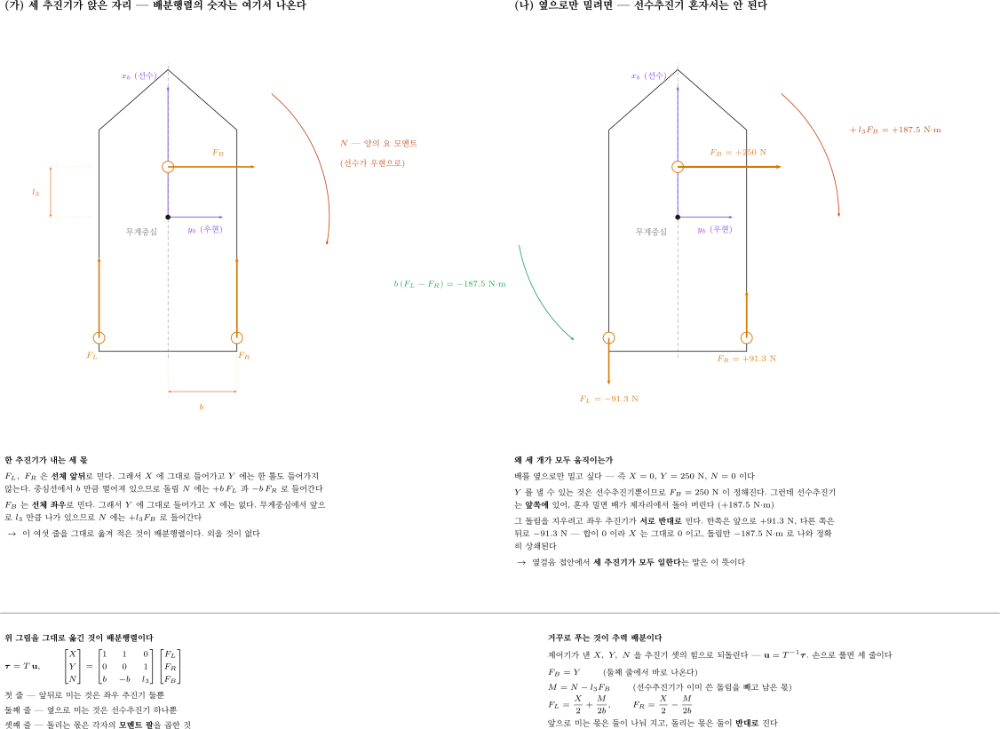

### 수평면에서 배의 자유도는 셋

- 평면 위 강체의 운동은 셋임 — 전후(surge) $u$ · 횡(sway) $v$ · 회전(yaw) $r$
- 제어 입력으로 만들 수 있는 힘·모멘트도 셋임 — $X$ [N] · $Y$ [N] · $N$ [N·m]
- **몇 개를 독립으로 만들 수 있는지**가 추진기 배치로 정해짐

### 5주차의 배 (추진기 둘)

$$
\begin{bmatrix} X \\ N \end{bmatrix}
=
\begin{bmatrix} 1 & 1 \\ b & -b \end{bmatrix}
\begin{bmatrix} F_L \\ F_R \end{bmatrix},
\qquad Y \equiv 0
$$

- $b$ = `half_beam` = 1.027135 m (선미 좌·우 추진기의 좌우 반폭)
- 횡력 $Y$ 를 만들 방법이 없음 → 자유도 셋 가운데 둘만 쥔 **underactuated** 임
- 할 수 있는 것: 뱃머리를 돌려 그 방향으로 전진 → **경로 추종**
- 할 수 없는 것: 선수각을 고정한 채 옆으로 이동 → **접안**

### 6주차의 배 (추진기 셋)

$$
\underbrace{\begin{bmatrix} X \\ Y \\ N \end{bmatrix}}_{\boldsymbol\tau\ \text{(원하는 힘·모멘트)}}
=
\underbrace{\begin{bmatrix} 1 & 1 & 0 \\ 0 & 0 & 1 \\ b & -b & l_3 \end{bmatrix}}_{T\ \text{(배분행렬)}}
\underbrace{\begin{bmatrix} F_L \\ F_R \\ F_B \end{bmatrix}}_{\mathbf u\ \text{(추진기 추력)}}
\;=\; T\,\mathbf u
$$

- $F_B$ = 선수추진기(bow thruster) 추력 [N], $l_3$ = `l_bow` = 0.75 m (선체 중심에서 선수추진기까지의 $x$ 거리)
- 행렬이 $3 \times 3$ 정방이고 가역이므로 $X$ · $Y$ · $N$ 을 **독립으로** 지시할 수 있음 → **fully actuated**
- 비로소 가능해지는 것: **$(x_n, y_n, \psi)$ 셋을 동시에 목표값으로 유지** — 동적위치유지(DP)와 접안의 전제임

### 행렬 $T$ 를 읽는 법 — 열은 추진기, 행은 자유도임

$T$ 의 **$j$ 번째 열**은 "$j$ 번 추진기가 1 N 을 내면 배에 무엇이 생기는가" 를 적은 것임. 위 그림의 모멘트 팔이 그대로 숫자로 들어가 있음.

| $T$ 의 열 | 추진기 | 1 N 이 배에 주는 것 |
|---|---|---|
| 첫째 열 $[\,1,\;0,\;b\,]^{\mathsf T}$ | 좌현 선미 | 전후 $+1$ N · 횡 $0$ · 요 $+b$ N·m |
| 둘째 열 $[\,1,\;0,\;-b\,]^{\mathsf T}$ | 우현 선미 | 전후 $+1$ N · 횡 $0$ · 요 $-b$ N·m |
| 셋째 열 $[\,0,\;1,\;l_3\,]^{\mathsf T}$ | 선수 | 전후 $0$ · **횡 $+1$ N** · 요 $+l_3$ N·m |

- **둘째 행 $[\,0,\;0,\;1\,]$ 이 5주차와 갈리는 자리임** — 5주차 행렬에는 이 행이 아예 없었음. 횡력은 선수추진기 하나만 내므로 $Y = F_B$ 가 그대로 성립함
- **셋째 열의 $l_3$** 가 1-2절 $-l_3 F_B$ 항의 뿌리임. 횡력을 내면 요 모멘트가 딸려 오는 것이 이 숫자로 적혀 있음
- $\det T = 2b = 2.0543 \ne 0$ 이므로 가역임 — 어떤 $\boldsymbol\tau$ 를 주어도 그것을 내는 $\mathbf u$ 가 **딱 하나** 있음

> [!tip] 추진기 수와 할 수 있는 일
> | 추진기 | 독립 입력 | 가능한 과업 | 이 과목의 주차 |
> |---|---|---|---|
> | 2 (선미 좌·우) | $X$, $N$ | 경로 추종 · 선수각 유지 | 4·5·7·8주차 |
> | 3 (선미 좌·우 + 선수) | $X$, $Y$, $N$ | 위 + 제자리 횡이동 · 위치+선수각 동시 유지 · **접안** | **6주차** |
> | 4 (틸팅 2기) | $X$, $Y$, $N$ (여유 있음) | 위 + 추력배분 최적화 | 이 과목에서는 다루지 않음 |

### 왜 선수추진기인가 — 실선의 사정

- 실제 선박의 선수추진기는 **주기관보다 작음**. 접안·이탈 같은 저속 조선에만 쓰기 때문임
- 이 주차에서도 그렇게 둠 — 선미 추진기 $\pm 500$ N 둘, 선수추진기 $\pm 250$ N 하나
- 횡방향 권한을 일부러 좁혀 두면 **배분이 한계에 걸리는 모습**을 실습에서 볼 수 있음 (1-2절 끝)

---

## 1-2. 추력배분 — 세 식 세 미지수, 손으로 풀린다

### 배분은 $T$ 의 역행렬임

1-1절에서 $\boldsymbol\tau = T\mathbf u$ 였음. 제어기가 원하는 것은 거꾸로임 — $\boldsymbol\tau$ 를 알고 $\mathbf u$ 를 구하는 것임.

$$
\mathbf u = T^{-1}\boldsymbol\tau,
\qquad
\begin{bmatrix} F_L \\ F_R \\ F_B \end{bmatrix}
=
\begin{bmatrix}
\tfrac{1}{2} & -\tfrac{l_3}{2b} & \tfrac{1}{2b} \\[3pt]
\tfrac{1}{2} & +\tfrac{l_3}{2b} & -\tfrac{1}{2b} \\[3pt]
0 & 1 & 0
\end{bmatrix}
\begin{bmatrix} X \\ Y \\ N \end{bmatrix}
$$

$T^{-1}$ 의 **행**을 읽으면 각 추진기가 무엇을 얼마나 떠맡는지가 보임.

| $T^{-1}$ 의 행 | 읽는 법 |
|---|---|
| 첫째 행 | $F_L$ 은 전후 지령의 절반 + 요 지령의 $1/2b$ 몫 $-$ 횡 지령이 만든 모멘트의 $l_3/2b$ 몫 |
| 둘째 행 | $F_R$ 은 같은 것을 **요 항만 부호 반대로** 받음 |
| 셋째 행 | $F_B$ 는 횡 지령 $Y$ 하나만 받음 — 전후·요 지령과 무관함 |

### 역행렬을 외울 필요가 없다

같은 것을 아래에서 위로 차례로 풀면 외울 것이 없어짐.

$$
\begin{aligned}
F_B &= Y \\
M &= N - l_3 F_B \\
F_L &= \frac{X}{2} + \frac{M}{2b},
\qquad
F_R = \frac{X}{2} - \frac{M}{2b}
\end{aligned}
$$

- 둘째 줄의 $M$ = 좌·우 추진기가 만들어야 하는 요 모멘트 [N·m]
- 이 세 줄을 $X$·$Y$·$N$ 으로 전개하면 위의 $T^{-1}$ 과 같아짐 — $M = N - l_3 Y$ 를 $F_L$ 식에 넣으면 $F_L = X/2 + N/2b - l_3 Y/2b$ 로 첫째 행이 그대로 나옴
- 세 식이 그대로 `parts/allocFcn.m` 의 세 줄임 (1-9절에서 한 줄씩 대조)

### $-l_3 F_B$ 항이 이 주차의 핵심

- 선수추진기는 선체 중심이 아니라 **앞쪽**($x = +0.75$ m)에 달려 있음
- 횡력을 내면 그 자리에서 **요 모멘트 $l_3 F_B$ 가 딸려 옴** — 옆으로 밀면서 동시에 뱃머리를 돌림
- 그 몫을 좌·우 추진기가 **반대 부호로 상쇄**해 주어야 비로소 선수각이 변하지 않는 횡이동이 됨

순수 횡이동 지령 $\tau = [0,\; Y,\; 0]^{\mathsf T}$ 을 위 식에 넣으면

$$ F_B = Y, \qquad F_L = -\frac{l_3 Y}{2b}, \qquad F_R = +\frac{l_3 Y}{2b} $$

- 좌·우 추진기가 **크기가 같고 부호가 반대**인 추력을 냄 → 전후 합력은 0, 요 모멘트만 $-l_3 Y$
- $Y = +250$ N 이면 $F_L = -91.3$ N, $F_R = +91.3$ N ($l_3 = 0.75$, $b = 1.027135$ 대입)
- 이 셋을 Gazebo 에 그대로 보내 **옆으로만 가는지** 재는 것이 실습 G-5 (`measure_sway.sh`)

### 포화가 어디서 걸리는가

- 배분 뒤 각 추진기에서 따로 잘림 — $|F_L|, |F_R| \le 500$ N, $|F_B| \le 250$ N
- 즉 **$Y$ 의 실제 한계는 250 N** 임. $v = 0.6$ m/s 를 유지하는 데 드는 힘이

$$ Y = (Y_v + Y_{v|v|}|v|)\,v = (100 + 100 \times 0.6) \times 0.6 = 96\ \text{N} $$

- 로 250 N 안에 들어가므로 `v_max = 0.6` 은 낼 수 있는 속도임
- $v = 1.2$ m/s 로 올리면 $(100 + 120)\times 1.2 = 264$ N 으로 한계를 넘어 지령을 못 따라감 → `v_max` 를 그 아래로 두는 근거임

---

## 1-3. 고리 셋 — 위치 P · 속도 PI · 선수각 P-D

### 위치 오차를 바로 추력으로 바꾸지 않는다

- 바깥 고리 = **위치제어**: 위치 오차 → **속도 지령** (P 제어, 지령을 포화시킴)
- 안쪽 고리 = **속도제어**: 속도 오차 → **추력** (PI 제어, anti-windup)
- 선수각: 선수각 오차 → **요 모멘트** (P-D, 요각속도 되먹임)

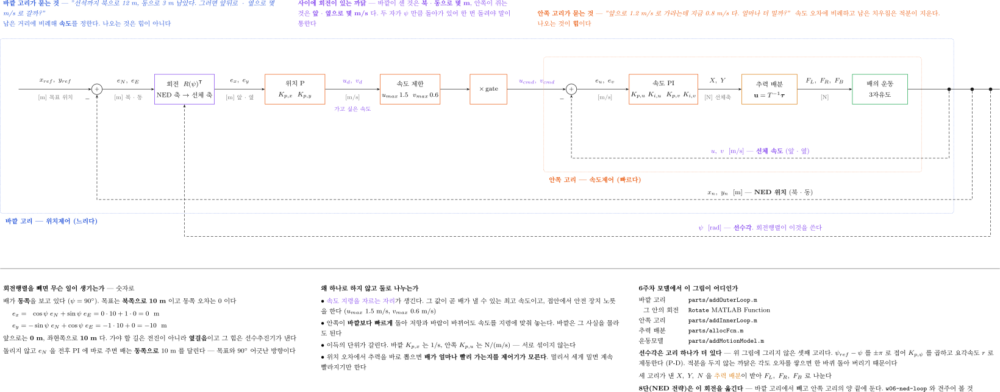

고리를 둘로 쪼개는 까닭 셋.

1. `u_max` · `v_max` 로 **접근 속도를 직접 묶을 수 있음**. 접안에서 꼭 필요함 — 부두에 1.5 m/s 로 닿으면 안 됨
2. 멀리 있을 때 추력이 포화된 채로 적분기가 쌓이는 일이 없음
3. 5주차의 속도 PI 를 **그대로 다시 씀** — 새로 배울 것이 한 고리뿐임

### 회전행렬 — 같은 화살표를 어느 축에서 읽는가

제어기 안에서 좌표계가 둘 섞임. 둘을 잇는 것이 회전행렬 하나임.

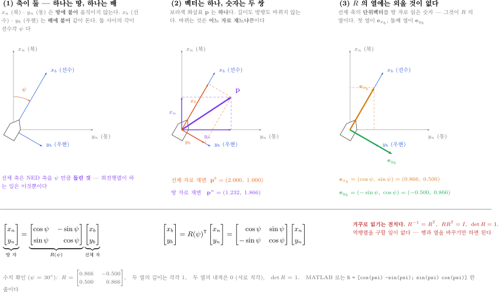

- **NED 좌표계**: 북($x$) · 동($y$) 축. 축이 **땅에 박혀 있어** 움직이지 않음. GPS·목표점이 이 축의 숫자로 옴
- **선체고정 좌표계**: 앞쪽($x_b$) · 우현쪽($y_b$) 축. 축이 **배와 함께 돎**. 추진기와 속도계가 이 축의 숫자로 말함
- 화살표(위치 오차·속도) 자체는 하나임. 바뀌는 것은 **그것을 읽는 축**뿐임

선수각 $\psi$ 만큼 돌아간 선체 축에서 읽는 식은 아래와 같음.

$$
R(\psi) = \begin{bmatrix} \cos\psi & -\sin\psi \\ \sin\psi & \cos\psi \end{bmatrix}
\qquad\text{(선체 축 } \to \text{ NED)}
$$

$$
R(\psi)^{\mathsf T} = R(-\psi) = \begin{bmatrix} \cos\psi & \sin\psi \\ -\sin\psi & \cos\psi \end{bmatrix}
\qquad\text{(NED } \to \text{ 선체 축)}
$$

**$R$ 의 열을 읽는 법** — $R(\psi)$ 의 열은 **선체 축의 단위벡터를 NED 로 적은 것**임.

| $R(\psi)$ 의 열 | 무엇인가 | $\psi = 0^\circ$ | $\psi = 90^\circ$ |
|---|---|---|---|
| 첫째 열 $[\cos\psi,\;\sin\psi]^{\mathsf T}$ | 배의 **앞쪽** 방향 | $[1,\,0]$ = 북 | $[0,\,1]$ = 동 |
| 둘째 열 $[-\sin\psi,\;\cos\psi]^{\mathsf T}$ | 배의 **우현쪽** 방향 | $[0,\,1]$ = 동 | $[-1,\,0]$ = 남 |

회전행렬의 성질 셋. 셋 다 뒤 절에서 그대로 쓰임.

1. $R^{-1} = R^{\mathsf T}$ — **직교행렬**임. 역행렬을 풀 필요가 없고 전치만 하면 됨. 코드에서 `inv` 를 쓰지 않는 까닭임
2. $\det R = \cos^2\psi + \sin^2\psi = 1$ — 길이와 각도를 바꾸지 않음. 오차 1 m 를 돌려도 1 m 임
3. $R(\psi_1)R(\psi_2) = R(\psi_1 + \psi_2)$ — 두 번 돌리면 각이 더해짐. $R(\psi)R(\psi)^{\mathsf T} = R(0) = I$ 로 1번과 이어짐

> [!tip] 어디에 앉아 있는가
> | 쓰는 자리 | 어느 방향 | 어느 파일 |
> |---|---|---|
> | 선체고정 바깥 고리 — 위치 오차를 선체 축으로 | $R^{\mathsf T}$ (NED → 선체) | `parts/addOuterLoop.m` |
> | NED 안쪽 고리 — 선체 속도를 북·동 속도로 | $R$ (선체 → NED) | `parts/addInnerLoopNED.m` 의 `ToNED` |
> | NED 안쪽 고리 — 북·동 힘 지령을 선체 축으로 | $R^{\mathsf T}$ (NED → 선체) | `parts/addInnerLoopNED.m` 의 `ToBody` |
> | 운동모델 — 선체 속도를 NED 위치로 적분 | $R$ (선체 → NED) | `parts/addMotionModel.m` |
>
> 선체고정 전략은 회전행렬이 **하나**, NED 전략은 **둘**임 (1-7절).

### 바깥 고리 (선체고정 전략, 1\~7단)

오차는 NED 로 나오고 속도 지령은 선체고정이어야 하므로 회전행렬 $R^{\mathsf T}$ 로 한 번 돌림.

$$
\begin{bmatrix} e_x \\ e_y \end{bmatrix}
=
\underbrace{\begin{bmatrix} \cos\psi & \sin\psi \\ -\sin\psi & \cos\psi \end{bmatrix}}_{R(\psi)^{\mathsf T}}
\begin{bmatrix} x_{ref} - x_n \\ y_{ref} - y_n \end{bmatrix}
$$

$$
u_{cmd} = g \cdot \mathrm{sat}(K_{p,x} e_x,\ u_{max}),
\qquad
v_{cmd} = g \cdot \mathrm{sat}(K_{p,y} e_y,\ v_{max})
$$

- $e_x$ = 앞쪽 오차, $e_y$ = 우현쪽 오차 [m]
- $g$ = `gate` (0 또는 1) — 도착하면 0 이 되어 속도 지령이 끊김 (1-4절). 7단만 $0 \sim 1$ 의 **감속 계수**로 둠 (E-1절)
- 게인: $K_{p,x} = K_{p,y} = 0.4$ 1/s, 포화: $u_{max} = 1.5$ m/s, $v_{max} = 0.6$ m/s

### 안쪽 고리

$$ X = \mathrm{sat}\!\left(K_{p,u} e_u + K_{i,u}\!\int\! e_u\,dt,\ 2F_{max}\right), \qquad Y = \mathrm{sat}\!\left(K_{p,v} e_v + K_{i,v}\!\int\! e_v\,dt,\ F_{B,max}\right) $$

- $e_u = u_{cmd} - u$, $e_v = v_{cmd} - v$
- 게인: $K_{p,u} = K_{p,v} = 300$, $K_{i,u} = K_{i,v} = 100$
- 포화 한계가 축마다 다름 — 전후는 선미 추진기 둘이 내므로 $2F_{max} = 1000$ N, 횡은 선수추진기 하나가 내므로 $F_{B,max} = 250$ N
#### 적분기 wind-up 과 역계산 anti-windup

멀리서 출발하면 속도 오차가 한동안 크게 남음. PI 의 출력은 이미 포화에 닿아 있는데 적분기는 그것을 모르고 계속 쌓음 — 이것이 **wind-up** 임. 목표에 닿아 오차가 0 이 되어도 쌓인 적분량이 그대로 밀어 배가 지나침.

이 모델은 **역계산**(back-calculation)으로 막음. 잘려 나간 만큼을 $K_b$ 배 해서 적분기 입력에 되돌림.

$$ v = K_p e + K_i I, \qquad \dot I = e + K_b\big(\mathrm{sat}(v) - v\big) $$

- 포화에 닿지 않으면 $\mathrm{sat}(v) = v$ 이므로 되돌리는 항이 0 임 — 보통 PI 와 같음
- 포화에 닿아 있는 동안에는 $\mathrm{sat}(v) - v$ 가 잘린 몫(부호까지)이고, 그만큼 적분량이 **능동적으로 되감김**
- $K_b$ 의 단위는 1/s 이고 $1/K_b$ 가 되감기는 시간상수임. $K_b = K_i/K_p = 100/300 = 0.333$ 1/s 로 둠 — 적분시간 $T_i = K_p/K_i = 3$ s 와 같게 두라는 Åström 의 권고임 (`W06_setup.m` 의 `Kb`)
- **고정**(clamping)과 다른 점: 고정은 적분을 **멈추기만** 함. 이미 쌓인 양은 그대로 남아 오차의 부호가 바뀐 뒤에야 줄어듦. 역계산은 포화에 닿아 있는 동안 쌓인 양을 줄여 나가므로 포화를 벗어나는 순간의 적분량이 작음
- 세 방식(끔 · 고정 · 역계산)을 같은 과업으로 직접 재서 견주려면 `W06_awup_compare(5)` 를 돌릴 것 — 설정만 바꿔 .slx 를 그대로 돌리고 표와 그림(`img/W06_awup_compare.png`)을 냄. 설계 추진기에서는 세 방식의 차이가 없고(지령 속도를 그대로 내므로 적분기가 쌓을 것이 없음), 추진기를 약하게 해 지령을 못 따라가게 만들면 차이가 드러남

**재 본 결과 — 설계 추진기에서는 세 방식이 한 치도 다르지 않음** (2026-10-23 기준 노트북, $F_{max} = 500$ N · $F_{B,max} = 250$ N)

| 단 | 완료 [s] | 끝 오차 [m] |
|---|---|---|
| 5단 | 78.70 | 0.545 |
| 7단 | 72.90 | 0.118 |
| 8단 | 145.95 | 0.554 |

- 끔 · 고정 · 역계산($K_b$ 를 어떤 값으로 두든) **세 숫자가 소수 셋째 자리까지 같음.** 추진기가 지령을 그대로 내므로 포화에 닿는 일이 없고, 따라서 되감을 적분량도 없음
- 설계 추진기만 써 보고 "되감기는 쓸모없다" 로 읽으면 안 됨 — **포화에 닿지 않는 설계였던 것**임

**추진기를 약하게 해 지령을 못 따라가게 만든 결과** ($F_{max} = 60$ N · $F_{B,max} = 40$ N, 같은 과업)

| 단 | 끔 (none) | 고정 (clamping) | 역계산 $K_b = 0.1$ | 역계산 $K_b = K_i/K_p$ | 역계산 $K_b = 1.0$ |
|---|---|---|---|---|---|
| 5단 완료 [s] / 끝 오차 [m] | 218.75 / 8.296 | 168.15 / 1.374 | 170.30 / 0.732 | 168.65 / 1.098 | 168.25 / 1.466 |
| 7단 완료 [s] / 끝 오차 [m] | 268.45 / 0.362 | 157.25 / 1.151 | 162.05 / 1.608 | 156.90 / 0.852 | 157.10 / 1.130 |
| 8단 완료 [s] / 끝 오차 [m] | 175.95 / 3.105 | 174.90 / 1.160 | 175.50 / 1.470 | 175.10 / 0.320 | 174.80 / 0.893 |

- **되감기를 끄면 5단이 50 s 늦고 끝 오차가 8.3 m 임** — 선석을 한참 지나쳐 되돌아오는 꼴임. 지나침이 끔 7.158 m 대 고정 0.059 m 로 **120 배** 차이
- 고정만 해도 완료가 168 s 로 떨어짐 — 되감기의 **큰 몫은 "멈추기"** 에서 나옴
- 역계산이 고정보다 더 좋은지는 단에 따라 갈림 (5단은 $K_b = 0.1$ 이 0.732 m 로 가장 좋고, 7단은 고정 1.151 m 보다 $K_b = K_i/K_p$ 가 0.852 m 로 좋음). **$K_b$ 를 키울수록 좋아지는 식이 아님**
- 세 단 모두 지령 속도를 **40 % 남짓만** 따라감 — 추진기가 모자란 상태에서 되감기가 할 수 있는 일은 "지나침을 막는 것" 까지임

### 선수각 고리

$$ N = \mathrm{sat}\!\left(K_{p,\psi}\,\mathrm{ssa}(\psi_{ref} - \psi) - K_{d,\psi}\, r,\ 2F_{max} b + F_{B,max} l_3\right) $$

- $K_{p,\psi} = 400$, $K_{d,\psi} = 200$
- $\mathrm{ssa}(\cdot)$ = smallest signed angle, $\pm\pi$ 로 접음 ($\mathrm{atan2}(\sin\theta, \cos\theta)$). 접지 않으면 350° 틀어진 것을 10° 반대로 도는 대신 **긴 쪽으로** 돌아감
- 미분항이 오차의 미분이 아니라 **요각속도 되먹임**임 — 측정값이므로 미분 잡음이 없음
- 포화 한계는 배분으로 낼 수 있는 최대 요 모멘트임 ($2 \times 500 \times 1.027135 + 250 \times 0.75 = 1214.6$ N·m)

> [!note] `gate` 는 바깥 고리에 있음
> 5주차에서는 안쪽 고리에 있었음. 위치 제어에서는 "속도를 0 으로" 가 곧 "멈춤" 이므로 속도 지령을 내는 자리가 맞음. 선수각 고리는 `gate` 와 무관하게 계속 돎 — 멈춘 뒤에도 선수각은 잡고 있어야 함

---

## 1-4. 멈추는 법 — 도착 판정과 래치

### 3단까지는 멈춘 것이 아니었다

- `gate` 가 늘 1 이면 배는 목표에 닿아도 속도 지령을 계속 받음 — 멈춘 것이 아니라 **버티고** 있는 것임
- 도착 판정: 거리가 $R_{stop}$ (= 1.5 m) 안이고 **선수각 오차가 5° 안**
- 도착하면 `phase` 가 0 → 1 로 올라가고 `gate` 가 1 → 0 으로 닫힘

### 래치가 왜 필요한가

- `gate` 가 닫히면 배가 관성으로 조금 더 감 → 거리가 $R_{stop}$ 을 다시 넘음 → `gate` 가 열림 → 또 닫힘 → **깜빡임**
- 한 번 도착했으면 끝이라고 기억해야 함. `phase` 는 **한 번 올라가면 내려오지 않음**

$$ \text{phase}(k) = \max\big(\text{phase}(k-1),\ \text{도착 판정}\big) $$

- `phase` 가 자기 자신의 입력이므로 그대로 되먹이면 **대수 루프**가 되어 Simulink 가 풀지 못함
- 한 스텝 전 값을 쓰면 끊어짐 → **Unit Delay** 하나. 이 모델에서 이산 블록은 이것 하나뿐이고, 표본 간격이 고정 스텝 `Ts_ctrl` 과 같아 솔버와 어긋나지 않음

### AutoStop

- `gate` 가 0 이 된 뒤 `stop_hold` (= 15 s) 를 더 돌고 시뮬레이션이 스스로 멈춤
- 바로 멈추지 않는 까닭 — **도착해서 서 있는 모습이 그래프에 남아야** 읽을 수 있음
- `T_run` (= 300 s) 까지 끌지 않으므로 표본 수가 단계마다 다름. 대조할 때는 짧은 쪽의 표본 수만큼만 맞댐

### 관성으로 더 가는 거리는 측정값이다

- 4단 측정: `gate` 가 26.00 s 에 닫힌 뒤 **4.060 m 를 더 감**. 끝 자세는 목표에서 2.576 m 떨어진 자리임
- $R_{stop}$ 안에 들어온 순간 지령을 끊었으므로 $R_{stop}$ 보다 더 멀어진 것임 — "도착 판정"과 "정지 정밀도"가 다른 값이라는 뜻임
- 접안에서는 이 거리를 줄여야 함. 5단은 같은 $R_{stop}$ 으로 0.545 m 에 멈춤 — 접근 축이 **느린 축(횡)** 이기 때문임 (1-6절)

---

## 1-5. 접안은 목표가 하나가 아니다 — 단계 전이

### 선석에 바로 돌진하면 비스듬히 부딪는다

사람이 배를 대는 순서가 있음.

| 단계 | 하는 일 | 목표 위치 | 목표 선수각 | 올라가는 조건 |
|---|---|---|---|---|
| 0 → 1 | 접근점으로 전진 | 접근점 | **가는 방향** (저항이 작음) | 접근점까지 거리 $< R_{dock}$ |
| 1 → 2 | 그 자리에서 선수각만 돌림 | 접근점 | 접안 선수각 $\psi_f$ | 선수각 오차 $< 5°$ |
| 2 → 3 | 선수각을 지킨 채 선석으로 붙임 | 선석 | 접안 선수각 $\psi_f$ | 선석까지 거리 $< R_{stop}$ → `gate` 닫힘 |

- 단계도 **래치**임 — 한 번 올라가면 내려오지 않음 (1-4절과 같은 구조)
- 7단은 2 → 3 조건에 속도까지 봄 — 거리 $< R_{stop}$ **이고** $\sqrt{u^2+v^2} < U_{berth}$ 일 때만 올라감. 빠른 축으로 들어오므로 거리만 보면 스쳐 지나가는 순간에도 도착으로 읽음 (E-1절)

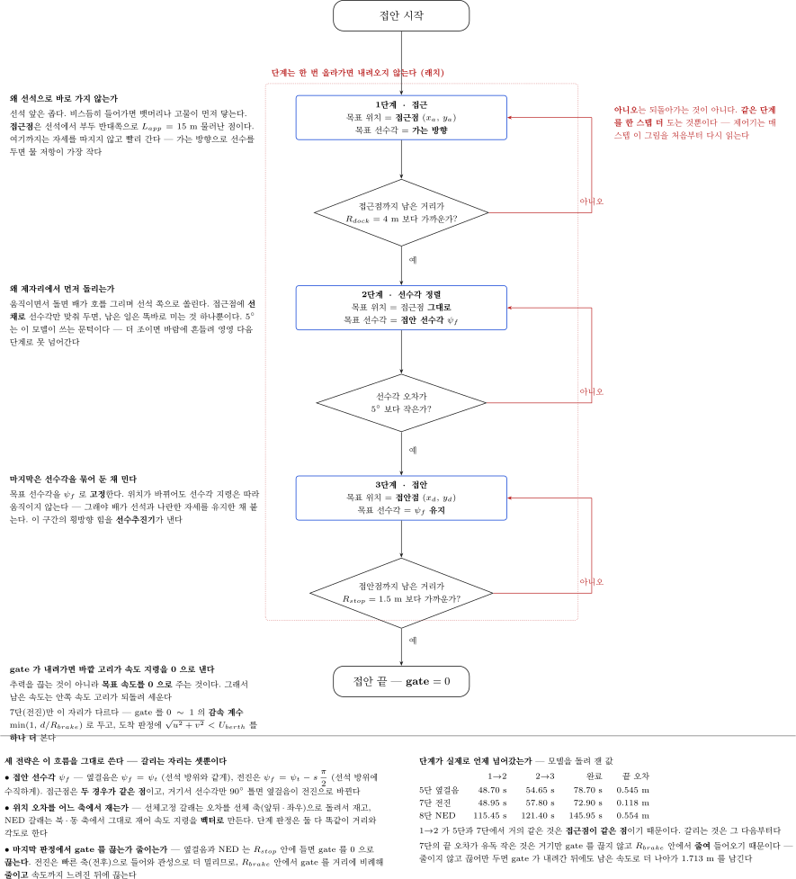

### 흐름도의 칸 ↔ 코드 한 줄

위 흐름도는 `parts/addGuidance.m` 안의 MATLAB Function `TaskRef` 한 칸이 전부임. 흐름도의 네모(하는 일)와 마름모(판정)가 코드에서 어느 줄인지 위에서 아래로 짝지은 표임. 설정값은 `W06_setup` 이 `task_q` 벡터에 담아 `q` 포트로 넣어 줌.

| 흐름도 칸 | `TaskRef` 코드 | 변수 | 설정값 (`W06_setup`) |
|---|---|---|---|
| 들어오는 자세 | `function [...] = TaskRef(x_n, y_n, psi, q, mode, phase_prev)` | `x_n` `y_n` `psi` | 항법 태그로 받음 |
| 접근점 계산 (세 단계 공통) | `ax = dx - sd*La*sin(dpsi);` `ay = dy + sd*La*cos(dpsi);` | `ax` `ay` | `dock_north=40` `dock_east=45` `dock_deg=0` `L_app=15` `berth_side=+1` → (40, 60) |
| **1단계 접근** | `x_ref = ax; y_ref = ay;` `psi_ref = atan2(ay - y_n, ax - x_n);` | `psi_ref` = 가는 방향 | — |
| 판정 $d_{app} < R_{dock}$ | `if sqrt((ax - x_n)^2 + (ay - y_n)^2) < Rd` → `ph = 1;` | `Rd = q(10)` | `R_dock = 4` m |
| **2단계 선수각 정렬** | `x_ref = ax; y_ref = ay; psi_ref = dpsi;` | 위치는 접근점에 묶음 | `dock_deg = 0` |
| 판정 $\lvert e_\psi\rvert < 5°$ | `e = atan2(sin(dpsi - psi), cos(dpsi - psi));` → `if abs(e) < 5*pi/180` → `ph = 2;` | `e` = 접은 선수각 오차 | 코드에 박힌 5° |
| **3단계 접안** | `x_ref = dx; y_ref = dy; psi_ref = dpsi;` | 목표가 선석으로 옮겨짐 | `dock_north` `dock_east` |
| 판정 $d_{dock} < R_{stop}$ | `if sqrt((dx - x_n)^2 + (dy - y_n)^2) < Rs` → `ph = 3;` | `Rs = q(13)` | `R_stop = 1.5` m |
| `gate = 0` → 정지 | `gate = double(ph < 3);` | `gate` | — |
| 래치 (한 번 올라가면 안 내려옴) | `ph = phase_prev;` 로 시작하고 조건이 맞을 때만 올림 | `phase_prev` | 되먹임 자리 |

- **래치를 어떻게 끊는가** — `phase` 가 자기 자신의 입력이므로 그대로 되먹이면 대수 루프임. 같은 파일이 `PhaseDly` (Unit Delay, `InitialCondition = 0`, `SampleTime = Ts_ctrl`) 를 끼워 **한 스텝 전 값**을 `phase_prev` 로 넣음. 그 선은 `drop_tag` → `Fr_phase_prev` (From) 로 이어짐
- **단계를 안 밟는 쪽** — `dock_on = 0` (`q(14)`) 이면 위 분기 전체를 건너뛰고 `x_ref = dx; y_ref = dy; psi_ref = atan2(dy - y_n, dx - x_n);` 한 줄로 선석으로 바로 감. 흐름도의 마름모 둘이 사라지는 쪽이며, 닿기는 하나 **어느 현을 댈지 고르지 못함** (1-6절의 비교)
- **7단은 같은 흐름도, 다른 두 줄** (`parts/addGuidanceFront.m` 의 `TaskFront`)

  | 다른 자리 | 7단 코드 |
  |---|---|
  | 접안 선수각 — 선석 방위에 **수직** | `psi_f = dpsi - sd*pi/2;` |
  | 접근점 — 접안 선수각의 **뒤쪽** | `ax = dx - La*cos(psi_f);` `ay = dy - La*sin(psi_f);` |
  | 2 → 3 판정에 속도 조건 | `if sqrt((dx-x_n)^2 + (dy-y_n)^2) < Rs && sqrt(u^2 + v^2) < Ub` |
  | `gate` 가 스위치가 아니라 **감속 계수** | `gate = min(1, d_t / Rb);` ( `ph < 3` 동안), 그 뒤 `gate = 0` |

  `Rb = q(15)` = `R_brake`, `Ub = q(16)` = `U_berth` $= 0.2$ m/s 임. 1\~6·8단은 `q(1:14)` 만 읽고, 7단만 `q(15)` `q(16)` 과 `u` `v` 를 더 받음

- 1\~4단은 단계 전이가 없음 — `addGuidanceConst.m` (상수 목표) 과 `addGuidanceStop.m` (도착 판정과 `gate` 만) 이 그 자리를 맡음

### 접근점은 어디인가

선석에서 부두 반대쪽으로 $L_{app}$ 만큼 떨어진 점임. 접안 선수각으로 들어가려면 그 뒤쪽에 서 있어야 함.

아래 그림의 변수가 식에 그대로 들어감 — 선석 $(d_x, d_y)$ · 선석 방위 $\psi_t$ · 물러난 거리 $L_{app}$ · 부두가 어느 쪽인가 $s$.

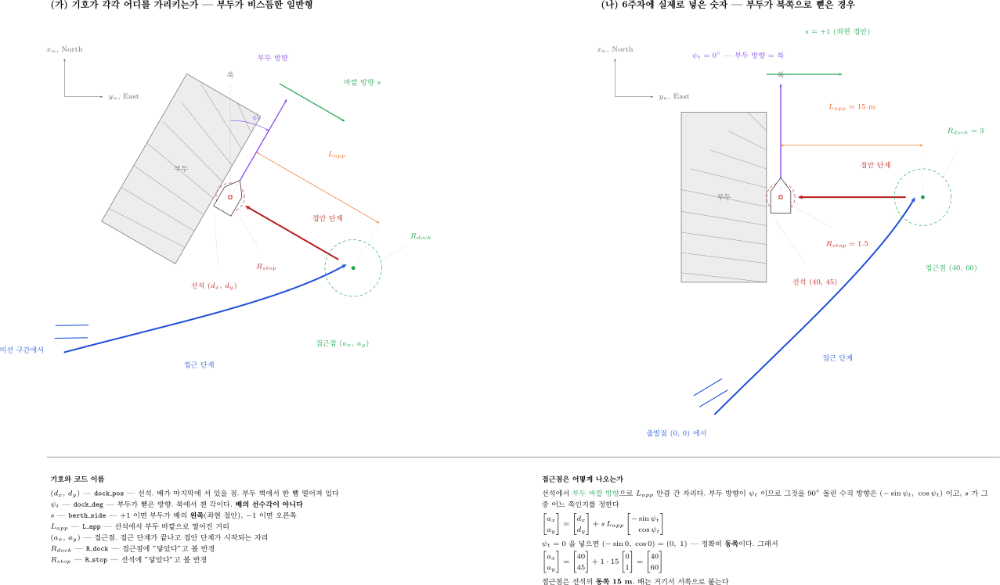

$$
\begin{aligned}
a_x &= d_x - s\, L_{app} \sin\psi_t \\
a_y &= d_y + s\, L_{app} \cos\psi_t
\end{aligned}
$$

벡터로 적으면 뜻이 더 분명함 — 접근점은 선석에서 **선석 방위에 수직한 방향으로** $L_{app}$ 만큼 물러난 점임.

$$
\begin{bmatrix} a_x \\ a_y \end{bmatrix}
=
\begin{bmatrix} d_x \\ d_y \end{bmatrix}
+
s\,L_{app}
\underbrace{\begin{bmatrix} -\sin\psi_t \\ \cos\psi_t \end{bmatrix}}_{\text{선석 방위의 우현쪽 수직}}
$$

- 괄호 안의 벡터는 1-3절 $R(\psi_t)$ 의 **둘째 열**임 — 선석과 나란히 선 배의 **우현쪽** 방향임. 거기에 $s$ 를 곱해 부두 반대쪽으로 뒤집음
- $(d_x, d_y)$ = 선석 위치, $\psi_t$ = 선석 방위 (`dock_deg`), $s$ = `berth_side` ($+1$ = 부두가 좌현쪽)
- 설정값 대입: $(40, 45) + 1 \times 15 \times (-\sin 0, \cos 0) = (40, 60)$
- 즉 배는 원점에서 접근점 (40, 60) 으로 전진하고, 거기서 선수각을 맞춘 뒤 **서쪽으로 15 m** 가서 (40, 45) 에 붙음

> [!warning] 선석은 그림에만 있는 가상의 부두임
> `sydney_regatta` 월드의 실제 도크 위치를 재서 쓴 값이 아님. 좌표만 바꾸면 실제 도크로 옮길 수 있음. 안전이 확인된 수역은 대략 $N \in [-28, 60]$, $E \in [-18, 100]$ 임 (5주차와 같은 값)

---

## 1-6. 옆걸음 접안과 전진 접안 — 같은 접근점, 선수각만 90° 차이

### 두 전략

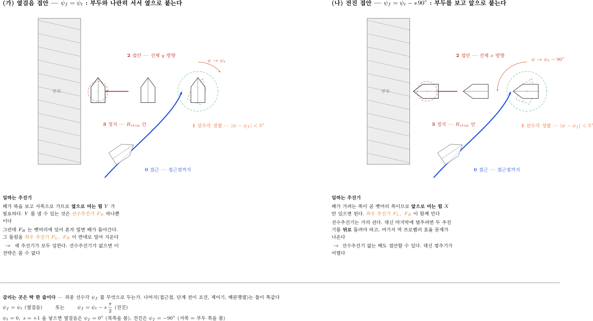

| | 접안 선수각 | 3단계의 접근 방향 | 쓰는 추력 |
|---|---|---|---|
| **옆걸음 (5단)** | $\psi_f = \psi_t$ | 횡 — 선석과 나란히 서서 옆으로 | 선수추진기 (느린 축) |
| **전진 (7단)** | $\psi_f = \psi_t - s\,\pi/2$ | 전후 — 선수를 부두로 돌려 앞으로 | 선미 추진기 (빠른 축) |

- 접근점은 **두 전략이 같은 점**임
- 선수각만 90° 틀면 바깥 고리가 선체좌표로 돌린 오차가 $e_y$ 에서 $e_x$ 로 **옮겨 앉음**
- 제어기는 한 줄도 바꾸지 않음 — 사다리의 값어치가 여기서 드러남

### 측정값으로 비교 (같은 선석·같은 접근점·같은 게인)

| | 완료 [s] | 끝 위치 오차 [m] | 진행축 어긋남 [m] | 옆축 어긋남 [m] | 최대 $F_R$ [N] | 최대 $\lvert v\rvert$ [m/s] |
|---|---|---|---|---|---|---|
| 5단 옆걸음 | 78.70 | 0.545 | $-0.545$ | 0.000 | 434.8 | 0.599 |
| 7단 전진 | 72.90 | 0.118 | $+0.102$ | $-0.060$ | 500.0 | 0.327 |

- **전진이 5.80 s 빠름** — 빠른 축(전후, $u_{max} = 1.5$ m/s)으로 들어가기 때문임
- **전진 쪽에는 감속 구간이 붙어 있음** — 빠른 축으로 들어오면 관성으로 밀리므로, 7단 유도부는 목표점까지 거리가 $R_{brake} = 8$ m 안에 들면 속도 지령에 $d/R_{brake}$ 를 곱해 **끊지 않고 줄임**. 감속 구간 없이 같은 모델을 돌리면 끝오차가 1.713 m 로 $R_{stop}$ 1.5 m 를 벗어남 (2026-10-15 측정)
- 그 감속 덕에 `gate` 가 닫힌 뒤 더 간 거리가 옆걸음 0.943 m, 전진 0.671 m 로 둘 다 1 m 안쪽임 (감속 구간 없는 전진은 3.208 m 였음)
- 부호는 다름 — 옆걸음은 선석에 **못 미쳐** 멈추고($-$), 전진은 0.102 m **지나쳐** 멈춤($+$). 실선에서 뒤쪽은 열린 물이고 앞쪽은 부두이므로 지나치는 쪽이 위험함
- 전진은 선미 추진기가 **한계 500.0 N 에 닿음** (회전수도 265.84 rad/s = $n_{max}$)

### 선수추진기를 끄면 어떻게 되는가 (7단, `bow_on = 0`)

- 300 s 를 다 돌아도 `gate` 가 0 으로 닫히지 않음 — **도착하지 못함** (끝값 0.227, 단계 2 에서 멈춤)
- 끝 자세는 선석에서 옆축으로 1.818 m 어긋난 자리임. 진행축 오차는 0 이지만 옆축을 지울 힘이 없음
- 전진 접안이라도 **마지막 정렬에는 횡력이 필요**하다는 뜻임

> [!note] 실험실 논문의 전략 선택 (Bang et al. 2025, 3.2절)
> - **전진 접안**: 구현이 가장 단순함. 다만 이탈할 때 후진해야 하므로 선회 공간이 더 필요하고, 빠른 축으로 들어가므로 관성으로 더 밀림 — 그래서 이 모델은 접안 직전에 감속 구간 $R_{brake}$ 를 둠
> - **옆걸음**: 접안 정밀도가 높고 이탈이 쉬움. 횡추력이 나는 배(fully actuated)여야 함
> - WAM-V 처럼 횡추력이 있는 배는 두 전략을 다 쓸 수 있음. 옆걸음은 감속 구간 **없이도** $R_{stop}$ 안에 들고, 전진은 감속 구간을 **둬야** 그 안에 듦 — 위 측정표가 그것을 보임

---

## 1-7. 제어기가 도는 좌표계를 바꾼다 — 선체고정 대 NED

### 회전행렬이 어디에 앉는가, 그것이 전부

```
선체고정 (5단)   위치오차 -> [R] -> 속도지령 -> 속도PI -> 힘 -> 배분
NED      (8단)   위치오차 ------> 속도지령 -> 속도PI -> [R] -> 힘 -> 배분
                                      측정속도 -> [R] -> 되먹임
```

- 선체고정은 회전행렬이 **하나**, NED 는 **둘**임
- NED 쪽이 하나 더 드는 까닭 — 제어기는 NED 에서 도는데 **센서도 구동기도 선체고정**임. 들어올 때 한 번, 나갈 때 한 번 돌려야 함

### 선체고정 전략 (5·7단) — 블록도와 코드

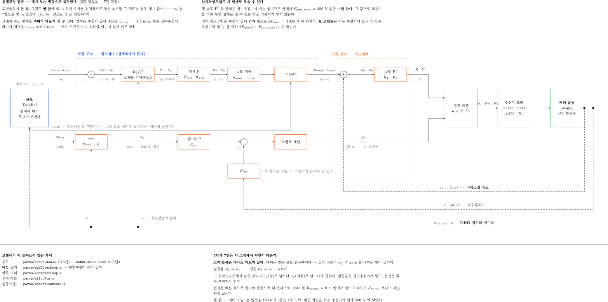

바깥 고리 — 회전행렬이 여기 하나 있음 (`parts/addOuterLoop.m`)

```matlab
%  NED 위치 오차를 선체고정 오차로 돌린다. e_x 앞쪽, e_y 우현쪽 [m]
e_x =  cos(psi)*e_N + sin(psi)*e_E;
e_y = -sin(psi)*e_N + cos(psi)*e_E;

%  비례 제어 -> 축마다 다른 속도 포화 -> gate
sl_gain(ss, 'Kp_x', 'Kp_x', 560,  80);     % Kp_x = 0.4
sl_gain(ss, 'Kp_y', 'Kp_y', 560, 220);     % Kp_y = 0.4
sl_sat (ss, 'SatU', 'u_max', 660,  80);    % u_max = 1.5 m/s  (전후, 선미 추진기)
sl_sat (ss, 'SatV', 'v_max', 660, 220);    % v_max = 0.6 m/s  (횡, 선수추진기)
```

안쪽 고리 — 적분기 한계가 **축마다 다름** (`parts/addInnerLoop.m`)

```matlab
%  속도 PI 둘. 다섯째 인자가 적분기 한계다 — 그 힘을 내는 추진기의 한계로 둔다
sl_pi(ss, 'PI_u', 'Kp_u', 'Ki_u', '2*F_max',   350,  60);   % 전후 : 1000 N
sl_pi(ss, 'PI_v', 'Kp_v', 'Ki_v', 'F_bow_max', 350, 180);   % 횡   :  250 N

%  선수각 P-D — 미분항은 오차 미분이 아니라 요각속도 되먹임이다
add_ssa (ss, 'ErrPsi', 'Ssa', [250 330], 70);               % ±pi 로 접음
sl_gain (ss, 'Kp_psi',  'Kp_psi',  450, 310);               % 400
sl_gain (ss, 'Kd_rate', 'Kd_psi',  450, 440);               % 200
sl_sat  (ss, 'SatN', '2*F_max*half_beam + F_bow_max*l_bow', 650, 310);
```

### NED 전략의 세 식 (실험실 논문 Bang et al. 2025, 식 13\~16)

위치 비례 제어 — 돌리지 않고 북·동 축에서 바로 (식 13)

$$ \dot{x}_{cmd} = K_{p,ned}(x_{ref} - x_n), \qquad \dot{y}_{cmd} = K_{p,ned}(y_{ref} - y_n) $$

측정 속도를 NED 로 (식 14, 회전행렬 1)

$$ \dot{x} = u\cos\psi - v\sin\psi, \qquad \dot{y} = u\sin\psi + v\cos\psi $$

NED 축 속도 PI (식 15)

$$ X_N = K_{p,vn}(\dot{x}_{cmd} - \dot{x}) + K_{i,vn}\!\int(\cdot)\,dt, \qquad Y_E = K_{p,vn}(\dot{y}_{cmd} - \dot{y}) + K_{i,vn}\!\int(\cdot)\,dt $$

힘 지령을 선체좌표로 (식 16, 회전행렬 2)

$$ X = X_N\cos\psi + Y_E\sin\psi, \qquad Y = -X_N\sin\psi + Y_E\cos\psi $$

- 선수각 P-D 와 추력배분은 선체고정 전략과 **글자까지 같음** (같은 `allocFcn.m` 을 씀)
- 바깥 고리의 **입력 포트에 $\psi$ 가 없음** — 두 전략의 첫째 차이가 포트 목록만 봐도 드러남

### NED 전략 (8단) — 블록도와 코드

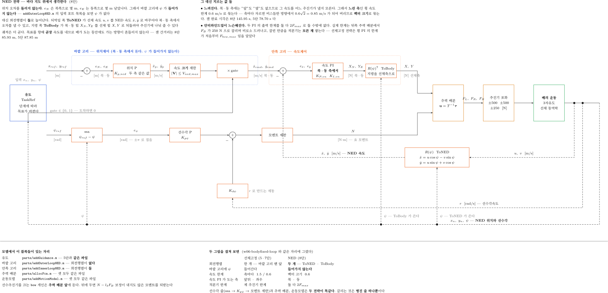

바깥 고리 — 회전행렬이 **없고**, 속도 지령을 **벡터 크기**로 묶음 (`parts/addOuterLoopNED.m`)

```matlab
%  입력 포트에 psi 가 없다 — 오차를 북·동 축에서 그대로 쓴다
sl_gain(ss, 'Kp_N', 'Kp_ned', 350,  80);   % Kp_ned = 0.4, 두 축 공통
sl_gain(ss, 'Kp_E', 'Kp_ned', 350, 240);

%  NED 속도 지령의 크기를 vmax 로 묶는다 (방향은 그대로).
%
%  축마다 따로 자르지 않는 까닭: 두 축을 각각 vmax 로 자르면 비스듬한
%  방향에서 크기가 vmax*sqrt(2) 가 되어 한계를 넘는다.
s = sqrt(xdot_p^2 + ydot_p^2);
if s > vmax
    xdot_cmd = xdot_p*vmax/s;
    ydot_cmd = ydot_p*vmax/s;
else
    xdot_cmd = xdot_p;
    ydot_cmd = ydot_p;
end
```

안쪽 고리 — 회전행렬 둘이 PI 를 **앞뒤로 감쌈** (`parts/addInnerLoopNED.m`)

```matlab
%  (1) 측정 속도를 NED 로 — 식 14, 회전행렬 R(psi)
xdot = u*cos(psi) - v*sin(psi);
ydot = u*sin(psi) + v*cos(psi);

%  (2) NED 축 속도 오차 -> PI — 식 15
%      적분기 한계가 둘 다 2*F_max 다. 북쪽 힘을 어느 추진기가 낼지
%      선수각에 따라 달라지므로 축마다 다르게 둘 수 없다
sl_pi(ss, 'PI_xd', 'Kp_vn', 'Ki_vn', '2*F_max', 620,  60);
sl_pi(ss, 'PI_yd', 'Kp_vn', 'Ki_vn', '2*F_max', 620, 180);

%  (3) 힘 지령을 선체좌표로 — 식 16, 회전행렬 R(psi)'
X =  X_N*cos(psi) + Y_E*sin(psi);
Y = -X_N*sin(psi) + Y_E*cos(psi);
```

- `ToNED` 는 $R(\psi)$, `ToBody` 는 $R(\psi)^{\mathsf T}$ 임 — 1-3절의 성질 1번($R^{-1} = R^{\mathsf T}$)이 코드에서 **부호 자리가 바뀐 것**으로 나타남
- 선체고정 전략의 `Rotate` 와 NED 전략의 `ToBody` 는 **같은 식**임. 다른 것은 **무엇을 돌리는가**뿐임 — 선체고정은 위치 오차 [m] 를, NED 는 힘 지령 [N] 을 돌림

### NED 전략이 치르는 값 둘

**(1) 속도 지령을 느린 축의 한계로 묶어야 함**

- 선체좌표에서는 전후 1.5 m/s · 횡 0.6 m/s 로 **축마다 다르게** 묶을 수 있었음. 어느 추진기가 그 속도를 내는지 알기 때문임
- NED 축은 그것을 모름 — 북쪽으로 1.5 m/s 를 지시해도 선수가 동쪽을 보고 있으면 그것은 **횡방향 1.5 m/s** 이고 선수추진기 하나로는 낼 수 없음
- 그래서 $V_{ned,max} = v_{max} = 0.6$ m/s 로 묶음. 묶는 방법도 축마다가 아니라 **벡터의 크기**로 함

$$ \mathbf{v}_{cmd} \leftarrow \mathbf{v}_{cmd} \cdot \min\!\left(1,\ \frac{V_{ned,max}}{\lVert \mathbf{v}_{cmd}\rVert}\right) $$

- 두 축을 따로 0.6 으로 자르면 비스듬한 방향에서 $0.6\sqrt{2} = 0.85$ m/s 가 되어 한계를 넘음. 크기로 자르면 **방향은 그대로** 두고 빠르기만 줄어듦

**(2) anti-windup 이 느슨해짐**

- 선체고정에서는 횡 속도 PI 의 **출력 한계**를 $F_{B,max}$ 로 둘 수 있었음 — 그 힘을 선수추진기가 낸다는 것을 알기 때문임
- NED 축에서는 북쪽 힘을 어느 추진기가 낼지 **선수각에 따라 달라짐**. 두 축 모두 $2F_{max}$ 로 두고, 실제 한계는 배분에서 $F_B$ 가 잘리며 드러남
- 역계산 anti-windup 은 **PI 가 제 손으로 자른 몫**만 되감음. 배분에서 잘린 몫은 PI 의 출력에 나타나지 않으므로 $\mathrm{sat}(v) - v = 0$ 이고, 되감기가 걸리지 않음 — 두 전략이 같은 $K_b$ 를 써도 NED 쪽만 적분량이 남는 까닭임

### 측정값으로 비교 (같은 과업 — 같은 선석·같은 접근점·같은 세 단계)

| | `gate` 닫힘 [s] | 돈 시간 [s] | 끝 위치 오차 [m] | 최대 $\lvert U\rvert$ [m/s] | 간 거리 [m] | $(F_L, F_R, F_B)_{max}$ [N] |
|---|---|---|---|---|---|---|
| 5단 선체고정 | 78.70 | 93.70 | 0.545 | 1.499 | 87.85 | (243.4, 434.8, 189.6) |
| 8단 NED | 145.95 | 160.95 | 0.554 | 0.630 | 85.93 | (134.4, 248.4, 210.6) |

- **NED 가 1.72 배 느림** (돈 시간 160.95 s 대 93.70 s) — 접근 구간 전체가 0.6 m/s 로 묶이기 때문임
- **끝 정밀도는 1 cm 안에서 같음** (0.545 m 대 0.554 m). 선석 어긋남은 진행축 $-0.545$ m 대 $-0.553$ m, 옆축 0.000 m 대 0.018 m
- **간 거리는 NED 가 1.92 m 짧음** (85.93 m 대 87.85 m, 직선거리 60.21 m). 선수각이 돌아도 목표점으로 가는 직선이 변하지 않아 경로가 곧음
- **선미 추력은 NED 가 작음** — 느리게 가므로 당연함. 다만 $F_B$ 는 NED 가 더 큼 (210.6 N 대 189.6 N). 북·동 힘을 선체축으로 돌린 몫이 횡으로 더 들어가기 때문임

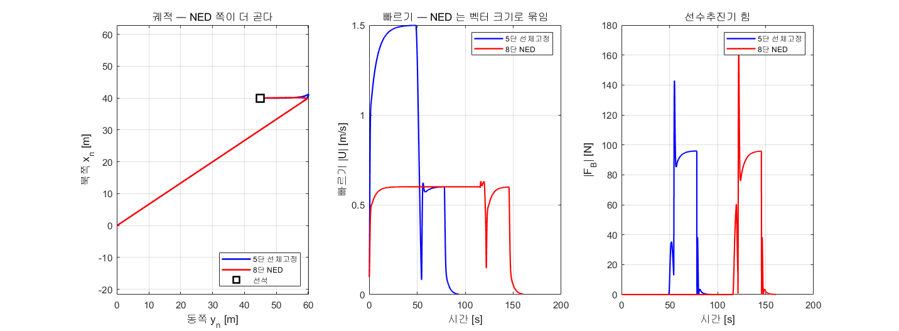

> [!tip] 어느 쪽을 쓰는가
> - **NED**: 오차를 지도 위에서 바로 셈. 경로가 곧고, 좌표계가 하나라 생각하기 쉬움
> - **선체고정**: 축마다 다른 속도·추력 한계를 **그대로 걸 수 있음**. 임무 제어(5주차)의 전후 속도 제어기를 다시 쓸 수 있음
> - WAM-V 처럼 전후와 횡의 힘이 크게 다른 배(선미 500 N 둘 · 선수 250 N 하나)에서는 **축마다 다르게 묶을 수 있는 쪽**이 유리함. 위 측정표의 1.72 배가 그 값임

---

## 1-8. 사다리 여덟 단 — 한 단계에 새로 생기는 것은 하나뿐

| 단 | 모델 | 이번에 새로 생기는 것 | 확인할 것 |
|---|---|---|---|
| 1 | `W06_1_point` | 위치 고리 + 속도 고리 + 선수각 고리 + 추력배분 | (30, 20) 에 45° 로 서 있는지 |
| 2 | `W06_2_sway` | `bow_on` 스위치 하나 (`InnerLoop` 안) | 1 이면 옆으로 12 m, 0 이면 제자리 |
| 3 | `W06_3_thrust` | `Thrusters` 서브시스템 — Gazebo 플러그인의 프로펠러 법칙 | 1단과 끝 자세가 같은지, 왕복 검산이 0 인지 |
| 4 | `W06_4_stop` | 도착 판정과 정지 게이트 (래치 + `AutoStop`) | 멈춘 뒤 관성으로 더 가는 거리 |
| 5 | `W06_5_dock` | 단계 전이 (접근 → 선수각 정렬 → 옆걸음) | `phase` 가 1·2·3 으로 올라가는 시각 |
| 6 | `W06_5_dock_vrx` (5단의 쌍둥이) | Gazebo 연동 (운동모델만 실물로 바뀜) | 토픽·RTF·오프라인 대조 |
| 7 | `W06_7_front` | 접안 선수각이 선석 방위에 수직 | 3단계가 전진으로 바뀜 |
| 8 | `W06_8_ned` | 위치·속도 제어가 NED 축에서 돎 | 회전행렬이 안쪽 고리로 옮겨 감 |

- **6단은 새 모델을 더하는 단이 아님** — 5단의 VRX 쌍둥이 `W06_5_dock_vrx` 를 Gazebo 에 붙여 돌리는 단임. 그래서 6단 칸에는 5단과 블록 구성이 같은 모델이 들어감 (다른 것은 운동모델 자리 하나)
- 7·8단은 6단 위가 아니라 **5단 위에** 쌓음. 6단은 운동모델을 실물로 바꾸는 갈림길이고, 7·8단은 오프라인에서 제어 전략을 바꾸는 길임
- 미리 만들어 둔 것은 **일곱 쌍**임 — 오프라인 일곱 개(1\~5·7·8)와 VRX 쌍둥이 일곱 개. 6단은 Gazebo 가 떠 있어야 돌아가므로 오프라인에서 숫자를 재는 것은 일곱 단(1\~5·7·8)임
- 블록 색은 역할을 뜻함 (5주차와 같은 규칙) — 유도 연두 · 제어 파랑 · 구동기 주황 · 플랜트 회색 · 로깅 노랑

### 각 단계의 모델 도면

| 단 | 도면 |
|---|---|
| 1 | 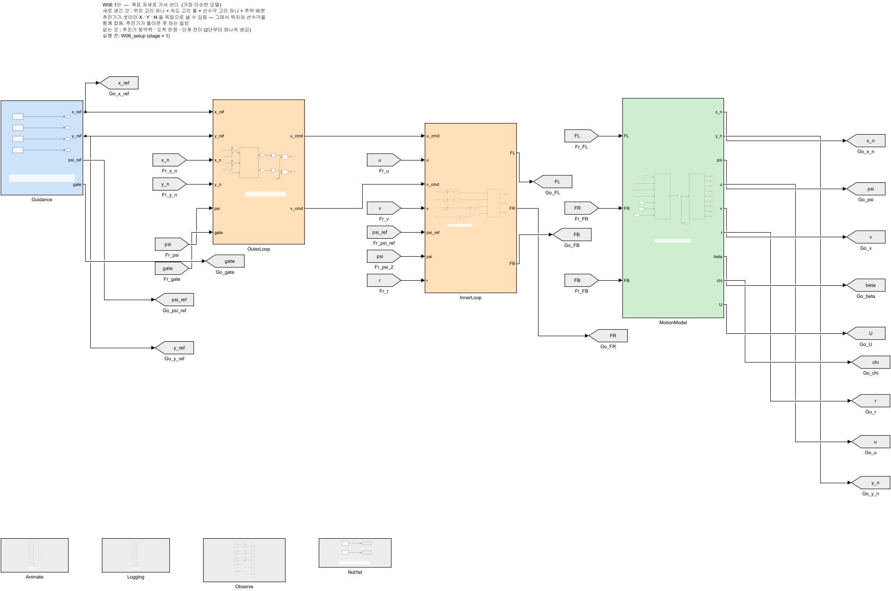 |
| 2 | 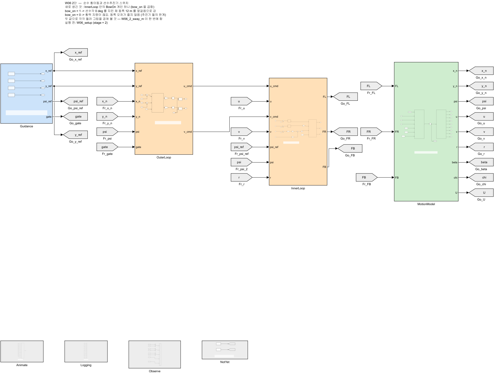 |
| 3 | 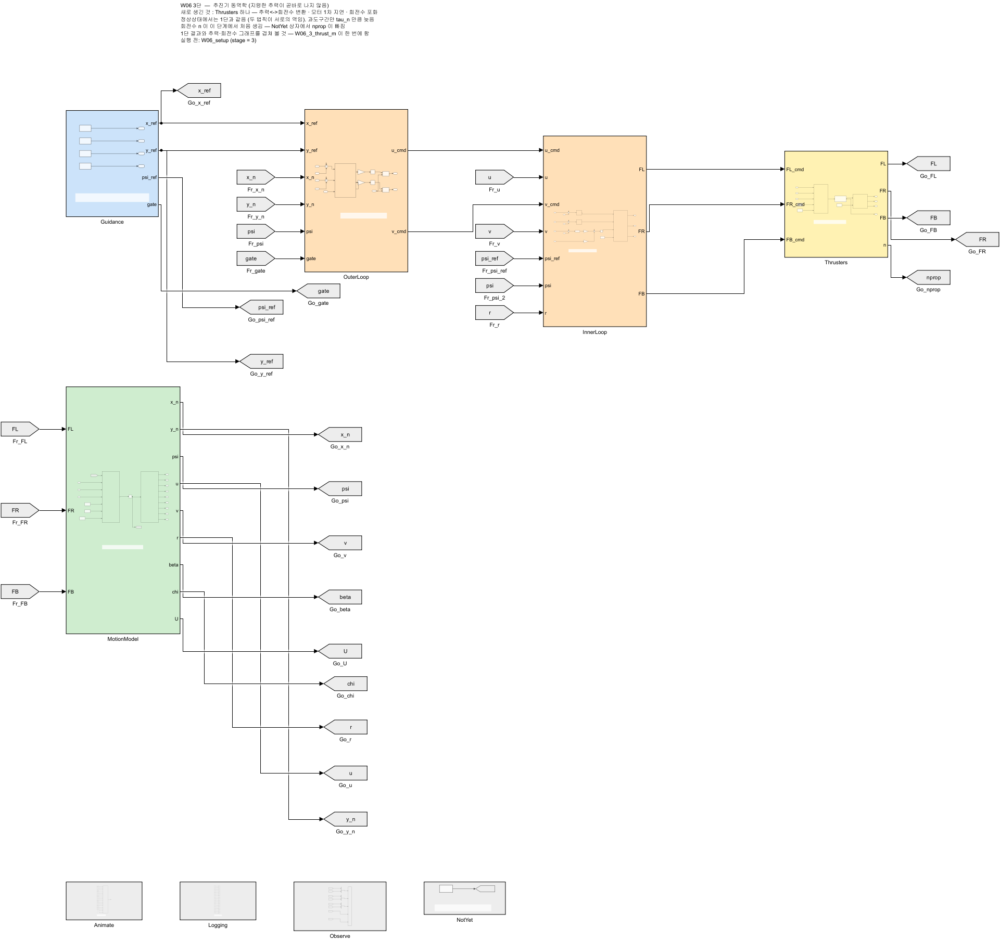 |
| 4 | 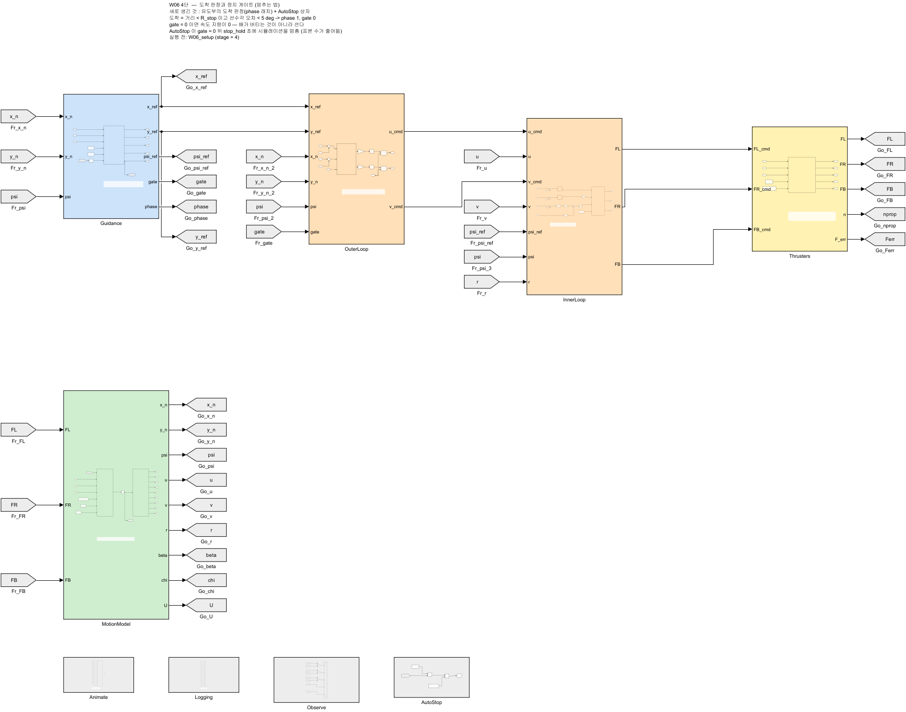 |
| 5 | 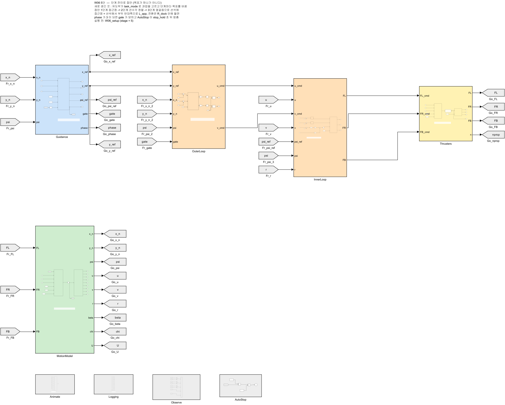 |
| 6 | 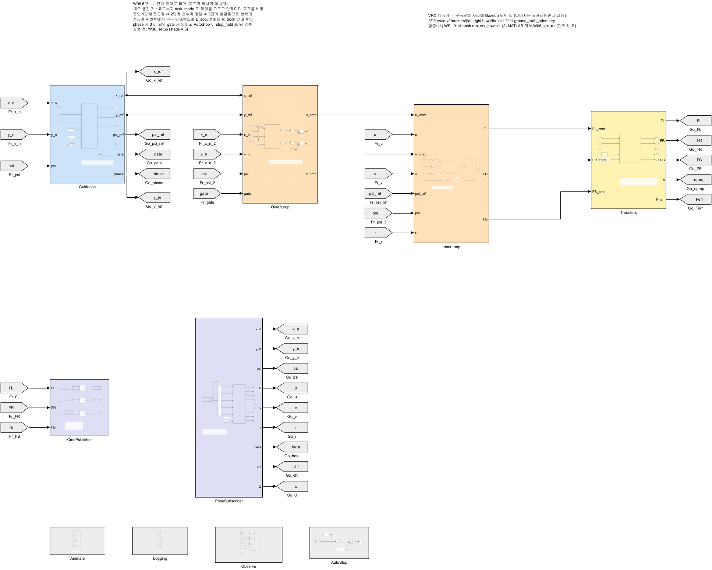 |
| 7 | 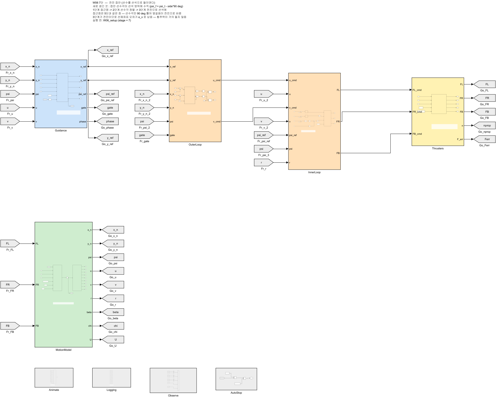 |
| 8 | 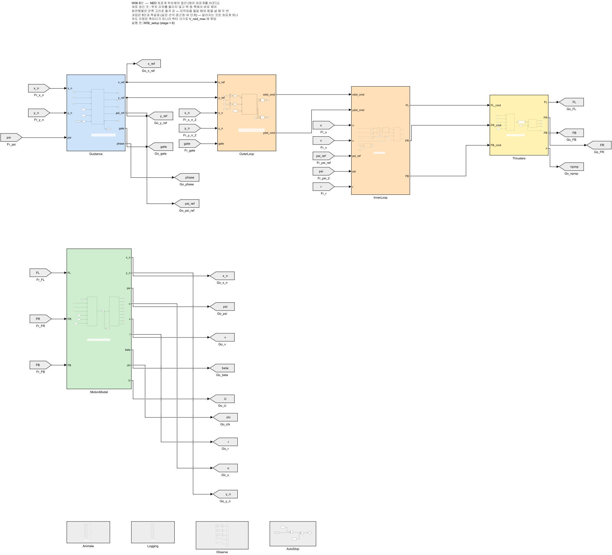 |

---

## 1-9. 수식과 코드 — 한 줄씩 맞춰 보기

### 추력배분 (`parts/allocFcn.m`)

| 식 | 코드 |
|---|---|
| $F_B = \mathrm{sat}(Y,\ F_{B,max})$ | `FB = Y;` → `if FB > Fbmax, FB = Fbmax; end` (양쪽) |
| $M = N - l_3 F_B$ | `M = N - l3*FB;` |
| $F_L = X/2 + M/(2b)$ | `FL = X/2 + M/(2*b);` |
| $F_R = X/2 - M/(2b)$ | `FR = X/2 - M/(2*b);` |
| $\lvert F_L\rvert, \lvert F_R\rvert \le F_{max}$ | `if FL > Fmax, FL = Fmax; end` (네 줄) |

> [!important] 포화된 **뒤의** $F_B$ 로 모멘트를 센다
> 코드에서 `FB` 를 먼저 자르고 그 값으로 `M = N - l3*FB` 를 셈. 지령값으로 세면 실제로 딸려 오지 않은 모멘트를 되받아 선수각이 반대로 틀어짐. 한 줄의 순서가 결과를 바꿈

### 바깥 고리 (`parts/addOuterLoop.m` 의 `Rotate` 함수)

| 식 | 코드 |
|---|---|
| $e_x = \cos\psi\, e_N + \sin\psi\, e_E$ | `e_x =  cos(psi)*e_N + sin(psi)*e_E;` |
| $e_y = -\sin\psi\, e_N + \cos\psi\, e_E$ | `e_y = -sin(psi)*e_N + cos(psi)*e_E;` |

### NED 전략의 회전행렬 둘 (`parts/addInnerLoopNED.m`)

| 식 | 코드 | 자리 |
|---|---|---|
| 식 14 | `xdot = u*cos(psi) - v*sin(psi);` | `ToNED` — 되먹임을 들일 때 |
| 식 14 | `ydot = u*sin(psi) + v*cos(psi);` | `ToNED` |
| 식 16 | `X =  X_N*cos(psi) + Y_E*sin(psi);` | `ToBody` — 힘을 낼 때 |
| 식 16 | `Y = -X_N*sin(psi) + Y_E*cos(psi);` | `ToBody` |

- 두 행렬은 서로의 전치임. 하나는 속도를 선체→NED 로, 다른 하나는 힘을 NED→선체로 돌림

### 선수각 오차 접기

| 식 | 코드 |
|---|---|
| $\mathrm{ssa}(\theta) = \mathrm{atan2}(\sin\theta, \cos\theta)$ | `e_psi = atan2(sin(psi_d - psi), cos(psi_d - psi));` |

- Simulink 에서는 `_tools/add_ssa.m` 가 같은 식의 블록을 놓음 — 합산점 하나와 `Fcn` 하나임

---

# 2부 · 실습

## 무엇을 돌리는가 — 모델 `.slx` 와 실행 `.m`

> [!tip] 이 표의 `.m` 하나만 치면 그 단계가 끝까지 돎
> `.slx` 를 먼저 열 필요가 없음. 실행 `.m` 이 **설정을 올리고 → 모델을 열고 → 돌리고 → 그림을 내고 → 숫자를 찍음**. 모델 파일은 그 안에서 열림.

| 단 | 새로 생기는 것 | 모델 `.slx` | **치는 것** | 블록도 그림 (`W06_simulink/img/`) |
|---|---|---|---|---|
| 1 | 세 고리 + 추력배분 | `W06_1_point.slx` | **`W06_1_point_run`** | `W06_1_point.png` |
| 2 | 선수추진기 on/off 스위치 | `W06_2_sway.slx` | **`W06_2_sway_run`** | `W06_2_sway.png` |
| 3 | 추진기 동역학 (추력↔회전수) | `W06_3_thrust.slx` | **`W06_3_thrust_run`** | `W06_3_thrust.png` |
| 4 | 도착 판정과 정지 게이트 | `W06_4_stop.slx` | **`W06_4_stop_run`** | `W06_4_stop.png` |
| 5 | 단계 전이 (접근 → 정렬 → 옆걸음) | `W06_5_dock.slx` | **`W06_5_dock_run`** | `W06_5_dock.png` |
| 6 | Gazebo 연동 (플랜트만 실물) | `W06_5_dock_vrx.slx` (5단 쌍둥이) | **`W06_6_vrx_run`** → 창에서 **Run** | `W06_5_dock_vrx.png` |
| 7 | 전진 접안 (bow-first) | `W06_7_front.slx` | **`W06_7_front_run`** | `W06_7_front.png` |
| 8 | NED 좌표계 위치제어 | `W06_8_ned.slx` | **`W06_8_ned_run`** | `W06_8_ned.png` |

- 파일 자리: 위 모델 일곱 개와 실행 파일 여덟 개 모두 `10-주차별-강의자료/W06_simulink/` 안에 **나란히** 있음. 이름이 `_run` 으로 끝나면 실행 파일, `.slx` 는 모델임
- 짝이 어긋나지 않게 **이름을 맞춰 둠** — `W06_<단>_<이름>.slx` ↔ `W06_<단>_<이름>_run.m`
- **6단만 조건이 둘 있음** — Gazebo·VRX 가 떠 있어야 하고, **실행은 Simulink 창의 Run 으로** 함. 나머지 일곱 단은 MATLAB 하나로 끝남
- **m 파일은 전부 오프라인 모델만 돌림** (2026-10-28 부터). Gazebo 연동은 쌍둥이를 **직접 Run** 하는 길 하나뿐임 — 한 m 파일이 두 모델을 함께 돌리면 어느 그래프가 무엇인지 헷갈리기 때문임
- 6단의 모델 칸이 5단과 같은 이름인 까닭 — 6단은 **5단의 쌍둥이를 실물로 돌리는 단**이라 새 모델이 없음. `W06_6_vrx_run` 은 `W06_vrx_run(5)` 한 줄짜리 편의 파일임 (기준 궤적을 새로 만들고 쌍둥이를 열어 줌)
- **단마다 VRX 쌍둥이가 있음** — `W06_1_point_vrx.slx` … `W06_8_ned_vrx.slx` 일곱 개. 쌍둥이를 여는 명령은 `W06_vrx_run(단)` 하나이고, 돌리는 것은 그 창의 **Run** 임 (G-7-3)

**그 밖에 직접 치는 `.m`**

| `.m` | 하는 일 | 관련 절 |
|---|---|---|
| `W06_setup` | 설정 — 모든 실행 파일이 맨 먼저 부름. 첫 줄 `stage` 를 고쳐 직접 쳐도 됨 | A |
| `W06_ladder` | 여덟 단을 한 번에 돌려 **측정표 하나**를 냄 | F |
| `W06_bow_demo` | 2단에서 `bow_on` 1 과 0 을 견줌 | D |
| `W06_psi_sweep` | 1단에서 목표 선수각 45·−60·100·−90° | C-4 |
| `W06_berth_compare` | 5·7·8단 세 접안 전략을 겹쳐 그림 | E-2 |
| `W06_awup_compare` | 적분기 anti-windup 세 방식을 같은 과업으로 견줌 | C-2 |
| `W06_shots` | 단계별 결과 그림을 `img/` 에 찍음 | F |
| `W06_anim_capture` | 실시간 화면을 그대로 PNG 로 저장 | B |
| `build_w06_models` | 모델 여덟 개를 다시 만듦 | H |

- **직접 치지 않는 `.m`** — `W06_plot` (결과 그림) · `W06_animate` (실시간 화면) · `W06_dock_patch` (ㄷ 자 선석 외곽선) · `W06_fig` (창 관리) · `parts/*` (블록 놓기). 위 실행 파일들이 부름
- VRX 실습 쪽 실행 파일은 `.m` 이 아니라 `.sh` 임 — `W06_vrx_lite/` 의 `make_wamv_bow.sh` · `run_vrx_bow.sh` · `measure_bow.sh` · `measure_sway.sh` · `shoot_bow.sh` (G 절)

## 실행하면 이런 결과가 나온다

| 단 | 결과 그림 |
|---|---|
| 1 | 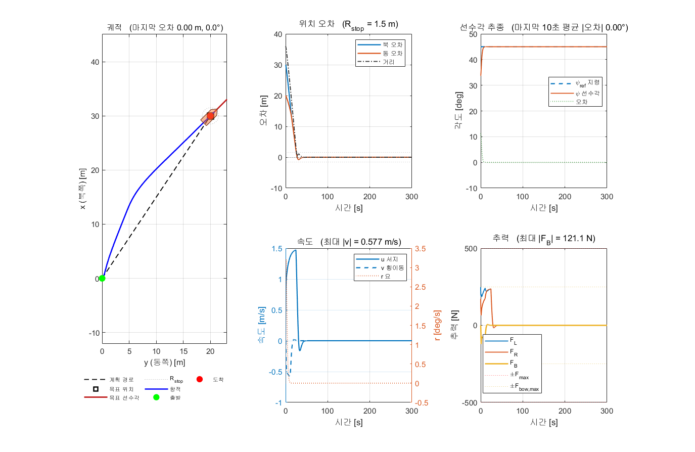 |
| 2 | 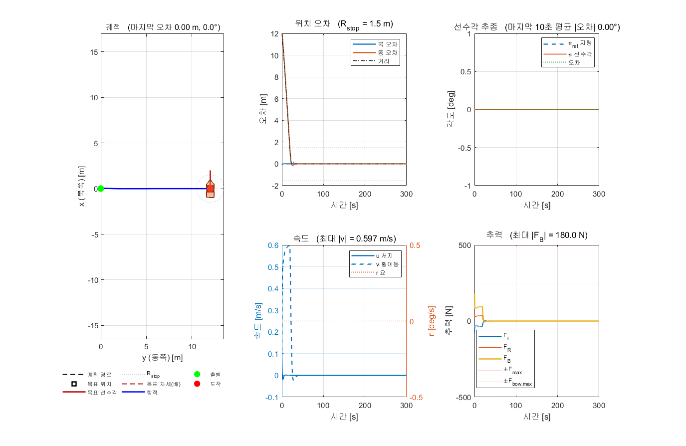 |
| 3 |  |
| 4 | 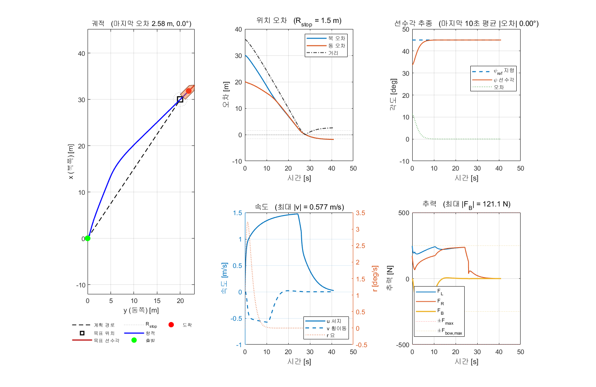 |
| 5 | 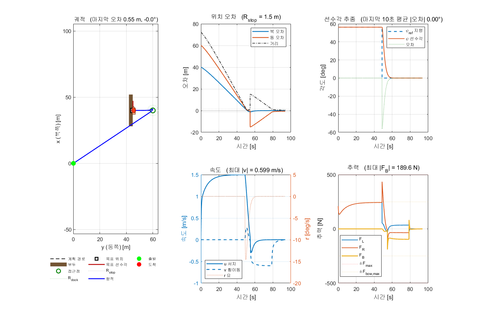 |
| 7 | 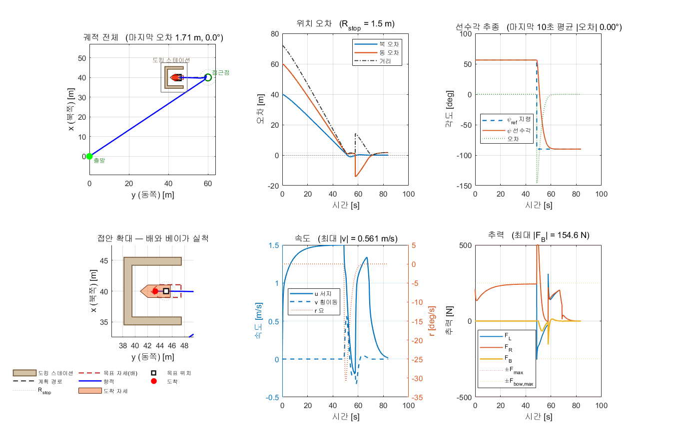 |
| 8 | 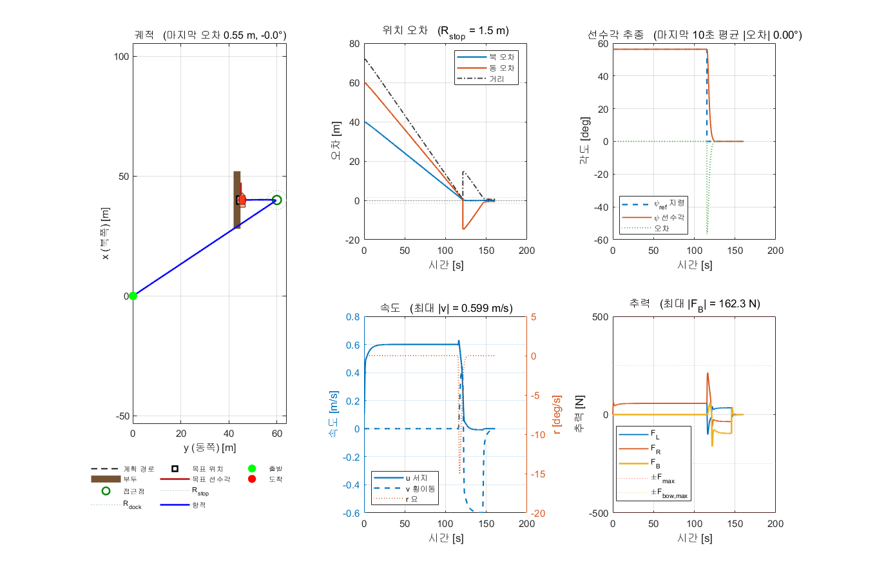 |

- 위 그림 일곱 장은 모두 `W06_shots` 가 찍은 것임. 노트에 붙은 그림과 직접 돌려 보는 그림이 **같은 코드**에서 나옴

### 돌리는 방법은 셋, 결과 그림은 하나

| 방법 | 치는 것 | 쓰는 자리 |
|---|---|---|
| 단계 실행 파일 | `W06_1_point_run` … `W06_8_ned_run` | **권장**. 설정 → 실행 → 그림 → 그 단계에서 봐야 할 숫자까지 한 번에 |
| 설정 파일 | `W06_setup` (첫 줄 `stage` 를 고침) | 설정을 바꿔 가며 볼 때 |
| Simulink 에서 직접 | 모델 창의 **Run** | 블록을 열어 보며 돌릴 때. `W06_setup` 을 한 번 돌려 둔 뒤여야 함 |

- 세 방법 모두 **같은 `.slx` 를 돌림**. 실행 파일 `.m` 은 물리를 다시 짜지 않음 — 설정을 올리고 `sim` 을 부르고 `W06_plot` 으로 그리는 세 걸음뿐임
- Simulink 에서 직접 Run 해도 `Animate` 상자가 실시간 그림을 띄움. 다만 끝난 뒤의 결과 그림 여섯 칸은 `W06_plot(out, '제목')` 을 손으로 한 번 불러야 나옴

### 비교해 보는 예제 셋

| 파일 | 무엇을 견주는가 | 나오는 것 |
|---|---|---|
| `W06_bow_demo` | 2단에서 `bow_on` 1 과 0 | 궤적·동쪽 오차·$v$·$F_B$ 네 칸 |
| `W06_psi_sweep` | 1단에서 목표 선수각 45·−60·100·−90° | 선수각 시간이력과 궤적, 표 한 장 |
| `W06_berth_compare` | 5·7·8단 세 접안 전략 | 궤적·선석 부근 확대·$F_B$, 표 한 장 |

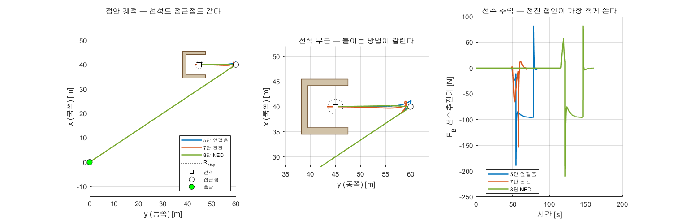

---

## A. 설정 파일 열어 보기 (10분)

`W06_simulink/W06_setup.m` 하나만 고치면 됨. 모델의 Constant 블록들이 이 파일이 만든 변수 이름을 그대로 참조함.

### 단계 고르기 — 첫 줄 하나

```matlab
stage = 1;      % 1~8. 이 한 줄이 어느 모델을 돌릴지 정한다
```

- `W06_setup` 을 실행하면 그 단계의 모델이 **자동으로 열리고 돌아감**
- 모델을 열기 전에 반드시 이 스크립트를 먼저 실행할 것

### 학생이 바꾸는 값

| 변수 | 기본값 | 뜻 |
|---|---|---|
| `stage` | 1 | 돌릴 단계 (1\~8) |
| `hold_north` · `hold_east` · `hold_deg` | 30 · 20 · 45 | 1·3·4단의 목표 자세 [m, m, deg] |
| `sway_north` · `sway_east` · `sway_deg` | 0 · 12 · 0 | 2단의 횡이동 목표 |
| `dock_north` · `dock_east` · `dock_deg` | 40 · 45 · 0 | 선석 위치와 방위 |
| `berth_side` | $+1$ | $+1$ = 부두가 좌현쪽 |
| `L_app` · `R_dock` · `R_stop` | 15 · 4 · 1.5 | 접근점 거리 · 전환반경 · 도착반경 [m] |
| `R_brake` · `U_berth` | 8 · 0.2 | 7단 감속 구간 [m] · 도착으로 보는 속도 한계 [m/s] (E-1) |
| `bow_on` | 1 | 0 으로 두면 선수추진기를 끔 |
| `u_max` · `v_max` | 1.5 · 0.6 | 속도 지령 포화 [m/s] |
| `F_max` · `F_bow_max` | 500 · 250 | 추력 한계 [N] |
| `current_speed` · `current_direction` | 0 · 0 | 조류 [m/s, deg] (오프라인만) |
| `animate` | 1 | 0 으로 두면 오프라인이 훨씬 빨리 돎. **VRX 연동에서는 1 로 둠** (G-7-1 상자) |

### 손대지 않는 값

- 플랜트 계수 (`m_usv` = 226.5 kg, `Izz` = 653 kg·m², 항력 계수 여섯) — **Gazebo 와 같은 값**이어야 오프라인·실기 대조가 성립함
- 추진기 계수 (`k_prop` = 0.0070752, `n_max` = 265.8 rad/s 참고선, `F_plugin_max` = 2353.5 N) — 모두 VRX URDF 에서 그대로 옮긴 값임 (§C-3)
- 제어 주기 `Ts_ctrl` = 0.05 s, 솔버 `ode4` 고정 스텝 — m 파일의 RK4 간격과 같아야 두 결과가 맞음

> [!note] 질량이 5주차의 211 kg 에서 226.5 kg 으로 늘어난 까닭
> 선수추진기(엔진 15 kg + 프로펠러 0.5 kg)가 $x = +0.75$ m 에 붙었음. 요 관성은 5주차 값(653)을 그대로 씀 — 중심선($y = 0$)에 있어 더해지는 몫이 $15.5 \times 0.75^2 = 8.7$ kg·m² 로 653 의 1.3 % 임

---

## B. 오프라인 모델 — 구조 읽기 (25분)

### 왼쪽에서 오른쪽으로 읽는다

```
Guidance  ->  OuterLoop  ->  InnerLoop  ->  Thrusters  ->  MotionModel
 무엇을       위치오차 ->     속도오차 ->   추력 포화 ->        운동방정식
 목표로        속도지령        추력        회전수 (플러그인)     (3자유도)
```

- 되먹임은 **태그(Goto/From)** 로 받음. 최상위에 되먹임 선을 그으면 사슬을 거슬러 올라가는 긴 선이 생겨 그림이 읽히지 않음
- 신호 이름이 단계마다 같음 — 그래서 한 단계에서 서브시스템 하나만 바꿔 끼울 수 있음

### 흐름도의 칸 ↔ 실제 블록 ↔ 실제 변수

위 흐름도의 다섯 칸이 모델 안에서 **어떤 이름으로 있는지** 왼쪽에서 오른쪽으로 짝지은 표임. 블록 이름은 모델 창에서 보이는 그 이름이고, 변수 이름은 `W06_setup` 이 만든 그 이름임.

| 흐름도 칸 | 서브시스템 블록 | 안에 든 블록 (보이는 이름) | 받는 신호 | 내는 신호 | `W06_setup` 변수 |
|---|---|---|---|---|---|
| 무엇을 목표로 | `Guidance` | `TaskRef` (MATLAB Function) · `PhaseDly` (Unit Delay) | `x_n` `y_n` `psi` | `x_ref` `y_ref` `psi_ref` `gate` `phase` | `task_q` (포트 이름은 `q`) |
| 위치오차 → 속도지령 | `OuterLoop` | `ErrN` `ErrE` (Sum) · `Rotate` (MATLAB Function) · `Kp_x` `Kp_y` (Gain) · `SatU` `SatV` (Saturation) | `x_ref` `y_ref` `x_n` `y_n` `psi` `gate` | `u_cmd` `v_cmd` | `Kp_x` `Kp_y` `u_max` `v_max` |
| 속도오차 → 추력 | `InnerLoop` | `SumU` `SumV` (Sum) · `PI_u` `PI_v` (되감기 이득 `Kb`) · `ErrPsi` + `Ssa` · `Kp_psi` `Kd_psi` `Kd_rate` (Gain) · `SumN` `SatN` · `BowOn` (Gain) · `Alloc` (MATLAB Function) + `PRM` (Constant) | `u_cmd` `v_cmd` `psi_ref` `u` `v` `psi` `r` | `FL` `FR` `FB` | `Kp_u` `Ki_u` `Kp_v` `Ki_v` `Kb` `Kp_psi` `Kd_psi` `bow_on` `alloc_prm` |
| 추력 포화 → 회전수 | `Thrusters` | `Flim` (Saturation) · `F_err` + `Kp` (모터 지연) · `n` (회전수 환산) · `Plugin` (추력 되돌림) | `FL_cmd` `FR_cmd` `FB_cmd` | `FL` `FR` `FB` | `F_plugin_max` `k_prop` |
| 운동방정식 | `MotionModel` | `EOM` (MATLAB Function) · `Integ` (Integrator) · `States` | `FL` `FR` `FB` | `x_n` `y_n` `psi` `u` `v` `r` `beta` `chi` `U` | `usv_p` (포트 이름은 `p`) · `current_speed` · `current_direction` |

**짜는 코드가 있는 자리** — 블록을 손으로 놓지 않고 스크립트가 놓음. 각 칸이 어떻게 생겼는지 글로 보려면 이 파일을 열 것

| 흐름도 칸 | 파일 |
|---|---|
| 무엇을 목표로 | `W06_simulink/parts/addGuidance.m` (1\~4단은 `addGuidanceConst.m` · `addGuidanceStop.m`, 7단은 `addGuidanceFront.m`) |
| 위치오차 → 속도지령 | `W06_simulink/parts/addOuterLoop.m` (8단은 `addOuterLoopNED.m`) |
| 속도오차 → 추력 | `W06_simulink/parts/addInnerLoop.m` + 배분식은 `parts/allocFcn.m` (8단은 `addInnerLoopNED.m`) |
| 추력 포화 → 회전수 | `W06_simulink/parts/addThrusters.m` |
| 운동방정식 | `W06_simulink/parts/addMotionModel.m` (VRX 쌍둥이는 이 자리에 `parts/plant.m` 의 `CmdPublisher` · `PoseSubscriber`) |
| 선 잇기 | `parts/wireGuid.m` · `wireLoops.m` · `wireThrusterGotos.m` · `wireNavGotos.m` |

**다이어그램대로 되어 있는지** — 세 군데만 흐름도와 다르게 읽어야 함

1. **화살표가 실제로 선인 곳은 넷 사이뿐임** — `Guidance → OuterLoop → InnerLoop → Thrusters`. `MotionModel` → `Guidance` 되먹임은 선이 아니라 **태그**임. `wireNavGotos` 가 `x_n` `y_n` `psi` `u` `v` `r` `beta` `chi` `U` 아홉 개를 Goto 로 내고, 각 서브시스템이 From 으로 받음
2. **8단은 칸 둘이 바뀜** — `OuterLoop` · `InnerLoop` 자리에 `OuterLoopNED` · `InnerLoopNED` 가 들어감. 안에서 바뀌는 것은 `Rotate` 가 빠지고 `ToNED` · `ToBody` 가 생기는 것뿐이며, `Alloc` 과 선수각 P-D 는 **같은 이름 그대로** 같은 자리에 있음
3. **6단은 마지막 칸이 바뀜** — `MotionModel` 자리에 `CmdPublisher`(추력 셋을 토픽으로) · `PoseSubscriber`(자세를 토픽으로) 가 들어감. 좌표 변환은 `Nav` (MATLAB Function) 한 칸이 맡음 (G-8)

- 포트 이름이 단계마다 같으므로 **블록 하나를 지우고 같은 포트 이름으로 새로 끼우면** 나머지가 그대로 돌아감. 과제 6 의 교체 연습이 이 구조에 기댐

### Guidance 서브시스템 (5·6·8단)

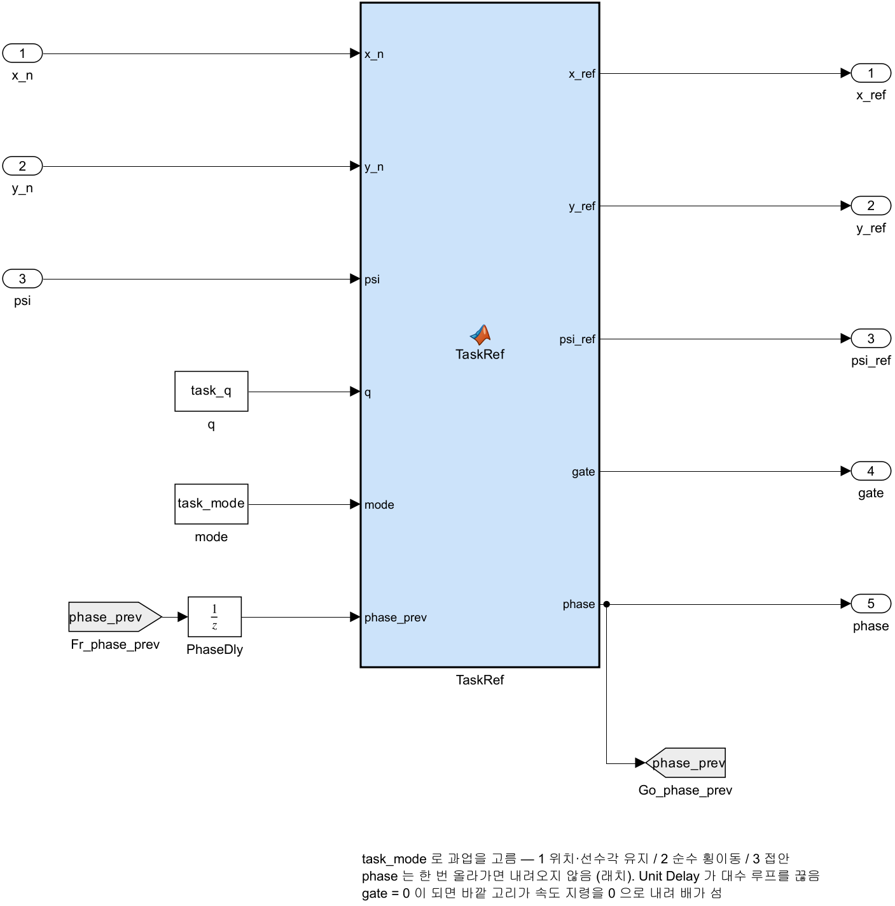

- 들어가는 것: 현재 자세 $(x_n, y_n, \psi)$
- 나오는 것: $x_{ref}$ · $y_{ref}$ · $\psi_{ref}$ · `gate` · `phase`
- 안에서 하는 일: 1-5절의 단계 전이 판정과 접근점 계산. `phase` 래치가 Unit Delay 로 끊김
- 1\~4단은 이 자리에 `GuidanceConst`(상수) 또는 `GuidanceStop`(도착 판정만) 이 들어감
- 7단은 **다른** 유도부(`TaskFront`)가 들어감 — 바로 아래 그림임

### Guidance 서브시스템 (7단, 전진 접안)

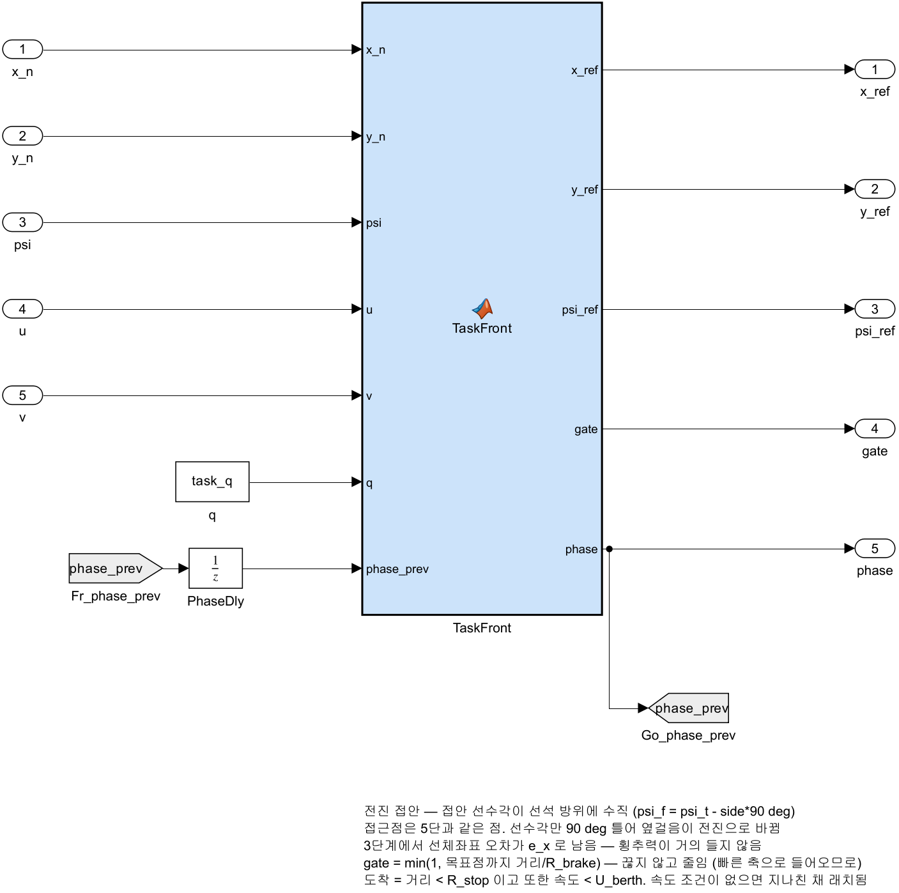

- 입력 포트가 둘 더 있음 — **속도 $u$ · $v$**. 도착 판정에 속도 조건이 들어 있기 때문임
- `gate` 출력이 0/1 이 아니라 $0 \sim 1$ 의 **감속 계수**임 ($\min(1, d/R_{brake})$)
- 나머지는 같음 — 접근점 계산도, `phase` 래치가 Unit Delay 로 끊기는 것도 같음
- 왜 이렇게 두는가는 E-1절에 측정값과 함께 있음

### OuterLoop 서브시스템 (선체고정, 1\~7단)

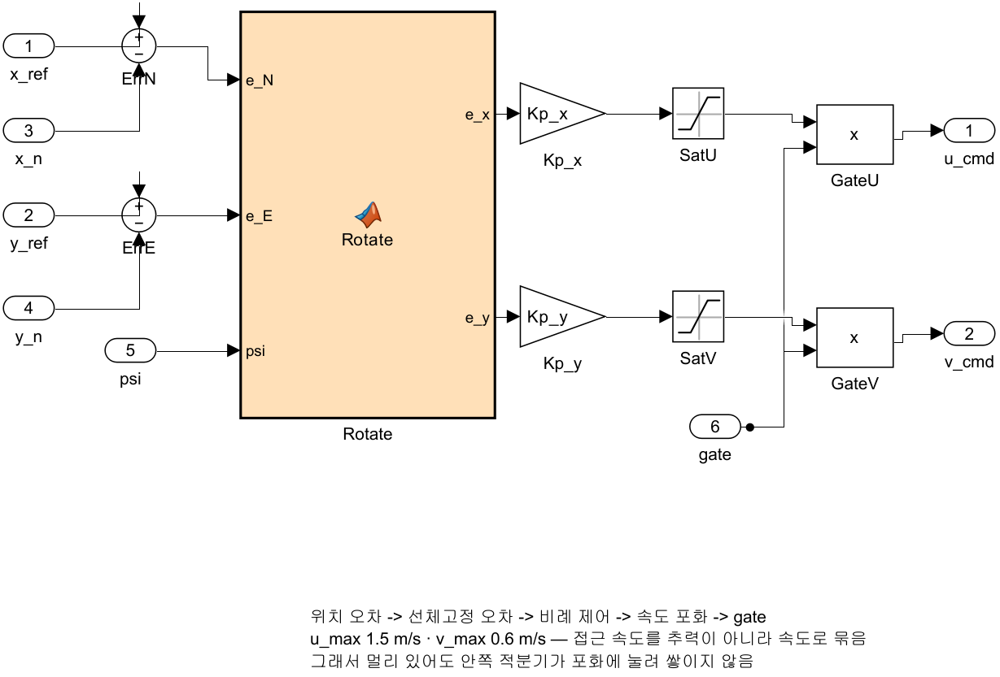

- 입력 포트 여섯: `x_ref` `y_ref` `x_n` `y_n` **`psi`** `gate`
- `Rotate` 함수가 NED 오차를 선체좌표로 돌림 → 비례 게인 둘 → 포화 → `gate` 곱
- 출력: `u_cmd` `v_cmd`

### InnerLoop 서브시스템 (선체고정, 1\~7단)

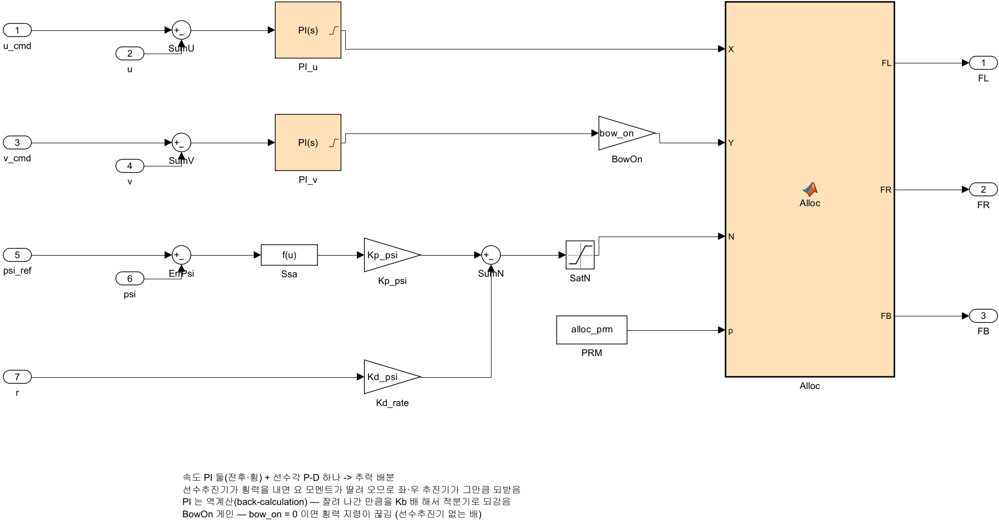

- 속도 PI 둘 (역계산 anti-windup 내장, 되감기 이득 `Kb`) + 선수각 P-D + `Alloc` (추력배분)
- `BowOn` 게인이 횡력 지령 $Y$ 의 길목에 있음 (2단에서 생김) — `bow_on = 0` 이면 여기서 끊김
- `PRM` 상수 블록이 `alloc_prm` $= [b;\ l_3;\ F_{max};\ F_{B,max}]$ 를 `Alloc` 에 넘김
  (벡터를 블록 안에 적으면 Simulink 가 값을 감추고 `-C-` 만 그리므로 `W06_setup`
  에서 이름 하나로 묶음. 운동모델의 `p` = `usv_p`, 4단 이하 유도부의 `q` = `stop_q`
  도 같은 까닭임)
- 출력: `FL` `FR` `FB`

### OuterLoop · InnerLoop — NED 판 (8단)

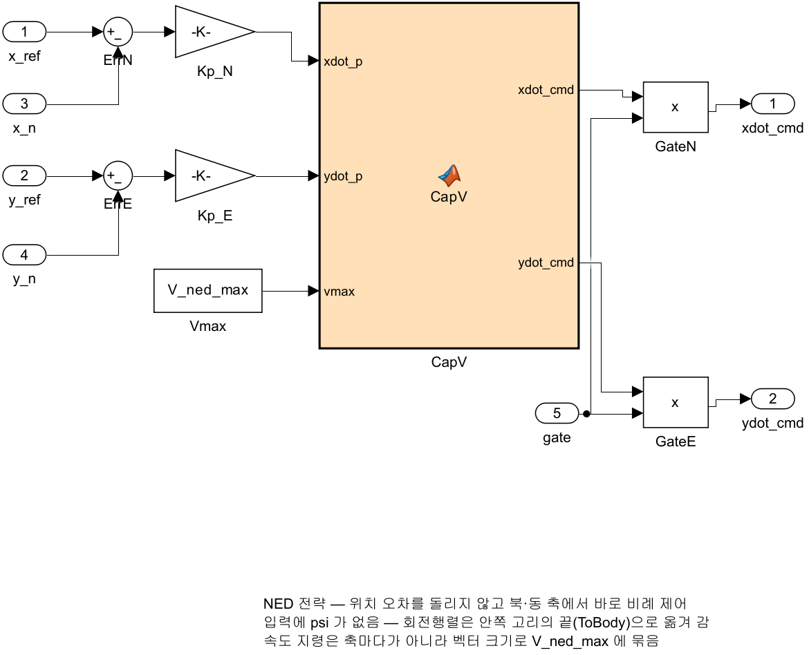

- 입력 포트 다섯 — **`psi` 가 없음**. 위치 오차를 돌리지 않으므로 필요가 없음
- 출력이 `xdot_cmd` · `ydot_cmd` (북·동 축 속도 지령)

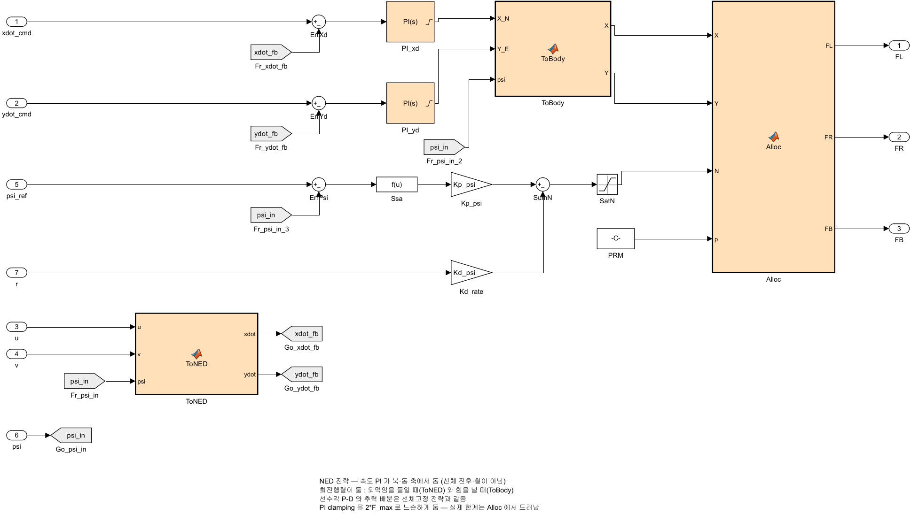

- 도면 아래쪽에 `ToNED`, 위쪽 끝에 `ToBody` — 회전행렬 둘이 눈에 보임
- 선수각 P-D 와 `Alloc` 은 선체고정 판과 **같은 자리에 같은 블록**임

### Thrusters 서브시스템 (3단 이상)

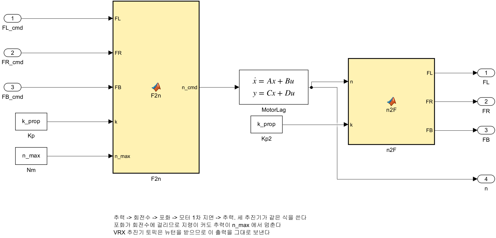

- 이 칸이 하는 일은 **Gazebo 추진기 플러그인이 하는 일**임. 네 토막을 소스 순서대로 옮겨 적음

$$
\underbrace{F = \mathrm{clamp}(F_{cmd},\ \pm F_{plugin,\max})}_{\text{1) 포화는 추력에}}
\;\to\;
\underbrace{n = \mathrm{sign}(F)\sqrt{|F|/k_{prop}}}_{\text{2) 조인트 속도 지령}}
\;\to\;
\underbrace{F_{chk} = k_{prop}\,|n|\,n}_{\text{3) 검산용}}
$$

$$
\text{4) 링크에 주는 힘} = F \quad (\text{되돌린 값이 아님}),
\qquad
F_{err} = F_{chk} - F \;\overset{!}{=}\; 0
$$

- 두 식은 서로의 역이므로 환산을 왕복해도 값이 바뀌지 않음 — 그래서 **1단과 끝 자세가 같아야 함** (아래 §C-3 에서 수치로 확인)
- 회전수 $n$ 은 네 번째 출력이고 $F_{err}$ 이 다섯 번째임. 2단까지 0 으로 채워 두었던 `nprop` · `Ferr` 태그가 이 단계에서 진짜 값을 받음
- $k_{prop} = \rho\,C_t\,D^4 = 1000 \times 0.004422 \times 0.2^4 = 0.0070752$, $F_{plugin,\max} = 2353.5$ N — 어느 파일 몇 번째 줄에서 온 값인지는 §C-3 에 적음
- 전에 두었던 모터 1차 지연과 회전수 포화는 **지웠음**. 플러그인이 `velocity_control = true` 로 회전수를 조인트에 바로 쓰므로 Gazebo 쪽에 대응하는 것이 없음

### MotionModel 서브시스템

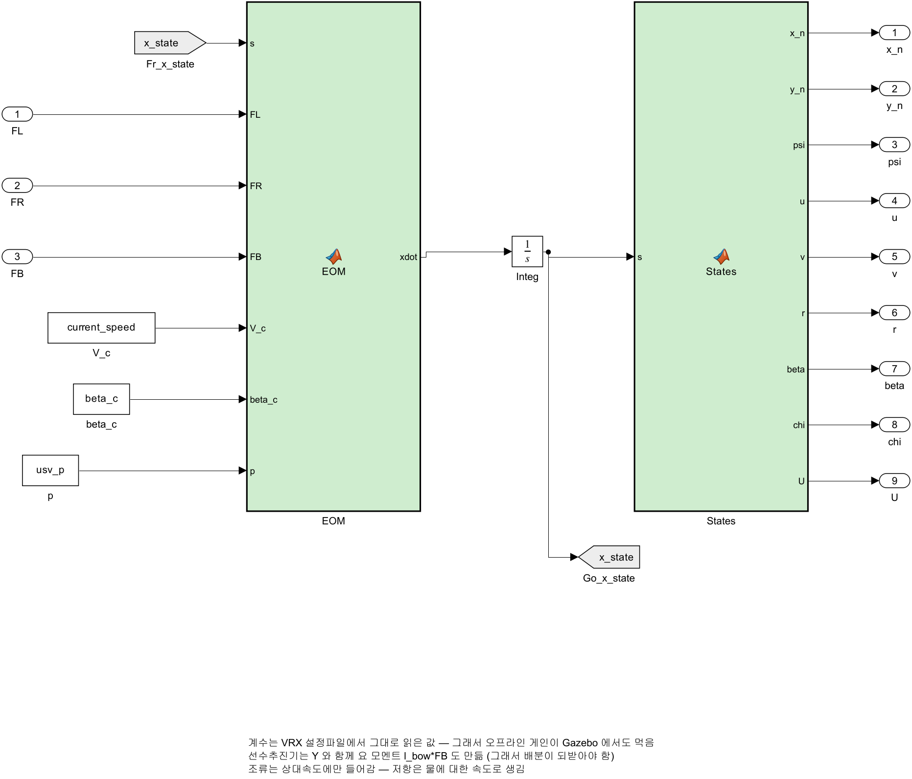

$$
\begin{aligned}
\dot u &= \big(F_L + F_R - (X_u + X_{u|u|}|u_r|)u_r\big)/m + v r \\
\dot v &= \big(F_B - (Y_v + Y_{v|v|}|v_r|)v_r\big)/m - u r \\
\dot r &= \big((F_L - F_R) b + l_3 F_B - (N_r + N_{r|r|}|r|)r\big)/I_{zz}
\end{aligned}
$$

NED 위치로 적분하는 자리에 회전행렬이 다시 나옴 (1-3절의 $R(\psi)$ 임).

$$
\begin{bmatrix} \dot x_n \\ \dot y_n \end{bmatrix}
=
\underbrace{\begin{bmatrix} \cos\psi & -\sin\psi \\ \sin\psi & \cos\psi \end{bmatrix}}_{R(\psi)}
\begin{bmatrix} u \\ v \end{bmatrix},
\qquad \dot\psi = r
$$

- $u_r$ · $v_r$ = 물에 대한 상대속도. 조류는 **상대속도에만** 들어감 — 저항은 물에 대한 속도로 생기기 때문임
- $v r$ · $-u r$ 는 원심항(Coriolis). 선회 중에 전후·횡이 서로 섞임
- $l_3 F_B$ 가 여기에도 있음 — 선수추진기가 실제로 요 모멘트를 만든다는 사실이 플랜트 쪽에 적혀 있고, 제어기 쪽에서 `Alloc` 이 그만큼 되받음

### 실시간 화면 — 네 칸의 뜻

| 자리 | 내용 |
|---|---|
| 왼쪽 큰 칸 | 항적 + 목표 자세 · 접근점 · 부두 + 선체 모양과 선수 방향. 가로축 $y$(동), 세로축 $x$(북) — 해도와 같은 방향 |
| 오른쪽 (1) | $\psi_{ref}$ 와 $\psi$ 를 겹쳐서 [deg] |
| 오른쪽 (2) | 북 오차 · 동 오차 · 목표까지 거리 [m] 와 $R_{stop}$ 띠 |
| 오른쪽 (3) | $u$ · $v$ (왼쪽 축) 과 $F_L$ · $F_R$ · $F_B$ (오른쪽 축) |

- 오프라인 모델과 VRX 쌍둥이가 `W06_animate.m` **하나를 같이 씀**. 바뀌는 것은 신호를 어디서 뽑았는지뿐임 (운동방정식 대 ground truth odometry)

#### 끝난 화면 — 세 전략

`setup` 의 `animate` 가 1 이면 돌아가는 동안 이 창이 따라 그려짐. 아래 세 장은 그 창이
**끝난 순간**임 (`W06_anim_capture.m` 으로 찍은 것이라 같은 조건으로 다시 나옴).

```matlab
>> W06_anim_capture('dock')     % 5단 옆걸음  -> img/W06_anim_dock.png
>> W06_anim_capture('front')    % 7단 전진    -> img/W06_anim_front.png
>> W06_anim_capture('ned')      % 8단 NED     -> img/W06_anim_ned.png
```

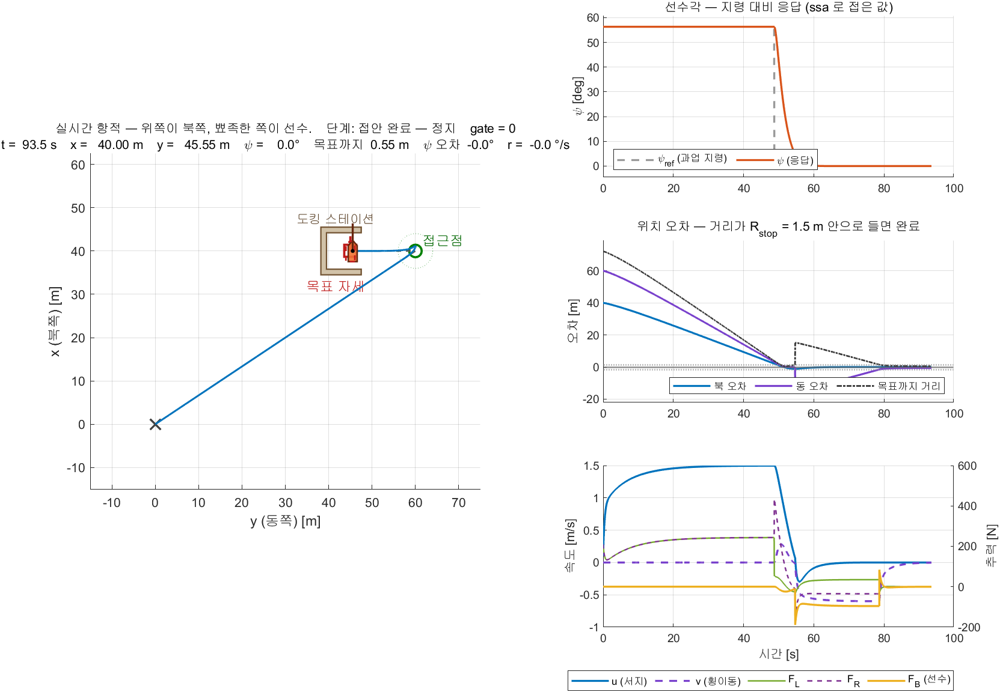

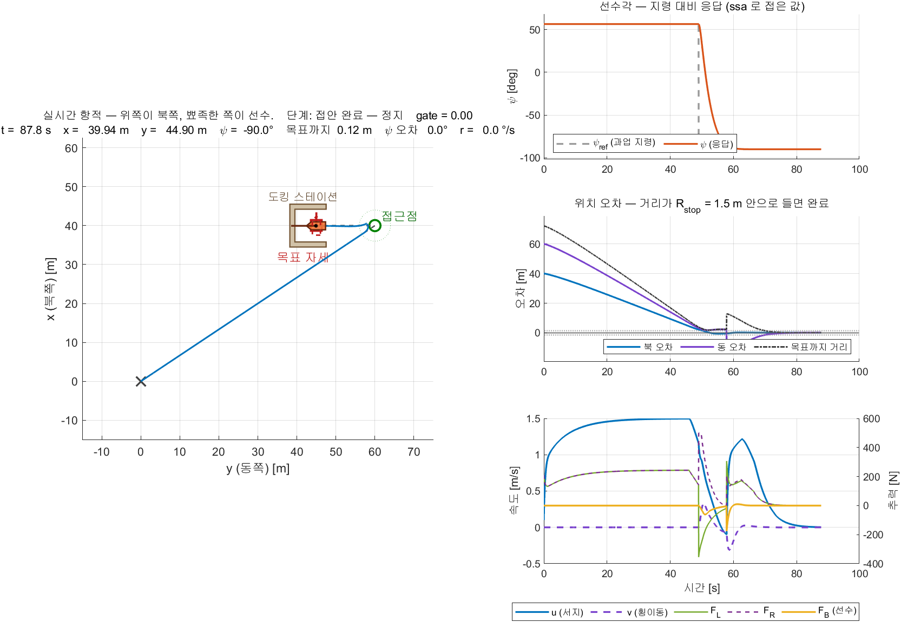

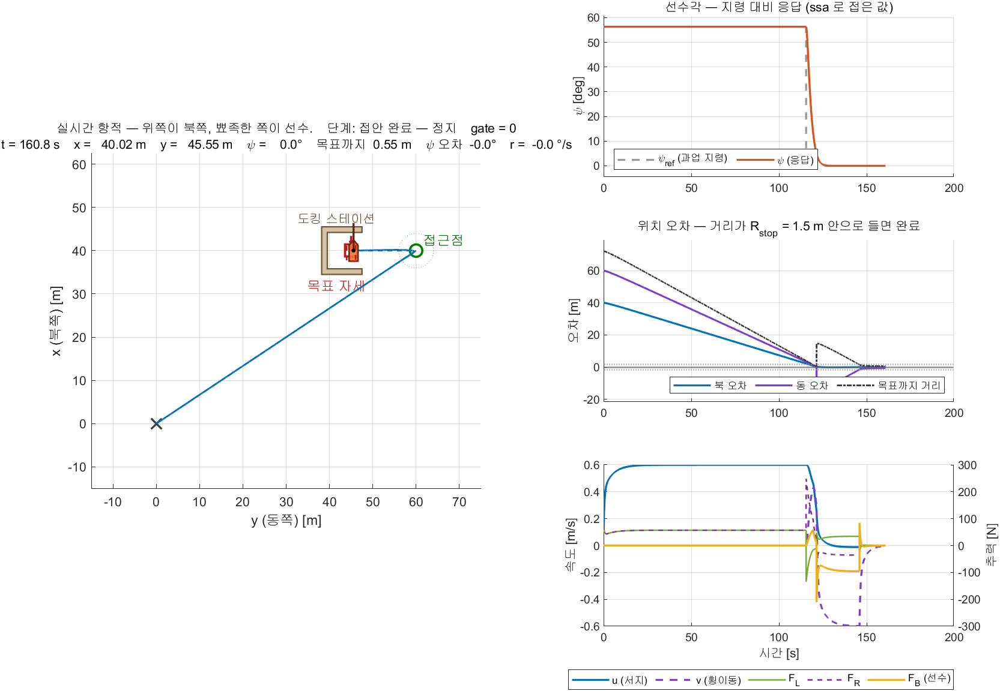

- 세 장을 같은 순서로 읽음 — ①왼쪽 칸에서 **선체가 ㄷ 자 베이 안에 들어가 있는지**와 항적이 벽을 넘지 않았는지 ②오른쪽 (1) 에서 $\psi$ 가 $\psi_{ref}$ 에 붙어 끝났는지 ③오른쪽 (2) 에서 목표까지 거리가 $R_{stop}$ 띠 안으로 들어갔는지 ④오른쪽 (3) 에서 $F_B$ 가 한계에 붙어 있던 구간이 있는지
- 세 전략이 **같은 선석·같은 출발점**이므로 그림 셋을 나란히 두면 궤적 모양의 차이가 그대로 보임 — 5단은 접근점까지 간 뒤 옆으로, 7단은 뱃머리를 돌려 전진으로, 8단은 북·동 성분을 한꺼번에
- 숫자로 견주는 것은 `W06_berth_compare` 의 표임 (위 B 절)

---

## C. 실습 1 — 사다리 1\~4단 (35분)

### C-1. 1단 — 정해진 자리에 정해진 선수각으로

```matlab
>> cd W06_simulink
>> W06_1_point_run     % 1단을 돌려 그림과 숫자를 낸다
```

- `W06_setup` 안의 `stage` 를 1 로 두고 실행해도, `W06_1_point.slx` 를 열어 Run 해도 **같은 그림**이 나옴 (아래 F 절)
- 확인할 것: (30, 20) 에 45° 로 서는지. 측정값은 끝 위치 오차 **0.000 m**, 선수각 오차 **0.000°**
- 최대 추력은 $F_L$ 248.4 N · $F_R$ 237.1 N · $F_B$ 121.1 N. 셋이 다른 값인 것이 이 단계의 요점임 — 선수추진기가 횡력을 내고, 좌·우가 그 요 모멘트를 **반대 부호로** 되받음
- 간 거리 39.02 m 대 직선거리 36.06 m — 선수각을 맞추며 가므로 조금 돌아감

#### 선수각 지령을 바꿔 보기 — `W06_psi_sweep`

```matlab
>> W06_psi_sweep       % 1단에서 psi_d 넷을 차례로 넣는다
```

| $\psi_d$ [°] | 돌 각도 [°] | 2° 안에 든 시각 [s] | $\lvert r\rvert_{max}$ [°/s] | $\lvert F_L - F_R\rvert_{max}$ [N] |
|---|---|---|---|---|
| 45 | 11.3 | 4.10 | 3.215 | 137.0 |
| $-60$ | $-93.7$ | 8.90 | 22.798 | 678.7 |
| 100 | 66.3 | 7.90 | 16.884 | 504.0 |
| $-90$ | $-123.7$ | 9.85 | 28.259 | 761.9 |

- 끝 선수각 오차는 **네 경우 모두 0.000°** 임. 얼마를 돌든 결국 맞춤
- 돌 각도가 클수록 2° 안에 드는 시각이 늦고, 좌·우 추력차가 커짐. $-90°$ 는 123.7° 를 돌아야 해 761.9 N 을 씀 — 한 쪽만 보면 $F_{max}$ 500 N 을 넘어 **포화에 걸림**
- 초기 선수각이 33.7° 인 까닭 — 1단의 출발 자세가 (0, 0, 33.7°) 임. 그래서 목표 45° 는 11.3° 만 돌면 됨
- `ssa` 가 왜 필요한가가 여기 드러남. $-90°$ 목표를 $+236.3°$ 로 세면 반대로 한 바퀴 돌게 됨

### C-2. 2단 — 순수 횡이동, 그리고 선수추진기를 꺼 본다

```matlab
>> W06_2_sway_run      % 2단 한 번만
>> W06_bow_demo        % bow_on 1 과 0 을 나란히 — 아래 표가 이 파일의 출력임
```

| `bow_on` | 끝 자세 $(x_n, y_n, \psi)$ | 남은 거리 [m] | $(F_L, F_R, F_B)_{max}$ [N] |
|---|---|---|---|
| 1 | $(-0.000,\ 12.000,\ -0.000°)$ | 0.000 | (80.7, 50.7, 180.0) |
| 0 | $(-0.000,\ 0.000,\ -0.000°)$ | **12.000** | (15.0, 15.0, 0.0) |

- `bow_on = 1`: 동쪽으로 12 m 를 가면서 **선수각이 전혀 변하지 않음** (최대 틀어짐 0.000°)
- `bow_on = 0`: 동쪽 12 m 가 끝까지 줄지 않음. 옆으로 밀 힘이 없기 때문임. 그런데 **선수각은 그대로 잡힘** — 요 모멘트는 좌·우 추진기로 내므로 선수추진기가 없어도 잡힘
- 위치와 선수각 가운데 **선수각만** 잡히는 모습이 추진기 둘의 한계임
- $F_L$ 과 $F_R$ 이 (80.7, 50.7) 로 다른 까닭 — 선수추진기의 요 모멘트 $l_3 F_B$ 를 되받는 몫이 반대 부호로 들어가기 때문임

### C-3. 3단 — 모터 회전수가 추력이 되는 자리

```matlab
>> W06_3_thrust_run    % 3단 — 회전수와 왕복 검산을 함께 찍는다
```

- 2단까지는 사슬에 추진기 칸이 없었음. 배분이 낸 추력 지령이 운동방정식으로 바로 들어갔음
- 3단에서 그 칸이 생김. 실물에서 그 칸을 맡는 것은 **Gazebo 추진기 플러그인**이고, 역 프로펠러 법칙은 그 안에 있음

#### 프로펠러 법칙이 WAM-V Gazebo 모델 어디에 있는가

| 무엇 | 파일 | 줄 |
|---|---|---|
| 플러그인 선언 · 계수 셋 | `vrx/vrx_urdf/wamv_gazebo/urdf/thruster_layouts/wamv_gazebo_thruster_config.xacro` | 10–24 |
| 펼친 URDF — 좌현 · 우현 · 선수 | `bow_wamv/bow_wamv_target.urdf` | 462–473 · 484–495 · 506–517 |
| 포화를 추력에 거는 곳 (`OnCmdThrust`) | `gz-sim7  src/systems/thruster/Thruster.cc` | 520–521 |
| 추력 → 회전수 (`ThrustToAngularVec`) | 〃 | 562–584 |
| 회전수 → 추력 (`AngularVelToThrust`) | 〃 | 593–599 |
| 회전수를 조인트에 바로 씀 (`velocity_control`) | 〃 | 740–756 |
| 링크에 힘을 주는 곳 (`AddWorldWrench`) | 〃 | 770–773 |

- Gazebo 판은 `vrx/vrx_gz/CMakeLists.txt:8` 의 `find_package(gz-sim7)` 로 확인함
- xacro 가 들고 있는 계수 — $C_t = 0.004422$, $\rho = 1000$, $D = 0.2$ m. **세 추진기가 모두 같은 값**임
- 포화 한계도 같은 xacro 에서 나옴. 임의로 고른 숫자가 아니라 **최고 속도에서의 항력을 추진기 둘이 나눠 낸 몫**임

$$
F_{plugin,\max} = \frac{(X_u + X_{u|u|}\,v_{\max})\,v_{\max}}{2}
= \frac{(51.3 + 72.4 \times 7.71667) \times 7.71667}{2} = 2353.5\ \text{N}
$$

> [!note] 선수추진기도 같은 계수를 씀
> `bow_wamv_target.urdf:506-517` 의 선수추진기 블록이 좌·우와 **글자 하나까지 같은 계수**임
> 그래서 `W06_setup` 에서도 `k_prop` 하나를 셋에 같이 씀 — 선수추진기만 따로 두지 않음

#### 옮겨 적은 것이 맞는가 — 1단과 견주어 확인

```matlab
>> W06_1_point_run     % 추진기 칸이 없는 1단
>> W06_3_thrust_run    % 추진기 칸이 있는 3단
```

| 견주는 것 | 1단 (칸 없음) | 3단 (칸 있음) | 뜻 |
|---|---|---|---|
| 끝 자세 차이 | — | $0.000$ m / $0.000$ deg | 환산을 왕복해도 **값이 하나도 바뀌지 않음** |
| $(F_L, F_R, F_B)_{\max}$ [N] | (248.4, 237.1, 121.1) | (248.4, 237.1, 121.1) | 링크에 가는 힘은 포화만 거친 지령임 |
| $(n_L, n_R, n_B)_{\max}$ [rad/s] | 없음 | (187.4, 183.1, 130.8) | 이 단계에서 처음 생기는 값임 |
| 왕복 검산 $\max\lvert F_{err}\rvert$ | $0$ (받침값) | $8.527\times10^{-14}$ N | 두 식이 서로의 역함수임 |

- $8.527\times10^{-14}$ N 은 $\sqrt{\cdot}$ 와 제곱을 한 번씩 거치며 생긴 **배정밀도 반올림**임. 추력 수백 N 에 견주면 $10^{-16}$ 배임
- 회전수 참고선은 $n_{\max} = \sqrt{F_{\max}/k_{prop}} = 265.8$ rad/s 임. 이 과업에서는 $187.4$ 까지만 올라가 닿지 않음
- 플러그인 한계 $2353.5$ N 에도 닿지 않음 — 먼저 걸리는 것은 제어기 쪽 $F_{\max} = 500$ N 임
- 추력이 회전수의 **제곱**이라 $F$ 를 반으로 줄여도 $n$ 은 $1/\sqrt{2}$ 배로만 줄어듦. 그 비선형을 눈으로 보는 자리임 (2026-10-15 측정)

### C-4. 4단 — 멈추는 법

```matlab
>> W06_4_stop_run      % 4단 — 게이트가 닫힌 시각과 그 뒤 미끄러진 거리
```

- `gate` 가 닫히는 시각 **26.00 s**, 돈 시간 41.00 s (= 26.00 + `stop_hold` 15 s)
- 끝 자세 $(31.831,\ 21.812)$, 45.000° — 목표에서 **2.576 m** 떨어진 자리
- `gate` 가 닫힌 뒤 관성으로 **4.060 m** 더 감. 끝 속도 $u$ = 0.0233 m/s, 끝 추력 $F_L$ = 0.44 N
- `gate` 가 닫히기 전까지는 1단과 **완전히 같음** (표본 521 개 = 26.00 s 까지 차이 0) — 새로 생긴 것이 정지 판정 하나뿐임을 보임

### 해 볼 것

1. `R_stop` 을 0.5 m 로 줄이고 4단을 다시 돌릴 것 → `gate` 가 닫히는 시각과 관성 거리가 어떻게 변하는지
2. `u_max` 를 0.5 m/s 로 줄일 것 → 관성 거리가 줄어드는 대신 완료 시각이 늘어나는 것을 확인
3. 2단에서 `sway_east` 를 30 m 로 늘릴 것 → 횡 속도가 `v_max` 에 묶여 시간만 늘어남. $F_B$ 는 더 커지지 않음

---

## D. 실습 2 — 5단 옆걸음 접안 (30분)

```matlab
>> W06_5_dock_run      % 5단 — 세 전이 시각과 옆걸음 구간의 선수각 벗어남
```


### 단계가 언제 넘어갔는가 (측정값)

| 전이 | 시각 [s] | 넘어가는 조건 |
|---|---|---|
| 1 → 2 (접근 → 선수각 정렬) | **48.70** | 접근점까지 거리 $< R_{dock}$ = 4 m |
| 2 → 3 (정렬 → 횡이동 접안) | **54.65** | 선수각 오차 $< 5°$ |
| 3 → 완료 | **78.70** | 선석까지 거리 $< R_{stop}$ = 1.5 m |

- 끝 자세 $(40.000,\ 45.545)$, $0.000°$ — 선석 $(40, 45, 0°)$ 에서 **0.545 m**
- 남은 0.545 m 는 전부 **동쪽(선석 바깥쪽)** 몫임 (북쪽 오차 0.000 m). 즉 부두에 덜 붙은 것이지 파고든 것이 아님
- 최대 추력 $(F_L, F_R, F_B)$ = (243.4, 434.8, 189.6) N. $F_R$ 가 500 N 한계의 87 % 까지 올라감 — 2단계에서 선수각을 돌리는 데 쓰임
- 최대 회전수 247.89 rad/s (한계 $n_{\max}$ = 265.84 의 93 %)
- 간 거리 87.85 m, 직선거리 60.21 m

### `dock_on` 을 끄면 — 단계를 나누지 않으면 어떻게 되는가

`dock_on` 은 유도부 설정 묶음의 열넷째 칸(`q(14)`)임. 0 으로 두면 목표가 처음부터 선석이고 선수각 지령은 **가는 방향**(선석 방위)으로 둠 — 즉 단계를 밟지 않고 바로 돌진함.

```matlab
>> W06_setup          % stage = 5
>> dock_on = 0;  task_q(14) = dock_on;
>> out = sim(mdl);  W06_plot(out, '5단 — dock_on = 0');
```

| `dock_on` | 완료 [s] | 끝 자세 | 남은 거리 [m] | 최대 $(F_L, F_R)$ [N] | **닿은 쪽** |
|---|---|---|---|---|---|
| 1 (3단계) | 78.70 | $(40.000,\ 45.545)$, $0.000°$ | 0.545 | (243.4, 434.8) | **$0.0°$ — 좌현이 부두를 봄** |
| 0 (한 번에) | **42.50** | $(39.670,\ 45.506)$, $-56.334°$ | 0.605 | (**500.0**, **500.0**) | **$-56.3°$ — 비스듬히 부딪음** |

- 남은 거리는 둘이 거의 같음 (0.545 대 0.605 m). **거리만 보면 구별이 안 됨**. 빠르기는 오히려 한 번에 가는 쪽이 1.85 배 빠름
- 구별되는 것은 **어느 쪽을 대고 섰는가** 임. `dock_on = 0` 은 선수각을 정렬하는 단계가 없으므로 닿는 순간의 선수각이 **그때의 방위각 그대로**임 — 이 설정에서는 $-56.3°$, 즉 뱃머리를 부두에 비스듬히 들이밂
- 좌·우 추진기가 둘 다 **500 N 한계에 닿음**. 돌진하면서 선수각을 동시에 쫓으므로 요 모멘트와 전후력을 한꺼번에 요구함
- 실제 접안에서는 계류줄 위치·방충재·승하선 위치가 현에 따라 정해져 있으므로 이것이 성공과 실패를 가름
- 단계를 나누는 까닭이 여기에 있음 — **2단계(선수각 정렬)가 어느 현을 댈지 결정함** (2026-10-15 측정)

> [!warning] 부두는 그림에만 있음
> 운동모델에 부두가 없음 — 벽과 부딪히는 힘이 들어 있지 않음. 선석을 지나쳐도 배가 그냥 통과함. 그림의 회색 띠는 눈으로 보는 보조선일 뿐이므로, 멈춤은 오직 $R_{stop}$ 판정이 책임짐

### 해 볼 것

1. `R_dock` 을 2 m 로 줄일 것 → 1 → 2 전이가 늦어지고, 선수각을 돌리는 자리가 선석에 더 가까워짐
2. `berth_side` 를 $-1$ 로 둘 것 → 접근점이 선석의 반대쪽으로 가고, 닿는 현이 바뀜
3. `L_app` 을 25 m 로 늘릴 것 → 돌아가는 거리가 늘고 완료 시각이 늘어남. 대신 선수각을 돌릴 여유가 커짐

---

## E. 실습 3 — 7단 전진 접안과 8단 NED 전략 (30분)

### E-1. 7단 — 접근점은 같고 선수각만 90° 다름

```matlab
>> W06_7_front_run     % 7단 — 선미 추력이 한계에 얼마나 붙는가
```


- 접안 선수각 $-90.000°$ (옆걸음은 $0°$). 즉 선수를 부두로 향하고 **앞으로 들어감**
- 전이 48.95 → 57.80 → 72.90 s, 완료 72.90 s (**옆걸음 78.70 s 보다 5.80 s 빠름**)
- 끝 자세 $(39.940,\ 44.898)$, $-90.000°$ — 선석에서 **0.118 m**
- 최대 추력 (354.9, **500.0**, 176.5) N — $F_R$ 가 한계 500 N 에 **닿음**. 선수각을 $-90°$ 로 돌리는 데 거의 전부를 씀
- 최대 회전수 265.84 rad/s — 한계 $n_{\max} = \sqrt{F_{\max}/k_{prop}}$ = 265.84 **그 값**임. $F_R$ 가 500 N 에 닿았으므로 회전수도 함께 닿음
- 최대 선회각속도 32.68 °/s (옆걸음 14.59 °/s 의 2.24 배)

### 빠른 축으로 들어올 때 — `gate` 를 끊지 않고 줄임

5단 옆걸음은 느린 축(횡)으로 들어오므로 $R_{stop}$ 안에서 `gate` 를 0 으로 **끊어도** 0.943 m 만 미끄러짐. 7단 전진은 빠른 축(전후)으로 들어와 같은 방식이면 3.208 m 를 더 가 끝오차가 1.713 m 가 됨 — $R_{stop}$ 1.5 m 를 벗어남 (2026-10-15 측정).

$$\text{gate} = \min\left(1,\ \frac{d}{R_{brake}}\right), \qquad R_{brake} = 8\ \text{m}$$

여기서 $d$ 는 목표점까지 거리임. 바깥 고리가 이미 거리에 비례하는 속도를 내므로, 여기에 $d/R_{brake}$ 가 한 번 더 곱해져 지령이 **거리의 제곱**으로 떨어짐. 지령이 실제 속도보다 먼저 내려가므로 속도 PI 의 적분이 **아직 거리가 남아 있는 동안** 역계산으로 되감김 — 끊어 버릴 때와 달리 쌓인 적분이 선석을 지나 밀어내지 못함.

도착 판정에도 속도 조건을 더함 — $d < R_{stop}$ **이고** $\sqrt{u^2+v^2} < U_{berth}$ (0.2 m/s) 일 때만 3단계로 넘김. 거리만 보면 빠른 속도로 스쳐 지나가는 순간에도 도착으로 읽음.

| | 감속 구간 없음 | $R_{brake} = 8$ m |
|---|---|---|
| 완료 [s] | 68.75 | 72.90 |
| 끝오차 [m] | **1.713** ($> R_{stop}$) | **0.118** |
| 선석을 지나친 거리 [m] | 1.691 | 0.102 |
| `gate` 닫힌 뒤 더 간 거리 [m] | 3.208 | 0.671 |
| 최대 $\lvert v\rvert$ [m/s] | 0.561 | 0.327 |

- 4.15 s 를 더 쓰고 끝오차를 **14 배** 줄인 셈임
- $R_{brake}$ 는 접근 거리 $L_{app}$ 15 m 보다 작게 둠. 4·6·8·10·12 m 로 쓸어 보면 끝오차가 1.347 → 0.716 → **0.118** → 0.461 → 0.951 m 로 8 m 에서 가장 작음 (2026-10-15 측정). 너무 짧으면 못 줄이고, 너무 길면 멀리서부터 기어 와 남은 거리를 못 지움

### 옆걸음 대 전진 — 같은 선석, 같은 접근점

| | 5단 옆걸음 | 7단 전진 |
|---|---|---|
| 접안 선수각 | $0°$ | $-90°$ |
| 완료 시각 [s] | 78.70 | **72.90** |
| 남은 거리 [m] | 0.545 | **0.118** |
| 마지막 구간을 끄는 추진기 | 선수추진기 ($F_B$) | 좌·우 ($F_L, F_R$) |
| $F_R$ 최대 [N] | 434.8 | 500.0 (한계에 닿음) |
| 진행축 어긋남 / 옆축 어긋남 [m] | $(-0.545,\ 0.000)$ | $(+0.102,\ -0.060)$ |
| `gate` | $R_{stop}$ 안에서 0 으로 **끊음** | $R_{brake}$ 안에서 **줄임** |
| `gate` 닫힌 자리에서 더 간 거리 [m] | 0.943 | **0.671** |

- 전진 방향은 추력이 크고($2 \times 500$ N) 저항이 작아 **잘 멈추지 않음**. 지령을 끊어만 두면 3.208 m 를 더 가 1.713 m 가 남음 — 그래서 감속 구간을 둠
- 옆걸음은 횡 추력이 250 N 하나뿐이고 횡 저항이 커서 끊어도 잘 멈춤 — 0.943 m
- 즉 **접안 선수각을 고르는 것은 유도부를 어떻게 닫을지 함께 고르는 것임**. 빠른 축으로 들어오면 감속 구간이 있어야 함

### 선수추진기를 끄고 접안을 해 보면

`bow_on` 게인은 2단에서 생긴 뒤 **3단 이상 모든 모델의 안쪽 고리에 그대로 붙어 있음** (8단은 `ToBody` 뒤). 접안 단계에서도 끄고 켤 수 있음.

```matlab
>> W06_setup          % stage = 7
>> bow_on = 0;
>> out = sim(mdl);  W06_plot(out, '7단 — bow_on = 0');
```

| | $F_B$ 있음 | $F_B$ 없음 (`bow_on = 0`) |
|---|---|---|
| 완료 | 72.90 s | **되지 않음 — 300.00 s 끝까지 `gate` 가 0 으로 안 닫힘** (끝값 0.227, 단계 2) |
| 끝 자세 | $(39.940,\ 44.898)$, $-90.000°$ | $(41.818,\ 45.000)$, $-90.000°$ |
| 남은 거리 | 0.118 m | 1.818 m |
| 최대 $(F_L, F_R)$ [N] | (354.9, 500.0) | (354.9, 500.0) |
| 최대 $F_B$ | 176.5 N | 0.0 N |

- 전진 접안인데도 선수추진기가 **필요함**. 까닭: 진행축은 좌·우 추진기로 잡지만, 그 축에 **수직인 방향**의 오차는 여전히 횡력으로만 지울 수 있음
- $F_B$ 가 없으면 옆축 오차 1.818 m 가 끝까지 남아 $R_{stop}$ 1.5 m 안에 들지 못함. 동쪽 좌표가 45.000 으로 **정확히** 멈춰 선 것은 진행축만 잡혔다는 뜻임
- 선수각은 두 벌 모두 $-90.000°$ 로 정확히 잡힘 — 요 모멘트는 좌·우로 내므로 영향이 없음
- 옆걸음(5단)과 NED(8단)에서 같은 것을 해 보면 더 뚜렷함 — 5단은 접근점에 15.758 m 를 남기고, 8단은 13.893 m 를 남긴 채 300 s 를 다 씀. 마지막 구간이 **전부** 횡이동이기 때문임 (2026-10-15 측정)

### E-2. 8단 — 제어기가 도는 좌표계만 바꿈

```matlab
>> W06_8_ned_run       % 8단 — NED 크기 한계 때문에 u 가 어디까지만 오르는가
>> W06_berth_compare   % 5·7·8단을 같은 선석에 붙여 견준다
```


과업이 5단과 **완전히 같음** — 같은 선석 $(40, 45, 0°)$, 같은 접근점 $(40, 60)$, 같은 세 단계. 달라지는 것은 오차를 세는 좌표계 하나임.

| | 5단 선체고정 | 8단 NED |
|---|---|---|
| 완료 시각 [s] | **78.70** | 145.95 (**1.85 배**) |
| 전이 시각 [s] | 48.70 · 54.65 · 78.70 | 115.45 · 121.40 · 145.95 |
| 끝 자세 | $(40.000,\ 45.545)$, $0.000°$ | $(40.018,\ 45.553)$, $-0.000°$ |
| 남은 거리 [m] | 0.545 | 0.554 |
| 간 거리 [m] | 87.85 (직선 60.21) | **85.93** (직선 60.21) |
| $(\lvert u\rvert, \lvert v\rvert)_{\max}$ [m/s] | (**1.499**, 0.599) | (0.600, 0.599) |
| $(F_L, F_R, F_B)_{\max}$ [N] | (243.4, 434.8, 189.6) | (134.4, 248.4, 210.6) |
| 최대 회전수 [rad/s] | 247.89 | 187.36 |


- 끝 정확도는 **거의 같음** (0.545 m 대 0.554 m). 두 전략 모두 제 일을 함
- 간 거리는 NED 가 조금 **짧음** (85.93 대 87.85 m) — 지도 위에서 바로 세므로 경로가 곧음
- 그런데 **1.85 배 느림**. 까닭이 둘임
  1. 속도 지령이 축마다가 아니라 **벡터 크기로** $V_{ned,max}$ = 0.6 m/s 에 묶임. 선체고정은 전후를 1.5 m/s 까지 쓸 수 있었음 — $\lvert u\rvert_{\max}$ 1.499 대 0.600 이 그 차이임
  2. PI 의 출력 한계를 $2F_{max}$ 로 **느슨하게** 둘 수밖에 없음. NED 축에서는 북쪽 힘을 어느 추진기가 낼지 선수각에 달려 있어 $F_{B,max}$ 로 묶을 수 없음. 실제 한계는 배분에서 $F_B$ 가 잘리며 드러나고, 그 몫은 PI 의 출력에 나타나지 않아 역계산도 되감지 못함
- 선미 추력은 NED 가 더 작음 (최대 248.4 대 434.8 N) — 천천히 가므로 덜 씀. 대신 **선수추진기는 더 씀** (210.6 대 189.6 N). 북·동 축에서 지령을 내면 그 힘을 선체 축으로 돌릴 때 횡 몫이 늘 섞여 나오기 때문임
- **고르는 법**: 추진기 능력이 축마다 크게 다른 배(WAM-V 는 전후 1000 N · 횡 250 N)에서는 축마다 묶을 수 있는 **선체고정**이 유리함. 능력이 축마다 비슷한 배나 경로를 곧게 두는 것이 중요한 과업에서는 **NED** 가 유리함

---

## F. 사다리 전체를 한 번에 재 본다 (20분)

### 왜 한 자리에서 재는가

- 단계별로 따로 보면 **어느 단에서 무엇이 달라졌는지**가 눈에 안 들어옴. 일곱 단을 연달아 돌려 한 표에 쌓으면 그것이 보임
- `W06_ladder` 는 단계마다 `W06_setup` 을 부르고 모델을 돌려 지표만 뽑음. 그림은 띄우지 않으므로 빠름 (1\~2분)
- 아래 표는 전부 **잰 값**임. 다시 돌리면 같은 숫자가 나와야 함

```matlab
>> W06_ladder              % 1~5·7·8 단 (6단은 Gazebo 가 있어야 하므로 빠짐)
>> W06_ladder([1 2 3])     % 일부만
```

### 측정표 1 — 임무 (2026-10-15 측정)

| 모델 | 완료[s] | 전이 1 | 전이 2 | 전이 3 | 끝오차[m] | 끝각[°] | 10s[m] |
|---|---|---|---|---|---|---|---|
| `W06_1_point` | — | — | — | — | 0.000 | 0.000 | 0.000 |
| `W06_2_sway` | — | — | — | — | 0.000 | 0.000 | 0.000 |
| `W06_3_thrust` | — | — | — | — | 0.000 | 0.000 | 0.000 |
| `W06_4_stop` | 26.00 | 26.00 | — | — | 2.576 | 0.000 | 2.206 |
| `W06_5_dock` | 78.70 | 48.70 | 54.65 | 78.70 | 0.545 | −0.000 | 0.592 |
| `W06_7_front` | 72.90 | 48.95 | 57.80 | 72.90 | 0.118 | 0.000 | 0.091 |
| `W06_8_ned` | 145.95 | 115.45 | 121.40 | 145.95 | 0.554 | −0.000 | 0.600 |

- 1\~3단의 **완료 칸이 비어 있는 것은 정상**임. 그 세 단에는 정지 게이트가 없어 `T_run` 300 초를 끝까지 돎. 그 대신 끝오차가 0.000 m 임 — 목표에 서서 300 초를 그대로 버팀
- 4단의 2.576 m 는 **틀린 값이 아니라 재는 값**임. $R_{stop}$ 안으로 들어온 26.00 초에 게이트가 닫히고, 그때 남아 있던 속도로 4.060 m 를 더 미끄러짐
- 10s 칸은 마지막 10 초 평균임. 5단 0.592 m 와 8단 0.600 m 가 1 cm 안에서 같음 — 좌표계를 바꿔도 **서는 자리는 거의 같음**

### 측정표 2 — 구동 (2026-10-15 측정)

| 모델 | $\lvert u\rvert_{max}$ | $\lvert v\rvert_{max}$ | $\lvert r\rvert_{max}$[°/s] | $F_L$[N] | $F_R$[N] | $F_B$[N] | $\lvert n\rvert_{max}$ | 간거리[m] | 직선[m] |
|---|---|---|---|---|---|---|---|---|---|
| `W06_1_point` | 1.474 | 0.577 | 3.22 | 248.4 | 237.1 | 121.1 | — | 39.02 | 36.06 |
| `W06_2_sway` | 0.100 | 0.597 | 0.00 | 80.7 | 50.7 | 180.0 | — | 12.31 | 12.00 |
| `W06_3_thrust` | 1.474 | 0.577 | 3.22 | 248.4 | 237.1 | 121.1 | 187.39 | 39.02 | 36.06 |
| `W06_4_stop` | 1.474 | 0.577 | 3.22 | 248.4 | 237.1 | 121.1 | 187.39 | 39.40 | 36.06 |
| `W06_5_dock` | 1.499 | 0.599 | 14.59 | 243.4 | 434.8 | 189.6 | 247.89 | 87.85 | 60.21 |
| `W06_7_front` | 1.498 | 0.327 | 32.68 | 354.9 | 500.0 | 176.5 | 265.84 | 84.89 | 60.21 |
| `W06_8_ned` | 0.600 | 0.599 | 14.59 | 134.4 | 248.4 | 210.6 | 187.36 | 85.93 | 60.21 |

- $\lvert n\rvert_{max}$ 가 1·2단에서 비어 있는 까닭 — 그 두 단에는 `Thrusters` 가 없음. 힘이 지령하는 순간 그대로 남. 3단에서 추진기가 들어가며 비로소 회전수가 생김
- 2단의 $\lvert u\rvert_{max}$ 가 0.100 m/s 인 것이 **순수 횡이동의 증거**임. 초기 속도 0.1 m/s 가 잦아들 뿐 앞으로 더 가지 않음. 대신 $\lvert v\rvert$ 가 $v_{max}$ 0.6 에 붙음
- 7단의 $F_R$ 500.0 N 은 한계에 **닿은 값**임. 전진 접안은 붙이는 힘을 선미 추진기가 내므로 여기가 먼저 포화됨. 같은 줄의 $\lvert n\rvert_{max}$ 265.84 rad/s 도 $n_{max}$ 와 같은 값임 — 추력 한계와 회전수 한계가 같은 순간에 닿음
- 7단의 $F_B$ 176.5 N 은 접안 세 단 가운데 **가장 적게 쓴 값**임 (5단 189.6, 8단 210.6). 옆걸음으로 붙이는 대신 제자리에서 돌아 밀어 넣으므로 횡력을 덜 씀
- 8단의 $\lvert u\rvert_{max}$ 0.600 m/s — NED 속도 지령은 **크기**를 $V_{ned,max}$ 0.6 m/s 로 묶으므로 $u_{max}$ 1.5 까지 못 올라감. 그래서 완료 시각이 145.95 초로 5단의 두 배 가까이 됨
- 간거리와 직선의 차가 **돌아간 몫**임. 접안 세 단은 직선 60.21 m 를 85\~88 m 로 감 — 접근점을 거치기 때문임

### 측정표 3 — 자세 (2026-10-15 측정)

| 모델 | 목표 $(x_n, y_n, \psi)$ | 끝 $(x_n, y_n, \psi)$ | 표본 |
|---|---|---|---|
| `W06_1_point` | (30.000, 20.000, 45.00°) | (30.000, 20.000, 45.00°) | 6001 |
| `W06_2_sway` | (0.000, 12.000, 0.00°) | (−0.000, 12.000, −0.00°) | 6001 |
| `W06_3_thrust` | (30.000, 20.000, 45.00°) | (30.000, 20.000, 45.00°) | 6001 |
| `W06_4_stop` | (30.000, 20.000, 45.00°) | (31.831, 21.812, 45.00°) | 821 |
| `W06_5_dock` | (40.000, 45.000, 0.00°) | (40.000, 45.545, 0.00°) | 1875 |
| `W06_7_front` | (40.000, 45.000, −90.00°) | (39.940, 44.898, −90.00°) | 1759 |
| `W06_8_ned` | (40.000, 45.000, 0.00°) | (40.018, 45.553, 0.00°) | 3220 |

### 숫자를 어떻게 읽는가

- **1·2·3단은 목표에 정확히 섬** — 끝 자세가 목표와 소수 셋째 자리까지 같음. 세 고리와 추력배분이 제대로 짜였다는 뜻임
- **4·5·7·8단의 남은 거리는 게이트 때문임**. 게이트가 $R_{stop}$ 안에서 닫히고 지령이 끊기므로, 남은 속도만큼 미끄러진 자리에 섬. 5단 0.545 m·8단 0.554 m 가 그 값임. 7단 0.118 m 가 유독 작은 것은 거기만 게이트를 끊지 않고 $R_{brake}$ 안에서 줄여 들어오기 때문임 (E-1)
- 선수각은 **모든 단에서 0.00°** 로 맞음. 선수각 고리는 위치 고리와 따로 돌므로 위치가 덜 붙어도 방향은 지킴
- 끝오차가 $R_{stop}$ 보다 커 보이는 4단이 **실패가 아님**. 판정은 게이트가 닫힌 시각에 이미 났음. 더 붙이려면 게이트를 닫지 말고 끝까지 제어하거나(= 1단), 7단처럼 닫기 전에 **줄여서** 들어와야 함

### 단계별로 하나씩 볼 때

```matlab
>> W06_1_point_run      % 1단 — 목표 자세와 끝 자세를 나란히 찍음
>> W06_4_stop_run       % 4단 — 게이트가 닫힌 시각과 그 뒤 미끄러진 거리
>> W06_5_dock_run       % 5단 — 세 단계 전이 시각과 옆걸음 구간의 선수각 벗어남
>> W06_7_front_run      % 7단 — 선미 추력이 한계에 얼마나 붙는가
>> W06_8_ned_run        % 8단 — NED 크기 한계 때문에 u 가 어디까지만 오르는가
```

- 각 실행 파일은 **그 단계에서 봐야 할 숫자**만 찍음. 표 전체가 필요하면 `W06_ladder` 를 쓸 것

---

## G. 실습 4 — Gazebo·VRX 에 선수추진기를 달고 확인 (40분)

- 쓰는 폴더: `10-주차별-강의자료/W06_vrx_lite/` (WSL 에서는 `~/Capstone-Design/1_2026-2학기_강의자료/10-주차별-강의자료/W06_vrx_lite/`)
- 3주차 2-3 의 `W03_vrx_lite/` 와 쓰는 법이 같음. 다른 것은 **URDF 하나** — 추진기가 둘에서 셋으로 늘었음

### G-0. 내려받기부터 띄우기까지 — 파일 계층도와 launch

#### 받아야 할 것 둘

| 받는 것 | 어떻게 | 받는 자리 | 양 (실측) |
|---|---|---|---|
| **VRX 시뮬레이터** — Gazebo 월드·WAM-V 모델·플러그인 | 3주차 2-2 의 다섯 단계 (`git clone` → 브랜치 `humble` → `rosdep` → `colcon build` → `.bashrc`) | `~/vrx_ws/` | 904 MB |
| **강의자료** — 이 주차의 `W06_vrx_lite/` 와 Simulink 모델 | 1쪽 저장소 블록의 `git clone` (그 뒤로는 `git pull`) | `~/Capstone-Design/` | 약 770 MB (2026-10-16 `git clone` 실측 764 MB · 1분 40초) |

```bash
# 처음 한 번 — 강의자료 (VRX 설치는 3주차 2-2 를 따를 것)
cd ~ && git clone https://github.com/wkyouncnu/Capstone-Design.git

# 그 뒤로는 갱신만
cd ~/Capstone-Design && git pull

# 이 주차 폴더로
cd ~/Capstone-Design/1_2026-2학기_강의자료/10-주차별-강의자료/W06_vrx_lite
ls
```

- **WSL 쪽에 받을 것** — Windows 의 Dropbox 폴더와 WSL 홈은 다른 자리임. `ros2` 와 `xacro` 는 WSL 안에서만 돌므로 실습은 `~/Capstone-Design` 에서 함
- 검증(2026-10-16): GitHub 에서 **새로 `git clone`** 한 뒤 위 폴더에 파일 **열한 개**가 그대로 생기고, `DRY=1` 로 launch 명령이 나오고, G-0 \~ G-7 이 전부 도는 것까지 기준 노트북에서 확인함
- 강의자료는 받기만 하면 되고 **빌드가 없음** — 셸 스크립트와 xacro·urdf 와 `.slx` 뿐임

#### 파일 계층도 — 이 주차가 쓰는 것

```text
~/Capstone-Design/1_2026-2학기_강의자료/10-주차별-강의자료/
├── W03_vrx_lite/stop_vrx.sh    1808 B   떠 있는 VRX 끄기 — 실험마다 먼저   (G-0 의 3번)
├── W06_vrx_lite/                        이 주차의 VRX 실습 폴더 (11개)
│   ├── wamv_bow_thrusters.xacro  1799 B   *** 새로 둔 유일한 파일 — 추진기 셋의 자리 ***
│   ├── make_wamv_bow.sh          2303 B   xacro -> URDF 로 펴기            (G-2)
│   ├── wamv_bow_lite.urdf       27736 B   미리 펴 둔 판, 759 줄            (G-2)
│   ├── run_vrx_bow.sh           2712 B   띄우기 — 모드 넷                  (G-3)
│   ├── gui_shot.config           2933 B   shot 모드의 GUI 배치 (3D 화면만)  (G-3)
│   ├── to_open_water.sh          1642 B   배를 넓은 물로 옮기기 (set_pose)  (G-4 · G-5 가 부름)
│   ├── measure_bow.sh            4020 B   선수추진기 부호 재기              (G-4)
│   ├── measure_sway.sh           4389 B   pure sway 배분 재기               (G-5)
│   ├── shoot_bow.sh              6526 B   그림 찍기                         (G-6)
│   ├── photo_cam.sdf             1398 B   시뮬레이터 안에 띄우는 사진기 모델 (G-6)
│   └── img/                               찍어 둔 그림 셋
└── W06_simulink/                        Simulink 쪽 — VRX 연동이 여기서 돎 (G-7)
    ├── W06_<단>_<이름>_vrx.slx            일곱 단의 VRX 쌍둥이 — 6단이 쓰는 것은 W06_5_dock_vrx.slx (G-7-3)
    ├── W06_vrx_run.m                      W06_vrx_run(단) — 기준 궤적을 만들고 쌍둥이를 열어 줌 (Run 은 사람이)
    └── W06_6_vrx_run.m                    = W06_vrx_run(5)
```

```text
~/vrx_ws/src/vrx/                        VRX 원본 — 한 글자도 고치지 않음
├── vrx_gz/
│   ├── launch/competition.launch.py       *** 띄울 때 부르는 launch ***
│   ├── worlds/sydney_regatta.sdf          월드, 639 줄
│   └── src/vrx_gz/model.py                스폰 자리·파랑 크기가 적힌 곳
└── vrx_urdf/
    ├── wamv_description/urdf/thrusters/engine.xacro        추진기 하나의 생김새
    └── wamv_gazebo/urdf/
        ├── wamv_gazebo.urdf.xacro                         make_wamv_bow.sh 가 부르는 뿌리
        └── thruster_layouts/
            ├── wamv_t_thrusters.xacro    원본 T 배치 (기본값) — 손대지 않음
            ├── wamv_aft_thrusters.xacro  원본 선미 둘
            └── wamv_x_thrusters.xacro    원본 X 배치
```

- `~/vrx_ws/install/share/vrx_gz/worlds/` 는 위 `src` 쪽을 가리키는 **심볼릭 링크**임 — 월드를 고치면 다시 빌드하지 않아도 반영됨
- 이 주차가 더한 것은 **`thruster_layouts/` 에 넣지 않고 강의자료 폴더에 따로 둠**. 원본 폴더를 건드리지 않아야 `git pull` 로 VRX 를 갱신해도 깨지지 않음

#### 어떤 launch 파일로 돌아가는가

`run_vrx_bow.sh` 의 마지막 줄이 부르는 것 하나뿐임.

```bash
exec ros2 launch vrx_gz competition.launch.py world:="$WORLD" "${ARGS[@]}"
```

**`competition.launch.py` 가 받는 인자 열 개** (실측, 기본값 포함)

| 인자 | 기본값 | 뜻 |
|---|---|---|
| `world` | `sydney_regatta` | 띄울 월드 이름. `~/vrx_ws/src/vrx/vrx_gz/worlds/` 의 파일 이름에서 `.sdf` 를 뗀 것 (설치본에 16개) |
| `sim_mode` | `full` | `full` = 시뮬레이터 + 브리지, `sim` = 시뮬레이터만, `bridge` = 브리지만 |
| `bridge_competition_topics` | `True` | ROS 2 ↔ Gazebo 토픽 브리지를 띄울지. **False 로 두면 추력 토픽이 안 생김** |
| `urdf` | `''` (빈 값) | **쓸 URDF 파일 경로.** 비우면 VRX 기본 WAM-V(T 배치, 센서 전부) |
| `headless` | `False` | `True` = 화면 없이 서버만 |
| `extra_gz_args` | `''` | `gz sim` 에 그대로 붙는 인자 (`--render-engine-gui ogre` · `--gui-config …`) |
| `paused` | `False` | 멈춘 채로 띄움 |
| `config_file` | `''` | 여러 대를 띄울 때의 YAML |
| `robot` | `''` | 그 YAML 에서 한 대만 고를 때 |
| `competition_mode` | `False` | 대회 채점 모드 |

**모드 넷이 위 인자에 무엇을 넣는가** — `run_vrx_bow.sh` 가 고르는 것은 `urdf` 와 `extra_gz_args` · `headless` 셋뿐임

| 모드 | `urdf` | 더 넣는 것 | 쓰는 자리 |
|---|---|---|---|
| `lite` (기본) | 폴더의 `wamv_bow_lite.urdf` | `extra_gz_args:=--render-engine-gui ogre` | **권장.** 느린 노트북 |
| `mine` | `~/capstone_ws/wamv/wamv_bow_lite.urdf` | 같음 | 직접 만든 URDF 를 쓸 때 |
| `headless` | 폴더의 판 | `headless:=true` | 측정·자동 실행. 가장 가벼움 |
| `shot` | 폴더의 판 | `extra_gz_args:=--gui-config <폴더>/gui_shot.config` | 강의자료 그림 찍기 |

- 명령만 보고 싶으면 `DRY=1 bash run_vrx_bow.sh <모드>` — 띄우지 않고 `ros2 launch …` 한 줄을 찍음. 어떤 인자가 들어가는지 눈으로 확인할 것
- 월드를 바꾸려면 `WORLD=navigation_task bash run_vrx_bow.sh` — 스크립트를 고치지 않음

#### 월드 파일에는 무엇이 정의되어 있는가 — `sydney_regatta.sdf` 639 줄

| 항목 | 정의된 값 (실측) | 왜 중요한가 |
|---|---|---|
| 물리 엔진 | `<physics name="4ms" type="dart">`, `max_step_size` **0.004 s**, `real_time_factor` 1.0 | 한 걸음이 4 ms. 느린 노트북에서 RTF 가 1 보다 작아지는 몫이 여기서 나옴 |
| 장면 | `<sky>` 켬 · `<grid>false</grid>` · `<ambient>1.0 1.0 1.0</ambient>` | 하늘 렌더링이 GPU 를 가장 많이 씀 |
| 부력·항력 | `libPolyhedraBuoyancyDrag.so` **7개** | 배와 부이가 뜨는 힘. 3자유도 오프라인 모델에 없는 롤·피치·히브가 여기서 생김 |
| 바람 | `libUSVWind.so` 1개 — 방향 240° · **평균 풍속 0.0 m/s** · 돌풍 이득 0 · `random_seed` 10 · 10 Hz | **기본값이 무풍임.** 그래서 오프라인(조류 0)과 바로 견줄 수 있음. 토픽 `/vrx/debug/wind/{speed,direction}` |
| 파랑 | `libPublisherPlugin.so` 가 `/vrx/wavefield/parameters` 로 2 초마다 발행 — 방향 0.0 · 이득 **0.3** · 주기 5 s | 이 몫이 VRX 쪽 선수각 흔들림의 원인임 (G-7-1 의 넷째 칸) |
| 파랑 영역 | `WAVEFIELD_SIZE = {'sydney_regatta': 1000}` (`vrx_gz/src/vrx_gz/model.py:45`) | 한 변 1000 m 안에서만 파랑이 듦 |
| 포함 모델 | Fuel 에서 받는 것 — 부두(`sydney_regatta`) · 관제소 3개 · 말뚝 3개 · 안테나 · 부이 6종 · 해안 파도 | 처음 띄울 때 내려받아 `~/.gz/fuel` 에 캐시됨. **첫 실행만 오래 걸림** |
| gz-sim 시스템 | physics · sensors · scene-broadcaster · navsat · imu · magnetometer · forcetorque · contact · particle-emitter2 · user-commands | 센서 토픽이 생기는 자리 |
| GUI 플러그인 | MinimalScene · ViewAngle · EntityTree · ComponentInspector · Screenshot · VideoRecorder 등 | `gui_shot.config` 가 이 목록을 **3D 화면 하나만** 남기고 지운 판임 |

**배가 뜨는 자리는 월드가 아니라 launch 에 있음**

```python
# ~/vrx_ws/src/vrx/vrx_gz/launch/competition.launch.py:46
m = Model('wamv', 'wam-v', [-532, 200, 0, 0, 0, 1])
```

- 여섯 수는 ENU 로 $(x,\ y,\ z,\ R,\ P,\ Y)$ 임 — 동쪽 $-532$ m · 북쪽 $+200$ m · 요 **1 rad** ($57.3°$)
- NED 로 읽으면 북 $+200$ · 동 $-532$ 이고, 선수각은 $\psi = \pi/2 - 1 = 0.5708$ rad $= 32.7°$ 임
- 이 값이 월드 원점 기준이므로 **제어기는 첫 샘플을 빼서 상대좌표로 씀** (G-8). 2026-10-15 실행에서 첫 샘플이 $(200.01,\ -531.98)$ m 로 위 값과 맞은 것을 확인함
- 자리를 바꾸려면 launch 를 고치지 않고 **띄운 뒤 서비스로 옮김**:

```bash
gz service -s /world/sydney_regatta/set_pose --reqtype gz.msgs.Pose \
  --reptype gz.msgs.Boolean --timeout 3000 \
  --req 'name: "wamv", position: {x: -532, y: 200, z: 0.1}, orientation: {z: 0.4794255, w: 0.8775826}'
```

#### 선수추진기를 어떻게 다는가 — 원리

VRX 는 추진기 배치를 **URDF 안에 박아 두지 않고 xacro 파일 하나로 갈아 끼우게** 만들어 두었음. 그 고리를 쓰는 것뿐임.

```text
wamv_bow_thrusters.xacro          1  추진기 셋의 자리·방향을 적은 파일 (이 주차에서 새로 둠)
        │
        │  make_wamv_bow.sh 가 끼움:
        │     xacro wamv_gazebo.urdf.xacro \
        │           yaml_thruster_generation:=true \
        │           thruster_xacro_file:=<위 파일>
        ▼
wamv_bow_lite.urdf                2  xacro 가 펴 준 URDF (759 줄). 추진기 링크·조인트·플러그인이 글자로 박힘
        │
        │  run_vrx_bow.sh 가 넘김:  urdf:=<위 파일>
        ▼
competition.launch.py             3  이 URDF 로 배를 월드에 스폰
        │
        ▼
/wamv/thrusters/bow/thrust        4  브리지가 추진기마다 토픽 하나를 냄 — bow 가 이때 생김
```

- `yaml_thruster_generation:=true` 가 **"배치를 바깥 파일에서 읽어라"** 는 뜻이고, `thruster_xacro_file:=` 가 그 파일을 가리킴. 둘은 VRX 원본이 이미 갖고 있는 인자임
- 토픽 이름은 xacro 의 `prefix` 를 그대로 따름 — `prefix="bow"` → `/wamv/thrusters/bow/thrust`. **이름을 바꾸면 Simulink 쪽 토픽도 같이 고쳐야 함**
- 추력은 엔진 링크의 $x$ 축으로 나가고, 그 축을 돌리는 것이 `orientation` 의 세 번째 값임 (G-1)
- 그러므로 **C 언어나 플러그인을 쓰지 않음** — 글자 세 줄로 추진기를 하나 더 다는 것임

#### VRX 원본 대비 바뀐 곳 — 이 넷뿐

| 파일 | 원본 | 이 주차 | 어떻게 |
|---|---|---|---|
| `thruster_layouts/wamv_t_thrusters.xacro` | 좌·우 둘 | — | **고치지 않음.** 원본 그대로 남겨 둠 |
| `wamv_bow_thrusters.xacro` | 없음 | 좌·우 + `bow` 셋 | **새로 둠** (강의자료 폴더). 원본 T 배치를 베껴 `<xacro:engine prefix="bow" …>` 한 줄을 더함 |
| `wamv_gazebo.urdf.xacro` | 기본 인자 | — | 고치지 않음. `yaml_thruster_generation` · `thruster_xacro_file` 인자를 **원본 그대로** 씀 |
| `sydney_regatta.sdf` | 639 줄 | — | 고치지 않음. 월드는 손대지 않음 |
| `competition.launch.py` | 인자 10개 | — | 고치지 않음. `urdf:=` 와 `extra_gz_args:=` 로 바깥에서만 바꿈 |

- 정리하면 **원본은 한 글자도 고치지 않고, 새 파일 하나를 바깥에 두어 인자로 끼운 것**임. `cd ~/vrx_ws/src/vrx && git status` 가 깨끗해야 맞음
- 센서를 끄는 것도 원본을 고치지 않음 — `make_wamv_bow.sh` 가 `camera_enabled:=false lidar_enabled:=false` 를 넘길 뿐임 (G-2)

#### 느린 노트북에서 돌리기 — 지렛대 셋

| 지렛대 | 어떻게 | 무엇을 아낌 |
|---|---|---|
| 센서를 뺀 URDF | `make_wamv_bow.sh` 기본값 — 카메라·LiDAR 를 끔 | 센서 렌더링. 가장 크게 듣는 것 |
| GUI 렌더 엔진 낮추기 | `extra_gz_args:=--render-engine-gui ogre` (`lite` 모드가 자동) | GPU. 기본값 `ogre2` 가 더 무거움 |
| 화면 자체를 끄기 | `headless:=true` (`headless` 모드) | GPU 전부. **측정만 할 때는 이것** |

- 세 지렛대를 쓰면 **물리는 그대로 두고 그림 몫만 줄임** — 월드의 `max_step_size` 0.004 s 와 플러그인은 손대지 않으므로 운동 결과가 달라지지 않음
- 측정값: `lite` 모드로 띄운 2026-10-15 실행의 RTF **1.023** (오돔 20초 수신으로 실측). RTF 가 1 보다 작아도 쌍둥이의 `InitFcn` 이 그 값을 `PacingRate` 로 넣어 Simulink 를 맞춰 느리게 돌림 (G-7)
- 네 가지 실행 방식의 RTF 비교는 3주차 2-3 에 있음

#### 실행 순서 — 터미널 둘과 MATLAB 하나

> [!important] 아래 순서 그대로 치면 됨 — **새로 설치하는 것은 없음**
> 2026-10-16 에 GitHub 에서 강의자료를 **새로 `git clone`** 해 기준 노트북(VRX 원본 그대로, 스폰 ENU $(-532,\ 162)$)에서 한 줄씩 실행해 확인함. 쓰는 것은 3주차의 VRX(`~/vrx_ws`)와 이 폴더의 스크립트뿐임

| 창 | 하는 일 | 끝날 때까지 |
|---|---|---|
| 터미널 1 (VS Code WSL 터미널 또는 Ubuntu 터미널) | VRX 를 띄움 | **닫지 않고** 떠 있는 채로 둠 |
| 터미널 2 | 토픽 · RTF 확인, G-4 \~ G-6 측정 | 필요할 때 |
| MATLAB | `W06_6_vrx_run` → 열린 창에서 **Run** | 실행이 끝날 때까지 |

1. (터미널 1) 강의자료 갱신 → 이 주차 폴더로

```bash
cd ~/Capstone-Design && git pull
cd ~/Capstone-Design/1_2026-2학기_강의자료/10-주차별-강의자료/W06_vrx_lite
```

2. (터미널 1) 남은 VRX 확인 · 띄울 명령 확인 — **실험마다 이 단계부터**

```bash
echo $ROS_DOMAIN_ID
bash ../W03_vrx_lite/stop_vrx.sh check
DRY=1 bash run_vrx_bow.sh
```

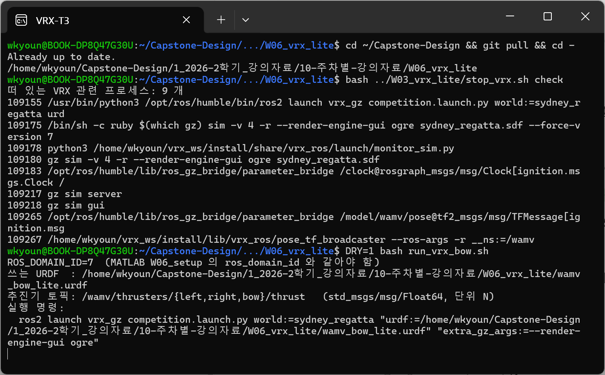

| 화면의 줄 | 뜻 |
|---|---|
| `Already up to date.` | `git pull` — 최신판임 |
| `떠 있는 VRX 관련 프로세스: 9 개` | **앞 실험의 VRX 가 아직 떠 있다**는 뜻. 그림은 일부러 띄워 둔 상태에서 찍은 것임. 0 개가 아니면 3번에서 끔 |
| `ROS_DOMAIN_ID=7` | MATLAB 의 `ros_domain_id` 와 같아야 함 |
| `실행 명령: ros2 launch vrx_gz competition.launch.py ...` | `run_vrx_bow.sh` 가 대신 치는 **launch 명령 전체**. 손으로 쳐도 같음 |

3. (터미널 1) 끄고 → 띄우기

```bash
bash ../W03_vrx_lite/stop_vrx.sh
bash run_vrx_bow.sh
```

- `stop_vrx.sh` 정상 출력: `끈 뒤: 0 개 — 정리 완료` 또는 `떠 있는 것이 없음 — 바로 띄우면 됨`
- 그 뒤로 노란 `[Wrn]` 과 빨간 `[Err]` 가 수백 줄 쏟아짐 — **정상임**. 5주차 E-1 4번의 표와 같은 세 가지(`Unable to deserialize sdf::Model` · `Sky not supported by: ogre` · `Server directory does not exist`)
- 20\~40 초 뒤 Gazebo 창에 배가 보이면 성공
- 첫 줄이 `화면 정상` 이 아니라 `화면 이상` 이면 Gazebo 창이 뜨지 않는 상태임 → PowerShell 에서 `wsl --shutdown` 후 새 터미널에서 다시 (5주차 E-1 경고 상자)

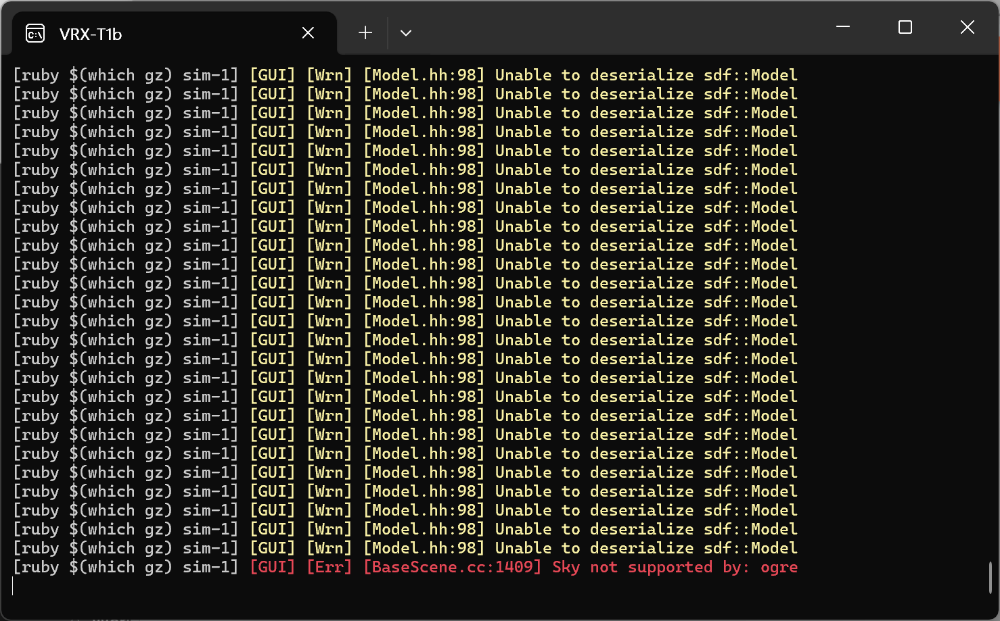

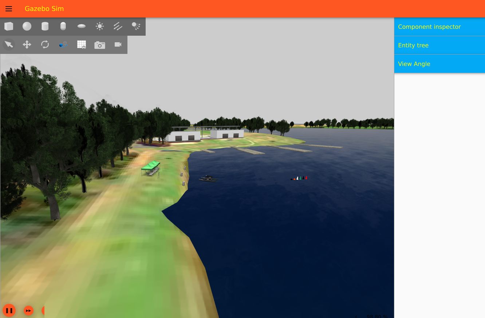

| 화면의 위치 | 무엇인가 |
|---|---|
| 가운데 물 위의 검은 배 | 선수추진기를 단 WAM-V. 스폰 자리가 **서쪽·남쪽 해안 바로 옆**임 — G-4 · G-5 가 배를 먼저 넓은 물로 옮기는 까닭 |
| 오른쪽 아래 `99.xx %` | 실시간 비율(RTF). 90 % 이상이면 됨 |

4. (터미널 2) 토픽 · RTF · 주기 확인

```bash
echo $ROS_DOMAIN_ID
ros2 topic list | grep -E "thrusters|ground_truth"
gz topic -e -t /stats -n 1 | grep real_time_factor
timeout 5 ros2 topic hz /wamv/sensors/position/ground_truth_odometry
```

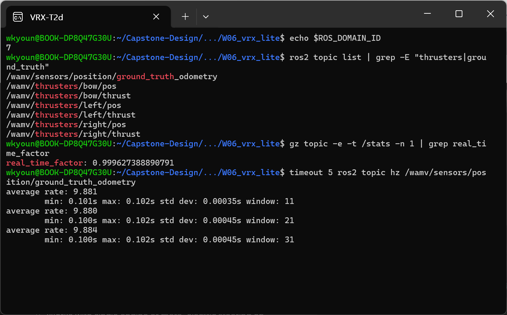

| 확인할 것 | 정상 |
|---|---|
| `thrusters` 아래 | `bow` · `left` · `right` 각각 `pos` · `thrust` — **`bow` 가 없으면 5주차 URDF 로 띄운 것** |
| `ground_truth_odometry` | 있어야 MATLAB 이 시작함 |
| `real_time_factor` | 0.9 이상. 띄운 직후 30 초는 0.5 안팎일 수 있음 (실측 0.47 → 1.00) |
| `average rate` | 약 9.9 Hz |

5. (MATLAB) 쌍둥이를 열고 **Run** 을 누름

```matlab
>> cd('\\wsl.localhost\Ubuntu-22.04\home\<사용자명>\Capstone-Design\1_2026-2학기_강의자료\10-주차별-강의자료\W06_simulink')
>> W06_6_vrx_run
```

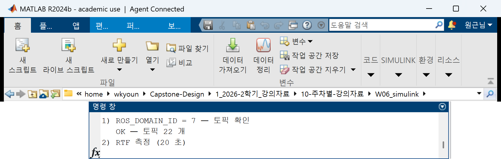

| 화면의 위치 | 무엇인가 |
|---|---|
| 주소창 `home ▸ <사용자명> ▸ Capstone-Design ▸ … ▸ W06_simulink` | WSL 안의 강의자료를 **그대로** 연 것. Windows 쪽으로 복사하지 않음 |
| 명령 창 `1) ROS_DOMAIN_ID = 7 — 토픽 확인` · `OK — 토픽 22 개` | 1단계 통과 |
| `2) RTF 측정 (20 초)` | 20 초 동안 아무 일도 없어 보이는 것이 정상 |

- m 파일은 기준 궤적을 만들고 창을 열어 줄 뿐임. 위 화면의 `1)` `2)` 는 **Run 을 누른 뒤** 모델의 `InitFcn` 이 찍는 것임
- 세 자리의 `ROS_DOMAIN_ID` 가 **모두 7** 이어야 함 — WSL `~/.bashrc` · `W06_setup` 의 `ros_domain_id` · Simulink 툴스트립 **시뮬레이션 → ROS 네트워크** 의 Domain ID. 셋째가 다르면 `InitFcn` 이 **멈추고 고칠 자리를 알려 줌** (2026-10-16 추가)
- 첫 실행은 Fuel 에서 모델을 받으므로 1\~2 분 더 걸림. 둘째 실행부터는 캐시를 씀
- 배가 뜨지 않거나 토픽이 비면 3주차 2-2 의 마지막 표(증상별 원인)를 볼 것

### G-1. 추진기 배치를 바꾼 xacro

`W06_vrx_lite/wamv_bow_thrusters.xacro` 가 이 주차에서 새로 둔 파일임. VRX 원본(`wamv_t_thrusters.xacro`)은 **고치지 않음**.

| 추진기 | `base_link` 기준 자리 (ENU, $x$ 앞 · $y$ 좌현 · $z$ 위) [m] | `orientation` | 비고 |
|---|---|---|---|
| `left` | $(-2.373776,\ +1.027135,\ 0.318237)$ | 기본값 | VRX 기본값과 같음 |
| `right` | $(-2.373776,\ -1.027135,\ 0.318237)$ | 기본값 | VRX 기본값과 같음 |
| `bow` | $(+0.750000,\ \ \ 0.000000,\ 0.318237)$ | `0 0 ${-pi/2}` | **이 주차에서 더한 것** |

- 추력은 엔진 링크의 $x$ 축으로 나감 (`engine.xacro` 의 프로펠러 조인트 `axis xyz="1 0 0"`). 따라서 `orientation` 의 세 번째 값(요 회전)이 추력 방향을 정함
- `0 0 ${pi/2}` → + 지령이 **좌현**(ENU $+y$ = NED $-y$). VRX 기본 T 배치가 쓰는 값
- `0 0 ${-pi/2}` → + 지령이 **우현**(ENU $-y$ = NED $+y$). **이 파일이 쓰는 값**
- 뒤쪽을 고른 까닭: 제어기를 NED 로 짜므로 지령 부호와 NED 부호를 같게 맞추려는 것임. 부호는 **믿지 않고 G-3 에서 재서 확인함**
- $y = 0$ (중심선)이므로 선수추진기는 요 모멘트를 $l_3 F_B$ 만큼만 만듦 — 1-2절의 배분행렬과 같은 가정임

### G-2. URDF 만들기

```bash
cd ~/Capstone-Design/1_2026-2학기_강의자료/10-주차별-강의자료/W06_vrx_lite
bash make_wamv_bow.sh                  # GPS · IMU · 참값 오도메트리 + 추진기 셋 (기본, 권장)
bash make_wamv_bow.sh camera           # 위 + 전방 카메라 1대
bash make_wamv_bow.sh camera lidar     # 위 + 카메라 + 3D LiDAR
```

- 결과: `~/capstone_ws/wamv/wamv_bow_lite.urdf`
- 3주차 `make_wamv_lite.sh` 와 다른 것은 한 줄뿐임 — `yaml_thruster_generation:=true thruster_xacro_file:=<이 폴더의 xacro>`
- 기본으로 켜는 센서 셋: GPS(`navsat`) · IMU(`imu_wamv_sensor`) · 참값 오도메트리(`OdometryPublisher` 플러그인). 카메라·LiDAR 는 느린 노트북에서 RTF 를 떨어뜨리므로 기본에서 뺌
- 폴더에 이미 만들어 둔 판이 들어 있음: `wamv_bow_lite.urdf` **759 줄**. 직접 만든 것과 견주어 볼 것
- 스크립트 끝이 센서 목록 · 추진기 토픽 셋 · **추진기 조인트 위치 셋**을 찍음. 아래처럼 나오면 위 G-1 표와 맞는 것임 (2026-10-23 실행)

```text
추진기 조인트 위치 :
  wamv/left_chassis_engine_joint   xyz=[-2.373776  1.027135 0.318237]  rpy=[0 0 0]
  wamv/right_chassis_engine_joint  xyz=[-2.373776 -1.027135 0.318237]  rpy=[0 0 0]
  wamv/bow_chassis_engine_joint    xyz=[ 0.750000  0.000000 0.318237]  rpy=[0 0 -1.5707963267948966]
```

### G-3. 띄우기

```bash
bash run_vrx_bow.sh            # = lite. 폴더의 wamv_bow_lite.urdf + GUI 엔진 ogre (권장)
bash run_vrx_bow.sh mine       # make_wamv_bow.sh 로 직접 만든 ~/capstone_ws/wamv/wamv_bow_lite.urdf
bash run_vrx_bow.sh headless   # 화면 없이 서버만 — 측정·자동 실행용. 가장 가벼움
bash run_vrx_bow.sh shot       # 3D 화면만 (패널 없음) — 강의자료 그림 찍을 때
```

- 명령만 확인: `DRY=1 bash run_vrx_bow.sh` · 월드 바꾸기: `WORLD=sydney_regatta bash run_vrx_bow.sh`
- `lite` 가 GUI 엔진을 `ogre` 로 낮춤 (3주차 2-3 의 네 가지 실행 방식 비교와 같은 까닭). `shot` 은 그림이 선명해야 하므로 기본값 `ogre2` 를 씀
- 뜨면서 `ROS_DOMAIN_ID=...` 를 찍음. **MATLAB `W06_setup` 의 `ros_domain_id` 와 같아야** 토픽이 보임 (2주차 2-5). 비어 있다는 경고가 나오면 `~/.bashrc` 의 `export ROS_DOMAIN_ID=` 를 확인할 것

| 터미널 | 하는 일 |
|---|---|
| 1 | `bash run_vrx_bow.sh` — 떠 있는 채로 둠 |
| 2 | `bash measure_bow.sh` · `bash measure_sway.sh` · `ros2 topic echo ...` |
| 3 (필요할 때) | `bash shoot_bow.sh` — 그림 찍기 |

**쓰는 토픽**

| 토픽 | 형식 | 뜻 |
|---|---|---|
| `/wamv/thrusters/left/thrust` | `std_msgs/msg/Float64` | 좌현 추력 [N] |
| `/wamv/thrusters/right/thrust` | `std_msgs/msg/Float64` | 우현 추력 [N] |
| **`/wamv/thrusters/bow/thrust`** | `std_msgs/msg/Float64` | **선수 추력 [N] — 이 주차에서 생김** |
| `/wamv/sensors/position/ground_truth_odometry` | `nav_msgs/msg/Odometry` | 참값 자세·속도 (ENU) |

### G-4. 부호를 재서 정함 — `measure_bow.sh`

```bash
bash measure_bow.sh            # +500 N 을 8 초
bash measure_bow.sh 500 8      # 힘[N] 시간[s] 을 직접
bash measure_bow.sh -500 8     # 부호를 바꿔 반대쪽도
```

> [!warning] 두 측정 스크립트는 시작할 때 **배를 넓은 물로 옮김** — 스폰 자리는 해안 바로 옆임 (2026-10-16 수정)
> - VRX 원본의 스폰 ENU $(-532,\ 162)$ 에서 그대로 재면 `measure_sway.sh 250` 이 배를 우현(남동쪽)으로 밀어 **해안에 얹힘**. 그 접촉 때문에 요가 $+33°$ 돌고 판정이 `요 유지 틀림` 으로 나왔음 (반대쪽 $-250$ 은 $-4.9°$ — 비대칭이 접촉의 증거)
> - 그래서 두 스크립트가 먼저 `to_open_water.sh` 를 불러 배를 ENU $(-532,\ 200)$ (5주차 경로 원점, 넓은 물)으로 옮기고 3 초 기다린 뒤 잼. 첫 줄에 `배를 넓은 물로 옮김 : ENU x=-532  y=200 ...` 이 찍힘
> - 방법은 Gazebo 의 `set_pose` 서비스 — 모델 `wamv` 의 자세를 바꿈. 스폰 자리 그대로 재 보려면 `STAY=1 bash measure_sway.sh`
> - 옮긴 뒤에는 **6단 실험 전에 VRX 를 다시 띄움** (G-0 의 3번)

- 선수추진기만 켜고 좌·우는 0 으로 둠. 재는 것은 **선체고정 좌표계에서의 이동량** — 전진(+앞) · 횡(+우현 = NED $+y$) · 요 변화(+시계방향 = NED $+\psi$)
- 정상 출력 (2026-10-16 기준 노트북, `bash measure_bow.sh 500 8`)

```
배를 넓은 물로 옮김 : ENU x=-532  y=200  yaw=1.0 rad  (3 초 기다려 가라앉힘)
지령      : 선수추진기 +500 N 을 8 초 (좌·우 추진기는 0 N)
시작 위치 : ENU x=-532.012  y= 199.999   yaw=  57.30 deg
끝 위치   : ENU x=-531.210  y= 190.204   yaw= -60.80 deg
선체 이동 : 전진  -7.808 m   횡(+우현)  +5.966 m   요(+시계) +118.10 deg
판정      : 선수추진기 +지령 -> 우현(NED +y) 로 밀린다   (요도 +시계 방향)
```
- 확인할 것: `+500` 을 주었을 때 **횡이 + 로** 나오는지. 그러면 xacro 의 `${-pi/2}` 선택이 맞은 것임
- 선수추진기만 켜면 요 모멘트 $l_3 F_B$ 를 아무도 되받지 않으므로 **배가 크게 돌아감**. 이것이 정상임 — 부호만 보는 측정임
- 출력 숫자를 그대로 표에 적을 것. 부호를 외우지 않고 **재서 정하는 것**이 이 절의 요점임

### G-5. pure sway 를 Gazebo 에서 — `measure_sway.sh`

```bash
bash measure_sway.sh              # Y = +250 N 을 10 초
bash measure_sway.sh 250 10       # 횡력[N] 시간[s]
bash measure_sway.sh -250 10      # 반대쪽
```

- 요 지령을 0 으로 두고 **배분행렬이 좌·우에 반대 부호를 주게** 함. 1-2절의 손풀이를 그대로 토픽에 실음

$$ \tau = [0;\ Y;\ 0] \;\Rightarrow\; F_B = Y, \quad F_L = -\frac{l_3 Y}{2b}, \quad F_R = +\frac{l_3 Y}{2b} $$

| $Y$ [N] | $F_B$ [N] | $F_L$ [N] | $F_R$ [N] |
|---|---|---|---|
| $+250$ | $+250.0$ | $-91.3$ | $+91.3$ |
| $-250$ | $-250.0$ | $+91.3$ | $-91.3$ |

- 확인할 것: 횡 이동이 $Y$ 부호대로 커지고, **요 변화와 전진이 거의 0 으로** 남는지
- 정상 출력 (2026-10-16 기준 노트북, `bash measure_sway.sh 250 10`)

```
배를 넓은 물로 옮김 : ENU x=-532  y=200  yaw=1.0 rad  (3 초 기다려 가라앉힘)
지령      : tau = [0, +250, 0]  ->  F_L= -91.27  F_R= +91.27  F_B=+250.00 N,  10 초
시작 위치 : ENU x=-532.015  y= 199.997   yaw=  57.30 deg
끝 위치   : ENU x=-523.746  y= 193.998   yaw=  52.84 deg
선체 이동 : 전진  -0.581 m   횡(+우현) +10.199 m   요(+시계)   +4.47 deg
평균 횡속 : +1.020 m/s
판정      : 횡 방향 맞음 · 요 유지 맞음 · 전진 억제 맞음
```

| 측정 (10 초, 넓은 물) | 횡 [m] | 요 [°] | 전진 [m] | 평균 횡속 [m/s] | 판정 |
|---|---|---|---|---|---|
| $Y = +250$ N | $+10.199$ | $+4.47$ | $-0.581$ | $+1.020$ | 셋 다 맞음 |
| $Y = -250$ N | $-10.198$ | $-4.85$ | $-0.589$ | $-1.020$ | 셋 다 맞음 |
| $Y = +250$ N, 스폰 자리 (`STAY=1`) | $+9.557$ | $+33.04$ | $-0.265$ | $+0.956$ | **요 유지 틀림** — 해안 접촉 |

- 넓은 물에서는 두 방향이 **대칭**임 (횡 $\pm 10.20$ m, 요 $\pm 4.5°$ 안팎). 요가 0 이 아닌 몫은 아래 셋째 줄의 6자유도 효과임 — 그래서 6단은 선수각 고리를 함께 돌림
- 스폰 자리 측정을 VRX 를 새로 띄워 두 번 돌렸더니 소수 셋째 자리까지 같은 값이 나왔음 — 우연한 흔들림이 아니라 **매번 같은 자리에서 같은 해안에 닿은 것**임
- 오프라인 2단(`stage = 2`)이 낸 $(F_L, F_R, F_B)$ 와 같은 조합임. 즉 **같은 배분이 시뮬레이터에서도 통하는지**를 보는 것임
- 완전히 0 이 되지는 않음 — Gazebo 는 6자유도(롤·피치·히브까지)를 풀고 파도와 물 유동도 들어 있음. 3자유도 오프라인 모델에 없는 몫임

### G-6. 그림 찍기 — `shoot_bow.sh`

```bash
bash shoot_bow.sh                  # ~/w06_shots 에 PNG 3장
bash shoot_bow.sh ~/내그림폴더       # 저장 폴더를 직접
```

- VRX 가 떠 있으면 그대로 쓰고, 안 떠 있으면 스크립트가 `headless` 로 띄웠다 끔 — **화면이 없어도 그림을 얻음**
- 찍는 자리는 배를 따라감. 참값 오도메트리로 배 자세를 읽어 선체고정 좌표의 사진기 자리를 ENU 로 옮긴 뒤 `set_pose` 로 사진기를 옮김

| 파일 | 사진기 자리 (선체고정) | 바라보는 점 | 크기 (측정) |
|---|---|---|---|
| `w06_bow_close.png` | $(3.4,\ 1.5,\ 0.9)$ | $(0.75,\ 0,\ 0.25)$ — 선수추진기 | 1600×900, 910 KB |
| `w06_three.png` | $(-2.0,\ 7.5,\ 3.2)$ | $(-0.60,\ 0,\ 0.30)$ | 1600×900, 640 KB |
| `w06_stern_pair.png` | $(-6.5,\ 0.0,\ 1.3)$ | $(-2.40,\ 0,\ 0.10)$ | 1600×900, 591 KB |

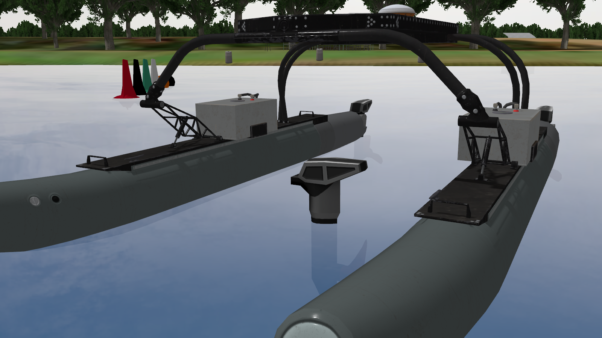

- 뱃머리 아래에 **가로로** 달린 통이 선수추진기임. 좌·우 추진기와 달리 90° 돌아 있음 — 그래서 추력이 옆으로 나감

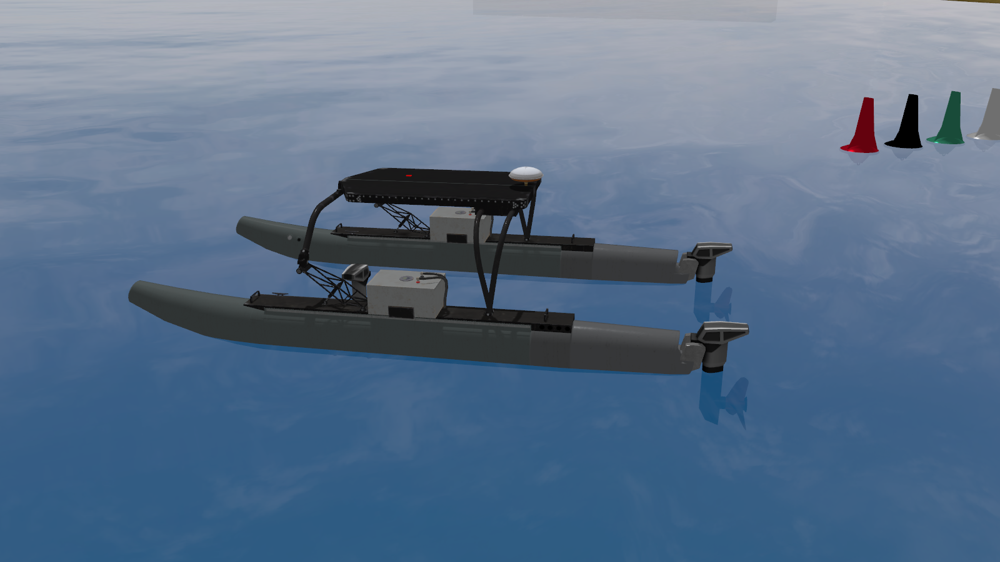

- 좌현 앞쪽 위에서 본 것. 선미에 둘, 선수에 하나 — 1-1절의 "추진기 셋" 이 실제로 이렇게 생김

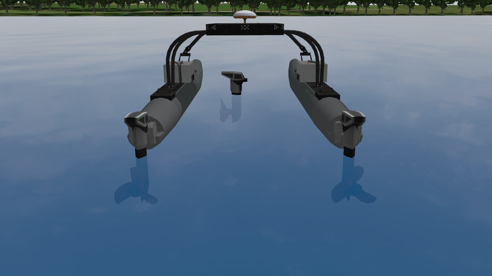

- 뒤에서 본 선미 쌍. 간격이 $2b = 2.054$ m 임 (배분행렬의 $b$ = 1.027135 m)

> [!warning] Gazebo 의 스크린샷 단추가 WSLg 에서 듣지 않음
> GUI 의 Screenshot 단추와 `/gui/screenshot` 서비스가 `data: true` 를 돌려주고도 **파일을 만들지 않음** — 플러그인이 `MinimalScene` 의 카메라를 못 찾기 때문임. 그래서 `shoot_bow.sh` 는 시뮬레이터 **안에** 사진기 모델(`photo_cam.sdf`)을 띄워 그 그림을 `/photo/image` 로 받아 PNG 로 씀. 같은 증상을 만나면 이 방식을 쓸 것

### G-7. 6단 — Simulink 를 Gazebo 에 붙여 돌린다

- 사다리의 여섯째 단이 돌리는 모델은 **5단의 VRX 쌍둥이** `W06_5_dock_vrx` 임. 5단에서 **운동모델만** 실물(Gazebo)로 바꾼 것이고, 제어기 세 고리와 추력배분은 글자까지 그대로 둠
- 그러므로 6단에 새 모델 파일이 없음 — 쌍둥이는 같은 `buildStage5` 가 만들고, 운동모델 자리만 `parts/plant.m` 이 Gazebo 토픽으로 바꿈 (G-7-3)
- 보내는 것: `/wamv/thrusters/{left,right,bow}/thrust` · 받는 것: `/wamv/sensors/position/ground_truth_odometry`
- **모델은 만들어져 있음**. 다만 Gazebo 가 떠 있어야 돌아가므로 오프라인 측정표(F 절)에는 빠짐

```matlab
>> W06_6_vrx_run        % 오프라인 5단으로 기준 궤적을 만들고 쌍둥이를 열어 줌
```

> [!important] 돌리는 것은 **열린 창의 Run** 임 (2026-10-28 부터)
> m 파일은 Gazebo 를 돌리지 않음. 한 m 파일이 오프라인과 연동을 함께 돌리면 어느 그래프가 무엇인지 헷갈림

- m 파일이 하는 일 — 셋
  1. 오프라인 5단을 돌려 **기준 궤적**을 `ref/W06_5_offline.mat` 에 남김 (이미 있으면 그대로 씀)
  2. 쌍둥이 `W06_5_dock_vrx` 를 **열어 줌**. 설정은 건드리지 않음 — 모델의 `InitFcn` 이 깖
  3. VRX 를 띄우는 순서와 Run 뒤에 무엇이 나오는지 찍어 줌
- **Run 을 누르면** 모델의 `InitFcn` 이 하는 일 — 다섯
  1. Simulink ROS 프로필의 Domain ID 가 `W06_setup` 의 `ros_domain_id` 와 같은지 봄. 다르면 **멈추고 고칠 자리를 알려 줌** (2026-10-16 추가 — 다르면 오류 없이 배가 서 있기만 함)
  2. `ros2('topic','list')` 로 오돔 토픽이 보이는지 확인함. 안 보이면 멈추고 `ROS_DOMAIN_ID` 를 일러 줌
  3. 20 초 동안 오돔을 받아 **RTF**(실시간 비율)를 재고, 그 값을 모델의 `PacingRate` 로 넣음 — Gazebo 보다 빨리 돌면 지령이 헛돎
  4. 첫 메시지의 위치를 `origin_north` · `origin_east` 로 삼음. Gazebo 는 ENU 이므로 `y`→북쪽, `x`→동쪽으로 바꿔 받음. 접안 수역(스폰에서 북 40 m · 동 45 m)은 스폰 162 · 200 두 설치 모두 넓은 물임 — 2026-10-16 확인
  5. **실시간 화면을 미리 만들어 둠** — 시계가 돌기 전에 만들어야 함 (아래 경고 상자)
- 끝나면 모델의 `StopFcn` 이 **동기 점검 $k$** 를 찍고, `ref/` 에 있는 오프라인 기준 궤적을 겹쳐 그리고, `interp1` 로 시각을 맞춘 이격거리를 찍음

> [!important] 실시간 화면은 **시계가 돌기 전에** 만들어 둠 — 첫 스텝에서 만들면 VRX 가 혼자 달림 (2026-10-28 기준 환경 실측)
> | 4단 쌍둥이 · 실시간 화면 켬 (`animate = 1`, 0.25 s 마다 그림) | 동기 점검 $k$ | 평균 / 최대 이격 [m] | 완료 [s] 오프 / VRX |
> |---|---|---|---|
> | 창을 **첫 스텝에서** 만듦 (2026-10-27 까지) | **1.522** | 9.10 / 13.09 | 26.0 / **17.5** |
> | 창을 **`InitFcn` 에서 미리** 만듦 (지금) | **0.999** | **0.10 / 0.23** | 26.0 / 26.05 |
> | (대조) 화면 끔 | 1.000 | 0.24 / 0.74 | 26.0 / 25.95 |
>
> - 창 하나에 축 넷 · 범례 셋 · 부두 패치 — **그래픽 개체 서른 남짓**을 만드는 데 여러 초가 걸림
> - 그것을 첫 스텝 안에서 하면 그 동안 모델 시각은 멈춰 있고, **Gazebo 는 마지막으로 받은 추력 명령을 그대로 지킴**. 배만 혼자 감
> - 실측: 모델 시간 **0.4 s 사이에 배가 9.4 m** 를 감. 그만큼 앞서 출발한 꼴이 되어 기준 궤적과 끝까지 어긋남
> - 고친 자리는 한 곳임 — `W06_model_init`(모델의 `InitFcn`)이 `W06_animate('init')` 로 **창만 먼저** 만듦. 첫 스텝은 그리기만 함
> - 그래서 **VRX 연동도 실시간 화면을 켠 채로 돌림**. 끄는 쪽이 더 정확하지도 않음 (위 표 둘째 · 셋째 줄)
> - 판정: 끝에 찍히는 **$k$ = 지나간 거리 ÷ (VRX 속도 $\sqrt{u^2+v^2}$ 를 모델 시각으로 적분)**. 쓸 수 있는 구간은 **0.9 \~ 1.08** 임 (5주차 E-4 와 같은 식)
> - **상한 1.08 을 넘으면** Simulink 가 늦은 것임 — 위 표 첫 줄의 1.522 가 그 꼴임
> - **하한 0.9 에 못 미치면 Gazebo 쪽이 멈춰 있었던 것**임. 명령은 꾸준히 나가는데 배가 그만큼 가지 않은 상태이고, 추력은 계속 나가므로 **걸림 검사로는 잡히지 않음.** 2026-10-23 에 ROS 2 데몬이 깨진 채로 돌린 실행이 $k$ = 0.014(2.2 m 만 감)·걸림 0.2 s 로 **두 검사를 모두 통과해 버려** 하한을 넣음. 고치는 법은 `ros2 daemon stop && ros2 daemon start` 뒤 VRX 를 새로 띄우는 것임
- 붙이는 법 자체는 3주차 2-7 의 `W03_3_vrx_drive`(추력 보내기) 와 `W03_2_vrx_nav`(자세 받기) 와 같음 — 늘어난 것은 `bow` 토픽 하나임
- 8단(NED)은 6단 위가 아니라 **5단 위에** 쌓음 — 과업을 5단과 똑같이 두어야 두 전략을 그대로 견줄 수 있기 때문임

#### G-7-1. 남는 그림 두 장 — 돌린 자리에서 반드시 받아 둘 것

Gazebo 가 떠 있는 자리에서만 얻는 그림임. 화면으로 보고 닫으면 다시 돌려야 하므로,
실행 파일이 **그 자리에서 `img/` 에 저장함** (5·7·8주차와 같은 이름 규칙임).

| 파일 | 무엇 | 읽는 법 |
|---|---|---|
| `img/W06_5_vrx_result.png` | 6단 자체의 성능 그림 (`W06_plot` 이 내는 그 네 칸). 제목에 실측 RTF 가 적힘 | 오프라인 5단 그림과 **같은 칸**이므로 나란히 두고 봄 |
| `img/W06_5_vrx_vs_offline.png` | 같은 과업·같은 원점으로 돌린 **오프라인 5단 ↔ VRX 쌍둥이 대조**, 여섯 칸 | 아래 여섯 줄 |

- 이름에 붙은 숫자 5 는 **돌린 모델의 단**임 (`W06_5_dock_vrx`). 다른 단도 같은 규칙으로 `W06_<단>_vrx_result.png` · `W06_<단>_vrx_vs_offline.png` 가 남음

- 대조 그림 여섯 칸을 이 순서로 읽음
  1. **궤적 + ㄷ 자 선석** — 두 선이 겹치는지. 겹치면 경로는 같고 **시각만 밀린 것**임
  2. **선석까지 거리** + $R_{dock}$ · $R_{stop}$ 선 — 둘 다 $R_{stop}$ 안으로 들어갔는지
  3. **이격거리** — `interp1` 로 시각을 맞춘 두 궤적의 거리. 과업이 끝나는 지점에서 다시 0 으로 떨어지면 위상 오차임 (경로 오차가 아님)
  4. **$\psi$ 와 $\psi_t$** — VRX 쪽 선수각이 더 흔들림. 조류·파도와 추진기 응답지연이 플러그인 안에 있기 때문임
  5. **$u$ · $v$** — 지령 한계 $u_{max}$ · $v_{max}$ 를 넘지 않는지
  6. **$F_L$ · $F_R$ · $F_B$** — VRX 쪽이 더 오래 한계에 붙어 있음
- 색은 **VRX 주황 · 오프라인 파랑** 으로 두 주차 전부 같게 둠
- 끝에 두 열 표(완료 시각 · 끝 오차 · 선수각 오차 · $\max|v|$ · $\max|F_B|$ · 주행거리 + 이격)를 찍음
- VRX 로그는 `setappdata(0,'W06_vrx_log', …)` 에 남음 — 그림만 다시 그리려고 Gazebo 를 다시 돌릴 필요가 없음
- 실시간 화면도 같은 방식으로 받아 둘 수 있음 — `W06_anim_capture('vrx')` → `img/W06_anim_vrx.png`. 페이싱은 **실측 RTF 그대로** 들어감 (더 높이면 모델과 시뮬레이터가 CPU 를 다퉈 오히려 느려짐, 3주차 2-3)

#### G-7-2. 돌려 본 결과 — 오프라인과 VRX 가 같은 자리에 선다 (2026-10-24 측정)

기준 노트북에서 G-0 의 순서 그대로 경량 월드(`run_vrx_bow.sh lite`)를 띄우고 `W06_6_vrx_run` 을 돌린 결과임. 도는 모델은 5단의 쌍둥이 `W06_5_dock_vrx` 임. VRX 원본 그대로(스폰 원점 (북, 동) = $(200.00,\ -532.03)$ m), 실측 RTF **1.035**, 실시간 화면 끔, 동기 점검 $k$ = **1.000**, 걸림 **0.2 s**(판정 기준 5 s), 가장 가까운 고정 물체 `mb_marker_buoy_red` 까지 **9.9 m**.

**Gazebo 화면 — 접안이 실제로 되는 모습** (2026-10-15 데스크톱에서 찍은 것)

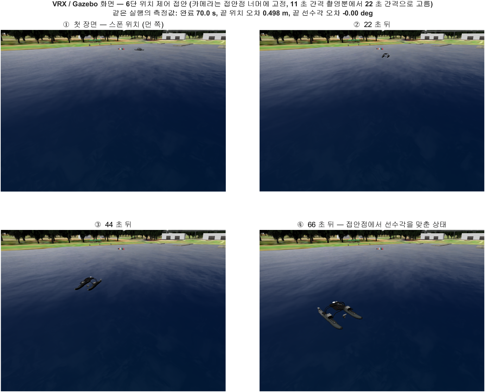

- 카메라를 접안점 너머 20 m 에 고정해 두고 11 초마다 찍은 일곱 장에서 **22 초 간격 넷**을 고른 것임. 배가 점에서 WAM-V 모양으로 커지는 것이 접근이고, ③ → ④ 에서 선체가 돌아가는 것이 선수각 정렬임
- ④ 의 자세가 **접안 완료 상태**임 — 선석 앞에 붙어 선수각을 맞추고 서 있음. 같은 실행의 측정값은 완료 70.0 s · 끝 위치 오차 0.498 m · 끝 선수각 오차 $-0.00°$
- 화면 캡처는 Gazebo 의 Screenshot 단추가 아니라 **창을 그대로 떠 온 것**임 (G-6 의 경고 상자)

**6단 자체의 성능 그림**

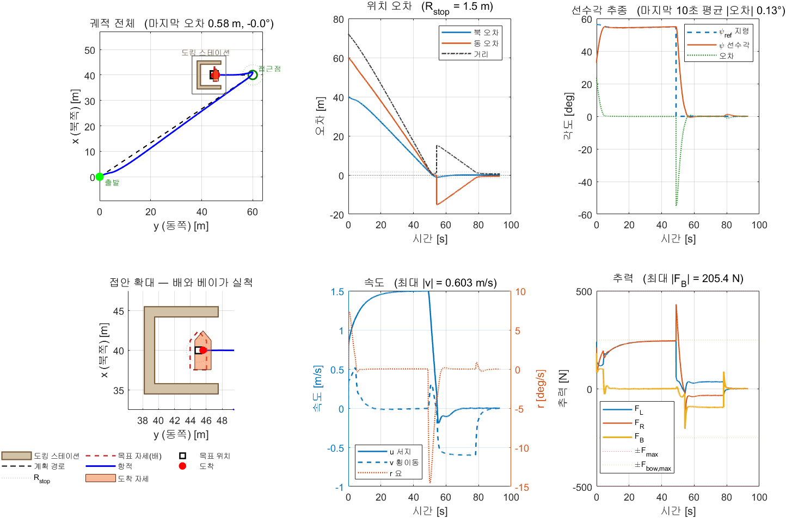

- 칸 배치가 오프라인 그림과 **같음** — 같은 `W06_plot` 이 그림. 제목에 실측 RTF 가 적혀 있음

**오프라인 5단 ↔ VRX 6단 대조**

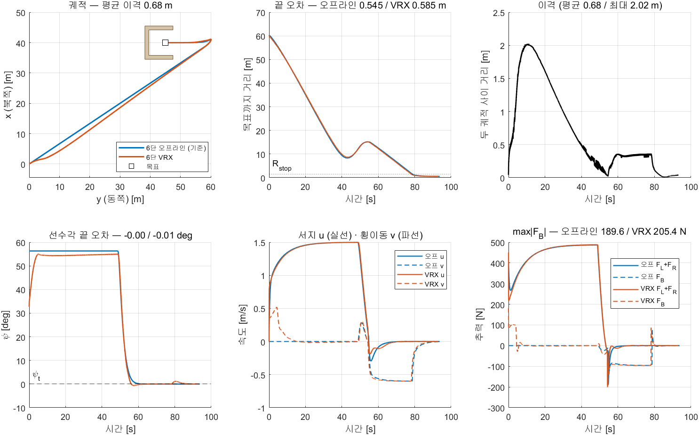

| 항목 | 오프라인 5단 | **VRX 쌍둥이** | 읽는 법 |
|---|---|---|---|
| 완료 시각 [s] | 78.45 | **77.7** | 0.75 s 차. 단계 전이 시각(48.5 / 53.9 / 77.7 s)도 1 s 안에서 맞음 |
| 끝 위치 오차 [m] | 0.561 | **0.587** | 둘 다 $R_{stop}$ 1.5 m 안 |
| 끝 선수각 오차 [deg] | $-0.00$ | $-0.02$ | 선수각 고리는 둘 다 끝까지 맞춤 |
| $\max\lvert v\rvert$ [m/s] | 0.599 | 0.602 | 지령 한계 $v_{max}$ 0.6 을 둘 다 지킴 |
| $\max\lvert F_B\rvert$ [N] | 190.6 | 205.3 | VRX 쪽이 8 % 더 씀 — 파랑(이득 0.3 · 주기 5 s)을 되받는 몫임 |
| 주행거리 [m] | 88.2 | 88.1 | 0.1 % 차. **경로가 사실상 같음** |

- **두 궤적의 이격** — 시각을 `interp1` 로 맞춰 재면 평균 0.17 m · 최대 0.44 m 임. 최대는 출발 직후(선수를 돌리는 첫 몇 초)이고, 과업이 끝나는 지점에서 다시 0 으로 떨어짐 → **경로 오차가 아니라 위상 오차**임 (G-7-1 의 셋째 칸)
- 출발 자세도 양쪽이 같음 — 초기 선수각 32.7 deg. 끝의 마지막 10 초 평균은 위치 0.624 m · 선수각 0.13 deg 로 **서 있는 상태**임. 추력배분의 왕복 검산(배분 → 합력)은 8.5e-14 N 으로 사실상 0 임
- 결론: **두 모델 모두 위치 제어로 접안이 됨**. 끝 오차가 둘 다 $R_{stop}$ 안이고, 성능 지표 여섯 개가 전부 10 % 안에서 맞음. 제어기를 한 글자도 고치지 않았는데 이렇게 맞는 것이 **1\~5단으로 쌓아 올린 보람**임

**같은 과업을 VRX 를 새로 띄워 일곱 번 돌린 결과** (2026-10-16 \~ 10-24 기준 노트북, 화면 끔)

| # | RTF | 완료 [s] | 끝 오차 [m] | $\max\lvert F_B\rvert$ [N] | 평균 / 최대 이격 [m] | $k$ |
|---|---|---|---|---|---|---|
| 1 | 0.975 | 77.55 | 0.592 | 202.1 | 0.79 / 2.25 | — |
| 2 | 0.987 | 79.50 | 0.502 | 207.1 | 0.95 / 2.10 | 0.974 |
| 3 | 0.989 | 80.05 | 0.597 | 202.9 | 1.53 / 2.87 | 0.966 |
| 4 | 0.984 | 79.55 | 0.632 | 204.4 | 1.43 / 4.58 | 0.991 |
| 5 (2026-10-23, `wsl --shutdown` 뒤) | 0.990 | 78.60 | 0.580 | 203.7 | 0.82 / 2.26 | 0.987 |
| 6 (2026-10-23, 경량 월드 재검증) | 0.996 | 78.90 | 0.562 | 206.5 | 0.67 / 1.47 | 0.983 |
| 7 (2026-10-24, 쌍둥이 `W06_5_dock_vrx`, **위 표**) | 1.035 | 77.70 | 0.587 | 205.3 | 0.17 / 0.44 | 1.000 |
| 오프라인 5단 | — | 78.45 | 0.561 | 190.6 | — | — |

- 완료 시각 77.55 \~ 80.05 s, 끝 오차 0.50 \~ 0.63 m — 일곱 번 모두 $R_{stop}$ 안. 1번은 $k$ 를 넣기 전의 실행이라 칸이 비어 있음
- 7번은 6단이 **5단의 쌍둥이**로 바뀐 뒤 처음 잰 값임 — 숫자가 1\~6번의 퍼짐 안에 들어가므로 **같은 모델**임이 확인됨. $k$ 가 1.000, 이격이 0.17 / 0.44 m 로 가장 작음(페이싱이 가장 잘 맞은 실행임)
- 오프라인 칸의 78.45 s · 0.561 m · 190.6 N 은 **쌍둥이 구조로 다시 생성한 뒤 재측정한 값**임 (앞서 적었던 78.7 s · 0.545 m · 189.6 N 과 0.3 % 안에서 같음)

> [!note] 2026-10-15 데스크톱 결과(완료 71.1 s · 끝 오차 0.453 m · 평균 이격 3.35 m)는 당시 기본값대로 **실시간 화면을 켠 채로** 잰 값임
> 그때는 "VRX 의 감쇠가 작아서 7.6 s 빠르다" 로 읽었음. 7.6 s 의 대부분은 **Simulink 가 늦은 몫**이었고, 까닭은 2026-10-28 에 드러남 — 실시간 화면 창을 **첫 스텝에서** 만들었기 때문임 (G-7-1 의 상자). 창을 `InitFcn` 에서 미리 만든 뒤로는 화면을 켠 채로도 $k$ 가 1 안팎임. 그런 실행은 끝에 찍히는 동기 점검 $k$ 로 바로 가려냄

**같은 과업을 여덟 번 돌린 끝 오차** (2026-10-15 데스크톱) — 한 번만 재고 믿지 않음

| # | 1 | 2 | 3 | 4 | 5 | 6 | 7 | 8 |
|---|---|---|---|---|---|---|---|---|
| 끝 오차 [m] | 0.423 | 0.441 | 0.443 | 0.453 | 0.465 | 0.465 | 0.485 | 0.498 |

- 퍼짐은 **0.42 \~ 0.50 m**, 폭 0.075 m 임. 여덟 번 모두 $R_{stop}$ 1.5 m 안
- 매번 달라지는 까닭 둘 — ① 파랑이 `random_seed` 10 으로 같아도 **배가 선석에 닿는 시각이 매번 달라** 파랑 위상이 다르게 걸림 ② RTF 가 매 실행 조금씩 달라 페이싱이 바뀜
- 오프라인은 같은 설정에서 **늘 0.561 m** 임 — 난수가 없으므로 똑같이 재현됨. 이 차이가 "시뮬레이터"와 "수식 모델"의 차이임
- 과제로 쓸 때: **세 번 이상 돌려 범위로 적을 것**. 한 번 값만 적으면 위 폭 0.075 m 안의 어느 한 점일 뿐임

#### G-7-3. 단마다 VRX 쌍둥이 — 오프라인에서 본 것을 Gazebo 에서 그대로 (2026-10-23)

> [!important] 모든 단이 **오프라인 ↔ VRX 쌍**임
> 같은 `buildStage<N>` 이 두 모델을 만들고, 다른 것은 **운동모델 자리 하나**뿐임 (`parts/plant.m`). 유도부·고리·추력배분·게인·상자는 글자까지 같음. 그래서 두 결과가 다르면 원인은 제어기가 아니라 플랜트(Gazebo)나 페이싱임

| 단 | 오프라인 모델 | VRX 쌍둥이 | 쌍둥이를 여는 명령 (Run 은 사람이) |
|---|---|---|---|
| 1 | `W06_1_point.slx` | `W06_1_point_vrx.slx` | `W06_vrx_run(1)` |
| 2 | `W06_2_sway.slx` | `W06_2_sway_vrx.slx` | `W06_vrx_run(2)` |
| 3 | `W06_3_thrust.slx` | `W06_3_thrust_vrx.slx` | `W06_vrx_run(3)` |
| 4 | `W06_4_stop.slx` | `W06_4_stop_vrx.slx` | `W06_vrx_run(4)` |
| 5 | `W06_5_dock.slx` | `W06_5_dock_vrx.slx` (6단이 쓰는 것) | `W06_vrx_run(5)` = `W06_6_vrx_run` |
| 7 | `W06_7_front.slx` | `W06_7_front_vrx.slx` | `W06_vrx_run(7)` |
| 8 | `W06_8_ned.slx` | `W06_8_ned_vrx.slx` | `W06_vrx_run(8)` |

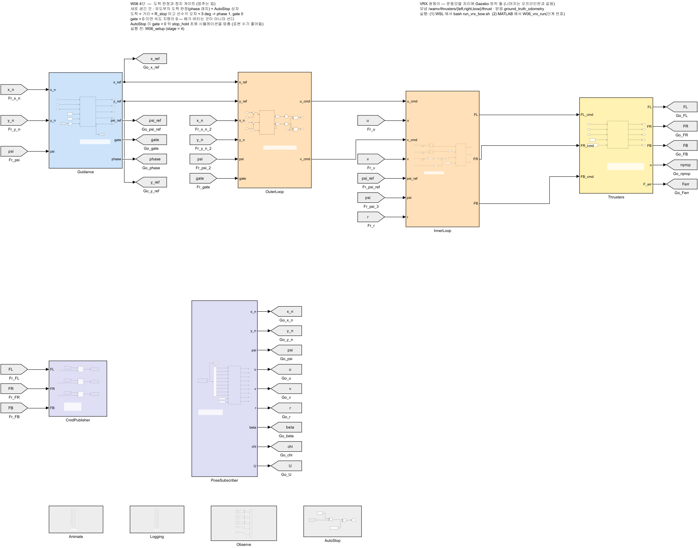

| 도면의 위치 | 무엇인가 |
|---|---|
| 윗줄 `Guidance` → `OuterLoop` → `InnerLoop` → `Thrusters` | 4단 오프라인과 **같은 블록** |
| 아랫줄 연보라 `CmdPublisher` | 추력 셋을 `/wamv/thrusters/{left,right,bow}/thrust` 로 보냄 — 오프라인의 `MotionModel` 입력 자리 |
| 아랫줄 연보라 `PoseSubscriber` | ground truth 를 받아 NED 항법량 아홉 개로 바꿈 — `MotionModel` 출력 자리 |
| 맨 아래 회색 넷 | 그림 · 로깅 · 스코프 · 자동정지 — 오프라인과 같음 |

- 다른 단의 도면도 같은 자리에 있음: `W06_simulink/img/W06_<단>_<이름>_vrx.png`
- 모델이 깨지면 `build_w06_models(1:8, 'vrx')` 로 쌍둥이만 다시 만듦 (오프라인 모델은 건드리지 않음)

**돌리는 순서** — G-0 의 ① ② 로 VRX 를 띄운 뒤

```matlab
W06_vrx_run(1)
```

- 단 번호만 바꿔 치면 됨. 쌍둥이 창이 열리면 **Run 을 누르는 것은 사람**임
- **단마다 VRX 를 새로 띄움** (G-0 의 3번 `stop_vrx.sh` 부터)
- 1\~3단은 정지 게이트가 없어 120 초로 끊음 (`W06_setup` 의 `T_run`)
- 오프라인 대조는 **Gazebo 배가 실제로 출발한 선수각**(스폰 32.7°)에서 돌림 — 그래서 아래 오프라인 값은 F 절 측정표(접근점을 향해 출발)와 조금 다름
- 끝에 모델의 `StopFcn` 이 찍는 것: 동기 점검 $k$ · **걸림 검사**(추진기가 힘을 내는데 5 초 넘게 서 있었는가) · **가장 가까이 지난 물체까지 거리**

**결과 — 일곱 쌍 모두 Gazebo 에서 오프라인과 같은 자리에 섬** (2026-10-23 기준 노트북, VRX 원본 스폰 ENU $(-532,\ 162)$, 단마다 VRX 새로 띄움, 실시간 화면 끔)

| 단 | RTF | 완료 [s] 오프 / VRX | 끝 오차 [m] 오프 / VRX | $\max\lvert F_B\rvert$ [N] 오프 / VRX | 평균 / 최대 이격 [m] | $k$ | 걸림 [s] |
|---|---|---|---|---|---|---|---|
| 1 | 0.986 | — / — | 0.000 / 0.001 | 128.1 / 148.6 | 0.25 / 1.40 | 0.965 | 0.1 |
| 2 | 0.982 | — / — | 0.000 / 0.003 | 180.0 / 188.2 | 0.01 / 0.24 | 1.000 | 0.2 |
| 3 | 0.984 | — / — | 0.000 / 0.001 | 128.5 / 145.1 | 0.03 / 0.27 | 1.000 | 0.2 |
| 4 | 0.983 | 26.0 / 27.6 | 2.564 / 2.593 | 128.6 / 148.1 | 1.18 / 2.50 | 0.939 | 0.2 |
| 5 | 0.964 | 78.45 / 76.45 | 0.561 / 0.521 | 190.6 / 204.9 | 0.64 / 1.27 | 1.019 | 0.2 |
| 7 | 0.989 | 72.70 / 72.30 | 0.119 / 0.115 | 180.0 / 210.0 | 0.31 / 0.68 | 0.994 | 0.6 |
| 8 | 0.980 | 145.95 / 145.15 | 0.554 / 0.556 | 210.6 / 222.6 | 0.16 / 0.56 | 1.003 | 0.2 |

- 1\~3단의 완료 칸이 비어 있는 것은 정상 — 정지 게이트가 없음 (F 절과 같은 까닭)
- 끝 오차는 단마다 오프라인과 **4 cm 안**에서 같음. 4단의 2.6 m 는 틀린 값이 아니라 게이트가 닫힌 뒤 미끄러진 거리임 (C-4)
- $\max\lvert F_B\rvert$ 는 VRX 쪽이 언제나 8\~17 % 큼 — 파랑을 되받는 몫임 (G-7-2 와 같은 읽기)
- 걸림이 0.6 s 를 넘은 단이 없음 → **어느 단도 무엇에 닿지 않았음**
- 결과 그림: `W06_simulink/img/W06_<단>_vrx_result.png` · `W06_<단>_vrx_vs_offline.png` (5단은 G-7-2 의 두 장)

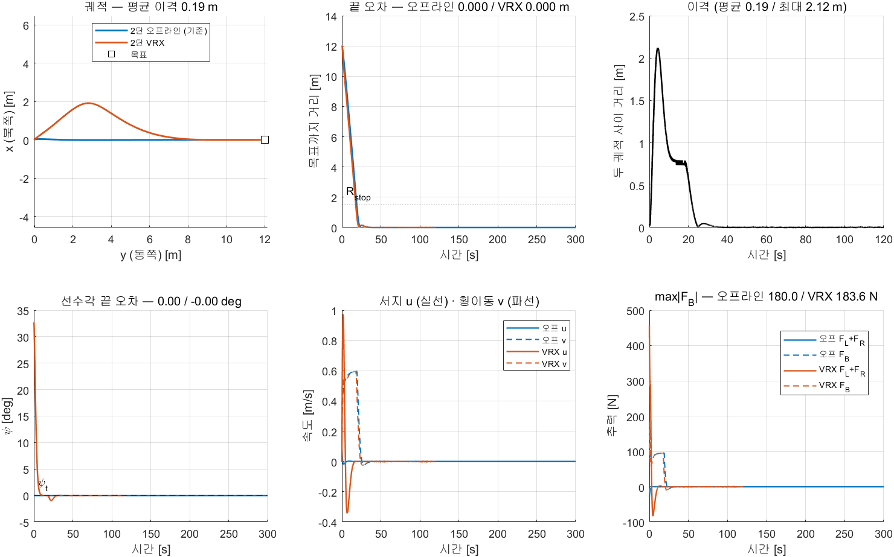

- 2단(순수 횡이동)의 여섯 칸. 궤적·거리·속도·추력의 두 선이 거의 하나로 겹침 — 평균 이격 0.01 m

**부딪칠 것이 없는가 — 스폰 둘레의 고정 물체와 거리**

`sydney_regatta` 에서 배가 다니는 물 위에 고정 물체가 둘 있음 (2026-10-23, `gz model -m <이름> -p` 로 잰 월드 ENU)

| 물체 | 월드 ENU $(x,\ y)$ [m] | 스폰 162 기준 (북, 동) [m] | 뜻 |
|---|---|---|---|
| 부표 여섯 개 (`mb_marker_buoy_*` · `mb_round_buoy_*`) | $x = -528$, $y = 186 \sim 191$ | 북 24 \~ 29, 동 4 | 스폰 바로 북쪽에 1 m 간격으로 한 줄 |
| 말뚝 셋 · 안테나 (`post_0~2` · `antenna`) | $y = 148 \sim 157$ | 남 5 \~ 14 | 남쪽 해안 위 — 스폰이 해안 옆인 증거 |

| 단 | 가장 가까이 지난 물체 · 거리 (스폰 162) | (스폰 200 인 설치) |
|---|---|---|
| 1 · 3 · 4 | 부표 줄 6.9 m | 9.9 m |
| 2 | 해안 말뚝 8.5 m (출발점 자체의 거리) | 9.6 m |
| 5 · 7 · 8 | 해안 말뚝 8.5 m (출발점 자체의 거리) | 9.9 m |

- 거리는 배 **중심선**에서 물체까지. 반폭 1.2 m 를 빼도 5 m 넘게 떨어짐 → 목표·출발점을 옮기지 않음
- 이 판단의 근거는 둘 — ① 위 거리 ② VRX 실행에서 걸림 0.6 s 이하. 둘 중 하나라도 어긋나면 그 단의 목표를 옮김
- 목표를 바꿔 볼 때는 `W06_setup` 의 `hold_*` · `sway_*` · `dock_*` 를 고치고 `W06_vrx_run(k)` 의 `가장 가까이 지난 물체` 줄을 볼 것 — **5 m 안**이면 경고가 찍힘
- 5주차 경로가 해안에 얹혔던 일(5주차 E-4)은 경로 원점을 스폰에 둔 채 남쪽으로 38 m 밀렸기 때문임. 6주차 목표는 전부 스폰의 북동쪽이라 같은 일이 생기지 않음

### G-8. 좌표계 — NED 제어기와 ENU 시뮬레이터

> [!important] 변환은 **받는 쪽 한 군데**에만 있음
> Gazebo·ROS 2 는 ENU 로 주고 제어기는 NED 로 짰으므로 변환이 필요함. 그런데 **보내는 쪽에는 변환이 없음** — 보내는 것이 좌표벡터가 아니라 추진기 셋의 **스칼라 추력 [N]** 이기 때문임.

| 방향 | 무엇이 지나가는가 | 변환 | 어디서 |
|---|---|---|---|
| 받는 쪽 (ENU → NED) | `nav_msgs/msg/Odometry` — 위치·자세·속도 | **있음.** 아래 다섯 줄 | `PoseSubscriber` 안의 `Nav` (MATLAB Function) |
| 보내는 쪽 (NED → ENU) | `std_msgs/msg/Float64` × 3 — $F_L$ · $F_R$ · $F_B$ [N] | **없음 (필요 없음).** 스칼라임 | `CmdPublisher` — 숫자를 그대로 실음 |

#### 받는 쪽 — `Nav` 가 하는 일 다섯

```matlab
% W06_simulink/parts/navCode.m — 모델 안에서는 PoseSubscriber/Nav
x_n = ey - org_x;                  % 1) 북 = y_ENU   (스폰 원점을 뺀다)
y_n = ex - org_y;                  %    동 = x_ENU

yaw_enu = atan2(2*(qw*qz + qx*qy), 1 - 2*(qy*qy + qz*qz));
p   = pi/2 - yaw_enu;              % 2) 선수각
psi = atan2(sin(p), cos(p));       % 3) ±pi 로 되감기

u =  bx;                           % 4) 선체속도 — y·z 부호가 바뀐다
v = -by;
r = -wz;

U    = sqrt(u*u + v*v);            % 5) 파생량
beta = atan2(v, u);                %    크랩각
chi  = atan2(sin(psi+beta), cos(psi+beta));
```

| # | 바꾸는 것 | 왜 |
|---|---|---|
| 1 | **축 맞바꿈** — 북 $\leftarrow y_{ENU}$ · 동 $\leftarrow x_{ENU}$ | ENU 는 $x$ 동 · $y$ 북 · $z$ 위, NED 는 $x$ 북 · $y$ 동 · $z$ 아래 (3주차 2-5) |
| 1 | **스폰 원점 빼기** — `org_x` `org_y` | 월드 원점이 배에서 568 m 떨어진 자리임 (G-0). 빼지 않으면 목표 자세 $(40,\ 45)$ 가 엉뚱한 자리가 됨 |
| 2 | $\psi = \pi/2 - \psi_{ENU}$ | ENU 요는 동쪽에서 **반시계**, NED 선수각은 북쪽에서 **시계**. 그래서 부호가 뒤집히고 $\pi/2$ 가 더해짐 |
| 3 | `atan2(sin, cos)` 되감기 | 뺀 결과가 $\pi$ 를 넘으면 $-\pi$ 쪽으로 튀어야 함. 안 하면 선수각 오차가 한 바퀴만큼 커짐 |
| 4 | 선체속도 $y$·$z$ 부호 | 선체축도 좌표계를 따름 — ENU 쪽 선체는 $y$ 좌현·$z$ 위, NED 쪽은 $y$ 우현·$z$ 아래 |
| 5 | $U$ · $\beta$ · $\chi$ | 로그·그림이 쓰는 파생량. 오프라인 `MotionModel` 의 `States` 와 **출력 아홉 개가 같은 순서**임 |

- 출력 순서를 `addMotionModel` 의 `States` 와 **같게 맞춘 것**이 핵심임 — 그래야 `wireNavGotos` 가 같은 태그 아홉 개(`x_n` `y_n` `psi` `u` `v` `r` `beta` `chi` `U`)를 내고, **로깅·그림·스코프가 5단과 똑같이 읽음**. 플랜트만 갈아 끼우고 나머지를 그대로 쓸 수 있는 까닭임
- `Nav` 첫머리에 가드가 있음 — `if ex == 0 && ey == 0` 이면 전부 0 을 냄. ROS 2 Subscribe 블록은 첫 메시지가 오기 전 **0 으로 채운 버스**를 내므로, 그대로 변환하면 위치가 스폰 원점만큼(약 568 m) 튀어 로그 첫 점이 망가짐

#### 보내는 쪽 — 변환할 좌표가 없음

```matlab
% parts/plant.m — 추력 셋을 토픽 셋에 그대로 실음
add_cmd_publisher(m, [2050 280], ...
    {'/wamv/thrusters/left/thrust', ...
     '/wamv/thrusters/right/thrust', ...
     '/wamv/thrusters/bow/thrust'}, 'Ts_ctrl', {'FL','FR','FB'});
```

- 세 토픽이 받는 것은 **그 추진기가 자기 축으로 낼 힘의 크기 [N]** 임. 좌표계가 붙은 양이 아니므로 ENU 로 돌릴 것이 없음
- 방향은 **URDF 가 이미 알고 있음** — `wamv_bow_thrusters.xacro` 의 `orientation="0 0 ${-pi/2}"` 한 줄이 "+ 지령은 우현" 을 정함 (G-1). 즉 **좌표 변환을 코드가 아니라 모델 파일이 맡은 것**임
- 그래서 부호를 바꾸고 싶으면 Simulink 가 아니라 **xacro 를 고침**. 고친 뒤에는 반드시 `measure_bow.sh` 로 다시 재서 확인할 것 (G-4)
- 선체고정 좌표의 힘 $(X,\ Y,\ N)$ 을 추력 셋으로 바꾸는 일은 `Alloc` 이 이미 끝냈음 (1-2절의 배분행렬). ENU·NED 와는 무관한, **선체 안에서의 일**임

> [!note] 어디까지가 NED 인가
> `Guidance` · `OuterLoop` · `InnerLoop` 는 전부 NED 와 선체고정으로만 돎 — ENU 를 모름. ENU 가 나타나는 자리는 **`PoseSubscriber/Nav` 한 칸과 URDF 의 `orientation` 한 줄**뿐임. 좌표계를 한 군데로 몰아 두면 부호를 틀렸을 때 **찾을 자리가 둘로 줄어듦**

---

## H. 모델을 다시 만들어야 할 때

```matlab
W06_setup
build_w06_models                 % 여덟 단 전부
build_w06_models(5)              % 5단만
build_w06_models(1:3)            % 1~3단
```

- 모델이 깨졌을 때 이 스크립트를 다시 돌리면 복구됨
- 한 단계가 어떻게 만들어지는지는 `parts/buildStage<N>.m` 에 있음. 블록 좌표와 서브시스템 속은 모두 `parts/` 안이고, `build_w06_models.m` 은 **무엇을 만드는지**만 보임
- 생성이 끝나면 강의노트가 쓰는 서브시스템 도면(`img/Guidance.png` 등)도 함께 다시 뽑힘
- 측정표를 다시 재려면 `W06_ladder` (일곱 단을 한 번에 돌려 표 세 개), 결과 그림은 `W06_shots`

---

# 마무리

## 이번 주차 요약

| 순서 | 한 일 | 확인 방법 |
|---|---|---|
| 1 | 추진기 둘 → 셋, 배분행렬 $2\times2$ → $3\times3$ | 1단에서 $(F_L, F_R, F_B)$ 가 셋 다 다른 값 |
| 2 | 선수추진기의 요 모멘트를 좌·우가 되받음 | 2단 pure sway — 12 m 옆걸음에 선수각 변화 0.000° |
| 3 | 선수추진기를 끄면 무엇이 안 되는가 | `bow_on = 0` 에서 동쪽 12 m 가 끝까지 남음, 선수각은 잡힘 |
| 4 | 모터 회전수가 추력이 되는 법칙은 **플러그인 안**에 있음 | 3단 왕복 검산 $8.5\times10^{-14}$ N, 1단과 끝 자세 차이 0 |
| 5 | 멈추는 법과 관성 | 4단 `gate` 26.00 s, 그 뒤 4.060 m 더 감 |
| 6 | 접안 세 단계 전이 | 5단 48.70 → 54.65 → 78.70 s, 남은 거리 0.545 m |
| 7 | 단계를 안 나누면 **현을 못 고름** | `dock_on = 0` 에서 닿은 선수각 $-56.334°$ (목표 $0°$) |
| 8 | 옆걸음 대 전진 | 7단 72.90 s (5.80 s 빠름) · 0.118 m, 감속 구간 없으면 1.713 m |
| 9 | 선체고정 대 NED | 끝 정확도 1 cm 안(0.545 / 0.554 m), NED 가 1.72 배 느림 |
| 10 | Simulink 와 m 파일 더블 검증 | `gate` · `phase` 차이 **0**, 자세 $10^{-11}$ 자리 |
| 11 | Gazebo 에 선수추진기 달기 | `/wamv/thrusters/bow/thrust` 가 보이고, 그림 3장이 찍힘 |

---

## 수업 진도 체크

> [!important] 다음 주 수업을 따라가기 위한 최소 조건

### 이론 이해

- [ ] 추진기 둘로는 **위치와 선수각을 동시에** 잡을 수 없는 까닭을 말할 수 있음
- [ ] underactuated 와 fully actuated 를 각각 한 문장으로 구분할 수 있음
- [ ] 배분행렬 $3\times3$ 의 세 줄이 각각 $X$ · $Y$ · $N$ 임을 앎
- [ ] 요 모멘트 줄에 $l_3 F_B$ 가 **왜** 있는지 설명할 수 있음
- [ ] pure sway 에서 $F_L$ 과 $F_R$ 이 **반대 부호**가 되는 까닭을 앎
- [ ] 선수추진기를 먼저 포화시키고 남은 모멘트를 좌·우에 나누는 **순서**의 뜻을 앎
- [ ] 세 고리(위치 P → 속도 PI → 선수각 P-D)의 역할을 각각 말할 수 있음
- [ ] 선수각 되먹임에 오차 미분이 아니라 **`r`** 을 쓰는 까닭을 앎 (5주차와 같은 이유)
- [ ] 접안 세 단계(접근 → 선수각 정렬 → 옆걸음)에서 **2단계가 무엇을 결정**하는지 앎
- [ ] 접안 선수각이 "빠르기 대 정확도" 의 선택임을 숫자로 설명할 수 있음
- [ ] 선체고정과 NED 전략에서 **회전행렬이 몇 개, 어디에** 앉는지 그릴 수 있음
- [ ] NED 전략이 치르는 두 가지 대가(벡터 속도 한계 · 느슨한 anti-windup)를 앎
- [ ] `gate` 가 닫혀도 배가 더 가는 까닭과, 그 거리가 접안 방향에 따라 다른 까닭을 앎

### 실습 완료

- [ ] `W06_setup` 실행만으로 각 단계가 돌았음
- [ ] 1단에서 (30, 20) 에 45° 로 서는 것을 확인했음
- [ ] 2단에서 `bow_on` 을 0/1 로 바꿔 옆걸음이 되고 안 되는 것을 봤음
- [ ] 3단을 1단과 이어 돌려 **끝 자세가 같고 왕복 검산이 0** 인 것을 확인했음
- [ ] 프로펠러 법칙이 VRX 어느 파일 몇 번째 줄에 있는지 짚을 수 있음 (§C-3)
- [ ] 4단에서 `R_stop` 을 바꿔 관성 거리가 변하는 것을 봤음
- [ ] 5단에서 `phase` 가 1 → 2 → 3 으로 올라가는 시각을 읽었음
- [ ] `dock_on = 0` 으로 두어 **어느 현을 댈지 고르지 못하는 것**을 봤음
- [ ] 7단을 돌려 $F_R$ 가 한계 500 N 에 닿는 것을 봤음
- [ ] 8단을 돌려 선체고정과 궤적을 겹쳐 봤음 (`W06_r5_vs_8.png`)
- [ ] m 파일을 돌려 slx 와 자동 대조 출력을 봤음
- [ ] `make_wamv_bow.sh` 로 URDF 를 직접 만들었음
- [ ] `stop_vrx.sh` → `run_vrx_bow.sh` 순서로 VRX 를 띄워 `bow` 토픽까지 `thrusters` 여섯 줄을 확인했음
- [ ] `measure_bow.sh` 로 **+ 지령이 어느 쪽인지 재서** 확인했음
- [ ] `measure_sway.sh 250` · `-250` 이 넓은 물에서 **판정 셋 모두 맞음**을 냈음 (첫 줄 `배를 넓은 물로 옮김`)
- [ ] `W06_6_vrx_run` 으로 쌍둥이를 열고 **Run** 을 눌러, 끝 오차가 $R_{stop}$ 안이고 **동기 점검 $k$ 가 0.9 \~ 1.08** 임을 확인했음
- [ ] `W06_vrx_run(2)` 로 2단 쌍둥이를 열어 Gazebo 에서 순수 횡이동을 돌려 **걸림 검사가 5 s 이하**, `가장 가까이 지난 물체` 가 5 m 넘게 나오는 것을 봤음
- [ ] `shoot_bow.sh` 로 선수추진기 그림을 얻었음

### 관찰 기록

- [ ] `bow_on` 0/1 궤적을 겹쳐 그림으로 남겼음
- [ ] 5단과 7단의 마지막 구간 추력 $(F_L, F_R, F_B)$ 를 표로 남겼음
- [ ] 선체고정과 NED 의 완료 시각·간 거리·최대 빠르기를 표로 남겼음
- [ ] Gazebo 측정값(`measure_bow` · `measure_sway` 출력)을 그대로 적어 두었음

---

## 과제 6 — 접안 전략 비교

- **제출 기한**: 8주차 수업 전
- **제출물**: 그래프 + 성능표 + 분석

### ① 접안 선수각을 바꿔 보기

접안 선수각(`W06_setup` 의 `dock_deg`) 을 0 · $-45$ · $-90$ 으로 두고 각각 돌릴 것 (0 은 옆걸음, $-90$ 은 전진)

| 접안 선수각 [deg] | 완료 [s] | 남은 거리 [m] | 진행축 / 옆축 어긋남 [m] | $(F_L, F_R, F_B)_{max}$ [N] | 관성 거리 [m] |
|---|---|---|---|---|---|
| 0 | | | | | |
| $-45$ | | | | | |
| $-90$ | | | | | |

- 빠르기와 정확도가 어떻게 맞바뀌는지 한 단락으로 적을 것

### ② 선수추진기 능력을 깎아 보기

`F_bow_max` 를 250 · 150 · 80 · 40 N 으로 줄이며 5단을 돌릴 것

| $F_{B,max}$ [N] | 완료 [s] | 남은 거리 [m] | 3단계(옆걸음) 걸린 시간 [s] | 완료 여부 |
|---|---|---|---|---|
| 250 | | | | |
| 150 | | | | |
| 80 | | | | |
| 40 | | | | |

- **접안이 되는 최소 선수추진기 추력**을 찾아 쓰고, 1-2절의 손풀이($Y = 96$ N · 1.2 m/s 면 264 N)와 견주어 설명할 것

### ③ 두 제어 좌표계

- 5단과 8단을 같은 조건에서 돌려 궤적을 겹쳐 그릴 것 (`W06_r5_vs_8.png` 와 같은 그림)
- `V_ned_max` 를 1.5 m/s 로 올려 다시 돌릴 것 — 완료 시각이 선체고정에 가까워지는지, 그때 궤적과 추력이 어떻게 변하는지
- 어느 전략을 WAM-V 에 쓸 것인지 고르고 **숫자를 근거로** 적을 것

### ④ Gazebo 측정

| 측정 | 명령 | 전진 [m] | 횡 [m] | 요 변화 [deg] |
|---|---|---|---|---|
| 선수추진기 + | `bash measure_bow.sh 500 8` | | | |
| 선수추진기 − | `bash measure_bow.sh -500 8` | | | |
| pure sway + | `bash measure_sway.sh 250 10` | | | |
| pure sway − | `bash measure_sway.sh -250 10` | | | |

- 선수추진기만 켠 것과 pure sway 를 견주어, **요 변화가 왜 달라지는지** 적을 것
- 오프라인 2단 결과와 견주어 다른 점을 적을 것 (Gazebo 는 6자유도 · 파도 · 물 유동이 있음)

---

## 막혔을 때

| 증상 | 원인 | 해결 |
|---|---|---|
| `먼저 W06_setup 을 실행하십시오` | 워크스페이스에 변수 없음 | `W06_setup` 먼저 |
| 옆으로 전혀 안 감 | `bow_on = 0` | 1 로 둘 것 (2단 C-2 가 일부러 꺼 보는 자리) |
| 선수각만 맞고 위치가 안 맞음 | 선수추진기 포화 | `F_bow_max` 또는 `v_max` 확인 — 과제 6 ② |
| 배가 선석을 지나쳐 감 | 부두가 운동모델에 없음 | 정상임. 멈춤은 $R_{stop}$ 판정이 책임짐 (1-5절 경고) |
| 반대쪽 현을 대고 섬 | `dock_on = 0`, 또는 `berth_side` 부호 | 둘을 확인 — D 절의 표 |
| `phase` 가 2 에서 안 넘어감 | 선수각 오차가 5° 안에 안 들어옴 | `Kp_psi` · `Kd_psi`, 또는 `R_dock` 을 키울 것 |
| 끝 선수각 오차가 90° 로 찍힘 | 7단 목표를 선석 방위로 셈 | `W06_plot` 이 `mode == 3` 에서 `pref(end)` 를 쓰는지 확인 |
| 1\~4단 그림에 쓰지도 않는 선석이 그려짐 | `task_mode` 가 3 으로 고정됨 | `W06_setup` 의 단계별 `task_mode` 확인 |
| 측정표 숫자가 F 절과 다름 | 모델·설정값 어긋남 | `build_w06_models` 로 재생성한 뒤 `W06_ladder` |
| 실행 파일을 Run 했는데 다른 단계가 돎 | 앞서 띄워 둔 모델이 남아 있음 | `bdclose('all')` 뒤에 다시 Run |
| 8단이 너무 느림 | `V_ned_max` 가 `v_max`(0.6) 로 묶임 | 정상임. 1-7절의 첫째 대가 |
| `bow` 토픽이 안 보임 | URDF 가 추진기 둘 판 | `run_vrx_bow.sh` 를 썼는지, `wamv_bow_lite.urdf` 인지 확인 |
| Gazebo 스크린샷 단추가 파일을 안 만듦 | WSLg 에서 플러그인이 카메라를 못 찾음 | `shoot_bow.sh` 를 쓸 것 (G-6 경고) |
| MATLAB 에서 토픽이 안 보임 | Domain ID 불일치 | `run_vrx_bow.sh` 가 찍는 값과 `W06_setup` 의 `ros_domain_id` 를 맞출 것 |
| `Simulink ROS 프로필의 Domain ID 는 8, ...` 으로 멈춤 | Simulink 프로필만 다름 | 툴스트립 **시뮬레이션 → ROS 네트워크** 에서 7 로 (G-0 의 5번) |
| VRX 완료 시각이 오프라인보다 수십 초 짧음 · $k$ > 1.08 | Simulink 가 VRX 를 못 따라감 (다른 무거운 프로그램 · 느린 CPU) | 브라우저 등 무거운 창을 닫고 VRX 를 새로 띄워 재실행. 실시간 화면은 창을 미리 만들므로 **끌 필요 없음** (G-7-1 상자) |
| `measure_sway.sh` 가 `요 유지 틀림` | 스폰 자리에서 재서 해안에 닿음 | `git pull` 로 최신 스크립트 — 시작할 때 `배를 넓은 물로 옮김` 줄이 찍혀야 함 (G-4 경고) |
| 배가 두 척 보임 · 토픽 값이 튐 · RTF 가 갑자기 반 | 앞서 띄운 VRX 가 고아로 남음 (보통의 종료 신호를 무시) | `bash ../W03_vrx_lite/stop_vrx.sh` → `끈 뒤: 0 개` 확인 후 다시 띄움. 안 되면 PowerShell 에서 `wsl --shutdown` |
| `run_vrx_bow.sh` 뒤 `[Wrn]`·`[Err]` 가 수백 줄 | 정상 경고 | 무시함. Gazebo 창에 배가 보이면 성공 (G-0 의 3번) |
| **로그는 나오는데 Gazebo 창이 안 뜸** · `화면 이상: ... msrdc.exe` | WSLg 의 창 표시기가 재시작을 반복 | WSL 터미널을 모두 닫고 PowerShell 에서 `wsl --shutdown` → 새 터미널에서 다시 (5주차 E-1 경고 상자) |
| **$k$ < 0.9** · 추력은 나가는데 배가 몇 m 만 가고 걸림 검사는 통과 | ROS 2 데몬이 깨져 추력 명령이 Gazebo 까지 안 감 | WSL 에서 `ros2 daemon stop && ros2 daemon start` → VRX 를 새로 띄워 재실행 (G-7 경고 상자) |
| Gazebo 창은 떴는데 **3D 화면이 흰색** | 메시·텍스처를 읽는 중임 | 20\~40 s 기다림. 토픽은 이미 나오므로 그대로 진행해도 됨 (5주차 E-1) |

---

## 참고 자료

### 이 주차의 원본

- **Fossen, T. I.** *Handbook of Marine Craft Hydrodynamics and Motion Control*, 2nd ed. (2021) — §12.2 (위치·선수각 제어와 추력 배분), §9.4 (완전구동 선박의 DP 제어) — `50-원본자료/` 에 PDF 있음
- **MSS 툴박스** — https://github.com/cybergalactic/MSS
  - `SIMULINK/mssSimulinkDemos/Otter/Otter_Berth/` — 이 주차의 사다리 5·7단이 따라간 원본
    - `Autoberthing_swayBerth` — 옆걸음 접안 (5단)
    - `Autoberthing_frontBerth` — 전진 접안 (7단)
  - 원본은 Otter USV(길이 2 m 급)이고 본 주차는 WAM-V(4.9 m 급)로 옮긴 것임. 질량·관성·항력·추력 한계가 모두 달라 게인을 다시 잡았음
- **실험실 논문** — Bang et al., *Development and Experimental Validation of an Autonomous USV Berthing System with Transition Logic for Multiple Berthing Maneuver Strategies*, **Ocean Engineering 331 (2025) 121333**
  - §3.3 의 두 제어 좌표계(선체고정 · NED)가 본 주차 1-7절과 8단의 원본임
  - 식 13\~16 이 NED 전략의 네 식 — `parts/addOuterLoopNED.m` · `addInnerLoopNED.m` 의 주석에 식 번호를 적어 두었음
  - 접안 전략 전이 논리(접근 → 정렬 → 접안)가 1-5절의 세 단계임

### 교수 강의자료 — 이 주차가 그대로 따라간 쪽

| 자료 | 이 주차의 어느 절 |
|---|---|
| `2. USV 제어기 설계.pptx` 125쪽 | §1-3 세 고리 구조, 1단 |
| `2. USV 제어기 설계.pptx` 153쪽 | §1-5 접안 세 단계, 5단 |
| `2. USV 제어기 설계.pptx` 155쪽 | 선수각 지령 스윕 — `W06_psi_sweep.m` ($\psi_d$ = 45 · $-60$ · 100 · $-90$°) |

### 볼트 내 문서

- [[W05_웨이포인트_유도_atan2와_LOS]] — 추진기 둘, 경로 추종. 이 주차의 바로 아래 단
- [[W09_라이다_장애물회피_파이썬유도와_시뮬링크제어]] — 이 주차의 선수추진기 가제보 모델에 3D 라이다를 얹음
- [[W03_Gazebo_VRX_구축과_좌표계]] — §2-3 VRX 띄우기, §2-7 추력 보내기·자세 받기
- [[ENU와-NED를-섞으면-조용히-틀린다]] — xacro 의 `orientation` 부호
- [[배는-급정지하지-않는다]] — 4단의 관성 거리, 도착 반지름을 관성보다 크게 두는 이유
- [[오프라인-모델이-시뮬레이터와-같아야-게인이-옮겨간다]] — 6단에서 오프라인과 Gazebo 를 대조하는 이유

### 배포 파일

| 파일 | 내용 |
|---|---|
| `W06_simulink/W06_setup.m` | **학생이 고치는 설정 파일. 실행하면 바로 그 단계가 돎** |
| `W06_simulink/W06_1_point.slx` … `W06_8_ned.slx` | 사다리 **여덟 단** 모델 (6단은 Gazebo 가 떠 있어야 돎) |
| `W06_simulink/W06_1_point_run.m` … `W06_8_ned_run.m` | 단계마다 **그 모델을 돌려 그림을 내는** 실행 파일 여덟 장 |
| `W06_simulink/W06_bow_demo.m` | 예제 — 2단에서 `bow_on` 만 켜고 꺼 본다 (6주차의 출발점) |
| `W06_simulink/W06_psi_sweep.m` | 예제 — 1단에서 선수각 지령 넷(45 · $-60$ · 100 · $-90$°)을 스윕 |
| `W06_simulink/W06_berth_compare.m` | 예제 — 접안 세 가지(5·7·8단)를 같은 선석에 붙여 견줌 |
| `W06_simulink/W06_awup_compare.m` | 예제 — 속도 PI 의 anti-windup 세 방식(끔·고정·역계산)을 같은 과업으로 견줌 |
| `W06_simulink/W06_animate.m` | 실시간 화면 네 칸 — 오프라인·VRX 공용. 창은 `W06_animate('init')` 로 시계가 돌기 전에 만듦 |
| `W06_simulink/W06_anim_capture.m` | 실시간 화면을 **조건과 함께 PNG 로** 남김 (`dock` · `front` · `ned` · `vrx`) |
| `W06_simulink/W06_6_vrx_run.m` | 오프라인 5단으로 기준 궤적을 만들고 6단 쌍둥이를 열어 줌 (G-7-1) — `W06_vrx_run(5)` 와 같음 |
| `W06_simulink/W06_vrx_run.m` | **단마다 VRX 쌍둥이**를 열어 줌. Run 뒤의 동기 점검 · 걸림 검사 · 물체까지 거리 · 기준 대조는 모델의 `StopFcn` 이 함 (G-7-3) |
| `W06_simulink/W06_<단>_<이름>_vrx.slx` | 1·2·3·4·5·7·8단의 VRX 쌍둥이 일곱 개 — 6단이 쓰는 것은 `W06_5_dock_vrx.slx` |
| `W06_simulink/parts/plant.m` · `navCode.m` | 운동모델 자리를 오프라인 / Gazebo 토픽으로 바꾸는 도우미, ENU→NED 변환 본문 |
| `W06_simulink/W06_plot.m` | 결과 그림과 성능 지표 (완료 시각 · 전이 시각 · 끝 오차 · 최대 추력) |
| `W06_simulink/W06_ladder.m` | **일곱 단을 한 번에 돌려 측정표 세 개**를 찍음 (F 절의 표) |
| `W06_simulink/W06_shots.m` | 결과 그림 여덟 장을 `img/` 에 다시 뽑음 |
| `W06_simulink/build_w06_models.m` | 모델 재생성 (`parts/` 의 단계별 빌더를 부름) |
| `W06_simulink/parts/` | 단계별 빌더와 서브시스템 — `buildStage<N>.m` · `add*.m` · `wire*.m` · `allocFcn.m` |
| `W06_vrx_lite/wamv_bow_thrusters.xacro` | **추진기 셋 배치** (VRX 원본을 고치지 않음) |
| `W06_vrx_lite/make_wamv_bow.sh` | URDF 만들기 (`camera` · `lidar` 선택) |
| `W06_vrx_lite/wamv_bow_lite.urdf` | 미리 만들어 둔 판 (759 줄) |
| `W06_vrx_lite/run_vrx_bow.sh` | VRX 띄우기 (`lite` · `mine` · `headless` · `shot`) |
| `W06_vrx_lite/measure_bow.sh` | 선수추진기 + 지령이 어느 쪽인지 재기 |
| `W06_vrx_lite/measure_sway.sh` | Gazebo 에서 pure sway 재기 |
| `W06_vrx_lite/to_open_water.sh` | 배를 넓은 물 ENU $(-532,\ 200)$ 으로 옮기기 — G-4 · G-5 가 먼저 부름 |
| `W03_vrx_lite/stop_vrx.sh` | 떠 있는 VRX 모두 끄기 — 실험마다 띄우기 전 (G-0 의 3번) |
| `W06_vrx_lite/shoot_bow.sh` · `photo_cam.sdf` · `gui_shot.config` | 화면 없이 그림 찍기 |
| `W06_vrx_lite/img/` | 선수추진기 그림 3장 (1600×900) |
| `W06_simulink/img/` | 블록도·결과 그림과 **VRX 그림 셋** — `W06_5_vrx_result.png` · `W06_5_vrx_vs_offline.png` · `w06_vrx_gazebo_seq.png` (G-7-2) |

---

## 다음 주 예고

- **7주차 — 한 점을 중심으로 도는 로이터링**
- 이번 주차는 **한 점에 서 있기**였음. 다음 주차는 **한 점 주위를 계속 도는 것**임
- 할 일
  - **벡터필드** — 경로를 좇는 대신 공간 전체에 방향을 깔아 둠
  - 회전 **방향** · **속도** · **반경** 을 마음대로 바꾸기
  - 반경 오차가 왜 바깥으로 남는지 수치로 분해
- 7주차는 추진기 **둘**(5주차 구성)로 돌아감. 이 주차의 선수추진기 **가제보 모델**은 9주차 장애물회피에서 라이다를 얹는 바탕으로 다시 씀
- 준비물
  - 과제 6 의 그래프와 표
  - 이번 주차 모델 여덟 단이 그대로 돌아가는 상태
