# 7주차 · 한 점을 중심으로 도는 로이터링

> [!important] 이번 학기 **녹화 강의 영상**은 여기에 올라감 — 수업에서 놓친 부분은 영상으로 확인할 것
> **<https://youtube.com/playlist?list=PLK_f1-krzJG8>**
>
> - 매주 수업 뒤 그 주차 영상이 이 재생목록에 추가됨
> - 아래 "참조 강의" 는 **지난 학기까지의 선수 과목**이고, 이 재생목록은 **이번 학기 본 수업** 녹화임

> [!important] 참조 강의 — 본 과목이 전제하는 배경
> <span style="font-size:0.88em">아래 다섯 과목은 **본 과목 담당 교수가 직접 강의한 것**이며, 본 과목이 전제하는 배경 지식에 해당함. 학부 기초에서 대학원 과정까지 이어지므로 부족한 지점부터 시작하면 됨. 본 문서에서 쓰는 좌표계·기호·유도 과정은 아래 강의에서 상세히 다루므로, 선수 지식이 부족한 경우 먼저 보고 돌아올 것.</span>
>
> | # | 과목 | 수준 | 언어 | 영상 | 자료·코드 |
> |---|---|---|---|---|---|
> | 1 | **제어공학** — 전달함수, 되먹임, 안정도, 근궤적, PID. 모든 것의 토대 | 학부 | 한국어 | [재생목록](https://youtube.com/playlist?list=PLFaUxNRM4BvJMpF9HZS-Mp8tDv9dTdglk) | [드라이브](https://drive.google.com/drive/folders/1TNIPDNtS_Iy8li-olka5WJslSXDYf0aT) |
> | 2 | **제어시스템설계** — 해석이 아니라 설계. 사양 결정, 루프 정형화, 이산 구현 | 학부 | 한국어 | [재생목록](https://youtube.com/playlist?list=PLFaUxNRM4BvIGroZ5rgn7x08F7C79d9WZ) | [드라이브](https://drive.google.com/drive/folders/11m5Xxl_PHJvxgHghLSP-jhCpmRpbvoXh) |
> | 3 | **캡스톤디자인** — 본 과목의 지난 학기 강의. 이동체 프로젝트를 처음부터 끝까지 | 학부 | 한국어 | [재생목록](https://youtube.com/playlist?list=PLFaUxNRM4BvLu7L0pDoLzDXTv8mm6rCmj) | [드라이브](https://drive.google.com/drive/folders/1haIQejlJfrdhtOuof-MpffR9ydVscXZS) |
> | 4 | **제어공학특론** — 좌표계, 6자유도 운동방정식, 회전행렬과 오일러각, 선형화와 트림 | 대학원 | 영어 | [재생목록](https://youtube.com/playlist?list=PLFaUxNRM4BvJmvF2ljx4KM5dj1P5jEcw0) | [드라이브](https://drive.google.com/drive/folders/1GUxbbONl916lNd0ggnFnXrNwNkd13-2-) |
> | 5 | **센서신호처리 및 융합** — 센서 모델, 잡음, 추정, 다중센서 융합 | 대학원 | 영어 | [재생목록](https://youtube.com/playlist?list=PLFaUxNRM4BvK-aP2Gdoyp5-AWvMn7Fo8E) | [드라이브](https://drive.google.com/drive/folders/1MEVJP7TzMcm8w6TZwUjhWJtL34WeNY3u) |
>
> <span style="font-size:0.88em">**MATLAB·Simulink 가 처음이라면 4주차 실습 전에 아래를 끝낼 것.** 본 과목의 제어기 실습은 전부 Simulink 로 진행함. Onramp 는 무료이며 각각 몇 시간이면 끝남</span>
>
> | 도구 | 시작 지점 |
> |---|---|
> | MATLAB | [MATLAB Onramp](https://matlabacademy.mathworks.com/kr/details/matlab-onramp/gettingstarted) · [Core MATLAB Skills](https://matlabacademy.mathworks.com/details/core-matlab-skills/lpmlcms) |
> | Simulink | [Simulink Onramp](https://matlabacademy.mathworks.com/kr/details/simulink-onramp/simulink) · 담당 교수 Simulink 강의 [1부](https://youtu.be/a-afHg_fSaU) · [2부](https://youtu.be/070Yn0Hw5a0) |

> [!important] 강의자료 저장소 — 처음 한 번만 `git clone`, 그 뒤로는 `git pull`
>
> | 저장소 | 주소 | 받는 자리 (WSL) |
> |---|---|---|
> | 강의자료 — 주차 문서 · Simulink 모델 · MATLAB 스크립트 | **<https://github.com/wkyouncnu/Capstone-Design>** | `~/Capstone-Design` |
> | ROS 2 예제 패키지 `usv_basics` — 2주차부터 쓰는 노드 코드 | **<https://github.com/wkyouncnu/usv_basics>** | `~/capstone_ws/src/usv_basics` |
>
> | 언제 | 명령 (VS Code 의 WSL 창 터미널) | 하는 일 |
> |---|---|---|
> | 처음 한 번 | `cd ~ && git clone https://github.com/wkyouncnu/Capstone-Design.git` | 강의자료 전체를 받음 (약 770 MB · 2026-10-16 실측 1분 40초) |
> | 처음 한 번 | `mkdir -p ~/capstone_ws/src && cd ~/capstone_ws/src && git clone https://github.com/wkyouncnu/usv_basics.git` | 예제 패키지를 받음. 이어서 `cd ~/capstone_ws && colcon build --symlink-install` |
> | 매주 수업 전 | `cd ~/Capstone-Design && git pull` · `cd ~/capstone_ws/src/usv_basics && git pull` | **바뀐 파일만** 받음. 다시 clone 하지 않음 |
> | 무엇이 바뀌었는지 | `git log --oneline -10` · `git show --stat HEAD` | 교수가 갱신한 내역을 확인 |
>
> - 두 저장소 모두 공개 — 로그인 없이 받아짐
> - 주차 문서는 `~/Capstone-Design/1_2026-2학기_강의자료/10-주차별-강의자료/` 에 있음. MATLAB 은 같은 폴더를 `\\wsl.localhost\Ubuntu-22.04\home\<사용자명>\Capstone-Design\...` 로 엶
> - `usv_basics` 를 받은 뒤 새 노드가 생겼으면 `colcon build --symlink-install` 을 한 번 더 돌림
> - 본인이 고친 파일 때문에 `git pull` 이 멈추면 `git stash` 로 치워 두고 다시 받음 → [[강의자료는-한-번-받고-git-pull-로-갱신한다]]

- **과목**: 캡스톤디자인 (2026-2) · 충남대학교 자율운항시스템공학과
- **이번 주차 학습 내용**: 한 점을 중심으로 **원을 그리며 돌게** 만듦. 방향·속도·반경을 바꿈

> [!important] 시작 전 확인
> - **강의자료부터 갱신**: VS Code WSL 창 터미널에서 `cd ~/Capstone-Design && git pull` — 문서와 코드·모델이 같은 판이 됨 ([[강의자료는-한-번-받고-git-pull-로-갱신한다]], 처음 받는 법은 2주차 2-6)
> - 5주차 `W05_0_offline.slx` 가 동작했어야 함
> - 배포 폴더 `W07_simulink/`, `W07_matlab/`
> - 논문 PDF: `50-원본자료/` 의 `Unmanned Aircraft Vector Field Path Following with Arrival Angle Control.pdf`

> [!note] 5주차에서 바뀌는 것은 **유도 한 단**뿐이다
> 내부루프(헤딩 P-D + 속도 PI), 추진기 모델, 운동모델, 게인이 전부 그대로임
> 유도만 LOS 에서 **벡터필드**로 바꿈. 이것이 GNC 를 층으로 나눠 설계하는 이유임

> [!important] 제어기와 동특성은 전부 **연속 시간**임 (2026-10-01)
> - 헤딩은 P-D 요각속도 되먹임 하나임 — $\tau_N = K_{p,\psi}\operatorname{ssa}(\psi_{\text{ref}}-\psi) - K_{d,\psi} r$.
>   `Kd_rate` 는 **양수**이고 빼는 일은 합산점 `SumN` 이 `+-` 로 함. 오차를 미분하는 구현과의 비교는 4주차 2-8절
> - 속도 PI 는 **Continuous-time** 임 (적분기 $1/s$, 안티와인드업 clamping)
> - 모터 1차 지연도 연속임 — $dn/dt = (n_{\text{cmd}}-n)/\tau_n$, 도면에는 `State-Space` 한 블록
> - 솔버는 오프라인·VRX 모델 모두 고정스텝 **연속** 솔버 `ode4` (스텝 `Ts_ctrl` = 0.05 s)
> - 이산으로 남은 것은 `Guidance` 의 회전수 계수기 세 개(`ThDly`·`AccDly`·`ArmDly`)뿐임.
>   표본 사이의 각 변화를 모아 감는 **사건 계수기**라 적분으로 바꿀 수 없고, 대수 루프도 끊음

---

## 이 주차를 마치면 할 수 있어야 하는 것

1. 로이터링이 무엇이고 왜 필요한지 설명하기
2. **웨이포인트로 원을 흉내내면 왜 안 되는지** 설명하기
3. **벡터필드**라는 발상을 설명하기
4. 논문의 식 (9)·(13)·(30) 을 읽고 코드와 대조하기
5. $p_c$ 의 **부호가 회전 방향**, **크기가 수렴 성향**임을 실험으로 보이기
6. 식 (28) 로 $p_c$ 를 **계산**해서 정하기
7. 남는 **반경 오차**의 원인을 세 가지로 분해하기
8. 회전수를 세어 임무를 끝내기

## 준비물

| 항목 | 내용 |
|---|---|
| 환경 | 1\~5주차 그대로 |
| 배포 파일 | `W07_simulink/` (모델 2개 + 스크립트 9개: setup · plot · animate · anim_capture · vectorfield · segments · vrx_run · build · tidy_layout), `W07_matlab/` (원본 참고) |
| 논문 | `50-원본자료/` PDF |

---

# 1부 · 이론

## 1-1. 로이터링이란

- **한 점을 중심으로 원을 그리며 계속 도는 것**
- 영어로 loitering — "어슬렁거리다"

### 왜 필요한가

| 상황 | 왜 도는가 |
|---|---|
| 표적 감시 | 한 지점을 계속 보면서 거리를 유지해야 함 |
| 대기 (holding) | 다음 지시가 올 때까지 자리를 지켜야 함 |
| 통신 중계 | 일정 반경 안에 머물러야 함 |
| 수색 | 중심에서 나선형으로 넓혀 가며 훑음 |

- 배는 헬리콥터가 아니라 **제자리에 뜰 수 없다**
- 멈추면 조류·바람에 밀림 → **돌면서 자리를 지키는 것**이 현실적인 해법
- 제자리 유지(DP)는 9주차에서 따로 다룸

---

## 1-2. 웨이포인트로 원을 흉내내면 안 되는가

- 원 위에 점을 촘촘히 찍어 5주차 LOS 로 따라가는 방법 — 세 가지 문제가 있음

> [!warning] 세 가지 조건이 관련된다

| 문제 | 내용 |
|---|---|
| **점 개수** | 반경 25 m 원을 1 m 오차로 근사하려면 12개, 0.2 m 오차면 25개 (현의 처짐 $h = r_d\,(1-\cos(\pi/n_{\text{pt}}))$, $r_d$ 반경, $n_{\text{pt}}$ 점 개수). 반경이 바뀌면 다시 만들어야 함 |
| **모서리** | 다각형이므로 꼭짓점마다 방향이 꺾임. 5주차에서 본 코너 이탈이 매 점마다 생김 |
| **방향·반경 변경** | 실시간으로 바꾸려면 웨이포인트 배열을 통째로 다시 만들어야 함 |

- 원은 **직선의 모음이 아님.** 원을 원으로 다루는 유도법칙이 필요함

---

## 1-3. 벡터필드라는 발상

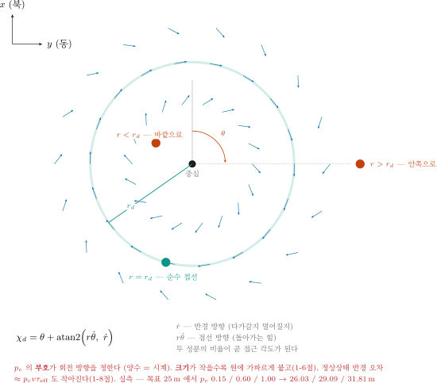

> [!important] "경로를 따라간다" 대신 **"공간에 방향을 깔아 둔다"**

- LOS 는 배의 위치를 보고 그때그때 목표 방향을 계산했음
- 벡터필드는 반대로 생각함
  - **공간의 모든 점**에 "여기서는 이쪽으로 가라"는 화살표를 미리 깔아 둠
  - 배는 자기가 있는 자리의 화살표를 그대로 따라감

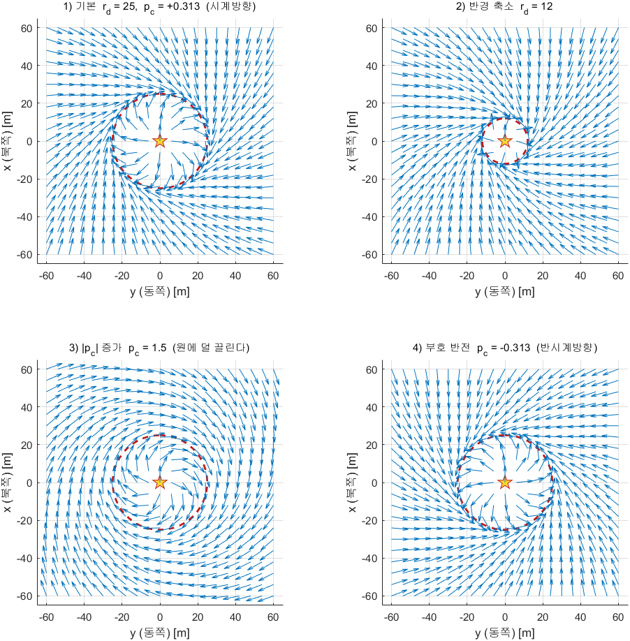

### 필드 읽는 법

| 위치 | 화살표가 향하는 곳 |
|---|---|
| 원 **바깥** | 중심 쪽으로 기울어 있음 → 원으로 다가감 |
| 원 **위** | 원에 **접함** → 그대로 돎 |
| 원 **안쪽** | 바깥으로 기울어 있음 → 원으로 밀려남 |

- 어디서 출발하든 결국 원 위로 모임
- 이 성질을 **수렴성(convergence)** 이라고 함

> [!note] 벡터필드는 원 말고도 쓴다
> 직선 경로에도 쓰고, 장애물 회피에도 씀 (12주차 LiDAR 기반 충돌회피의 인공포텐셜장이 같은 계열임)
> 이번 주차의 학습 대상은 그중 **원 궤도용** 하나임

---

## 1-4. 논문의 식 (9) — 극좌표 벡터필드

> **출처**: W. Jung, S. Lim, D. Lee, H. Bang,
> *"Unmanned Aircraft Vector Field Path Following with Arrival Angle Control"*
> — `50-원본자료/` 에 PDF 있음. KAIST 항공우주공학과

### 논문은 원 궤도 벡터필드 셋을 차례로 다룬다

- 강의 PPT 도 같은 순서로 넘어감. 셋째를 쓰는 까닭을 알려면 앞의 둘이 무엇인지 알아야 함

| 논문 식 | 파라미터 | 출처 | 성격 |
|---|---|---|---|
| 식 (2) | $p_o$ | 논문 참고문헌 [7] | **도착각 제어**용. 원에 닿는 각도를 지정할 수 있음 |
| 식 (5) | $p_l$ | Nelson 외 [22] (2007) | 널리 쓰이는 형태. $p_l = 2$ 로 두면 Frew 의 필드와 같아짐 |
| **식 (9)** | **$p_c$** | **이 논문의 제안** | 원 궤도 전용. **시간지연이 있어도 성능을 식으로 따질 수 있음** |

> 논문 III절 원문
> "Note that, if the dynamic model contains **time-delay** then it is hard to analyze
>  the performance of the circular path following. Therefore, we suggest another
>  vector field to follow a circular orbit."

- 앞의 두 필드는 **시간지연이 들어가면 수렴 성능을 손으로 계산할 수 없음**
- 식 (9) 는 그 계산이 되게 만든 형태임 → 1-7절의 설계식 $p_c = 4\zeta_c^2 v\tau_r / r_d$ 이 거기서 나옴
- 실제 배에는 지연이 늘 있음 (본 과목 실측 $\tau_{\text{eff}} = 4.55$ s, 1-8절) → **셋째를 씀**

> [!note] 식 (2)·(5) 는 이 강의자료에 옮기지 않았다
> PDF 의 수식이 글자로 깨끗하게 추출되지 않아, 옮겨 적으면 틀릴 위험이 있음
> 원문 2\~4쪽에서 직접 볼 것. 이번 주차에 쓰는 것은 식 (9) 하나임

### 먼저 극좌표로 바꾼다

- 중심에서 배까지의 **거리** $r$ 과 **방위** $\theta$ 로 위치를 표현

> [!warning] 이 주차의 $r$ · $\theta$ · $v$ · $\tau$ 는 다른 주차와 뜻이 다르다
> 논문 기호를 그대로 쓰기 때문에, 4·5주차에서 익힌 글자와 겹침
>
> | 글자 | 이 주차 1-4 \~ 1-8절 | 다른 주차 · 이 주차의 헤딩 제어기 |
> |---|---|---|
> | $r$ | 로이터 중심에서 배까지의 **거리** [m] | **요각속도** [rad/s] (4주차 $-K_{d,\psi}\,r$) |
> | $\theta$ | 중심에서 본 배의 **방위** [rad] (북에서 시계) | **피치** 각 (3주차 오일러각) |
> | $r_d$ | 원하는 **반경** [m] | 4주차 MSS 식의 목표 요각속도 ($r_{\text{ref}}$ 로 바꿈) |
> | $\tau_r$ | 헤딩 루프의 등가 **지연** [s] | 3주차 1-8: 요 운동 시상수 $T_r$ (0.47 s) |
> | $p_c$ | 논문의 **유도 이득** (무차원) | 로이터 중심 $x_c$, $y_c$ 와 첨자가 같지만 위치가 아님 |
> | $v$ | 목표 **속력** [m/s] ($= v_d$ = `u_ref`, 1-7·1-8절) | **좌우 속도** [m/s] (3주차부터, $\beta = \operatorname{atan2}(v, u)$) |
> | $\tau$ | 시상수·지연 [s] ($\tau_r$, $\tau_{\text{eff}}$ — 논문 기호). 모터 시상수는 $T_n$ (코드 `tau_n`) | **제어입력** (4주차 1-6절부터) |
>
> 한 식 안에서는 섞이지 않는다 — 벡터필드 식의 $r$ 은 전부 거리이고, 헤딩 제어기 식의
> $r$ 은 전부 요각속도임. 1-8절의 $(K_{d,\psi} + N_r)/K_{p,\psi}$ 에 나오는 $N_r$ 은 요 **감쇠** 계수로, 또 다른 것임
> 논문과 코드를 맞춰 읽기 위해 기호를 바꾸지 않았음

- 배의 위치는 북쪽 $x$, 동쪽 $y$ [m] (코드 `x_n`, `y_n`). 논문도 같은 표기 ("x and y axes indicate north and east")
- 로이터 중심 $(x_c, y_c)$ = 코드의 (`center_north`, `center_east`)

$$
\Delta x = x - x_c, \qquad \Delta y = y - y_c
$$

$$
r = \sqrt{\Delta x^{2} + \Delta y^{2}}, \qquad
\theta = \operatorname{atan2}(\Delta y,\ \Delta x) \quad \text{(NED 이므로 atan2(동쪽, 북쪽))}
$$

### 식 (9)

$$
\dot{r} \;=\; \frac{-\,v_d\,(r-r_d)}{\sqrt{(r-r_d)^{2}+(p_c\,r)^{2}}},
\qquad
r\dot{\theta} \;=\; \frac{v_d\,p_c\,r}{\sqrt{(r-r_d)^{2}+(p_c\,r)^{2}}}
$$

| 기호 | 뜻 |
|---|---|
| $v_d$ | 원하는 속도 [m/s] |
| $r_d$ | 원하는 반경 [m] |
| $p_c$ | 유도 파라미터. **이번 주차의 핵심 대상** |
| $\dot{r}$ | **반경 방향** 속도 — 원에 붙는 성분 |
| $r\dot{\theta}$ | **접선 방향** 속도 — 도는 성분 |

### 두 성분이 하는 일

| 조건 | $\dot{r}$ | $r\dot{\theta}$ | 결과 |
|---|---|---|---|
| $r > r_d$ (바깥) | **음수** | 있음 | 중심 쪽으로 좁히며 돎 |
| $r = r_d$ (원 위) | **0** | 최대 | 순수하게 돎 |
| $r < r_d$ (안쪽) | **양수** | 있음 | 바깥으로 넓히며 돎 |

> [!tip] 분모가 하는 일 — 그냥 **벡터의 길이**다
> 분자 둘 $-(r-r_d)$ 와 $p_c r$ 는 서로 **직각**임 (하나는 반경 방향, 하나는 접선 방향)
> 그래서 분모는 그 둘을 두 변으로 하는 직각삼각형의 **빗변**, 곧 보정 전 벡터의 **길이**임
>
> $$\sqrt{(r-r_d)^2 + (p_c r)^2} \;=\; \bigl\lVert\,[\,-(r-r_d),\ p_c r\,]\,\bigr\rVert$$
>
> - 길이로 나누면 **단위벡터**가 되고, 거기에 $v_d$ 를 곱했으니 합성 속력이 어디서나 정확히 $v_d$ 임
> - 코드에서는 이 분모를 `D` 로 둠 — `N` 은 본 과목에서 **요 모멘트**에 이미 쓰는 기호임
> - **각도만 쓸 때는 이 분모가 약분되어 사라짐** → 1-5절 "한 줄로 접힌다"

### 식 (9) 는 어떻게 조립된 것인가

- 외우는 식이 아님. 요구조건 셋을 차례로 끼운 결과임

**① 반경 오차를 줄이는 성분** — 바깥에 있으면 안쪽으로, 안에 있으면 바깥으로

$$
\dot{r} \;\propto\; -\,(r - r_d)
$$

- 오차 $(r - r_d)$ 에 **비례**하고 **부호가 반대** — 4주차 P 제어기와 같은 꼴임

**② 돌기 위한 성분** — 접선 방향으로 늘 한쪽으로

$$
r\dot{\theta} \;\propto\; p_c\,r
$$

- $p_c$ 의 **부호**가 어느 쪽으로 돌지를 정함 (1-6절)

**③ 속력을 $v_d$ 로 고정** — ①②를 벡터로 보고 그 크기로 나눈 뒤 $v_d$ 를 곱함

$$
\text{크기} \;=\; \sqrt{(r-r_d)^{2} + (p_c r)^{2}}
\qquad\longrightarrow\qquad
\text{식 (9)}
$$

- 검산: $\dot{r}^{2} + (r\dot{\theta})^{2} = v_d^{2}\dfrac{(r-r_d)^{2} + (p_c r)^{2}}{(r-r_d)^{2} + (p_c r)^{2}} = v_d^{2}$ — 어디서나 속력 $v_d$

> [!tip] 왜 $p_c$ 가 아니라 $p_c\,r$ 인가
> - 두 성분의 **비**가 무차원이 됨 — $\dfrac{r\dot{\theta}}{-\dot{r}} = \dfrac{p_c\,r}{r - r_d}$ 이므로 $p_c$ 자체가 단위 없는 수임
>   (만약 $p_c$ 만 썼다면 $p_c$ 에 [m] 단위가 붙어, 반경이 바뀔 때마다 값을 다시 잡아야 함)
> - 원 위에서 정확히 순수 선회가 됨 — $r = r_d$ 를 넣으면 분모가 $|p_c| r_d$ 로 약분되어
>   $\dot{r} = 0$, $r\dot{\theta} = v_d$ (단, $p_c > 0$). 접선 속도가 딱 목표 속력임
> - 중심 근처에서 터지지 않음 — $r \to 0$ 이면 접선 성분도 0 으로 같이 감

### 원 근방에서는 1차 지연이다 — 식 (23)·(24)

- 반경 오차를 $y_c \equiv r - r_d$ 로 두고, 원 근방($|y_c| \ll |p_c| r_d$) 에서 분모를 $|p_c| r_d$ 로 근사

$$
\dot{y}_c \;=\; \dot{r} \;\approx\; -\,\frac{v}{p_c\,r_d}\,y_c
$$

- 지연이 없다면 반경 오차는 **1차 지수**로 줄어듦. 시정수는

$$
T_c \;=\; \frac{p_c\,r_d}{v}
\;=\; \frac{0.313 \times 25}{1.5} \;=\; 5.2~\text{s}
$$

| 경과 | 남은 반경 오차 |
|---|---|
| $T_c$ = 5.2 s | 37 % |
| $2T_c$ = 10.4 s | 14 % |
| $3T_c$ = 15.6 s | 5 % |

- $p_c$ 가 **작을수록** 시정수가 짧아 빨리 붙음 → 1-6절 "크기 = 수렴 성향" 의 근거임
- 단, 이 식에는 **지연이 없음.** 실제 배는 헤딩이 즉시 안 돌아감 → 지연을 넣으면 2차가 되고,
  그것이 1-7절의 식 (27) 임. 거기서 진동이 생기므로 $p_c$ 를 마냥 작게 둘 수 없음

---

## 1-5. 식 (13) — 어느 방향으로 갈 것인가

- 식 (9) 는 속도를 **두 성분**으로 줬음. 배의 헤딩 제어기가 받는 것은 **각도 하나**임
- 그 둘을 각도 하나로 바꾸는 것이 식 (13) 이고, 유도법칙의 **최종 출력**임

$$
\chi_d \;=\; \theta \;+\; \underbrace{\operatorname{atan2}\!\left(r\dot{\theta},\; \dot{r}\right)}_{\textstyle \alpha}
$$

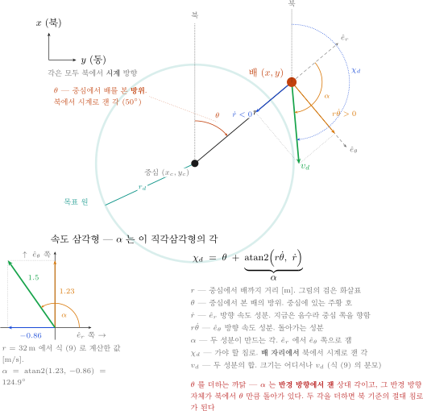

### 글자 ↔ 그림 대응

| 글자 | 그림에서 | 뜻 | 재는 기준 |
|---|---|---|---|
| $r$ | 중심 → 배 검은 화살표 | 중심에서 배까지 거리 [m] | — |
| $\theta$ | **중심**에 있는 주황 호 | 중심에서 본 배의 방위 [rad] | 북에서 시계 |
| $\hat{e}_r$ · $\hat{e}_\theta$ | 배에서 나가는 회색 점선 둘 | 반경 방향 · 접선 방향 단위벡터 | $\hat{e}_r$ 은 중심의 반대쪽, $\hat{e}_\theta$ 는 $\theta$ 가 커지는 쪽 |
| $\dot{r}$ | 파란 화살표 (그림에서는 중심 쪽) | $\hat{e}_r$ 방향 속도 성분 [m/s] | 음수면 중심 쪽 |
| $r\dot{\theta}$ | 앰버 화살표 | $\hat{e}_\theta$ 방향 속도 성분 [m/s] | 양수면 시계방향 |
| $\alpha$ | **배** 자리의 앰버 호 | 두 성분이 만드는 각 | $\hat{e}_r$ 에서 $\hat{e}_\theta$ 쪽으로 |
| $\chi_d$ | **배** 자리의 파란 호 | 가야 할 침로 | 북에서 시계 |
| $v_d$ | 초록 화살표 (평행사변형의 대각선) | 두 성분의 합. 크기는 어디서나 $v_d$ | — |

- 호가 **두 자리**에 있는 것이 요점임 — $\theta$ 는 **중심**에서 재고, $\alpha$ 와 $\chi_d$ 는 **배**에서 잼

### $\dot{r}$ 과 $r\dot{\theta}$ 는 그림의 어느 선인가

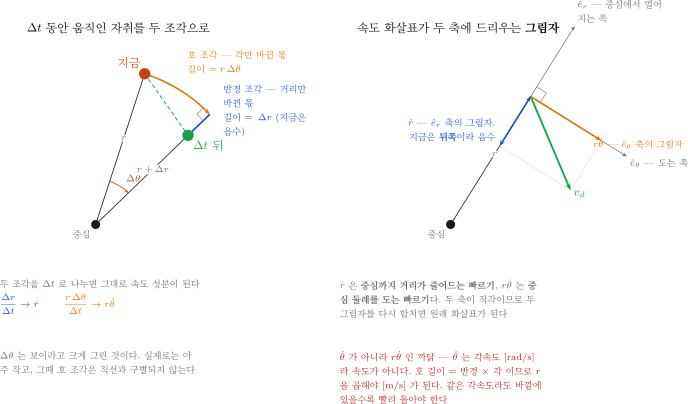

- 왼쪽 — 짧은 시간 $\Delta t$ 동안 배가 간 자취를 **두 조각**으로 쪼갠 것임

| 조각 | 무엇이 바뀌었나 | 길이 | $\Delta t$ 로 나누면 |
|---|---|---|---|
| **호 조각** (앰버) | 각 $\theta$ 만 바뀜. 거리는 그대로 | $r\,\Delta\theta$ | $r\dot{\theta}$ |
| **반경 조각** (파랑) | 거리 $r$ 만 바뀜. 각은 그대로 | $\Delta r$ | $\dot{r}$ |

- 두 조각이 서로 **직각**인 까닭 — 하나는 반경선을 **따라가고**, 다른 하나는 반경선에 **수직**임
- 오른쪽 — 같은 둘을 속도에서 본 것임. 속도 화살표를 두 축에 내린 **그림자**(정사영)임

| 성분 | 어느 축의 그림자인가 | 뜻 | 부호 |
|---|---|---|---|
| $\dot{r}$ | $\hat{e}_r$ — 중심과 배를 잇는 선 | 중심까지 **거리가 줄어드는** 빠르기 | 음수 = 가까워지는 중 |
| $r\dot{\theta}$ | $\hat{e}_\theta$ — 그 선에 수직 | 중심 둘레를 **도는** 빠르기 | 양수 = 시계방향 |

> [!important] $\dot{\theta}$ 가 아니라 $r\dot{\theta}$ 인 까닭
> - $\dot{\theta}$ 는 **각속도** [rad/s] 라 속도가 아님. 단위부터 다름
> - 호 길이 $=$ 반경 $\times$ 각 이므로 $r$ 을 곱해야 [m/s] 가 됨
> - 같은 각속도라도 **바깥에 있을수록 빨리** 돌아야 함 — 육상 트랙의 바깥 레인이 더 긴 것과 같음

- 본 과목 값으로 — $r = 32$ m 지점에서 $\dot{r} = -0.86$ m/s, $r\dot{\theta} = +1.23$ m/s

| 읽는 법 | 값 |
|---|---|
| 1초에 중심 쪽으로 | $0.86$ m 가까워짐 |
| 1초에 원 둘레를 따라 | $1.23$ m 나아감 |
| 각속도 $\dot{\theta} = r\dot{\theta}/r$ | $1.23/32 = 0.038$ rad/s $= 2.2^\circ$/s |
| 그 자리의 빠르기를 유지하면 한 바퀴 | $360/2.2 \approx 163$ s |
| 두 성분의 합 | $\sqrt{0.86^2 + 1.23^2} = 1.50$ m/s — 식 (9) 가 보장한 $v_d$ 와 같음 |

### $\operatorname{atan2}$ 가 왜 $\alpha$ 인가

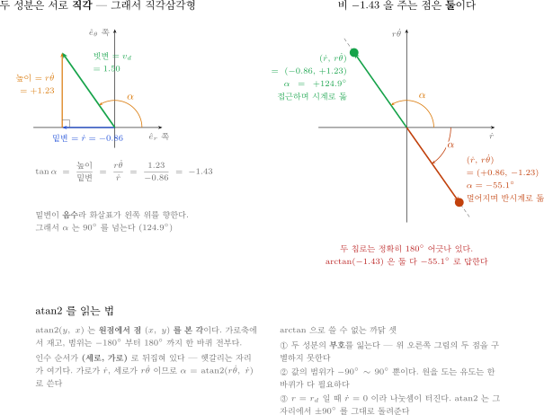

- 두 성분이 **직각**이므로, 둘은 직각삼각형의 **밑변**과 **높이**가 됨
- 그 삼각형에서 밑변부터 빗변까지 벌어진 각이 $\alpha$ 임. 빗변은 속도 $v_d$ 자신임

$$
\tan\alpha \;=\; \frac{\text{높이}}{\text{밑변}} \;=\; \frac{r\dot{\theta}}{\dot{r}}
\qquad\longrightarrow\qquad
\alpha \;=\; \operatorname{atan2}\!\left(r\dot{\theta},\ \dot{r}\right)
$$

- $\operatorname{atan2}(y,\ x)$ 는 **원점에서 점 $(x,\ y)$ 를 본 각**임. 가로축에서 재고, 범위는 $-180^\circ$ 부터 $180^\circ$ 까지 한 바퀴 전부임

| $\operatorname{atan2}$ 의 자리 | 그림에서 | 식 (13) 에서 |
|---|---|---|
| 첫 인수 (세로) | 높이 | $r\dot{\theta}$ |
| 둘째 인수 (가로) | 밑변 | $\dot{r}$ |

> [!warning] 인수 순서가 (세로, 가로) 로 뒤집혀 있다
> 쓰는 순서는 $(y,\ x)$ 인데 뜻하는 점은 $(x,\ y)$ 임. 바꿔 넣으면 각이 $90^\circ - \alpha$ 로 나와 조용히 틀림

#### $\arctan$ 으로 쓰면 안 되는 까닭 셋

| 까닭 | 무슨 일이 생기나 |
|---|---|
| ① 부호를 잃음 | $+1.23/(-0.86)$ 과 $-1.23/(+0.86)$ 은 똑같이 $-1.43$ 임. $\arctan$ 은 둘 다 $-55.1^\circ$ 로 답하지만 실제 두 침로는 $180^\circ$ 어긋나 있음 (위 그림 오른쪽) |
| ② 범위가 반쪽 | $\arctan$ 은 $-90^\circ \sim 90^\circ$ 만 냄. 원을 도는 유도는 한 바퀴가 다 필요함 |
| ③ $0$ 으로 나눔 | $r = r_d$ 이면 $\dot{r} = 0$ 이라 비가 터짐. $\operatorname{atan2}$ 는 그 자리에서 $\pm 90^\circ$ 를 그대로 냄 |

- MATLAB · Python · C 모두 인수 순서가 $(y,\ x)$ 로 같음

```matlab
alpha = atan2(r_thetadot, r_dot);   % (세로, 가로) 순서
chi_d = theta + alpha;
```

#### 부호 조합이 곧 기동이다

- 식 (9) 에서 $\dot{r}$ 의 부호는 $-(r - r_d)$ 가, $r\dot{\theta}$ 의 부호는 $p_c$ 가 정함

| $\dot{r}$ | $r\dot{\theta}$ | $\alpha$ | 배의 상태 |
|---|---|---|---|
| $-$ (바깥, $r>r_d$) | $+$ ($p_c>0$) | $90^\circ \sim 180^\circ$ | 안으로 들어오며 시계로 돎 — **보통의 경우** |
| $+$ (안쪽, $r<r_d$) | $+$ | $0^\circ \sim 90^\circ$ | 밖으로 나가며 시계로 돎 |
| $-$ | $-$ ($p_c<0$) | $-180^\circ \sim -90^\circ$ | 들어오며 반시계로 돎 |
| $+$ | $-$ | $-90^\circ \sim 0^\circ$ | 나가며 반시계로 돎 |
| $0$ ($r=r_d$, 원 위) | $+$ | $+90^\circ$ | 접근 성분이 없음 — 순수 선회 |

- 1-6절의 "부호 한 글자로 방향이 뒤집힌다" 가 이 표의 셋째 줄임

### $\theta$ 가 무엇인가

> [!important] $\theta$ 는 배의 자세가 아니다. **중심에서 배를 본 방위**다
> - 선수각 $\psi$ (뱃머리가 향한 쪽) 도 아니고, 침로 $\chi$ (배가 가는 쪽) 도 아님
> - 배가 제자리에서 뱃머리만 돌려도 $\theta$ 는 **변하지 않음**. 배가 원 둘레를 따라 움직여야 변함
> - 중심에 서서 배를 가리키는 손가락이 향한 방향임

$$
\theta \;=\; \operatorname{atan2}(y - y_c,\ x - x_c)
$$

| $\theta$ | 배가 있는 곳 |
|---|---|
| $0^\circ$ | 중심의 **정북** |
| $+90^\circ$ | 중심의 **정동** |
| $\pm 180^\circ$ | 중심의 **정남** |
| $-90^\circ$ | 중심의 **정서** |

- 배가 원을 한 바퀴 돌면 $\theta$ 가 $2\pi$ 만큼 변함 → 1-9절의 **회전수 세기**가 이 변화를 누적해서 셈
- $p_c > 0$ (시계방향) 이면 $\theta$ 가 계속 **커지고**, $p_c < 0$ 이면 계속 작아짐

### 왜 $\theta$ 를 더하는가

- $\alpha = \operatorname{atan2}(r\dot{\theta},\ \dot{r})$ 는 $\hat{e}_r$ 에서 잰 **상대** 각임 — 기준선이 배의 위치마다 다름
- 그 기준선 $\hat{e}_r$ 자체가 북에서 $\theta$ 만큼 돌아가 있음
- 두 각을 더하면 **북 기준의 절대 침로**가 됨. 헤딩 제어기는 북 기준 각도만 받음

$$
\underbrace{\chi_d}_{\text{북 기준 침로}} \;=\; \underbrace{\theta}_{\text{기준선이 돌아간 양}} \;+\; \underbrace{\alpha}_{\text{기준선에서 잰 각}}
$$

> [!note] 두 성분을 NED 로 돌려도 같은 각이 나온다
> $(\dot{r},\ r\dot{\theta})$ 를 $\theta$ 만큼 **회전**시켜 북·동 성분으로 바꾼 뒤 $\operatorname{atan2}$ 를 걸어도 같은 값임 —
> 극좌표 축에서 읽은 화살표를 NED 축에서 다시 읽는 것임
> 3주차 1-6절 "회전 표현 — 오일러각 · 쿼터니언 · 회전행렬", 5주차 "같은 화살표를 두 축으로 읽기" 그림과 같은 구조임
> 벡터필드를 **그림으로 그릴 때**는 화살표 길이가 필요하므로 이 경로를 씀 (`W07_vectorfield.m`)

### 식 (9) + 식 (13) 은 한 줄로 접힌다 — 식 (30)

> [!important] 유도 블록 코드에 $v_d$ 도 분모도 나오지 않는 까닭
> 각도만 필요하면 **두 성분에 똑같이 곱해진 양수는 아무 일도 하지 않는다.**
> 논문도 이 사실을 써서 식 (30) 으로 다시 적음

- 식 (9) 의 두 성분은 같은 **양수** $k$ 를 공유함

$$
k \;\equiv\; \frac{v_d}{\sqrt{(r-r_d)^{2}+(p_c r)^{2}}} \;>\; 0,
\qquad
\dot{r} \;=\; k\,\bigl[-(r-r_d)\bigr],
\qquad
r\dot{\theta} \;=\; k\,\bigl[\,p_c r\,\bigr]
$$

- $\operatorname{atan2}$ 는 점의 **방향**만 봄. 두 인수를 같은 양수로 늘려도 각은 그대로임

$$
\operatorname{atan2}(k\,a,\ k\,b) \;=\; \operatorname{atan2}(a,\ b) \qquad (k > 0)
$$

- 그래서 상대 각 $\alpha$ 에서 $k$ 가 **통째로 약분됨**

$$
\alpha \;=\; \operatorname{atan2}\bigl(r\dot{\theta},\ \dot{r}\bigr)
\;=\; \operatorname{atan2}\bigl(k\,p_c r,\ -k\,(r-r_d)\bigr)
\;=\; \operatorname{atan2}\bigl(p_c r,\ \ r_d - r\bigr)
$$

- 식 (13) 에 넣으면 유도법칙 전체가 **한 줄**이 됨 — 논문의 식 (30) 임

$$
\boxed{\;\chi_d \;=\; \theta \;+\; \operatorname{atan2}\bigl(p_c\,r,\ \ r_d - r\bigr)\;}
\qquad\text{식 (30)}
$$

| 무엇이 사라졌나 | 왜 사라지나 | 그래도 필요한 곳 |
|---|---|---|
| $v_d$ | 두 성분에 똑같이 곱해져 있어 **각도를 바꾸지 못함** | 속력은 유도가 아니라 **별도 지령** `u_cmd` 로 제어기에 들어감 |
| 분모 $\sqrt{(r-r_d)^2+(p_c r)^2}$ | 역시 두 성분 공통의 양수 배수임 | 속력을 $v_d$ 로 **고정**하는 역할 — 벡터필드를 **그릴 때** 필요함 |

> [!warning] 분모가 쓸모없다는 뜻이 아니다
> 분모는 1-4절 ③ 의 "속력을 $v_d$ 로 고정" 장치임. **없어진 것이 아니라, 각도만 뽑을 때 약분되는 것**임
> | 어디 | 분모를 쓰나 | 왜 |
> |---|---|---|
> | `W07_vectorfield.m` (그림) | **쓴다** (`D`) | 화살표의 **길이**가 $v_d$ 여야 필드 모양이 제대로 보임 |
> | `LoiterVF` (유도 블록) | 쓰지 않는다 | **각도 하나**만 내면 되므로 약분됨 |

- 그래서 `LoiterVF` 블록 안의 코드는 이것이 전부임

```matlab
r     = sqrt(dx*dx + dy*dy);              % 중심까지 거리
theta = atan2(dy, dx);                    % 중심에서 본 배의 방위
if r < 1e-6, r = 1e-6; end                % 중심은 특이점

chi_d   = theta + atan2(pc*r, -(r - rd));       % 식 (30)
psi_ref = atan2(sin(chi_d), cos(chi_d));        % +-pi 로 감싸기
```

### 식 ↔ 코드 한 줄씩

| 논문 | 코드 | 비고 |
|---|---|---|
| $r = \sqrt{\Delta x^{2}+\Delta y^{2}}$ | `r = sqrt(dx*dx + dy*dy)` | 중심에서 배까지 거리 |
| $\theta = \operatorname{atan2}(\Delta y,\ \Delta x)$ | `theta = atan2(dy, dx)` | NED 이므로 (동, 북) 순서 |
| 식 (30) 의 $\operatorname{atan2}(p_c r,\ r_d - r)$ | `atan2(pc*r, -(r - rd))` | $r_d - r$ 과 $-(r-r_d)$ 는 같은 값 |
| 식 (30) 의 $\theta\;+$ | `theta + ...` | 상대 각을 북 기준으로 돌림 |
| 범위 정리 | `atan2(sin(chi_d), cos(chi_d))` | $\theta + \alpha$ 는 $\pm 2\pi$ 까지 나올 수 있음 |

- 블록의 **입력은 $r_d$ 와 $p_c$ 둘뿐**이고 출력은 $\psi_{\text{ref}}$ 임 — 식 (30) 에 나오는 기호가 그대로 입력임
- $v_d$ 를 입력으로 받지 않는 것이 요점임. 받아도 **쓸 데가 없음**

### 숫자로 한 번 — 그림의 그 지점

- 그림의 배는 중심에서 $r = 32$ m, 방위 $\theta = 50^\circ$ 에 있음 (목표 반경 25 m 보다 7 m 바깥)
- 본 과목 값 $v_d = 1.5$ m/s, $r_d = 25$ m, $p_c = 0.313$ (1-7절에서 계산)

| 단계 | 계산 | 값 |
|---|---|---|
| 위치 | $\Delta x = 32\cos 50^\circ$, $\Delta y = 32\sin 50^\circ$ | $20.57$, $24.51$ m |
| 분모 | $\sqrt{7^{2} + (0.313 \times 32)^{2}} = \sqrt{49 + 100.3}$ | $12.22$ |
| 식 (9) ① | $\dot{r} = -1.5 \times 7 / 12.22$ | $-0.859$ m/s (중심 쪽) |
| 식 (9) ② | $r\dot{\theta} = 1.5 \times 10.02 / 12.22$ | $+1.229$ m/s (시계 쪽) |
| 합의 크기 | $\sqrt{0.859^{2} + 1.229^{2}}$ | $1.500$ m/s $= v_d$ |
| 상대 각 | $\alpha = \operatorname{atan2}(1.229,\ -0.859)$ | $124.9^\circ$ |
| 식 (13) | $\chi_d = 50^\circ + 124.9^\circ$ | $174.9^\circ$ (거의 정남) |

- **식 (30) 으로 바로 계산해도 같음** — $\operatorname{atan2}(0.313 \times 32,\ 25 - 32) = \operatorname{atan2}(10.02,\ -7) = 124.9^\circ$
  - 분모 $12.22$ 도 $v_d = 1.5$ 도 **쓰지 않았는데** 상대 각이 같음. 위 "한 줄로 접힌다" 의 실제 확인임
- NED 성분을 거쳐도 같음 — $v_{f,x} = -1.494$, $v_{f,y} = +0.132$ 이고 $\operatorname{atan2}$ 가 $174.9^\circ$ 를 줌
  (벡터필드를 **그림으로** 그릴 때 쓰는 경로임)
- 읽는 법: 이 배는 **거의 정남쪽**으로 가라는 지시를 받음. 남으로 가면 원 둘레를 따라 시계방향으로 돌면서
  동시에 반경이 32 m 에서 25 m 쪽으로 줄어듦 — 접근과 선회가 **한 각도**에 들어 있음

> [!note] 연구실 참조 구현 두 개와 같은 식이다
> | 구현 | 쓰는 형태 | 본 과목 `LoiterVF` 와 |
> |---|---|---|
> | `UGV_Control_StateFlow_260529.slx` 의 `KAIST_CircularVF` (연구실 원본, 배포하지 않음) | 식 (9) → NED 성분 → $\operatorname{atan2}$ | 같은 각도. **긴 쪽 경로**임 |
> | `W07_matlab/Guid_VF_Loiter.m` (배포, 읽기용) | 식 (30) 한 줄 | **같은 형태** |
>
> ```matlab
> psi_ref = theta + atan2(vf_pc*r, -(r - vf_rd));
> ```
>
> - 세 구현의 각도 차이를 격자 전체($r_d$ · $p_c$ · 위치 약 4만 점)에서 재면 최대 $1.1 \times 10^{-15}$ rad — **부동소수점 오차 수준**임
> - 어느 쪽으로 써도 같으므로, 본 과목 블록은 **짧은 쪽**(식 30)을 씀
> - `Guid_VF_Loiter.m` 안의 함수 이름은 `VF_Loiter_guidance` 이고, `wrapToPi` 는 Mapping Toolbox 가 필요함
> - 두 형태가 같음을 손으로 유도해 볼 것 (과제 ①)

> [!important] 식은 $\chi_d$(침로), 코드는 `psi_ref`(선수각) 에 넣는다
> 벡터필드가 주는 것은 **배가 갈 방향**, 즉 침로 $\chi_d$ 임. 그런데 헤딩 제어기가 받는 것은
> **뱃머리가 향할 방향** $\psi$ 임. 그래서 코드는 $\chi_d$ 를 그대로 `psi_ref` 에 넣음 —
> 5주차 1-7절 "조류 속에서는 경로 옆에 붙어 간다" 와 같은 대체임. 크랩각 $\beta$ 가 0 이면 둘이 같고, 0 이 아니면 그만큼 원이 벌어짐
> - 논문도 이 대체를 그대로 씀 — 식 (30) 의 출력은 침로이고, 기체·선체는 그것을 **선수각 지령으로** 받음
> - 1-8절이 그 대가를 **수치로** 재고, 과제 ③ 에서 직접 분해함

---

## 1-6. $p_c$ — 부호와 크기

> [!important] 부호가 **회전 방향**을, 크기가 **원에 끌리는 정도**를 정한다

- 1-5절의 $\alpha$ 하나만 보면 됨. $p_c$ 는 **그 자리의 화살표를 몇 도로 돌릴지** 정하는 손잡이임

$$
\alpha \;=\; \operatorname{atan2}\!\big(r\dot{\theta},\ \dot{r}\big)
\;=\; \operatorname{atan2}\!\big(p_c\,r,\ -(r - r_d)\big)
$$

- 분모·분자의 공통 인자 $v_d/\sqrt{\cdots}$ 는 양수라 각도에 영향을 주지 않아 지워짐
- 그래서 **필드의 방향은 $v_d$ 와 무관함.** 속도를 바꿔도 화살표의 방향은 그대로임

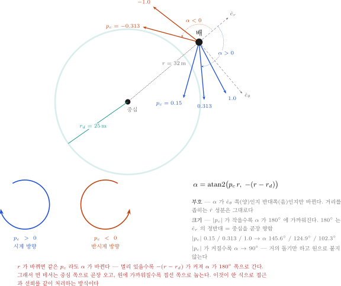

### 부호 = 방향

> 논문 III절 원문
> "Positive and negative parameters generate **clockwise** and **counterclockwise**
>  vectors around the origin, respectively."

| $p_c$ | 회전 방향 |
|---|---|
| `> 0` | **시계방향** |
| `< 0` | **반시계방향** |

- 확인: 원 위 정북 지점($\theta = 0$)에서 $p_c > 0$ 이면 속도가 **동쪽**을 향함
  → 위에서 오른쪽으로 = 시계방향

> [!caution] 참고 코드의 한글 주석이 반대로 적혀 있다
> `W07_matlab/VF_test_code_main.m` 에 "양수: 반시계 방향 회전" 이라고 되어 있으나
> 논문 본문과 수치 확인 결과 **양수가 시계방향**임. 코드 주석보다 원문과 실험을 믿을 것

#### 방향을 뒤집는 법 — 한 글자

```matlab
vf_pc =  0.313;   % 시계방향
vf_pc = -0.313;   % 반시계방향 — 부호만 바꿈
```

- 부호를 바꾸면 $\alpha$ 가 $\hat{e}_r$ 기준으로 **반대쪽**으로 넘어감 ($+124.9^\circ \rightarrow -124.9^\circ$)
- $\dot{r}$ 성분(거리를 좁히는 쪽)은 **그대로**임 → 수렴 성향은 바뀌지 않음
- C-2 실측이 이것을 보여 줌 — 기준 26.25 m, 부호만 뒤집은 경우 26.26 m. 반경은 사실상 같고 도는 쪽만 바뀜

### 크기 = 수렴 성향

> 논문 원문
> "A particle on the field with the **smaller |p_c|** is pulled **more** toward the loitering circle."

| `|p_c|` | 필드 모양 | 결과 |
|---|---|---|
| **작다** | 화살표가 원 쪽으로 강하게 꺾임 | 빨리 붙지만 급함 |
| **크다** | 화살표가 소용돌이처럼 완만 | 천천히 붙음 |

- 1-3절 두 번째 그림(`W07_vectorfield` 출력)의 3번 패널이 $|p_c| = 1.5$ 인 경우임. 원 밖에서도 거의 돌기만 함

#### 숫자로 — 같은 자리($r = 32$ m, $r_d = 25$ m) 에서

- 위 그림의 화살표 다섯 개가 이 표임. $\alpha = \operatorname{atan2}(p_c \times 32,\ -7)$ 로 계산한 값

| $p_c$ | $\alpha$ | 화살표가 하는 일 | 1-7절 식 (28) 의 $\zeta_c$ |
|---|---|---|---|
| 0.15 | $145.6^\circ$ | 중심 쪽으로 많이 꺾임 — 세게 끌림 | 0.47 (진동함) |
| **0.313** | $124.9^\circ$ | 접근과 선회가 섞임 | **0.68** |
| 0.6 | $110.0^\circ$ | 거의 접선 — 느리게 붙음 | 0.95 |
| 1.0 | $102.3^\circ$ | 돌기만 하다시피 함 | 1.22 (느림) |

- $\zeta_c$ 는 $\zeta_c = \frac{1}{2}\sqrt{p_c r_d/(v\tau)}$ 에 $v = 1.5$ m/s, $r_d = 25$ m, **헤딩 루프 몫의 지연
  $\tau = 2.8$ s** (1-8절의 4.63 s 에서 크랩각 몫 1.83 s 를 뺀 값) 를 넣어 **계산한** 값임. 실측 응답이 아님
- 1-7절은 설계 단계의 $\tau_r = 1.31$ s 로 $p_c = 0.313$ 을 뽑았음 (그 값으로는 $\zeta_c \approx 1.0$).
  실제 배의 지연이 설계값보다 커서 $\zeta_c$ 가 0.68 로 내려감 — 설계값과 실제가 어긋나는 지점임
- 양 끝의 극한

| 극한 | $\alpha$ | 기동 |
|---|---|---|
| $\lvert p_c\rvert \rightarrow 0$ | $180^\circ$ | 중심을 **곧장** 향함. 돌지 않고 들이박음 |
| $\lvert p_c\rvert \rightarrow \infty$ | $90^\circ$ | **접선만** 향함. 원으로 붙지 않고 그 반경을 유지하며 돎 |

> [!warning] 작게 둘수록 좋은 것이 아니다 — 상충이 있다
> | $\lvert p_c\rvert$ 를 줄이면 | 효과 |
> |---|---|
> | 시정수 $T_c = p_c r_d/v$ | 짧아짐 → **빨리 붙음** (1-4절) |
> | 정상상태 반경 오차 | 작아짐 → **원에 더 가까이** (1-8절 실측: 0.150 → 26.03 m, 1.000 → 31.81 m) |
> | 감쇠비 $\zeta_c$ | 작아짐 → **오버슈트·진동** (식 (28)) |
>
> 처음 둘만 보면 작을수록 좋지만, 셋째가 발목을 잡음
> 그래서 **$\zeta_c$ 를 먼저 정하고 $p_c$ 를 계산**함 — 1-7절

### 파라미터 네 개를 한 장에

| 바꾸는 것 | 필드 모양 | 배의 기동 | 설계식에 미치는 영향 |
|---|---|---|---|
| $p_c$ 의 **부호** | $\alpha$ 가 $\hat{e}_\theta$ 의 반대쪽으로 넘어감 | 도는 **방향**이 뒤집힘 (시계 ↔ 반시계) | $\lvert p_c\rvert$ 가 같으면 $T_c$ · $\zeta_c$ · 반경 오차 모두 그대로 |
| $\lvert p_c\rvert$ 의 **크기** | 작을수록 $\alpha \rightarrow 180^\circ$ (중심 쪽) | 작으면 빨리 붙되 진동, 크면 느리게 붙되 매끈 | $T_c \propto p_c$, $\zeta_c \propto \sqrt{p_c}$, 반경 오차 $\propto p_c$ |
| $v$ (`u_ref`) | **변화 없음** — $\alpha$ 식에 $v$ 가 없음 | 같은 궤적을 빨리 돎. 1주에 도는 횟수만 늘어남 | $T_c \propto 1/v$, $\zeta_c \propto 1/\sqrt{v}$, 반경 오차 $\propto v$ (C-2 실측: 1.6배 속도 → 28.47 m) |
| $r_d$ | 원이 커지거나 작아짐. 같은 $r$ 에서 $\alpha$ 가 달라짐 | 반경이 바뀜. 작은 원은 더 빨리 돌아야 함 | $T_c \propto r_d$, $\zeta_c \propto \sqrt{r_d}$ — 작은 원은 감쇠가 줄어 진동하기 쉬움 (C-2 실측: 0.6배 반경 → 18.79 m) |
| $\tau$ (지연) | 변화 없음 — 필드가 아니라 **배**의 성질 | 지연이 크면 바깥으로 더 밀림 | $\zeta_c \propto 1/\sqrt{\tau}$, 반경 오차 $\approx p_c v \tau_{\text{eff}}$ (1-8절) |

- 설계할 때 고르는 순서: $v$ · $r_d$ 는 임무가 줌 → $\tau$ 는 배에서 **측정**함 → $\zeta_c$ 를 정함 → $p_c$ 가 **계산**됨
- 부호는 설계와 무관함. 임무가 요구하는 회전 방향으로 마지막에 붙임

---

## 1-7. $p_c$ 를 계산해서 정하기 — 식 (27)·(28)

> [!important] 눈대중으로 고르지 않는다. 논문이 설계식을 준다

- 헤딩 추종에 시간지연 $\tau_r$ 이 있을 때 반경 오차의 특성방정식 — **식 (27)**

$$
s^{2} \;+\; \frac{1}{\tau_r}\,s \;+\; \frac{v}{p_c\,r_d\,\tau_r} \;=\; 0
$$

- 표준형 $s^2 + 2\zeta_c\omega_c s + \omega_c^2$ 과 비교하면 — **식 (28)**

$$
\omega_c \;=\; \sqrt{\frac{v}{p_c\,r_d\,\tau_r}},
\qquad
\zeta_c \;=\; \frac{1}{2}\sqrt{\frac{p_c\,r_d}{v\,\tau_r}}
$$

- 원하는 감쇠비 $\zeta_c$ 로 뒤집으면

$$
p_c \;=\; \frac{4\,\zeta_c^{2}\,v\,\tau_r}{r_d}
$$

### 대상 선박에 적용

| 항목 | 값 | 어디서 |
|---|---|---|
| $v$ ($= v_d$) | 1.5 m/s | 목표 속도 `u_ref` |
| $r_d$ | 25 m | 목표 반경 |
| $\tau_r$ | 1.31 s | 헤딩 루프 $1/(\zeta\omega_n)$, $\omega_n = 0.783$, $\zeta = 0.978$ — 4주차 2-9절의 5주차 게인 값 |
| $\zeta_c$ | 1 | 오버슈트 없이 붙게 |

$$
p_c \;=\; \frac{4 \times 1^{2} \times 1.5 \times 1.31}{25} \;=\; 0.313
$$

> [!note] 논문의 0.33 을 그대로 쓰면 안 된다
> 논문 값은 $v = 25$ m/s, $r_d = 150$ m, $\tau_r = 0.5$ s 인 **무인기** 기준임
> 우연히 숫자가 비슷하지만 근거가 다름. **자기 배의 값으로 다시 계산할 것**

---

## 1-8. 반경 오차는 왜 남는가

> [!important] 원 위에 정확히 올라서지 않는다. 항상 **바깥쪽**으로 조금 밀린다

- 기준 환경 실측값 (`r_d = 25 m`, `v = 1.5 m/s`)

| $p_c$ | 정착 반경 [m] | 오차 [m] |
|---|---|---|
| 0.150 | 26.03 | +1.03 |
| **0.313** | **27.14** | **+2.14** |
| 0.600 | 29.09 | +4.09 |
| 1.000 | 31.81 | +6.81 |

- **오차가 $p_c$ 에 정확히 비례함** (오차 ÷ $p_c$ = 6.82 로 일정)

### 왜 그런가 — 논문 식 (29)\~(31)

- 원을 돌면 지령 각도 $\chi_d$ 가 **계속 회전**함. 회전율은 $v/r_d$
- 헤딩 제어기는 이렇게 계속 움직이는 지령을 **항상 조금 늦게** 따라감
- 늦은 만큼 배가 바깥으로 밀림

#### 네 줄 유도

1. **식 (29)** — 원을 도는 동안 지령과 침로는 원의 회전율로 함께 돎

$$
\dot{\chi}_d \;\approx\; \dot{\chi} \;\approx\; \frac{v}{r_d}
$$

2. **식 (30)** — 정착 반경 $r_{ss}$ 의 원 위, 방위 $\theta = 0$ (정북) 지점을 봄. 시계방향 선회이므로 침로는 정동 $\pi/2$, 지령은 식 (13) 에 식 (9) 를 넣은 값

$$
\chi = \frac{\pi}{2}, \qquad
\chi_d = \operatorname{atan2}(r\dot{\theta},\ \dot{r}) = \operatorname{atan2}\!\big(p_c\,r_{ss},\ -(r_{ss}-r_d)\big)
$$

3. **식 (31)** — 1차 지연 $\dot{\chi} = (\chi_d - \chi)/\tau_r$ (식 (25)) 에 식 (29) 를 넣으면 정상상태에서 $\chi_d - \chi = v\tau_r/r_d$. 즉 $\chi_d = \pi/2 + v\tau_r/r_d$. 이것을 식 (30) 과 같게 놓고 $r_{ss}$ 로 풀면

$$
\tan\!\Big(\frac{\pi}{2} + \frac{v\tau_r}{r_d}\Big) = \frac{p_c\,r_{ss}}{-(r_{ss}-r_d)}
\;\;\Rightarrow\;\;
r_{ss} = \frac{\tan\!\big(\frac{v\tau_r}{r_d} + \frac{\pi}{2}\big)\, r_d}{p_c + \tan\!\big(\frac{v\tau_r}{r_d} + \frac{\pi}{2}\big)}
$$

4. **근사** — 지연각 $\delta_{\text{lag}} = v\tau_r/r_d$ 가 작으면 $\tan(\pi/2 + \delta_{\text{lag}}) \approx -1/\delta_{\text{lag}}$

$$
r_{ss} \approx \frac{r_d}{1 - p_c v\tau_r / r_d}
\;\;\Rightarrow\;\;
r_{ss} - r_d = \frac{p_c\,v\,\tau_r}{1 - p_c v\tau_r / r_d} \;\approx\; p_c\,v\,\tau_r
$$

- 논문의 $\tau_r$ 자리에 실제 배의 **등가 지연** $\tau_{\text{eff}}$ 를 넣어 씀

$$
r_{ss} - r_d \;\approx\; p_c\,v\,\tau_{\text{eff}}
$$

| 항 | 뜻 |
|---|---|
| 분자 $p_c v \tau_{\text{eff}}$ | 오차의 주성분. $p_c$·속도·지연에 비례 |
| 분모 $1 - p_c v\tau_{\text{eff}}/r_d$ | $r_d$ 가 작을수록 1 보다 작아져 오차를 키움. $r_d$ 가 크면 1 에 가까워져 선형 근사와 같아짐 |

- 실측에서 (선형 근사 기준) $\tau_{\text{eff}} = 6.82 / 1.5 = 4.55$ s
  - 분모까지 넣은 정확한 식으로 역산하면 $p_c = 0.313$ 의 2.138 m 에서 약 4.2 s
  - 실측 오차는 $p_c$ 에 거의 정확히 비례함 (오차 ÷ $p_c$ = 6.81 \~ 6.87). 이 범위에서는 정확한 식보다 **선형 근사가 더 잘 맞는다**는 관찰

### 지연의 정체 세 가지

| 기여 | 등가 지연 | 근거 |
|---|---|---|
| 헤딩 루프의 **램프 추종 오차** | 2.50 s | $(K_{d,\psi} + N_r)/K_{p,\psi} = 1000/400$. 적분기가 없어 생기는 오차 — 4주차 2-9절 닫힌 루프 식에 경사 입력을 넣은 결과 |
| **모터 지연** | 0.30 s | `tau_n` |
| **크랩각** | 1.83 s | 정상선회에서 $\beta = -5.81^\circ$, 선회율 $U/r_{ss} = 3.17^\circ$/s $\rightarrow 5.81/3.17$ |
| 합 | **4.63 s** | 오차에서 역산한 **4.55 s** 와 1.8 % 차이 — 과제 ③ 에서 직접 확인 |

> [!important] 크랩각이 또 나온다
> 벡터필드가 주는 것은 **속도가 향할 방향(침로 $\chi$)** 임
> 그런데 배에는 **뱃머리 방향(선수각 $\psi$)** 밖에 지시할 수 없음
> 선회 중에는 둘이 $\beta$ 만큼 어긋나고, 그것이 그대로 반경 오차가 됨
> → 5주차 [[조류가-있으면-뱃머리와-진행방향이-다르다]] 와 같은 문제

### 줄이는 법

| 방법 | 효과 (실측) |
|---|---|
| $p_c$ 를 줄임 | 오차가 비례해서 줄지만 수렴이 느려짐 |
| 크랩각 보상 $\psi_{\text{ref}} = \chi_d - \beta$ | 기준 환경에서 **2.14 → 1.24 m** (42 % 감소). 단 **논문에 없는 항**이라 본 과목 모델에는 넣지 않음 — 아래 참고 |
| 헤딩 루프를 빠르게 | $K_{p,\psi}$ 를 올리면 $(K_{d,\psi}+N_r)/K_{p,\psi}$ 가 줄어듦 |
| 반경을 키움 | 위 식의 분모 $1 - p_c v\tau_{\text{eff}}/r_d$ 가 1 에 가까워지고, 선회율 $v/r_d$ 가 줄어 크랩각도 작아짐. 식 (28) 로 $p_c$ 를 다시 잡으면 $p_c \propto 1/r_d$ 라서 오차 $p_c v\tau_{\text{eff}}$ 도 $r_d$ 에 반비례해 줄어듦 |

- 크랩각 몫만 떼어 보면 $p_c v \tau_{\text{crab}} = 0.313 \times 1.5 \times 1.83 = 0.86$ m — 전체 오차 2.14 m 의 **40 %** 임
- 나머지(램프 추종 + 모터) 몫은 $0.313 \times 1.5 \times 2.8 = 1.31$ m 이고, 크랩 보상을 넣고 실측한 1.24 m 와 거의 같음

> [!important] 크랩각 보상은 모델에 넣지 않는다
> | 까닭 | 내용 |
> |---|---|
> | 논문에 없음 | 식 (9)·(13)·(30) 어디에도 $\beta$ 항이 없음. 연구실 참조 구현 둘(`KAIST_CircularVF`, `Guid_VF_Loiter.m`) 에도 없음 |
> | 유도와 제어가 섞임 | $\beta$ 는 **운동모델이 내는 상태**임. 유도법칙이 그것을 되먹임하면 "경로를 주는 블록" 과 "배를 맞추는 블록" 의 경계가 흐려짐 |
> | 가리는 것보다 설명하는 것이 나음 | 남는 2.14 m 를 보상으로 덮지 않고, 위 표처럼 **지연 셋으로 분해해 설명**함 |
>
> - 그래서 `LoiterVF` 의 입력은 $r_d$ 와 $p_c$ **둘뿐**임 (속력은 별도 경로, 1-5절)
> - 보상 효과를 보고 싶으면 모델을 고치지 않고도 됨 — 과제 ③ 처럼 $\beta$ 를 **재서 손으로** 계산하면 수치가 나옴

> [!warning] 1-7 절 설계에 넣은 $\tau_r = 1.31$ s 와 이 절의 2.8 s 는 다른 값이다
> | 값 | 무엇 | 어디서 |
> |---|---|---|
> | 1.31 s | 헤딩 루프의 **시상수** $1/(\zeta\omega_n)$ — 계단 지령에 얼마나 빨리 붙는가 | 1-7 절 표 (설계 가정) |
> | 2.8 s | 원을 돌 때 지령이 **경사(램프)로 계속 바뀌는** 동안 뒤처지는 시간 $(K_{d,\psi} + N_r)/K_{p,\psi} + T_n = 2.5 + 0.3$ | 이 절 "지연의 정체" |
> - 로이터링에서는 선수각 지령이 쉬지 않고 돌므로 실제로 작동하는 것은 **2.8 s 쪽**임
> - 2.8 s 로 식 (28) 을 다시 풀면 $\zeta_c = \frac{1}{2}\sqrt{\frac{0.313 \times 25}{1.5 \times 2.8}} = 0.68$ — 설계값 1 보다 덜 감쇠됨
> - 그래도 본 과목은 $p_c = 0.313$ 을 기본값으로 둠. 이 절 첫 표처럼 $p_c$ 를 키우면 반경 오차가 비례해 커지기 때문 — **감쇠와 정상상태 오차 사이의 절충**

### 다른 운동모델에서도 같은 분해가 성립한다 (2026-10-28 실측)

- 같은 유도법칙을 **운동모델만 바꿔** 돌려 대조함 — 연구실 참조 구현(`UGV_Control_StateFlow_260529.slx`, Ackermann 차량)과 본 과목 WAM-V
- 네 번 실행 = 두 모델 × 두 조건
  - 참조 조건 — $r_d = 5$ m, $p_c = -0.5$, $v = 0.5$ m/s
  - 본 과목 조건 — $r_d = 25$ m, $p_c = 0.313$, $v = 1.5$ m/s
- 구간 — 참조 모델은 로이터 모드(`op_mode = 21`)가 **이어지는** 구간, 본 과목 모델은 원 도달 30 s 뒤부터 끝까지

#### 같은 조건($r_d = 25$ m, $p_c = 0.313$, $v = 1.5$ m/s)에서 나란히

| 지표 | 참조 모델 | 본 과목 모델 | 차이의 원인 |
|---|---|---|---|
| 선회방향 | 시계방향 | 시계방향 | 차이 없음 — $p_c$ 부호 규약이 두 구현에서 같음 |
| 정착 평균 $\lvert r - r_d \rvert$ | 1.261 m | 2.138 m | **운동모델** — 아래 분해표가 전부 설명함 |
| 같은 값을 $r_d$ 의 % 로 | 5.05 % | 8.55 % | 위와 같음 |
| $1.2\,r_d \rightarrow 1.1\,r_d$ 통과 | 5.36 s | 4.25 s | **운동모델** — 본 과목 모델이 원에 더 빨리 붙음 |
| 원 도달($0.3\,r_d$) | 0.00 s | 12.55 s | **비교 불가** — 로이터 진입 반경이 다름(31.21 m / 44.72 m). 참조는 진입 시점을 Stateflow 미션 논리가 정하고, 31.21 m 는 이미 허용범위 안이라 0 이 됨 |

#### 반경 오차의 분해 — 네 실행 모두

| 실행 | 선수각 뒤짐 | 크랩각 $\beta$ | 합 | 반경오차가 요구하는 기울기 | 남는 차이 |
|---|---|---|---|---|---|
| 참조 모델 · 참조 조건 | $13.875^\circ$ | $0.952^\circ$ | $14.827^\circ$ | $14.829^\circ$ | $+0.002^\circ$ |
| 참조 모델 · 본 과목 조건 | $7.499^\circ$ | $1.228^\circ$ | $8.728^\circ$ | $8.725^\circ$ | $-0.003^\circ$ |
| 본 과목 모델 · 본 과목 조건 | $8.304^\circ$ | $5.804^\circ$ | $14.109^\circ$ | $14.125^\circ$ | $+0.017^\circ$ |
| 본 과목 모델 · 참조 조건 | $12.412^\circ$ | $9.035^\circ$ | $21.447^\circ$ | $21.450^\circ$ | $+0.003^\circ$ |

- **반경오차가 요구하는 기울기** — 정상선회에서 반경오차 $e$ 를 유지하려면 속도가 원의 접선에서 안쪽으로 얼마나 기울어야 하는가, 즉 $\arctan\dfrac{e}{\lvert p_c \rvert\, r}$
- 네 실행 모두 남는 차이가 $0.02^\circ$ 미만 → 정착 반경오차는 **선수각 뒤짐과 크랩각으로 전부 설명됨**. 유도법칙이 보태는 몫은 없음
- 참조 모델(Ackermann 차량)은 $\beta \approx 1^\circ$ 로 거의 미끄러지지 않음 → 오차가 사실상 뒤짐 하나
- 본 과목 WAM-V 는 $\beta$ 가 기울기의 **41 %** 를 차지함 → 같은 유도법칙에서 오차가 1.261 m 에서 2.138 m 로 커지는 이유가 이것
- 네 실행 모두 오차 부호가 **+** → 항상 원 바깥쪽. 이 절 첫 표와 같은 결론
- $r_d$ 를 줄이면 상대 오차가 커지는 경향이 **두 운동모델에서 같게** 나옴 (참조 5.05 → 15.26 %, 본 과목 8.55 → 24.45 %) → 운동모델 특성이 아니라 유도·기하의 성질

> [!note] 운동모델이 없는 참조 스크립트는 궤적 대조에 쓸 수 없다
> `W07_matlab/VF_test_code_main.m` 과 `Guid_VF_Loiter.m` 은 **벡터필드와 각도만** 계산함
> 시간 적분이 없으므로 궤적·반경오차·선회방향이 나오지 않음
> 식이 같은지는 1-5 절의 격자 대조(약 4만 점, 최대 차이 $1.1 \times 10^{-15}$ rad)로 확인함

---

## 1-9. 회전수 세기와 임무 종료 — `TurnCount` 블록

- 로이터링은 조치하지 않으면 **영원히 돎**. 끝내는 조건이 필요함
- 그 조건을 맡는 것은 유도부 안의 `TurnCount` 블록 하나임
- 하는 일은 두 가지뿐임
  1. 몇 바퀴 돌았는지 센다 → `turns`
  2. 요구한 바퀴 수를 채우면 배를 세운다 → `gate`

### 블록 전체

```matlab
function [turns, gate, th_out, acc_out, armed] = TurnCount( ...
         theta, r, rd, req, th_prev, acc_prev, armed_prev)
%#codegen
tol = 0.3*rd;
th_out = theta;

if armed_prev < 0.5
    acc_out = 0;
    if abs(r - rd) <= tol
        armed = 1;                % 원에 닿았음 — 이제부터 센다
    else
        armed = 0;
    end
else
    armed = 1;
    d = theta - th_prev;
    d = atan2(sin(d), cos(d));    % +pi 에서 -pi 로 감기는 점프를 지운다
    acc_out = acc_prev + d;
end

turns = abs(acc_out) / (2*pi);

if (req > 0) && (turns >= req)
    gate = 0;                     % 임무 완료 — 배를 세운다
else
    gate = 1;
end
```

- 원본은 `W07_simulink/build_w07_models.m` 의 `setFcn(ss,'TurnCount', …)` 부분임
- 모델을 손으로 고치지 않음. 생성 스크립트가 이 코드를 블록 안에 심음

### 입력 7 개 · 출력 5 개

- 입력

| 이름 | 뜻 | 어디서 오는가 |
|---|---|---|
| `theta` | 로이터 중심에서 본 선박의 방위각 [rad] | `LoiterVF` 3번 출력 |
| `r` | 로이터 중심까지의 거리 [m] | `LoiterVF` 2번 출력 |
| `rd` | 목표 반경 [m] | `Schedule` 3번 출력 |
| `req` | 요구 바퀴 수 | Constant `Req` — base 의 `required_turns` |
| `th_prev` | **직전 표본**의 `theta` | 자기 출력 3번이 한 칸 지연을 지나 되돌아옴 |
| `acc_prev` | 직전 표본의 누적 각 | 자기 출력 4번이 되돌아옴 |
| `armed_prev` | 직전 표본의 무장 상태 | 자기 출력 5번이 되돌아옴 |

- 출력

| 이름 | 뜻 | 어디로 가는가 |
|---|---|---|
| `turns` | 센 바퀴 수 (소수점까지) | 로깅 · 실시간 화면 |
| `gate` | 주행 허가 0 또는 1 | 유도부 출력 포트 → 내부루프의 Gate 블록 |
| `th_out` | 지금의 `theta` | 되먹임 — 다음 표본의 `th_prev` |
| `acc_out` | 누적 각 [rad] | 되먹임 — 다음 표본의 `acc_prev` |
| `armed` | 무장 상태 0 또는 1 | 되먹임 — 다음 표본의 `armed_prev` |

- `theta` 와 `r` 은 **새로 계산한 값이 아님**. `LoiterVF` 가 이미 낸 것을 그대로 받음 (1-5 절)

### 기억을 어떻게 갖는가 — Unit Delay 세 개

> [!important] MATLAB Function 블록은 매 표본마다 백지에서 다시 실행된다
> 함수 안에서 만든 변수는 그 표본이 끝나면 사라짐
> 그래서 기억해야 하는 값은 **출력으로 내보냈다가 다음 표본에 입력으로 받는다**

- 기억이 필요한 값 세 개 — `theta`, 누적 각, 무장 상태
- 셋 다 출력으로 나가서 **Unit Delay** 를 한 칸 지나 입력으로 되돌아옴
- 블록 이름은 `ThDly` · `AccDly` · `ArmDly`, 초기값은 모두 0
- 비유: 공책에 적어 두고 다음 시간에 다시 펴 보는 것. 머리로 외우지 않음

| 지연을 끼우는 이유 | 설명 |
|---|---|
| 각 변화를 모으려면 | `theta - th_prev` 는 **바로 앞 표본**과의 차이임. 지금 값에서 지금 값을 빼면 늘 0 |
| 대수 루프를 피하려면 | 지연이 없으면 출력이 곧 자기 입력이 되어, 한 표본 안에서 답이 정해지지 않음 |

- 되먹임 선은 화면을 가로지르지 않음. **Goto/From 태그**로 건넴 (볼트 규약)
- 초기값 0 이 안전한 이유: 첫 표본은 `armed_prev = 0` 이라 `acc_out` 이 0 으로 눌리므로, `th_prev = 0` 이 틀린 값이어도 누적에 섞이지 않음

### 한 바퀴를 어떻게 세는가

- 한 바퀴 = `theta` 가 $2\pi$ 만큼 변한 것
- 매 표본의 변화량 `d` 를 전부 더해 $2\pi$ 로 나눔

- `atan2(sin(d), cos(d))` 가 필요한 이유 — 각도는 감긴다

| 표본 | 생짜 `theta` | 생짜 차이 `d` | 감기 처리 뒤 |
|---|---|---|---|
| $k$ | $+179^\circ$ | — | — |
| $k+1$ | $-179^\circ$ | $-358^\circ$ | $+2^\circ$ |

- `theta` 는 `atan2` 가 낸 값이므로 $-180^\circ$ 와 $+180^\circ$ 사이를 돌며 감김
- 감기는 순간의 생짜 차이는 실제 움직임과 **$360^\circ$ 만큼 다름**
- `atan2(sin(d), cos(d))` 는 그 점프를 지워 실제 움직인 각으로 되돌림
- 이 한 줄이 없으면 한 바퀴마다 한 바퀴를 잃어 `turns` 가 0 근처에 머묾

- `abs(acc_out)` 이 필요한 이유 — 방향에 따라 부호가 바뀐다
  - $p_c < 0$ (반시계방향) 이면 `theta` 가 줄어들어 누적이 **음수**로 쌓임
  - 절댓값을 취하면 시계·반시계 두 방향을 같은 식으로 셈

### `armed` — 접근 구간을 한 바퀴로 세지 않기 위한 장치

| 상태 | 언제 | 하는 일 |
|---|---|---|
| `armed = 0` (무장 전) | 원에 한 번도 닿지 않음 | `acc_out` 을 **0 으로 눌러 둠**. 아무리 돌아도 세지 않음 |
| `armed = 1` (무장) | $\lvert r - r_d \rvert \le 0.3\,r_d$ 를 **한 번** 만족한 뒤 | 매 표본의 각 변화를 누적. 다시 0 으로 돌아가지 않음 |

- 필요한 이유: 멀리서 접근하는 동안에도 중심에서 본 방위각 `theta` 는 계속 변함
- 그것까지 세면 원을 한 바퀴 돌기도 전에 카운트가 올라감
- 연구실 UGV 예제 `calculate_turns` 도 같은 방식임

### `gate` — 어떻게 배를 세우는가

- `turns` 가 `req` 에 닿으면 `gate = 0`
- 내부루프의 Gate 블록이 `u_cmd` $\times$ `gate` 를 계산함 → 속도 지령 0 → 배가 섬
- `req = 0` 은 "세지 말고 계속 돌아라" 의 뜻임. 파라미터 실험에서 씀 (C-1 절)
- `gate` 는 래치(한 번 닫히면 잠그는 장치)가 아님에도 다시 열리지 않음
  - 배가 서면 `theta` 가 더 변하지 않아 `turns` 가 그 값에 머묾
  - 조건이 계속 참이므로 `gate` 도 0 에 머묾

### 허용대 `tol = 0.3·r_d` 의 한계 (기준 환경 실측, 2026-10-28)

> [!warning] 무장 조건은 "정착 오차가 허용대보다 작은가" 가 아니다
> **주행 중 한 번이라도** $\lvert r - r_d \rvert$ 가 `tol` 밑으로 내려가는가임
> 단조롭게 접근하면 정착 오차가 곧 최소 오차가 되지만, 안쪽으로 과도응답하면 지나가며 한 번 들어옴

- `W07_0_offline`, $u_{ref} = 1.5$ m/s, 400 s, `required_turns = 2`

| $r_d$ [m] | $p_c$ | `tol` [m] | $\min \lvert r - r_d \rvert$ [m] | 정착 오차 [m] | 끝 `turns` | 판정 |
|---|---|---|---|---|---|---|
| 25 | 1.000 | 7.50 | 6.666 | +6.74 | 2.025 | 여유 11 % 로 겨우 무장 |
| 20 | 1.000 | 6.00 | 6.828 | +6.83 | **0.000** | **영영 무장 안 됨** |
| 16 | 1.000 | 4.80 | 6.866 | +6.87 | **0.000** | **영영 무장 안 됨** |
| 6 | 0.313 | 1.80 | 0.704 | +1.95 | 2.096 | 과도응답이 원을 가로질러 무장 |

- 1 행 — C-1 절에서 $\lvert p_c \rvert = 1.00$ 의 원 도달이 62.2 s 로 유독 느렸던 것이 이 때문임
- 2·3 행 — 바깥에서 단조롭게 접근해 허용대 안으로 한 번도 들어오지 못함
- 4 행 — 정착 오차 1.95 m 가 `tol` 1.80 m 보다 큰데도 세어짐. 접근 중 안쪽으로 과도응답하며 $r = r_d$ 를 가로지르기 때문

> [!warning] 작은 원 또는 큰 $\lvert p_c \rvert$ 에서 배가 영영 서지 않는다
> 오류 메시지가 없음. `turns` 가 0 에 머물고 `gate` 가 닫히지 않아 요구 바퀴 수를 채우지 못함
>
> - 원인: 정착 오차는 $e \simeq T_{\text{eff}} \lvert p_c \rvert u$ 로 **$r_d$ 와 무관함** (C-1 절). 그런데 `tol` 은 $r_d$ 에 **비례함**
> - 즉 원을 작게 잡을수록 허용대만 좁아지고 오차는 그대로 남음
> - 본 과목 기본값은 안전함 — 오차 2.1 m 대 허용대 7.5 m 로 여유가 3.5 배
> - 고치는 방향: 허용대에 절대 하한을 두거나, $\lvert p_c \rvert\, u$ 에 비례한 항을 더함

> [!note] 허용대를 넓게 잡은 것은 이 경험 때문이다
> 예전 값 $0.05\,r_d + 1$ (2.25 m) 로는 $p_c = 0.6$ · $1.0$ 에서 배가 원 위를 돌면서도 **회전수가 영영 0** 이었음
> 2026-09-18 확인. 과제 ② 가 재현되지 않던 원인이 이것임
> 지금의 $0.3\,r_d$ 는 그 사건의 처방이며, 위 표가 그 처방에도 남아 있는 한계를 보인 것임

### 상태기계와의 관계

- 이것이 MILS 예제의 `StartMission2 → StopMission2` 전이 조건과 같음

```
PrepareFirst1 → StartMission1 → StartMission2 → StopMission2
  (준비)        (웨이포인트)     (로이터링)      (정지)
                                    ↑
                        number_of_turn >= required_number_of_turn
```

> [!note] Stateflow 로 묶는 것은 나중에 한다
> 이번 주차에는 **로이터링 한 동작만** 만듦
> 웨이포인트 항주와 로이터링을 상태기계로 잇는 것은 8주차 Stateflow 미션에서 다룸

---

# 2부 · 실습

## 실행하면 이런 결과가 나온다

> [!important] 아래는 기준 환경에서 실제로 받은 출력이다
> 값이 크게 다르면 설정 파일을 먼저 확인함. 소수점 마지막 자리는 달라질 수 있음

```matlab
cd('<배포 폴더>/W07_simulink')
W07_setup
```

- `W07_setup` 이 설정 → 오프라인 모델 실행(`sim`) → `W07_plot` 까지 **한 번에** 함 (맨 끝 `auto_run = 1`)
- `sim` 과 `W07_plot` 을 따로 다시 부를 필요 없음. 설정만 하려면 `auto_run = 0`

- 정상 출력

```
W07 설정 완료
  로이터 중심 (x,y) = (20, 40),  반경 25 m
  p_c = +0.313  ->  시계방향,  목표 속도 1.5 m/s
  2 바퀴 돌면 정지

오프라인 모델 실행 중  (auto_run = 0 으로 두면 실행하지 않는다)

===== 시계방향 / r_d = 25 m / u = 1.5 m/s =====
  원 도달 시각              12.6 s
  정착 후 평균 반경오차     2.138 m   <- 과제에 쓸 값
  정착 후 최대 반경오차     2.248 m
  반경오차 표준편차         0.013 m
  총 회전수                  2.00 바퀴
  정지 시각                240.6 s
  정상상태 속도             1.500 m/s
```

| 읽는 법 | 뜻 |
|---|---|
| 평균 반경오차 2.138 m | **0 이 되지 않음.** 이유는 §1-8 — $p_c$ 에 비례하는 정상상태 오차 |
| 표준편차 0.013 m | 오차가 흔들리지 않고 일정하게 남음. 잡음이 아니라 **편향**이라는 뜻 |
| 총 회전수 2.00 바퀴 | 회전수 세기가 정확함. 1.9 나 2.1 이 나오면 §1-9 를 다시 볼 것 |
| 정상상태 속도 1.500 | 목표와 일치 |

> [!note] 반경오차가 남는 것이 정상이다
> 오차는 헤딩 루프가 **계속 도는 지령을 늦게 따라가기** 때문에 생김 (§1-8)
> 지연이 0 이면 논문 식 (24) 에 따라 반경오차는 0 으로 수렴함
> 크랩각 보상이나 더 빠른 헤딩 루프로 줄임. §C 에서 $p_c$ 를 바꿔 오차가 $p_c$ 에 비례함을 직접 확인함

---

## A. 벡터필드 그려 보기 (15분)

- 배를 돌리기 전에 필드부터 눈으로 봄

```matlab
cd('<배포 폴더>/W07_simulink')
W07_vectorfield
```

- 네 조건이 한 번에 나옴

| 패널 | 조건 | 확인할 것 |
|---|---|---|
| 1 | `r_d=25, p_c=+0.313` | 기본. 원 밖은 안쪽으로, 원 안은 바깥으로 |
| 2 | `r_d=12` | 원이 작아지고 필드가 따라 바뀜 |
| 3 | `p_c=1.5` | 소용돌이가 커짐 — 원에 덜 끌림 |
| 4 | `p_c=-0.313` | **화살표가 반대로 돎** |

### 해 볼 것

- `CASES` 배열의 $p_c$ 를 0.05 로 바꿔 볼 것. 원 밖에서 거의 직선으로 중심을 향함
- 원 위 정북 지점($\Delta x = r_d,\ \Delta y = 0$)의 화살표가 **동쪽**을 향하는지 확인 → 시계방향

---

## B. 오프라인 로이터링 (30분)

```matlab
W07_setup
```

> [!important] 5주차와 마찬가지로 **설정 파일을 실행하면 곧바로 돈다**

- 정상 출력

```
W07 설정 완료
  로이터 중심 (x,y) = (20, 40),  반경 25 m
  p_c = +0.313  ->  시계방향,  목표 속도 1.5 m/s
  2 바퀴 돌면 정지

오프라인 모델 실행 중  (auto_run = 0 으로 두면 실행하지 않는다)

===== 시계방향 / r_d = 25 m / u = 1.5 m/s =====
  원 도달 시각              12.6 s
  정착 후 평균 반경오차     2.138 m   <- 과제에 쓸 값
  정착 후 최대 반경오차     2.248 m
  반경오차 표준편차         0.013 m
  총 회전수                  2.00 바퀴
  정지 시각                240.6 s
  정상상태 속도             1.500 m/s
```

### 실시간 화면 — 네 칸의 뜻

- 4주차 화면이 답한 질문은 "시킨 대로 따라갔는가" 였음 (4주차 2-0-1)
- 5주차가 답한 질문은 "경로를 따라가고 있는가" 였음 (5주차 A절)
- 7주차가 답해야 하는 질문은 **"한 점을 중심으로 돌고 있는가"** 하나임
- 그래서 4·5주차와 같은 네 칸 배치를 쓰되 오른쪽 칸의 내용이 7주차 것으로 바뀜

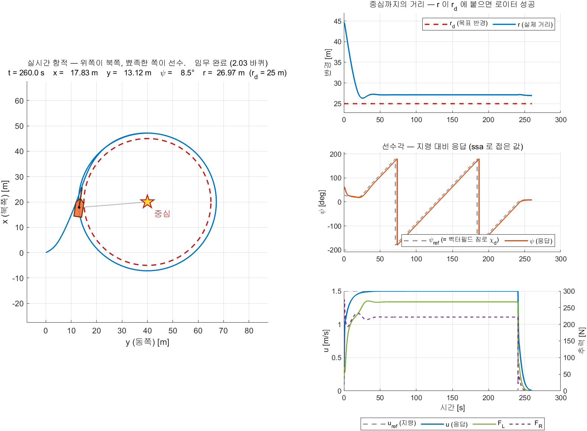

- 조건 — `W07_0_offline`, 중심 $(20,\ 40)$, $r_d = 25$ m, $p_c = +0.313$ (시계방향),
  $u_{\text{ref}} = 1.5$ m/s, `required_turns = 2`,
  $K_{p,\psi} = 400$ · $K_{d,\psi} = 200$, $K_{p,u} = 300$ · $K_{i,u} = 100$, 260 s 주행 (2026-09-25 실측)

| 자리 | 그리는 것 | 왜 그 자리에 있는가 |
|---|---|---|
| 왼쪽 큰 칸 | 항적 + **로이터 중심(별표)과 목표 반경 원(빨간 점선)** + 선체 모양과 선수 방향 | 궤적선만으로는 뱃머리가 어디를 보는지 안 보임. 중심에서 배까지 이은 회색 선의 길이가 곧 오른쪽 ① 의 $r$ 임 |
| 오른쪽 ① | $r_d$ (빨간 점선) 와 $r$ (파랑) 을 **겹쳐서** [m] | **7주차의 핵심 지표.** 항적만 보면 "대충 원 같다" 에서 멈추고 몇 미터 어긋났는지 읽히지 않음 |
| 오른쪽 ② | $\psi_{\text{ref}}$ (회색 점선) 와 $\psi$ (주황) 를 **겹쳐서** (deg, `ssa`) | 벡터필드가 낸 침로를 헤딩 루프가 따라가는지 한 칸에서 읽힘. $\psi_{\text{ref}}$ 가 곧 목표 침로 $\chi_d$ 임 |
| 오른쪽 ③ | 왼쪽 축에 $u_{\text{ref}}$ · $u$, 오른쪽 축에 $F_L$ · $F_R$ | 그 응답을 무엇이 만들었는지 |

- 가로축은 `y (동쪽)`, 세로축은 `x (북쪽)` — **위쪽이 북쪽**이며 해도와 같은 방향임 (3주차 1-5)
- 제목 줄에 현재 시각 · 위치 · $\psi$ · $r$ · **누적 회전수**와 반경오차가 찍힘
- ③ 이 `yyaxis` 로 축을 둘로 나눈 이유는 자릿수임. $u$ 는 1.5 m/s, $F$ 는 수백 N 이라 한 축에 겹치면 $u$ 가 직선으로 보임
- ③ 의 지령선은 설정값이 아니라 **$u_{\text{cmd}} \times \text{gate}$** 임. 두 바퀴를 다 돌면 `gate` 가 0 이 되어 지령이 0 으로 떨어짐 (그림에서 240.6 s)
- ① 의 $r_d$ 선은 `use_schedule = 1` 이면 450 s 에 $0.6\,r_d$ 로 내려감 (C-2 절)

**어디를 보면 로이터링이 되고 있는가**

| 볼 곳 | 정상이면 | 아니면 |
|---|---|---|
| ① 의 $r$ | 44.7 m 에서 내려와 $r_d$ 선 **바로 위에 나란히 누움.** 붙되 딱 겹치지는 않음 | $r_d$ 를 향해 내려오지 않으면 유도가 아니라 헤딩 루프를 의심 (② 를 볼 것) |
| ① 의 두 선 간격 | **일정하게 남음** — 이 실측에서 $+2.138$ m. 0 이 되지 않는 것이 정상이며 이유는 1-8 절 ($p_c$ 에 비례하는 정상상태 오차) | 간격이 커졌다 작아졌다 하면 $p_c$ 가 너무 커 원에 덜 끌리는 것 |
| ① 의 부호 | 오차가 **양수** — 항상 원 바깥임. 이 실측에서 전 구간 최솟값 $r$ = 26.32 m 로 목표 25 m 보다 늘 큼 | 원 안으로 들어가면 오버슈트임 |
| ② 의 두 선 | 응답선이 지령선에 **붙어서 같이 감.** 두 선이 톱니처럼 계속 오르내림 = 계속 도는 중 | 붙지 않으면 $K_{p,\psi}$ 가 작거나 추력이 포화임 |
| ② 의 세로선 | $\pm 180°$ 이음매를 지날 때만 생김 — `ssa` 로 접은 값이라 그럼. **세로선 사이 간격이 한 바퀴**임 (이 실측에서 약 114 s — 원 도달 12.6 s 에서 2.00 바퀴 240.6 s 까지) | — |
| ② 의 평평한 구간 | **없어야 함.** 직선 주행이 없다는 것이 로이터링임 (5주차 LOS 화면은 구간마다 평평했음) | 평평하면 원을 벗어나 직선으로 가고 있는 것 |
| 제목 줄의 바퀴 수 | 원에 붙은 뒤부터 **꾸준히 늘어남.** 접근 구간에서는 0 (1-9 절) | 늘지 않으면 아직 $0.3\,r_d$ 띠 안에 못 들어온 것 |
| ③ 의 $F_L$ · $F_R$ | **계속 벌어져 있음** — 이 실측에서 267.4 N 대 221.8 N. 요 모멘트가 계속 걸려 있다는 뜻 | 둘이 한 값으로 모이면 직진 중임 |

| 설정 (`W07_setup.m`) | 뜻 |
|---|---|
| `animate = 1` | 0 으로 두면 그림을 그리지 않아 훨씬 빨리 돎 |
| `animate_every = 0.25` | 몇 초마다 다시 그릴지. 키우면 빨라짐 |
| `boat_scale = 1.5` | 선체를 몇 배로 크게 그릴지. 1 이면 실제 크기(4.9 m). 원이 작으므로 5주차(3)보다 작게 둠 |

- 선체 모양은 5주차와 같음 — **선수는 세모, 선미는 네모**

> [!important] 오프라인 모델과 VRX 쌍둥이가 화면 함수 하나(`W07_animate.m`)를 같이 씀
> 갈아 끼우는 것은 신호를 어디서 뽑았는지뿐임 — 운동방정식이냐, 참값 오도메트리냐
> 따라서 위 그림과 D-3 의 VRX 화면은 **같은 함수가 그린 같은 배치**이며 나란히 놓고 읽을 수 있음

> [!note] 모델 안에서는 포트 없는 회색 상자 `Animate` 하나임
> 신호는 `From` 태그로 받으므로 **제어 신호 사슬에 선이 한 줄도 늘지 않음**
> 받는 태그는 `x_n` · `y_n` · `psi` · `psi_ref` · `r_dist` · `turns` · `u` · `u_cmd` · `gate` · `FL` · `FR` 열한 개이며, 전부 **이미 있던 태그**임
> 목표 반경 $r_d$ 만 태그가 없어(`Schedule` 의 3번 출력) 그리는 함수가 같은 규칙으로 다시 계산함. 본선에 가지를 치면 배선 검사가 걸리기 때문임
> MATLAB Function 블록은 코드 생성 대상이라 기본적으로 그래픽 출력을 지원하지 않음.
> `coder.extrinsic` 으로 선언하면 **컴파일하지 않고 MATLAB 함수를 그대로 부름**
> ```matlab
> coder.extrinsic('W07_animate');
> ```

> [!tip] 이 화면을 그대로 PNG 로 남기려면
> ```matlab
> W07_anim_capture('offline')             % img/W07_anim_offline.png
> W07_anim_capture('vrx')                 % img/W07_anim_vrx.png   (VRX 기동 필요)
> W07_anim_capture('offline','Stop',150)  % 150초에서 끊어 찍기 (한 바퀴만)
> ```
> 조건(중심 · 반경 · $p_c$ · 게인 · 정지 시간 · 페이싱)과 **같은 실행에서 뽑은 지표**(원 도달 · 정지 · 회전수 · 정착 반경오차 · $u$ · $F_L$ · $F_R$)를 구조체로 함께 돌려주므로 그림과 숫자가 어긋나지 않음

### 성능 그림

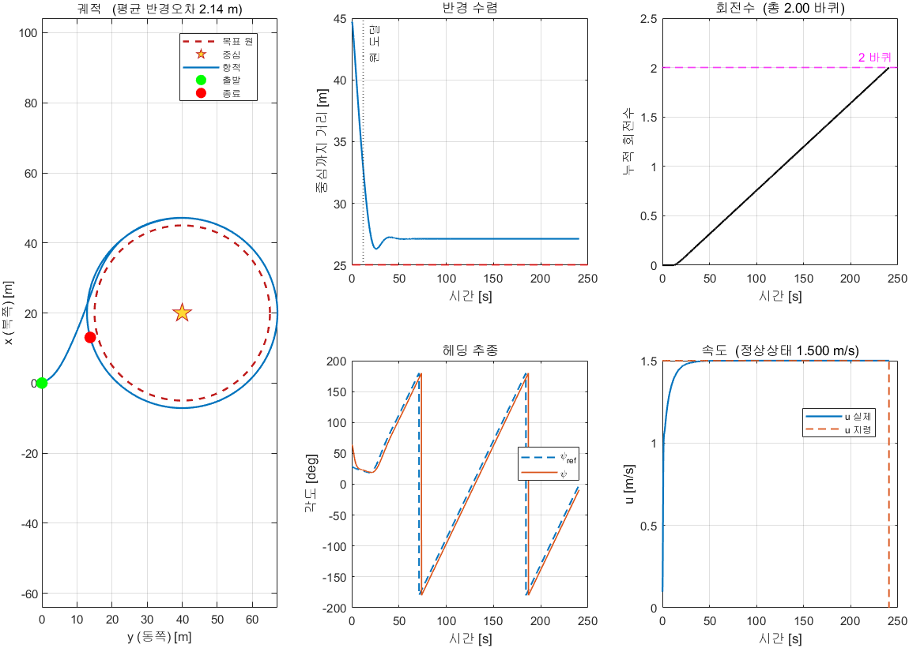

| 그림 | 볼 것 |
|---|---|
| 궤적 | 목표 원(점선)과 실제 항적(실선)의 간격 |
| 반경 수렴 | 오버슈트 없이 붙는가. **일정한 오차가 남는가** |
| 회전수 | 원 도달 전에는 0, 도달 후 선형 증가 |
| 헤딩 추종 | $\psi_{\text{ref}}$ 가 계속 회전하고 $\psi$ 가 조금 뒤따라감 |
| 속도 | 1.5 m/s 유지, 정지 시 0 |

### 모델 구조

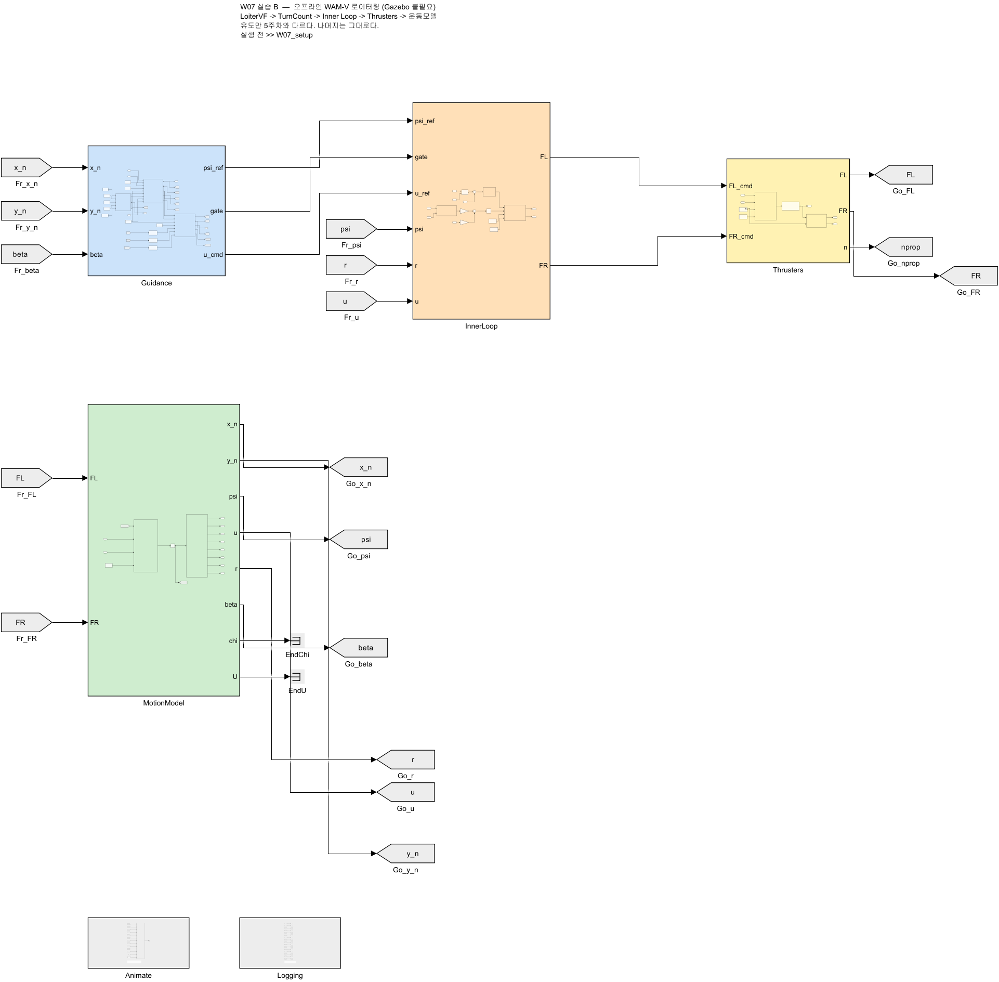

| 단 | 블록 | 5주차 대비 |
|---|---|---|
| 1 | `Schedule` → `LoiterVF` | **바뀜** — LOS 대신 벡터필드 |
| 1 | `TurnCount` | **추가** — 회전수와 종료 판정 |
| 2 | `InnerLoop` | 그대로 |
| 3 | `Thrusters` | 그대로 |
| 4 | `MotionModel` | 그대로 |
| — | `Animate` | 배치는 같은 네 칸. 오른쪽 ① 이 $y_e$ 에서 **반경 $r$** 으로 바뀌고, 왼쪽 칸에 목표 원·중심·회전수가 붙음 |

- **`LoiterVF`·`TurnCount`·`Schedule` 은 `Guidance` 상자 안**에 있음. 더블클릭해서 열 것
- 로이터 중심·반경·회전수 같은 **설정값도 그 안에** 있음. 최상위에는 신호만 보임
- `Logging` 과 `Animate` 는 **입출력 포트가 없는 상자**. 안에서 From 태그로 받음


### 블록 색으로 역할을 구분한다

> [!note] 5\~8주차의 모든 모델이 같은 색 규칙을 따른다

| 색 | 역할 | 예 |
|---|---|---|
| 파랑 | 유도 (Guidance) | `Guidance`, `WpManager`, `LoiterVF` |
| 보라 | 미션 판단 | `MissionFSM`, `ModeSwitch`, `TurnCount` |
| 주황 | 제어 (Control) | `InnerLoop`, PID, 추력배분 |
| 노랑 | 추진기 | `Thrusters` |
| 초록 | 운동모델 (Plant) | `MotionModel` |
| 연보라 | ROS 통신 | `PoseSubscriber`, `CmdPublisher` |
| 회색 | 로깅·표시 | `Logging`, `Animate`, Goto/From 태그 |
| 흰색 | 설정값 | Constant |

- 선은 **직선 또는 직각**만 씀. 대각선 없음
- 되먹임처럼 뒤로 돌아가는 선만 꺾임
- 배치를 흐트러뜨렸으면 생성 스크립트를 다시 돌림 (배치까지 다시 만듦)

```matlab
W07_setup
build_w07_models
```

---

## C. 방향·속도·반경 바꾸기 (30분)

### C-1. 하나씩 바꿔 보기

- `W07_setup.m` 에서 값을 고치고 다시 실행
- 아래 표의 **결과** 는 추측이 아니라 실제로 돌려 잰 값임 (기준 환경 실측, 2026-10-28)

| 바꿀 값 | 시도 | 결과 (실측) |
|---|---|---|
| $p_c$ | `-0.313` | **반시계방향**으로 돎. 반경 오차는 `+0.313` 과 같음 (2.137 m / 2.138 m) |
| $p_c$ | `0.15` / `0.6` / `1.0` | 반경 오차가 $\lvert p_c \rvert$ 에 **비례**해 커짐 — 1.02 / 4.09 / 6.82 m |
| $r_d$ | `12` / `40` | 원 크기가 바뀜. **절대 오차는 거의 그대로** (2.25 / 2.13 m), $r_d$ 대비 비율만 18.7 % / 5.3 % |
| `u_ref` | `1.0` / `2.0` | 도는 속도가 바뀜. 오차도 속도에 비례 — 1.44 / 2.82 m |
| 시작 위치 | 원 안 · 원 위 · 원 밖 | 정착 반경이 모두 같음 (27.13 m). 원에 닿는 **시간만** 달라짐 |
| `required_turns` | `0` | 멈추지 않고 계속 |

#### 17 번을 한 장에 — `W07_sweep`

- 오프라인 모델만 쓴다. VRX 불필요

```matlab
T = W07_sweep;     % 17 번 돌려 그림 한 장과 표를 만든다 (1~2분)
```

- 정상 출력 (앞 세 줄과 끝 줄)

```
W07_sweep: 17 회 실행
   1/17  p_c = +0.313  (시계방향)       정착반경  27.14 m  오차 +2.14 m  시계방향
   2/17  p_c = -0.313  (반시계방향)     정착반경  27.14 m  오차 +2.14 m  반시계방향
   3/17  중심  r_0 = 0 m                정착반경  27.13 m  오차 +2.13 m  시계방향
  img/W07_sweep.png 저장
```

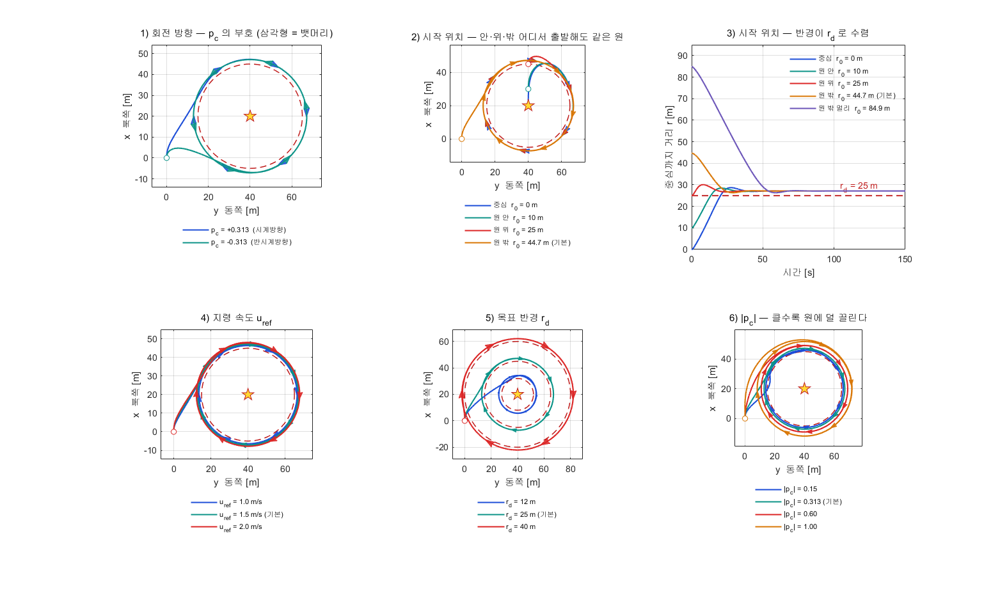

- 모든 실행에 공통으로 둔 것 — 한 번에 **하나만** 바뀌게 하기 위함

| 항목 | 값 | 이유 |
|---|---|---|
| `required_turns` | `0` | 멈춘 뒤의 꼬리가 평균을 더럽히지 않게 |
| 초기 선수각 | $0^\circ$ (정북) | 시작 위치만 바뀌고 뱃머리는 고정되게 |
| 정착 구간 | 원 도달 30 s 뒤 \~ 끝 | 1-8 절과 같은 정의 |

- 그림 읽는 법

| 표시 | 뜻 |
|---|---|
| 붉은 점선 원 | 목표 원 $r_d$ |
| 노란 별 | 로이터 중심 |
| 빈 동그라미 | 출발 지점 |
| **삼각형** | 뱃머리 방향. 뾰족한 끝이 선수이며, 도는 방향을 이것으로 읽음 |
| 1번 칸 | 두 궤적이 거울상. 삼각형이 서로 반대를 가리킴 |
| 2번 칸 | 출발점이 중심·원 안·원 위·원 밖 어디든 **같은 원**에 정착 |
| 3번 칸 | 중심에서 출발해도, 84.9 m 밖에서 출발해도 $r$ 이 $r_d$ 로 모임 |
| 4번 칸 | 세 원이 거의 겹침 — 속도는 원 크기를 바꾸지 않음 |
| 5번 칸 | $r_d$ 가 원 크기를 정함. 바깥쪽 치우침은 세 경우 모두 비슷 |
| 6번 칸 | $\lvert p_c \rvert$ 가 클수록 원이 바깥으로 벌어짐 |

#### 실측값 17 행

| 바꾼 것 | 값 | 정착 반경 [m] | 오차 [m] | $r_d$ 대비 [%] | 원 도달 [s] | 방향 |
|---|---|---|---|---|---|---|
| 회전 방향 | $p_c = +0.313$ | 27.138 | +2.138 | 8.55 | 15.55 | 시계방향 |
| 회전 방향 | $p_c = -0.313$ | 27.137 | +2.137 | 8.55 | 12.40 | **반시계방향** |
| 시작 위치 | $r_0 = 0$ m (중심) | 27.134 | +2.134 | 8.54 | 14.55 | 시계방향 |
| 시작 위치 | $r_0 = 10$ m (원 안) | 27.134 | +2.134 | 8.54 | 7.20 | 시계방향 |
| 시작 위치 | $r_0 = 25$ m (원 위) | 27.136 | +2.136 | 8.55 | 0.00 | 시계방향 |
| 시작 위치 | $r_0 = 44.7$ m (기본) | 27.138 | +2.138 | 8.55 | 15.55 | 시계방향 |
| 시작 위치 | $r_0 = 84.9$ m | 27.138 | +2.138 | 8.55 | 45.80 | 시계방향 |
| 지령 속도 | `u_ref` $= 1.0$ | 26.437 | +1.437 | 5.75 | 20.70 | 시계방향 |
| 지령 속도 | `u_ref` $= 1.5$ (기본) | 27.138 | +2.138 | 8.55 | 15.55 | 시계방향 |
| 지령 속도 | `u_ref` $= 2.0$ | 27.822 | +2.822 | 11.29 | 13.05 | 시계방향 |
| 목표 반경 | $r_d = 12$ m | 14.246 | +2.246 | 18.71 | 28.10 | 시계방향 |
| 목표 반경 | $r_d = 25$ m (기본) | 27.138 | +2.138 | 8.55 | 15.55 | 시계방향 |
| 목표 반경 | $r_d = 40$ m | 42.127 | +2.127 | 5.32 | 0.00 | 시계방향 |
| 끌림 세기 | $\lvert p_c \rvert = 0.15$ | 26.024 | +1.024 | 4.10 | 13.05 | 시계방향 |
| 끌림 세기 | $\lvert p_c \rvert = 0.313$ (기본) | 27.138 | +2.138 | 8.55 | 15.55 | 시계방향 |
| 끌림 세기 | $\lvert p_c \rvert = 0.60$ | 29.090 | +4.090 | 16.36 | 24.15 | 시계방향 |
| 끌림 세기 | $\lvert p_c \rvert = 1.00$ | 31.817 | +6.817 | 27.27 | 62.20 | 시계방향 |

- 오차 부호가 17 행 모두 **+** → 항상 원 바깥쪽. 1-8 절의 결론과 같음
- 원 도달 $0.00$ s 는 출발 지점이 이미 허용범위($0.3\,r_d$) 안이라는 뜻임. 빠른 것이 아님
  - $r_0 = 25$ m 는 원 위에서 출발, $r_d = 40$ m 는 출발점 $r_0 = 44.7$ m 가 허용범위 안

#### 네 그룹을 한 식으로 줄이면

$$
e \;\simeq\; T_{\text{eff}} \,\lvert p_c \rvert\, u,
\qquad T_{\text{eff}} \approx 4.5\ \text{s}
$$

- $e$ — 정착 반경 오차 [m]. 1-8 절에서 쓴 것과 같은 양
- 실측이 이 식을 그대로 따름

| 확인 | 실측 |
|---|---|
| $\lvert p_c \rvert$ 에 비례 | 오차 $\div \lvert p_c \rvert$ = 6.83 / 6.83 / 6.82 / 6.82 — 네 값이 같음 |
| $u$ 에 비례 | 오차 $\div u$ = 1.44 / 1.43 / 1.41 |
| $r_d$ 와 무관 | 2.25 / 2.14 / 2.13 m — $r_d$ 가 3 배 넘게 변해도 그대로 |
| 기본값 검산 | $4.5 \times 0.313 \times 1.5 = 2.11$ m, 실측 2.138 m |

- 왜 $r_d$ 가 약분되는가 — 1-8 절의 분해를 그대로 이어붙이면 나옴
  1. 반경 오차 $e$ 를 유지하려면 속도가 접선에서 안쪽으로 $\phi = \arctan\dfrac{e}{\lvert p_c \rvert r}$ 만큼 기울어야 함
  2. 그 기울기는 **선수각 뒤짐 + 크랩각**이며, 둘 다 선회 각속도 $u/r$ 에 비례 → $\phi \approx T_{\text{eff}}\, u / r$
  3. 둘을 같다고 놓으면 $e \approx \lvert p_c \rvert\, r \cdot T_{\text{eff}}\, u / r = T_{\text{eff}} \lvert p_c \rvert u$ — $r$ 이 사라짐
- $T_{\text{eff}}$ 는 운동모델의 성질임. 유도법칙이 아니라 **배가 얼마나 늦게 도는가**를 재는 값

> [!warning] 추력이 포화되면 이 식이 깨진다
> 위 식은 추진기가 포화되지 않는 범위에서만 성립함
> C-2 의 3·4 구간은 지령 2.4 m/s 를 내지 못해(실효 2.19 m/s) 오차가 식의 예측보다 1.5 배 이상 커짐
> 속도를 올릴 때는 반경 오차보다 **추력 포화**를 먼저 확인할 것

> [!tip] $\lvert p_c \rvert$ 를 고르는 기준
> 작을수록 원에 세게 끌려 오차가 작아지지만, 원에 붙을 때까지의 궤적이 중심을 향해 곧게 들어옴
> $\lvert p_c \rvert = 1.0$ 이면 오차가 $r_d$ 의 27 % (6.8 m) 까지 커짐
> 본 과목 기본값 `0.313` 은 오차 8.5 % 로, 접근 궤적과 정확도가 함께 무난한 값임

### C-2. 도는 도중에 바꾸기

- `use_schedule = 1` 로 두면 시간에 따라 자동으로 바뀜

| 구간 | 방향 | 속도 | 반경 |
|---|---|---|---|
| 0\~150 s | 설정대로 | `u_ref` | $r_d$ |
| 150\~300 s | **반전** | `u_ref` | $r_d$ |
| 300\~450 s | 반전 | `u_ref` $\times 1.6$ | $r_d$ |
| 450 s\~ | 반전 | `u_ref` $\times 1.6$ | $0.6\,r_d$ |

- 기준 환경 실측값 (2026-10-28, `required_turns = 0`, 600 s, 구간마다 앞 30 s 제외)

```matlab
T = W07_segments;        % 위 조건으로 한 번 돌려 표를 찍음 (몇 초)
```

| 구간 | 목표 반경 [m] | 평균 반경 [m] | 오차 [m] | 평균 `u` [m/s] | 회전 방향 |
|---|---|---|---|---|---|
| 1) 기본 | 25 | 27.13 | +2.13 | 1.499 | 시계방향 |
| 2) 방향 반전 | 25 | 27.13 | +2.13 | 1.501 | **반시계방향** |
| 3) 속도 1.6배 | 25 | 29.82 | +4.82 | 2.185 | 반시계방향 |
| 4) 반경 0.6배 | 15 | 20.31 | +5.31 | 2.138 | 반시계방향 |

> [!warning] 3번 구간에서 속도가 목표(2.4)에 못 미친다
> 2.4 m/s 를 유지하려면 $X = (100 + 150 \times 2.4) \times 2.4 = 1104$ N, 편당 552 N 이 필요한데
> `F_max` = 500 N 이라 **포화**함. 게다가 선회에도 추력을 나눠 써야 함
> 5주차에서 본 것과 같은 문제 — **게인이 아니라 포화가 한계임**

> [!warning] 4번 구간에서 오차가 크게 는다 (+5.31 m)
> - 속도가 1.6배라 §1-8 식의 분자 $p_c v\tau_{\text{eff}}$ 가 커짐
> - 반경이 작아 분모 $1 - p_c v\tau_{\text{eff}}/r_d$ 가 1 보다 더 작아지고, 선회율 $v/r_d$ 가 커져 크랩각도 커짐
> - 두 효과가 겹쳐 오차가 불어남
> **작은 원을 빠르게 도는 것이 가장 어려움**

---

## D. VRX 연동 (35분)

- 5주차 E절과 절차가 완전히 같음. 스크립트 이름만 바뀜
- **선행 조건**: 5주차 E-1 의 `~/capstone_ws/wamv/w7_wamv.urdf.xacro` (`ground_truth_enabled` 기본값 `true`) 가 있어야 함
  - 없으면 ground truth 토픽이 나오지 않아 `W07_vrx_run` 이 오류를 내고 멈춤

```bash
ros2 launch vrx_gz competition.launch.py \
    world:=sydney_regatta \
    urdf:=$HOME/capstone_ws/wamv/w7_wamv.urdf.xacro
```

> [!important] 5주차 주행이 끝난 상태에서 그대로 이어 돌리지 않는다
> 배가 경로 끝(원에서 100 m 밖)에 있으면 **원 도달에 실패**함
> 실측에서 이 상태로 돌렸더니 회전수 0, 반경오차 37.9 m 가 나왔음
> **VRX 를 껐다가 다시 띄워** 배를 스폰 위치로 되돌린 뒤 시작함

- RTF 가 1 % 미만인 노트북은 옵션을 함께 줌 (5주차 E-2 와 같은 한 줄 명령)

```bash
ros2 launch vrx_gz competition.launch.py world:=sydney_regatta urdf:=$HOME/capstone_ws/wamv/w7_wamv.urdf.xacro "extra_gz_args:=--render-engine-server ogre --render-engine-gui ogre"
```

```matlab
setappdata(0, 'W07_skip_run', true);   % W07_setup 의 오프라인 자동 실행을 건너뜀
W07_setup
W07_vrx_run
```

- `W07_vrx_run.m` 이 토픽 확인 → RTF 측정 → 페이싱 설정 → 실행 → 그림까지 함
- 출력 앞부분에 단계 번호가 차례로 찍힘 (숫자는 환경마다 다름)
  1. `0) ROS_DOMAIN_ID = …`
  2. `1) VRX 토픽 확인` → `OK — 토픽 …개`
  3. `2) RTF 측정 (20초)` → `스폰 위치 (x, y) = (…, …) m — 이 점을 원점으로 쓴다` → `RTF = …`
  4. `3) W07_1_vrx 실행 (…초)`
  5. `4) 결과 그림` → VRX 지표 7줄 → `5) 같은 초기 선수각으로 오프라인 모델 실행` → 오프라인 지표 7줄 → 대조 3줄
- 스폰 위치는 설치마다 다름 ($y_{\text{ENU}}$ = 162 또는 200). 스크립트가 ground truth 첫 샘플을 원점으로 쓰므로 손댈 필요 없음 (8주차 D절 경고 참고)
- 도는 동안 **실시간 화면**이 뜸. VRX 모델에도 오프라인과 같은 `Animate` 블록이 들어 있고 **같은 함수**(`W07_animate.m`)가 그림
  - 배가 어디쯤 돌고 있는지 Gazebo 화면 없이도 보임. 끄려면 `animate = 0`
  - 읽는 법은 B절의 네 칸 표와 같음. 아래 D-3 에 그 화면이 있음

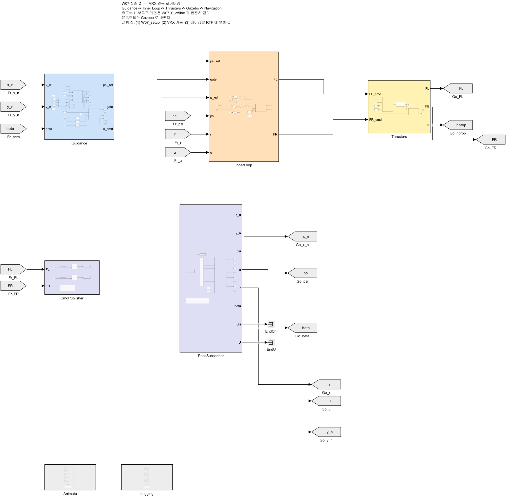

> [!caution] 로이터 원이 수역 안에 들어가야 한다
> 스폰 기준 안전 수역은 $x \in [-28,\ 60]$, $y \in [-18,\ 100]$ 임
> 기본 설정(중심 (20,40), 반경 25)이면 원이 $x \in [-5,\ 45]$, $y \in [15,\ 65]$ 를 차지해 안전함
> 반경을 40 이상으로 키우면 **육지에 얹힘**

### D-1. 결과

- 기준 환경 실측값 (2026-09-19, 데스크톱, 스폰 ENU $(-532, 200)$, 측정 RTF 0.683, 300 s)

```
===== VRX 로이터링 =====
  원 도달 시각              13.8 s
  정착 후 평균 반경오차     2.265 m   <- 과제에 쓸 값
  정착 후 최대 반경오차     2.411 m
  반경오차 표준편차         0.022 m
  총 회전수                  2.00 바퀴
  정지 시각                242.6 s
  정상상태 속도             1.500 m/s
```

- "원 도달" 은 반경 오차가 $0.3\,r_d$ (= 7.5 m) 안에 처음 든 시각. 회전수를 세기 시작하는 시각과 같음 (1-9절)
- "정착 후" 는 원 도달 30 s 뒤부터 정지까지

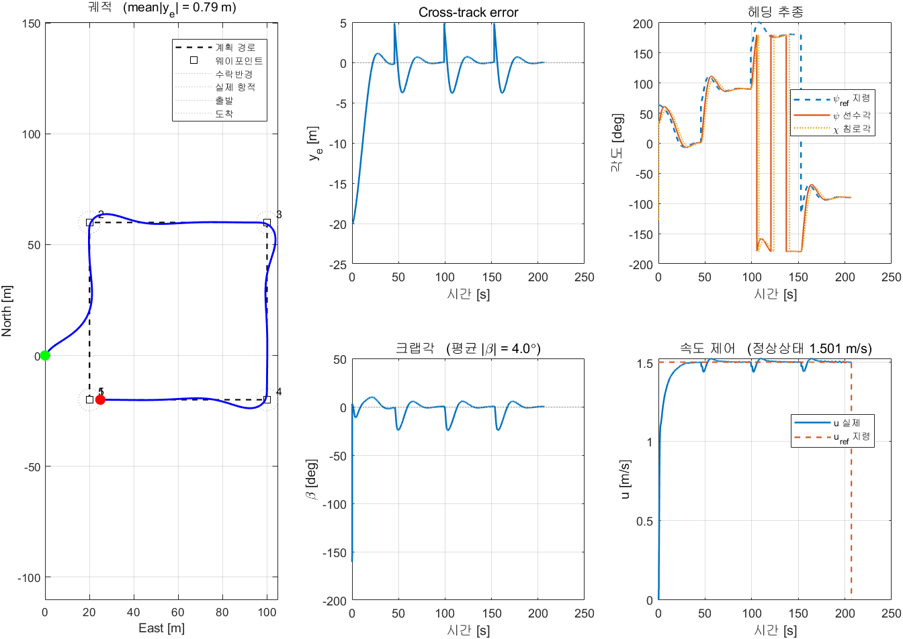

### D-2. 오프라인과 비교

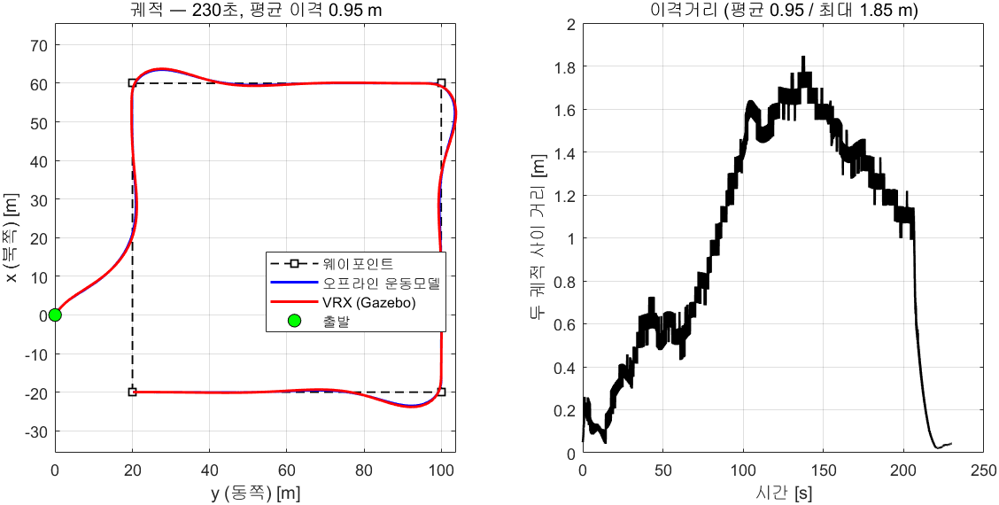

- 오프라인 열은 `W07_vrx_run` 이 **VRX 초기 선수각(32.91°)으로 다시 돌린** 값

| 항목 | 오프라인 | VRX | 차이 |
|---|---|---|---|
| 정착 후 평균 반경오차 [m] | 2.138 | 2.265 | +0.127 |
| 반경오차 표준편차 [m] | 0.013 | 0.022 | |
| 회전수 | 2.00 | 2.00 | 0 |
| 정지 시각 [s] | 241.7 | 242.6 | +0.9 |
| 평균 반경 (전 구간) [m] | 27.69 | 27.86 | +0.17 |
| 궤적 평균 이격 [m] | | | 0.77 |
| 궤적 최대 이격 [m] | | | 1.96 |

- **반경오차는 0.13 m 안에서 같음.** 원의 크기는 두 모델이 같게 만듦
- 이번 실행은 정지 시각 차이가 0.9 s 뿐이라 이격도 0.77 m 로 작음
- 같은 설정의 2026-09-18 실행은 이격이 **4.96 m**(최대 13.49 m) 였음. 반경오차는 똑같이 2.265 m
  - 그때는 VRX 가 8.9 s 먼저 멈춤 → 한 바퀴에 약 4 s 빠름. 이격이 **시간에 거의 직선으로** 커지다 정지 뒤 0.6 m 로 떨어짐
  - 두 배가 같은 원을 **조금 다른 속도로** 돌아 같은 시각에 원의 다른 지점에 있었다는 뜻
  - 궤적 그림에서 두 선은 겹침 → **위상 오차**이지 경로 오차가 아님 → [[궤적이-겹치면-이격은-오차가-아니라-지연이다]]
- 이격은 페이싱 비율(측정 RTF)과 실제 진행이 얼마나 어긋났느냐에 따라 실행마다 달라짐
- 판정은 **반경오차 · 회전수**로 함. 이격과 정지 시각은 위상을 보는 보조 지표

> [!warning] 페이싱을 실측 RTF 보다 높게 잡지 않는다
> - 비율 0.97 로 올려 본 결과, 300초 시뮬레이션이 381초 걸려 실효 비율이 **0.787** 로 떨어지고 회전수가 1.66 바퀴에 그쳤음 (2026-09-15 실측)
> - 모델과 시뮬레이터가 같은 CPU 를 나눠 쓰기 때문. **스크립트가 잰 값을 그대로 씀**

### D-3. 실시간 화면 — VRX

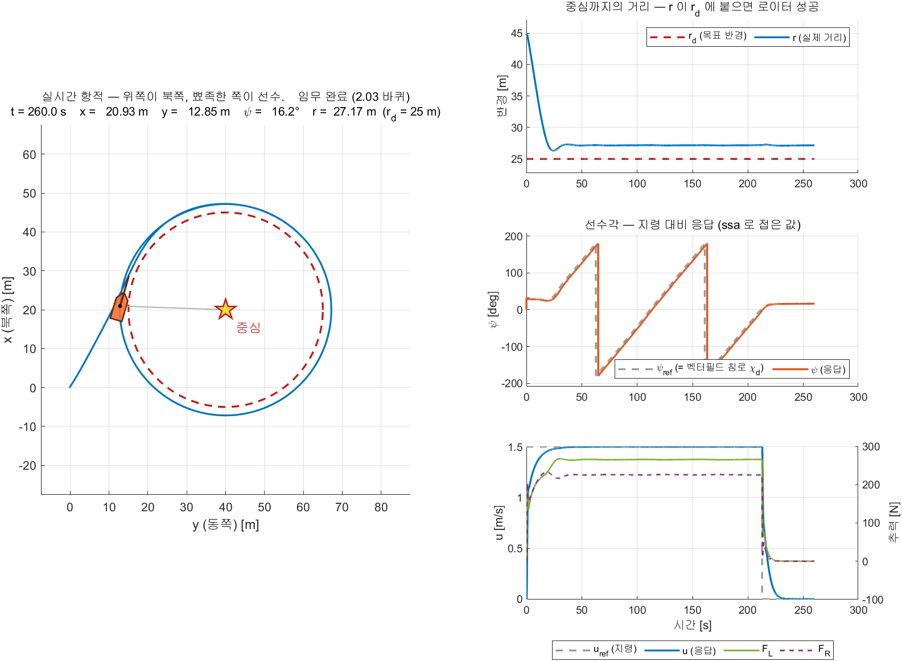

- 조건 — `W07_1_vrx`, **3주차 경량 모델**(`W03_vrx_lite/run_vrx.sh lite`), `ROS_DOMAIN_ID=7`,
  스폰 ENU $(-532.2,\ 200.0)$, 페이싱 1.073(= MATLAB 이 20초 동안 잰 RTF), 260 s 주행에 벽시계 319.2 s,
  유도 설정·게인은 B절 오프라인 화면과 동일 (2026-09-25 실측)
- 읽는 법은 B절의 네 칸 표와 **완전히 같음.** 같은 함수가 그린 같은 배치이기 때문임
- 캡처 명령은 `W07_anim_capture('vrx')` 하나임. 토픽 확인 → 스폰·RTF 측정 → 페이싱 설정 → 주행 → 추력 0 송신 → 저장까지 함

| 볼 곳 | 오프라인 | VRX | 뜻 |
|---|---|---|---|
| ① 의 정착 평균 반경오차 | $+2.138$ m | $+2.172$ m | **유도 성능은 시뮬레이터가 바뀌어도 같음** (차이 0.034 m) |
| ① 의 정착 평균 반경 | 27.14 m | 27.17 m | 원의 크기를 두 모델이 같게 만듦 |
| 회전수 | 2.00 | 2.00 | 종료 판정이 같게 걸림 |
| 원 도달 시각 | 12.5 s | 12.4 s | 접근 구간이 거의 같음 |
| 완주 시각 (③ 의 지령이 0 으로 떨어지는 시점) | 240.6 s | 212.8 s | **초기 선수각이 다름** — 오프라인은 `psi_init` 이 중심을 바라보게 두고 출발하고, VRX 는 스폰 선수각에서 출발함 (D-2 의 실측 32.91°) |
| ③ 의 정상상태 $u$ | 1.500 m/s | 1.500 m/s | 추력·항력 계수가 같다는 증거 |
| ③ 의 $F_L$ / $F_R$ | 267.4 / 221.8 N | 265.5 / 225.7 N | 양쪽 모두 계속 벌어져 있음 = 계속 도는 중 |

- 위 표의 "정착" 은 D-1 과 같은 정의임 — 원 도달 30 s 뒤부터 정지까지
- 이 수치는 **캡처한 그림과 같은 실행**에서 뽑은 것이며, D-1 · D-2 의 표(2026-09-19 실행)와는 다른 실행임

> [!caution] 캡처 전에 VRX 를 껐다 켠다
> 직전 주행이 끝난 상태에서 이어 돌리면 배가 원 위에 서 있고, 스크립트는 **그 자리**를 스폰 원점으로 읽음
> 실제로 이어 돌렸더니 스폰이 $(220.4,\ -519.4)$ 로 읽혀 원이 통째로 그만큼 옮겨졌음 (2026-09-25)
> 그림은 멀쩡해 보이지만 조건이 문서와 달라짐. D절 앞머리의 경고와 같은 이야기임

### 확인할 것

- [ ] 2단계 출력의 `스폰 위치` 가 launch 파일의 스폰 좌표와 같은가
- [ ] 오프라인과 같은 반경 오차가 나오는가
- [ ] 회전수가 같은 속도로 올라가는가
- [ ] `u` 평균 × 시간 ≈ 주행거리 인가 (페이싱이 맞는지). 주행거리는 시뮬레이션 결과 `out` 에서 다음 한 줄로 구함 (`W07_setup` 이 작업공간에 남기는 오프라인 `out` 에는 바로 쓸 수 있음. `W07_vrx_run` 은 `out` 을 작업공간에 남기지 않음)
  ```matlab
  sum(hypot(diff(out.log_x_n.Data), diff(out.log_y_n.Data)))
  ```
- [ ] $p_c$ 부호를 뒤집으면 VRX 에서도 반대로 도는가

---


# 마무리

## 이번 주차 요약

| 순서 | 한 일 | 확인 |
|---|---|---|
| 1 | 벡터필드 그려 보기 | 네 조건의 화살표 모양 |
| 2 | 오프라인 로이터링 | 2바퀴 돌고 정지 |
| 3 | 방향 반전 | $p_c$ 부호 하나로 |
| 4 | 속도·반경 변경 | 시나리오 4단계 |
| 5 | 반경 오차 분해 | 지연 셋의 합 4.63 s $\approx$ 역산 4.55 s |
| 6 | VRX 연동 | 오프라인과 대조 |

---

## 수업 진도 체크

> [!important] Term Project 를 시작하기 위한 최소 조건

### 이론 이해

- [ ] 로이터링이 무엇이고 왜 필요한지 말할 수 있음
- [ ] 웨이포인트로 원을 근사하면 안 되는 이유 세 가지를 앎
- [ ] **벡터필드**가 LOS 와 무엇이 다른지 설명할 수 있음
- [ ] 식 (9) 의 $\dot{r}$ 과 $r\dot{\theta}$ 가 각각 무슨 역할인지 앎
- [ ] 분모가 **벡터의 길이**이고, 그래서 속력이 항상 $v_d$ 라는 것을 앎
- [ ] 각도만 쓸 때 $v_d$ 와 분모가 **약분**되어 식 (30) 한 줄이 된다는 것을 설명할 수 있음
- [ ] $p_c$ 의 **부호**가 회전 방향임을 앎 (양수 = 시계방향)
- [ ] $p_c$ 의 **크기**가 커지면 원에 덜 끌린다는 것을 앎
- [ ] 식 (28) 로 $p_c = 4\zeta_c^{2} v \tau_r / r_d$ 를 계산할 수 있음
- [ ] 반경 오차가 왜 **바깥쪽**으로 남는지 설명할 수 있음
- [ ] 그 지연의 세 가지 원인을 말할 수 있음
- [ ] 회전수를 셀 때 **원 도달 후부터** 세야 하는 이유를 앎

### 실습 완료

- [ ] `W07_vectorfield` 로 네 조건의 필드를 확인했음
- [ ] `W07_setup` 실행만으로 배가 돌고 2바퀴 후 멈췄음
- [ ] **실시간 화면** 네 칸의 뜻을 알고, ① 의 $r$ 이 $r_d$ 위에 **일정한 간격을 남기고** 눕는 것을 눈으로 확인했음
- [ ] ② 에 평평한 구간이 없다는 것(직선 주행이 없다는 뜻)을 확인했음
- [ ] $p_c$ 부호를 바꿔 **반시계방향**으로 돌렸음
- [ ] $p_c$ 크기를 바꿔 반경 오차가 비례하는 것을 확인했음
- [ ] $r_d$ 와 `u_ref` 를 바꿔 봤음
- [ ] 평균 크랩각 $\beta$ 를 재서 **등가 지연**으로 바꿔 봤음
- [ ] `use_schedule = 1` 로 도중에 방향·속도·반경이 바뀌는 것을 봤음
- [ ] VRX 에서 로이터링을 실행했음

### 관찰 기록

- [ ] $p_c$ 4조건의 정착 반경을 표로 남겼음
- [ ] 반경 오차를 지연 셋으로 분해해 합이 맞는지 확인했음
- [ ] 오프라인과 VRX 결과를 겹쳐 그렸음

---

## 과제 6 — 로이터링 성능 분석

- **제출 기한**: 8주차 수업 전

### ① 긴 형태와 짧은 형태가 같음을 보이기 (손계산)

- 식 (9) 를 그대로 풀어 쓴 **긴 형태** — `W07_vectorfield.m` 과 연구실 원본 `KAIST_CircularVF` 가 쓰는 방식

```matlab
D       = sqrt((r - rd)^2 + (pc*r)^2);
r_dot   = -vd * (r - rd) / D;
rth_dot =  vd * pc * r   / D;
vf_x = r_dot*cos(theta) - rth_dot*sin(theta);
vf_y = r_dot*sin(theta) + rth_dot*cos(theta);
chi_d = atan2(vf_y, vf_x);
```

- 모델 안 `LoiterVF` 가 쓰는 **짧은 형태** — 식 (30). `W07_matlab/Guid_VF_Loiter.m` 과 같음

```matlab
chi_d = theta + atan2(pc*r, -(r - rd));
```

- **이 둘이 같은 각도를 준다는 것을 유도하시오.** 두 단계로 나누어 쓸 것
  1. $(\dot{r},\ r\dot{\theta})$ 를 $\theta$ 만큼 돌린 것이 $(v_{f,x},\ v_{f,y})$ 이므로
     $\operatorname{atan2}(v_{f,y},\ v_{f,x}) = \theta + \operatorname{atan2}(r\dot{\theta},\ \dot{r})$ 임을 보이시오
     - 힌트: $(\dot{r},\ r\dot{\theta}) = \rho(\cos\alpha,\ \sin\alpha)$ 로 두고 삼각함수 덧셈정리를 쓸 것 ($\rho = v_d > 0$)
  2. $\dot{r}$ 과 $r\dot{\theta}$ 가 **같은 양수** $v_d/D$ 를 공유하므로 $\operatorname{atan2}$ 에서 약분됨을 보이시오
- $r = 32$ m, $\theta = 50^\circ$, $r_d = 25$, $p_c = 0.313$ 에서 두 형태를 각각 계산해 **소수점 둘째 자리까지 같은지** 확인하시오
  - 1-5절 "숫자로 한 번" 의 값과 맞아야 함

### ② $p_c$ 스윕

- $p_c$ = 0.15 / 0.313 / 0.6 / 1.0 ($r_d$=25, `u_ref`=1.5)

| $p_c$ | 원 도달 시각 [s] | 정착 반경 [m] | 오차 [m] | 오차/$p_c$ |
|---|---|---|---|---|
| 0.15 | | | | |
| 0.313 | | | | |
| 0.6 | | | | |
| 1.0 | | | | |

- **오차가 $p_c$ 에 비례하는가?** 마지막 열이 일정한지 확인하고 그 값의 의미를 쓰시오
- 식 (28) 로 각 $p_c$ 의 $\zeta_c$ 를 계산해 표에 함께 넣고, 도달 시각의 경향과 맞는지 논하시오

### ③ 반경 오차를 지연 셋으로 분해

- 1-8절은 남는 반경 오차를 $r_{ss} - r_d = p_c \, v \, \tau_{\text{eff}}$ 로 설명했음
- **그 $\tau_{\text{eff}}$ 가 정말 세 몫의 합인지** 직접 재서 확인하는 과제임
- 기본 설정(`W07_setup` 그대로)으로 한 번 돌리고 아래 표를 채우시오

| 재는 것 | 구하는 법 | 값 |
|---|---|---|
| 정착 반경 $r_{ss}$ | `W07_plot` 의 "정착 후 평균 반경오차" $+\ r_d$ | |
| 반경 오차 | $r_{ss} - r_d$ | |
| 역산한 $\tau_{\text{eff}}$ | (반경 오차) $/\ (p_c v)$ | |
| 평균 대지속력 $U$ | `W07_plot` 의 정상상태 속도 | |
| 선회율 $U/r_{ss}$ | 나눗셈 [rad/s] | |
| 평균 크랩각 $\beta$ | 아래 한 줄 [deg] | |
| 크랩각 몫 $\tau_{\text{crab}}$ | $\lvert\beta\rvert \,/\, (U/r_{ss})$ — $\beta$ 를 **rad 로** 넣을 것 | |
| 램프 추종 몫 | $(K_{d,\psi} + N_r)/K_{p,\psi}$ | |
| 모터 몫 | `tau_n` | |
| **세 몫의 합** | 위 셋을 더함 | |

- 평균 크랩각은 `W07_setup` 실행 뒤 다음 한 줄로 구함 (접근·과도 구간을 뺀 60 s 이후부터 정지 전까지의 평균 [deg])

```matlab
b = out.log_beta.Data; t = out.log_beta.Time; g = out.log_gate.Data; mean(b(t>60 & g>0.5))*180/pi
```

- **세 몫의 합이 역산한 $\tau_{\text{eff}}$ 와 몇 % 차이나는지** 쓰시오. 10 % 안이면 분해가 맞은 것임
- 세 몫 가운데 **가장 큰 것**이 무엇이고, 그것을 줄이려면 무엇을 바꿔야 하는지 한 줄로 쓰시오
- 크랩각 몫이 만드는 오차 $p_c v \tau_{\text{crab}}$ 를 계산하고 전체 오차의 몇 % 인지 쓰시오

> [!note] 보상하지 않고 설명하는 것이 목적이다
> $\psi_{\text{ref}} = \chi_d - \beta$ 로 보상하면 오차가 줄기는 함 (1-8절 기준 2.14 → 1.24 m)
> 그래도 모델에는 넣지 않음 — 까닭은 1-8절 "크랩각 보상은 모델에 넣지 않는다" 에 있음
> 이 과제는 보상 없이도 남는 오차를 **끝까지 설명할 수 있다**는 것을 보이는 것임

### ④ 방향·속도·반경 변경

- `use_schedule = 1` 로 실행
- 네 구간의 평균 반경·평균 속도·회전 방향을 표로
- 궤적 그림에 구간 경계를 표시

### ⑤ 오프라인 ↔ VRX

- 같은 설정으로 두 모델을 각각 300초 실행
- 궤적을 겹쳐 그리고 반경 오차를 비교

### ⑥ 분석 (8\~12줄)

1. $p_c$ 를 작게 하면 오차가 줄어듦. 그런데 왜 무한히 작게 하지 않는가?
2. 반경 오차가 항상 **바깥쪽**인 이유를 지연으로 설명하시오
3. 작은 원을 빠르게 도는 것이 어려운 이유는?
4. 로이터링을 조류 속에서 하려면 무엇을 더 해야 하겠는가?

### 평가 기준

| 항목 | 배점 |
|---|---|
| ① 두 식이 같음을 유도 | 15% |
| **② $p_c$ 스윕과 비례 관계 확인** | 25% |
| **③ 반경 오차를 지연 셋으로 분해** | 25% |
| ④ 시나리오 실행 및 기록 | 15% |
| ⑤·⑥ 대조와 분석 | 20% |

---

## 막혔을 때

| 증상 | 원인 | 해결 |
|---|---|---|
| `먼저 W07_setup 을 실행하십시오` | 워크스페이스에 변수 없음 | `W07_setup` 먼저 |
| 배가 원에 못 붙고 빙빙 돔 | $p_c$ 가 너무 큼 | $p_c$ 를 줄일 것 |
| 원에 붙되 심하게 출렁임 | $p_c$ 가 너무 작음 ($\zeta_c$ < 0.5) | 식 (28) 로 다시 계산 |
| 회전 방향이 반대 | $p_c$ 부호 | 양수 = 시계방향 |
| 회전수가 0 에서 안 올라감 | 원에 아직 도달 못 함 | 반경 오차 그래프 확인 |
| 회전수가 너무 빨리 올라감 | 접근 중에 세고 있음 | `TurnCount` 의 `armed` 확인 |
| 반경 오차가 5 m 넘게 큼 | 속도가 빠르거나 반경이 작음 | `u_ref` 를 낮추거나 $r_d$ 를 키울 것 |
| 속도가 목표에 못 미침 | 추력 포화 | `F_max` 확인. 5주차 참조 |
| VRX 에서 배가 멈춤 | 육지에 얹힘 | 원이 안전 수역 안인지 확인 |
| 주행거리와 `u` 가 2배 차이 | 페이싱 ≠ RTF | RTF 재측정 |

---

## 참고 자료

### 이 주차의 원본

- **W. Jung, S. Lim, D. Lee, H. Bang**, *"Unmanned Aircraft Vector Field Path Following with Arrival Angle Control"* — `50-원본자료/` PDF. 식 (9), (13), (27)\~(31)
- 연구실 구현 (배포 폴더 `W07_matlab/` 에 들어 있는 것만 볼 수 있음)
  - `W07_matlab/Guid_VF_Loiter.m` — 압축형 한 줄 구현 (읽기용)
  - `W07_matlab/VF_test_code_main.m`, `VF_test_code_main_parameter.m` — 필드 시각화 원본
  - `UGV_Control_StateFlow_260529.slx` — `KAIST_CircularVF`, `calculate_turns`, 4상태 미션 FSM. **연구실 원본, 배포하지 않음**

### 볼트 내 문서

- [[W05_웨이포인트_유도_atan2와_LOS]] — 내부루프·추진기·운동모델이 그대로 옴
- [[조류가-있으면-뱃머리와-진행방향이-다르다]] — 반경 오차의 크랩각 성분
- [[오프라인-모델이-시뮬레이터와-같아야-게인이-옮겨간다]] — 왜 오프라인에서 먼저 하는가
- [[USV-운동모델은-왜-이렇게-생겼나]] — 극배치 설계의 배경

### 배포 파일

| 파일 | 내용 |
|---|---|
| `W07_simulink/W07_setup.m` | **학생이 고치는 설정 파일. 실행하면 바로 돎** |
| `W07_simulink/W07_segments.m` | C-2 도중 변경 시나리오의 구간별 반경 · 속도 · 방향 표 |
| `W07_simulink/W07_vectorfield.m` | 벡터필드 네 조건 비교 (실습 A) |
| `W07_simulink/W07_0_offline.slx` | 오프라인 로이터링 |
| `W07_simulink/W07_1_vrx.slx` | VRX 연동 |
| `W07_simulink/W07_plot.m` | 그림 6장 + 성능 지표 |
| `W07_simulink/W07_animate.m` | 실시간 화면 네 칸 그리기 — 오프라인·VRX 공용 (모델 안 `Animate` 블록이 호출) |
| `W07_simulink/W07_anim_capture.m` | 그 화면을 PNG 로 남김. 조건과 지표를 함께 돌려줌 |
| `W07_simulink/build_w07_models.m` | 모델 재생성 |
| `W07_matlab/` | 연구실 원본 (읽기용) |

---

## 다음 주 예고

- **8주차 — Stateflow 미션: 웨이포인트와 로이터링을 잇는다**
- 5주차의 LOS 와 7주차의 벡터필드를 **하나의 임무로 묶음**
- 할 일
  - 유한상태기계(FSM)를 Stateflow 로 그리기
  - `WpFollow` → `Loiter` → `WpFollow` → `Finish`
  - 두 유도법칙을 **갈아 끼우는** 법과 그때 생기는 유의 사항 세 가지
- 준비물
  - 과제 6 의 $p_c$ 스윕 표
  - 5주차 `W05_setup.m` 과 7주차 `W07_setup.m` 을 나란히 열어 둘 것 (설정이 합쳐짐)
