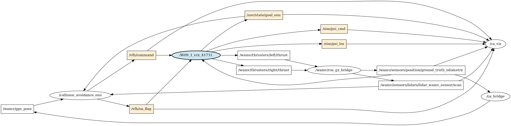
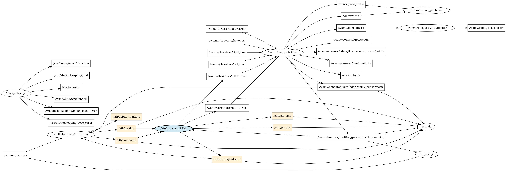
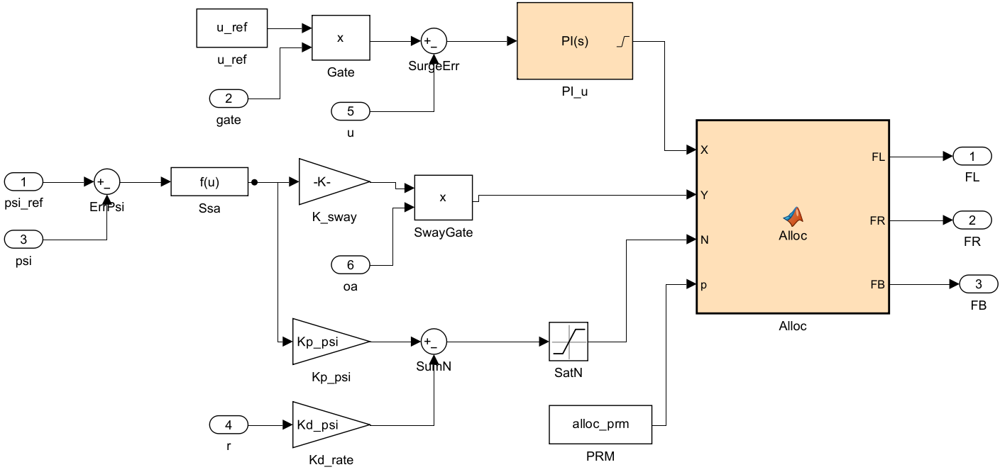
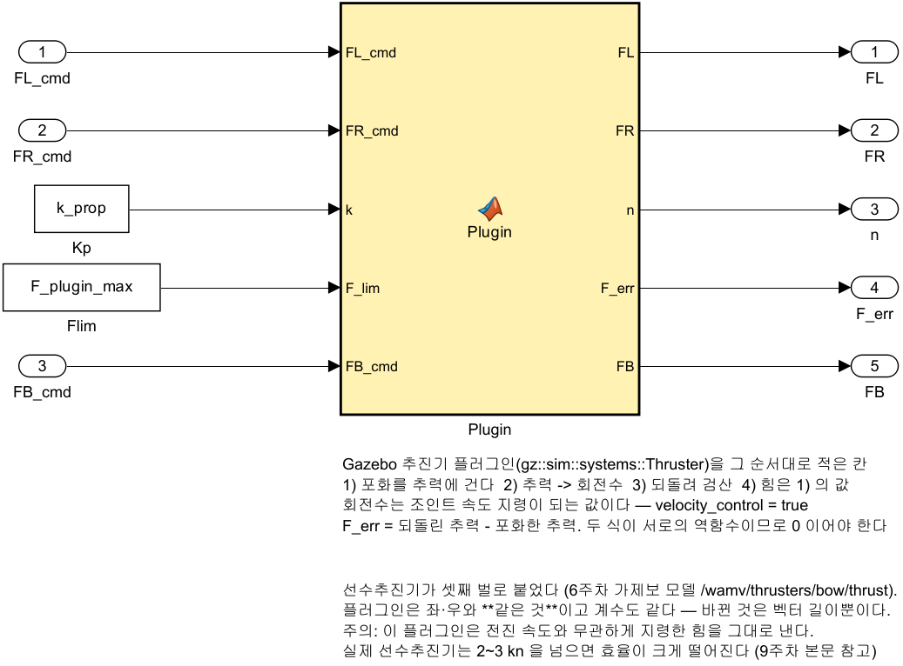
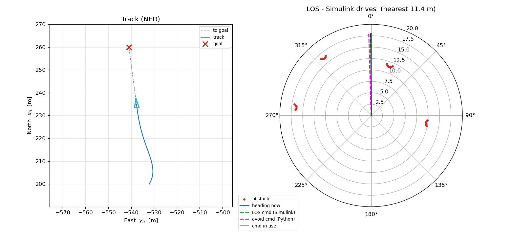
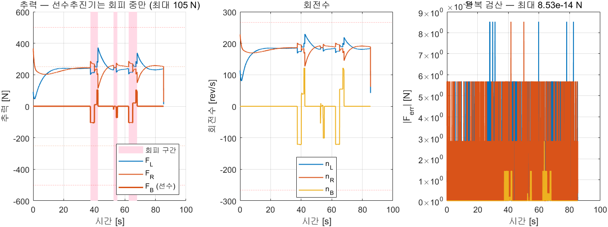
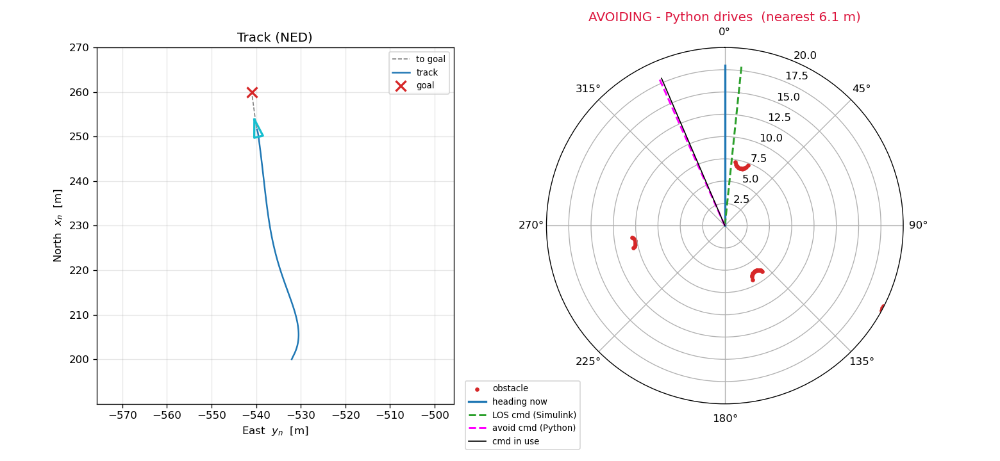
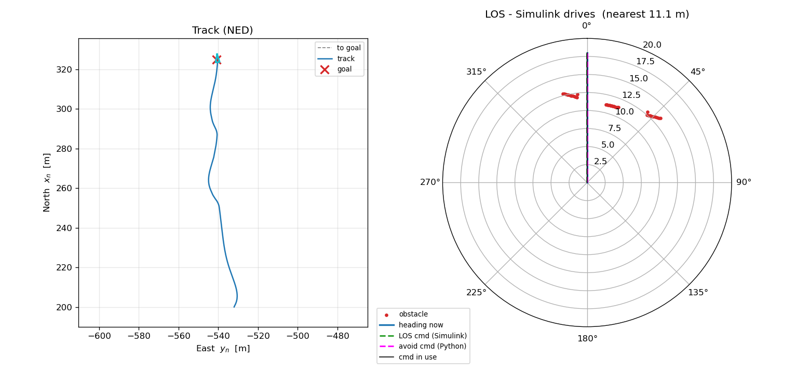

# 9주차 · 라이다 장애물회피, 파이썬 유도와 시뮬링크 제어

> [!important] 이번 학기 **녹화 강의 영상**은 여기에 올라감 — 수업에서 놓친 부분은 영상으로 확인할 것
> **<https://youtube.com/playlist?list=PLK_f1-krzJG8>**
>
> - 매주 수업 뒤 그 주차 영상이 이 재생목록에 추가됨
> - 아래 "참조 강의" 는 **지난 학기까지의 선수 과목**이고, 이 재생목록은 **이번 학기 본 수업** 녹화임

> [!important] 참조 강의 — 본 과목이 전제하는 배경
> <span style="font-size:0.88em">아래 다섯 과목은 **본 과목 담당 교수가 직접 강의한 것**이며, 본 과목이 전제하는 배경 지식에 해당함. 학부 기초에서 대학원 과정까지 이어지므로 부족한 지점부터 시작하면 됨. 본 문서에서 쓰는 좌표계·기호·유도 과정은 아래 강의에서 상세히 다루므로, 선수 지식이 부족한 경우 먼저 보고 돌아올 것.</span>
>
> | # | 과목 | 수준 | 언어 | 영상 | 자료·코드 |
> |---|---|---|---|---|---|
> | 1 | **제어공학** — 전달함수, 되먹임, 안정도, 근궤적, PID. 모든 것의 토대 | 학부 | 한국어 | [재생목록](https://youtube.com/playlist?list=PLFaUxNRM4BvJMpF9HZS-Mp8tDv9dTdglk) | [드라이브](https://drive.google.com/drive/folders/1TNIPDNtS_Iy8li-olka5WJslSXDYf0aT) |
> | 2 | **제어시스템설계** — 해석이 아니라 설계. 사양 결정, 루프 정형화, 이산 구현 | 학부 | 한국어 | [재생목록](https://youtube.com/playlist?list=PLFaUxNRM4BvIGroZ5rgn7x08F7C79d9WZ) | [드라이브](https://drive.google.com/drive/folders/11m5Xxl_PHJvxgHghLSP-jhCpmRpbvoXh) |
> | 3 | **캡스톤디자인** — 본 과목의 지난 학기 강의. 이동체 프로젝트를 처음부터 끝까지 | 학부 | 한국어 | [재생목록](https://youtube.com/playlist?list=PLFaUxNRM4BvLu7L0pDoLzDXTv8mm6rCmj) | [드라이브](https://drive.google.com/drive/folders/1haIQejlJfrdhtOuof-MpffR9ydVscXZS) |
> | 4 | **제어공학특론** — 좌표계, 6자유도 운동방정식, 회전행렬과 오일러각, 선형화와 트림 | 대학원 | 영어 | [재생목록](https://youtube.com/playlist?list=PLFaUxNRM4BvJmvF2ljx4KM5dj1P5jEcw0) | [드라이브](https://drive.google.com/drive/folders/1GUxbbONl916lNd0ggnFnXrNwNkd13-2-) |
> | 5 | **센서신호처리 및 융합** — 센서 모델, 잡음, 추정, 다중센서 융합 | 대학원 | 영어 | [재생목록](https://youtube.com/playlist?list=PLFaUxNRM4BvK-aP2Gdoyp5-AWvMn7Fo8E) | [드라이브](https://drive.google.com/drive/folders/1MEVJP7TzMcm8w6TZwUjhWJtL34WeNY3u) |
>
> <span style="font-size:0.88em">**MATLAB·Simulink 가 처음이라면 4주차 실습 전에 아래를 끝낼 것.** 본 과목의 제어기 실습은 전부 Simulink 로 진행함. Onramp 는 무료이며 각각 몇 시간이면 끝남</span>
>
> | 도구 | 시작 지점 |
> |---|---|
> | MATLAB | [MATLAB Onramp](https://matlabacademy.mathworks.com/kr/details/matlab-onramp/gettingstarted) · [Core MATLAB Skills](https://matlabacademy.mathworks.com/details/core-matlab-skills/lpmlcms) |
> | Simulink | [Simulink Onramp](https://matlabacademy.mathworks.com/kr/details/simulink-onramp/simulink) · 담당 교수 Simulink 강의 [1부](https://youtu.be/a-afHg_fSaU) · [2부](https://youtu.be/070Yn0Hw5a0) |

> [!important] 강의자료 저장소 — 처음 한 번만 `git clone`, 그 뒤로는 `git pull`
>
> | 저장소 | 주소 | 받는 자리 (WSL) |
> |---|---|---|
> | 강의자료 — 주차 문서 · Simulink 모델 · MATLAB 스크립트 | **<https://github.com/wkyouncnu/Capstone-Design>** | `~/Capstone-Design` |
> | ROS 2 예제 패키지 `usv_basics` — 2주차부터 쓰는 노드 코드 | **<https://github.com/wkyouncnu/usv_basics>** | `~/capstone_ws/src/usv_basics` |
>
> | 언제 | 명령 (VS Code 의 WSL 창 터미널) | 하는 일 |
> |---|---|---|
> | 처음 한 번 | `cd ~ && git clone https://github.com/wkyouncnu/Capstone-Design.git` | 강의자료 전체를 받음 (약 770 MB · 2026-10-16 실측 1분 40초) |
> | 처음 한 번 | `mkdir -p ~/capstone_ws/src && cd ~/capstone_ws/src && git clone https://github.com/wkyouncnu/usv_basics.git` | 예제 패키지를 받음. 이어서 `cd ~/capstone_ws && colcon build --symlink-install` |
> | 매주 수업 전 | `cd ~/Capstone-Design && git pull` · `cd ~/capstone_ws/src/usv_basics && git pull` | **바뀐 파일만** 받음. 다시 clone 하지 않음 |
> | 무엇이 바뀌었는지 | `git log --oneline -10` · `git show --stat HEAD` | 교수가 갱신한 내역을 확인 |
>
> - 두 저장소 모두 공개 — 로그인 없이 받아짐
> - 주차 문서는 `~/Capstone-Design/1_2026-2학기_강의자료/10-주차별-강의자료/` 에 있음. MATLAB 은 같은 폴더를 `\\wsl.localhost\Ubuntu-22.04\home\<사용자명>\Capstone-Design\...` 로 엶
> - `usv_basics` 를 받은 뒤 새 노드가 생겼으면 `colcon build --symlink-install` 을 한 번 더 돌림
> - 본인이 고친 파일 때문에 `git pull` 이 멈추면 `git stash` 로 치워 두고 다시 받음 → [[강의자료는-한-번-받고-git-pull-로-갱신한다]]

- **과목**: 캡스톤디자인 (2026-2) · 충남대학교 자율운항시스템공학과
- **이번 주차 학습 내용**: 배에 **3D 라이다**를 달아 앞을 보게 하고, 목표까지의 통로가 막혔을 때만 **파이썬이 헤딩 명령을 내도록** 함. 제어기는 5주차 것을 **한 줄도 바꾸지 않음**

> [!important] 9주차는 **중간 발표 주간**임
> - 중간고사는 없음. 대신 이번 주차에 **중간 발표**를 함 — 전체 평가의 **15%**
> - 가져올 것 둘: ① 1\~8주차 결과물 중 하나의 **동작 데모**, ② 팀별 Term Project **제안서 초안**
> - 발표 순서와 시간 배분은 [[평가와-팀운영]], 제안서 양식은 [[Term-Project-명세]] 를 따름
> - 이번 주차 실습은 발표 뒤에 진행함. 실습 분량이 많으므로 **① 터미널 1 을 발표 전에 미리 띄워 둘 것**

> [!important] 시작 전 확인
> - **강의자료부터 갱신**: VS Code WSL 창 터미널에서 `cd ~/Capstone-Design && git pull` ([[강의자료는-한-번-받고-git-pull-로-갱신한다]])
> - 6주차 `W06_vrx_lite/run_vrx_bow.sh` 가 동작했어야 함 — 이번 주차의 배는 **그 선수추진기 배에 라이다만 더 단 것**임
> - 5주차 `W05_1_vrx.slx` 가 동작했어야 함 — 이번 주차 모델은 **그것을 복사해서** 만듦
> - MATLAB **R2024b + Simulink + ROS Toolbox**
> - 배포 폴더 `W09_simulink/` 와 `W09_vrx_lite/`
> - WSL 메모리 여유 **8 GB 이상** — 라이다를 달면 Gazebo 서버가 장면을 렌더함

> [!important] 이번 주차 실행 요약 — 네 덩어리만 치면 됨
> 자세한 설명은 2부. 아래 순서는 2026-10-27 기준으로 확인한 것임
>
> **① 터미널 1 — 라이다를 단 Gazebo 띄우기** (창이 뜨면 닫지 않고 둠)
>
> ```bash
> cd ~/Capstone-Design && git pull
> cd ~/Capstone-Design/1_2026-2학기_강의자료/10-주차별-강의자료/W09_vrx_lite
> bash ../W03_vrx_lite/stop_vrx.sh
> bash run_vrx_ca.sh
> ```
>
> **② 터미널 2 — 회피 쪽 노드 셋 띄우기** (브리지 · 회피기 · 극좌표 그림)
>
> ```bash
> cd ~/Capstone-Design/1_2026-2학기_강의자료/10-주차별-강의자료/W09_vrx_lite
> bash run_ca_nodes.sh
> ```
>
> **③ MATLAB — 이음새를 붙여 돌리기**
>
> ```matlab
> cd('\\wsl.localhost\Ubuntu-22.04\home\<사용자명>\Capstone-Design\1_2026-2학기_강의자료\10-주차별-강의자료\W09_simulink')
> W09_setup
> W09_vrx_run
> ```
>
> **④ 끝낼 때 — 반드시 정리** (남은 `gz sim` 이 메모리를 수십 GB 까지 먹음)
>
> ```bash
> bash ../W03_vrx_lite/stop_vrx.sh
> ```
>
> | 이럴 때 | 할 것 |
> |---|---|
> | RTF 가 0.3 아래로 떨어짐 | ① 을 `bash run_vrx_ca.sh ultralite` 로 다시 (1-3 절) |
> | Rviz 로 장애물을 눈으로 보고 싶음 | 터미널 3 에서 `rviz2 -d w09_ca.rviz` (실습 D) |
> | 시뮬링크 없이 회피만 먼저 | ② 를 `GOAL="-532 312" DEMO_THRUST=1 bash run_ca_nodes.sh` 로 (실습 F) |
> | 라이다가 무엇을 보는지 숫자로 | `bash probe_lidar.sh` · `bash check_obstacles.sh` (실습 B · D) |
> | Gazebo 창이 안 뜸 | Windows PowerShell 에서 `wsl --shutdown` → 터미널을 새로 열고 ① 부터 |
> | 다음 실험 | ④ 부터 다시 |

> [!note] 8주차까지는 **아는 길**만 갔음
> - 5주차 LOS 유도는 "다음 웨이포인트가 저기 있으니 그쪽으로 선수를 돌려라" 가 전부였음 — 길에 무엇이 있는지는 보지 않았음
> - 8주차 Stateflow 는 **어느 모드로 갈지**를 골랐지만, 모드 안에서 가는 길은 역시 미리 정해진 선이었음
> - 즉 지금까지의 배는 **눈이 없었음**. 센서는 자기 위치와 자세만 알려 주었음
> - 이번 주차에 눈(라이다)을 달고, 눈이 "앞이 막혔다" 고 할 때만 길을 바꿈
> - 바꾸는 것은 **길뿐**임. 그 길을 따라가는 제어기는 5주차 것을 그대로 씀

---

## 이 주차를 마치면 할 수 있어야 하는 것

1. **유도와 제어의 경계**를 말하고, 회피가 왜 유도단에 들어가는지 설명하기
2. VRX WAM-V 에 **3D 라이다를 달고** 위치(특히 높이)를 **실측 근거로** 정하기
3. ROS 의 **FLU** 축과 본 과목의 **FRD** 축을 변환하고, 부호를 틀리면 무엇이 깨지는지 말하기
4. 라이다 성능을 세 판으로 낮춰 보고, **RTF 와 발행 주기 중 무엇이 실제 제약인지** 측정으로 가리기
5. Rviz2 에서 `PointCloud2` 로 장애물을 띄우고, **다가갈수록 거리가 줄어드는 것**을 숫자로 확인하기
6. 라이다 거리값을 **장애물 점 묶음**으로 바꾸는 전처리(걸러내기·군집)를 설명하기
7. **호 다발(arc bank)** 회피기의 세 걸음 — 깔기 · 지우기 · 점수 매기기 — 를 코드와 대조하며 설명하기
8. 선체를 **원이 아니라 직사각형**으로 재는 이유를 숫자로 제시하기
9. `oa_flag` 가 **거리 문턱이 아니라 통로 판정**임을 설명하고, 그래서 언제 켜지는지 예로 들기
10. Simulink 쪽 **이음새(스위치 + 명령 나이)** 를 만들고, 명령이 끊겼을 때 무엇으로 되돌아가는지 보이기

---

## 준비물

| 구분 | 내용 |
|---|---|
| 소프트웨어 | MATLAB R2024b · Simulink · ROS Toolbox · WSL2 Ubuntu 22.04 · ROS 2 Humble · Gazebo Garden · VRX 2.4.1 · `rviz2` · `python3-matplotlib` |
| 배포 폴더 | `W09_vrx_lite/` (URDF 생성·실행·측정·시각화 11개) · `W09_simulink/` (모델 1개 + m 파일 4개) |
| 선행 | 6주차 (선수추진기 배와 `run_vrx_bow.sh`) · 5주차 (LOS 유도와 `W05_1_vrx.slx`) · 3주차 (VRX lite 실행과 좌표계) · 2주차 (토픽) |
| 시간 | 이론 50분 + 실습 150분 (중간 발표와 같은 주차이므로 발표 뒤 실습) |

---

# 1부 · 이론

## 1-1. 역할 분담 — 유도는 둘, 제어는 하나


- 그림 읽는 법

| 요소 | 의미 |
|---|---|
| 위쪽 묶음 (Simulink) | 제어는 **여기 하나뿐**임. LOS 유도 → AvoidSeam → 헤딩 P-D·속도 PI → 추력배분 |
| 파란 상자 `AvoidSeam` | 이번 주차에 **새로 생긴 유일한 칸**. 하는 일은 "어느 헤딩 명령을 쓸까" 의 판단 하나 |
| 주황 상자 헤딩 P-D · 속도 PI | 5주차 것 **그대로**. 블록 하나도 바뀌지 않음 |
| 왼쪽 아래 묶음 (ROS 2 · Python) | 유도를 **하나 더** 냄. 회피기와 좌표 브리지 둘 |
| 오른쪽 아래 묶음 (Gazebo · VRX) | 라이다 · 위치·자세 · 추진기 셋 |
| 화살표에 붙은 글자 | ROS 2 토픽 이름. 두 세계를 잇는 것은 **토픽 다섯**뿐임 |
| 점선 화살표 | 되먹임 — 위치·자세는 Simulink 와 파이썬이 **같은 토픽**에서 받음 |
| 맨 아래 `ca_viz` | 극좌표 실시간 그림. 파이썬이 그림 (1-10 절) |

- 이 그림이 말하는 것은 한 줄임 — **5주차와 달라진 자리는 `AvoidSeam` 한 칸뿐임**
- 유도가 둘(LOS 와 회피)로 늘고, 그 둘 중 하나를 고르는 상자가 생긴 것이 전부임
- 헤딩 P-D · 속도 PI · 추력배분 · 운동모델은 **그대로**임

### 두 세계를 잇는 토픽 다섯

| 토픽 | 메시지형 | 방향 | 담는 것 |
|---|---|---|---|
| `/wamv/sensors/lidars/lidar_wamv_sensor/scan` | `sensor_msgs/LaserScan` | Gazebo → Python | 라이다 거리값 한 고리 |
| `/wamv/sensors/position/ground_truth_odometry` | `nav_msgs/Odometry` | Gazebo → 양쪽 | 위치·자세 (ENU) |
| `/usv/state/goal_enu` | `geometry_msgs/Point` | Simulink → Python | 목표점. `x` = 동, `y` = 북 |
| `/vfh/command` | `geometry_msgs/Twist` | Python → Simulink | `angular.z` = **절대 방위각**(ENU, rad), `linear.x` = 속력 |
| `/vfh/oa_flag` | `std_msgs/Bool` | Python → Simulink | 피하는 중이면 `true` |

> [!important] `/vfh/command` 의 `angular.z` 는 **각속도가 아님**
> - `Twist` 라는 이름 때문에 `angular.z` 를 요 각속도로 읽기 쉬움. 여기서는 **절대 방위각**임
> - 즉 "지금부터 초당 몇 도씩 돌아라" 가 아니라 "**동쪽을 0 으로 재서 이 방향을 보라**" 임
> - 메시지형을 새로 만들지 않고 기존 `Twist` 에 얹은 것이라 이렇게 됨 — 실무에서 흔한 타협이며, 받는 쪽이 뜻을 알고 있어야 함
> - Simulink 쪽은 이 값을 받아 바로 NED 로 돌려 헤딩 명령으로 씀 (1-7 절)

### 말로만 그런가 — `rqt_graph` 로 찍어 본 것

- 위 표는 **설계도**임. 실제로 그렇게 붙었는지는 돌려 놓고 그래프를 찍어 봐야 앎



- 타원이 **노드**, 네모가 **토픽**, 화살표가 발행·구독 방향임

| 그림에서 볼 것 | 뜻 |
|---|---|
| 연파랑 타원 `/W09_1_vrx_…` | **Simulink 모델이 띄운 ROS 2 노드**임. 뒤의 숫자는 돌릴 때마다 바뀜 |
| 거기서 **나가는** 화살표 다섯 | `/usv/state/goal_enu` · `/sim/psi_los` · `/sim/psi_cmd` · 추진기 좌·우 |
| 거기로 **들어오는** 화살표 셋 | `/vfh/command` · `/vfh/oa_flag` · `ground_truth_odometry` |
| 크림색 네모 | 이번 주차에 **새로 생긴** 토픽. `/sim/` · `/vfh/` · `/usv/` 셋뿐임 |
| `/collision_avoidance_enu` | 파이썬 회피기. 스캔과 `/wamv/gps_pose` 를 받아 `/vfh/*` 를 냄 |
| `/ca_viz` | 그림만 그림 — 화살표가 **들어오기만** 함. 아무것도 내지 않음 |

> [!important] 이 한 장이 증거인 까닭
> - Simulink 가 ROS 2 쪽에서 **보통 노드 하나로 보인다**는 것을 눈으로 확인하는 자리임. 특별한 것이 아님
> - 노드 이름은 **모델 이름**(`W09_1_vrx`)에서 나옴. 모델을 바꾸면 이름도 바뀜
> - **돌아가는 동안에만** 보임. `sim` 이 끝나면 목록에서 사라짐 — 그래서 찍는 때가 중요함

- 찍는 법 — **시뮬레이션이 도는 동안**에 쳐야 함

```bash
export ROS_DOMAIN_ID=7
rqt_graph
```

- 실제로 떠 있는 것은 이보다 훨씬 많음. 다리(`ros_gz_bridge`)와 가제보 쪽까지 다 그리면 이렇게 됨



- 이 장은 **읽으라고 싣는 것이 아님**. "다리 하나가 토픽을 몇 개나 나르는가" 를 한 번 보고 넘기는 용도임
- 위의 간추린 장은 이 중에서 `ros_gz_bridge` · 센서 원본 · 측정용 도구를 지운 것임

### 토픽 다섯의 실측 주기

| 토픽 | 실측 주기 | QoS | 재는 법 |
|---|---|---|---|
| `/sim/psi_los` | $19.69$ Hz | RELIABLE · VOLATILE | `ros2 topic hz /sim/psi_los` |
| `/sim/psi_cmd` | $19.44$ Hz | RELIABLE · VOLATILE | 〃 |
| `/vfh/command` | $19.38$ Hz | RELIABLE · VOLATILE | 〃 |
| `…/lidar_wamv_sensor/scan` | $9.93$ Hz | SENSOR_DATA | 〃 |
| `/wamv/gps_pose` | $9.92$ Hz | SENSOR_DATA | 〃 |

- 제어는 $20$ Hz(`Ts_ctrl` $=0.05$ s)인데 스캔은 $10$ Hz 임 — **센서가 절반 느림**
- 그래서 회피 명령도 $10$ Hz 로밖에 새로 서지 않음. 이음새의 `oa_timeout` 을 $0.5$ s 로 둔 까닭임 (스캔 다섯 번 치 여유)

> [!note] MATLAB 이 찍는 "토픽 `/vfh/command` 에 손실된 메시지" 경고는 정상임
> - ROS 쪽이 Simulink 샘플 주기보다 빨리 내면 이 경고가 뜸
> - 제어는 **가장 최근 값 하나**만 쓰므로 버려지는 것이 맞음. 고장이 아님

### 왜 제어까지 파이썬으로 옮기지 않는가

- 연구실 원본 런치(`vrx_avoidance_enu.launch.py`)는 **헤딩 제어까지 파이썬**이 했음. 그쪽이 코드는 짧음
- 그런데 그렇게 하면 이 과목이 1\~8주차에 만든 것이 **전부 쓰이지 않음**
- 더 중요한 이유 둘

| 까닭 | 설명 |
|---|---|
| 제어는 주기가 생명임 | 헤딩 P-D 는 `Ts_ctrl` = 0.05 s 로 돎. 파이썬 노드는 OS 스케줄러에 맡겨진 20 Hz 임 — 흔들림이 큼 |
| 책임이 섞이면 못 고침 | 배가 휘청일 때 "제어 이득이 나쁜가, 회피 명령이 튀는가" 를 가릴 수 없음. 둘을 갈라 두면 로그 한 장으로 가려짐 |

- 그래서 경계를 이렇게 그음

| 하는 일 | 누가 | 까닭 |
|---|---|---|
| 어디로 갈까 (유도) | LOS 는 Simulink, 회피는 Python | 회피는 센서 자료가 크고 알고리즘이 자주 바뀜 — 스크립트 쪽이 유리함 |
| 어느 명령을 쓸까 (판단) | Simulink (`AvoidSeam`) | 제어기 바로 앞이므로 제어기와 같은 주기로 돌아야 함 |
| 어떻게 갈까 (제어) | Simulink | 주기가 일정해야 하고, 이미 튜닝이 끝났음 |

---

## 1-2. 라이다를 어디에 달 것인가 — 높이는 계산이 아니라 실측으로


- 그림 읽는 법

| 요소 | 의미 |
|---|---|
| 위쪽 (평면도) | 위에서 본 배. 큰 원은 라이다의 360° 시야 |
| 두 개의 긴 사각형 | 좌·우 선체(hull). 가운데가 비어 있는 쌍동선임 |
| 이중 원 | 라이다. `base_link` 에서 앞으로 $0.70$ m, 좌우 중앙 |
| 작은 사각형 셋 | 추진기 셋 — 좌·우·선수 (6주차에서 단 것) |
| 아래쪽 (측면도) | 옆에서 본 배. 가로 실선은 수면 |
| 붉은 반투명 상자 | `cpu_cases_link` — 라이다 바로 아래에 있는 장비함. 윗면이 수면 기준 $1.765$ m |
| 세 개의 높이 눈금 | 시험해 본 높이들. 채택한 $1.90$ m 와 그 아래 두 개 |
| $13.5$ cm 치수선 | 장비함 윗면과 라이다 사이 여유 |
| 아래로 기운 가는 선 | 가장 아래 광선($-15°$). 수면과 $7.09$ m 앞에서 만남 |

> [!warning] ROS 의 축과 본 과목의 축은 **$y$ 와 $z$ 의 부호가 반대**임
> URDF·TF 는 ROS 관례(REP-103)인 **FLU** 를 씀. 본 과목의 제어식은 Fossen 관례인 **FRD** 를 씀
>
> | 축 | ROS (URDF·TF, FLU) | 본 과목 제어식 (FRD) | 바꾸는 법 |
> |---|---|---|---|
> | $x$ | 선수 | 선수 | 그대로 |
> | $y$ | **좌현** | **우현** | $y_{FRD} = -y_{FLU}$ |
> | $z$ | **위** | **아래** | $z_{FRD} = -z_{FLU}$ |
>
> - 예: 좌현 추진기의 URDF 값은 $y_{FLU} = +1.027$ 이지만, 추력배분 행렬에는 $y_{b,L} = -1.027$ 로 들어감
> - 위 장착 그림의 평면도는 **URDF 축(좌현 양수)** 으로 그려져 있음 — 5주차부터 쓰는 NED 식과 부호가 반대이므로 주의할 것
> - 라이다 값을 쓸 때도 같음. 회피 코드 안의 점은 $y$ 가 **좌현 양수**임 (1-4 절)

### 실측한 센서·추진기 배치

| 부품 | $x$ [m] | $y$ [m] | $z$ [m] | 비고 |
|---|---|---|---|---|
| **3D 라이다** (이번 주차) | $+0.700$ | $0.000$ | $\mathbf{1.900}$ | 가장 높음. 360° |
| 카메라 (좌·우 전방) | — | — | $1.500$ | 10주차 이후 사용 |
| GPS | $-0.850$ | $0.000$ | $1.300$ | |
| IMU | $+0.300$ | $-0.200$ | $1.300$ | |
| 추진기 좌·우 | $-2.374$ | $\pm 1.027$ | $0.318$ | 5주차 |
| 추진기 선수 | $+0.750$ | $0.000$ | $0.318$ | 6주차 |

- 위 값은 **VRX 실행 중 TF 에서 측정**한 것임. 추정치가 아님
- VRX 기본 라이다는 $z = 1.800$ · $y = -0.300$ 임 — 이번 주차는 둘 다 바꿈. 까닭이 아래 셋임

### 왜 $z = 1.90$ 인가 — $1.75$ 와 $1.80$ 사이에 절벽이 있음

- 360° 라이다를 배 위에 달면 광선 일부가 **자기 배**를 때림. 그 값은 장애물이 아닌데 회피기는 장애물로 받음
- 그러면 **가만히 떠 있어도 회피 모드가 켜진 채로** 있게 됨
- 그래서 높이를 바꿔 가며 "들어온 값 중 선체 외곽 안쪽에서 온 비율" 을 셈 (`probe_lidar_pose.sh`)

```
높이z 자기배 수면 쓸수있음 가장가까운
1.65        82%      0%      25     35.30
1.70        82%      0%      25     35.32
1.75        81%      0%      25     35.33
```

| 높이 $z$ [m] | 자기 배 비율 | 판정 |
|---|---|---|
| $1.65$ | **82 %** | 들어온 값 넷 중 셋이 자기 배임 — 쓸 수 없음 |
| $1.70$ | **82 %** | 같음 |
| $1.75$ | **81 %** | 같음 |
| $1.80$ · $2.20$ · $2.60$ | **0 %** | 갑자기 사라짐 |

- $1.75$ 와 $1.80$ 사이에서 82 % 가 0 % 로 **한 번에** 떨어짐. 서서히 줄지 않음 — 즉 **무엇인가 하나**가 가리고 있다는 뜻임
- 범인은 `cpu_cases_link` 임

| 항목 | 값 |
|---|---|
| 관절 원점 $z$ | $1.530$ m |
| 상자 크기 | $0.59 \times 0.83 \times 0.47$ m |
| 윗면 높이 | $1.530 + 0.47/2 = \mathbf{1.765}$ m |

- 라이다를 $1.765$ m 아래에 달면 수평 광선이 이 상자의 측면을 때림. 위로 올리면 상자 위를 지나감
- 그래서 **$1.80$ 이면 되는데 왜 $1.90$ 인가** — 파도에 기울기 때문임

| 라이다 높이 | 장비함 윗면과의 여유 | 그 여유가 사라지는 횡경사 |
|---|---|---|
| $1.80$ m | $3.5$ cm | 약 $5°$ |
| **$1.90$ m** | $13.5$ cm | 약 $\mathbf{18°}$ |

- $5°$ 는 잔파도에서도 나옴. $18°$ 면 이 월드에서는 거의 안 나옴 → $1.90$ 으로 둠

> [!note] 수면 반사는 **문제가 아니었음**
> - 흔히 "라이다를 낮추면 물에 맞아 헛점이 생긴다" 고 함. 이 월드에서는 **모든 높이에서 수면 비율이 0 %** 였음
> - 가장 아래 광선($-15°$)이 수면과 만나는 거리는 $1.9 / \tan 15° = 7.09$ m 임 — 즉 물리적으로는 고리가 생길 자리가 있음
> - 그런데 VRX 의 수면은 라이다에 **되돌아오지 않는 재질**임. 실제 바다와 다른 점이고, 실선 시험에서는 다시 확인해야 하는 항목임

### 높이를 올리면 잃는 것

| 항목 | $1.80$ m | $1.90$ m |
|---|---|---|
| $0.5$ m 부표를 처음 보는 거리 | $4.85$ m | $5.2$ m |

- 높이면 **멀리** 보지만 **발밑**을 못 봄. 올릴수록 근거리 사각지대가 커짐
- 위 표는 그 대가가 $35$ cm 라는 뜻임. 호 다발이 보는 거리는 앞으로 $4.5$ m 뿐이므로 (1-5 절) 이 정도는 감수함

### 왜 $x = 0.70$, $y = 0$ 인가

| 좌표 | 값 | 까닭 |
|---|---|---|
| $x$ | $+0.70$ | 선수추진기($+0.75$) **바로 위**. 앞쪽에 둘수록 전방 사각지대가 작아짐. 더 앞으로 보내면 매달 구조물이 없음 |
| $y$ | $0$ | VRX 기본값은 $-0.3$ 임. 360° 센서를 중심선에서 $30$ cm 옮기면 **좌현과 우현이 서로 다른 거리로 보임** — 좌·우를 고르는 판단에 편향이 들어감 |

- 라이다 마스트 길이는 $z - 1.2965 - 0.05$ 로 계산되므로 $z$ 는 $1.35$ m 보다 커야 함. $1.90$ 은 이 제약을 만족함

---

## 1-3. 라이다의 성능은 RTF 가 아니라 **발행 주기**가 정함

- 라이다를 달면 Gazebo 서버가 매 스캔마다 장면을 렌더함. 그래서 느려질 것이라고 예상함
- 그런데 **무엇이 느려지는지**를 가려야 함. 둘은 다른 문제임

| 재는 것 | 뜻 | 낮으면 |
|---|---|---|
| **RTF** (real-time factor) | 모의가 실제 시간을 얼마나 따라가는가. $1.0$ = 같은 속도 | 제어 주기가 설계대로 돌지 않음 |
| **발행 주기** (points Hz) | 라이다가 실제로 몇 번 자료를 내는가 | 회피기가 **낡은 장면**을 보고 판단함 |

### 라이다 세 판

| 판 | 빔 $\times$ 샘플 | 점/스캔 | 최대거리 | 설계 주기 | 쓰는 자리 |
|---|---|---|---|---|---|
| `full` | $16 \times 1875$ | $30{,}000$ | $130$ m | $10$ Hz | VRX 원본 그대로. 비교용 |
| **`lite`** | $16 \times 440$ | $\mathbf{7{,}040}$ | $40$ m | $10$ Hz | **기본값** |
| `ultralite` | $8 \times 220$ | $1{,}760$ | $30$ m | $5$ Hz | RTF 가 $0.3$ 아래일 때 |

### 재 본 결과 (2026-10-27 · headless · 판마다 20초)

```
판            점/스캔   RTF_단독   RTF_구독중   points_Hz
none              0       0.99          -          -
ultralite      1760       0.99       0.99       4.97
lite           7040       0.99       0.99       9.96
full          30000       0.99       0.99       0.62
```

- 읽는 법 셋

| 관찰 | 뜻 |
|---|---|
| RTF 가 네 판 모두 $0.99$ | **RTF 는 제약이 아님**. 라이다를 달아도 모의 속도는 떨어지지 않음 |
| `lite` 의 발행이 $9.96$ Hz (설계 $10$) | 설계대로 나옴 — 쓸 수 있음 |
| `full` 의 발행이 $0.62$ Hz | 설계 $10$ Hz 의 **$1/16$**. 한 장에 $1.61$ s 걸림 |

> [!important] `full` 판을 쓰면 회피기가 **멈춤 상태로 고정**됨
> - 회피기에는 `sys.sensor_timeout_sec` = $0.5$ s 가 있음. 마지막 스캔이 $0.5$ s 보다 오래되면 "센서가 끊겼다" 로 보고 **속력 0** 을 냄
> - `full` 의 스캔 간격은 $1.61$ s 임 — 즉 **항상** 문턱을 넘음. 배가 아예 안 움직임
> - 그래서 기본값은 `lite` 임. 고른 근거는 추측이 아니라 위 표임
> - RTF 만 보고 "$0.99$ 니까 `full` 도 되겠지" 라고 판단하면 틀림. **두 숫자를 같이 봐야 함**

> [!note] RTF 를 왜 두 번 재는가
> - 구독자가 붙으면 점구름을 **받아서 푸는** 비용이 따로 듦. `full` 은 한 장이 약 $960$ KB 임
> - 그래서 "아무도 안 볼 때" 와 "한 명이 볼 때" 를 나눠 재어 둠. 실제 데모는 뒤쪽 숫자로 돎
> - 이 월드에서는 둘이 같았음($0.99$) — 즉 받아 푸는 비용은 무시할 수 있었음

---

## 1-4. 라이다 값을 장애물 점으로 바꾸는 법

- 회피기는 거리값 배열을 바로 쓰지 않음. **선체 기준 2차원 점 묶음**으로 바꿈 (`scan_to_points`)
- 걸음 셋

| 걸음 | 하는 일 | 매개변수 (기본값) |
|---|---|---|
| ① 걸러내기 | `inf`·`nan` 을 버리고, 너무 가깝거나 너무 먼 값을 버림 | `lidar.ignore_radius_m` $= 0.6$ · `lidar.max_range_m` $= 10.0$ |
| ② 좌표 바꾸기 | 각도·거리를 $x$(선수) · $y$(좌현) 로 바꿈 | — |
| ③ 군집 | 이웃한 값들을 묶고, **점이 적은 묶음은 버림** | `cluster_min_points` $= 3$ · `cluster_max_gap_m` $= 0.45$ |

- ① 의 `ignore_radius` $= 0.6$ m 는 **자기 배를 지우는 마지막 안전장치**임. 1-2 절에서 높이로 이미 해결했으므로 평소에는 할 일이 없음
- ① 의 `max_range` $= 10$ m 는 라이다 성능($40$ m)보다 훨씬 짧음. 까닭은 1-5 절 끝에 있음
- ③ 이 중요함 — 혼자 떠 있는 점 하나는 **잡음**으로 보고 버림. 그렇게 하지 않으면 헛점 하나에 배가 피함

> [!note] 회피기가 쓰는 것은 `/scan` 한 고리뿐임
> - 라이다는 토픽 둘을 냄 — `/points` (`PointCloud2`, 열여섯 고리 전부) 와 `/scan` (`LaserScan`, **한 고리**)
> - 회피기는 `/scan` 을 씀. 즉 이 회피기는 **평면 회피**임 — 높이를 보지 않음
> - 물 위를 떠다니는 부표·배를 피하는 데에는 충분함. 다리 아래나 경사면에서는 모자람
> - 열여섯 고리를 다 쓰면 무엇이 달라지는지는 다음 주차에서 다룸

---

## 1-5. 호 다발 21개 중 하나를 고름


- 그림 읽는 법

| 요소 | 의미 |
|---|---|
| 가운데 초록 사각형 | 지금의 배. 외곽 $4.9 \times 2.46$ m — **원이 아니라 직사각형**임 |
| 원점에서 뻗는 선 여러 개 | 깔아 둔 호. 선회율 $-12 \sim +12$ °/s 를 21개로 나눈 것 (그림에는 11개만) |
| 붉은 점선 | 3초 안에 선체가 **닿는** 호. 점수를 매기지 않고 바로 지움 |
| 회색 실선 | 살아남은 호. 이 중에서 점수로 고름 |
| 굵은 청록 | 고른 호. 선회율 $+12°$/s, 반지름 $7.16$ m |
| 청록 점선 사각형 | 3초 뒤의 배. $36°$ 돌았고 $4.5$ m 갔음 |
| 붉은 점 묶음 둘 | 장애물 묶음. 군집을 거쳐 남은 점들 |
| 동그라미 친 점 하나 | 선체 폭 $\pm 1.23$ m 안에 들어와 있는 점 — **직진이 지워지는 이유**이고 `oa_flag` 가 1 이 되는 이유 |
| 파란 점선 화살표 | 목표점 방향 |
| 아래쪽 글상자 | 점수식과 그 뜻 |

### 걸음 셋 — 깔고, 지우고, 점수를 매김

**① 깔기** — 배가 **실제로 낼 수 있는** 선회율 21개를 미리 깔아 둠

- 자유롭게 "어디로 갈까" 를 고르지 않음. 낼 수 있는 선회율만 후보로 둠
- 선회율 $r$ 로 속력 $u$ 로 돌면 반지름 $R = u/r$, 시간 $T$ 뒤 선회각 $\Phi = rT$

| 선회율 $r$ [°/s] | 반지름 $R$ [m] | 3초 뒤 선회각 $\Phi$ | 호 길이 |
|---|---|---|---|
| $12.0$ | $7.16$ | $36.0°$ | $4.5$ m |
| $9.6$ | $8.95$ | $28.8°$ | $4.5$ m |
| $7.2$ | $11.94$ | $21.6°$ | $4.5$ m |
| $4.8$ | $17.90$ | $14.4°$ | $4.5$ m |
| $2.4$ | $35.81$ | $7.2°$ | $4.5$ m |
| $0$ | $\infty$ (직진) | $0°$ | $4.5$ m |

- $u = 1.5$ m/s · $T = 3$ s 이므로 호 길이는 모두 $4.5$ m 임. 호마다 15 걸음으로 나누어 따라감
- 함수 `simulate_arc_bank` 는 점 좌표만 내지 않고 **각 점에서의 선수각**도 함께 냄. 까닭은 바로 아래임

**② 지우기** — 3초 안에 선체가 닿는 호를 지움

> [!important] 선체를 **원으로 재면 못 지나감**
> - 배를 반지름 $5$ m 짜리 원으로 근사하면, 폭 $10$ m 아래의 통로는 **전부** 막힌 것으로 나옴
> - 실제 WAM-V 는 길고 좁음 — 길이 $4.9$ m, 폭 $2.46$ m
> - 그래서 `footprint_clearance` 는 **직사각형에서 점까지의 거리**를 잼. 직사각형은 방향이 있으므로 **각 점에서의 선수각**이 필요함 — ① 에서 선수각을 함께 낸 이유임
> - 코드 상수는 WAM-V URDF 의 충돌 형상에서 가져온 것임
>
> ```python
> HULL_X_MIN, HULL_X_MAX = -2.4, 2.5
> HULL_HALF_WIDTH = 1.23
> ```
>
> - 원 근사도 코드에 남아 있음(`arc_collides` 의 `head is None` 경로) — 둘을 바꿔 가며 비교해 보라고 남긴 것임 (과제 ②)

**③ 점수 매기기** — 살아남은 호 중 하나를 고름

$$
\text{score} \;=\; \underbrace{\bigl(1 - \text{align}\bigr)}_{\text{목표를 향하는가}} \;+\; 0.3 \cdot \underbrace{\text{clip}\!\left(\frac{d_{min}-r}{3},\,0,\,1\right)}_{\text{여유가 넉넉한가}}
$$

| 기호 | 뜻 | 값 |
|---|---|---|
| $\text{align}$ | 2초 뒤 선수각이 목표 방위에서 얼마나 벗어나는가를 $0 \sim 1$ 로 잰 것 | `plan.control_lookahead_sec` $= 2.0$ |
| $d_{min}$ | **직사각형 선체에서 장애물 점까지**의 최소 거리 | — |
| $r$ | 안전 여유 — 호를 지울 때와 같은 값을 씀 | `robot.safety_margin_m` $= 1.20$ |
| $3$ | "이만큼 여유가 있으면 만점" 의 기준 | `plan.clearance_scale_m` $= 3.0$ |
| $0.3$ | 여유에 주는 가중치 | `plan.clearance_weight` $= 0.30$ |

- 가중치가 $0.3$ 이므로 **목표 쪽으로 가는 것이 여유보다 세 배 무거움** — 통로가 열려 있으면 굳이 넓은 쪽으로 돌지 않음
- 점수가 같을 때는 선회율이 작은 쪽을 고름(`- 1e-6 * |rates|`) — 쓸데없이 돌지 않게 하는 미세 항임

### 왜 $\text{align}$ 을 **2초**로 재는가

- 호는 3초 앞까지 따라가지만, 명령으로 내보내는 것은 $2$ 초 뒤의 선수각임 (`CTRL_T`)
- 이 둘이 어긋나 있던 적이 있음 — 평가한 호, 점수를 매긴 시점, 내보낸 명령이 **서로 다른 시간축** 위에 있었음
- 지금은 셋을 하나로 맞춰 둠. 짧게 잡으면(예: $0.2$ s) $12°/\text{s} \times 0.2 = 2.4°$ 밖에 못 돌아 조타가 사실상 안 됨

### 전부 막혔을 때 — 탈출

- 21개가 모두 지워질 수 있음. 그러면 속력을 $\text{max} \times 0.30$ 으로 낮추고 (`robot.min_speed_ratio`) 호를 $0.3$ 배로 줄여 다시 잼
- 고르는 기준이 바뀜 — **여유 + $0.6 \times$ 목표 정렬** (`plan.blocked_goal_weight` $= 0.6$)

> [!warning] 여유만 보고 고르면 배가 목표를 등지고 섬
> - 처음에는 "가장 넓은 쪽" 만 골랐음. 그러자 넓은 쪽이 **목표 반대 방향**인 자리에서 배가 그쪽을 보고 멈춰 있었음
> - 실제로 $380$ 초를 그렇게 보냈음. 막혀 있으니 호는 계속 지워지고, 가장 넓은 쪽은 계속 뒤쪽이었음
> - 그래서 탈출에도 목표 정렬 항을 넣음. 같은 실수를 본인 알고리즘에서도 하기 쉬운 지점임

### 속력은 여유에 비례해서 줄임

| 선체 여유 | 속력 |
|---|---|
| $\le$ `safety_margin_m` ($1.20$ m) | $\text{max} \times 0.30$ |
| $\ge 1.20 + $ `slow_scale_m` ($4.0$ m) | $\text{max}$ ($1.5$ m/s) |
| 그 사이 | 1차로 비례 |

- 예전에는 $1.5$ 와 $0.45$ 두 값만 있었음 — 문턱을 넘을 때 속력이 **툭** 바뀌어 배가 끄덕였음
- 이력(hysteresis)도 있음 — 고른 호는 새 후보가 `plan.hysteresis_margin` $= 0.10$ 만큼 더 좋지 않으면 **바꾸지 않음**. 없으면 비슷한 점수의 두 호 사이에서 조타가 떪

> [!important] 3초는 $4.5$ m — **자기 배 길이 $4.9$ m 보다 짧음**
> - 호 다발 전체가 폭 $2.7$ m $\times$ 깊이 $4.5$ m 밖에 안 되는 손바닥만 한 부채임
> - 그래서 이 회피기는 **멀리 보는 기계가 아니라 가까이를 놓치지 않는 기계**임
> - 라이다를 $130$ m 까지 늘려도 쓰이지 않음 — `lidar.max_range_m` 기본값이 $10$ m 인 이유임
> - 실제 제약은 선회율이 $12°$/s 뿐이라는 것임. 3초에 $36°$ 밖에 못 돎
> - 더 멀리 보고 싶으면 늘릴 것은 라이다가 아니라 **`plan.sim_time_sec`** 임 (과제 ②)

### 모드 둘 — GOAL 과 HOLD

| 모드 | 들어가는 때 | 통로가 열려 있으면 | 막혀 있으면 |
|---|---|---|---|
| **GOAL** | 목표점이 들어와 있음 | 목표 쪽으로 직진 | 호 다발에서 하나 고름 |
| **HOLD** | 목표점이 없음 | 제자리에 섬 | 장애물 **반대쪽**으로 $0.6$ m/s 로 비킴 |

- 이번 주차 데모는 GOAL 모드만 씀 — 목표점을 Simulink 가 계속 내기 때문임
- 목표점에 $2$ m 안으로 들어가면 속력 0 을 내고 `oa_flag` 를 내림

---

## 1-6. `oa_flag` 는 거리 문턱이 **아님**

- 가장 많이 틀리는 지점임. `oa_flag` 는 "장애물이 몇 m 안에 있는가" 의 답이 **아님**
- **"목표까지의 직진 통로가 막혔는가"** 의 답임

```
dclear = 직진 경로를 따라갔을 때의 선체 최소 여유
dclear >= MARGIN (1.20 m)  →  oa_flag = false   (LOS 가 그대로 간다)
dclear <  MARGIN           →  oa_flag = true    (파이썬이 조타를 잡는다)
```

| 상황 | 가장 가까운 장애물 | `oa_flag` | 까닭 |
|---|---|---|---|
| 좌현 $8$ m 에 부표, 앞은 비었음 | $8$ m | **0** | 직진 통로가 열려 있음 |
| 정면 $30$ m 앞이 벽 | $30$ m | **1** | 직진하면 결국 닿음 |
| 선미 $3$ m 에 부표 | $3$ m | **0** | 가는 방향이 아님 |

- 즉 플래그가 0 인데 장애물이 가까이 있는 것은 **정상**임. 거리를 보지 않기 때문임
- 로그를 읽을 때도 이것을 기억해야 함 — "$8.7$ m 인데 회피가 꺼졌다" 는 버그가 아님

---

## 1-7. 이음새 — 스위치 하나와 명령의 나이 하나


- 그림 읽는 법

| 요소 | 의미 |
|---|---|
| 왼쪽 위 `CmdSub` | `/vfh/command` 를 받음. 출력 둘 — **1번 `IsNew`**, 2번 `Msg` |
| `SelCmd` → `EnuToNed` | `angular.z` 를 뽑아 ENU 방위각을 NED 선수각으로 돌림 |
| 왼쪽 아래 `FlagSub` | `/vfh/oa_flag` 를 받음 |
| 가운데 `Age` (적분기) | 마지막 명령이 **들어온 지 몇 초 지났는가** |
| `Fresh` ($<$) · `Take` (AND) | 판단 — 플래그가 1 **이고** 명령이 신선한가 |
| 오른쪽 `Pick` (스위치) | 위 입력 = 회피, 가운데 = 판단, 아래 = LOS |

- 하는 일은 한 줄임 — **제어기에 들어가는 명령을 누가 낼지 고름**

```
판단 = oa_flag  AND  (명령이 끊긴 지 oa_timeout 초보다 적다)

판단 = 0  →  psi_ref = psi_los   (5주차와 완전히 같음)
판단 = 1  →  psi_ref = psi_oa    (파이썬이 낸 값)
```

### 왜 "나이" 를 재는가

- 파이썬 노드가 죽거나 WSL 이 버벅대면 `/vfh/command` 가 끊김. 그런데 `oa_flag` 의 마지막 값은 `true` 로 남아 있음
- 그 상태로 스위치를 두면 **낡은 회피 명령을 계속 쓰는** 배가 됨 — 가장 위험한 고장임
- 그래서 명령이 들어올 때마다 적분기를 0 으로 되돌리고(`ExternalReset`), 그 값이 `oa_timeout` = $0.5$ s 를 넘으면 **LOS 로 되돌아감**
- 즉 이음새의 기본 상태는 **5주차 동작**임. 회피는 "증거가 있을 때만" 끼어듦

> [!warning] 적분기 되돌림은 `'level'` 이지 `'rising'` 이 아님
> - `IsNew` 는 새 메시지가 있는 **스텝 동안 1** 로 유지되는 신호임. 상승에지만 보면 놓치는 스텝이 생김
> - Discrete-Time Integrator 의 외부 되돌림 포트는 블록 **왼쪽** 변에 붙음 — 배선할 때 헷갈리는 지점임

### ENU 와 NED 를 바꾸는 한 줄

- 파이썬은 ENU(동쪽 0, 반시계 양수)로 냄. 본 과목 제어기는 NED(북쪽 0, 시계 양수)로 돎

$$\psi_{NED} = \text{ssa}\!\left(\frac{\pi}{2} - \psi_{ENU}\right)$$

```matlab
atan2(sin(pi/2-u), cos(pi/2-u))
```

- `atan2` 로 감싸는 것은 결과를 $-\pi \sim \pi$ 로 **접기** 위함임 (5주차 `ssa` 와 같은 일)
- 이 변환은 **자기 역함수**임 — 두 번 걸면 원래로 돌아옴. 그래서 부호를 틀렸는지 확인하기 쉬움
- 이 한 줄은 MATLAB Function 안에 숨기지 않고 `Fcn` 블록으로 **블록도에 보이게** 둠

### 왜 모델을 새로 만들지 않고 복사했는가

- `build_w09_models.m` 은 `W05_1_vrx.slx` 를 **복사**해서 시작함. 새로 그리지 않음
- 다시 그리면 "제어기가 5주차와 같다" 는 것을 **주장**할 수 있을 뿐임. 복사하면 **같은 블록**임
- 복사한 뒤 하는 일 넷뿐

| 하는 일 | 내용 |
|---|---|
| 끊기 | `Guidance → InnerLoop` 가지 하나를 끊음 |
| 끼우기 | 그 자리에 `AvoidSeam` 을 넣음. 기존 태그 `psi_ref` 는 `psi_los` 로 이름만 바꿈 |
| 더하기 | `GoalPublisher` 를 붙임 (아래) |
| 덧붙이기 | `InnerLoop` 와 `Thrusters` 에 **선수추진기 갈래**를 뒤에 붙임 (1-8 절) |


| 요소 | 의미 |
|---|---|
| `Fr_wp_idx` | 지금 몇 번째 웨이포인트를 보고 있는지 (5주차 유도단이 내는 값) |
| `Goal` | 그 웨이포인트를 **월드 ENU 좌표**로 바꿈 |
| `Publish` | `/usv/state/goal_enu` 로 $1$ Hz 로 냄 |

- 좌표를 바꾸는 식 둘 — 경로 좌표는 원점이 출발점이지만 ENU 는 원점이 월드임

$$x_{ENU} = y_{wp} + \text{origin\_east}, \qquad y_{ENU} = x_{wp} + \text{origin\_north}$$

- 즉 목표점을 내는 쪽도 **Simulink** 임. 파이썬은 받기만 함 — 이 주차의 설계에서 유도의 주인은 끝까지 Simulink 쪽에 있음

---

## 1-8. 선수추진기 — 6주차 배분을 가져와 **회피할 때만** 켬

- 5주차 배는 추진기가 둘임. 좌·우 **선미** 추진기로 전후력 $X$ 와 요 모멘트 $N$ 을 냄
- 6주차 위치제어에서 **선수추진기**를 단 모델을 만들었음. 이 주차는 그 추력배분을 **그대로 가져옴**
- 까닭 — 회피는 결국 **옆으로 비키는 일**임. 선수각을 돌려서만 비키면 배가 돌아가는 시간만큼 늦음

### 왜 요(yaw) 보조가 아니라 횡력인가

- 선수추진기를 쓰는 길은 둘임. 요를 **도와** 더 빨리 돌리거나, 아예 **옆으로 밀**거나

| 쓰는 길 | 모멘트 팔 | 지금 상태 |
|---|---|---|
| 선수추진기로 요를 도움 | $l_{bow} = 0.75$ m | 선미 쌍보다 **짧음** — 1 N 당 모멘트가 적음 |
| 선미 쌍으로 요를 냄 | $b = 1.027$ m | 한계 $\pm 1027$ N·m 중 $400$ 쯤만 씀 — **아직 남아 있음** |

- 선미 쌍이 포화되지 않았으므로 요를 **도울 이유가 없음**. 남은 쪽은 횡력임
- 그래서 선수추진기는 **옆으로 미는 데에만** 씀

### 배분식 — 6주차 그대로

$$F_B = \mathrm{clamp}\bigl(Y,\; \pm F_{bow,max}\bigr), \qquad M = N - l_{bow} F_B$$

$$F_L = \frac{X}{2} + \frac{M}{2b}, \qquad F_R = \frac{X}{2} - \frac{M}{2b}$$

- $-\,l_{bow} F_B$ 항이 6주차의 요점임. 선수추진기가 횡력을 내면 **요 모멘트가 딸려 옴**
- 무게중심에서 $0.75$ m 앞에 달려 있으므로, 옆으로 밀면 배가 그 자리에서 돌려고 함
- 딸려 온 만큼을 선미 쌍이 **되받아 빼야** 선수각이 흐트러지지 않음 — $N$ 에서 $l_{bow} F_B$ 를 미리 빼 두는 것이 그것임
- 포화 **뒤**의 $F_B$ 로 모멘트를 셈. 지령이 한계에 걸렸으면 실제로 딸려 온 것도 그만큼뿐임

### 횡력 지령은 어디서 오는가

$$Y_{cmd} = K_{sway} \cdot \mathrm{ssa}(\psi_{ref} - \psi) \cdot oa, \qquad K_{sway} = 250\ \mathrm{N/rad}$$

- 새로 재는 값이 **하나도 없음**. `InnerLoop` 가 이미 계산하고 있던 **선수각 오차**를 갈라 씀
- `Ssa` 블록의 출력이 둘로 갈라짐 — 기존 비례항 `Kp_psi` 와, 새로 붙인 `K_sway` 갈래임
- $oa$ 는 회피 깃발임 ($0$ 또는 $1$). **곱**이므로 평상시에는 뒤쪽 갈래가 통째로 0 이 됨



| 요소 | 의미 |
|---|---|
| `Ssa` | 선수각 오차를 $\pm\pi$ 로 접음. **5주차에 이미 있던 블록** |
| `Kp_psi` | 헤딩 비례항 — 5주차 그대로 |
| `K_sway` → `SwayGate` | 새로 붙인 갈래. 오차에 $250$ 을 곱하고 $oa$ 를 다시 곱함 |
| `Alloc` | 추력배분. 입력이 $X, Y, N$ 셋이 됨 (5주차는 $X, N$ 둘) |

> [!important] 평상 주행은 5주차와 **같은 식**임
> - $oa = 0 \Rightarrow Y_{cmd} = 0 \Rightarrow F_B = 0$
> - 그러면 $M = N - l_{bow}\cdot 0 = N$ 임 — 5주차 배분식과 **글자까지 같음**
> - 즉 선수추진기를 달아도 **회피하지 않는 동안의 제어는 손대지 않은 것**임
> - 주장이 아니라 숫자로 확인함. 실측 자리는 G-4 절임

### 포트는 **뒤에 붙임** — 중간에 끼우면 선이 조용히 어긋남

- Simulink 는 부모 쪽 신호선을 서브시스템의 **포트 번호**로 기억함
- 서브시스템 **중간**에 포트를 끼우면 뒤 번호가 한 칸씩 밀림 → 기존 선이 **엉뚱한 포트에 붙음**
- 오류가 나지 않음. 모델은 돌고 결과만 틀림 — 가장 찾기 어려운 종류의 실수임
- 그래서 새 포트는 전부 **맨 끝**에 붙였음

| 서브시스템 | 새 입력 | 새 출력 |
|---|---|---|
| `InnerLoop` | `oa` — **6번** (끝) | `FB` — **3번** (끝) |
| `Thrusters` | `FB_cmd` — **3번** (끝) | `FB` — **5번** (끝) |

- 덕분에 5주차 신호선을 **한 줄도 다시 그리지 않았음**



- `Thrusters` 안의 `Plugin` 블록은 5주차와 **식이 같음**. 달라진 것은 벡터 길이 하나뿐임 ($2 \to 3$)
- 세 추진기가 같은 Gazebo 플러그인이고 계수도 같음 ($C_t = 0.004422$, $\rho = 1000$, $D = 0.2$ m)
- 그래서 회전수 환산도 같은 한 줄임 — $n = \mathrm{sign}(F)\sqrt{|F|/k}$, $k = \rho C_t D^4 = 0.00708$

> [!warning] 가제보는 **전진 속도를 모름**
> - 실제 선수추진기는 배가 빨라지면 **듣지 않음**. 물이 측면으로 흘러가 추력이 흩어짐
> - 대체로 $2 \sim 3$ kn 위에서는 거의 쓸 수 없는 장치임 (실선 설계의 상식임)
> - 그런데 Gazebo 의 추진기 플러그인은 전진 속도와 무관하게 **지령한 힘을 그대로** 걸어 줌
> - 즉 이 주차의 횡력 회피는 시뮬레이터에서 **실제보다 잘 듣는 것**임. 실선으로 옮길 때는 저속 구간에만 쓰거나, 속도에 따라 $K_{sway}$ 를 줄여야 함
> - 이것을 학생에게 숨기지 않는 것이 이 절의 마지막 할 일임

---

## 1-9. 자를 하나로 씀 — `ca_bridge`

- 회피기는 `/wamv/gps_pose` 를 봄. Simulink 는 `/wamv/sensors/position/ground_truth_odometry` 를 봄
- 연구실 원본은 `/wamv/gps_pose` 를 **GPS 위경도를 평면으로 펴서** 만들었음. 그런데 그 평면의 원점은 **처음 받은 위치**임
- Simulink 가 쓰는 참값 오도메트리의 원점은 **Gazebo 월드 원점**임
- 자가 둘이면 같은 고리 안에서 **회피의 "왼쪽" 과 Simulink 의 "왼쪽" 이 다름** — 몇 m 씩 어긋남

| 쪽 | 원래 쓰던 자 | 원점 |
|---|---|---|
| 파이썬 회피기 | GPS 위경도를 편 평면 | 처음 받은 위치 |
| Simulink | 참값 오도메트리 | Gazebo 월드 원점 |

- 그래서 `ca_bridge.py` 를 끼움. 하는 일은 **참값 오도메트리를 `PoseStamped` 로 모양만 바꿔** `/wamv/gps_pose` 로 다시 내는 것뿐임
- 회전도 변환도 없음 — 둘 다 ENU 이기 때문임. 코드가 짧은 것이 이 노드의 요점임
- 결과: 양쪽이 **같은 토픽의 같은 숫자**를 봄

> [!note] 실선에서는 이 브리지를 쓸 수 없음
> - 참값 오도메트리는 시뮬레이터만 주는 값임. 실제 배에는 없음
> - 실선에서는 양쪽이 **같은 항법 출력**(예: GPS/INS 융합 결과)을 쓰도록 맞춰야 함
> - 이 주차에서 브리지로 해결한 문제는 사라지지 않고, **항법단을 하나로 두는 일**로 옮겨 감

---

## 1-10. 그림은 누가 그리는가 — 파이썬

- 극좌표 실시간 그림은 **파이썬**(`ca_viz.py`)이 그림. Simulink 가 그리지 않음. 까닭 셋

| 까닭 | 설명 |
|---|---|
| 자료가 이미 그쪽에 있음 | 스캔 $440$ 개를 Simulink 로 가져오려면 매 스텝 **가변 크기 신호**로 풀어야 함. 제어와 무관한 비용임 |
| Scope 는 시간축 그림임 | 극좌표 산점도를 그리려면 MATLAB Function 블록이 필요함 — 모델이 그림을 그리는 일을 하게 됨 |
| 모델은 **자기만 아는 값 둘**만 내면 됨 | `/sim/psi_los` 와 `/sim/psi_cmd` — Publish 블록 둘로 끝남 |

- 즉 **그리는 일은 파이썬, 그릴 값을 내는 일은 양쪽**임
- 보고서용 그림은 여전히 MATLAB(`W09_plot.m`)이 그림 — 실행이 끝난 뒤 로그로 그리는 것은 Simulink 쪽이 유리함

### `ca_viz.py` 가 그려 내는 것



- 이것이 `ca_viz.py` 한 장임. 왼쪽이 NED 지도, 오른쪽이 배 기준 극좌표임
- 위 그림에서 읽히는 것

| 보이는 것 | 뜻 |
|---|---|
| 제목이 `LOS - Simulink drives` | 지금은 **Simulink 가 조타 중**임 — `oa_flag` 가 0 |
| 네 선이 거의 한 줄로 겹쳐 있음 | LOS 명령 · 회피 명령 · 실제 쓰는 값 · 지금 선수각이 모두 같은 방향임 |
| 붉은 점이 **네 덩어리**로 흩어져 있음 | 라이다가 본 슬라럼 기둥들. 가장 가까운 것이 $11$ m 밖이라 어느 것도 호에 안 걸림 |
| 왼쪽 지도의 붉은 $\times$ 가 배보다 **위**에 있음 | 목표점이 **앞**에 있다는 것 — 이것이 어긋나면 배가 제자리에서 돎 (2부 G 절) |

> [!warning] 목표점 $\times$ 가 배 **뒤**에 찍히면 그 자리에서 멈추고 고칠 것
> - 회피기는 "목표 쪽으로 가되 부딪히지 않는 호" 를 고름. 목표가 뒤에 있으면 **뒤로 돌라**고 냄
> - 그런데 LOS 는 앞으로 끌므로, 둘이 맞서서 배가 **제자리에서 빙빙 돎**
> - 회피처럼 보이지만 회피가 아님. 2026-10-27 에 실제로 한 번 걸렸고, 원인은 `GoalPublisher` 의 번호 한 칸이었음 (2부 G 절)

### 극좌표에 겹쳐 그리는 선 넷

| 선 | 담는 것 | 어디서 |
|---|---|---|
| 파랑 실선 | 지금 선수각 | 오도메트리. 배 기준이므로 **늘 위쪽 0°** 에 고정됨 |
| 초록 점선 | LOS 헤딩 명령 | `/sim/psi_los` (5주차 유도) |
| 자홍 점선 | 회피 헤딩 명령 | `/vfh/command` (이번 주차) |
| 검정 얇은 선 | Simulink 가 **실제로 쓰는** 값 | `/sim/psi_cmd` — 스위치를 통과한 뒤의 값 |

- 읽는 법이 이 그림의 전부임

| 보이는 것 | 뜻 |
|---|---|
| 검정이 **초록** 위에 겹침 | 평상시 — LOS 가 조타함 |
| 검정이 **자홍** 위에 겹침 | 회피 중 — 파이썬이 조타함 |
| 검정이 **어느 쪽에도** 안 겹침 | **이음새가 틀렸음** — 이것을 보려고 넷을 겹쳐 그림 |

---

# 2부 · 실습

## 무엇을 돌리는가 — 폴더 둘

> [!tip] 치는 것은 터미널 둘과 MATLAB 한 줄임
> 나머지 스크립트는 **확인용**임. 처음 돌릴 때는 A → C → D → G 만 해도 데모가 됨

### `W09_vrx_lite/` — WSL 쪽

| 파일 | 하는 일 | 언제 |
|---|---|---|
| `make_wamv_ca.sh` | 라이다를 단 WAM-V URDF 를 만듦 (세 판) | 실습 A |
| `run_vrx_ca.sh` | 그 배로 VRX 를 띄움 | 실습 A · **터미널 1** |
| `probe_lidar.sh` | 라이다가 무엇을 보는지 한 장 찍어 봄 | 실습 B |
| `probe_lidar_pose.sh` | 높이를 훑어 자기 배 비율을 잼 | 실습 B |
| `measure_rtf.sh` | 판마다 RTF 와 발행 주기를 잼 | 실습 C |
| `w09_ca.rviz` | Rviz2 설정 (Fixed Frame 이 박혀 있음) | 실습 D |
| `check_obstacles.sh` | 배를 밀면서 **가장 가까운 거리가 줄어드는지** 잼 | 실습 D |
| `ca_bridge.py` | 참값 오도메트리를 `/wamv/gps_pose` 로 다시 냄 | 실습 F · G |
| `ca_viz.py` | 극좌표 실시간 그림 | 실습 H |
| `run_ca_nodes.sh` | 위 셋을 한꺼번에 띄움 | 실습 F · G · **터미널 2** |
| `wamv_ca_components.xacro` | 센서 배치 정의 (직접 치지 않음) | — |

> [!warning] 파이썬 셋은 **저장소에 없음** — 따로 받음
> - `ca_bridge.py` · `ca_viz.py`, 그리고 회피기(`vfh_avoider`) 는 git 에 올리지 않음. **실행 파일로 따로 배포함** (LMS)
> - `git pull` 만 하면 `run_ca_nodes.sh` 가 "그런 파일이 없다"로 멈춤 — 배포본을 `W09_vrx_lite/` 에 풀어 넣은 뒤 실습 F 로 감
> - 저장소에 있는 것은 **쉘 스크립트 · Rviz 설정 · Simulink · 강의노트**임. 이것만으로 실습 A $\sim$ E 까지는 그대로 됨

### `W09_simulink/` — MATLAB 쪽

| 파일 | 하는 일 | 직접 치는가 |
|---|---|---|
| `W09_setup.m` | 이득·웨이포인트·장애물 표·원점을 작업공간에 올림 | **예** |
| `W09_vrx_run.m` | 토픽 점검 → RTF 측정 → `sim` → 그림 → 판정 | **예** |
| `W09_1_vrx.slx` | 모델. 유도 둘 + 이음새 + 5주차 제어기 | 열어서 봄 |
| `W09_plot.m` | 결과 그림 | 아님 (`W09_vrx_run` 이 부름) |
| `build_w09_models.m` | 모델을 **다시 만듦** | 아님 (실습 I) |

> [!warning] 아래 "정상 출력" 의 숫자는 **노트북 성능과 월드에 따라 달라짐**
> - 표로 실은 측정값은 2026-10-27 에 실제로 찍은 것임
> - 본인 숫자가 다르더라도 **모양이 같으면 정상**임. 과제에는 본인 숫자를 적을 것

---

## A. 실습 1 — 가제보 모델이 무엇이고 어떻게 띄우는가 (20분)

### A-1. 배가 무엇으로 조립되는가

- WAM-V 는 하나의 파일이 아님. **xacro 매크로**를 쌓아 URDF 를 만들어 냄

| 층 | 파일 | 담는 것 |
|---|---|---|
| 뼈대 | `wamv_gazebo.urdf.xacro` | 선체·부력·물리. VRX 가 주는 것 |
| 추진기 | `../W06_vrx_lite/wamv_bow_thrusters.xacro` | 추진기 셋의 자리 — **6주차 것을 그대로 씀** |
| 센서 | `wamv_ca_components.xacro` | GPS · IMU · 참값 · **3D 라이다** |

- 즉 이번 주차에 새로 쓴 것은 **센서 층 하나**임. 배를 다시 만들지 않음
- `make_wamv_ca.sh` 가 6주차 `make_wamv_bow.sh` 와 다른 곳은 **두 줄**임 — 센서 층을 끼우라는 xacro 인수 둘

### A-2. URDF 를 만듦

```bash
cd ~/Capstone-Design/1_2026-2학기_강의자료/10-주차별-강의자료/W09_vrx_lite
bash make_wamv_ca.sh
```

- 정상 출력 (끝 두 줄)

```
라이다 자리 : x = 0.700  y = 0.000  z = 1.900   (post 0.63 + arm 0.03 + sensor 0.04)
만들었습니다 : /home/<사용자명>/capstone_ws/wamv/wamv_ca_lite.urdf
```

> [!warning] 라이다 $x$ 는 한 숫자가 아니라 **세 관절의 합**임
> - URDF 안에서 라이다는 기둥(post) → 팔(arm) → 센서 세 관절로 매달려 있음
> - 그래서 `grep` 으로 `x=0.7` 을 찾으면 **안 나옴**. 스크립트가 세 관절 원점을 더해서 찍어 주는 이유임
> - 센서 자리를 바꿀 때는 이 합을 보고 확인할 것

### A-3. 띄움 — 터미널 1

```bash
bash ../W03_vrx_lite/stop_vrx.sh
bash run_vrx_ca.sh
```

- 정상 출력 (가운데쯤)

```
추진기 토픽 : /wamv/thrusters/left/thrust /wamv/thrusters/right/thrust /wamv/thrusters/bow/thrust
라이다 토픽 : /wamv/sensors/lidars/lidar_wamv_sensor/points
              /wamv/sensors/lidars/lidar_wamv_sensor/scan
창이 뜨면 /vrx/release 를 보내십시오 (아래 명령)
```

- Gazebo 창이 뜨고 배가 떠 있으면 성공임

> [!warning] `/vrx/release` 를 안 보내면 배가 **못 움직임**
> - VRX 는 경기 시작 전까지 배를 고정해 둠. 추력을 줘도 꼼짝 안 함
> - 터미널 2 에서 한 번 보냄. `run_ca_nodes.sh` 는 이것을 **대신 보내 줌**
>
> ```bash
> gz topic -t /vrx/release -m gz.msgs.Empty -p ''
> ```

> [!warning] 6주차와 다른 한 줄 — 렌더 엔진
> - 6주차 URDF 에는 그림을 그리는 센서가 없어서 Gazebo **서버**는 아무것도 렌더하지 않았음
> - 라이다를 달면 서버가 매 스캔마다 장면을 그림. 그래서 `run_vrx_ca.sh` 는 **서버 엔진도** `ogre` 로 낮춤
> - 끄는 것이 아니라 낮추는 것임 — `ogre2` 는 WSL2 의 소프트 렌더에서 특히 비쌈
> - 이 한 줄이 없으면 창이 뜨다 멈추거나 RTF 가 $0.2$ 아래로 떨어짐

### A-4. 토픽이 다 올라왔는지

```bash
ros2 topic list | grep -E "thrusters|lidar|ground_truth"
```

- 정상 출력 — 추진기 셋(각 `thrust`), 라이다 둘(`points` · `scan`), 참값 하나가 보이면 됨

| 자주 걸리는 지점 | 조치 |
|---|---|
| 아무것도 안 보임 | `ROS_DOMAIN_ID` 가 비어 있음 — `export ROS_DOMAIN_ID=7` 뒤 다시 |
| 추진기는 보이는데 라이다가 없음 | 6주차 URDF 로 띄웠음 — `run_vrx_bow.sh` 가 아니라 `run_vrx_ca.sh` 임 |
| `bow/thrust` 가 없음 | 선수추진기 층이 안 붙었음 — `make_wamv_ca.sh` 를 다시 |

---

## B. 실습 2 — 라이다가 실제로 무엇을 보는가 (20분)

### B-1. 한 장을 들여다봄

```bash
bash probe_lidar.sh
```

- 스스로 띄우고 찍고 끔. 보여 주는 것 넷

| 순서 | 보여 주는 것 | 무엇을 읽는가 |
|---|---|---|
| ① | 라이다가 내는 토픽과 각 메시지형 | `scan` 과 `points` 는 **다른 토픽**임 |
| ② | `/scan` 머리글 — 광선 수와 각도 범위 | 몇 개를 어느 범위로 쏘는가 |
| ③ | 거리값 분포 — 유효 개수·최소·중앙·최대·최다 구간 | **값이 한 거리에 몰려 있는지**가 핵심임 |
| ④ | `PointCloud2` 한 장의 크기와 `ros2 topic hz` | Rviz 에서 볼 것과 같은 자료임 |

> [!important] ③ 에서 값이 **한 거리에 몰려 있으면** 그것은 장애물이 아니라 평면임
> 둘 중 하나를 의심함
>
> | 몰린 자리 | 범인 | 확인 |
> |---|---|---|
> | $7$ m 근처 | **수면** — $z=1.9$ 라이다의 가장 아래 광선($-15°$)이 $1.9/\tan 15° = 7.09$ m 앞에서 물과 만남 | 배를 돌려도 고리가 따라옴 |
> | $0.35 \sim 2.3$ m | **자기 배** — 라이다가 너무 낮음 | 배를 돌려도 같은 모양이 그대로 있음 |
>
> - 이 월드에서는 $z=1.9$ 에서 둘 다 나오지 않음. 나오면 높이를 의심할 것

### B-2. 높이를 직접 훑어 봄

```bash
bash probe_lidar_pose.sh 1.65 1.70 1.75 1.80
```

- 한 높이에 2\~3분 걸림. 화면 없이 돎
- 정상 출력 (2026-10-27 실측, 아래 셋)

```
높이z 자기배 수면 쓸수있음 가장가까운
1.65        82%      0%      25     35.30
1.70        82%      0%      25     35.32
1.75        81%      0%      25     35.33
```

| 열 | 뜻 |
|---|---|
| 자기배 % | 선체 외곽(앞 $2.5$ · 뒤 $-2.4$ · 반폭 $1.23$ m) 안에서 들어온 광선의 비율 |
| 수면 % | $5$ m 넘는 거리에 한 구간으로 몰린 값의 비율 |
| 쓸수있음 | 자기 배도 수면도 아닌 값의 개수 — 진짜 장애물을 볼 여력 |
| 가장가까운 | 자기 배를 뺀 최소 거리 |

- $1.80$ 부터 자기배가 **0 %** 로 떨어짐. 그 절벽의 범인이 `cpu_cases_link` 임 (1-2 절)
- 채택값은 $1.90$ 임 — $1.80$ 도 0 % 이지만 횡경사 여유가 $5°$ 뿐임

> [!warning] 이 스크립트는 오래 걸림. 수업 중에는 **표만 읽고 넘어갈 것**
> - 네 높이를 다 돌리면 10분이 넘음. 과제로 돌려 보는 것을 권함
> - 중간에 멈추려면 `Ctrl+C` 뒤 `bash ../W03_vrx_lite/stop_vrx.sh`

---

## C. 실습 3 — RTF 와 발행 주기를 재서 판을 고름 (15분)

```bash
bash measure_rtf.sh
```

- 네 판을 차례로 잼 — `none` · `ultralite` · `lite` · `full`. 판마다 20초, 화면 없이 돎
- 정상 출력 (2026-10-27 실측)

```
판            점/스캔   RTF_단독   RTF_구독중   points_Hz
none              0       0.99          -          -
ultralite      1760       0.99       0.99       4.97
lite           7040       0.99       0.99       9.96
full          30000       0.99       0.99       0.62

RTF 1.00 = 실제 시간과 같은 속도.  points_Hz 설계값은 URDF 의 update_rate.
```

- 결론 셋

| 결론 | 근거 |
|---|---|
| RTF 는 **제약이 아님** | 네 판 모두 $0.99$. 라이다를 달아도 모의 속도가 안 떨어짐 |
| 실제 제약은 **발행 주기**임 | `full` 이 설계 $10$ Hz 의 $1/16$ 인 $0.62$ Hz 로 주저앉음 |
| 기본값은 `lite` | 설계 $10$ Hz 를 $9.96$ Hz 로 지킴 |

> [!warning] `full` 판으로는 배가 **아예 안 움직임**
> - 회피기의 `sensor_timeout` 은 $0.5$ s 임. `full` 의 스캔 간격은 $1.61$ s 임
> - 즉 항상 "센서 끊김" 으로 판정되어 속력 0 을 냄. 오류 메시지 없이 가만히 있음
> - **RTF 만 보고 판을 고르면 이 함정에 빠짐.** 두 숫자를 같이 봐야 함

- 한 판만 재려면 `bash measure_rtf.sh lite`, 재는 시간을 바꾸려면 `SEC=30 bash measure_rtf.sh`

---

## D. 실습 4 — Rviz2 에서 장애물이 `PointCloud2` 로 들어오는지 (25분)

### D-1. 눈으로 확인

- 터미널 1 에 Gazebo 가 떠 있는 상태에서, 터미널 3 을 하나 더 엶

```bash
cd ~/Capstone-Design/1_2026-2학기_강의자료/10-주차별-강의자료/W09_vrx_lite
rviz2 -d w09_ca.rviz
```

> [!important] Fixed Frame 은 반드시 `wamv/wamv/base_link` 임
> - Rviz2 기본값 `map` 은 **이 세계에 없는 좌표계**임. 그냥 두면 모든 표시가 `Status: Error` 로 뜸
> - `w09_ca.rviz` 안에 박아 두었으므로 `-d` 로 열면 손댈 것이 없음
> - 설정 없이 맨손으로 열었다면: Global Options → Fixed Frame → `wamv/wamv/base_link`

- 설정 파일이 켜 주는 표시 넷

| 표시 | 토픽 | 어떻게 보이는가 |
|---|---|---|
| `Grid` | — | $5$ m 격자. 거리를 눈으로 재는 자 |
| `PointCloud2 (장애물)` | `.../points` | 높이에 따라 색이 변하는 점들 (`AxisColor` · $Z$) |
| `LaserScan (/scan, 회피가 쓰는 것)` | `.../scan` | 붉은 구슬. **회피기가 실제로 보는 것**이 이것임 |
| `TF (좌표계 나무)` | — | 기본 꺼짐. 필요할 때 켬 |


- 그림 읽는 법

| 요소 | 의미 |
|---|---|
| 가운데 격자 | $5$ m 간격. 배는 원점에 있음 |
| 색이 변하는 점 띠 | `PointCloud2`. 색은 높이($Z$) |
| 멀리 보이는 긴 선 | 해안선 — 장애물이 아님 |
| 왼쪽 위 작은 화면 | 전방 카메라. 선체 두 개가 보임 |


- 그림 읽는 법

| 요소 | 의미 |
|---|---|
| 빨강 · 초록 · 파랑 축 | $x$ · $y$ · $z$ (ROS FLU 축이므로 초록이 **좌현**) |
| 가운데 뭉친 축들 | 선체·라이다·GPS·IMU 가 모두 `base_link` 근처에 있음 |
| 뒤쪽에 떨어진 넷 | 좌·우 추진기와 그 프로펠러 |

- 배를 돌리거나 밀면 점들이 함께 돌아야 함. 돌지 않으면 Fixed Frame 이 월드에 고정된 것임

### D-2. 화면이 비어 있을 때

| 증상 | 원인 | 조치 |
|---|---|---|
| `PointCloud2` 가 비어 있음 | 토픽 이름 또는 Fixed Frame | 토픽을 다시 고르고, Fixed Frame 을 `wamv/wamv/base_link` 로 |
| `Fixed Frame [map] does not exist` | 기본값을 그대로 씀 | 위와 같음 |
| 한 장 뜨고 멈춤 | 시뮬레이터가 멈춰 있음 | Gazebo 창의 재생 버튼 · `/vrx/release` |
| 카메라 화면이 회색 | 토픽 이름 오타 | By topic 으로 다시 고름 |
| 느리지만 맞게 나옴 | RTF 가 낮음 | **오류가 아님** — 노트북 성능 문제임 |

> [!note] VRX 센서 토픽의 QoS 는 모두 `RELIABLE` 임
> - 실무에서는 "고빈도 센서는 `BEST_EFFORT`" 가 관례임. **이 시뮬레이터는 다름**
> - `ros_gz_bridge` 가 기본 QoS 로 발행하기 때문임 — 발행자가 있는 토픽 25개가 전부 `RELIABLE` 임
> - 확인하는 법
>
> ```bash
> ros2 topic info /wamv/sensors/lidars/lidar_wamv_sensor/scan --verbose | grep -E "Publisher count|Reliability"
> ```
>
> - 구독자를 `BEST_EFFORT` 로 만들면 **섞여도 받아짐**(호환 방향이 그쪽임). 회피기와 `ca_viz` 가 그렇게 되어 있음
> - 반대로 발행이 `BEST_EFFORT` 인데 구독이 `RELIABLE` 이면 **한 장도 안 들어옴** — 이쪽이 자주 걸리는 함정임

### D-3. 숫자로 확인 — 다가갈수록 줄어드는가

- 눈으로 보는 것만으로는 부족함. **가만히 서 있으면** 주위가 비어 있어 "값이 25개 들어왔다" 정도만 보임
- 회피가 되려면 **다가갈수록 거리가 줄어드는 것**이 보여야 함

```bash
bash check_obstacles.sh
```

- 배를 앞으로 밀면서 1초마다 가장 가까운 값을 적음
- 읽는 법 — `가장가까운` 이 $40$ m 에서 $10$ m 로 **단조롭게 줄면 성공**임

| 줄지 않을 때 | 원인 |
|---|---|
| 값이 처음부터 끝까지 같음 | 배가 안 움직임 — `/vrx/release` 가 빠졌음 |
| 값이 들쭉날쭉함 | 앞이 비어 있음 — 월드에서 장애물이 있는 쪽으로 돌릴 것 |
| 처음부터 $2$ m 아래로 고정 | 라이다가 **자기 배만** 봄 — 높이를 확인할 것 (1-2 절) |

---

## E. 실습 5 — 월드의 장애물 표를 직접 만듦 (10분)

- `W09_plot.m` 은 **월드에 실제로 있는 장애물 위치**를 궤적 위에 겹쳐 그림. 그 표를 만드는 법임
- 월드 파일에서 `<include>` 를 읽음

```bash
grep -c "<include>" /home/<사용자명>/vrx_ws/src/install/share/vrx_gz/worlds/stationkeeping_task.sdf
```

> [!warning] 주석 안의 `<include>` 를 먼저 지워야 함 — 2026-10-27 에 여기서 틀렸음
> - 그냥 세면 **51개**가 나옴. 그 가운데 다섯은 `<!-- <include> ... -->` 안에 든 **주석**임 — 월드에 없는 물체임
> - 주석을 지우지 않고 세었더니 정북 $2 \sim 4$ m 앞에 부표가 둘 더 있는 것으로 읽혀 "두 번 막힌다" 는 결론이 흔들렸음
> - 주석을 먼저 지우면 **46개**, 경로 주변은 **42개**임
> - $x_n = 105$ · $117$ 줄은 주석 안에 들어 있어 **월드에 없음**

- 주석을 지우고 세는 법

```bash
python3 - <<'PY'
import re, pathlib
p = pathlib.Path.home() / 'vrx_ws/src/install/share/vrx_gz/worlds/stationkeeping_task.sdf'
s = re.sub(r'<!--.*?-->', '', p.read_text(), flags=re.S)
print('주석 뺀 include :', s.count('<include>'))
PY
```

- 정상 출력

```
주석 뺀 include : 46
```

- 나온 좌표를 경로 원점(`path_north0` $=200$, `path_east0` $=-532$) 기준으로 옮김

> [!warning] 여기서 **한 걸음 더** 가야 함 — `<include>` 자리가 장애물 자리가 아님
> - `<include>` 는 모델을 **어디에 놓을지**만 적음. 모델 **안쪽**의 `<link>` 가 제자리에서 한 번 더 움직일 수 있음
> - `custom_obstacle` 이 바로 그런 모델임

```bash
cat ~/vrx_ws/src/install/share/vrx_gz/models/custom_obstacle/model.sdf
```

```xml
<model name="custom_obstacle">
  <static>true</static>
  <link name="link">
    <pose>5 3 1 0 0 0</pose>   <!-- ENU: 동 5 m · 북 3 m · 높이 1 m -->
```

> - 즉 `<include><pose>` 에 **(북 $3$, 동 $5$)** 를 더해야 참값임. `W09_setup.m` 의 아래 두 줄이 그것임

```matlab
obs_x_n = obs_x_n + 3;      % 링크 오프셋 — 북쪽 3 m
obs_y_n = obs_y_n + 5;      % 링크 오프셋 — 동쪽 5 m
```

> - 같은 파일에서 **반지름**도 확인함. `collision` 실린더는 반지름 $1.5$ m, 눈에 보이는 `visual` 기둥은 $0.75$ m 임 — 화면을 보고 재면 **절반으로 잘못 잡음**
> - 배 반폭 $1.23$ m 를 더하면 **닿는 거리는 $2.73$ m** 임. 여유는 이 값과 견줌
> - 이 한 걸음을 빠뜨리면 어떤 일이 벌어지는지는 아래 "이 숫자들은 한 번 틀렸다가 고친 것임" 상자에 있음

> [!warning] 장애물 배치는 **월드마다 다름**
> - 월드를 바꾸면 이 표를 다시 만들어야 함
> - `W09_setup.m` 의 표는 `stationkeeping_task` 전용임

### 이 월드에서 배가 가는 길

| 항목 | 값 |
|---|---|
| 웨이포인트 (북) | $0 \to 60 \to 125$ m |
| 웨이포인트 (동) | $0 \to -9 \to -9$ m — 둘째 구간부터 **서쪽**으로 $9$ m 틀어 놓음 |
| 경로 원점 (월드) | 북 $200$ · 동 $-532$ |
| 경로선이 막히는 자리 | 슬라럼의 가운데 기둥 셋 — $(60,\,-8)$ · $(72,\,-8)$ · $(96,\,-8)$ 이 경로선에서 각각 $1.0$ m |

- 막히는 자리에서만 파이썬이 조타를 잡고, 나머지는 Simulink 의 LOS 가 잡음. 2026-10-28 측정으로는 주행의 $14$ % 임 (2부 H-2 절)
- 웨이포인트를 서쪽으로 $9$ m 틀어 놓은 데에는 까닭이 있음 — 두 번 옮겨 여기까지 왔음

> [!warning] 정북 직선으로 두면 **회피가 한 번도 안 켜짐** — 2026-10-27 에 걸렸음
> - 회피기가 호를 지우는 기준은 **지금 거리가 아니라 $3$ 초 뒤까지 끌고 간 선체 사각형**임 (`arc_collides` → `footprint_clearance`)
> - 선체 사각형은 선미 $-2.4$ m $\sim$ 선수 $+2.5$ m, 반폭 $1.23$ m. 이 사각형 **표면**에서 라이다 점까지가 `robot.safety_margin_m` $= 1.20$ m 보다 좁아지면 그 호를 버림
> - 중심거리로 환산하면 선체 반폭 $1.23$ m $+$ 여유 $1.20$ m $+$ 장애물 반지름 $1.5$ m $= 3.93$ m 임 — 단, **호 위에서** 그렇게 되어야 함
> - 정북 직선($y_n = 0$)에서 가장 가까운 장애물은 $(48,\,-3)$ 과 $(84,\,-3)$ 으로 **$3$ m** 떨어져 있음. $3.93$ m 보다 안쪽인데도 안 켜졌음
> - 까닭은 직진 호가 기둥 **옆을 스쳐** 지나가 선체 사각형이 안 걸렸기 때문임 — 판정은 "지금 거리" 가 아님
> - 1번 웨이포인트는 **출발점 그대로** 두어야 함 — `sw_mode` $=1$ 은 첫 구간이 옆으로 누우면 번호가 안 넘어감

- 그래서 둘째·셋째 웨이포인트만 옮겨 가며 세 번 재 보았음

| 걸음 | `wp_east` | 경로선 $3.93$ m 안에 드는 기둥 | 결과 |
|---|---|---|---|
| ① | $0$ | 없음 (가장 가까운 것이 $3$ m 이나 호가 비켜 감) | `oa_flag` 가 한 번도 안 섬 |
| ② | 동 $6$ | $(96,\,+7)$ 한 곳 | **한 번**만 켜짐 — 신호를 읽기에 모자람 |
| ③ | **서 $9$** | $(60,\,-8)$ · $(72,\,-8)$ · $(96,\,-8)$ 셋 (각 $1.0$ m) | **세 번** 켜짐 — 지금 쓰는 경로임 |

> [!important] 경로선 기하는 **예고**일 뿐임 — 실제로 켜지는 자리는 배가 지나간 자리가 정함
> - 이 주차에 싣는 주행(H-2 절)은 예고대로였음 — $(60,\,-8)$ · $(72,\,-8)$ · $(96,\,-8)$ 셋에서 켜지고, $4.15$ m 로 간신히 열려 있던 $(48,\,-3)$ 은 그냥 지나갔음
> - **그러나 같은 경로를 다시 돌리면 달라짐.** 하루 앞서 돌린 주행에서는 $(48,\,-3)$ 에서 먼저 켜졌음 — 배가 경로선보다 동쪽으로 $2$ m 밀려 있었기 때문임 (그때 $y_n = -7.1$, 중심거리 $4.10$ m)
> - 그 회피가 배를 서쪽으로 밀어 놓는 바람에 그 주행에서는 $(60,\,-8)$ 이 $4.99$ m 로 **열린 채** 지나갔고, 대신 $(84,\,-3)$ 이 걸려 **다섯 번** 켜졌음
> - 까닭은 판정이 **그 순간의 선수각에서 뻗은 호** 위에서 나기 때문임 — 앞의 회피가 다음 기둥의 기하를 바꿈
> - 오프라인 기하 검산은 경로를 **고르는** 데 쓰고, 숫자는 **실측으로** 적을 것

- $x_n = 36$ 의 벽은 가운데가 **넓게** 열려 있음 — $y_n = -23 \sim +7$, 폭 $30$ m 짜리 문임
- 배는 문 안에서 뜨고, 서쪽 $9$ m 로 틀면 문 한가운데를 지남. 가장 가까운 문설주 $(36,\,+7)$ 까지 중심거리 $12.59$ m 임
- **그래서 이 벽에서는 회피가 켜지지 않는 것이 맞음** — 늦게 본 것이 아님. 2026-10-28 에 라이다 원시 스캔으로도 확인했음 (아래)

> [!tip] 라이다가 실제로 본 것 — 2026-10-28 실측
> 참값표가 아니라 **라이다 원시 스캔**(`/wamv/sensors/lidars/lidar_wamv_sensor/scan`)을 주행 내내 받아 매 스캔의 최소 거리를 찍었음
>
> | 잰 것 | 값 |
> |---|---|
> | 시야각 | $-180 \sim +180$ deg — **가린 곳 없음** |
> | 빔 수 · 분해능 | $440$ 개 · $0.82$ deg |
> | 거리 범위 | $0.1 \sim 40.0$ m (회피기는 `lidar.max_range_m` $=10$ m 로 잘라 씀) |
>
> - 위 셋은 경로와 무관한 **센서 자체의 값**임
> - 아래 셋은 **옛 경로(동쪽 $6$ m)** 주행에서 잰 것임. 서쪽으로 옮긴 지금은 문설주가 $12.59$ m 로 멀어져 같은 장면이 안 나오나, 보여 주는 바가 "지금 거리가 아니라 호" 라서 그대로 둠
>
> | 옛 경로에서 잰 것 | 값 |
> |---|---|
> | 주행 전체 최소 | **$2.89$ m** — $x_n = 35.5$, 즉 **문 통과 지점** |
> | 그때 `oa_flag` | **0** |
> | 회피가 켜진 지점 | $x_n = 86.7 \to 92.5$, 그때 최소 거리는 **$6.20 \to 3.62$ m** |
>
> - 문에서는 **가장 가까운데도 안 켜지고**, 기둥에서는 **$6.2$ m 나 남았는데 켜짐** — 이것이 "지금 거리가 아니라 호를 본다" 는 증거임
> - 문에서 선체 표면까지의 틈은 $2.89 - 1.23 = 1.66$ m 로 여유 $1.20$ m 보다 바깥임. 호를 끌고 가도 문이 $30$ m 로 넓어 안 걸림
> - 기둥에서는 $4.5$ m 앞을 보는 호가 기둥 $1$ m 옆을 지나가게 되어 **미리** 켜짐. 피하는 쪽이 늦지 않다는 뜻임
> - 라이다 실측값이 참값표의 중심거리보다 늘 작게 나옴 — 참값표는 **중심 대 중심**이고 라이다는 원기둥 **표면**을 맞히기 때문임

> [!warning] 이 숫자들은 2026-10-27 에 **한 번 틀렸다가 고친 것**임
> - 처음에는 벽을 $x_n = 33$, 문을 $y_n = -27 \sim +1$, 출발점에서 문설주까지를 $2$ m 로 적었음
> - 위 E 절의 **링크 오프셋 한 걸음**을 빠뜨려 장애물 $42$ 개가 통째로 (북 $3$, 동 $5$) 어긋나 있었음
> - 결과 — 멀쩡히 지나간 주행에 "최소 여유 $0.04$ m" 라는 **있지도 않은 충돌**이 찍혔음. 표를 고치고 그 주행(옛 경로)을 다시 재면 $3.65$ m 임
> - 그리고 "벽에서도 한 번 막힌다" 는 **잘못된 결론**까지 딸려 왔음. 실제로는 문이 넓어 그냥 지나감
> - 교훈 둘 — **SDF 는 `<include>` 까지가 아니라 모델 안쪽까지 읽어야 참값임**. 그리고 **참값표가 틀리면 지표가 거짓말을 함** (회피기 잘못으로 보임)

---

## F. 실습 6 — 파이썬 회피만 먼저 (15분)

- 이음새를 붙이기 전에, 회피 쪽이 혼자 도는지 확인함. Simulink 는 아직 띄우지 않음
- 터미널 1 에 Gazebo 가 떠 있는 상태에서 터미널 2 에

```bash
cd ~/Capstone-Design/1_2026-2학기_강의자료/10-주차별-강의자료/W09_vrx_lite
GOAL="-532 312" DEMO_THRUST=1 bash run_ca_nodes.sh
```

| 환경변수 | 하는 일 |
|---|---|
| `GOAL="동 북"` | Simulink 대신 목표점을 $1$ Hz 로 박아 둠 (ENU) |
| `DEMO_THRUST=1` | 좌·우 추진기에 $600$ N 을 $10$ Hz 로 밀어 배를 전진시킴 |

- `-532 312` 라는 숫자의 뜻 — 배는 동 $-532$ · 북 $200$ 에서 뜸. 북 $233$ 의 벽에 열린 문이 동 $-559 \sim -531$ 임. 그 문을 지나 **정북 $112$ m** 를 가리키는 점임
- 정상 출력 — 세 노드가 1초 간격으로 올라오고, 로그가 `/tmp/w09_ca_nodes.log` 에 쌓임

```bash
tail -f /tmp/w09_ca_nodes.log
```

| 로그에 보이는 줄 | 뜻 |
|---|---|
| `OA Mode: OFF (atan2)` | 통로가 열려 있음 — 목표 쪽으로 직진 |
| `OA Mode: ON (Route 14, 1.1 m/s)` | 호 다발에서 14번을 골랐음 |
| `OA Mode: ON (All Blocked)` | 전부 막혔음 — 탈출 중 |
| `OA Mode: OFF (Goal Reached)` | 목표 $2$ m 안으로 들어왔음 |

> [!warning] `run_ca_nodes.sh` 가 **띄우지 않는** 것 둘이 이 주차의 요점임
> - `heading_controller_enu` — 헤딩 제어는 **Simulink** 가 함 (5주차 PD 를 그대로 씀)
> - `goal_publisher_enu` — 목표점은 **Simulink** 의 웨이포인트 관리자가 냄
> - 연구실 원본 런치(`vrx_avoidance_enu.launch.py`)는 이 둘까지 띄워서 제어까지 파이썬이 했음
> - 이 주차는 그 둘을 빼고 **그 자리에 Simulink 를 끼움**. 그래서 이 실습에서는 둘을 환경변수로 **흉내만** 냄

> [!caution] 실습이 끝나면 반드시 정리할 것
> - 남은 `gz sim` 프로세스가 메모리를 수십 GB 까지 먹어 WSL 이 죽음
>
> ```bash
> bash ../W03_vrx_lite/stop_vrx.sh
> ```

---

## G. 실습 7 — 이음새를 붙여 돌림 (35분)

### G-1. 네 걸음

**① MATLAB — 설정을 올림**

```matlab
cd('\\wsl.localhost\Ubuntu-22.04\home\<사용자명>\Capstone-Design\1_2026-2학기_강의자료\10-주차별-강의자료\W09_simulink')
W09_setup
```

- 올리는 것 — 이득, 웨이포인트, 장애물 표, 경로 원점, `oa_timeout`

| 변수 | 값 | 어디서 쓰임 |
|---|---|---|
| `Kp_psi` · `Kd_psi` | $400$ · $200$ | 헤딩 P-D (5주차 그대로) |
| `Kp_u` · `Ki_u` | $300$ · $100$ | 속도 PI (5주차 그대로) |
| `u_ref` | $1.5$ m/s | 순항 속력 |
| `Delta` · `R_LOS` | $10$ · $5$ | LOS 유도 (5주차 그대로) |
| `oa_timeout` | $0.5$ s | **이음새** — 명령이 이보다 오래되면 LOS 로 되돌아감 |
| `Ts_ctrl` | $0.05$ s | 제어 주기 |

**② 터미널 1 — Gazebo** (실습 A 와 같음)

```bash
bash ../W03_vrx_lite/stop_vrx.sh
bash run_vrx_ca.sh
```

**③ 터미널 2 — 회피 쪽 노드 셋** (이번에는 환경변수 **없이**)

```bash
bash run_ca_nodes.sh
```

**④ MATLAB — 돌림**

```matlab
W09_vrx_run
```

### G-2. `W09_vrx_run` 이 하는 다섯 걸음

| 걸음 | 하는 일 | 왜 |
|---|---|---|
| 0 | ROS 네트워크 설정에서 `ROS_DOMAIN_ID` 를 읽어 맞춤 | 도메인이 다르면 토픽이 안 보임 |
| 1 | 토픽 **넷**을 점검. 하나라도 없으면 멈추고 조치를 찍음 | 반쯤 돌다 이상해지는 것보다 나음 |
| 2 | RTF 를 20초 재고, 배가 뜬 자리를 읽어 경로 원점을 맞춤 | 아래 경고 상자 |
| 3 | 페이싱을 **측정한 RTF 로** 맞추고 `sim` 을 돎 | 모의가 실제 시간과 같은 속도로 가야 토픽이 안 밀림 |
| 4 | `W09_plot` 으로 그림을 그리고 저장 | 보고서용 |
| 5 | 이음새 판정을 찍음 | 아래 |

> [!warning] 배가 뜬 자리와 경로 원점이 어긋나면 **엉뚱한 곳으로 감**
> - 경로는 원점이 출발점인 좌표로 쓰여 있고, 월드는 원점이 따로 있음. `W09_vrx_run` 이 `path_north0` · `path_east0` 을 읽어 맞춤
> - 배가 뜬 자리가 그 원점에서 $2$ m 넘게 떨어져 있으면 **경고**를 찍음 — 월드를 바꿨거나 `W09_setup` 을 안 돌린 것임

> [!warning] 문서의 수치는 전부 실행 결과임
> - 페이싱 비율은 고정값이 아니라 **그 자리에서 잰 RTF** 를 그대로 씀
> - RTF 가 $0.25$ 아래로 나오면 `ultralite` 판을 쓰라고 찍어 줌

### G-3. 끝나면 무엇을 보는가

- 화면에 찍히는 판정 둘

| 판정 | 뜻 | 이 월드에서 기대하는 값 |
|---|---|---|
| `oa_n` | 회피가 **켜진 횟수** (상승에지만 셈) | **$3 \sim 6$** — 2026-10-28 측정은 $3$ 회 · 총 $13.0$ s (기둥 세 곳) |
| `clear_min` | 월드 참값 장애물까지의 **중심 대 중심** 최소 거리 | 닿는 거리 $2.73$ m 보다 커야 함 ($=$ 장애물 $1.5$ $+$ 선체 반폭 $1.23$) |
| `gap_min` | 위에서 장애물 반지름과 선체 반폭을 뺀 **표면 대 표면** 틈 | $0$ 보다 커야 충돌이 아님. 여유 $1.20$ m 아래면 회피가 늦은 것임 |

- 그림에서 볼 것 셋

| 볼 것 | 어디 |
|---|---|
| `psi_los` 와 `psi_ref` 가 **갈라지는 구간** | 그 구간이 곧 회피 구간임 |
| `oa` 신호의 네모 펄스 셋 | 위 `oa_n` 과 개수가 맞아야 함 |
| 궤적이 참값 장애물을 **비켜 가는지** | 겹쳐 그린 붉은 점과 대조 |

> [!important] `oa_n` 이 **딱 두 배**로 나오면 세는 법이 틀린 것임
> - 켜짐·꺼짐을 모두 세면 한 번 피할 때마다 2가 더해져 정답의 **두 배**가 됨 (세 번 피했으면 $6$ 이 나옴)
> - `W09_plot.m` 은 **상승에지만** 셈 — `sum(diff([0; on]) > 0)`
> - 본인이 다시 짤 때 흔히 걸리는 지점임

| 이럴 때 | 원인 | 조치 |
|---|---|---|
| `oa_n` 이 0 | 회피 노드가 안 떠 있거나 목표점이 안 감 | 터미널 2 로그 · `ros2 topic echo /usv/state/goal_enu --once` |
| 회피는 켜지는데 배가 안 꺾임 | 이음새의 스위치 문턱·포트 순서 | `AvoidSeam` 을 열어 `Pick` 의 2번 입력을 확인 |
| 배가 반대로 꺾임 | ENU↔NED 부호 | `EnuToNed` 식을 확인 (1-7 절) |
| 중간에 LOS 로 되돌아감 | 명령이 $0.5$ s 넘게 끊겼음 | 터미널 2 에서 `ros2 topic hz /vfh/command` |


| 요소 | 의미 |
|---|---|
| 왼쪽 파랑 | 유도 — LOS 와 `AvoidSeam` |
| 가운데 주황 | 제어 — 헤딩 P-D · 속도 PI. **5주차 그대로** |
| 오른쪽 노랑 | 추력배분 |
| 연보라 | ROS 입출력 — 명령 발행 · 자세 구독 · `GoalPublisher` |
| 맨 오른쪽 | 로깅과 관찰 |

### G-4. 선수추진기가 **회피할 때만** 켜졌는지 확인함

- `W09_plot` 이 그림 두 장을 냄. 둘째 장이 추진기임



- 읽는 법 한 줄 — **분홍 띠 밖에서 $F_B$ 선이 0 에 붙어 있어야 함**
- 2026-10-28 실측 (주행 $130$ s, RTF $1.02$). **H-2 · H-3 과 같은 한 주행임**

| 항목 | 값 | 뜻 |
|---|---|---|
| 회피 중 $\max\lvert F_B \rvert$ | $104.7$ N | 한계 $250$ N 의 $42$ % — 아직 여유가 있음 |
| 평상 중 $\max\lvert F_B \rvert$ | $\mathbf{0.0}$ N | **정확히 0.** 5주차와 같은 식으로 돌았다는 증거임 |
| 추력 왕복 오차 | $8.5\times 10^{-14}$ N | 배분 → 회전수 → 다시 추력. 수치 오차뿐임 |
| 최소 여유 (중심 대 중심) | $3.19$ m | $t = 53.4$ s · $x_n = 73$ m 의 $(72,\,-8)$ 기둥. 닿는 거리 $2.73$ m 보다 바깥임 |
| 선체 표면 틈 | $\mathbf{0.46}$ m | 위 값에서 장애물 $1.5$ · 선체 반폭 $1.23$ 을 뺀 것 |
| 회피 켜짐 | $3$ 회 · 총 $13.0$ s ($15.2$ %) | $(60,\,-8)$ · $(72,\,-8)$ · $(96,\,-8)$ — 기둥 세 곳임 |
| 완주 시각 | $85.4$ s | $125$ m $\div$ $1.5$ m/s $= 83.3$ s 이므로 세 번 피하고도 거의 곧바로 간 것임 |
| LOS 구간 평균 횡오차 | $1.57$ m (최대 $3.05$ m) | 회피가 경로에서 밀어낸 만큼. 되돌아오는 데 쓴 거리임 |
| 동기 비율 `k_sync` | $1.007$ | Simulink 와 Gazebo 가 같은 속도로 돌았음 ($0.9 \sim 1.1$ 이면 정상) |

> [!warning] 경로를 서쪽으로 옮기면서 **틈이 줄었음** — $0.92$ m $\to$ $0.46$ m
> - 옛 경로(동쪽 $6$ m)는 기둥 하나만 스쳐 지났으므로 틈이 넉넉했음
> - 지금은 기둥 세 곳을 잇달아 피하므로, 하나를 피한 **자세 그대로** 다음 기둥에 들어감 — 그래서 가장 좁은 자리가 좁아짐
> - 그래도 닿는 거리 $2.73$ m 보다 $0.46$ m 바깥이라 **충돌은 없음**. 다만 여유가 얇아진 것은 사실이고, 이것이 "회피를 자주 켜는 경로" 의 값임
> - 더 넓히려면 `robot.safety_margin_m` ($1.20$) 을 키우거나 `u_ref` 를 낮춤. 둘 다 과제 9 의 선택지임

- 평상 구간 $F_B$ 는 네 번 돌린 것 **모두 정확히 0** 이었음 (옛 경로 $170$ s · $130$ s, 새 경로 두 번). 회피 중 최대는 주행마다 $104.7 \sim 181.0$ N 으로 달랐음 — 피할 기둥이 많고 급하게 꺾을수록 커짐
- "평상 중 0" 이 왜 당연한지는 1-8 절의 마지막 강조 상자에 있음. 식에서 곱이 0 이 되기 때문임

> [!tip] 숫자가 0 이 아니면 어디를 보는가
> - 평상 중 $F_B \neq 0$ → `SwayGate` 에 $oa$ 가 안 들어오고 있음. `InnerLoop` 6번 입력을 봄
> - 왕복 오차가 $10^{-6}$ N 보다 크면 → `k_prop` 이나 `F_plugin_max` 가 URDF 값과 다름
> - 회피 중에도 $F_B = 0$ → 회피가 아예 안 켜진 것임. `oa_n` 부터 봄 (위 표)

---

## H. 실습 8 — 극좌표 그림 읽기 (10분)

- `run_ca_nodes.sh` 가 이미 `ca_viz.py` 를 띄웠음. 창이 둘로 나뉘어 있음

| 창 | 담는 것 |
|---|---|
| 왼쪽 | NED 지도 — 지나온 항적 · 배 · 목표점. 위가 북($x_n$), 오른쪽이 동($y_n$) |
| 오른쪽 | 극좌표 — **배 기준**. 위가 선수 |

- 오른쪽에 겹쳐 그려지는 선 넷과 읽는 법은 1-10 절의 표와 같음
- 제목 줄도 봄

| 제목 | 뜻 |
|---|---|
| `LOS - Simulink drives (nearest X m)` | 평상시 |
| `AVOIDING - Python drives (nearest X m)` | 회피 중 (붉은 글씨) |

- 창 없이 그림만 저장하려면

```bash
VIZ_SAVE=/tmp/w09.png VIZ_SECS=25 bash run_ca_nodes.sh
```

> [!note] 그림의 글자가 영어인 것은 일부러임
> - WSL 에 한글 폰트가 없으면 `matplotlib` 이 네모로 그림. 실시간 창은 영어로 둠
> - 보고서에 쓸 한글 그림은 MATLAB `W09_plot.m` 이 그림

---

### H-2. 2026-10-28 에 실제로 찍은 결과

- 아래 세 장은 **같은 한 번의 주행**에서 뽑은 프레임임. 서쪽 $9$ m 경로 · 주행 $85$ s
- **G-4 의 그림·숫자, H-3 의 영상이 모두 이 주행임** — 이 주차의 숫자는 한 주행으로 통일해 두었음


| 보이는 것 | 뜻 |
|---|---|
| 제목이 검정 `LOS - Simulink drives` | `oa_flag` 가 0 — **Simulink 가 조타 중**임 |
| 네 선이 모두 선수($0^\circ$) 근처에 포개져 있음 | 자홍(회피)도 그려지긴 하나 초록(LOS)과 같은 쪽을 가리킴. **고를 것이 없는 구간**임 |
| 검정(실제 쓰는 값)이 **초록** 위에 있음 | 이음새가 LOS 를 골랐음 |
| `nearest 11.4 m` | 가장 가까운 장애물이 $11$ m 밖임. 호가 걸릴 거리가 아님 |
| 왼쪽 지도 — 배가 북 $235$, 목표 $\times$ 가 북 $260$ | 상대좌표로 $x_n = 35$ · 목표는 2번 웨이포인트. 문을 막 지난 참임 ($t \approx 28$ s) |



| 보이는 것 | 뜻 |
|---|---|
| 제목이 붉은 `AVOIDING - Python drives` | `oa_flag` 가 1 — **파이썬이 조타 중**임 |
| 초록(LOS)은 우현 $+12^\circ$, 자홍(회피)은 좌현 $-30^\circ$ | 두 유도가 **서로 반대쪽**을 가리킴. 이 순간이 이음새가 일하는 순간임 |
| 검정(실제 쓰는 값)이 **자홍 위에 포개져** 있음 | 이음새가 회피 명령을 골랐음 — 제대로 붙은 것임 |
| 파랑(지금 선수각)은 아직 $0^\circ$ 근처 | 막 켜져서 **돌기 시작하는** 참임. 명령이 먼저 꺾이고 배가 뒤따름 |
| `nearest 6.1 m` · 선수 $+13^\circ$ 에 붉은 덩어리 | 피하는 대상이 바로 저것임. 초록 LOS 가 **그 덩어리 쪽**을 가리키고 있음 |
| 왼쪽 지도 — 배는 북 $252$, 목표 $\times$ 가 북 $260$ | 상대좌표로 $x_n = 52$, 첫째 회피 구간($t = 37.5 \sim 42.4$ s) 한가운데임. 걸린 기둥은 $(60,\,-8)$ |



- 이 한 장이 **이 주차의 결과**임. 항적이 북 $200$ 에서 $325$ 까지 이어지고, 북 $250$ · $273$ · $290$ 세 군데에서 **옆으로 밀려 있음** — 밀린 자리마다 회피가 켜진 것임
- 배(하늘색 세모)가 붉은 $\times$ (목표점, 북 $324.5$) 위에 올라서 있음 — **완주한 뒤**의 프레임임. 완주 자체는 $85.4$ s 였음 (G-4 표)
- 극좌표에 남은 붉은 점은 $10 \sim 13$ m 앞의 **부두**(`dock_2022`, $x_n = 133$) 면임. 슬라럼 기둥은 다 지났음. `nearest 11.1 m`
- 항적이 서쪽($y_n$ 음수)으로 전체적으로 기울어 있음 — 둘째·셋째 웨이포인트를 서쪽 $9$ m 로 옮겨 둔 그 경로임

- 이 주행에서 잰 숫자 (Simulink 쪽 `log_oa` 로 셈 — `W09_vrx_run` 이 돌려주는 값임)

| 잰 것 | 값 | 어떻게 쟀는가 |
|---|---|---|
| 주행 시간 | $85.4$ s (`StopTime` $130$ s) | `W09_vrx_run` 의 `t_finish` |
| 회피가 **켜진 횟수** (상승에지) | $3$ | `sum(diff([0; oa>0.5]) > 0)` |
| 회피에 쓴 시간 | $13.0$ s = **$15.2$ %** | `oa_time` · `oa_frac` |
| 켜진 자리 (상대좌표 $x_n$) | $50{\to}57$ · $72{\to}76$ · $86{\to}94$ | `log_x_n` 을 회피 구간으로 자름 |
| 그때 걸린 기둥 | $(60,-8)$ · $(72,-8)$ · $(96,-8)$ | 참값표와 맞댐 |
| 구간별 최소 중심거리 | $4.35$ m · $3.19$ m · $3.55$ m | 회피 구간마다 가장 가까웠던 기둥까지 |
| 가장 가까웠던 거리 (중심 대 중심) | $3.19$ m | `clear_min` · $(72,-8)$ · $t = 53.4$ s |
| 선체 표면 틈 | $0.46$ m | `gap_min` |

> [!important] "$15$ %" 라는 숫자가 이 주차의 요점임
> - 기둥 세 곳을 피하고도 주행의 $85$ %는 **5주차 LOS 가 그대로** 몰았음. 회피는 $13$ 초 끼어들었을 뿐임
> - 회피는 **상시 제어기가 아니라 끼어드는 유도**임. 이음새를 둔 까닭이 이것임
> - 켜진 자리가 $(60,-8)$ · $(72,-8)$ · $(96,-8)$ 로 **E 절의 경로선 예고와 그대로 맞았음**. 다만 이것은 운이 좋았던 것이고, 같은 경로의 다른 주행은 $(48,-3)$ · $(84,-3)$ 에서 켜져 다섯 번이 됐음 (E 절 강조 상자)

> [!note] 본인 숫자는 다를 것임
> - RTF·스캔 주기·바람 설정이 조금만 달라도 회피가 켜지는 자리와 길이가 달라짐
> - **모양**이 같으면 정상임 — 상승에지 $3 \sim 6$ 회, 참 비율 $10 \sim 20$ %, 최소 선체 틈이 **0 보다 큼**
> - 과제에는 본인이 잰 숫자를 적을 것

### H-3. 영상 — 가제보와 극좌표 그림을 **나란히**

- 배포 파일: `W09_ca_demo.mp4` ($85$ 초 · $2152 \times 720$ · $8.2$ MB) — **저장소에는 없음**. `.gitignore` 가 `*.mp4` 를 막으므로 LMS 로 따로 받음. 아래 절차로 직접 다시 만들 수도 있음
- 왼쪽이 가제보 화면(배를 따라다니는 위에서 본 시점), 오른쪽이 `ca_viz.py` 두 패널임. **같은 시각의 같은 주행**임
- 2026-10-28 에 **지금 쓰는 서쪽 $9$ m 경로**로 찍었음. 완주 $85$ s 를 실시간($238$ 프레임 · $2.80$ fps)으로 그대로 담았음
- **H-2 의 세 장, G-4 의 그래프와 같은 주행임** — 영상에서 제목이 붉어지는 세 번이 H-2 표의 세 구간 그대로임

> [!note] 다시 돌리면 영상과 똑같이 나오지는 않음
> - 같은 경로를 하루 앞서 돌렸을 때는 회피가 **다섯 번** 켜졌고 선체 틈이 $0.50$ m 였음 (완주 $86.2$ s)
> - 둘 다 아래 "본인 숫자는 다를 것임" 상자의 **정상 범위 안**임 — 상승에지 $3 \sim 6$ 회, 참 비율 $10 \sim 20$ %, 선체 틈이 $0$ 보다 큼
> - 어긋난 것이 아님. **같은 설정에서도 주행마다 흔들림** — 회피 판정이 그 순간의 선수각에서 뻗은 호 위에서 나므로, 앞의 회피가 다음 기둥의 기하를 바꿈 (E 절)
> - 과제에는 본인이 잰 숫자를 적을 것

| 영상에서 볼 것 | 어디 |
|---|---|
| 배가 슬라럼 기둥으로 다가감 | 왼쪽 — 하얀 원기둥이 선수 쪽으로 커짐 |
| 제목이 초록에서 **붉은 `AVOIDING`** 으로 바뀜 | 오른쪽 위 |
| 자홍(회피)과 초록(LOS)이 갈라짐 | 오른쪽 극좌표 |
| 검정(현재 선수각)이 **자홍** 을 따라감 | 〃 — 이음새가 일하는 순간 |
| 왼쪽에서 배가 실제로 옆으로 밀림 | 가제보 — 그림이 말로 하는 것을 눈으로 확인함 |
| 기둥을 지나면 제목이 다시 초록으로 | 오른쪽 — LOS 가 조타를 되받음 |

> [!note] 어떻게 녹화했는가 — 화면녹화기를 쓰지 않았음
> - 가제보는 자기 GUI 에 스크린샷 서비스가 있음. 이것을 $0.3$ s 마다 불러 프레임을 받음
>
> ```bash
> gz service -s /gui/screenshot --reqtype gz.msgs.StringMsg \
>   --reptype gz.msgs.Boolean --timeout 2000 --req 'data: "/tmp/shots"'
> ```
>
> - `data` 는 **파일이 아니라 폴더**임. 가제보가 `<폴더>/<ISO시각>.png` 로 써 줌
> - 배를 따라다니게 하려면 `/gui/follow` 에 `data: "wamv"`, 거리는 `/gui/follow/offset` 에 `x: -6, y: 0, z: 34`
> - `ca_viz.py` 는 `--save <폴더>` 로 같은 주기로 자기 그림을 떨어뜨림
> - 두 묶음을 시각으로 짝지어 좌우로 붙이고, MATLAB `VideoWriter(..., 'MPEG-4')` 로 묶음. **WSL 에 ffmpeg 이 없으므로 MATLAB 이 유일한 인코더임**
> - 이 방법의 좋은 점 — 창을 가려도, 다른 일을 해도 프레임이 그대로 나옴. 화면녹화기와 달리 **안이 보이는 녹화**임

## I. 모델을 다시 만들어야 할 때

- 모델은 **손으로 그리지 않음**. 스크립트가 만듦

```matlab
W09_setup
build_w09_models
```

- 하는 일 — `W05_1_vrx.slx` 를 복사 → 가지 하나를 끊음 → `AvoidSeam` 을 끼움 → `GoalPublisher` 를 붙임 → 배치를 정리하고 선 검사를 돌림
- 선 검사(`check_lines`)는 일곱 항목이 **모두 0** 이어야 통과임. 통과하면 아무것도 안 찍힘
- 즉 제어기는 다시 만들어지지 않음 — **복사된 같은 블록**임 (1-7 절)

---

# 마무리

## 이번 주차 요약

| 순서 | 한 일 | 확인 방법 |
|---|---|---|
| 1 | 6주차 선수추진기 배에 **3D 라이다**를 달았음 | `make_wamv_ca.sh` 가 찍는 `x=0.700 y=0.000 z=1.900` |
| 2 | 높이를 **실측으로** 정했음 ($1.90$ m) | `probe_lidar_pose.sh` — $1.75$ 까지 82 %, $1.80$ 부터 0 % |
| 3 | 라이다 세 판의 RTF 와 발행 주기를 쟀음 | `measure_rtf.sh` — RTF 는 모두 $0.99$, `full` 만 $0.62$ Hz |
| 4 | Rviz2 에서 장애물을 `PointCloud2` 로 확인했음 | 격자 위의 점들이 배와 함께 돎 |
| 5 | 다가갈수록 거리가 줄어드는 것을 숫자로 봤음 | `check_obstacles.sh` 의 `가장가까운` 이 단조 감소 |
| 6 | 파이썬 회피기를 혼자 돌려 봤음 | 로그의 `OA Mode: ON (Route i, …)` |
| 7 | Simulink 에 **이음새**를 붙였음 | 회피가 켜진 구간에서 `psi_los` 와 `psi_ref` 가 갈라짐 |
| 8 | 극좌표 그림으로 넷을 겹쳐 봤음 | 검정 선이 초록 또는 자홍 **위에** 얹힘 |
| 9 | `rqt_graph` 로 **두 세계가 붙었음**을 눈으로 봤음 | Simulink 노드 하나가 토픽 다섯으로 파이썬과 이어짐 (1-1 절) |
| 10 | 한 번 주행의 결과를 숫자로 적었음 | 회피 $15.2$ %, 상승에지 $3$, 최소 선체 틈 $0.46$ m (H-2 절) |

## 수업 진도 체크

> [!important] 다음 주 수업을 따라가기 위한 최소 조건

**필수 — 다음 주차가 이것 위에서 시작함**

- [ ] `run_vrx_ca.sh` 로 라이다를 단 배가 뜨고, 라이다 토픽 둘이 보임
- [ ] Rviz2 에서 `PointCloud2` 가 보이고, Fixed Frame 을 왜 `wamv/wamv/base_link` 로 두는지 말할 수 있음
- [ ] `measure_rtf.sh` 를 돌려 본인 노트북의 표를 가지고 있음
- [ ] `W09_vrx_run` 이 끝까지 돌고 그림이 나옴
- [ ] `rqt_graph` 를 **돌아가는 동안** 찍어, Simulink 노드가 토픽 다섯으로 파이썬과 이어진 것을 확인
- [ ] `ca_viz.py` 에서 제목이 `LOS` ↔ `AVOIDING` 으로 한 번이라도 바뀌는 것을 봄

**권장 — 해 두면 과제가 쉬움**

- [ ] `probe_lidar.sh` 로 거리값 분포를 보고, 몰린 구간이 없음을 확인
- [ ] `check_obstacles.sh` 로 가장 가까운 거리가 줄어드는 것을 확인
- [ ] `AvoidSeam` 을 열어 `Pick` 의 세 입력이 각각 무엇인지 설명할 수 있음

**심화 — 과제 ③ 과 Term Project 로 이어짐**

- [ ] `plan.sim_time_sec` 을 바꿔 보고 궤적이 어떻게 달라지는지 봄
- [ ] 직사각형 선체와 원 근사를 바꿔 가며 통과 여부를 비교
- [ ] 본인 팀 미션에 회피 상태를 어디에 끼울지 그려 봄

---

## 과제 9 — 회피기를 흔들어 보고 숫자로 말하기

- **제출 기한**: 다음 주차 수업 시작 전
- **제출**: 보고서 1부 (PDF) + 로그·그림 파일

### ① 요구사항 — 돌리고 바꾸기

- 기본 설정(`lite` 판)으로 `W09_vrx_run` 을 한 번 돌려 **기준 결과**를 만듦
- 아래 셋 중 **둘 이상**을 바꿔 다시 돌림

| 바꿀 것 | 어디 | 무엇이 달라질 것으로 예상되는가 |
|---|---|---|
| `plan.sim_time_sec` ($3 \to 5$ 또는 $2$) | 회피 노드 매개변수 | 더 일찍 피하는가, 좁은 문을 못 지나가는가 |
| `plan.clearance_weight` ($0.3 \to 1.0$) | 같음 | 넓은 쪽으로 크게 돌아가는가 |
| 라이다 판 (`lite` $\to$ `ultralite`) | `run_vrx_ca.sh` 인수 | 발행 주기가 절반이면 회피가 늦는가 |

### ② 검증 — 필수

- 아래 넷을 **숫자로** 제시함. 말로만 쓰면 점수가 없음

| 항목 | 어디서 |
|---|---|
| RTF 와 발행 주기 | `measure_rtf.sh` 표 (본인 노트북 값) |
| `oa_n` (회피가 켜진 횟수) | `W09_vrx_run` 출력 |
| `clear_min` (장애물까지 최소 중심거리) | 같음 |
| `gap_min` (선체 표면 틈) | 같음 — **이 값이 0 보다 커야 안 닿은 것임** |
| 전체 주행 시간 | 같음 |

- 기준 결과와 바꾼 결과를 **같은 표에 나란히** 둘 것

- 그림 **세 장**도 함께 냄

| 그림 | 언제 찍는가 |
|---|---|
| `rqt_graph` | 시뮬레이션이 **도는 동안**. Simulink 노드 `/W09_1_vrx_…` 가 보여야 함 |
| `ca_viz.py` — `LOS` | 제목이 `LOS - Simulink drives` 인 순간 |
| `ca_viz.py` — `AVOIDING` | 제목이 붉은 `AVOIDING - Python drives` 인 순간. **이 한 장이 회피가 일어났다는 증거임** |

> [!tip] `AVOIDING` 한 장을 못 건지면 창을 보고 있지 말고 연속 저장을 켤 것
> - `ca_viz.py --save /tmp/w09ca/w09viz.png --secs 210 --every 4` 로 돌리면 $4$ 초마다 번호가 붙어 저장됨
> - 회피 구간은 한 번에 $1 \sim 5$ 초라 눈으로 보고 누르기 어려움. $8$ 초마다 저장한 2026-10-28 주행에서도 $10$ 장 중 **한 장**에만 걸렸음

### ③ 분석 — 5\~10줄

- 아래 넷 중 **둘 이상**에 답함
  - `oa_flag` 가 거리 문턱이 아니라 통로 판정이라는 것을, 본인 로그의 한 순간을 들어 설명할 것
  - `sim_time_sec` 을 늘렸을 때 좁은 문($30$ m)을 지나는 데 유리했는가 불리했는가. 왜 그런가
  - 발행 주기가 절반이 되었을 때 무엇이 먼저 나빠졌는가 — 회피 시점인가, 조타의 떨림인가
  - 선체를 원으로 근사하면 이 월드에서 어떤 구간이 통과 불가로 바뀌는가

### ④ 평가 기준

| 항목 | 배점 |
|---|---|
| 동작 — 기준 결과와 바꾼 결과가 둘 다 끝까지 돎 | 30 % |
| **검증 수행 및 수치 제시** | **40 %** |
| 분석의 정확성 | 20 % |
| 코드·설정 가독성 (무엇을 바꿨는지 분명한가) | 10 % |

---

## 막혔을 때

| 증상 | 가장 흔한 원인 | 조치 |
|---|---|---|
| 토픽이 하나도 안 보임 | 비대화형 셸이 `.bashrc` 를 건너뜀 | `export ROS_DOMAIN_ID=7` 를 **명령 안에** 씀 |
| Gazebo 창이 안 뜸 | WSL 그래픽 | PowerShell 에서 `wsl --shutdown` 뒤 다시 |
| 배가 추력을 줘도 안 움직임 | `/vrx/release` | `gz topic -t /vrx/release -m gz.msgs.Empty -p ''` |
| 라이다 점이 하나도 안 들어옴 | URDF 를 안 만들었음 | `bash make_wamv_ca.sh` 뒤 다시 띄움 |
| 가만히 있는데 회피가 켜져 있음 | 라이다가 **자기 배**를 봄 | 높이 확인 (1-2 절) · `probe_lidar.sh` |
| 배가 아예 안 움직임, 오류는 없음 | `full` 판 — 센서 끊김으로 판정됨 | `lite` 로 (1-3 절) |
| Rviz 가 전부 `Status: Error` | Fixed Frame 이 `map` | `wamv/wamv/base_link` 로 |
| `W09_vrx_run` 이 토픽 점검에서 멈춤 | 터미널 1·2 중 하나가 안 떠 있음 | 찍힌 조치 줄을 따라감 |
| 회피는 켜지는데 조타가 안 됨 | 이음새 스위치 | `AvoidSeam` → `Pick` 입력 순서 (1-7 절) |
| MATLAB 이 느려지고 토픽이 밀림 | 페이싱이 RTF 와 안 맞음 | `W09_vrx_run` 을 다시 (RTF 를 다시 잼) |
| WSL 이 갑자기 죽음 | 남은 `gz sim` 이 메모리를 먹음 | 끝낼 때마다 `stop_vrx.sh` |
| 주행 중 Gazebo 가 **통째로 사라짐** | `stationkeeping_task` 는 시뮬 시각 $320$ s 에서 채점이 끝나며 죽음 | 아래 강조 상자 |

> [!warning] 띄운 뒤 **곧바로** 돌릴 것 — $320$ 초가 전부임
> - `stationkeeping_task` 의 채점 플러그인은 시뮬 시각 $320$ s 에서 `OnFinished` 를 부르고 **그 자리에서 죽음** (`Segmentation fault`, 종료코드 $139$)
> - 시뮬 시각은 `gz sim` 이 뜨는 순간부터 흐름. **터미널 1 을 띄워 놓고 기다린 시간이 그대로 깎임**
> - 2026-10-28 에 이것에 걸렸음 — 토픽을 기다리며 $250$ s 를 보내고 주행을 시작했더니 $70$ s 만에 Gazebo 가 사라짐. `k_sync` 가 $0.32$ 로 찍히고 오도메트리 $228$ 개가 버려졌음
> - 지킬 것 둘
>   - 터미널 1 이 `lidar_wamv_sensor/scan` 을 내보내기 시작하면 **곧바로** 터미널 2 와 MATLAB 으로 넘어감
>   - 기다릴 토픽을 `/wamv/gps_pose` 로 잡지 말 것 — 그것은 터미널 2 가 띄우므로 영원히 안 옴
> - 한 주행이 $130$ s 이므로 준비에 쓸 수 있는 시간은 **$3$ 분 남짓**임. 넘겼으면 `stop_vrx.sh` 뒤 다시 띄움

---

## 참고 자료

### 이 주차의 원본

- 회피 알고리즘 — `collision_avoidance_enu.py` (연구실 `vrx_control` 패키지). 이 문서의 1-4 \~ 1-6 절이 이 파일을 따라감
- 원본 런치 `vrx_avoidance_enu.launch.py` — 제어까지 파이썬이 하던 판. 이 주차는 그중 둘을 빼고 Simulink 를 끼움
- 실제 주행 영상 — <https://youtu.be/KqoTraTfRd0>

### 교수 강의자료 — 이 주차가 전제하는 쪽

- 센서신호처리 및 융합 — 센서 모델과 잡음, 전처리 (위 참조 강의 5번)
- 제어공학특론 — 좌표계와 회전 (위 참조 강의 4번)

### 볼트 내 문서

- [[3주차-VRX-구축과-좌표계]] — ENU · NED · `stop_vrx.sh`
- [[5주차-웨이포인트-유도]] — LOS 와 헤딩 P-D. 이번 주차가 **그대로 가져다 쓴** 제어기
- [[6주차-선수추진기와-접안]] — 이번 주차 배의 추진기 층
- [[평가와-팀운영]] · [[Term-Project-명세]] — 중간 발표

### 배포 파일

- `W09_vrx_lite/` — 쉘 스크립트 · Rviz 설정 · xacro (위 "무엇을 돌리는가" 표)
- 파이썬 셋(`ca_bridge.py` · `ca_viz.py` · 회피기) — **저장소 밖**, 실행 파일로 LMS 배포
- `W09_simulink/` — `W09_1_vrx.slx` · `W09_setup.m` · `W09_vrx_run.m` · `W09_plot.m` · `build_w09_models.m`
- `assets/w09-ca-viz-{los,avoiding,done}.png` — 2026-10-28 서쪽 $9$ m 경로 주행에서 찍은 `ca_viz.py` 세 장
- `assets/w09-rqt-graph.png` · `assets/w09-rqt-graph-full.png` — 노드 그래프 (추린 것 · 전부)
- `W09_ca_demo.mp4` — 가제보 · `ca_viz.py` 를 나란히 붙인 영상 $85$ 초. **저장소 밖**, LMS 로 배포 (H-3 절)

---

## 다음 주 예고

- **라이다 신호처리** — 이번 주차에 띄운 `/points` 를 직접 전처리하고 **부표를 탐지**함
- 이번 주차의 회피기는 `/scan` **한 고리**만 썼음. 열여섯 고리를 다 쓰면 무엇이 달라지는지 봄
- 군집(clustering)을 직접 짬 — 이번 주차에는 `cluster_min_points` · `cluster_max_gap_m` 두 매개변수로 **쓰기만** 했음
- 이번 주차에 만든 회피기는 그 뒤로도 계속 쓰임. 팀 미션 매니저에 **회피 상태**를 끼워 넣는 일이 Term Project 의 한 조각임
