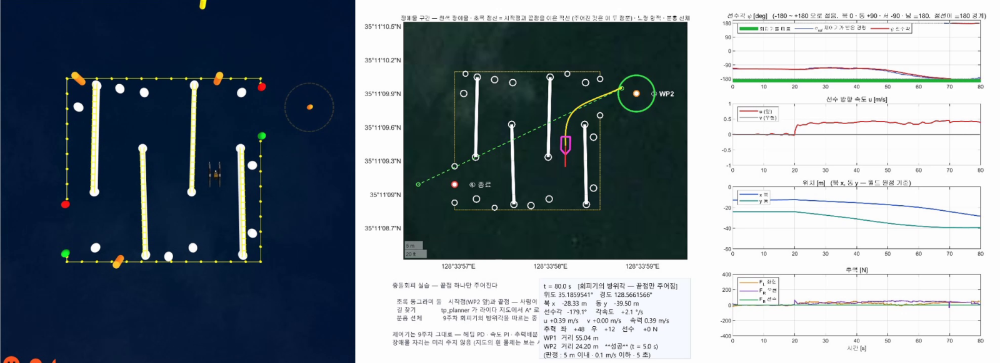
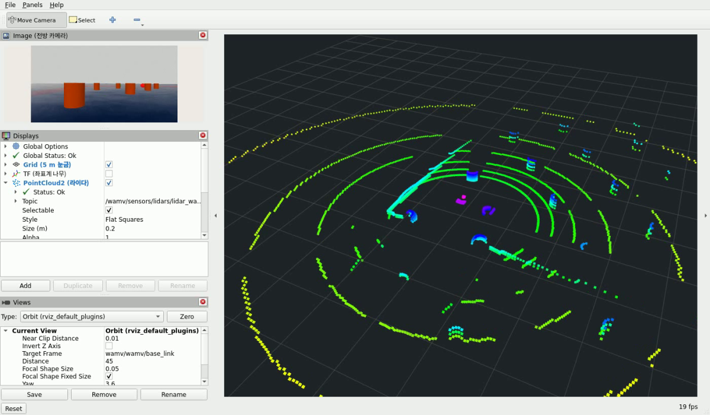

# 텀프로젝트 녹화 지침 — 화면 구성과 명령

> [!important] 표준 구성 — 가로 2 칸
> | 칸 | 무엇을 둠 | 대략 크기 |
> |---|---|---|
> | **왼쪽** | 가제보 3D 뷰 — 좌우 패널을 잘라 낸 것 | 약 1000 × 720 |
> | **오른쪽** | **MATLAB GCS 그림 한 장** (`TP_gcs` · `TP_avoid_gcs`) | 약 1000 × 720 |
>
> - RViz2 는 쓰지 않음 — 근거는 3 장
> - 두 창을 **각각 뜯어 두었다가 나중에 붙임.** 실시간 합성이 아님
> - 이 구성으로 이미 만든 영상 세 개가 있음 (1-2 절)

---

## 1. 조사한 영상 — 29 개를 전부 열어 확인함

- `60-텀프로젝트` 아래의 `.mp4` · `.MOV` 를 모두 찾아 실제 프레임을 뽑아 봄
- **열리지 않은 파일은 없음** (29 / 29)
- 이 PC 에는 `ffmpeg` 이 없음 — WSL 의 `python3` + OpenCV 로 메타데이터와 프레임을 읽음

### 1-1. 현장 촬영 원본 — 8 개 · 4.79 GB (저장소 밖, 추적하지 않음)

| 파일 | 길이 | 해상도 / fps | 크기 |
|---|---|---|---|
| `20261114_095840_FreeV_[1].mp4` | 268.6 s | 1920×1080 / 30.00 | 418.1 MB |
| `20261114_104342_SeaNU_[1].mp4` | 162.3 s | 1920×1080 / 30.02 | 252.6 MB |
| `20261114_155955_FreeV_[2].mp4` | 162.5 s | 1920×1080 / 30.01 | 252.7 MB |
| `20261115_094657_SeaNU_[2].mp4` | 245.8 s | 1920×1080 / 30.00 | 382.1 MB |
| `20261115_123101_SeaNU_[3].mp4` | 84.5 s | 1920×1080 / 30.01 | 225.2 MB |
| `20261115_123101_SeaNU_[3]-2.mp4` | 6.0 s | 1920×1080 / 30.00 | 18.2 MB |
| `FreeV_[3].MOV` | 267.3 s | 1920×1080 / 59.94 | 1700.3 MB |
| `SeaNU_[2].MOV` | 244.9 s | 1920×1080 / 59.94 | 1563.7 MB |

- 전부 **1 칸짜리 실사 영상.** 화면 녹화가 아님
- 보이는 것 — 3·15 해양누리공원 앞바다 · 파란 폰툰 도크와 빨강/초록/파랑 표지판 · 노란 로프로 둘러친 흰 장애물 열 · 빨강·초록 수로 부표 · 노랑/파랑 소형 무인선 · 해안과 산
- 글자 정보 없음. 명령값·상태·그래프 모두 없음
- 용도 — **월드 제작과 대조용 참고 자료.** 화면 구성 결정과는 무관함

### 1-2. 2 칸 합성본 — 3 개 (저장소 안, 지금의 표준)

| 파일 | 해상도 | fps | 길이 | 크기 |
|---|---|---|---|---|
| `TP_manual/TP_manual_mission.mp4` | 2022×720 | 8.0 | 55.6 s | 13.5 MB |
| `TP_avoid/TP_avoid_mission.mp4` | 1976×720 | 7.0 | 42.6 s | 9.1 MB |
| `TP_avoid/TP_avoid_mission_waypoints.mp4` | 1976×720 | 6.0 | 41.5 s | 8.7 MB |

- 왼쪽 가제보 · 오른쪽 MATLAB GCS 의 가로 2 칸
- 가제보 칸은 패널이 잘려 **3D 뷰만** 남아 있음. 글자 없음
- GCS 칸의 글자는 **원본 해상도에서 전부 읽힘**



- 위 그림은 `TP_avoid/TP_avoid_mission.mp4` 의 **12.7 초** 장면임

| 그림에서 볼 곳 | 무엇 |
|---|---|
| 왼쪽 | 가제보 3D 뷰 — 장애물 열과 배. 패널·툴바 없음 |
| 오른쪽 위 | 위성지도 — 임무점·유지 원·선체·선수 방향선·항적 |
| 오른쪽 가운데 | 계기판 글상자 — 시각·위경도·북 $x$ 동 $y$·선수각·각속도·속도·추력·WP 거리·성공 판정 |
| 오른쪽 아래 | 시계열 넷 — 선수각 $\psi$ 와 $\psi_{ref}$ · 속도 $u,v$ · 위치 $x,y$ · 추력 $F_L,F_R,F_B$ |

### 1-3. 창별 단일 영상 — 18 개 (`TP_vrx_lite/shots/`)

- 구간 여섯 × 창 셋. **붙인 적이 없음**

| 창 | 해상도 | fps | 보이는 것 |
|---|---|---|---|
| `*_gz.mp4` | 1200×1000 | 14.96 | 가제보 창 **통째로** — 제목 표시줄, Component inspector · Entity tree · View Angle 패널이 가로의 약 1/3 을 차지함. 아래에 RTF 표시 |
| `*_rviz.mp4` | 1400×820 | 14.96 | RViz2 창 통째로 — 왼쪽 약 30 % 가 카메라 패널 + Displays 트리 + Views 트리 |
| `*_cam.mp4` | 640×360 | 5.2 ~ 6.5 | 전방 카메라 + OpenCV 오버레이 글자 |

| 구간 | 길이 |
|---|---|
| `01_gate` | 12.1 s |
| `03_wp1` | 10.2 s |
| `05_dock` | 10.2 s |
| `09_search` | 10.1 s |
| `12_obs` | 12.2 s |
| `15_goal` | 10.1 s |

- 카메라 오버레이는 읽힘 — `01_gate_cam.mp4` 6.1 초에 `GREEN -35.4deg` · `RED +24.7deg` · 왼쪽 아래 `gate pass -5.3 deg`
- 표지판 인식도 읽힘 — `05_dock_cam.mp4` 5.1 초에 `BLUE +0.0deg` · `GREEN -2.3deg` · `BLUE +23.4deg` · `placards: 3`
- 가제보 창의 패널은 잘라야 함 — `01_gate_gz.mp4` 6.0 초에 패널이 그대로 들어 있음

---

## 2. 지금까지의 녹화 파이프라인

### 2-1. 1 세대 — 창 셋을 동시에 뜯음 (`TP_vrx_lite/rec_run.sh`, 2026-11-16)

- `xcap.py` 두 개 + `rec_cam.py` 하나를 **동시에 띄우고 `wait`**
- 남는 것은 **파일 세 개.** 붙이는 단계가 없음

```bash
bash rec_run.sh gate1 01_gate 12 120 gate
```

| 인자 | 뜻 |
|---|---|
| `gate1` | `goto.sh` 로 순간이동할 지점 |
| `01_gate` | 파일 이름 앞가지 |
| `12` | 녹화 길이 [s] |
| `120` | 좌우 추진기에 거는 추력 [N] — 장면이 실제로 바뀌게 함 |
| `gate` | 카메라 오버레이 종류 (`gate` / `search` / `placard` / `none`) |

- `rec_cam.py` 는 **ROS 토픽을 직접 받아** 영상으로 씀. 화면을 뜯는 것이 아님
- 프레임률은 **실제로 받은 속도**를 그대로 씀 → 영상 길이가 벽시계와 맞음

### 2-2. 2 세대 — 적립해 두고 MATLAB 이 붙임 (`TP_manual/`, 2026-11-19)

| 단계 | 무엇이 | 무엇을 남김 |
|---|---|---|
| 1 | `rec_gazebo.py` (WSL) | `gz_<벽시계 ms>.jpg` · `contacts.csv` |
| 2 | `TP_gcs.m` 의 녹화 훅 (MATLAB) | `gcs_<벽시계 ms>_<모델 시각>.jpg` |
| 3 | `TP_make_video.m` (MATLAB) | 두 장을 가로로 붙인 MPEG-4 |

- 맞추는 법 — 파일 이름에 든 **벽시계(ms)** 로 가장 가까운 장끼리 짝지음
- 둘이 같은 PC 에서 도므로 시계가 같음
- GCS 쪽은 `getframe` 으로 **그림 창 한 장**을 통째로 뜸
- 가로 폭은 **짝수로 맞춤** — 코덱이 홀수 폭을 받지 않음

### 2-3. 화면 녹화 프로그램을 쓰지 않는 이유

> [!warning] WSLg 창은 다른 창에 가려지면 화면 녹화에 안 잡힘
> - X 서버에서 창을 직접 뜯으면 가려져 있어도 잡힘 (`xcap.py` 의 `Grabber`)
> - `libX11.so.6` 의 `XGetImage` 를 ctypes 로 부름. 창 목록은 `xwininfo -root -tree` 로 찾음
> - RViz2 의 3D 영역은 **별도의 자식 X 창**임 — 부모만 뜨면 멈춘 그림이 나옴 (2026-11-17 수정)

### 2-4. 이 방식으로 2 칸 영상을 만들 수 있는가

- **만들 수 있음. 이미 만들어 쓰고 있음** (1-2 절의 세 파일)
- 다만 **실시간 합성이 아님** — 창을 따로 뜯어 두고 **끝난 뒤 MATLAB 에서 붙임**
- 장점 — 두 창이 서로 가려져도 무방함, 배속을 나중에 정함, 같은 프레임으로 다른 영상을 다시 만들 수 있음
- 제약 — 가제보를 벽시계 1 초에 한 장만 뜯으므로 **원본이 저속 촬영**임. 배속 = 출력 프레임률

---

## 3. 오른쪽 칸 — RViz2 인가 MATLAB GUI 인가

판단 기준은 하나임 — **명령값과 임무 상태가 그 화면에 실제로 보이는가.**

### 3-1. RViz2 에 실제로 보이는 것

- 설정 파일 `TP_vrx_lite/tp.rviz` 에 든 표시는 **다섯 개가 전부**임

| 표시 | 토픽 |
|---|---|
| Grid (5 m 눈금) | — |
| TF (좌표계 나무) | — (체크 꺼져 있음) |
| PointCloud2 (라이다) | `/wamv/sensors/lidars/lidar_wamv_sensor/points` |
| LaserScan (/scan, 한 층만) | `/wamv/.../scan` |
| Image (전방 카메라) | `/wamv/sensors/cameras/front_camera_sensor/image_raw` |

- **Marker · MarkerArray · Path · Odometry · Pose · 글자 오버레이가 하나도 없음**



- 위 그림은 `TP_vrx_lite/shots/12_obs_rviz.mp4` 의 **6.0 초** 장면임

| 실제 화면 | 무엇이 보였는가 |
|---|---|
| `12_obs_rviz.mp4` **6.0 초** | 라이다 점구름 고리, 카메라 썸네일, Displays·Views 트리. 회피 명령값 **없음** |
| `05_dock_rviz.mp4` **5.0 초** | 도크 벽면의 점구름. 베이 번호·접근 목표·옆걸음 명령 **없음** |
| `01_gate_rviz.mp4` **10.0 초** | 점구름과 카메라 썸네일. 게이트 통과 방위각 **없음** |

- 세 장면 모두 왼쪽 약 30 % 가 UI 트리임 — `Near Clip Distance 0.01`, `Focal Shape Size 0.05` 같은 **설정 항목**이 자리를 차지함
- 즉 **RViz2 화면에서 읽을 수 있는 것은 센서 원자료뿐**임

### 3-2. MATLAB GCS 에 실제로 보이는 것

| 실제 화면 | 무엇이 보였는가 |
|---|---|
| `TP_avoid_mission.mp4` **12.7 초** | `t = 80.0 s` · `북 x -28.33 m 동 y -39.50 m` · `선수각 -179.1°` · `각속도 +2.1 °/s` · `u +0.39 m/s` · **`추력 좌 +48 우 +12 선수 +0 N`** · `WP2 거리 24.20 m` · `성공 (t = 5.0 s)` · `(판정 : 5 m 이내 · 0.1 m/s 이하 · 5 초)`. 시계열에 $\psi_{ref}$ 와 회피기 작동 구간이 함께 그려짐 |
| `TP_manual_mission.mp4` **27.8 초** | `t = 194.0 s` · **`추력 좌 +200 우 +200 선수 +0 N`** · `WP1 거리 37.66 m 성공 (t = 47.0 s)` · 조종키 범례 (W 전진 / S 후진 / A 좌선회 / D 우선회 / Q 좌현 / E 우현 / 정지) · 임무점 ①출발 ②WP1 ③WP2 ④종료 |

- 명령값(추진기 세 개), 기준값($\psi_{ref}$), 임무 상태(WP 거리와 성공 판정)가 **한 화면에 전부** 있음
- 글자는 원본 해상도에서 읽힘

### 3-3. 결론

> [!important] 오른쪽 칸은 **MATLAB GCS 그림**으로 함
> - 기준은 "RViz2 만으로 충분하면 RViz2 하나로 간다" 였음
> - 그러나 지금 설정의 RViz2 에는 **명령값이 한 글자도 없음** (3-1 절의 세 시각)
> - 채점에 쓰는 값 — 추력·선수각·WP 거리·성공 판정 — 은 **MATLAB GCS 에만 있음** (3-2 절)
> - 따라서 RViz2 로 대체할 수 없음

### 3-4. 남는 여지

- RViz2 도 **원리상으로는** 충분해질 수 있음
  - `Marker` · `MarkerArray` · `Path` 표시를 붙이고 명령값을 글자 마커로 내보내면 됨
  - `TP_dock/marker_viz.py` 가 그 방향으로 가는 중으로 보임
- 다만 **지금 존재하는 어떤 녹화에도 그런 화면이 없음**
- 위 판단은 **현재 상태**를 근거로 한 것임. 마커 표시가 실제로 붙고 녹화로 확인되면 다시 볼 것

---

## 4. 표준 녹화 절차 — 그대로 따라 할 명령

> [!note] 전제
> - WSL 은 비대화형이라 `.bashrc` 를 건너뜀 — 환경변수를 명령 안에 직접 씀
> - 같은 PC 에서 가제보를 둘 띄울 때는 `GZ_PARTITION` 을 다르게 줌

### 4-1. 가제보를 캡처용으로 띄움 (터미널 1)

```bash
cd ~/Capstone-Design/1_2026-2학기_강의자료/60-텀프로젝트/TP_haeyang && export ROS_DOMAIN_ID=7 GZ_PARTITION=hy1 && bash run_haeyang.sh lite shot
```

### 4-2. 배를 풀고 보는 눈을 올림 (터미널 2)

```bash
cd ~/Capstone-Design/1_2026-2학기_강의자료/60-텀프로젝트/TP_haeyang && export ROS_DOMAIN_ID=7 GZ_PARTITION=hy1 && gz topic -t /vrx/release -m gz.msgs.Empty -p ""; bash view.sh -- -31 -6 90 -31 -6 0
```

### 4-3. 가제보 화면과 접촉을 받아 적기 시작함 (터미널 3)

```bash
cd ~/Capstone-Design/1_2026-2학기_강의자료/60-텀프로젝트/TP_manual && export ROS_DOMAIN_ID=7 GZ_PARTITION=hy1 && source /opt/ros/humble/setup.bash && python3 rec_gazebo.py --out ~/tp_rec --every 1.0 --max-sec 780
```

- 남기는 것

```
gz_<벽시계 ms>.jpg    가제보 창
contacts.csv          접촉이 보고된 순간마다 한 줄
```

### 4-4. MATLAB 에서 주행함 — 둘째 인자가 GCS 프레임 폴더임

```matlab
TP_mission('vrx', 'C:\tmp\rec_gcs')
```

- 손으로 몰며 녹화할 때는 Run 전에 한 줄 침

```matlab
setappdata(0, 'TP_rec', struct('dir', 'C:\tmp\rec_gcs', 'every', 2))
```

- 끝나면 끔

```matlab
rmappdata(0, 'TP_rec')
```

### 4-5. 가제보 기록을 멈추고 Windows 로 옮김 (터미널 2)

```bash
touch ~/tp_rec/STOP && mkdir -p /mnt/c/tmp/rec_gz && cp ~/tp_rec/* /mnt/c/tmp/rec_gz/
```

### 4-6. 둘을 나란히 붙임 (MATLAB)

```matlab
TP_make_video('C:\tmp\rec_gz', 'C:\tmp\rec_gcs', '', struct('crop', [430 48 970 932], 'speed', 8))
```

- 정상 출력

```
가제보 551 장 가운데 445 장 · GCS 198 장 (모델 394 s)
저장 : ...\TP_manual\TP_manual_mission.mp4  (2022 x 720, 445 장, 8 fps → 56 초, 13.5 MB)
```

| 값 | 뜻 | 기준 |
|---|---|---|
| `crop` | 가제보 그림에서 남길 곳 `[x y 폭 높이]` | **창 크기마다 다름.** 1760×980 창은 `[430 48 970 932]`, 1200×1000 창은 `[0 47 783 953]` |
| `speed` | 배속이자 출력 프레임률 | 벽시계 1 초에 한 장 뜯었으므로 `8` 이면 8 배속 |
| `height` | 출력 높이 [px] | 기본 720 |

### 4-7. 센서 화면만 따로 필요할 때 (선택)

```bash
cd ~/Capstone-Design/1_2026-2학기_강의자료/60-텀프로젝트/TP_vrx_lite && export ROS_DOMAIN_ID=7 GZ_PARTITION=hy1 && source /opt/ros/humble/setup.bash && bash rec_run.sh gate1 01_gate 12 120 gate
```

- 카메라 인지 결과를 따로 보일 때만 씀. 본 영상의 오른쪽 칸으로 쓰지 않음

---

## 5. 막혔을 때

| 증상 | 원인 | 해결 |
|---|---|---|
| 합성 영상의 왼쪽에 패널이 들어감 | `crop` 이 창 크기와 안 맞음 | 4-3 절 출력의 창 크기를 보고 `crop` 을 다시 잡음 |
| RViz2 3D 영역이 멈춘 그림으로 나옴 | 부모 창만 뜯음 | `xcap.py` 최신본을 씀 (자식 창을 합쳐 뜯음) |
| 영상 길이가 벽시계와 다름 | 프레임률을 임의로 지정함 | `rec_cam.py` 는 `--fps 0` (기본) 으로 둠 — 받은 속도를 그대로 씀 |
| `TP_make_video` 가 "프레임이 없다" 로 멈춤 | WSL 쪽 폴더를 Windows 로 못 가져옴 | 4-5 절을 실행했는지 확인. `\\wsl.localhost\Ubuntu-22.04\home\<사용자명>\tp_rec` 를 직접 줘도 됨 |
| 배가 두 척 보이고 값이 튐 | 가제보 둘이 같은 칸을 씀 | 세션마다 `GZ_PARTITION` 을 다르게 줌 |
| GCS 녹화 때문에 모델이 뒤처짐 | `every` 가 너무 짧음 | `every` 를 2 초 이상으로 둠 |

> [!caution] 가제보를 끈 뒤에는 반드시 정리함
> - 남은 `gz sim` 프로세스가 62 GB 까지 자라 OOM 을 부름
> - 확인은 `pgrep -a -x gz`
> - `stop_vrx.sh` 와 `cleanup` 은 칸을 가리지 않음 — **다른 세션의 가제보까지 끔.** 둘이 돌 때는 띄운 터미널에서 `Ctrl+C`

---

## 6. 저장소에 무엇을 넣는가

| 대상 | 넣는가 |
|---|---|
| 현장 촬영 원본 8 개 (4.79 GB) | **넣지 않음.** 추적 밖에 둠 |
| 2 칸 합성본 (10 MB 안팎) | 넣음 |
| 중간 프레임 (`gz_*.jpg` · `gcs_*.jpg`) | **넣지 않음.** 임시 폴더에 둠 |
| 문서에 싣는 캡처 | 넣음 — `assets/` 에 PNG 로, 폭 1600 이하로 줄여서 |

## 참고 자료

- [[텀프로젝트_실습_수동조종과_GCS]] — 2 부 8 단계에 같은 절차가 실습 형태로 들어 있음
- `60-텀프로젝트/TP_avoid/텀프로젝트_실습_충돌회피.md` — 회피 주행 녹화 명령
- `60-텀프로젝트/TP_vrx_lite/xcap.py` — X 서버에서 창을 뜯는 방법과 이미 밟은 지뢰
- `60-텀프로젝트/TP_manual/TP_make_video.m` — 벽시계로 두 화면을 맞추는 코드
