# 텀프로젝트 실습 — 버튼으로 모는 배와 위성지도 GCS

> [!important] ▶ 텀프로젝트 **실행 동영상** — 손대기 전에 이것을 먼저 볼 것
> ### **<https://youtu.be/LWO3GolKxWk>**
>
> <span style="font-size:0.94em">*KABAOT Gazebo Simulation* — 해양누리 월드에서 배가 실제로 도는 모습임. **이 실습이 끝나면 무엇이 되는지 영상으로 먼저 보고**, 그 다음에 명령을 칠 것.</span>
>
> | 영상과 함께 볼 것 | 이 문서의 어디 |
> |---|---|
> | 버튼·키보드로 배를 모는 법 | 2-2 절 (조종 키 표) |
> | 위성지도 GCS 화면 읽는 법 | 2-2 절 (GCS 창 읽는 법) |
> | 전 구간을 버튼만으로 지나가는 순서 | **2-8 절** (따라 하는 순서 13 단계) |
> | 같은 동영상을 직접 만드는 법 | 2-8 절 끝 (왼쪽 가제보 · 오른쪽 GCS) |

- **과목**: 캡스톤디자인 (2026-2) · 충남대학교 자율운항시스템공학과
- **이 실습에서 하는 일**: ① 버튼 여섯으로 배를 몬다 ② 버튼 값이 추진기 셋의 추력으로 나뉘는 과정을 본다 ③ 위성지도 GCS 에서 항적·선수 방향·속도·위치를 실시간으로 확인한다 ④ WP1·WP2 까지 몰아 위치유지 판정을 받아 본다 ⑤ 도킹·탐색·장애물 구간까지 **전 구간을 버튼만으로** 지나가 본다

> [!important] 이 문서를 읽는 방법
> - 텀프로젝트의 **첫 실습**임. 유도·제어를 넣기 전에, 사람이 직접 몰아서 **월드 · 추진기 · 센서 · GCS 가 다 이어져 있는지**부터 확인함
> - 헤딩 제어·속도 제어는 **들어 있지 않음.** 버튼을 누르는 동안 정해진 힘이 나가는 것이 전부임 (개루프)
> - 3 주차의 키보드 조종(`wamv_teleop_key`)과 같은 일을 함. 달라진 것은 셋임 — **선수추진기**가 더해졌고, **Simulink** 안에서 돌고, **위성지도**에 그려짐
> - 숫자와 화면은 모두 **2026-11-19 에 실제로 돌려 얻은 것**임. 구간과 조건을 함께 적었음
> - 요구조건과 채점은 [[텀프로젝트_요구조건]] 에 있음. 이 문서는 그 4-D 절(GCS 와 실시간 계측)의 출발점이 됨

> [!important] 시작 전 확인
> - 강의자료를 최신으로 받았는가 — `cd ~/Capstone-Design && git pull`
> - [[텀프로젝트_요구조건]] 0-5 절의 명령으로 가제보가 뜨는가 (2 부 4 단계에서 다시 띄움)
> - MATLAB 에서 `geobasemap satellite` 가 되는가 — 인터넷이 있어야 위성 사진이 뜸. 없으면 다른 지도로 넘어감

## 이번 실습 실행 요약

- 뒤의 절을 읽지 않아도 무엇을 쳐야 하는지 알게 하려는 칸임. 2026-11-19 에 아래 그대로 쳐서 확인하였음

**(1) 가제보 없이 먼저 — MATLAB 만**

```matlab
cd('\\wsl.localhost\Ubuntu-22.04\home\<사용자명>\Capstone-Design\1_2026-2학기_강의자료\60-텀프로젝트\TP_manual')
open_system('TP_manual_offline')
```

- 모델 창에서 **Run** 을 누름 → GCS 창이 뜸 → 그 창을 한 번 클릭하고 `W` `S` `A` `D` `Q` `E` 를 눌러 봄

**(2) 가제보로 — 터미널 1 (WSL)**

```bash
cd ~/Capstone-Design/1_2026-2학기_강의자료/60-텀프로젝트/TP_haeyang && export ROS_DOMAIN_ID=7 GZ_PARTITION=hy1 && bash run_haeyang.sh lite gui
```

**(3) 배를 풀기 — 터미널 2 (WSL)**

```bash
export GZ_PARTITION=hy1; gz topic -t /vrx/release -m gz.msgs.Empty -p ""
```

**(4) MATLAB**

```matlab
open_system('TP_manual_vrx')
```

- **Run** 을 누름 → 명령창에 토픽 확인과 RTF 측정(10 초)이 찍힌 뒤 GCS 창이 뜸 → 같은 키로 조종함

**(5) 끝낼 때 — 반드시**

```bash
bash ~/Capstone-Design/1_2026-2학기_강의자료/60-텀프로젝트/TP_vrx_lite/stop_vrx.sh
```

| 이럴 때 | 할 일 |
|---|---|
| 키를 눌러도 반응이 없음 | GCS 창을 **한 번 클릭**한 뒤 누름. 키는 맨 앞에 있는 창으로만 감. 그래도 안 되면 **정지 버튼이 눌려 있는지** 봄 (GCS 가운데 원이 빨강) |
| 급히 멈춰야 함 | GCS 가운데 `정지` 원을 클릭하거나 Simulink `ManualPad` 의 정지 버튼을 누름 → 추력 셋이 모두 0 |
| 추력 그래프는 움직이는데 배가 안 감 | (3) 을 안 한 것임. 배를 풀 것 |
| `토픽이 보이지 않는다` 로 멈춤 | (2) 가 안 떠 있거나 `ROS_DOMAIN_ID` 가 7 이 아님 |
| 배가 게이트 부표에 걸려 안 움직임 | 후진(`S`)으로 빼고 돌아감. 까닭은 1-3 절 |
| 지도가 위성 사진이 아님 | 인터넷이 없는 것임. 좌표는 그대로 맞음 |

---

## 이 실습을 마치면 할 수 있어야 하는 것

1. 버튼 하나가 추진기 셋의 추력 몇 N 이 되는지 손으로 계산할 수 있음
2. 횡이동 버튼을 눌렀을 때 좌·우 추진기가 **반대로** 도는 까닭을 설명할 수 있음
3. GPS 의 위도·경도가 GCS 의 북·동 [m] 와 위성지도 위의 점으로 바뀌는 과정을 설명할 수 있음
4. 배를 직접 몰아 WP1 · WP2 의 위치유지 판정(5 m 이내 · 0.1 m/s 이하 · 5 초)을 받을 수 있음
5. 자기 조의 GCS 와 제어기를 만들 때 이 모델의 어느 상자를 바꿔 끼우면 되는지 짚을 수 있음

## 준비물

| 항목 | 내용 |
|---|---|
| 강의자료 | `~/Capstone-Design` 을 `git pull` 로 최신으로 |
| 실습 폴더 | `60-텀프로젝트/TP_manual/` — 모델 둘과 스크립트 여섯 |
| MATLAB | R2024b · Simulink · ROS Toolbox · Stateflow (MATLAB Function 블록용) |
| 인터넷 | 위성 사진 타일을 받을 때만 |
| 가제보 | 2 부 4 단계부터. 월드 `haeyangnuri`, 판 `lite` |

**실습 폴더의 파일**

| 파일 | 무엇 | 손댈 일 |
|---|---|---|
| `TP_manual_offline.slx` | 버튼 → 추력 배분 → **운동방정식**. 가제보 없이 돎 | 열고 Run |
| `TP_manual_vrx.slx` | 버튼 → 추력 배분 → **가제보**. 위치는 GPS 에서 | 열고 Run |
| `TP_manual_setup.m` | 설정값 전부 — 버튼의 힘, 추진기 한계, 지도 범위 | **값은 여기서 고침** |
| `TP_gcs.m` | GCS 창 — 위성지도·그래프·화살표 버튼·키보드 | 자기 조 GCS 의 출발점 |
| `TP_gcs_keys.m` | GCS 창에서 눌린 키를 모델에 넘김 | 없음 |
| `TP_manual_init.m` · `TP_manual_stop.m` | Run 을 누를 때·멈출 때 도는 콜백 | 없음 |
| `TP_manual_check.m` | 확인 주행 — 스크립트가 버튼을 대신 누름 | 2 부 3·6 단계에서 돌림 |
| `TP_mission.m` | **전 구간** 확인 주행 — 게이트·WP1·도킹·탐색·WP2·장애물·종료 | 2 부 8 단계에서 돌림 |
| `rec_gazebo.py` · `TP_make_video.m` | 가제보 화면과 GCS 창을 나란히 붙인 동영상을 만듦 | 2 부 8 단계 끝 |
| `build_tp_manual.m` | 모델 둘을 처음부터 다시 만듦 | 모델이 깨졌을 때 한 줄 |

---

# 1부 · 이론

- 새 개념은 셋임 — **버튼이 추력 셋이 되는 과정**, **GPS 가 지도 위의 점이 되는 과정**, **곧장 가면 안 되는 까닭**

## 1-0. 모델 한 장 — 왼쪽에서 오른쪽으로

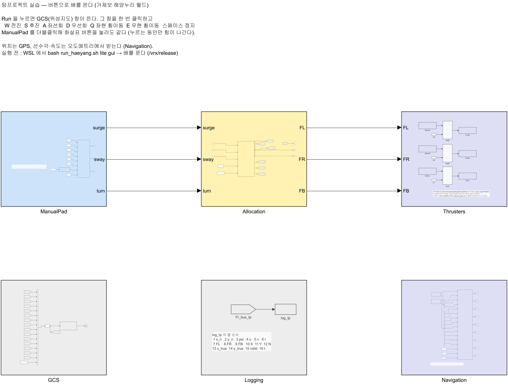

| 상자 | 색 | 하는 일 | 내놓는 것 |
|---|---|---|---|
| `ManualPad` | 파랑 | 화살표 버튼 여섯. 누르는 동안 1, 떼면 0. **정지 버튼** 하나 — 눌러 두면 모두 0 | `surge` · `sway` · `turn` (각각 −1 · 0 · +1) |
| `Allocation` | 노랑 | 버튼 값에 힘을 곱하고 추진기 셋으로 나눔 | `FL` · `FR` · `FB` [N] |
| `Thrusters` | 연보라 | 추력 셋을 가제보로 발행 | 토픽 `/wamv/thrusters/{left,right,bow}/thrust` |
| `Navigation` | 연보라 | GPS → 위치, 오도메트리 → 선수각·속도 | 태그 `x_n` `y_n` `psi` `u` `v` `r` |
| `GCS` | 회색 | 신호 열다섯을 묶어 `TP_gcs.m` 을 부름 | GCS 창 |
| `Logging` | 회색 | 같은 묶음을 `log_tp` 로 남김 | 워크스페이스 변수 |

- `ManualPad` 가 **파랑(유도)** 인 까닭 — 유도가 들어갈 자리에 사람이 앉아 있음. 텀프로젝트에서는 이 자리에 Stateflow 미션과 유도·제어가 들어감
- `TP_manual_offline` 은 `Thrusters` · 가제보 · `Navigation` 세 자리를 **`MotionModel` 하나**로 바꾼 것임. 나머지는 글자 하나까지 같음 (쌍둥이)

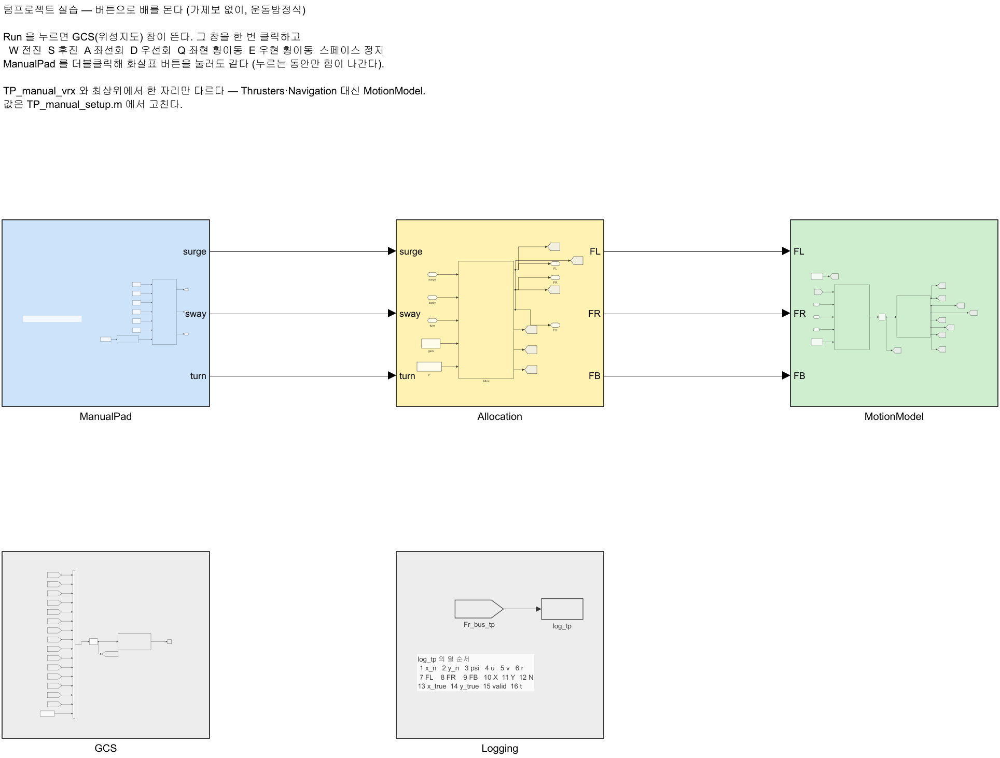

## 1-1. 버튼 하나가 추력 셋이 되기까지

### 왜 필요한가

- 3 주차의 키보드 조종은 추진기가 **둘**이었음. 전진은 둘 다 +, 선회는 서로 반대 — 외울 수 있었음
- 텀프로젝트의 배는 **선수추진기**가 하나 더 있음. 옆으로 밀 수 있게 됐지만, 그냥 밀면 **배가 돌아감**
- 그래서 "어느 방향으로 얼마의 힘" 을 먼저 정하고, 그것을 추진기 셋으로 **나누는 단계**가 따로 필요함. 이것이 추력 배분임 (6 주차)

### 원리 — 두 걸음

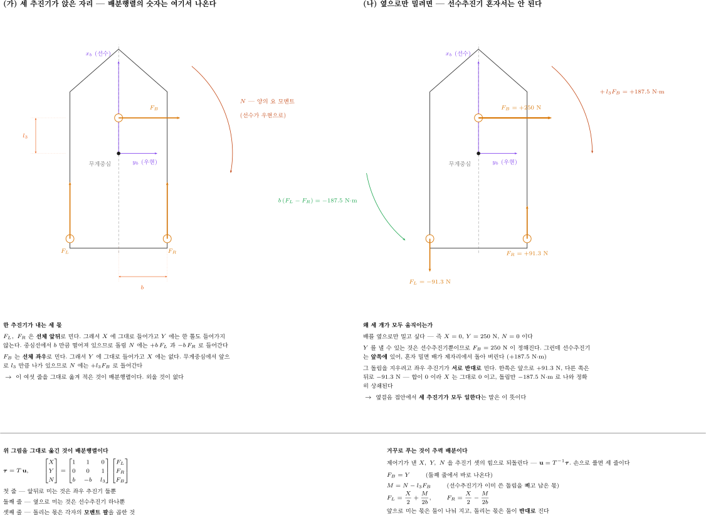

| 그림의 글자 | 뜻 | 값 |
|---|---|---|
| $F_L$ · $F_R$ | 선미 좌·우 추진기의 추력. 앞으로 밀면 + | 한계 ±500 N |
| $F_B$ | 선수추진기의 추력. **우현으로 밀면 +** | 한계 ±250 N |
| $b$ | 선체 중심선에서 좌·우 추진기까지의 거리 | 1.027 m |
| $l_3$ | 선체 중심에서 선수추진기까지 앞쪽 거리 | 0.75 m |

**첫 걸음 — 버튼 값에 힘을 곱함**

$$X = X_{btn}\,(\text{전진} - \text{후진}), \qquad Y = Y_{btn}\,(\text{우현} - \text{좌현}), \qquad N = N_{btn}\,(\text{우선회} - \text{좌선회})$$

| 글자 | 뜻 | `TP_manual_setup.m` 의 값 |
|---|---|---|
| $X$ | 요구 전후력 [N]. 앞이 + | $X_{btn} = 400$ N |
| $Y$ | 요구 횡력 [N]. 우현이 + | $Y_{btn} = 200$ N |
| $N$ | 요구 요 모멘트 [N m]. 시계방향이 + | $N_{btn} = 400$ N m |

- 버튼은 0 또는 1 임. 전진과 후진을 같이 누르면 $1 - 1 = 0$ 이 되어 서로 지움

**둘째 걸음 — 추진기 셋으로 나눔**

- 추진기 셋이 배에 주는 힘은 이렇게 더해짐

$$X = F_L + F_R, \qquad Y = F_B, \qquad N = (F_L - F_R)\,b + l_3\,F_B$$

- 식 셋에 모르는 것 셋이므로 손으로 풀림. 둘째 식에서 $F_B$ 가 바로 나오고, 그것을 셋째 식에 넣음

$$F_B = Y, \qquad F_L = \frac{X}{2} + \frac{N - l_3 Y}{2b}, \qquad F_R = \frac{X}{2} - \frac{N - l_3 Y}{2b}$$

> [!important] $-l_3 Y$ 가 이 절의 핵심임
> - 선수추진기는 **앞쪽**에 달려 있음. 옆으로 밀면 배가 옆으로 가면서 **동시에 돎** — 모멘트 $l_3 F_B$ 가 딸려 옴
> - 그 몫을 좌·우 추진기가 **반대 방향으로** 돌아 지워 줌. 그래야 선수각이 그대로인 채 옆으로만 감
> - 그래서 횡이동 버튼 하나를 눌렀는데 추진기 **셋이 모두** 돎

### 적용 — 숫자를 넣어 봄

**전진 버튼 (`W`)** — $X = 400$, $Y = 0$, $N = 0$

$$F_B = 0, \qquad F_L = F_R = \frac{400}{2} = 200\ \text{N}$$

**우선회 버튼 (`D`)** — $X = 0$, $Y = 0$, $N = 400$

$$F_L = +\frac{400}{2 \times 1.027} = +194.7\ \text{N}, \qquad F_R = -194.7\ \text{N}$$

**우현 횡이동 버튼 (`E`)** — $X = 0$, $Y = 200$, $N = 0$

$$F_B = 200\ \text{N}, \qquad F_L = \frac{0 - 0.75 \times 200}{2 \times 1.027} = -73.0\ \text{N}, \qquad F_R = +73.0\ \text{N}$$

- 선수추진기가 우현으로 200 N 을 밀면 시계방향 모멘트 150 N m 가 딸려 옴. 좌현 추진기가 뒤로 73 N, 우현 추진기가 앞으로 73 N 을 내어 그것을 지움

### 결과 — 모델이 낸 값과 맞대어 봄

```matlab
TP_manual_check('buttons')
```

- 정상 출력 (오프라인 운동모델, 정지 상태에서 버튼 하나를 **20 초** 누른 끝의 값)

```
  버튼            F_L[N]  F_R[N]  F_B[N] |    X[N]    Y[N]    N[Nm] |  u[m/s]  v[m/s]  r[deg/s] |     북[m]     동[m]
  전진 (W)         200.0   200.0     0.0 |     400       0        0 |  +1.333  +0.000     +0.00 |   +25.90    +0.00
  후진 (S)        -200.0  -200.0     0.0 |    -400       0        0 |  -1.333  +0.000     +0.00 |   -25.90    +0.00
  좌선회 (A)       -194.7   194.7     0.0 |       0       0     -400 |  +0.000  +0.000    -20.97 |    +0.00    +0.00
  우선회 (D)        194.7  -194.7     0.0 |       0       0      400 |  +0.000  +0.000    +20.97 |    +0.00    +0.00
  좌현 횡 (Q)        73.0   -73.0  -200.0 |       0    -200        0 |  +0.000  -1.000     +0.00 |    +0.00   -19.08
  우현 횡 (E)       -73.0    73.0   200.0 |       0     200        0 |  +0.000  +1.000     +0.00 |    +0.00   +19.08
```

| 볼 것 | 맞는 모습 | 까닭 |
|---|---|---|
| 추력 세 칸 | 위에서 손으로 구한 200 · 194.7 · 73.0 과 같음 | 같은 식임 |
| 횡이동 두 줄의 $r$ | **0.00** — 옆으로 19 m 를 가는 동안 선수각이 안 변함 | $-l_3 Y$ 가 모멘트를 지웠음 |
| 선회 두 줄의 $u$ · $v$ | 0 — 제자리에서 돎 | 좌·우 추력의 합이 0 임 |
| 전진의 $u$ | 1.333 m/s 에서 멈춤 | 저항과 추력이 같아지는 속도임 (아래) |

**끝 속도가 그 값인 까닭** — 추력과 저항이 같아지면 더 빨라지지 않음. 저항은 선형항과 제곱항의 합임

$$(100 + 150\,u)\,u = 400 \;\Rightarrow\; u = 1.333\ \text{m/s}$$

$$(100 + 100\,v)\,v = 200 \;\Rightarrow\; v = 1.000\ \text{m/s}, \qquad (800 + 800\,r)\,r = 400 \;\Rightarrow\; r = 0.366\ \text{rad/s} = 20.97\ ^\circ/\text{s}$$

- 계수는 6 주차 `W06_setup.m` 과 같은 값임 (VRX 설정파일에서 읽은 것)

> [!note] 이 배분식은 `Allocation` 상자 안의 `Alloc` 블록에 그대로 들어 있음
> - 모델에서 `Allocation` 을 더블클릭 → `Alloc` 을 더블클릭하면 위 식 다섯 줄이 보임
> - 텀프로젝트에서 제어기를 넣을 때 **이 상자는 그대로 씀.** 앞의 `ManualPad` 만 제어기로 바꾸면 됨 — 제어기가 내는 $X$ · $Y$ · $N$ 을 이 상자가 받음

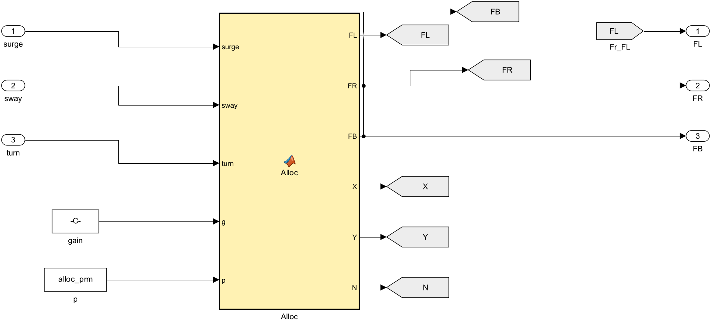

## 1-2. GPS 의 위도·경도가 지도 위의 점이 되기까지

### 왜 필요한가

- GCS 는 배를 **위성지도 위에** 그려야 함 (요구조건 D1). 지도의 좌표는 위도·경도임
- 유도·제어는 **미터**로 계산함. 5 m 이내인지, 몇 m 남았는지를 위도·경도로는 셀 수 없음
- 그래서 둘 사이를 오가는 변환이 필요함. 부록 A2 에서 배운 것을 이 월드에 그대로 씀

### 원리

- 이 월드는 원점(동 0 · 북 0)을 실제 좌표에 맞춰 두었음 — **위도 35.1862095° N · 경도 128.5665903° E**
- 수십 m 범위에서는 지구를 평면으로 보아도 됨. 위도 1° 와 경도 1° 가 몇 m 인지만 알면 곱셈 한 번임

$$x_n = (\text{위도} - \text{위도}_0)\,\frac{\pi}{180}\,R_M, \qquad y_n = (\text{경도} - \text{경도}_0)\,\frac{\pi}{180}\,R_N \cos(\text{위도}_0)$$

| 글자 | 뜻 | 이 월드에서 |
|---|---|---|
| $x_n$ · $y_n$ | 원점에서 북·동으로 몇 m 인가 | 출발선이 $(-32,\ 0)$ |
| $R_M$ | 자오선 곡률반경 — 남북으로 갈 때의 지구 반지름 | 6 356 622 m |
| $R_N$ | 묘유선 곡률반경 — 동서로 갈 때의 지구 반지름 | 6 385 238 m |
| 환산 | 북 1 m = $9.0136 \times 10^{-6}$ ° 위도, 동 1 m = $1.0979 \times 10^{-5}$ ° 경도 | 요구조건 7-6 절과 같은 값 |

> [!warning] GPS 가 내는 것은 **안테나의 자리**임. 배의 중심이 아님
> - 안테나는 선체 중심에서 **뒤로 0.85 m** 에 달려 있음 (요구조건 7-1 절)
> - 배가 북을 보면 안테나는 0.85 m 남쪽에, 동을 보면 0.85 m 서쪽에 있음 — **선수각에 따라 달라짐**
> - 그래서 선수각만큼 돌린 0.85 m 를 더해 중심으로 옮김
>
> $$x_n = x_{\text{안테나}} + 0.85\cos\psi, \qquad y_n = y_{\text{안테나}} + 0.85\sin\psi$$

### 적용 — `Navigation` 상자

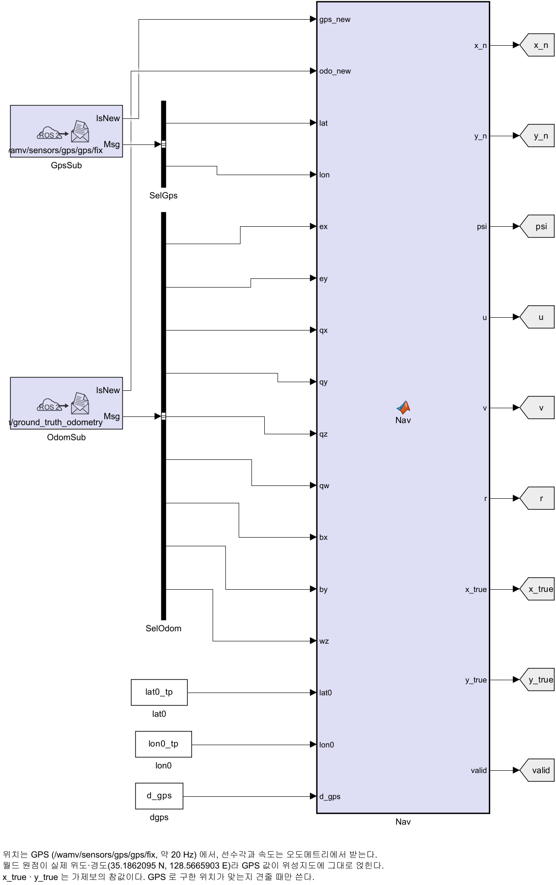

| 블록 | 받는 것 | 내놓는 것 |
|---|---|---|
| `GpsSub` | `/wamv/sensors/gps/gps/fix` (약 20 Hz) | 위도 · 경도 |
| `OdomSub` | `/wamv/sensors/position/ground_truth_odometry` | 자세(쿼터니언) · 속도 · 참값 위치 |
| `Nav` | 위 둘과 원점·안테나 거리 | `x_n` `y_n` `psi` `u` `v` `r` 과 비교용 `x_true` `y_true` |

- `Nav` 를 더블클릭하면 위 식이 번호 붙은 다섯 토막으로 들어 있음
- ROS·가제보는 **ENU**(동 x · 북 y), 본 과목은 **NED**(북 x · 동 y)임. 바꾸는 줄이 `Nav` 안에 있음 — $\psi = \pi/2 - \text{yaw}_{ENU}$, $v = -v_{ENU}$, $r = -r_{ENU}$ (3 주차)
- `x_true` · `y_true` 는 가제보의 참값임. **GPS 로 구한 위치가 맞는지 견줄 때만** 씀

### 결과 — GPS 로 구한 위치는 참값과 얼마나 다른가

| 조건 | 값 |
|---|---|
| 주행 | 출발선 → 게이트 여섯 → WP1 → WP2, 160 s, 지나온 거리 76.6 m (2 부 6 단계의 주행) |
| GPS 위치 − 참값 (**전 구간**, 중심으로 옮긴 뒤) | RMS **0.049 m** · 최대 **0.141 m** |
| 전 구간 주행 395.5 s · 283.1 m 에서 (2 부 8 단계) | RMS **0.054 m** · 최대 **0.137 m** |

- 0.85 m 를 옮기지 않으면 그만큼이 그대로 오차가 됨. 5 m 링 판정에는 작지만 도킹(좌우 여유 2.77 m)에서는 작지 않음

## 1-3. 출발선에서 WP1 로 곧장 가면 안 되는 까닭

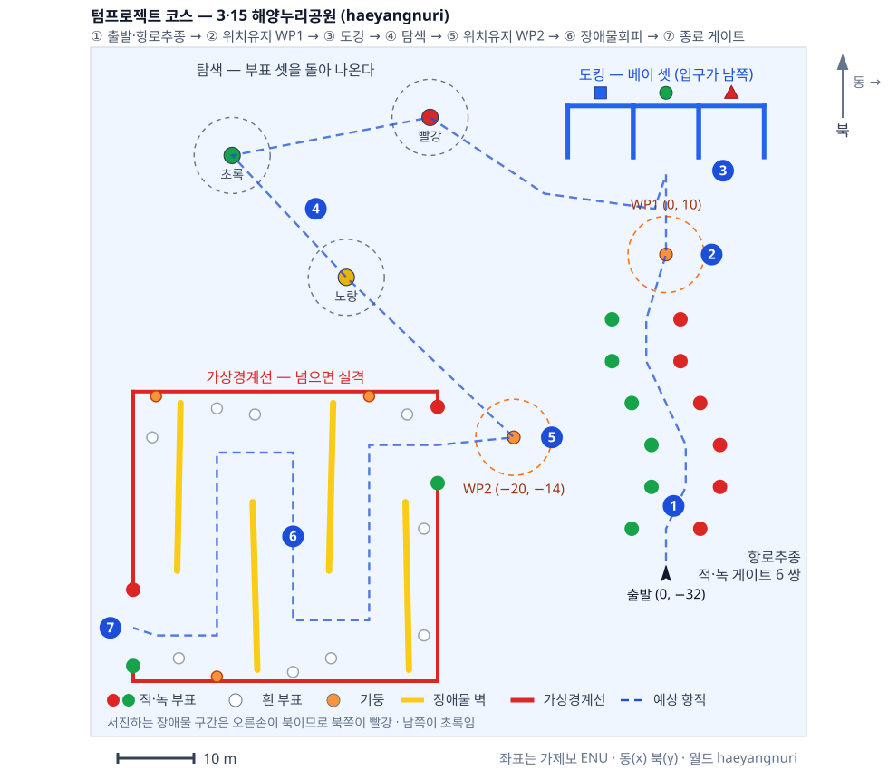

| 그림에서 볼 것 | 뜻 |
|---|---|
| 오른쪽 아래 적·녹 부표 여섯 쌍 | 항로추종 게이트. 중심이 좌우로 어긋나 **S 자**를 그림 |
| 출발 (0, −32) 에서 WP1 (0, 10) | 직선으로 이으면 **둘째 게이트의 초록 부표**(동 −1.9 · 북 −20.5) 옆을 스침 |
| WP1 에서 WP2 (−20, −14) | 직선으로 이으면 **여섯째 게이트의 초록 부표**(동 −7.1 · 북 1.5) 위를 지남 |

- 배의 반폭이 1.23 m, 부표 반지름이 0.75 m 임. 부표 중심에서 **1.98 m** 안으로 지나가면 닿음
- 출발 → WP1 직선은 동 0 을 따라감. 둘째 게이트의 초록 부표가 동 −1.9 에 있으므로 간격이 1.9 m — **닿음**

> [!warning] 실제로 걸렸음 — 2026-11-19 첫 가제보 주행
> - 출발선에서 WP1 을 향해 곧장 전진시켰더니 **북 −22 m 에서 멈췄음**. 140 초 동안 간 거리가 18 m 였음
> - 추력은 계속 나가고 있었음 (좌현 395 N). 배가 부표에 얹혀 밀고만 있었던 것임
> - 오프라인 모델에서는 같은 직선이 **아무 일 없이 통과**되었음 — 운동방정식에는 부표가 없기 때문임
> - 즉 오프라인에서 되는 길이 가제보에서 되는 길은 아님. **부딪히는 것은 가제보에서만 확인됨**

- 그래서 게이트는 **중심을 차례로** 지나야 함. 게이트 중심은 요구조건 3-1 절의 표에 있음
- WP1 에서 WP2 로 갈 때는 서쪽으로 먼저 빠진 뒤(북 8 · 동 −14 부근) 남쪽으로 내려감

---

# 2부 · 실습

## 2-1. 1 단계 — 모델 열기

- MATLAB 의 현재 폴더를 실습 폴더로 옮김. `<사용자명>` 은 WSL 의 계정 이름임 (터미널에서 `whoami`)

```matlab
cd('\\wsl.localhost\Ubuntu-22.04\home\<사용자명>\Capstone-Design\1_2026-2학기_강의자료\60-텀프로젝트\TP_manual')
```

```matlab
open_system('TP_manual_offline')
```

- 모델 창이 뜸. 위 1-0 절의 둘째 그림과 같은 모양이면 맞음

> [!note] 현재 폴더를 옮길 때 경고 한 줄이 뜰 수 있음
> - `...에 대한 변경 알림 핸들을 가져올 수 없습니다` — WSL 폴더라서 뜨는 것임. 실행에는 상관없음

## 2-2. 2 단계 — 가제보 없이 몰아 보기

1. 모델 창 위쪽의 **Run** (초록 세모) 을 누름
2. 2\~3 초 뒤 **GCS 창**이 화면 오른쪽에 뜸. 명령창에는 아래 한 줄이 찍힘

```
[TP_manual_offline] GCS 준비 완료 — 창을 한 번 클릭한 뒤 W S A D Q E 로 조종한다
```

3. GCS 창의 지도 부분을 **한 번 클릭**함 (키 입력이 이 창으로 가게 함)
4. `W` 를 3 초쯤 누르고 있다가 뗌 → 지도의 배가 북쪽으로 가고 노란 항적이 남음
5. `D` 를 눌러 봄 → 배가 제자리에서 시계방향으로 돎. 빨간 선(선수 방향)이 함께 돎
6. `E` 를 눌러 봄 → 배가 **선수를 그대로 둔 채** 오른쪽으로 감
7. 끝낼 때는 모델 창의 **Stop** 을 누름. 명령창에 주행 요약이 찍힘

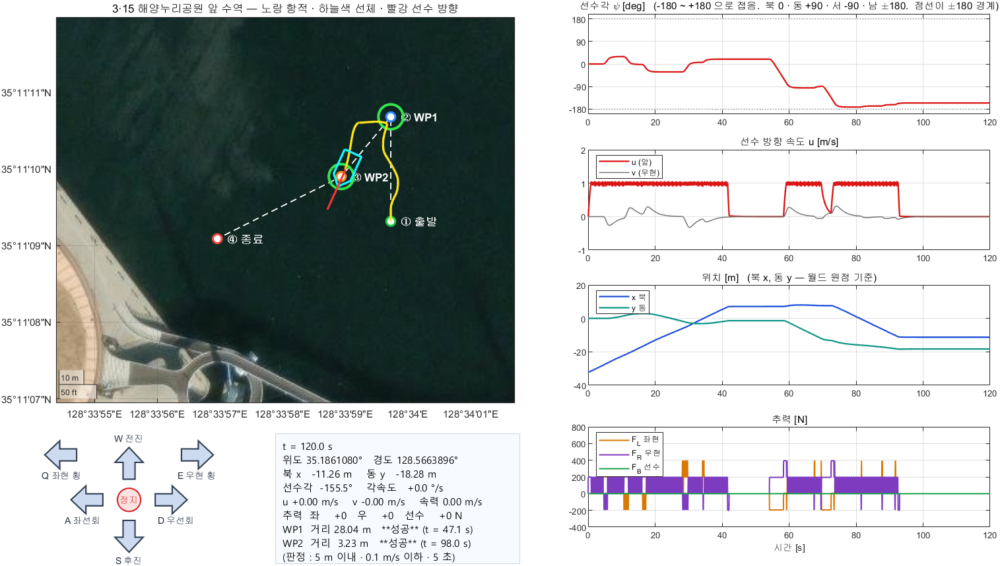

**GCS 창 읽는 법**

| 자리 | 그려지는 것 |
|---|---|
| 왼쪽 위 지도 | 위성 사진. 왼쪽 아래 둥근 광장이 3·15 해양누리공원임 |
| 지도의 ①\~④ | 출발 · WP1 · WP2 · 종료. 흰 점선이 미션 순서임 |
| 주황 원 둘 | 위치유지 링 (반경 5 m). 들어가면 **노랑**, 판정을 받으면 **초록**으로 바뀜 |
| 노란 선 | 지나온 항적 |
| 하늘색 도형 | 선체. **뾰족한 쪽이 선수**임. 보기 쉽게 3 배로 키워 그림 (`boat_scale`) |
| 빨간 선 | 선수 방향선 |
| 오른쪽 그래프 넷 | 위에서부터 선수각 [deg] · 속도 $u$ · $v$ [m/s] · 위치 북 · 동 [m] · 추력 셋 [N] |
| 선수각 그래프의 점선 둘 | **±180° 경계**임. 선수각은 언제나 −180° 와 +180° 사이로 접어서 그림 (북 0° · 동 +90° · 서 −90° · 남 ±180°) |
| 왼쪽 아래 화살표 | 조종 버튼. 힘이 나가는 방향이 **노랑**으로 칠해짐 |
| 화살표 가운데 `정지` 원 | 정지 버튼. 눌려 있으면 **빨강**으로 채워짐 |
| 가운데 아래 글상자 | 지금 값 — 위도·경도, 북·동, 선수각, 속도, 추력, WP 까지 거리와 판정 |

**조종하는 세 가지 길** — 셋 다 같은 곳(`ManualPad`)으로 들어감

| 길 | 어떻게 | 언제 편한가 |
|---|---|---|
| 키보드 | GCS 창을 클릭한 뒤 `W` `S` `A` `D` `Q` `E`, 정지는 스페이스. 방향키 ↑ ↓ ← → 도 `W` `S` `A` `D` 와 같음 | 몰 때 |
| GCS 의 화살표 | 마우스로 **누르고 있는 동안** 힘이 나감. 떼면 0 | 키보드가 안 먹을 때 |
| Simulink 의 버튼 | 모델에서 `ManualPad` 를 더블클릭 → 화살표 버튼 여섯 | 블록과 함께 볼 때 |

| 키 | 버튼 | 나가는 힘 | 배의 움직임 |
|---|---|---|---|
| `W` · ↑ | 전진 | $X = +400$ N | 앞으로 |
| `S` · ↓ | 후진 | $X = -400$ N | 뒤로. **멈출 때도 이것을 씀** |
| `A` · ← | 좌선회 | $N = -400$ N m | 제자리에서 반시계방향 |
| `D` · → | 우선회 | $N = +400$ N m | 제자리에서 시계방향 |
| `Q` | 좌현 횡이동 | $Y = -200$ N | 선수를 둔 채 왼쪽으로 |
| `E` | 우현 횡이동 | $Y = +200$ N | 선수를 둔 채 오른쪽으로 |
| — | **정지 버튼** (Simulink `ManualPad` · GCS 가운데 원) | $X = Y = N = 0$ | 추력 셋이 모두 0. **다시 누를 때까지** 다른 버튼이 안 먹음 |

- 두 키를 같이 누르면 힘이 더해짐. `W` + `D` 는 앞으로 가며 오른쪽으로 돎

> [!note] 선수각이 +180° 에서 −180° 로 건너뛰는 것은 정상임
> - 배가 남쪽을 지나 계속 돌면 +179° 다음이 −179° 가 됨. 각도는 같은 방향이고 **숫자만 접힌 것**임
> - 그래프에서는 그 자리의 선을 **잇지 않고 끊어** 그림. 이으면 세로줄이 화면을 가로질러 값이 튄 것처럼 보임
> - 축은 ±200° 로 조금 넓게 잡고 ±180° 에 점선을 그어 두었음. 선이 점선 밖으로 나가는 일은 없음
> - 제어기를 만들 때도 같음 — 헤딩 오차는 반드시 접어서(−180° \~ +180°) 씀 (4 주차)

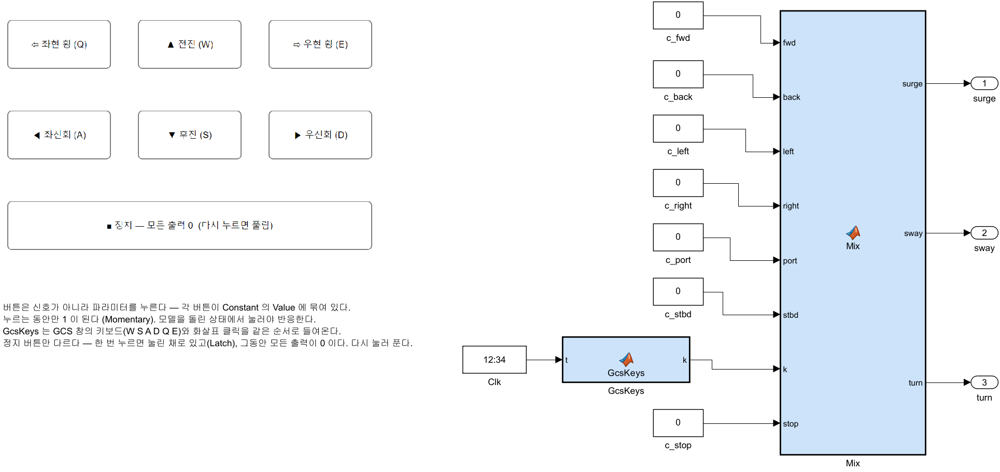

> [!important] 정지 버튼 — 모든 출력을 한 번에 0 으로
> - `ManualPad` 의 맨 아래 긴 버튼임. GCS 창 가운데의 `정지` 원을 클릭해도 **같은 버튼**이 눌림
> - 화살표 버튼과 달리 **눌린 채로 있음** (Latch). 누르면 그때부터 추력 셋이 0 이고, 다시 눌러야 풀림
> - 눌려 있는 동안은 키보드·화살표·스크립트가 무엇을 누르든 0 이 나감. GCS 가운데 원이 **빨강**으로 채워지고 글상자 첫 줄에 `정지 버튼 눌림` 이 뜸
> - 확인 (오프라인, 2026-11-19) — 전진을 누르고 있는 중에 정지를 켜자 $X$ 가 400 → **0** N, $F_L$ · $F_R$ 이 200 → **0** N 이 되었고, 끄자 다시 400 N 이 나갔음
> - **추력이 0 이 되는 것이지 배가 바로 서는 것은 아님.** 1.33 m/s 에서 누르면 저항으로 1.66 m 를 더 가서 섬. 가제보의 바람·파도에는 그대로 밀림
> - Run 을 누를 때마다 풀린 상태로 시작함 (눌린 채 끝냈어도)

> [!note] 버튼은 신호가 아니라 **파라미터**를 누름
> - 각 버튼은 옆의 Constant 블록(`c_fwd` 등)의 값에 묶여 있음. 누르는 동안만 그 값이 1 이 됨
> - `GcsKeys` 블록은 GCS 창에서 눌린 키를 같은 순서로 들여옴. `Mix` 가 둘을 합쳐 어느 쪽에서 누르든 같게 만듦
> - 모델이 **돌고 있을 때** 눌러야 반응함

> [!warning] 손을 떼도 배는 바로 서지 않음
> - 이 모델에는 제어가 없음. 버튼을 떼면 힘이 0 이 될 뿐, 배는 저항으로 천천히 섬
> - 1.33 m/s 로 가다가 떼면 **1.66 m 를 더 감** (오프라인 실측. 5 초 뒤에도 0.05 m/s 가 남음). 세우려면 반대 버튼을 잠깐 누름
> - 이 불편함이 곧 제어기가 필요한 까닭임. 위치유지가 왜 과제인지 손으로 느끼는 것이 이 단계의 목적임

## 2-3. 3 단계 — 버튼 여섯의 결과표 확인

```matlab
TP_manual_check('buttons')
```

- 정상 출력은 1-1 절 끝의 표와 같음. **숫자가 한 자리도 다르지 않아야 함** (사람이 누르지 않으므로 누가 돌려도 같음)
- 걸리는 시간은 20 초쯤임 (화면 없이 여섯 번 돌림)

| 확인할 것 | 기준 |
|---|---|
| 전진의 `F_L` · `F_R` | 200.0 · 200.0 |
| 우현 횡의 `F_L` · `F_R` · `F_B` | −73.0 · 73.0 · 200.0 |
| 횡이동 두 줄의 `r` | +0.00 |

## 2-4. 4 단계 — 가제보에 붙이기

1. 오프라인 모델이 돌고 있으면 **Stop** 을 누르고 창을 닫음
2. WSL 터미널 1 에서 가제보를 띄움 (처음 한 번은 배를 만드느라 1 분쯤 더 걸림)

```bash
cd ~/Capstone-Design/1_2026-2학기_강의자료/60-텀프로젝트/TP_haeyang && export ROS_DOMAIN_ID=7 GZ_PARTITION=hy1 && bash run_haeyang.sh lite gui
```

> [!warning] 위 명령은 **한 줄**임
> - 줄이 넘어가 보여도 끊지 말고 통째로 붙여 넣음

3. 가제보 창이 뜨면 WSL 터미널 2 에서 배를 풂

```bash
export GZ_PARTITION=hy1; gz topic -t /vrx/release -m gz.msgs.Empty -p ""
```

4. MATLAB 에서 VRX 모델을 열고 **Run** 을 누름

```matlab
open_system('TP_manual_vrx')
```

- 정상 출력 (명령창). RTF 를 재는 10 초 동안은 아무것도 안 움직이는 것이 정상임

```
[TP_manual_vrx] VRX 준비 1/2 — ROS_DOMAIN_ID = 7, 토픽 확인
     OK — 토픽 28 개 (선수추진기 · GPS · 오도메트리 있음)
[TP_manual_vrx] VRX 준비 2/2 — RTF 측정 (10 초, 그대로 기다릴 것)
     배 위치 (북 -32.25, 동 -1.92) m,  RTF = 0.955 — 이 값을 페이싱 비율로 둔다
[TP_manual_vrx] GCS 준비 완료 — 창을 한 번 클릭한 뒤 W S A D Q E 로 조종한다
```

| 줄 | 뜻 |
|---|---|
| 토픽 28 개 | 가제보가 보임. 선수추진기 토픽까지 있음 |
| 배 위치 (북 −32, 동 −2) | 출발선임. 풀어 둔 사이 바람과 파도에 1\~2 m 밀려 있는 것은 정상임 |
| RTF = 0.955 | 가제보가 실시간의 95.5 % 로 돎. 모델도 **같은 빠르기**로 돌게 맞춤 |

5. GCS 창을 클릭하고 `W` 를 누름 → **가제보 창의 배**가 앞으로 가고, GCS 지도에도 같은 항적이 그려짐

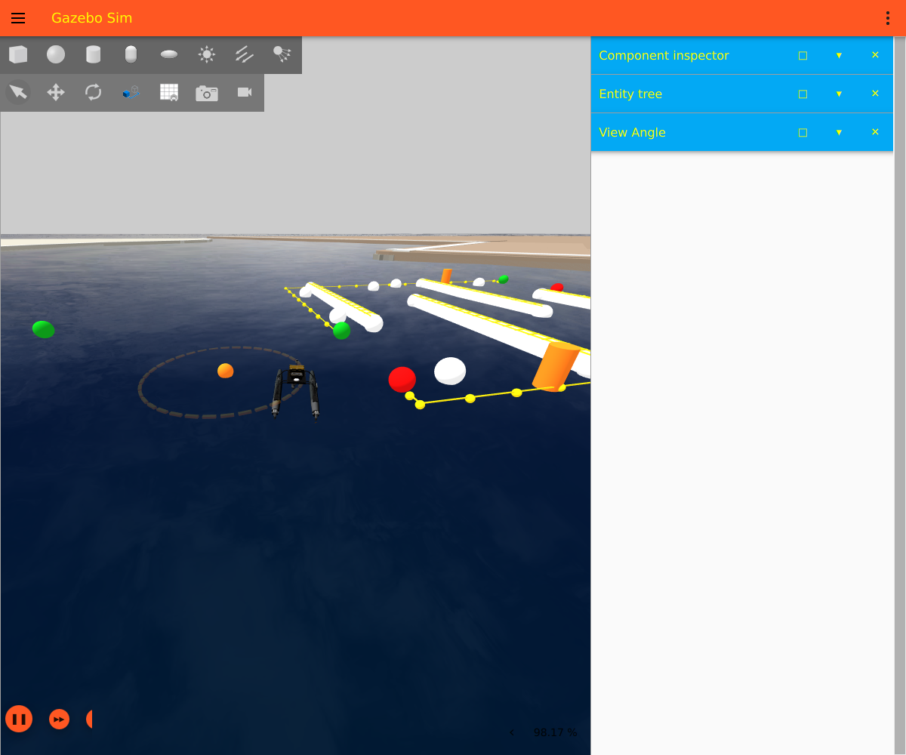

> [!important] Run 을 누르면 콜백이 네 가지를 대신 확인함
> | 확인 | 틀렸을 때 |
> |---|---|
> | ROS 의 Domain ID 가 7 인가 | 고칠 자리를 알려 주고 멈춤 |
> | 선수추진기 · GPS · 오도메트리 토픽이 있는가 | 없는 토픽 이름을 찍고 멈춤 |
> | 가제보가 몇 배속으로 도는가 (RTF) | 그 값으로 모델의 빠르기를 맞춤 |
> | GCS 창이 첫 스텝 **전에** 서 있는가 | 지도를 받는 동안 배가 혼자 가는 일을 막음 |
>
> - 넷 다 틀려도 **오류 메시지 없이** 결과만 어긋나는 것들임. 그래서 `TP_manual_init.m` 이 먼저 막음
> - Stop 을 누르면 `TP_manual_stop.m` 이 **추력 셋에 0 을 한 번 더 보냄.** 가제보의 추진기는 명령이 끊기면 마지막 값을 붙잡고 있기 때문임

## 2-5. 5 단계 — WP1 · WP2 까지 직접 몰기

- 목표 — 출발선에서 게이트 여섯을 지나 **WP1 링 안에서 멈추고**, 이어서 **WP2 링 안에서 멈춤**

| 순서 | 어디로 | 요령 |
|---|---|---|
| 1 | 게이트 1\~3 — 오른쪽(동)으로 2.6 m 휘어짐 | `W` 를 누른 채 `D` 를 짧게 끊어 누름 |
| 2 | 게이트 4\~6 — 왼쪽(서)으로 5.2 m 휘어짐 | `W` 를 누른 채 `A` 를 짧게 끊어 누름 |
| 3 | WP1 (북 10 · 동 0) | 링 3\~4 m 앞에서 `W` 를 떼고 `S` 를 짧게 눌러 세움 |
| 4 | 서쪽으로 빠짐 (북 8 · 동 −14 부근) | `A` 로 서쪽을 보게 돌린 뒤 `W` |
| 5 | WP2 (북 −14 · 동 −20) | 남서쪽으로 돌려 내려간 뒤 같은 방법으로 세움 |

**판정을 읽는 법** — GCS 창 가운데 아래 글상자의 두 줄

```
WP1  거리  3.20 m   링 안 — 정지 2.4 / 5 s
WP2  거리 28.74 m
```

| 글자 | 뜻 |
|---|---|
| `거리` | 선체 중심에서 그 지점까지 [m] |
| `링 안 — 정지 2.4 / 5 s` | 5 m 안에 있고 속력이 0.1 m/s 아래인 채로 2.4 초가 지났음. 5 초를 채우면 성공임 |
| `**성공** (t = 47.0 s)` | 그 시각에 판정을 받았음. 지도의 링이 초록으로 바뀜 |

- 속력이 0.1 m/s 를 넘으면 초가 **0 으로 돌아감.** 완전히 서야 함
- Stop 을 누르면 명령창에 요약이 찍힘. `WP1 위치유지 : 성공` 두 줄이 나오면 이 단계는 끝임

> [!tip] 처음에는 잘 안 서는 것이 정상임
> - 선회 버튼은 21 °/s 로 돎. 0.5 초만 눌러도 10° 가 돌아가므로 **짧게 끊어** 누름
> - 링 안에서 속력이 0.1 m/s 아래로 안 내려가면 반대 버튼을 아주 짧게 누름
> - 손으로 해 보면 "5 m 안에서 5 초 정지" 가 생각보다 까다로움. 그것을 자동으로 하는 것이 요구조건 3-2 절임

## 2-6. 6 단계 — 같은 주행을 스크립트로 (확인 주행)

- 사람이 몬 주행은 다시 해도 같은 숫자가 안 나옴. 그래서 **정해진 규칙으로 버튼을 누르는 스크립트**로 한 번 더 돌려 숫자를 맞대어 봄
- 이 스크립트는 사람과 **같은 길**로 들어감 — 버튼 여섯을 켜고 끌 뿐임. 유도·제어 블록을 넣은 것이 아님

| 스크립트가 누르는 규칙 | 값 |
|---|---|
| 목표 방위와 선수각의 차가 이보다 크면 그쪽 선회 버튼 | 8° |
| 그 차가 이 안이고 속도가 1.0 m/s 아래면 전진 버튼 | 30° |
| 지나가는 점(게이트 중심)은 이 안에 들면 다음 점으로 | 2 m |
| 멈추는 점(WP)은 이 안에 들면 전진을 떼고 후진으로 세움 | 3.5 m |

**오프라인에서**

```matlab
TP_manual_check('offline')
```

**가제보에서** — 가제보를 **새로 띄우고** 배를 푼 뒤에 돌림 (앞 실험이 끝난 자리에서 시작하면 결과가 달라짐)

```matlab
TP_manual_check('vrx')
```

- 정상 출력 (가제보)

```
[TP_manual_vrx] 주행 요약
  주행 시간      : 160.0 s   (기록 3201 점)
  지나온 거리    : 76.6 m
  끝 위치        : 북 -10.72 m · 동 -20.50 m   (위도 35.1861129, 경도 128.5663652)
  WP1 위치유지  : 성공 (t = 52.2 s 에 판정)
  WP2 위치유지  : 성공 (t = 97.8 s 에 판정)
  GPS - 참값     : RMS 0.049 m · 최대 0.141 m   (전 구간, 선체 중심으로 옮긴 뒤)
  동기 점검      : 모델 빠르기 0.952 · 가제보 RTF 0.955 → k = 1.004   (1.08 이하면 정상)
```

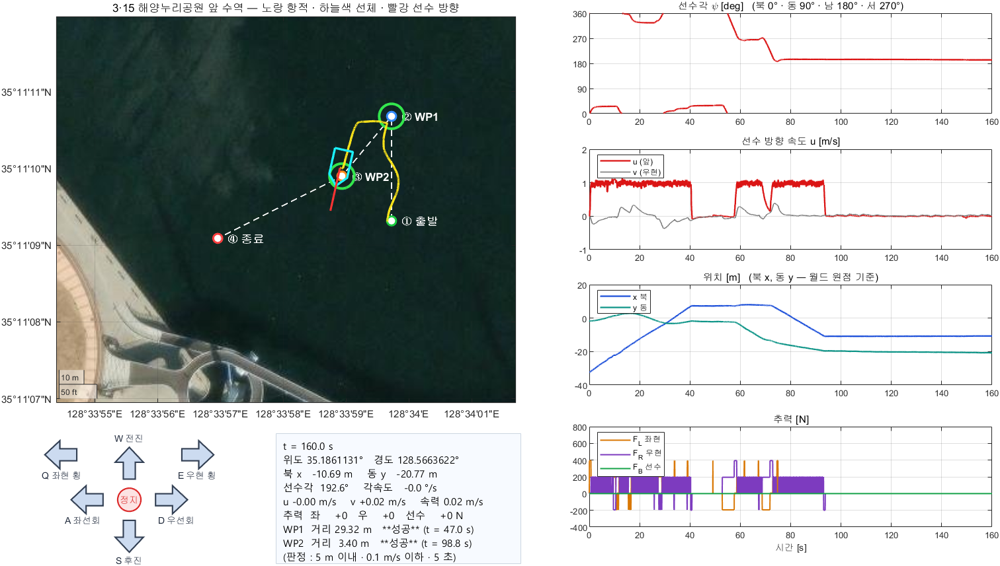

**오프라인과 가제보를 나란히** (2026-11-19, 같은 스크립트)

| 항목 | 오프라인 | 가제보 |
|---|---|---|
| 지나온 거리 | 73.2 m | 76.6 m |
| WP1 링(5 m) 진입 | 40.1 s | 38.1 s |
| WP1 위치유지 판정 | **성공** 47.1 s | **성공** 52.2 s |
| WP2 링(5 m) 진입 | 91.0 s | 90.4 s |
| WP2 위치유지 판정 | **성공** 98.0 s | **성공** 97.8 s |
| 끝 위치 (북, 동) | (−11.26, −18.28) m | (−10.70, −20.50) m |

**게이트를 지날 때 중심에서 얼마나 벗어났는가** (게이트의 북 좌표를 넘는 순간의 동쪽 어긋남. + 가 동쪽)

| 게이트 | 1 | 2 | 3 | 4 | 5 | 6 |
|---|---|---|---|---|---|---|
| 오프라인 [m] | +0.10 | −0.30 | +0.21 | +0.34 | −0.17 | −0.32 |
| 가제보 [m] | −0.14 | −0.20 | +0.13 | +0.36 | −0.23 | −0.52 |

- 가제보에서 가장 크게 벗어난 것이 **0.52 m** 임. 게이트의 좌우 여유는 3.27 m 임 (요구조건 3-1 절)
- 가제보의 WP1 판정이 오프라인보다 5 초 늦음 — 링 안에 서 있어도 파도에 속력이 0.1 m/s 를 넘나들어 5 초를 채우는 데 더 걸렸음
- 가제보의 끝 위치가 오프라인보다 서쪽으로 2.2 m 임. 그 가운데 **1.06 m 는 판정 뒤 62 초 동안 바람과 파도에 밀린 것**이고, 나머지는 세운 자리의 차이임
- 오프라인은 판정 뒤 0.02 m 밖에 안 움직였음 — 운동모델에는 바람도 파도도 없기 때문임. 가제보에서는 **세워 놓아도 밀림**. 위치유지 제어가 필요한 까닭임

> [!important] 동기 점검 $k$ 를 반드시 볼 것
> - $k$ = 가제보 RTF ÷ 모델 빠르기임. **1 이면** 모델과 가제보가 같은 박자로 돈 것임
> - $k$ 가 1.08 을 넘으면 모델이 가제보를 못 따라간 것임. 그 주행의 숫자는 쓰지 않음
> - 2026-11-19 에 처음 만든 GCS 는 한 번 그리는 데 **0.47 초**가 걸려 $k$ 가 **1.77** 이었음. 지도 제목과 글상자를 매번 바꾼 것이 원인이었음
> - 그리는 방법을 고쳐 **0.066 초**로 줄인 뒤 $k$ = **0.993 \~ 1.004** 가 되었음. 자기 조의 GCS 를 만들 때도 같은 일이 생김 → 아래 "막혔을 때"

## 2-7. 7 단계 — 값을 바꿔 보기

- 값은 모두 `TP_manual_setup.m` 에 있음. Run 을 누를 때마다 이 파일이 다시 읽힘 — **파일을 고치고 저장한 뒤 Run**

| 바꿀 것 | 변수 | 기본값 | 바꾸면 |
|---|---|---|---|
| 전진·후진의 힘 | `X_btn` | 400 N | 끝 속도가 바뀜. 200 으로 하면 0.869 m/s (실측) |
| 횡이동의 힘 | `Y_btn` | 200 N | 250 N 을 넘기면 선수추진기 한계에 걸림 |
| 선회의 모멘트 | `N_btn` | 400 N m | 선회가 빨라지거나 느려짐 |
| 선체 그림의 크기 | `boat_scale` | 3 | 1 이 실제 크기 (4.9 m) |
| 지도 범위 | `gcs_view` | [−105 50 −130 45] | [북최소 북최대 동최소 동최대] m |
| 그래프 시간 폭 | `gcs_window` | 120 s | 길게 몰 때 늘림 |
| 다시 그리는 간격 | `animate_every` | 0.25 s (가제보에서는 0.5 s) | 느린 PC 는 1.0 으로 |

- `X_btn = 200` 일 때의 끝 속도 — $(100 + 150u)u = 200$ 에서 $u = 0.869$ m/s. `TP_manual_check('buttons')` 로 확인할 것

## 2-8. 8 단계 — 전 구간을 버튼만으로 (도킹 · 탐색 · 장애물 구간까지)

- 묻는 것 — **이 코스는 물리적으로 지나갈 수 있는가.** 회피 알고리즘 이전에, 버튼만으로 끝까지 가지는지를 가제보에서 확인함
- 가는 길은 요구조건 1 장의 임무 사슬 그대로임 — 출발 → 게이트 여섯 → WP1 → **도킹** → **탐색** → WP2 → **장애물 구간** → 종료 게이트


### 따라 하는 순서 — 구간마다 누르는 키

| 순서 | 구간 | 어디까지 (북, 동) [m] | 누르는 키 |
|---|---|---|---|
| 1 | 게이트 여섯 | (1.5, −2.6) | `W` 를 누른 채 `D` · `A` 를 짧게. 게이트 **중심**을 차례로 지남 |
| 2 | WP1 위치유지 | (7.5, −2.0) 부근 | 링 안에서 `W` 를 떼고 `S` 로 세움. **한가운데로 가지 않음** — 주황 부표가 떠 있음 |
| 3 | 도크 앞으로 | (17, 0) | WP1 부표를 왼쪽(서)으로 돌아 올라가 세움 |
| 4 | 서쪽을 보게 돌림 | 제자리 | `A` 를 눌러 선수각을 **−90°** 로. 다 돌면 뗌 |
| 5 | **옆걸음으로 베이 안으로** | (25.5, 0) | `E` (우현 횡이동). 선수각이 벗어나면 `A` · `D` 를 짧게 |
| 6 | 5 초 머묾 | 베이 안 | 손을 뗌. 밀리면 `Q` · `E` 로 되돌림 |
| 7 | **옆걸음으로 나옴** | (17, 0) | `Q` (좌현 횡이동) |
| 8 | 빨강 부표로 | (23.4, −26.4) | 도크 서쪽 모서리를 돌아(18, −16) 서쪽으로 `W` |
| 9 | **빨강 부표 한 바퀴 — 우현선회** | 부표 둘레 6.5 m | `W` 를 누른 채 `D` 를 끊어 누름. 부표가 늘 **오른쪽**에 있게 |
| 10 | WP2 위치유지 | (−12.5, −23.5) 부근 | 남쪽으로 내려와 링 안에서 세움. 여기도 한가운데는 피함 |
| 11 | 장애물 진입 게이트 | (−15, −30) | 적·녹 부표 사이로 서쪽을 보고 들어감 |
| 12 | 차단벽 넷 | 북 → 남 → 북 → 남 | 열 사이를 **남북으로** 달리고 차단벽 끝에서 180° 돎. 도는 동안 `W` 를 뗌 |
| 13 | 종료 게이트 | (−39, −74.5) | 적·녹 부표 사이를 지나 세움 |

- 좌표는 GCS 창 가운데 아래 글상자의 `북 x` · `동 y` 로 읽음. 선수각 −90° 는 **서쪽**임
- 옆걸음(5·7 번)에서는 **`W` · `S` 를 쓰지 않음.** 선수각을 지킨 채 `Q` · `E` 만으로 들어갔다 나옴 (요구조건 3-3 절)

> [!tip] 손으로 몰 때의 요령
> - 차단벽 사이는 폭 8 m 임. 한가운데로 가면 좌우로 2.8 m 가 남음. **지도를 확대하지 말고** 가제보 창을 위에서 내려다보게 두고 봄
> - 가제보의 보는 눈을 위로 올리는 명령 — `bash view.sh -- -31 -6 90 -31 -6 0` (`TP_haeyang` 폴더, 코스 전체가 한 화면에 듦)
> - 차단벽 끝을 돌 때는 속도를 0.5 m/s 아래로 줄임. `W` 를 뗀 채 `D` 나 `A` 만 누르면 제자리에서 돎
> - 마우스로 할 때는 GCS 왼쪽 아래의 화살표를 **누르고 있음**. 두 방향을 같이 줄 수 없으므로 키보드보다 느림

### 스크립트로 같은 길을 — 숫자를 남기는 주행

```matlab
TP_mission('offline')
```

- 가제보 없이 먼저 돌려 길을 확인함. 30\~45 초쯤 걸림 (모델 시간 415 초를 빨리 돌림)

```matlab
TP_mission('vrx')
```

- 가제보를 **새로 띄우고 배를 푼 뒤** 돌림. 7 분쯤 걸림
- 사람 대신 스크립트가 위 표의 키를 누름. **버튼 여섯을 켜고 끌 뿐이고 제어기는 없음**

- 정상 출력 (가제보, 2026-11-19)

```
[TP_manual_vrx] 주행 요약
  주행 시간      : 395.5 s   (기록 7910 점)
  지나온 거리    : 283.1 m
  끝 위치        : 북 -38.98 m · 동 -73.47 m   (위도 35.1858581, 경도 128.5657837)
  WP1 위치유지  : 성공 (t = 47.0 s 에 판정)
  WP2 위치유지  : 성공 (t = 261.9 s 에 판정)
  GPS - 참값     : RMS 0.054 m · 최대 0.137 m   (전 구간, 선체 중심으로 옮긴 뒤)
  동기 점검      : 모델 빠르기 0.890 · 가제보 RTF 0.953 → k = 1.071   (1.08 이하면 정상)

  구간별 시각 (모델 시간)
    게이트 6 통과                 t =   31.2 s
    WP1 에서 출발                t =   54.4 s
    도크 앞 정지                  t =   72.4 s
    베이 안 도착                  t =  113.6 s
    베이에서 나옴                  t =  130.4 s
    빨강 부표 한 바퀴               t =  212.8 s
    WP2 에서 출발                t =  270.4 s
    장애물 진입 게이트               t =  281.5 s
    종료 게이트 통과·정지             t =  395.4 s
  옆걸음 구간 (t = 85.4 ~ 130.4 s) : 자세오차 최대 3.8 deg · RMS 1.8 deg,  |u| 최대 0.64 m/s
```

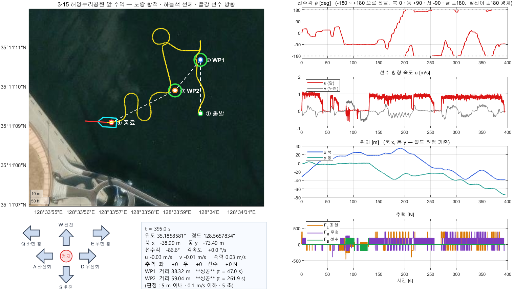

### 결과 — 물리적으로 지나갔는가

- 항적을 `passable.py` 에 넣어, 매 순간 **선체 사각형(4.9 × 2.46 m)과 가장 가까운 물체 사이**를 잼

```bash
python3 ../TP_haeyang/passable.py --track TP_mission_vrx.csv --png track.png
```

| 구간 | 선체 최소 여유 (가제보 실주행) | 오프라인 같은 길 | 가장 가까웠던 것 |
|---|---|---|---|
| 항로추종 게이트 | **1.52 m** | 1.53 m | 게이트 부표 |
| WP1 부표 옆 (세울 때·떠날 때) | **0.82 m** (전 구간 최소) | 0.85 m | WP1 한가운데의 주황 부표 |
| 도킹 — 베이 드나들기 | **1.10 m** | 1.10 m | 베이 칸막이 끝 |
| 탐색 — 빨강 부표 둘레 | **2.92 m** | 3.40 m | 빨강 부표 |
| **장애물 구간** | **1.70 m** | 2.00 m | 차단벽 끝의 펜더 |
| 가상경계선까지 (선체 중심) | **5.40 m** | 5.50 m | 경계 로프 |

| 확인한 것 | 값 | 어떻게 쟀나 |
|---|---|---|
| **접촉** | **0 건** | `/vrx/contacts` 를 주행 내내 받아 적음 (`rec_gazebo.py`) |
| 접촉 기록기가 잡는가 | 부표에 일부러 밀어붙이자 12 초에 **6294 건** | 같은 기록기. 즉 0 건은 "못 잡은 것" 이 아님 |
| 가상경계선 이탈 | 없음 | 구간 안에 머문 105 초 동안 로프까지 5.4 m 이상 |
| 위치유지 판정 | WP1 · WP2 둘 다 성공 | GCS 의 판정 (5 m · 0.1 m/s · 5 초) |
| 동기 점검 $k$ | 1.071 | 1.08 이하 — 쓸 수 있는 주행임 |

- **장애물 구간은 버튼만으로 접촉 없이 지나감.** 선체와 장애물 사이가 가장 좁았던 순간이 1.70 m 였음
- 오프라인(2.00 m)보다 0.30 m 좁게 지나간 것은 파도·바람과 조작 지연 때문임. 계획한 길의 여유(2.59 m, 요구조건 3-7 절)에서 **0.9 m 를 실제 주행이 깎아 먹었음**
- 전 구간에서 가장 좁았던 곳은 장애물이 아니라 **WP1 의 부표(0.82 m)** 였음 — 위치유지 지점 한가운데에 부표가 있다는 것을 잊으면 닿음

> [!warning] 옆걸음 도킹은 버튼만으로는 요구조건을 못 채움
> - 요구조건 3-3 절의 문턱은 옆걸음 구간에서 **자세오차 5° 이하 · 전후 속도 0.25 m/s 이하**임
> - 이 주행의 자세오차는 최대 3.8° 로 문턱 안이었으나, 전후 속도가 최대 **0.64 m/s** 로 문턱을 넘었음
> - 버튼은 켜고 끄는 것뿐이라 400 N 이 한꺼번에 들어감. 조금만 밀려도 크게 되받게 됨
> - 즉 "들어갔다 나오는 것" 은 되지만 **채점 기준은 제어기가 있어야 맞춤.** 이것이 도킹이 과제인 까닭임

### 동영상으로 남기기 — 왼쪽 가제보, 오른쪽 GCS

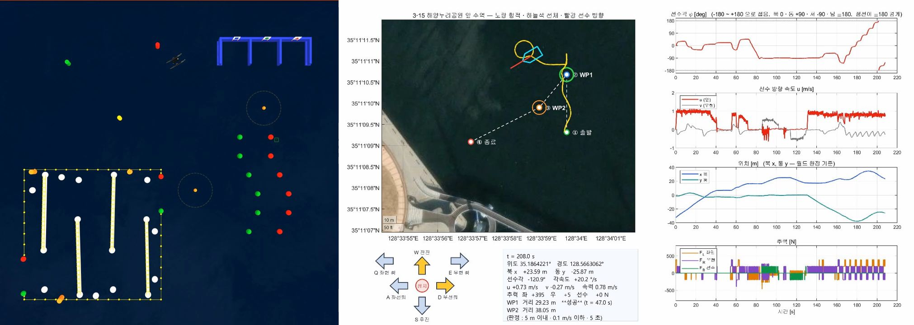

- 만든 것 — `TP_manual/TP_manual_mission.mp4` (2022 × 720, 8 배속, 56 초, 13.5 MB). 위 주행 전체가 들어 있음
- 저장소에는 동영상을 넣지 않음 (용량). 아래 순서로 **직접 만들 수 있음**

1. 가제보를 캡처용 창으로 띄우고 배를 푼 뒤, 보는 눈을 위로 올림 (터미널 1 · 2)

```bash
cd ~/Capstone-Design/1_2026-2학기_강의자료/60-텀프로젝트/TP_haeyang && export ROS_DOMAIN_ID=7 GZ_PARTITION=hy1 && bash run_haeyang.sh lite shot
```

```bash
cd ~/Capstone-Design/1_2026-2학기_강의자료/60-텀프로젝트/TP_haeyang && export ROS_DOMAIN_ID=7 GZ_PARTITION=hy1 && gz topic -t /vrx/release -m gz.msgs.Empty -p ""; bash view.sh -- -31 -6 90 -31 -6 0
```

2. 가제보 화면과 접촉을 받아 적기 시작함 (터미널 3)

```bash
cd ~/Capstone-Design/1_2026-2학기_강의자료/60-텀프로젝트/TP_manual && export ROS_DOMAIN_ID=7 GZ_PARTITION=hy1 && source /opt/ros/humble/setup.bash && python3 rec_gazebo.py --out ~/tp_rec --every 1.0 --max-sec 780
```

3. MATLAB 에서 주행함. 둘째 인자가 GCS 창을 남길 폴더임 (없으면 만들어짐)
   - **손으로 몰면서 녹화**하려면 Run 을 누르기 전에 `setappdata(0,'TP_rec',struct('dir','C:\tmp\rec_gcs','every',2))` 를 한 줄 침. 끝난 뒤 `rmappdata(0,'TP_rec')` 로 끔

```matlab
TP_mission('vrx', 'C:\tmp\rec_gcs')
```

4. 끝나면 가제보 쪽 기록을 멈추고, 그 폴더를 Windows 로 가져옴 (터미널 2)

```bash
touch ~/tp_rec/STOP && mkdir -p /mnt/c/tmp/rec_gz && cp ~/tp_rec/* /mnt/c/tmp/rec_gz/
```

5. MATLAB 에서 둘을 나란히 붙여 저장함

```matlab
TP_make_video('C:\tmp\rec_gz', 'C:\tmp\rec_gcs', '', struct('crop', [430 48 970 932], 'speed', 8))
```

- 정상 출력

```
가제보 551 장 가운데 445 장 · GCS 198 장 (모델 394 s)
저장 : ...\TP_manual\TP_manual_mission.mp4  (2022 x 720, 445 장, 8 fps → 56 초, 13.5 MB)
```

| 값 | 뜻 |
|---|---|
| `crop` | 가제보 그림에서 남길 곳 [x y 폭 높이]. 위 값은 코스만 남김 (창 1760 × 980 기준) |
| `speed` | 배속. 가제보를 1 초에 한 장 뜯었으므로 8 이면 8 배속임 |
| 두 화면을 맞추는 법 | 파일 이름에 든 **벽시계**로 가장 가까운 장끼리 붙임 |

> [!warning] GCS 창을 너무 자주 남기면 모델이 뒤처짐
> - 창 한 장을 남기는 데 0.16 초가 듦. **1 초마다** 남겼더니 동기 점검 $k$ 가 **1.225** 가 되어 그 주행은 버렸음
> - **2 초마다** 로 줄이고 그림을 절반 크기로 쓰게 고친 뒤 $k$ = **1.071** 이 되었음
> - 화면 녹화 프로그램을 따로 돌릴 때도 같음. 녹화를 켰으면 **반드시 $k$ 를 볼 것**

## 2-9. 9 단계 — 끝내기

1. Simulink 에서 **Stop** 을 누름 (추력 0 이 한 번 더 나감)
2. WSL 에서 가제보를 끔

```bash
bash ~/Capstone-Design/1_2026-2학기_강의자료/60-텀프로젝트/TP_vrx_lite/stop_vrx.sh
```

- 정상 출력

```
끈 뒤: 0 개 — 정리 완료
```

> [!caution] 끄지 않으면 남은 `gz sim` 이 메모리를 수십 GB 까지 먹음
> - 작업이 끝나면 바로 끔. 창을 닫는 것만으로는 서버가 남을 수 있음

---

# 마무리

## 이 실습의 요약

| 물음 | 답 |
|---|---|
| 버튼을 누르면 무엇이 나가는가 | 정해진 힘 — 전후 400 N · 횡 200 N · 요 모멘트 400 N m |
| 그것이 추진기 셋으로 어떻게 나뉘는가 | $F_B = Y$, $F_{L,R} = X/2 \pm (N - l_3 Y)/(2b)$ |
| 횡이동 때 좌·우 추진기가 왜 도는가 | 선수추진기가 만든 모멘트 $l_3 Y$ 를 지우려고 |
| 위치는 어디서 오는가 | GPS 의 위도·경도 → 원점 기준 북·동 [m] → 안테나에서 중심으로 0.85 m |
| GPS 위치는 얼마나 맞는가 | 참값과 RMS 0.049 m (전 구간) |
| 곧장 가면 왜 안 되는가 | 게이트 부표가 직선 위에 있음. 가제보에서만 걸림 |
| 장애물 구간을 버튼만으로 지나가는가 | 지나감 — 접촉 0 건, 선체 최소 여유 1.70 m (가제보 실주행) |
| 선수각은 어떻게 그리는가 | −180° \~ +180° 로 접어서. 경계에서는 반대편으로 건너뜀 |
| 텀프로젝트에서 무엇을 바꿔 끼우는가 | `ManualPad` → 미션(Stateflow) · 유도 · 제어. `Allocation` 부터 뒤는 그대로 |

## 수업 진도 체크

> [!important] 다음 단계(제어기 넣기)로 가기 위한 최소 조건

### 이론 이해
- [ ] 우현 횡이동 버튼의 $F_L$ · $F_R$ · $F_B$ 를 손으로 구해 −73.0 · 73.0 · 200.0 을 얻었다
- [ ] 횡이동 때 선수각이 변하지 않는 까닭을 $-l_3 Y$ 로 설명할 수 있다
- [ ] GPS 안테나 자리를 옮기지 않으면 위치가 몇 m 어긋나는지 말할 수 있다

### 실습 완료
- [ ] `TP_manual_offline` 을 Run 하여 GCS 창이 떴고, 키보드로 배를 움직였다
- [ ] `TP_manual_check('buttons')` 의 표가 1-1 절의 정상 출력과 같다
- [ ] `TP_manual_vrx` 로 가제보의 배를 움직였고, GCS 지도에 항적이 그려졌다
- [ ] 직접 몰아 WP1 과 WP2 에서 `성공` 판정을 받았다
- [ ] `TP_mission('vrx')` 가 종료 게이트까지 갔고, 구간별 시각 아홉 줄이 모두 찍혔다
- [ ] 가운데 베이에 `Q` · `E` 만으로 들어갔다 나왔다 (직접 몰아서)

### 관찰 기록
- [ ] `TP_manual_check('vrx')` 의 동기 점검 $k$ 값을 적었다 (1.08 이하)
- [ ] 같은 주행의 GPS − 참값 RMS 를 적었다
- [ ] 전 구간 항적을 `passable.py --track` 에 넣어 장애물 구간의 선체 최소 여유를 적었다

### 신고 사항
- [ ] GCS 창이 안 뜨거나 위성 사진이 안 나오면 그 화면을 캡처해 두었다

## 연습 과제 — 자기 조의 GCS 로 바꾸기

- 텀프로젝트 요구조건 4-D 절의 출발점임. 점수에 들어가는 과제가 아니라 **텀프로젝트 준비**임

| 번호 | 할 일 |
|---|---|
| 1 | `TP_gcs.m` 을 복사해 자기 조 이름으로 바꿈. 글상자에 **현재 모드** 한 줄을 더함 (요구조건 D3) |
| 2 | 오른쪽 그래프에 **명령값을 겹쳐** 그림 — 지금은 실제값만 있음. 명령 대비 실제가 요구조건 D4\~D7 임 |
| 3 | 직접 몰아 WP1 · WP2 판정을 받고, 그 화면을 녹화함 |
| 4 | 판정까지 걸린 시각 · 지나온 거리 · GPS − 참값 RMS · 동기 점검 $k$ 를 **세 번** 재어 표로 냄 |

| 평가 항목 | 배점 | 무엇을 보는가 |
|---|---|---|
| GCS 에 모드와 명령값이 더해짐 | 30 | 화면 캡처. 주행 중에 움직이는가 |
| WP1 · WP2 판정을 받음 | 30 | 녹화. 끊김 없이 |
| **검증 — 세 번 잰 숫자의 표** | **40** | 평균과 가장 나쁜 값. $k \le 1.08$ 인 주행만 셈. "잘 됐다" 는 인정하지 않음 |

## 막혔을 때

| 증상 | 까닭 | 할 일 |
|---|---|---|
| 키를 눌러도 아무 일도 없음 | GCS 창이 맨 앞이 아님 | GCS 의 지도를 한 번 클릭함 |
| 키를 뗐는데 계속 감 | 창이 바뀌는 사이에 뗀 것을 못 받음 | 스페이스를 누름 (눌린 키를 모두 뗌). 급하면 `정지` 원을 클릭함 |
| 아무 키도 안 먹고 추력이 0 임 | 정지 버튼이 눌려 있음 (GCS 가운데 원이 빨강) | `정지` 원이나 `ManualPad` 의 정지 버튼을 **한 번 더** 누름 |
| `토픽이 보이지 않는다` | 가제보가 안 떴거나 Domain ID 가 다름 | 터미널 1 의 명령을 한 줄로 다시 침 |
| `Simulink ROS 프로필의 Domain ID 는 …` | Simulink 쪽 설정이 7 이 아님 | 툴스트립 **시뮬레이션 → ROS 네트워크** 에서 7 로 바꿈 |
| 추력 그래프는 움직이는데 배가 안 감 | 배를 풀지 않았음 | `gz topic -t /vrx/release …` |
| 배가 한 자리에서 밀기만 함 | 부표나 차단벽에 얹혔음 | 후진으로 빼고 돌아감 (1-3 절) |
| 동기 점검 `k` 가 1.08 을 넘음 | GCS 를 그리느라 모델이 뒤처짐 | `animate_every` 를 1.0 으로 올림 |
| 지도가 회색이거나 단색임 | 위성 타일을 못 받음 | 인터넷을 확인함. 좌표와 항적은 그대로 맞음 |
| 모델을 고치다 망가뜨림 | — | `build_tp_manual` 한 줄로 처음 상태로 되돌림 |
| GCS 를 고쳤더니 모델이 느려짐 | 매번 제목·글상자·축 범위를 바꿈 | 선과 글자의 **값만** 바꾸고, 축 범위는 넘칠 때만 바꿈 (`TP_gcs.m` 의 `pad_y`) |

> [!note] 이 실습에서 확인한 범위
> - GCS 창의 **키보드와 화살표 클릭**은 실제로 눌러 확인하였음 — `W` 4 초에 $X = +400$ N 이 3.9 초, `D` 에 $N = +400$, `E` 에 $Y = +200$, 화살표 `A` 클릭에 $N = -400$ 이 나감 (오프라인, 2026-11-19)
> - Simulink 캔버스의 화살표 버튼과 정지 버튼은 **버튼이 묶인 Constant 의 값을 바꿔** 확인하였음 (`c_back` 을 1 로 → $X = -400$ N, `c_stop` 을 1 로 → 0 N). 화면에서 직접 클릭하는 시험은 하지 않았음
> - 전 구간 주행(2-8 절)은 **스크립트가 버튼을 누른 것**임. 사람이 손으로 끝까지 몬 기록은 아님. 같은 버튼·같은 힘이므로 손으로도 갈 수 있는 길임은 보였으나, 걸리는 시간은 사람마다 다름
> - 그 주행은 배를 출발선에 **옮겨 놓고**(순간이동) 시작하였음. 가제보를 새로 띄운 직후는 아님

## 참고 자료

- [[텀프로젝트_요구조건]] — 임무·채점·제공물. 4-D 절이 GCS 와 실시간 계측임
- [[W03_Gazebo_VRX_구축과_좌표계]] — 키보드 조종 `wamv_teleop_key` 와 ENU ↔ NED
- [[W06_선수추진기와_위치제어_접안]] — 추력 배분식의 유도와 선수추진기의 부호
- [[A2_위성지도_GCS]] — 위도·경도 변환과 위성지도 GCS 의 단계별 실습

## 다음 단계

- `ManualPad` 자리에 **속도·헤딩 제어기**를 넣음 — 버튼이 힘이 아니라 **목표값**을 바꾸게 됨 (4 주차의 안쪽 고리)
- 그 위에 **위치유지**(6 주차)와 **Stateflow 미션**(8 주차)을 얹으면 텀프로젝트의 구간 2·5 가 됨
