# 텀프로젝트 요구조건 — KABOAT 종합임무

> [!important] 점수표 — **기본 100 점 + 가산 50 점 = 최대 150 점**
>
> | 구분 | 점수 | 무엇을 보는가 | 자세히 |
> |---|---|---|---|
> | **A. 구간 완수** | **40** | 코스를 도는가 — 항로추종·위치유지·도킹·탐색·장애물회피 | 4-A |
> | **B. 완주·방식 보너스** | **20** | 끝까지, 그리고 제대로 된 방식으로 도는가 | 4-B |
> | **C. 필수 구현 방식** | **14** | Stateflow · Simulink · 3 추진기를 실제로 썼는가 | 4-C |
> | **D. GCS 와 실시간 계측** | **16** | 밖에서 보이는가. 성능이 숫자로 찍히는가 | 4-D |
> | **E. 제출물·재현성·발표** | **10** | 남이 그대로 돌릴 수 있는가 | 4-E |
> | **기본 소계** | **100** | | |
> | **F. 가산 — LLM · VLM · 음성 · 강화학습** | **+50** | AI 기법을 쓰고 **비교표로 증명**했는가 | 4-F |
> | **최대** | **150** | | |
>
> - 구간을 다 도는 것만으로는 **40 점**임. 나머지 60 점은 **방식 · 계측 · 재현성**에 있음
> - **실격** — 가상경계선 이탈 · 구간을 끊어 돌림 · 외부 PC 에서 제어명령 · 수동 개입 (4-G 절)
> - 이 100 점은 성적의 **Term Project 데모·성능 35 %** 에 대응함. 보고서 15 % 는 따로임

> [!important] 이 문서를 읽는 방법
> - **요구조건 문서임.** 무엇을 만들어 내야 하고 어떻게 채점하는지를 적은 것임. 구현 방법은 적지 않음
> - 1\~4 장이 요구조건, 5 장이 제공물, 6 장이 실행 명령, 7 장이 제공물의 확인 결과임
> - **당장 띄워 보려면 0-5 절 하나면 됨** — `git pull` 한 뒤 명령 네 토막임. 6 장은 그것을 풀어 쓴 것임
> - 6·7 장의 숫자는 모두 **실제로 돌려서 얻은 값**임. 추정값이 아님
> - 제공되는 ROS 코드는 **인지의 시작점만**임. 유도·제어·판단은 과제임 → 3 장의 "학생이 만들 것"

> [!important] 월드는 **3·15 해양누리공원 앞바다**임
> - 월드 이름 `haeyangnuri`, 파일 `TP_haeyang/haeyangnuri.sdf`. 모델 43 개
> - 원점(동 0 · 북 0)이 **위도 35.1862095 N · 경도 128.5665903 E** 임. 실제 경남 창원시 앞바다임
> - 그래서 GPS 가 **진짜 위도·경도**로 나옴. GCS 의 위성지도에 그대로 얹힘 (7-6 절)
> - 육지(공원 호안·매립지 호안)는 OSM 실측 해안선을 따라 그렸음
> - 옛 월드 `kaboat_term` 은 **그대로 남겨 두었음**. 이 문서는 새 월드만 다룸

> [!important] 상위 규정
> - `경기규정-202611` 과 `2025 KABOAT 임무설명 r1` 이 상위 문서임. 이 문서와 어긋나면 **규정을 따름**
> - 규정 6.2(2) — 종합임무는 **한 경기장에서 연속으로** 진행하고, 세부 임무를 **각각 채점**함
> - 규정 4.2(12) — 제어명령은 **선체 내부 PC** 에서 냄. 외부 관제 PC 는 모니터링 전용임

---

## 0. 한눈에 보기

- 그림 넷으로 전체를 먼저 보임 — **코스**, **좌표가 붙은 지도**, **시스템 계층**, **프로그램 계층**
- 그 다음 0-5 절이 **바로 실행하는 명령**임. 숫자와 조건은 1 장부터임

### 0-1. 코스 전체 — 가제보 공중 시점


- 실제 가제보 화면임. `bash view.sh all` 한 줄로 다시 띄울 수 있음 (5-3 절)
- 배는 오른쪽 아래 출발선(동 0 · 북 −32)에 있음. 경로는 **오른쪽 아래 → 위 → 왼쪽 아래**로 ㄷ 자를 그림

| 화면에서 찾을 것 | 어디에 |
|---|---|
| 출발선과 항로추종 게이트 열 | 오른쪽 아래. 적·녹 공 여섯 쌍이 북쪽으로 올라가며 **완만한 S** 를 그림 |
| 위치유지 WP1 | 게이트 열 끝, 오른쪽 위. 주황 점과 점선 링 |
| 도킹 ⊔ 구조물 | 오른쪽 맨 위. 파란 베이 셋, 위에 파랑 네모 · 초록 원형 · 빨강 삼각형 표지판 |
| 탐색 부표 셋 | 왼쪽 위. 빨강(가장 북동) · 초록(가장 서) · 노랑(가운데 남) |
| 위치유지 WP2 | 화면 가운데. 두 번째 점선 링 |
| 장애물 구간 | 왼쪽 아래. 노란 점선 사각(가상경계선) 안에 노란 차단벽 넷과 흰 돔들 |
| 종료 게이트 | 왼쪽 아래 끝. 적·녹 한 쌍 |


### 0-2. 같은 코스를 좌표와 함께

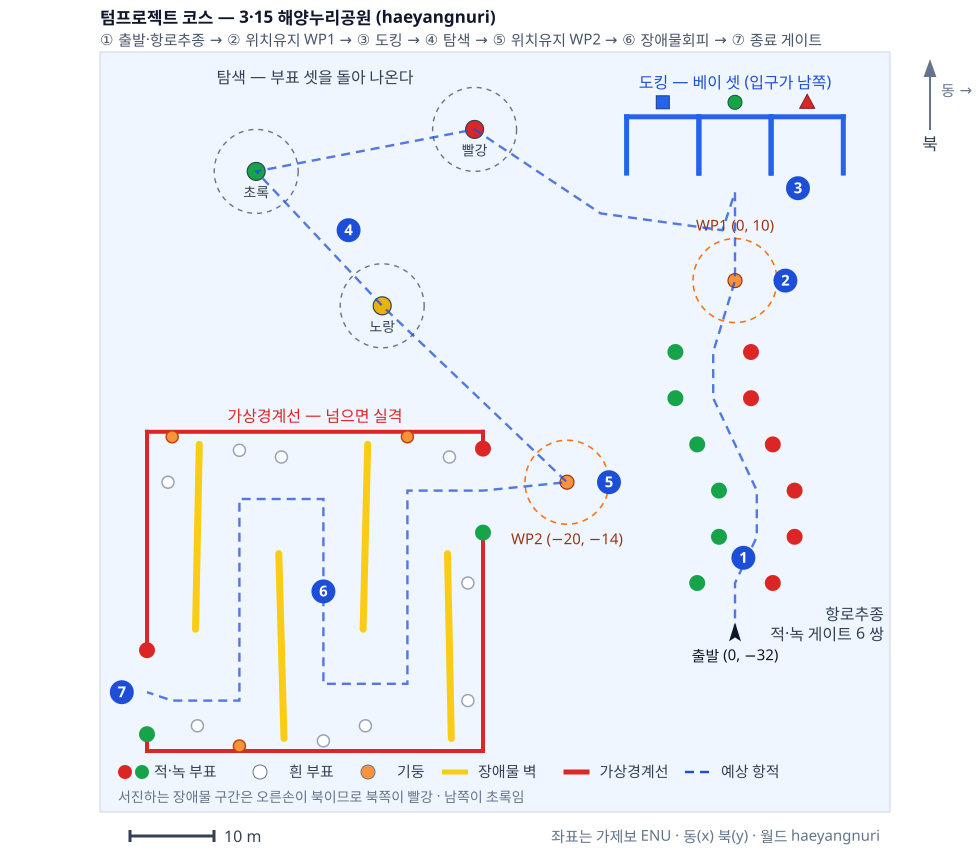

| 그림의 약속 | 뜻 |
|---|---|
| 파란 점선과 ①\~⑦ | 임무 사슬의 순서. 1 장의 표와 같은 번호임 |
| 빨강·초록 작은 원 | 게이트 부표. 북향 구간은 빨강이 동, 서진 구간은 빨강이 북임 |
| 주황 점선 원 | 위치유지 판정 영역 (반경 5 m) |
| 빨간 굵은 선 | 가상경계선. 두 군데가 끊겨 있고 그곳이 진입구·종료구임 |
| 노란 긴 막대 넷 | 부유 차단벽. 흰 작은 원은 돔 부표, 주황 원은 기둥임 |
| 왼쪽 아래 눈금자 | 10 m |

- 좌표는 **가제보 ENU** 임 — 동이 $x$, 북이 $y$. 3 장의 모든 좌표가 이 그림의 좌표임
- 같은 지점을 위도·경도로도 적어 두었음 → 7-6 절

### 0-3. 시스템 계층 — 무엇이 어디서 도는가


| 칸 | 누가 만드는가 | 무엇 |
|---|---|---|
| 윈도우 — MATLAB/Simulink | **학생** | 미션 판단(Stateflow) · 유도 · 제어 · 추력 배분 · GCS |
| WSL — ROS 2 | **학생** (시작점은 제공) | 영상 인지 · 점군 인지 · 위치 확인 · Rviz2 |
| WSL — 가제보 | 제공. 건드리지 않음 | 월드 `haeyangnuri` · WAM-V 라이트 · 센서 · `ros_gz_bridge` |

- 두 쪽은 **토픽으로만** 만남. 내보내는 것은 추력 셋, 받는 것은 영상·점군·오도메트리·GPS 임
- 이 이음새의 토픽 이름과 자료형이 그림 아래 칸에 적혀 있음. 7-1 절의 표와 같음

### 0-4. 프로그램 계층 — 어떤 파일을 어떤 순서로 쓰는가

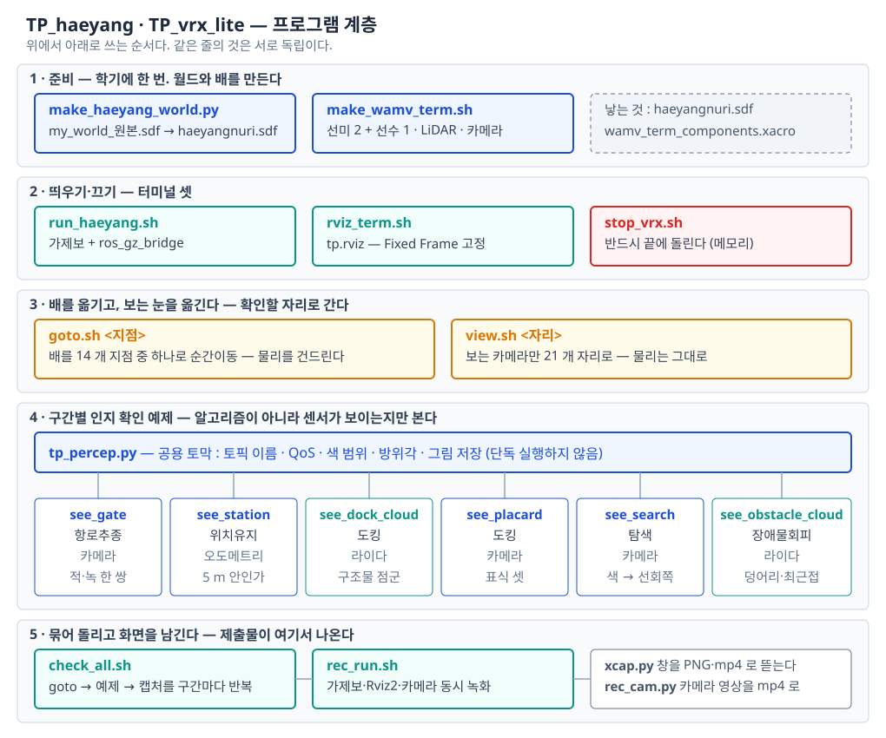

| 단 | 언제 | 무엇 | 어느 폴더 |
|---|---|---|---|
| 1 준비 | **치지 않아도 됨** | 월드(`make_haeyang_world.py`) · 배(`make_wamv_term.sh`) — 월드는 받은 것을 쓰고 배는 2 단이 알아서 만듦 (6-0 절) | 각각 `TP_haeyang` · `TP_vrx_lite` |
| 2 띄우기·끄기 | 실행할 때마다 | `run_haeyang.sh` · `rviz_term.sh` · `stop_vrx.sh` | `TP_haeyang` · `TP_vrx_lite` |
| 3 자리 잡기 | 확인할 때만 | 배를 옮김(`goto.sh`) · 보는 눈만 옮김(`view.sh`) | `TP_haeyang` |
| 4 인지 확인 예제 | 구간마다 | 공용부 `tp_percep.py` 위에 `see_*.py` 여섯 개 | `TP_vrx_lite` |
| 5 묶어 돌리기 | 증거를 남길 때 | `check_all.sh` · `topshots.sh` · `xcap.py` | `TP_haeyang` · `TP_vrx_lite` |

> [!note] 폴더가 둘로 갈린 까닭
> - `TP_haeyang` 에는 **월드에 딸린 것**만 둠 — 월드 생성·실행·지점표·시점표·위성지도 예제
> - `TP_vrx_lite` 에는 **월드와 무관한 것**을 둠 — 배(URDF)·인지 예제·캡처 도구
> - 인지 예제는 센서 기준(배 앞 몇 m)으로만 판단하므로 월드가 바뀌어도 그대로 돎
> - 딱 하나 `see_station.py` 만 부표 좌표가 필요해 `--east/--north` 로 새 좌표를 줌

> [!note] 3 단과 4 단의 선이 끊겨 있는 까닭
> - `goto.sh` 는 **물리를 건드림** — 배를 집어 옮김. 채점 시행에는 쓸 수 없음
> - `view.sh` 는 **보는 카메라만** 옮김 — 물리에 손대지 않으므로 언제 써도 됨
> - `tp_percep.py` 는 단독으로 돌리지 않음. 여섯 예제가 함께 쓰는 토막임

### 0-5. 바로 실행 — `git pull` 한 뒤 이것만 치면 됨

> [!important] 월드도 배도 **만들 필요 없음**
> - 월드 `haeyangnuri.sdf` 는 **저장소에 들어 있음**. 받으면 그대로 씀
> - 배(URDF)는 `run_haeyang.sh` 가 **없으면 알아서 한 번 만듦**. 따로 칠 것이 없음
> - 그래서 아래 네 토막이 전부임. 6 장은 이것을 자세히 풀어 쓴 것일 뿐임

**(0) 받기 — 처음 한 번, 또는 자료가 바뀌었을 때**

```bash
cd ~/Capstone-Design && git pull
```

**(1) 터미널 1 — 가제보**

```bash
cd ~/Capstone-Design/1_2026-2학기_강의자료/60-텀프로젝트/TP_haeyang && export ROS_DOMAIN_ID=7 GZ_PARTITION=hy1 && bash run_haeyang.sh lite gui
```

- 처음 한 번은 배를 만드느라 1 분쯤 더 걸림. 두 번째부터는 바로 뜸
- 뜨면 화면이 0-1 절의 사진과 같음. 배는 오른쪽 아래 출발선(동 0 · 북 −32)에 있음

**(2) 터미널 2 — Rviz2** (센서가 보이는지 볼 때만. 안 띄워도 됨)

```bash
cd ~/Capstone-Design/1_2026-2학기_강의자료/60-텀프로젝트/TP_haeyang && export ROS_DOMAIN_ID=7 GZ_PARTITION=hy1 && bash ../TP_vrx_lite/rviz_term.sh
```

**(3) 배를 풀기** — 터미널 3. 풀지 않으면 추력을 줘도 제자리에 떠 있기만 함

```bash
export GZ_PARTITION=hy1; gz topic -t /vrx/release -m gz.msgs.Empty -p ""
```

**(4) 끝낼 때 — 반드시**

```bash
bash ~/Capstone-Design/1_2026-2학기_강의자료/60-텀프로젝트/TP_vrx_lite/stop_vrx.sh
```

| 꼭 지킬 것 | 까닭 |
|---|---|
| 세 터미널 모두 `ROS_DOMAIN_ID=7` · `GZ_PARTITION=hy1` | WSL 은 비대화형이라 `.bashrc` 를 건너뜀. 값이 다르면 **토픽이 하나도 안 보임** |
| 인자는 `lite gui` 순서 (`<판> <모드>`) | `bash run_haeyang.sh gui` 는 "gui" 를 판 이름으로 읽고 **아무 말 없이 끝남** |
| 끝나면 `stop_vrx.sh` | 남은 `gz sim` 이 메모리를 62 GB 까지 먹어 PC 가 멈춤 |

- 여기까지가 **월드를 띄우는 전부**임. 그 다음은 각자의 Simulink·ROS 노드를 붙이는 일임
- 확인 도구(`check_all.sh` · `goto.sh` · `view.sh`)와 센서 실측값은 6·7 장에 있음

---

## 1. 임무 사슬

| 순서 | 구간 | 성공 판정 | 주 센서 | 실패·감점 |
|---|---|---|---|---|
| 1 | 출발 → 항로추종 | 적·녹 게이트 **6 쌍**을 순서대로 통과 | 카메라 | 게이트 누락 1 개당 감점 |
| 2 | 위치유지 WP1 | 부표 반경 **5 m 이내**, 정지 후 **5 초** 유지 | GPS·IMU | 5 m 이탈 또는 정지 미달 |
| 3 | 도킹 | 지정 표식의 베이에 **옆걸음으로** 진입·정지 | 카메라 + 라이다 | 베이 오선택, 벽 접촉 |
| 4 | 탐색 | 지정 색 부표를 **규정 방향으로** 1 회전 | 카메라 | 방향 반대, 부표 접촉 |
| 5 | 위치유지 WP2 | 구간 2 와 같음 | GPS·IMU | 구간 2 와 같음 |
| 6 | 장애물회피 | 차단벽·부표 사이를 무접촉 통과 | 라이다 | 접촉, **가상경계선 이탈은 실격** |
| 7 | 종료 게이트 | 적·녹 종료 게이트 통과 | 카메라 | 미통과 |

> [!important] 전 구간 연속 주행이 **필수 조건**임
> - 구간별로 따로 돌린 결과는 받지 않음. 출발선에서 한 번에 구간 7 까지 가야 함
> - 구간을 끊어 돌린 시행은 **0 점**으로 처리함. 규정 6.2(2) 와 같음
> - 중간에 멈추거나 수동 개입하면 그 시행은 끝난 것으로 봄

---

## 2. 규정에서 그대로 오는 조건

| 조건 | 값 | 출처 |
|---|---|---|
| 제한시간 | 15 분 | 규정 |
| 도전 횟수 | 5 회 | 규정 |
| 접촉 벌점 (종합임무) | 1 회당 **30 초** | 규정 |
| 임무점수 | 완료 시간(초) + 접촉 벌점. **낮은 쪽이 상위** | 규정 |
| 위치유지 점수 | $100 \times$ (성공 횟수 / 지정 위치 개수) | 규정 |
| 제어명령 위치 | 선체 내부 PC. 외부는 모니터링 전용 | 규정 4.2(12) |
| 탐색 선회 방향 | **빨강·초록 → 우현선회 / 노랑 → 좌현선회** | 규정 5.2(6) |
| 도킹 표식 | 모양 3 종 (삼각형·원형·네모) × 색 5 종 (빨강·초록·파랑·주황·노랑) 중 임의 조합 | 임무설명 Ⅲ |

> [!warning] 색만 보거나 모양만 보는 코드는 경기에서 깨짐
> - 표식은 모양과 색이 **임의로 조합**됨. "빨강이면 왼쪽 베이" 같은 규칙은 쓸 수 없음
> - 색과 모양을 **둘 다** 판정해야 함. 제공 예제 `see_placard.py` 가 둘을 모두 내놓음

> [!caution] 가상경계선 이탈은 실격임
> - 장애물 구간의 가상경계선(**동 −70 \~ −30, 북 −46 \~ −8**)을 벗어나면 그 시행은 실격임
> - 감점이 아니라 실격임. 경계선 안쪽으로 여유를 두고 경로를 잡을 것

---

## 3. 구간별 요구조건

### 3-1. 항로추종 (구간 1)


- 그림 읽는 법 — 오른쪽(동)이 빨강, 왼쪽(서)이 초록임. 배는 아래(남)에서 위(북)로 지남
- 월드에 놓인 것 — 게이트 **6 쌍**. 북 −26.0 부터 5.5 m 간격, 중심이 좌우로 어긋남

| 쌍 | 북 $y$ [m] | 중심 동 $x$ [m] | 폭 [m] | 좌우 여유 [m] | 들어가는 침로 변화 [°] |
|---|---|---|---|---|---|
| 1 | −26.0 | 0.0 | 9.0 | 3.27 | +25.3 |
| 2 | −20.5 | +2.6 | 9.0 | 3.27 | −25.3 |
| 3 | −15.0 | +2.6 | 9.0 | 3.27 | −25.3 |
| 4 | −9.5 | 0.0 | 9.0 | 3.27 | 0.0 |
| 5 | −4.0 | −2.6 | 9.0 | 3.27 | +25.3 |
| 6 | +1.5 | −2.6 | 9.0 | 3.27 | +17.0 |

- 중심이 `0 → +2.6 → +2.6 → 0 → −2.6 → −2.6` 으로 움직여 **완만한 S** 한 번을 그림
- 침로 변화가 최대 **25.3°** 임 — 조향은 분명히 보이되 과하지 않음. 직진만으로는 통과하지 못함
- 좌우 여유는 배 반폭 **1.23 m** (전폭 2.46 m) 를 뺀 값임
- 여섯 쌍 모두 폭 **9.0 m** 임 (2026-11-19 에 가운데 넷을 8.0 → 9.0 m 로 넓혔음. 까닭은 3-7 절)
- 진행 방향은 **북향**임. 따라서 **빨강이 우현**, 초록이 좌현임
- 성공 판정 — 게이트 중심선을 **순서대로** 지남. 순서가 어긋난 게이트는 불통과로 셈
- 학생이 만들 것 — 적·녹 쌍을 묶어 게이트 중심 방위를 내는 것, 그 방위를 따라가는 유도·제어
- 제공되는 것 — 색 덩어리 검출과 쌍 묶음까지 (`see_gate.py`)

### 3-2. 위치유지 (구간 2·5)


- 그림 읽는 법 — 가운데 주황 점이 부표, 그 둘레 얇은 원이 판정 링임. 링 안에 들어가 멈추면 됨
- 월드에 놓인 것 — 주황 부표 2 개와 **반경 5 m 링**. **WP1 (동 0 · 북 10)**, **WP2 (동 −20 · 북 −14)**
- 링은 판정 영역을 눈으로 보이게 둔 것임. 가제보 화면과 Rviz2 양쪽에서 보임
- 성공 판정 — 부표 중심에서 **5 m 이내**에 들어간 뒤 **정지 상태로 5 초** 유지
  - 정지의 기준은 대지속력 **0.1 m/s 이하**로 둠
- WP2 의 링 가장자리에서 장애물 경계(동 −30)까지 **5.0 m** 남음 — 링 안에서 멈춰도 경계를 넘지 않음
- 학생이 만들 것 — 정지 유지 제어 (3 자유도). 6 주차 선수추진기 모델을 그대로 쓸 수 있음
- 제공되는 것 — 거리·속력을 재고 5 초를 세는 판정기 (`see_station.py`)

### 3-3. 도킹 (구간 3)


- 그림 읽는 법 — 베이 셋이 동서로 늘어서 있고 입구가 모두 남쪽임. 배는 남쪽에서 북으로 들어감
- 월드에 놓인 것 — ⊔ 모양 3 베이. **베이 중심 동 −8.6 · 0 · +8.6**, 입구 **북 22.5**, 뒷벽 **북 29.8**
- 베이 폭 **8.0 m**, 깊이 **7.0 m**, 벽 두께 **0.6 m**, **벽 높이 2.0 m**. 구조물 전체 폭 26.4 m (동 ±13.2)
- 표지판은 베이 **위**에 기둥으로 세워 두었음 (실제 대회 사진과 같은 꼴). 중심 높이 1.2 m
- 표식 차례는 **서쪽 파랑 네모 · 가운데 초록 원형 · 동쪽 빨강 삼각형** 임

| 여유 | 값 | 뜻 |
|---|---|---|
| 선수 진입 좌우 여유 | **2.77 m** | 베이 폭 8.0 − 배 전폭 2.46 을 반으로 나눈 것 |
| 깊이 여유 | **2.10 m** | 베이 깊이 7.0 − 배 길이 4.9 |
| 옆걸음 진입 여유 | **1.55 m** | 배를 가로로 넣을 때. 선수각을 유지해야 하므로 이 값이 기준임 |

- 성공 판정 — **지정된 표식**의 베이에 선체가 들어가 정지함
- 방식 요건 — 진입은 **순수 옆걸음**으로 함. 선수각을 유지한 채 횡이동으로 들어감
  - 판정 문턱 — 옆걸음 구간 전체에서 자세오차 ≤ 5°, 최대 $\lvert u \rvert$ ≤ 0.25 m/s
- 학생이 만들 것 — 베이 선택 판단 (Stateflow), 옆걸음 추력 배분, 접근 경로
- 제공되는 것 — 표식 셋의 색·모양·방위 (`see_placard.py`), 점군으로 본 도크 방향 (`see_dock_cloud.py`)

### 3-4. 탐색 (구간 4)


- 그림 읽는 법 — 세 부표가 넓은 삼각으로 떨어져 있음. 오른쪽 위가 빨강, 왼쪽이 초록, 아래가 노랑임
- 월드에 놓인 것 — 부표 3 개. **빨강 (−31, 28) · 초록 (−57, 23) · 노랑 (−42, 7)**
- 선회 궤도 반경은 **5.0 m** 로 봄 (제자리 선회 반경 2.74 m 보다 크게 잡은 값임)
- 부표 사이가 20 m 넘게 벌어져 있어 **선회 궤도 셋이 겹치지 않음**. 도킹 구조물·장애물 경계와도 떨어짐
- 성공 판정 — 지정 색 부표를 중심으로 **1 회전**하고, 회전 방향이 규정과 같음
- 회전 방향은 규정 5.2(6) 을 따름 — 빨강·초록은 **우현선회**, 노랑은 **좌현선회**
- 학생이 만들 것 — 부표 중심 선회 궤적 생성과 추종 (로이터링)
- 제공되는 것 — 색 판정과 그에 따른 선회 방향 1 개 (`see_search.py`)

> [!warning] 세 번째 부표는 **노랑**임
> - 2025 년 판 문서의 "흰색 부표 반시계" 는 `경기규정-202611` 에서 **노랑 좌현선회**로 바뀜
> - 월드에도 노랑으로 넣어 두었음. 흰색을 찾는 코드는 아무것도 못 찾음

### 3-5. 장애물회피 (구간 6)


- 그림 읽는 법 — 긴 노란 막대가 **부유 차단벽**, 흰 공이 **돔 부표**, 주황 기둥이 모서리에 섬
- 둘레의 가는 선이 가상경계선이고 **동쪽·서쪽 두 군데가 끊겨 있음** — 그곳이 진입구·종료구임
- 진행은 오른쪽(동)에서 왼쪽(서)으로임
- 월드에 놓인 것

| 것 | 수 | 자리 |
|---|---|---|
| 부유 차단벽 (길이 22 m · 폭 0.9 m · **윗면 높이 1.2 m**) | 4 | 동 −34 · −44 · −54 · −64 (**열 간격 10 m**). 남·북을 번갈아 막음 |
| 흰 돔 부표 (반지름 0.9 m · **윗면 높이 1.35 m**) | 9 | 차단벽 끝의 목을 좁히는 넷 + 구석의 다섯 |
| 주황 기둥 (높이 2.0 m) | 3 | (−39, −8.6) · (−59, −45.4) · (−67, −8.6). 경계 로프에 붙여 둠 |

- 차단벽이 남·북을 번갈아 막으므로 **북 → 남 → 북 → 남** 으로 네 번 꺾어야 빠져나감
- **가장 좁은 통로 폭이 8.10 m** 임 — 선체 사각형(4.9 × 2.46 m)을 길 따라 밀었을 때 남는 틈이 **2.59 m** 임 (3-7 절)
- 진입 게이트 (동 −30, **북 −10 빨강 · 북 −20 초록**), 종료 게이트 (동 −70, **북 −34 빨강 · 북 −44 초록**)
- 이 구간은 **서진**임. 서쪽을 보고 서면 오른손이 북쪽이므로 **빨강이 북**임
- 가상경계선 — 동 −70 \~ −30, 북 −46 \~ −8. 진입구(동 −30, 북 −21\~−9)와 종료구(동 −70, 북 −45\~−33)가 끊김
- 접촉 판정 거리 — 기둥 반지름 0.6 m + 배 반폭 **1.23 m** = **1.83 m**
- 성공 판정 — 무접촉 통과. 접촉 1 회당 벌점 30 초. **경계선 이탈은 실격**
- 학생이 만들 것 — 회피 경로 생성. 9 주차 VFH 결과물을 그대로 가져올 수 있음
- 제공되는 것 — 점군을 앞쪽 띠로 잘라 덩어리와 최근접 거리를 내는 것 (`see_obstacle_cloud.py`)

> [!note] 2026-11-19 에 장애물을 두 가지로 고쳤음
> - **높이를 올렸음** — 차단벽 윗면 0.5 → 1.2 m, 돔 윗면 1.05 → 1.35 m. 낮아서 라이다 줄 사이로 빠졌음 (7-7 절)
> - **열 간격을 벌렸음** — 9 → 10 m, 목을 좁히던 돔 넷을 로프 쪽으로 1 m 물렸음. 통로 폭 7.18 → 8.10 m (3-7 절)
> - 임무의 꼴은 그대로임 — 차단벽 넷이 남·북을 번갈아 막고, **북 → 남 → 북 → 남** 으로 꺾어 나감

### 3-6. 공통 방식 요건

| 요건 | 내용 | 근거 | 배점 |
|---|---|---|---|
| 미션 판단 | **Stateflow 차트 하나**가 전 구간을 돌림 | 8 주차 차트를 늘림 | 4-C1 |
| 제어 | **Simulink**. 유도·제어·추력배분을 전부 Simulink 쪽에 둠 | 5\~8 주차 자료 | 4-C2 |
| 인지 | ROS 2 쪽에 둠. 카메라는 OpenCV, 라이다는 점군 처리 | 이 문서 5 장 | — |
| 추진기 | 선미 좌·우 2 개 + **선수추진기 1 개** 3 추진기 | 6 주차 모델 | 4-C3 |
| GCS | **위성지도** 위 실시간 항적 · **선수방향** 표시 · 현재 모드 표시 | 7-6 절 위경도 | 4-D1\~D3 |
| 실시간 플롯 | 헤딩 · surge $u$ · sway $v$ · 위치 $x$·$y$, **명령 대비 실제**를 주행 중에 | 5\~7 주차 | 4-D4\~D7 |
| 제어명령 | 선체 내부 PC 에서 냄. GCS 는 모니터링만 | 규정 4.2(12) | 4-G |
| 제출 | GitHub 저장소. **쉘 스크립트 하나 + Simulink** 로 재현 | — | 4-E |

> [!important] 도구는 **MATLAB · Simulink · Stateflow** 가 필수임
> - 미션 판단은 Stateflow, 제어기는 Simulink 임 — 파이썬으로 대체할 수 없음
> - 파이썬은 **인지와 판단 입력**까지임. 명령을 만드는 자리는 Simulink 임 (4-C2 절의 감점 조항)
> - 둘을 잇는 꼴은 9 주차 이음새와 같음 — 파이썬이 토픽으로 **지령**을 내고 Simulink 가 받음

### 3-7. 물리적으로 지나갈 수 있는가 — 선체 크기로 본 통로

- 회피 알고리즘이 맞아도 **길이 배보다 좁으면** 못 지나감. 그래서 배의 길이와 폭으로 코스를 실제로 밀어 보았음
- 배는 길이 **4.9 m** · 폭 **2.46 m** 의 사각형으로 봄. 제자리에서 돌 때 휩쓰는 반경은 **2.74 m** 임

```bash
python3 passable.py --png passable.png
```


| 그림의 약속 | 뜻 |
|---|---|
| 회색 | 장애물 — 차단벽·펜더·돔·기둥·게이트 부표·경계 로프 |
| 주황 선 | 장애물에서 가장 멀리 떨어져 가는 길 |
| 빨간 사각형 | 그 길 위에 3 m 마다 놓은 선체 (진행 방향으로 놓음) |
| 빨간 동그라미 | 선체 테두리가 장애물에 가장 가까워지는 자리 |

| 구간 | 통로 폭 | **선체 최소 여유** | 최소 선회 반경 | 1 m/s 로 돌 때 필요한 각속도 |
|---|---|---|---|---|
| 항로추종 (출발선 → WP1) | 6.93 m | **1.77 m** | 3.8 m | 15.2 °/s |
| 장애물회피 (WP2 → 종료 게이트) | 8.10 m | **2.59 m** | 4.6 m | 12.5 °/s |

- **선체 최소 여유**가 곧 **허용되는 경로 오차**임 — 길에서 이만큼 벗어나면 닿음
- 통로 폭의 절반(항로추종 3.47 m · 장애물 4.05 m)이 **keep-out 반경의 한계**임. 회피기가 장애물을 이보다 크게 부풀리면 길이 닫힘

> [!important] 고치기 전에는 폭이 빠듯했음 — 2026-11-19 에 넓힌 까닭
> | 구간 | 고치기 전 | 고친 뒤 | 무엇을 바꿨나 |
> |---|---|---|---|
> | 항로추종 선체 여유 | 1.27 m | **1.77 m** | 가운데 게이트 넷의 폭 8.0 → 9.0 m |
> | 장애물 통로 폭 | 7.18 m | **8.10 m** | 차단벽 열 간격 9 → 10 m, 목의 돔을 1 m 물림 |
> | 장애물 선체 여유 | 2.19 m | **2.59 m** | 위와 같음 |
>
> - 9 주차 회피기의 keep-out 반경은 배 반폭 1.23 + 안전여유 2.00 = **3.23 m** 임 (`W09_setup.m`)
> - 고치기 전 통로 반폭이 3.59 m 라 **남는 틈이 0.7 m** 였음 — 선체는 지나가도 회피기가 길을 못 찾는 폭이었음
> - 지금은 반폭 4.05 m 라 같은 설정에서 틈이 **1.6 m** 남음. 그래도 넉넉하지 않으므로 안전여유를 2.0 m 보다 키우지 말 것

> [!important] 가제보에서 실제로 몰아 확인하였음 — 2026-11-19
> - 제어기 없이 **버튼 여섯만으로** 출발선에서 종료 게이트까지 갔음 (395.5 초 · 283.1 m). 도킹과 부표 선회를 포함함
> - **접촉 0 건** (`/vrx/contacts`). 장애물 구간에서 선체와 장애물 사이가 가장 좁았던 순간이 **1.70 m** 였음
> - 위 표의 2.59 m 에서 0.9 m 가 줄었음 — 파도·바람과 조작 지연의 몫임. 여유는 넉넉하지 않음
> - 절차와 동영상 만드는 법은 [[텀프로젝트_실습_수동조종과_GCS]] 2-8 절에 있음

> [!warning] 이 숫자는 **가장 좋은 길**을 따라갔을 때의 값임
> - 길을 벗어나거나 비스듬히 들어가면 여유가 줄어듦. 선체가 길어서 **모서리가 먼저 닿음**
> - 게이트를 25° 로 비스듬히 지날 때가 가장 빠듯함 — 게이트 앞에서 침로를 미리 맞출 것
> - 차단벽 끝을 돌 때는 속력을 줄일 것. 1 m/s 로 돌려면 12.5 °/s 가 필요함

---

## 4. 채점 — 기본 100 점 + 가산 50 점

- 이 100 점은 성적의 **Term Project 데모·성능 35 %** 에 대응함. 보고서 15 % 는 따로임
- 구간을 다 도는 것은 **40 점**임. 나머지 60 점은 **방식 · 계측 · 재현성**에 있음 — 첫 장의 점수표와 같음

### A. 구간 완수 — 40 점

| 항목 | 배점 | 재는 법 |
|---|---|---|
| A1 항로추종 | **6** | 게이트 1 쌍 통과마다 1 점 × **6 쌍**. 순서 어긋나면 그 게이트는 불통과 |
| A2 위치유지 WP1 | **4** | 반경 5 m 링 진입 2 + 정지 후 5 초 유지 2 |
| A3 위치유지 WP2 | **4** | 위와 같음 |
| A4 도킹 | **8** | 지정 표식 베이 **선택 일치 4** + 베이 안 진입·정지 4 |
| A5 탐색 — 3 색 선회 | **9** | 색마다 1 회전 2 + 규정 방향 일치 1 → **색당 3 점** × 3 색 |
| A6 장애물회피 | **9** | 무접촉 통과 9. 접촉 1 회당 **−3** (최저 0). 경계선 이탈은 실격 |

- A5 선회 방향은 규정 5.2(6) 임 — **빨강·초록 우현선회(시계) · 노랑 좌현선회(반시계)** (3-4 절)
- A2·A3 의 정지 기준은 대지속력 **0.1 m/s 이하**임
- 구간 7 **종료 게이트**는 A 에 따로 배점하지 않음 — 통과했는지는 B1(전 임무 완주)로 봄

### B. 완주·방식 보너스 — 20 점

| 항목 | 배점 | 재는 법 |
|---|---|---|
| B1 **전 임무 완주** | **8** | 구간 1\~7 을 하나도 빠뜨리지 않고 연속으로 끝냄. 하나라도 실패면 0 |
| B2 **3 색 선회 전부** | **4** | 빨강·초록·노랑 셋 다 1 회전 + 방향 일치. 둘까지는 0 |
| B3 **순수 옆걸음 도킹** | **6** | 자세오차 ≤ 5° 2 + 최대 $\lvert u \rvert$ ≤ 0.25 m/s 2 + $\lvert v \rvert$ > 0.3 m/s 가 2 초 이상 2 |
| B4 제한시간 | **2** | 15 분 이내 1, **7 분 30 초** 이내 2 |

> [!important] 끊어 돌린 시행은 실격임. B1 은 그 위에 얹는 것임
> - 구간을 따로 돌린 결과는 **채점하지 않음** (1 장·4-G 절)
> - B1 은 **연속으로 돌린 시행 안에서 일곱 구간을 전부 성공**했을 때만 주는 점수임
> - 선수를 돌려 도킹하면 A4(8 점)는 받지만 **B3(6 점)은 0** 임

### C. 필수 구현 방식 — 14 점

| 항목 | 배점 | 확인하는 것 |
|---|---|---|
| C1 **Stateflow 미션판단** | **6** | 차트 **하나**가 전 구간을 돌림 3 + 상태 전이 로그가 임무 사슬 순서와 일치 3 |
| C2 **제어기는 Simulink** | **5** | 유도·제어·추력배분이 전부 Simulink 안 3 + 파이썬에 제어 루프가 **없음** 2 |
| C3 **선수추진기 포함 3 추진기** | **3** | `/wamv/thrusters/{left,right,bow}/thrust` 세 토픽이 모두 실제로 쓰임 |

> [!caution] C2 는 감점 조항이 있음
> - 파이썬 쪽에서 PID·추력 계산·요(yaw) 제어가 발견되면 **C2 를 0 으로 둠**
> - 파이썬은 **인지와 판단 입력까지**임. 명령을 만드는 자리는 Simulink 임
> - 경계가 헷갈리면 9 주차 이음새를 그대로 따를 것 — 파이썬은 `/vfh/command` 같은 **지령**만 냄

### D. GCS 와 실시간 계측 — 16 점

#### D-1. 위성지도 GCS — 8 점

| 항목 | 배점 | 확인하는 것 |
|---|---|---|
| D1 **위성지도 위 실시간 항적** | **4** | GPS 위경도를 위성지도에 그대로 얹음. 지나온 자취가 선으로 남음 |
| D2 **선수방향 표시** | **2** | 배 아이콘이 **실제 선수각**으로 돌아감 (화살표·삼각형 등) |
| D3 **현재 모드 표시** | **2** | 지금 어느 구간·모드인지 글자로. **Stateflow 상태와 같아야 함** |

- 월드 원점이 **35.1862095 N · 128.5665903 E** 라 **진짜 위경도**가 나옴 — 위성지도에 그대로 얹힘 (7-6 절)
- 7-6 절 끝에 **MATLAB 위성지도 예제**가 있음. 거기서 시작하면 D1 은 금방 됨
- **돌아가는 GCS 한 벌**이 [[텀프로젝트_실습_수동조종과_GCS]] 에 있음 — 위성지도 위 항적·선체·선수 방향과 그래프 넷. 그 `TP_gcs.m` 을 고쳐 쓰면 됨
- 지도 타일은 **오프라인 캐시도 인정**함. 경기장에 인터넷이 없을 수 있음
- 제어명령은 선체 내부 PC 에서 냄. GCS 는 **모니터링 전용**임 (규정 4.2(12))

#### D-2. 실시간 제어 플롯 — 8 점 (4 종 × 2)

**플롯마다 — 주행 중 실시간으로 그려짐 1 점 + 성능 기준 충족 1 점**

| 항목 | 세로축 | 겹쳐 그릴 것 | 성능 기준 |
|---|---|---|---|
| D4 **헤딩 제어** | [deg] | $\psi_{cmd}$ vs $\psi$ | 정상상태 오차 RMS **≤ 5°** |
| D5 **전진속도 (surge)** | [m/s] | $u_{cmd}$ vs $u$ | RMS **≤ 0.2 m/s** |
| D6 **횡속도 (sway)** | [m/s] | $v_{cmd}$ vs $v$ | 옆걸음 도킹 구간에서 RMS **≤ 0.15 m/s** |
| D7 **위치 (XY)** | [m] | 북 $x_{cmd}$ vs $x$ · 동 $y_{cmd}$ vs $y$ | 위치유지 구간 RMS **≤ 1.0 m** |

- 기호는 NED 임 — **북이 $x$, 동이 $y$**. 코드에서는 `x_n` · `y_n` 로 씀
- D4\~D6 은 **이너 루프**, D7 은 **아우터 루프**임. 한 화면에 겹치지 말 것
- 네 플롯 모두 **주행 중 실시간**이어야 함. 끝난 뒤 MATLAB 으로 그린 것은 **성능 1 점만** 인정함
- 그리는 자리는 자유임 — Simulink Scope·Dashboard 든 GCS 화면이든 상관없음

### E. 제출물·재현성·발표 — 10 점

| 항목 | 배점 | 확인하는 것 |
|---|---|---|
| E1 **GitHub 저장소** | **4** | 8 장의 제출물이 전부 들어 있고 `git clone` 으로 받아짐 |
| E2 **그대로 재현** | **3** | 채점자가 **쉘 스크립트 하나 + Simulink 열고 실행**만으로 같은 결과를 봄 |
| E3 **최종 발표 (10 분)** | **3** | 시간 준수 1 + Simulink·파이썬 구조 설명 2 |

> [!caution] E2 가 가장 엄격한 항목임
> - 채점자 컴퓨터에서 `bash run_all.sh` 를 치고 Simulink 를 눌렀을 때 돌지 않으면 **3 점이 0** 임
> - 제출 전에 **다른 계정에서 `git clone` 부터** 해 볼 것. 절대경로가 박혀 있으면 거기서 걸림
> - 9 주차 배 URDF 처럼 **빌드 경로가 박히는 파일**은 저장소에 넣지 말고 **스크립트가 만들게** 할 것

### F. 가산점 — 최대 50 점

| 항목 | 가산 | 인정 기준 |
|---|---|---|
| F1 **LLM 으로 임무 판단** | **+15** | 자연어 지시를 LLM 이 읽고 Stateflow 상태·목표점으로 바꿈. **프롬프트–출력 로그** 필수 |
| F2 **VLM 으로 시각 인지** | **+15** | 표식·부표를 VLM 이 판정. OpenCV 규칙 기반과의 **정확도 비교표** 필수 |
| F3 **음성 명령** | **+10** | 시작·중단·목표 변경을 음성으로. **인식 실패 시 안전 동작**까지 있어야 함 |
| F4 **강화학습·딥러닝** | **+10** | 한 구간 이상을 학습 정책으로. **학습 곡선 + 고전 제어 비교** 필수 |

- 네 개를 다 하면 **+50**, 그래서 최대 **150 점**임
- **돌아가는 것만으로는 주지 않음** — 쓰지 않았을 때와 비교한 표가 없으면 0 임
- 가산 항목이 본 임무를 망치면 안 됨. F 때문에 완주를 못 하면 A·B 에서 잃는 것이 더 큼

### G. 실격

| 사유 | 근거 |
|---|---|
| **가상경계선 이탈** — 동 −70 \~ −30 · 북 −46 \~ −8 밖으로 나감 | 규정 · 2 장 |
| 구간을 **끊어서** 돌린 시행 | 규정 6.2(2) |
| 제어명령을 **외부 PC** 에서 냄 | 규정 4.2(12) |
| 주행 중 수동 개입 | 규정 |

- 실격은 감점이 아님. 그 시행의 **총점이 0** 임

---

## 5. 제공물

- 위치 — 월드·실행·지점·지도는 `60-텀프로젝트/TP_haeyang/`, 배·인지·캡처는 `60-텀프로젝트/TP_vrx_lite/`
- 모두 **실제로 돌려서 확인한 것**임. 확인 결과는 7 장에 있음

### 5-1. 월드와 배

| 파일 | 폴더 | 무엇 |
|---|---|---|
| `haeyangnuri.sdf` | `TP_haeyang` | 텀프로젝트 월드. 모델 43 개. 월드 이름 `haeyangnuri` |
| `make_haeyang_world.py` | `TP_haeyang` | 위 월드를 만든 스크립트. **학생은 칠 일 없음** — 결과물이 위 `.sdf` 임 (6-0 절) |
| `haeyang.launch.py` | `TP_haeyang` | 배를 출발선 (0, −32, 북향) 에 띄우는 런치 |
| `run_haeyang.sh` | `TP_haeyang` | **월드를 띄움 — 평소 쓰는 것은 이 하나임.** 배(URDF)가 없으면 먼저 만들어 줌 |
| `make_wamv_term.sh` | `TP_vrx_lite` | 배의 URDF 생성 — 선미 2 + 선수 1 추진기, 3D 라이다, 단안 카메라. **`run_haeyang.sh` 가 알아서 부름** |
| `wamv_term_components.xacro` | `TP_vrx_lite` | 센서 배치 파일 (7-5 절) |
| `rviz_term.sh` · `tp.rviz` | `TP_vrx_lite` | 확인용 Rviz2 |
| `stop_vrx.sh` | `TP_vrx_lite` | 끄기. **반드시 씀** |

> [!note] 옛 월드는 그대로 남아 있음
> - `TP_vrx_lite/kaboat_term.sdf` 와 `make_term_world.py` · `run_vrx_term.sh` 는 손대지 않았음
> - 이 문서의 모든 숫자와 그림은 **새 월드** `haeyangnuri` 의 것임

### 5-2. 인지 확인 예제 — 모두 `TP_vrx_lite`

| 파일 | 확인하는 것 | 내놓는 값 |
|---|---|---|
| `see_gate.py` | 적·녹 부표 한 쌍이 OpenCV 로 잡히는가 | 두 부표의 방위와 통과 방위 1 개 |
| `see_station.py` | 5 m 이내·정지 5 초를 셀 수 있는가 | 거리·속력·성공 여부 |
| `see_dock_cloud.py` | 도크 벽이 점군으로 보이는가 | 점 수·거리·방위폭 |
| `see_placard.py` | 표식 셋의 색과 모양이 갈리는가 | 색·모양·방위 셋 |
| `see_search.py` | 부표 색으로 선회 방향이 갈리는가 | 색과 선회 방향 1 개 |
| `see_obstacle_cloud.py` | 장애물이 점군으로 나오는가 | 덩어리 수·최근접 거리와 방위 |
| `tp_percep.py` | 위 여섯 개가 함께 쓰는 공통부 | HSV 표, 덩어리 찾기, 모양 판정 |

> [!important] 제공 코드의 범위
> - **인지의 시작점만**임. 알고리즘 전체가 아님
> - 모두 "값이 나오는지"를 한 번 찍어 보는 것임. 시간에 따라 쫓아가는 것(추적·필터)은 없음
> - 유도·제어·판단은 과제임. 제공 코드의 출력을 Simulink 로 넘기는 이음새부터 학생 몫임

### 5-3. 보조 도구

| 파일 | 폴더 | 무엇 |
|---|---|---|
| `check_all.sh` | `TP_haeyang` | 구간을 지정해 순간이동 → 예제 실행 → 캡처를 한 번에 함 |
| `goto.sh` | `TP_haeyang` | 배를 확인 지점으로 순간이동시킴. **지점 14 개** |
| `view.sh` | `TP_haeyang` | **보는 카메라만** 옮김. **자리 21 개** (0 장·3 장의 공중 사진들) |
| `topshots.sh` | `TP_haeyang` | `view.sh` 자리 열 곳을 돌며 공중 사진 10 장을 한 번에 찍음 |
| `clearance.py` | `TP_haeyang` | 장애물 구간의 통로 폭을 격자로 재어 숫자로 냄 |
| `passable.py` | `TP_haeyang` | **선체 사각형**을 길 따라 밀어 실제로 남는 틈과 선회 반경을 냄 (3-7 절) |
| `lidar_reach.py` | `TP_haeyang` | 장애물이 **몇 m 에서** 라이다에 잡히는지 거리별로 잼 (7-7 절) |
| `choke.py` | `TP_haeyang` | 가장 좁은 목에서 양쪽 영역을 색으로 갈라 그림 |
| `check_gps.py` | `TP_haeyang` | 네 지점에 배를 옮겨 GPS 위도·경도와 ENU 좌표를 맞대어 봄 (7-6 절) |
| `run_map.m` · `haeyang_points.m` | `TP_haeyang` | **MATLAB 위성지도**에 네 지점을 찍는 예제 (7-6 절) |
| `xcap.py` | `TP_vrx_lite` | 가제보·Rviz2 창을 PNG·mp4 로 뜯어냄 |
| `rec_cam.py` | `TP_vrx_lite` | 카메라 영상에 탐지 결과를 얹어 녹화함 |

> [!warning] 순간이동은 확인용임
> - `goto.sh` 와 `check_all.sh` 는 지점을 건너뛰어 인지만 빨리 보는 도구임
> - **채점 시행에는 쓸 수 없음.** 출발선에서 연속으로 가야 함 (1 장)
> - `view.sh` · `topshots.sh` 는 다름 — 물리에 손대지 않으므로 **언제 써도 됨**

---

## 6. 실행 절차

### 6-0. 준비 — **필요 없음**

> [!important] 이 절은 읽고 넘어가도 됨
> - 0-5 절의 네 토막이면 돎. 아래 두 스크립트는 **치지 않아도 됨**
> - `git pull` 로 받은 것이 곧 쓰는 것임

| 만드는 것 | 학생이 쳐야 하나 | 까닭 |
|---|---|---|
| 월드 `haeyangnuri.sdf` | **아니오** | 저장소에 들어 있음 (128 KB, 모델 43 개). `run_haeyang.sh` 가 ASCII 경로로 복사해 씀 |
| 배 `wamv_term_lite.urdf` | **아니오** | `run_haeyang.sh` 가 **없으면 알아서 만듦** (스크립트 40 번 줄). 처음 한 번 1 분쯤 더 걸릴 뿐임 |

- 배(URDF)만은 저장소에 넣을 수 없음 — `xacro` 가 `~/vrx_ws` 의 **절대경로를 박아** 넣어 PC 마다 다름. 그래서 각자의 PC 에서 한 번 만들어지는 것이고, 그 일을 실행 스크립트가 대신함

**그래도 손으로 만들고 싶을 때** (센서나 배치를 고쳤을 때만)

```bash
cd ~/Capstone-Design/1_2026-2학기_강의자료/60-텀프로젝트/TP_haeyang
```

```bash
bash ../TP_vrx_lite/make_wamv_term.sh lite
```

```bash
python3 make_haeyang_world.py ../TP_vrx_lite/my_world_원본.sdf haeyangnuri.sdf
```

> [!caution] 월드를 다시 만들 때 지킬 것
> - 이름을 바꾸면 안 됨 — `<world name="haeyangnuri">` 와 파일명이 같아야 센서 이음새가 붙음
> - 다르면 가제보는 뜨는데 **토픽이 하나도 안 나옴**. 아무 오류도 찍히지 않아 찾기 어려움
> - 다시 만들면 저장소의 월드를 덮어씀. 되돌리려면 `git checkout -- haeyangnuri.sdf`

### 6-1. 터미널 셋 — 환경변수를 매번 줌

- 0-5 절과 같은 명령임. 여기서는 판·모드와 까닭까지 풀어 씀

> [!warning] WSL 은 비대화형이라 `.bashrc` 를 건너뜀
> - `ROS_DOMAIN_ID` 와 `GZ_PARTITION` 을 **명령 안에 직접** 씀
> - 세 터미널의 두 값이 **같아야** 서로 보임. 다르면 토픽도 `gz service` 도 닿지 않음

**터미널 1 — 가제보**

```bash
export ROS_DOMAIN_ID=7; export GZ_PARTITION=hy1; bash run_haeyang.sh lite gui
```

| 모드 | 언제 |
|---|---|
| `gui` | 보통 때. 창 크기는 자유 |
| `shot` | 캡처할 때. 창을 **1760 × 980** 으로 고정해 그림 크기를 맞춤 |
| `headless` | RTF 만 잴 때. **라이다가 발행되지 않음** — 인지 확인에는 못 씀 |

> [!caution] 인자 순서는 `<판> <모드>` 임
> - `bash run_haeyang.sh gui` 는 "gui" 를 판 이름으로 읽고 **아무 말 없이 사용법만 찍고 끝남**
> - 가제보가 안 떴는데 떴다고 착각하게 됨. 뒤따르는 모든 `gz service` 가 시간 초과로 실패함

**터미널 2 — Rviz2**

```bash
export ROS_DOMAIN_ID=7; export GZ_PARTITION=hy1; bash ../TP_vrx_lite/rviz_term.sh
```

**터미널 3 — 확인 예제**

```bash
export ROS_DOMAIN_ID=7; export GZ_PARTITION=hy1; source /opt/ros/humble/setup.bash
```

### 6-2. 배를 풀기

```bash
export GZ_PARTITION=hy1; gz topic -t /vrx/release -m gz.msgs.Empty -p ""
```

- 풀지 않으면 순간이동시켜도 제자리에 떠 있기만 함

### 6-3. 구간별 확인 — `check_all.sh`

- 터미널 3 에서 씀. 구간 이름 하나를 줌

```bash
bash check_all.sh gate
```

| 인자 | 하는 일 |
|---|---|
| `start` | 출발선에서 첫 게이트를 봄 |
| `gate` | 게이트 1 번·3 번에서 적·녹 쌍을 봄 |
| `station` | WP1 에서 5 m·5 초 판정을 돌림 |
| `dock` | 도크 앞·도크 안에서 점군과 표식을 봄 |
| `search` | 탐색 부표 셋을 차례로 봄 |
| `station2` | WP2 에서 판정을 돌림 |
| `obstacle` | 진입 게이트·선두·중앙에서 점군을 봄 |
| `goal` | 종료 게이트를 봄 |
| `all` | 위 전부를 차례로 |

- `goto.sh` 의 지점 14 개 — `start` `gate1` `gate3` `wp1` `dock` `dock_C` `search_red` `search_grn` `search_ylw` `wp2` `obs_gate` `obs_front` `obs_mid` `goal`
- 남는 것 — `~/capstone_ws/hy_shots/` 에 구간마다 `*_gz.png` · `*_rviz.png` · `*_cam.png` · `*.log`
- 녹화까지 하려면 `REC=1 bash check_all.sh` 임 (구간마다 8 초짜리 mp4 가 더 남음)

### 6-4. 공중 사진 — `view.sh` · `topshots.sh`

```bash
bash view.sh dock
```

- 보는 카메라만 그 자리로 옮김. 배는 움직이지 않음. 자리 21 개가 등록돼 있음

```bash
bash topshots.sh
```

- 자리 열 곳을 돌며 `00_top_*.png` 열 장을 한 번에 찍음. 0 장과 3 장의 공중 사진이 이것임

| 자리 | 보는 것 |
|---|---|
| `all` · `course` · `bay` | 코스 전체 → 둘레 바다 → 만 전체 (위성지도 대조용) |
| `bird` · `bird2` · `bay_eye` | 비스듬히 내려다본 것 |
| `gates` · `wp1` · `dock` · `search` · `wp2` · `obs` · `goal` | 구간별 위에서 |
| `gates_eye` · `dock_eye` · `dock_side` · `search_eye` · `obs_eye` | **배 눈높이**에서 바라본 것 |
| `land` · `shore` | 육지와 호안 |

### 6-5. 예제를 따로 돌리기

- `check_all.sh` 를 거치지 않고 하나만 볼 때는 **ROS 를 먼저 소스함**

```bash
source /opt/ros/humble/setup.bash && python3 ../TP_vrx_lite/see_placard.py --out /tmp/dock.png
```

- 소스하지 않으면 `ModuleNotFoundError: No module named 'rclpy'` 가 남

### 6-6. 끝낼 때 — 반드시

```bash
bash ../TP_vrx_lite/stop_vrx.sh
```

> [!caution] 끄지 않으면 메모리를 62 GB 까지 먹음
> - 남은 `gz sim` 이 계속 자라 OOM 을 부름. 작업이 끝나면 바로 끔
> - 이 스크립트는 **프로세스 이름으로** 끔. 가제보를 둘 띄웠다면 남의 것까지 끔
> - 둘이 돌 때는 띄운 터미널에서 `Ctrl+C` 를 씀

---

## 7. 제공물 확인 결과

- **2026-11-19** 에 위 절차대로 다시 돌려 얻은 값임 (장애물 높이·간격을 고친 월드). `판 lite` · `ROS_DOMAIN_ID=7` · `GZ_PARTITION=hy1`
- 월드 `haeyangnuri`, 모드 `shot` (창 1760 × 980)

### 7-1. 센서 실측값

| 항목 | 값 |
|---|---|
| 카메라 | 640 × 360, **8.98 Hz**, 수평화각 80° |
| 카메라 내부행렬 | $f_x = f_y = 381.4$ px, $c_x = 320$, $c_y = 180$ |
| 라이다 | 16 층 × 440, **9.91 Hz**, 40 m. 한 스캔 **7040 점** |
| 라이다 위치 | 선체 기준 전방 0.70 m, 높이 **1.90 m** — 수면에서는 약 **1.8 m** (선체 기준점이 수면 아래 0.12 m) |
| 라이다 세로 줄 | 16 줄, **−15° \~ +15° 를 2.0° 간격** (실측 −15 · −13 · … · +15) → 높이 $h$ 인 물체는 약 $h / 0.035$ m 까지 보임 |
| IMU | **99.05 Hz** |
| GPS | **19.72 Hz**. 안테나가 선체 뒤 0.85 m · 높이 1.30 m |
| 실시간 배율 (RTF) | **0.98 \~ 0.99** — 가제보 GUI + Rviz2 + 카메라 + 라이다를 모두 켠 상태 |
| 추진기 토픽 | `/wamv/thrusters/{left,right,bow}/thrust`, `std_msgs/Float64` |
| Rviz2 Fixed Frame | `wamv/wamv/base_link` |

> [!note] RTF 가 1 에 가까운 것이 이 판을 고른 까닭임
> - 월드가 커지고(모델 43 개) 육지까지 들어갔는데도 **실시간의 98 %** 로 돎
> - 즉 Simulink 쪽 제어 주기를 실시간 기준으로 잡아도 됨

> [!warning] 카메라는 10 m 이상 떨어져서 봐야 함
> - 화각 80°, 4 m 거리에서 보이는 폭은 약 6.7 m 임. 폭 9 m 게이트가 **화면 밖으로 나감**
> - `goto.sh` 의 게이트 지점은 모두 **10\~12 m** 로 잡아 두었음

### 7-2. 구간별 결과

| 구간 | 지점 | 결과 |
|---|---|---|
| 출발선 | `start` | 빨강 +35.6°, 초록 −37.7°, 통과 −1.0°, 568 px. 빨강이 우현 |
| 항로추종 1 | `gate1` | 빨강 +32.7°, 초록 −32.8°, 통과 −0.1°, 490 px |
| 항로추종 3 | `gate3` | 빨강 +33.8°, 초록 −31.8°, 통과 +1.0°, 492 px |
| 위치유지 WP1 | `wp1` | 거리 0.11\~0.16 (평균 0.14) m, 속력 0.00\~0.15 m/s, 5 m 안 8.0/8.0 초 → **규정 통과** |
| 도킹 — 라이다 | `dock` | 띠 안 **363 점**, 높이 0.30\~3.60 m, 1 m 초과 **191 점 (53 %)**, 거리 10.8\~21.3 m, 방위폭 **104.1°** |
| 도킹 — 카메라 | `dock` | **파랑 네모 (−26.2°) \| 초록 원형 (+1.5°) \| 빨강 원형 (+28.7°)** — 색·방위는 정답과 일치. **빨강의 모양은 틀렸음** (정답 삼각형) |
| 도킹 — 근접 | `dock_C` | 베이 안 7 m. 띠를 넓히면 **초록 원형 +4.6°, 1372 px** 와 파랑 네모 (−37.9°) 둘이 남음 |
| 탐색 빨강 | `search_red` | 7222 px, +1.4° → **우현선회** |
| 탐색 초록 | `search_grn` | 7484 px, +0.2° → **우현선회** |
| 탐색 노랑 | `search_ylw` | 7497 px, +0.6°, 채움률 0.93 → **좌현선회** |
| 위치유지 WP2 | `wp2` | 거리 0.02\~0.22 (평균 0.14) m, 속력 0.00\~0.36 m/s, 5 m 안 8.0/8.0 초 → **규정 통과** |
| 장애물 진입 | `obs_gate` | 띠 193 점, 덩어리 13 개, 최근접 9.59 m @ −21.3°, 5 m 안 0/20 칸 |
| 장애물 선두 | `obs_front` | 띠 253 점, 덩어리 3 개, 최근접 8.15 m @ −45.5°, 5 m 안 0/20 칸 |
| 장애물 중앙 | `obs_mid` | 띠 **1021 점**, 덩어리 **131 개**, 최근접 **4.73 m @ +0.4°**, 5 m 안 **8/24 칸** |
| 종료 게이트 | `goal` | 빨강 +30.0°, 초록 −29.8°, 통과 +0.1°, 438 px. 빨강이 우현(북) |

- 일곱 구간 모두 **값이 나옴**. 즉 요구조건이 이 월드·이 센서로 확인 가능함
- 2026-11-17 의 값과 견주면 장애물 세 줄의 점 수가 **45 → 193 · 84 → 253 · 570 → 1021** 로 늘었음 — 높이를 올린 효과임 (7-7 절)

> [!warning] 표식의 **모양 판정은 17 m 에서 흔들림**
> - 색과 방위는 세 번 돌려 세 번 다 맞았음. 빨강의 모양만 `삼각형` · `모름` · `원형` 으로 갈렸음
> - 17 m 에서 빨강 표식이 184 px 뿐이라 꼭짓점을 세기에 작음. 모양까지 쓰려면 **12 m 안으로 다가가서** 다시 볼 것

> [!important] 도킹 스테이션은 점군으로 찾을 수 있음
> - 벽 높이 2.0 m 가 10\~21 m 거리에서 라이다에 잡힘 — 높이 1.0 m 를 넘는 점이 **191 개**임
> - 방위폭이 104.1° 로 넓음. 베이 셋이 26.4 m 에 걸쳐 있기 때문임
> - 즉 색을 보기 전에 **라이다로 도크 방향을 먼저 잡는** 길이 열려 있음
> - 파랑 표식은 물빛과 색이 겹침. 라이다로 방향을 좁힌 뒤 그 쪽만 보는 쪽이 안전함

> [!warning] 장애물 중앙에서 숫자가 확 바뀜
> - 진입구에서는 띠 193 점·최근접 9.59 m 로 한산함. 구간 가운데로 들어가면 **1021 점·4.73 m** 가 됨
> - 앞쪽 5 m 격자 24 칸 중 **8 칸이 막힘** — 정면 ±18° 가 벽임. 열린 방향은 ±22° 바깥뿐임
> - 즉 회피 알고리즘은 **진입 전에 길을 정해 두는 쪽**이 아니라 매 스캔 다시 푸는 쪽이어야 함

### 7-3. 구간별 화면 — 이 화면이 뜨면 맞음

- 아래 화면은 모두 **실제로 돌려 찍은 것**임. 같은 명령을 치면 같은 꼴이 나와야 함
- 명령은 터미널 3 (예제용) 에서 침. 그 앞에 `source /opt/ros/humble/setup.bash` 가 되어 있어야 함
- 숫자는 7-2 절의 표와 같음. 여기서는 **화면의 생김새**만 봄
- Rviz2 왼쪽 위 작은 창이 **전방 카메라**, 오른쪽 큰 창이 **라이다 점군**임

#### 가. 항로추종 — 게이트 한 쌍

```bash
bash goto.sh gate1 && python3 ../TP_vrx_lite/see_gate.py
```

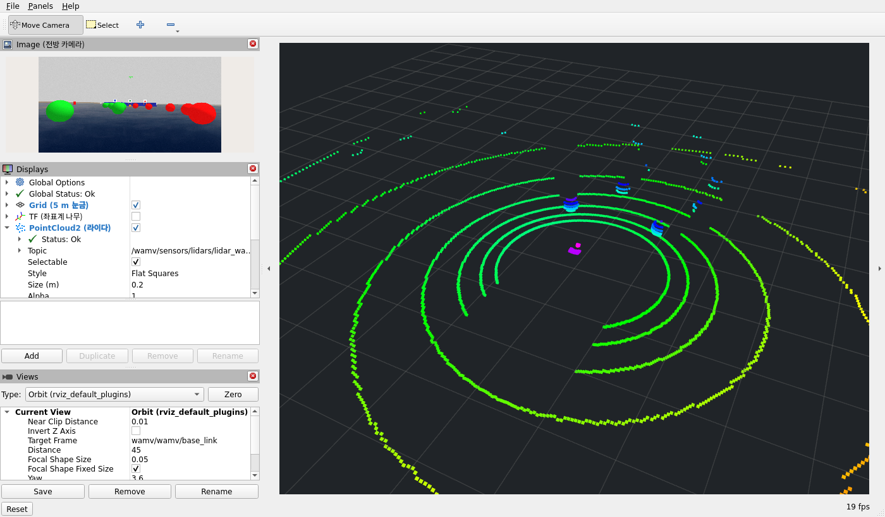

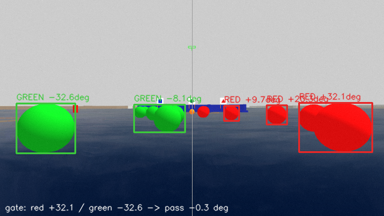

| 화면에서 볼 것 | 맞는 모습 |
|---|---|
| Rviz2 왼쪽 위 영상 | 수평선 아래에 빨강·초록 공 하나씩 |
| Rviz2 오른쪽 점군 | 배를 둘러싼 초록 고리(수면 반사) 사이에 작은 덩어리 둘 |
| 카메라 그림의 네모 | 적·녹 각각 하나씩. 셋 이상 잡히면 HSV 범위를 좁힘 |
| 터미널 | 두 부표 방위와 그 가운데값 한 줄. 빨강이 **양수**(우현)여야 함 |

#### 나. 위치유지 — WP1

```bash
bash goto.sh wp1 && python3 ../TP_vrx_lite/see_station.py --east 0 --north 10
```


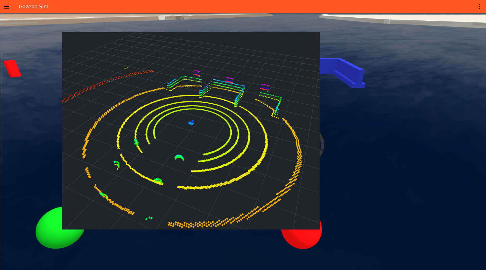

| 화면에서 볼 것 | 맞는 모습 |
|---|---|
| 가제보 | 배가 링 안에 있고 파도 말고는 움직이지 않음 |
| 터미널 | 거리 0.0x\~0.3 m 가 이어지고 **정지 경과 초**가 올라감 |
| 5 초를 넘긴 뒤 | `유지 성공` 이 뜸 |

> [!note] `--east` · `--north` 를 주는 까닭
> - `see_station.py` 만 월드 좌표가 필요함. 기본값은 옛 월드의 것임
> - WP1 은 `--east 0 --north 10`, WP2 는 `--east -20 --north -14` 임

#### 다. 도킹 — 라이다로 구조물을 봄

```bash
bash goto.sh dock && python3 ../TP_vrx_lite/see_dock_cloud.py
```

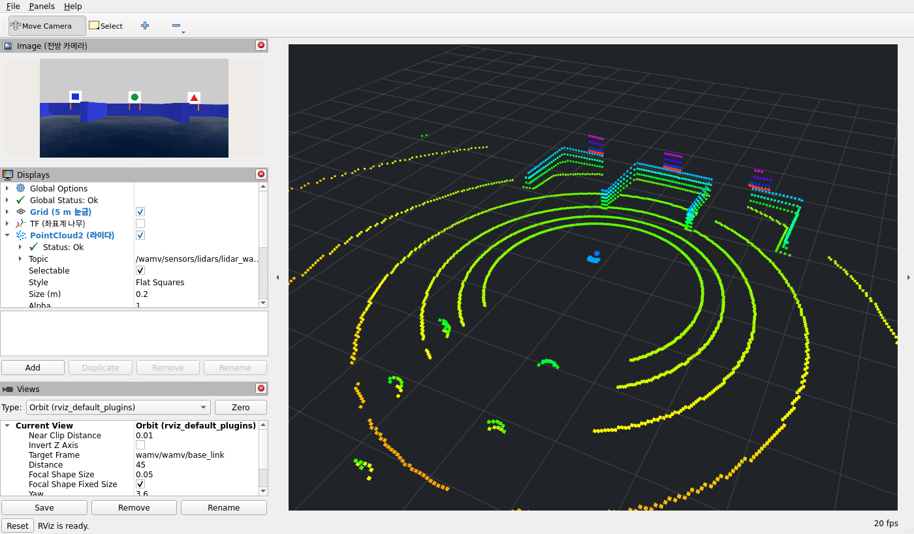

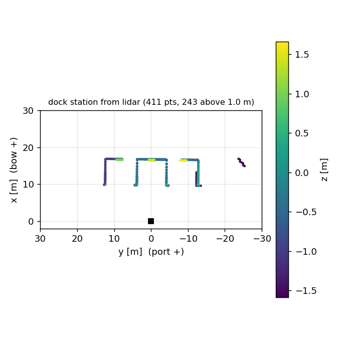

| 화면에서 볼 것 | 맞는 모습 |
|---|---|
| Rviz2 점군의 색 | 벽은 높이 2 m 라 **파랑·보라**로, 수면은 초록·노랑으로 나옴 |
| 덩어리 | 벽이 가로로 길게 늘어선 꼴. 방위폭이 100° 를 넘음 |
| 터미널 | 1 m 초과 점 수(190\~230)와 거리 범위·방위폭 |

- 색이 높이를 뜻함 — 수면보다 높은 것만 골라내면 도크 방향을 **색을 보기 전에** 잡을 수 있음

#### 라. 도킹 — 카메라로 표식을 봄

```bash
bash goto.sh dock && python3 ../TP_vrx_lite/see_placard.py \
     --truth '서쪽 파랑 네모 · 가운데 초록 원형 · 동쪽 빨강 삼각형'
```

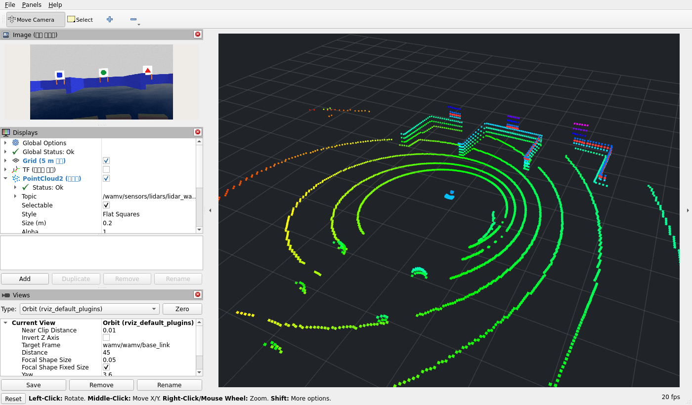

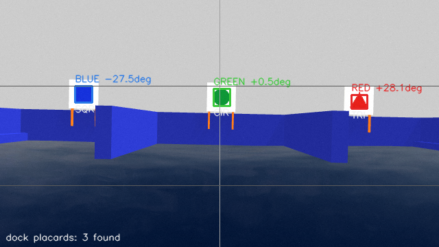

| 화면에서 볼 것 | 맞는 모습 |
|---|---|
| 표식 수 | **셋**이 다 잡힘. 둘만 잡히면 12 m 로 물러서서 다시 봄 |
| 왼쪽부터 | **파랑 · 초록 · 빨강** (실제 대회 사진과 같은 차례임). 모양은 네모 · 원형 · 삼각형이 정답임 |
| 터미널 | 색·모양·방위가 세 줄. 방위가 −26.2° → +1.5° → +28.7° 로 늘어섬. 빨강의 모양은 이 거리에서 흔들림 (7-2 절) |

#### 마. 도킹 — 베이 안에서 (근접)

```bash
bash goto.sh dock_C && python3 ../TP_vrx_lite/see_placard.py --sky-cut 0.15 --water-cut 0.8
```

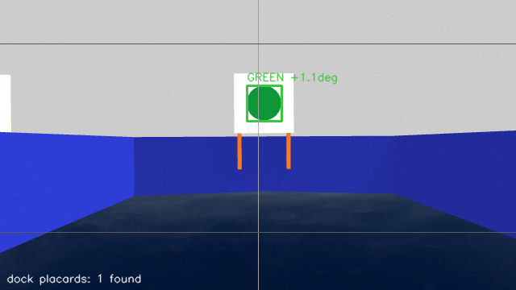

| 화면에서 볼 것 | 맞는 모습 |
|---|---|
| 표식 수 | **하나 또는 둘**. 고른 베이의 것이 가장 가운데에 옴 (이웃 베이 것이 가장자리에 걸릴 수 있음) |
| 크기 | 1372 px 로 커짐 (12 m 에서는 313 px 였음) |
| 방위 | +4.6° — 0 에 가까울수록 베이 한가운데를 보고 있다는 뜻 |

> [!warning] 가까이 가면 표식이 **띠 위로** 올라감
> - `see_placard.py` 는 하늘과 물을 잘라낸 가운데 띠에서만 찾음 (기본 세로 35 %\~75 %)
> - 7 m 까지 들어가면 표식이 화면 위쪽(세로 27 %)으로 올라가 **띠 밖으로 나감** → 0 개가 됨
> - 색 문제가 아니라 **띠 문제**임. `--sky-cut 0.15 --water-cut 0.8` 로 띠를 넓히면 잡힘
> - 거리에 따라 띠를 바꾸는 것이 학생 몫임

#### 바. 탐색 — 색으로 선회 방향을 가름

```bash
bash goto.sh search_ylw && python3 ../TP_vrx_lite/see_search.py
```

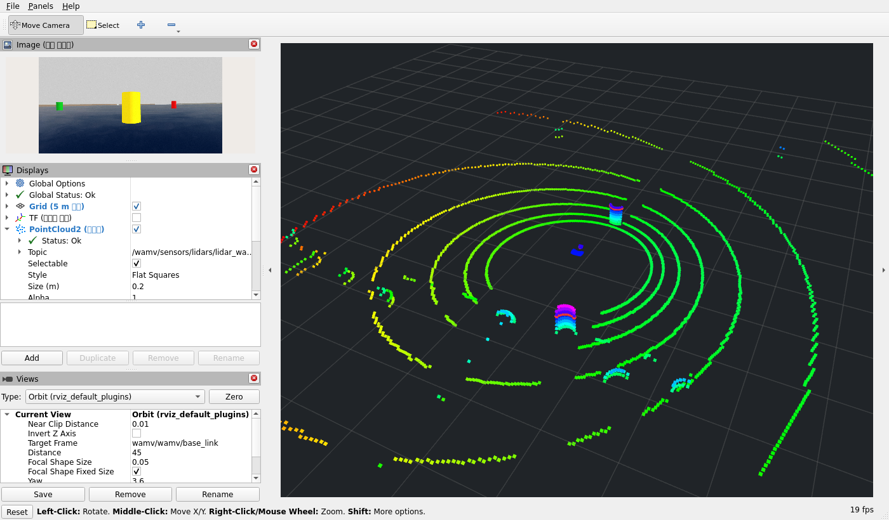

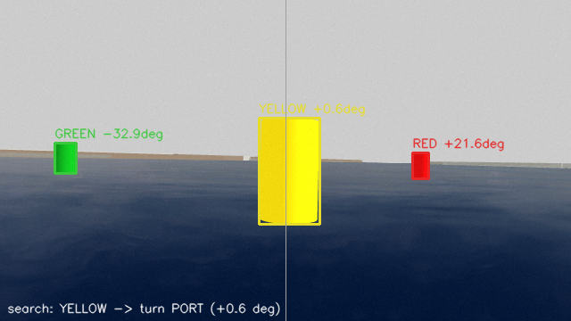

| 화면에서 볼 것 | 맞는 모습 |
|---|---|
| 가장 큰 덩어리 | 노랑 7497 px. 채움률 0.93 — 거의 완전한 원임 |
| 터미널의 선회 방향 | 노랑이면 `좌현선회`, 빨강·초록이면 `우현선회` |
| 바꿔 보기 | `search_red` · `search_grn` 으로 가면 방향이 뒤집혀야 함 |

> [!note] 노랑 지점에서는 셋이 한 화각에 듦
> - 노랑 7497 px 말고도 초록 753 px (−32.9°) · 빨강 455 px (+21.6°) 가 같이 잡힘
> - 부표를 벌려 놓았는데도 그러함. **가장 큰 덩어리**를 고르는 규칙이 필요함

#### 사. 장애물회피 — 점군으로 장애물을 봄

```bash
bash goto.sh obs_mid && python3 ../TP_vrx_lite/see_obstacle_cloud.py
```

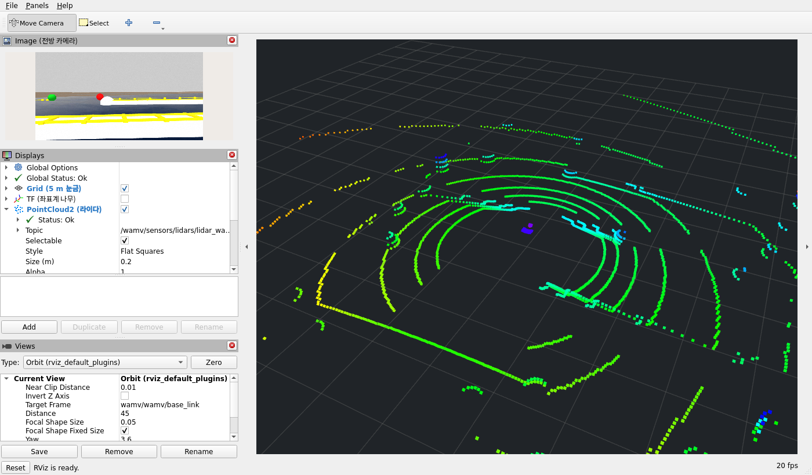

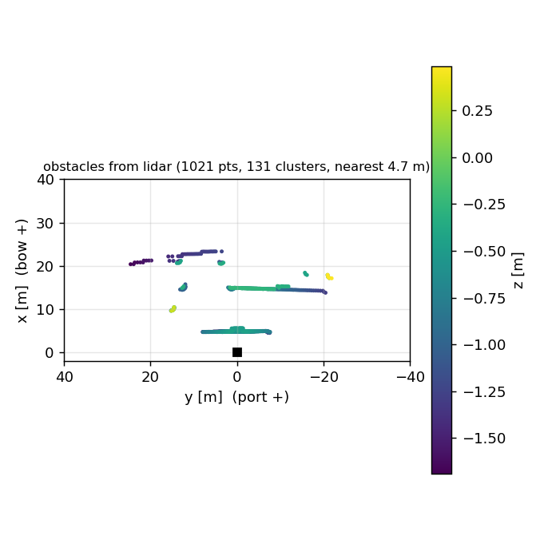

| 화면에서 볼 것 | 맞는 모습 |
|---|---|
| Rviz2 점군 | 초록 고리 사이에 **길게 선 파란 벽 둘**. 앞과 뒤의 차단벽임 |
| 왼쪽 위 영상 | 흰 차단벽과 그 윗면의 노란 띠가 화면을 가로지름 |
| 터미널 | 띠 1021 점, 최근접 4.73 m. 최근접이 **1.83 m** 아래면 접촉임 |
| 5 m 격자 | 24 칸 중 8 칸이 막힘 — 열린 방향이 ±22° 바깥임 |

#### 아. 종료 게이트

```bash
bash goto.sh goal && python3 ../TP_vrx_lite/see_gate.py
```

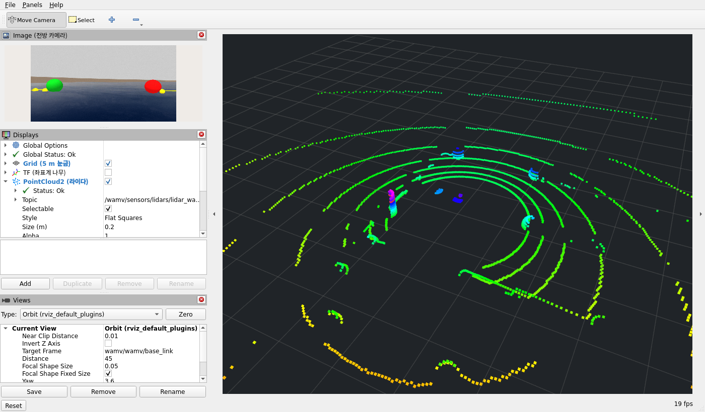

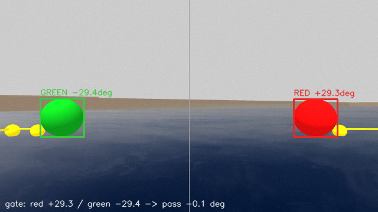

| 화면에서 볼 것 | 맞는 모습 |
|---|---|
| 적·녹 자리 | 이 구간은 **서진**이라 빨강이 화면 오른쪽(북)임 |
| 통과 방위 | 거의 0° — 게이트를 정면으로 보고 있다는 뜻 |
| 터미널 | `빨강이 우현` 이 떠야 함. `좌현` 이 뜨면 월드의 적·녹이 뒤집힌 것임 |

> [!warning] 화면이 안 바뀌면 Rviz2 를 의심하지 말 것
> - 배를 옮겼는데 점군이 그대로면, 배를 **풀지 않은** 것임 (6-2 의 `/vrx/release`)
> - Rviz2 자체는 멀쩡함. 창을 떠서 캡처할 때만 주의할 것이 있음 — 9 장 마지막 줄

### 7-4. 캡처

- 위치 — `60-텀프로젝트/TP_haeyang/shots/`
- 공중 사진 10 장 + 구간별 15 묶음임. 구간마다 가제보 창·Rviz2 창·카메라 영상을 같은 이름으로 남겼음

| 꼴 | 무엇 |
|---|---|
| `00_top_<자리>.png` | 공중 사진 (`topshots.sh` 가 찍음) |
| `NN_<구간>_gz.png` | 가제보 창 |
| `NN_<구간>_rviz.png` | Rviz2 창 — 점군·레이저스캔·영상 |
| `NN_<구간>_cam.png` | 카메라 영상에 탐지 결과를 얹은 것 |
| `NN_<구간>_cloud.png` | 점군을 위에서 본 그림 (라이다 구간) |
| `NN_<구간>.log` | 예제가 찍은 숫자 전부 |

> [!note] 이번 판에는 mp4 를 남기지 않았음
> - 녹화가 필요하면 `REC=1 bash check_all.sh` 로 구간마다 8 초짜리를 받음
> - `TP_vrx_lite/rec_run.sh` 는 **옛 월드의 지점표**를 쓰므로 이 월드에서는 쓰지 않음
> - 창을 뜯는 속도는 15 Hz 로 묶여 있음. 실제로 뜯은 속도로 저장하므로 빨리감기가 아님

### 7-5. 센서 자리를 바꾸고 싶을 때 — 매뉴얼

- 아래 값은 **지금 쓰는 값**임. 바꾸지 않아도 전 구간이 돌아감
- 바꿔 보고 싶을 때만 읽는 절임. 바꾼 뒤에는 7-1·7-2 표의 숫자가 전부 달라짐

#### 7-5-1. 지금 어디에 달려 있나

| 센서 | 전후 $x$ [m] | 좌우 $y$ [m] | 높이 $z$ [m] | 자세 | 토픽 |
|---|---|---|---|---|---|
| 단안 카메라 | **+1.00** | 0 | **1.60** | 정면 ($R=P=Y=0$) | `…/cameras/front_camera_sensor/image_raw` |
| 3D 라이다 | **+0.70** | 0 | **1.90** | 정면 | `…/lidars/lidar_wamv_sensor/points` |
| GPS 안테나 | **−0.85** | 0 | 1.30 | — | `…/gps/gps/fix` |
| IMU | +0.30 | **−0.20** | 1.30 | — | `…/imu/imu/data` |

> [!note] 좌표 규약 — URDF 는 선체고정 FLU 임
> - $x$ 앞(선수) · $y$ **좌현**(+) · $z$ 위. 기준은 `wamv/wamv/base_link`
> - 즉 센서를 우현으로 옮기려면 $y$ 를 **음수**로 줌
> - 항법에서 쓰는 NED(북 $x$ · 동 $y$) 와는 다른 틀임. 섞지 말 것

#### 7-5-2. 바꾸는 세 가지 길

| 길 | 고치는 곳 | 언제 쓰나 | 오래 남나 |
|---|---|---|---|
| ① 환경변수 | 아무 파일도 안 고침 | 값을 두세 개 **시험해 볼 때** | 안 남음 (그 터미널 한 번) |
| ② xacro 고치기 | `TP_vrx_lite/wamv_term_components.xacro` | 자리를 **확정**했을 때 | 남음 (저장소에 들어감) |
| ③ URDF·SDF 직접 고치기 | `~/capstone_ws/wamv/wamv_term_lite.urdf` | 한 줄만 급히 확인할 때 | **안 남음** (다시 만들면 날아감) |

##### 길 ① — 환경변수 (가장 빠름)

```bash
TP_CAM_Z=2.20 TP_CAM_P=0.15 bash make_wamv_term.sh lite
```

| 변수 | 뜻 | 기본값 |
|---|---|---|
| `TP_CAM_X` / `TP_CAM_Y` / `TP_CAM_Z` | 카메라 자리 [m] | `1.0` / `0` / `1.6` |
| `TP_CAM_R` / `TP_CAM_P` / `TP_CAM_YAW` | 카메라 자세 [**라디안**] | `0` / `0` / `0` |
| `CA_LIDAR_X` / `CA_LIDAR_Y` / `CA_LIDAR_Z` | 라이다 자리 [m] | `0.7` / `0` / `1.9` |
| `CA_LIDAR_R` / `CA_LIDAR_P` / `CA_LIDAR_YAW` | 라이다 자세 [라디안] | `0` / `0` / `0` |
| `CA_LIDAR_BEAMS` / `CA_LIDAR_SAMPLES` | 세로 층수 / 한 바퀴 샘플 수 | `16` / `440` |
| `CA_LIDAR_RATE` / `CA_LIDAR_RANGE` | 라이다 주기 [Hz] / 사거리 [m] | `10` / `40` |

- 각도는 **라디안**임. 10° 를 주려면 `0.1745` 를 씀 ($10 \times \pi/180$)
- 변수를 준 뒤 **URDF 를 다시 만들어야** 적용됨. 가제보가 떠 있는 동안 변수만 바꿔도 아무 일도 안 일어남

##### 길 ② — xacro 고치기 (확정했을 때)

- 고칠 파일 : `60-텀프로젝트/TP_vrx_lite/wamv_term_components.xacro`
- 고칠 줄은 두 군데임. `$(optenv …)` 의 **둘째 칸이 기본값**이므로 그 숫자만 바꿈

```xml
<xacro:wamv_3d_lidar name="lidar_wamv"
                     x="$(optenv CA_LIDAR_X 0.7)" y="$(optenv CA_LIDAR_Y 0)" z="$(optenv CA_LIDAR_Z 1.9)"
                     R="$(optenv CA_LIDAR_R 0)" P="$(optenv CA_LIDAR_P 0)" Y="$(optenv CA_LIDAR_YAW 0)"
                     … />

<xacro:wamv_camera name="front_camera"
                   x="$(optenv TP_CAM_X 1.0)" y="$(optenv TP_CAM_Y 0)" z="$(optenv TP_CAM_Z 1.6)"
                   R="$(optenv TP_CAM_R 0)" P="$(optenv TP_CAM_P 0)" Y="$(optenv TP_CAM_YAW 0)"/>
```

- GPS·IMU 는 환경변수를 달아 두지 않았음. 같은 파일의 아래 두 줄을 직접 고침

```xml
<xacro:wamv_gps name="gps_wamv" x="-0.85"/>
<xacro:wamv_imu name="imu_wamv" y="-0.2"/>
```

##### 길 ③ — 만들어진 URDF 를 직접 고치기 (한 번만 볼 때)

- 자리는 **조인트 origin** 에, 성능은 **`<sensor>` 블록** 에 들어 있음

```bash
grep -n 'front_camera\|lidar_wamv' ~/capstone_ws/wamv/wamv_term_lite.urdf | head -20
```

| 고칠 것 | 찾을 태그 |
|---|---|
| 카메라 자리 | `<joint name="wamv/base_to_front_camera_post_joint">` 의 `<origin xyz=…>` |
| 카메라 자세 | `<joint name="wamv/front_camera_post_arm_to_front_camera_joint">` 의 `<origin rpy=…>` |
| 해상도 | `<sensor type="camera">` 안의 `<width>` · `<height>` |
| 화각 | 같은 블록의 `<horizontal_fov>` (기본 `1.3962634` 라디안 = 80°) |
| 주기 | 같은 블록의 `<update_rate>` |
| 라이다 사거리 | `<sensor type="gpu_lidar">` 안의 `<range><max>` |
| 라이다 세로 화각 | 같은 블록의 `<vertical><min_angle>` · `<max_angle>` (기본 ±$\pi/12$ = ±15°) |

> [!warning] 길 ③ 은 `make_wamv_term.sh` 를 다시 돌리면 **덮어써짐**
> - 확정한 값은 반드시 길 ② 로 xacro 에 옮겨 적을 것
> - 월드 쪽 센서(배가 아니라 부두에 달린 카메라 같은 것)를 더하는 경우에는 월드 SDF 의
>   `<model><link><sensor>` 블록에 `<pose>` 와 함께 넣음. 그때는 `make_haeyang_world.py` 를 고침

#### 7-5-3. 바꾸는 절차 — 다섯 걸음

```bash
bash ../TP_vrx_lite/stop_vrx.sh                                   # 1. 가제보를 끔 (반드시)
TP_CAM_Z=2.20 bash ../TP_vrx_lite/make_wamv_term.sh lite          # 2. URDF 를 다시 만듦
grep -A1 base_to_front_camera_post_joint ~/capstone_ws/wamv/wamv_term_lite.urdf   # 3. 값 확인
bash run_haeyang.sh lite shot                      # 4. 다시 띄움
bash goto.sh dock && python3 ../TP_vrx_lite/see_placard.py   # 5. 인지가 되는지 확인
```

- 3 번에서 `<origin xyz="0.95 0 2.146…"` 처럼 **바꾼 값이 보여야** 함. 안 보이면 2 번이 실패한 것임
- 5 번이 표식 셋을 못 잡으면 자리를 되돌리고 7-5-4 의 한계표를 볼 것

#### 7-5-4. 지켜야 하는 한계 — 넘으면 깨짐

| 한계 | 값 | 까닭 |
|---|---|---|
| 카메라 $z$ 하한 | **> 1.33 m** | 지지대 길이 $= z - 1.2965 - 0.027$ 임. 1.33 아래면 길이가 음수가 되어 모양이 뒤집힘 |
| 카메라 $x$ 하한 | **> 0.70 m** | 라이다 마스트가 $x = 0.70$ 에 섬. 뒤에 두면 굵은 띠가 화면 가운데를 가림 |
| 카메라 피치 $P$ | **0 권장** | 내려보게 기울이면 수평선이 화면 위로 올라가 멀리 있는 게이트가 잘림 |
| 라이다 $z$ 하한 | **≥ 1.80 m** | 1.75 m 이하면 들어온 점의 82 % 가 자기 배(`cpu_cases_link` 윗면 1.765 m)였음 |
| 라이다 $z$ 상한 | \~2.3 m | 더 높이면 가까운 부표가 세로 화각 ±15° 밖으로 빠짐 |
| GPS 자리 | 바꾸면 **위도·경도가 달라짐** | 안테나가 선체 뒤 0.85 m 임. 바꾸면 `check_gps.py` 의 `ANT_X` 도 같이 고침 |
| IMU $y = -0.2$ | 유지 권장 | 5·8·9 주차에서 맞춰 둔 항법·제어가 이 값 기준임 |

> [!important] 해상도를 바꿔도 인지 코드는 안 고쳐도 됨
> - 초점거리가 $f_x = (W/2)/\tan(\text{HFOV}/2)$ 로 따라 달라짐 (1280 → 762.7 · 640 → 381.4 · 424 → 252.7)
> - 인지 예제는 $f_x$ 를 손으로 적지 않고 `camera_info` 의 $K$ 에서 읽음. 그래서 판을 바꿔도 방위 계산이 맞음
> - 바꾼 뒤 확인 : `ros2 topic echo /wamv/sensors/cameras/front_camera_sensor/camera_info --once`

#### 7-5-5. 바꾼 뒤 확인하는 세 줄

```bash
ros2 topic echo /wamv/sensors/cameras/front_camera_sensor/camera_info --once      # 해상도·K
ros2 run tf2_ros tf2_echo wamv/wamv/base_link wamv/wamv/front_camera_link_optical  # 실제 자리
ros2 topic hz /wamv/sensors/lidars/lidar_wamv_sensor/points                        # 라이다 주기
```

- 세 줄이 **바꾼 값과 같게** 나오면 성공임
- 7-1 표의 값이 달라졌으면 보고서에 **바꾼 값과 그 까닭**을 적을 것. 채점은 값 자체가 아니라 임무 성공으로 봄

---

### 7-6. 네 지점의 위도·경도 — GPS 와 위성지도

- 이 월드의 원점(동 0 · 북 0)을 **3·15 해양누리공원 앞바다**의 실제 좌표에 맞춰 두었음

$$\text{위도}_0 = 35.1862095^\circ \text{N}, \qquad \text{경도}_0 = 128.5665903^\circ \text{E}$$

- 그래서 GPS 가 **진짜 위도·경도**를 냄. 위성지도 위에 코스가 그대로 얹힘
- 환산은 WGS84 국부 평면 근사임 — 이 위도에서

$$1\ \text{m 북} = 9.0136 \times 10^{-6}\ \text{deg 위도}, \qquad 1\ \text{m 동} = 1.0979 \times 10^{-5}\ \text{deg 경도}$$

#### 네 지점

| 번호 | 지점 | 동 $x$ [m] | 북 $y$ [m] | 위도 [°N] | 경도 [°E] |
|---|---|---|---|---|---|
| ① | 출발점 — 적·녹 게이트 사이 | 0 | −32 | 35.1859211 | 128.5665903 |
| ② | WP1 — 도크 앞 위치유지 | 0 | +10 | 35.1862996 | 128.5665903 |
| ③ | WP2 — 장애물 앞 위치유지 | −20 | −14 | 35.1860833 | 128.5663707 |
| ④ | 종료 게이트 — 장애물 출구 | −70 | −39 | 35.1858580 | 128.5658218 |

> [!note] NED 와 가제보 ENU 의 관계
> - 가제보 좌표는 **ENU** 임 — 동이 $x$, 북이 $y$
> - 항법에서 쓰는 **NED** 는 북이 $x_n$, 동이 $y_n$ 임. 즉 둘을 맞바꾸면 됨
> - 위 표의 "동 / 북" 을 NED 로 쓰면 ① 은 $(x_n, y_n) = (-32,\ 0)$ 임
> - $N$ 은 좌표가 아니라 **선수동요 모멘트**임. 혼동하지 말 것

#### 가제보에서 실측으로 맞대어 본 결과

```bash
export ROS_DOMAIN_ID=7; export GZ_PARTITION=hy1; python3 check_gps.py
```

- 네 지점에 배를 차례로 옮겨 놓고, GPS 가 낸 위도·경도와 오도메트리의 ENU 를 맞대어 봄
- 환산식으로 되돌린 값과 표의 값이 **0.03 m 이내**로 맞았음
- GPS 안테나가 선체 뒤 0.85 m 에 있어 선체 중심과 체계적으로 그만큼 어긋남 — 정상임
  - 즉 GPS 를 선체 중심 좌표로 쓰려면 선수각만큼 돌린 **0.85 m 를 더해 줘야** 함

#### MATLAB 위성지도 예제

```matlab
cd TP_haeyang
run_map
```

- 돌리면 명령창에 네 지점의 표가 찍히고, 아래 그림이 뜸

![네 지점을 위성지도에 얹은 것 (`run_map.m`). 각 상자의 숫자는 위도·경도와 월드 원점 기준 북·동 [m] 임](TP_haeyang/map_points.png)

- 노란 ✕ 가 월드 원점(위도 35.1862095 · 경도 128.5665903), 흰 점선이 미션 순서임

| 파일 | 무엇 |
|---|---|
| `haeyang_points.m` | 네 지점의 위도·경도·동·북을 테이블 하나로 냄. **숫자의 원본**임 |
| `run_map.m` | 위성지도를 띄우고 네 지점을 번호와 함께 찍음. PNG 로 저장함 |

- `geobasemap satellite` 로 Esri 위성 타일을 씀. Mapping Toolbox 와 **인터넷 연결**이 있어야 함
  - 타일을 못 받으면 지형도로 조용히 넘어감 — 바탕이 위성 사진이 아니면 인터넷을 먼저 볼 것
- GCS(A2) 에서 지도를 클릭해 웨이포인트를 찍는 기능을 붙일 때 이 환산을 그대로 쓰면 됨
- 좌표를 바꿀 때는 `haeyang_points.m` **한 곳만** 고침. 그림은 그 테이블을 읽음

### 7-7. 장애물이 라이다에 잡히는 거리 — 높이를 올린 까닭

- 라이다는 수면 위 약 1.8 m 에 있고, 세로 16 줄이 **2° 간격**임 (7-1 절)
- 낮은 물체는 **줄과 줄 사이**로 빠짐. 가장 아래 줄(−15°)도 물체 윗면 위로 지나가는 거리 안쪽에서는 **통째로 사라짐**

$$d_{\text{사라짐}} = \frac{h_{\text{라이다}} - h_{\text{물체}}}{\tan 15^\circ}$$

```bash
python3 lidar_reach.py
```

- 배를 차단벽의 동쪽 $d$ m 에 서쪽을 보게 놓고, 점군 가운데 **차단벽 자리에 떨어진 점**만 셈 (스캔 5 번 평균, 수면 위 0.05 m 이상)

| 라이다 → 차단벽 거리 | 고치기 전 (윗면 0.5 m) | **고친 뒤 (윗면 1.2 m)** |
|---|---|---|
| 3 m | 5.8 점 | **361 점** |
| 4 m | 171 점 | **722 점** |
| 5 m | 11 점 | **389 점** |
| 6 m | 178 점 | **426 점** |
| 8 m | 81 점 | **232 점** |
| 10 m | 38 점 | **160 점** |
| 12 m | 9.2 점 | **96 점** |
| 15 m | **0 점** | **70 점** |
| 21 m | **0 점** | **17 점** |
| 30 m | **0 점** | 6.4 점 |

| 읽는 법 | 뜻 |
|---|---|
| 고치기 전 3 m · 5 m 가 5.8 · 11 점 | 줄 사이로 빠진 것임. 1 m 움직일 때마다 벽이 나타났다 사라졌음 |
| 고치기 전 15 m 부터 0 점 | 윗면 0.5 m 는 $0.5 / 0.035 \approx 14$ m 밖에서 한 줄도 안 걸림 |
| 고친 뒤 3\~30 m 가 끊기지 않음 | 윗면 1.2 m 는 $1.2 / 0.035 \approx 34$ m 까지 한 줄 이상 걸림 |

| 흰 돔 — 라이다 → 돔 중심 거리 | 고치기 전 (윗면 1.05 m) | **고친 뒤 (윗면 1.35 m)** |
|---|---|---|
| 2.5 m | **0 점** | **124 점** |
| 3 m | 21 점 | 60 점 |
| 6 m | 49 점 | 64 점 |
| 10 m | 19 점 | 34 점 |
| 15 m | 7.0 점 | 13 점 |

- 돔과 선체가 닿는 거리는 돔 반지름 0.9 + 배 반폭 1.23 = **2.13 m** 임. 고치기 전에는 그 직전(2.5 m)에 돔이 사라졌음
- 라이다는 선수보다 1.75 m 뒤에 있음. 정면으로 다가갈 때 라이다 → 돔 중심 2.65 m 에서 선수가 닿음 — 지금은 그 거리에서 보임

> [!warning] 그래도 2 m 안쪽은 못 봄
> - 고친 뒤에도 돔은 라이다에서 2.0 m 에 0 점임. 라이다가 높이 달려 있어 생기는 사각임
> - 회피는 **멀리서 본 것을 기억해** 해야 함. "지금 안 보이니 없다" 로 판단하면 닿음
> - 센서 자리를 낮추면 사각이 줄지만 자기 배가 점군에 들어옴 (7-5 절)

---

## 8. 제출물

### 8-1. GitHub 저장소 하나로 냄

- 저장소 주소만 내면 됨. 파일을 따로 보내지 않음 (4-E1 절)
- 저장소 최상위가 아래와 같을 것 — **이름을 그대로 쓸 것**

| 번호 | 제출물 | 형식 | 채점 |
|---|---|---|---|
| 1 | Simulink·Stateflow 모델 일체 | `.slx` + 생성 스크립트 `.m` | 4-C1·C2 |
| 2 | 모델 준비 스크립트 | `setup.m` — 경로·파라미터를 한 번에 올림 | 4-E2 |
| 3 | ROS 2 인지 패키지 | **파이썬 원본** + `README.md` | 4-E1 |
| 4 | 실행 스크립트 | `run_all.sh` — 월드·배·인지 노드를 한 번에 띄움 | 4-E2 |
| 5 | 종료 스크립트 | `stop.sh` — `gz sim` 까지 확실히 끔 | 4-E2 |
| 6 | `README.md` | 설치 → 실행 → 결과 확인. `ROS_DOMAIN_ID` · `GZ_PARTITION` 명시 | 4-E2 |
| 7 | **Simulink 화면 캡처** | 최상위 · 유도 · 제어 · 추력배분 · Stateflow 차트 | 4-E3 |
| 8 | GCS | 실행 가능한 꼴 + 화면 녹화 | 4-D1\~D3 |
| 9 | 연속 완주 녹화 | 출발선부터 종료 게이트까지 **끊김 없는 영상** | 4-B1 |
| 10 | 실시간 플롯 녹화 | 네 플롯이 **주행 중에** 움직이는 화면 | 4-D4\~D7 |
| 11 | 반복 시행 집계표 | 5 회. 구간별 시각·접촉·성공 여부 | 보고서 |
| 12 | 보고서 | 실패 분석과 재현 절차를 포함 | 보고서 15 % |

> [!important] 채점자는 이 두 줄만 침
> ```bash
> git clone <저장소> && cd <저장소>
> bash run_all.sh        # 월드·배·인지 노드
> ```
> - 그 뒤 **Simulink 모델을 열고 Run** 을 누름. 그것으로 돌지 않으면 4-E2 는 0 임
> - 절대경로(`/home/학생이름/…`)가 박혀 있으면 거기서 걸림 — **다른 계정에서 `git clone` 부터 해 볼 것**
> - 9 주차 배 URDF 처럼 **빌드 경로가 박히는 파일**은 넣지 말고 스크립트가 만들게 할 것

> [!important] 9 번이 채점의 기준 증거임
> - 끊어 찍은 영상, 편집으로 이어 붙인 영상은 받지 않음
> - 화면에 경과 시간이 보이게 찍을 것

### 8-2. 최종 발표 — **10 분**

- 10 분을 넘기면 넘긴 자리에서 끊음 (4-E3 절)
- **시뮬링크와 파이썬이 어떻게 맞물리는지**가 발표의 가운데임

| 시각 | 내용 | 무엇을 보일 것 |
|---|---|---|
| 0:00–1:30 | 연속 완주 영상 | 끊김 없이. 배속은 괜찮으나 배속임을 밝힐 것 |
| 1:30–4:00 | **Simulink 구조** | 최상위 → 유도 → 제어 → 추력배분. **캡처를 띄우고 신호 이름을 짚을 것** |
| 4:00–6:00 | **Stateflow 차트** | 상태와 전이 조건. 영상의 어느 장면이 어느 상태인지 맞댈 것 |
| 6:00–7:30 | **파이썬 인지** | 어느 토픽으로 무엇을 넘기는가. 제어를 하지 않는다는 것을 보일 것 |
| 7:30–9:00 | **실시간 플롯 네 개** | 명령 대비 실제. RMS 숫자를 말할 것 |
| 9:00–10:00 | 실패와 대책 | 안 됐던 시행과 무엇을 고쳤는가 |

> [!caution] 발표에서 자주 깎이는 셋
> - **블록 그림만 띄우고 넘어감** — 어느 신호가 어디로 가는지 말하지 않으면 4-E3 을 못 받음
> - **플롯을 끝난 뒤 MATLAB 으로 그려 옴** — 성능 점수만 받고 실시간 점수는 못 받음 (4-D-2 절)
> - **가산 항목 설명에 시간을 다 씀** — F 는 50 점이지만 기본 100 점을 설명하지 않으면 그쪽이 더 큼

---

## 9. 자주 걸리는 곳

| 증상 | 까닭 | 할 일 |
|---|---|---|
| `gz service` 가 전부 시간 초과 | 가제보가 안 떠 있음 | 터미널 1 의 인자 순서 확인 — `lite gui` |
| 토픽이 하나도 안 보임 | `ROS_DOMAIN_ID` 가 다름 | 세 터미널에 같은 값을 줌 |
| 가제보가 둘 보이고 값이 튐 | `GZ_PARTITION` 이 같음 | 세션마다 다른 값을 줌 |
| `ModuleNotFoundError: rclpy` | ROS 를 소스하지 않음 | `source /opt/ros/humble/setup.bash` |
| `AttributeError: _ARRAY_API not found` | `pip` 로 깔린 **NumPy 2** 가 ROS 의 `cv_bridge` (NumPy 1 용) 와 안 맞음 | 아래 칸 참고 |
| Rviz2 가 전부 Status: Error | Fixed Frame 이 `map` 임 | `wamv/wamv/base_link` 로 바꿈 |
| 순간이동해도 제자리 | 배를 풀지 않음 | 6-2 의 `/vrx/release` |
| 게이트가 안 잡힘 | 너무 가까움 | 10 m 이상 물러서서 봄 |
| 파랑 표식 자리에 바다가 잡힘 | 물빛이 파랑임 | 라이다로 방향을 좁힌 뒤 그 쪽만 봄 |
| 캡처한 Rviz2 그림의 점군이 늘 같음 | 창을 뜯는 방법의 문제 | 아래 칸 참고 |
| 가제보 사진 한가운데에 점군이 얹혀 나옴 | 겹친 창을 자식으로 오인함 | 아래 칸 참고 |

> [!warning] NumPy 2 가 깔려 있으면 인지 예제가 **전부** 죽음
> - 2026-11-19 에 기준 노트북에서 실제로 났음 — `check_all.sh all` 의 15 개 가운데 13 개가 위 오류로 끝났음
> - 까닭 — `pip install` 한 패키지(딥러닝·그림 도구 등)가 NumPy 2 를 `~/.local` 에 끌고 들어옴. ROS Humble 의 `cv_bridge` 는 NumPy 1 로 빌드된 것임
> - 확인 — `python3 -c "import numpy; print(numpy.__version__, numpy.__file__)"`. 2.x 이고 경로가 `~/.local` 이면 이것임
> - 급한 대로 — 명령 앞에 `PYTHONNOUSERSITE=1` 을 붙임. `~/.local` 을 건너뛰고 시스템의 NumPy 1.21 을 씀
>   ```bash
>   PYTHONNOUSERSITE=1 bash check_all.sh all
>   ```
> - 제대로 — `pip install --user "numpy<2"`. 가산 항목(4-F)으로 딥러닝 패키지를 깔 때는 **가상환경**에 깔 것

> [!caution] Rviz2 창을 떠서 캡처할 때 — 3 차원 화면이 얼어붙음
> - Rviz2 의 3 차원 화면은 **따로 떨어진 자식 창**에 OpenGL 로 그려짐
> - 본 창만 뜯으면 그 자리에 **맨 처음 장면**이 그대로 들어감. 배를 어디로 옮겨도 같은 그림이 나옴
> - 2026-11-17 에 이 문제로 캡처 19 장을 다시 찍었음 (3 차원 영역의 화소 차이가 **0.00** 이었음)
> - `xcap.py` 는 자식 창을 따로 뜯어 제자리에 얹도록 고쳤음. **이 스크립트를 쓰면 문제 없음**
> - 그렇게 고치고 나서 **두 번째 문제**가 났음 — 겹친 창을 화면 위치로만 골라 가제보 사진 한가운데에 Rviz2 의 점군 화면이 통째로 얹혀 나왔음 (2026-11-17, 사진 25 장)
> - 지금은 `xwininfo -id <창> -tree` 로 **진짜 자식인 것만** 고름. 화면에서 겹치는지로 고르면 안 됨
> - 직접 캡처 도구를 만들 때는 자식 창까지 뜯을 것. 가제보는 창 하나라 이 문제가 없음

---

## 참고

- [[텀프로젝트_실습_수동조종과_GCS]] — 첫 실습. 버튼으로 배를 몰고 위성지도 GCS 로 확인함
- [[텀프로젝트_계획]] — 이 요구조건의 설계 근거와 실현 가능성 검토
- [[W06_선수추진기와_위치제어_접안]] — 선수추진기 3 추진기 모델
- [[W08_Stateflow_미션_웨이포인트와_로이터링]] — Stateflow 미션 차트
- [[W09_라이다_장애물회피_파이썬유도와_시뮬링크제어]] — 장애물회피
- `경기규정-202611` · `2025 KABOAT 임무설명 r1` — 상위 규정
