# 텀프로젝트 요구조건 — KABOAT 종합임무

> [!important] 이 문서를 읽는 방법
> - **요구조건 문서임.** 무엇을 만들어 내야 하고 어떻게 채점하는지를 적은 것임. 구현 방법은 적지 않음
> - 1~4 장이 요구조건, 5 장이 제공물, 6 장이 실행 명령, 7 장이 제공물의 확인 결과임
> - 6·7 장의 숫자는 모두 **실제로 돌려서 얻은 값**임. 추정값이 아님
> - 제공되는 ROS 코드는 **인지의 시작점만**임. 유도·제어·판단은 과제임 → 3 장의 "학생이 만들 것"

> [!important] 상위 규정
> - `경기규정-202611` 과 `2025 KABOAT 임무설명 r1` 이 상위 문서임. 이 문서와 어긋나면 **규정을 따름**
> - 규정 6.2(2) — 종합임무는 **한 경기장에서 연속으로** 진행하고, 세부 임무를 **각각 채점**함
> - 규정 4.2(12) — 제어명령은 **선체 내부 PC** 에서 냄. 외부 관제 PC 는 모니터링 전용임

---

## 0. 한눈에 보기

- 그림 넷으로 전체를 먼저 보임 — **코스**, **좌표가 붙은 지도**, **시스템 계층**, **프로그램 계층**
- 숫자와 조건은 1 장부터임

### 0-1. 코스 전체 — 가제보 공중 시점


- 실제 가제보 화면임. `bash topview.sh all` 한 줄로 다시 띄울 수 있음 (5-3 절)
- 배는 오른쪽 아래 출발선에 있음. 전체 경로는 **오른쪽 아래 → 위 → 왼쪽**으로 한 바퀴를 그림

| 화면에서 찾을 것 | 어디에 |
|---|---|
| 출발선과 항로추종 게이트 열 | 오른쪽 아래. 작은 적·녹 공이 북쪽으로 줄지어 올라감 |
| 위치유지 WP1 | 게이트 열 끝, 오른쪽 위. 주황 부표와 링 |
| 도킹 ⊔ 구조물 | 위 가운데. 개구부가 **남쪽**(화면 아래)을 봄 |
| 탐색 부표 셋 | 도크 아래. 빨강·초록·노랑 |
| 위치유지 WP2 | 탐색 부표 왼쪽 아래 |
| 장애물 격자와 가상경계선 | 왼쪽 절반. 기둥 12 개가 다섯 줄 |
| 종료 게이트 | 왼쪽 끝 |

### 0-2. 같은 코스를 좌표와 함께


| 그림의 약속 | 뜻 |
|---|---|
| 파란 점선과 ①~⑦ | 임무 사슬의 순서. 1 장의 표와 같은 번호임 |
| 빨강·초록 작은 원 | 게이트 부표. 빨강이 동쪽 열, 초록이 서쪽 열 |
| 주황 점선 원 | 위치유지 판정 영역 (반경 5 m) |
| 빨간 굵은 선 | 가상경계선. 두 군데가 끊겨 있고 그곳이 진입구·종료구임 |
| 주황 작은 원 12 개 | 장애물 기둥 |
| 왼쪽 아래 눈금자 | 10 m |

- 좌표는 **가제보 ENU** 임 — 동이 $x$, 북이 $y$. 3 장의 모든 좌표가 이 그림의 좌표임

### 0-3. 시스템 계층 — 무엇이 어디서 도는가

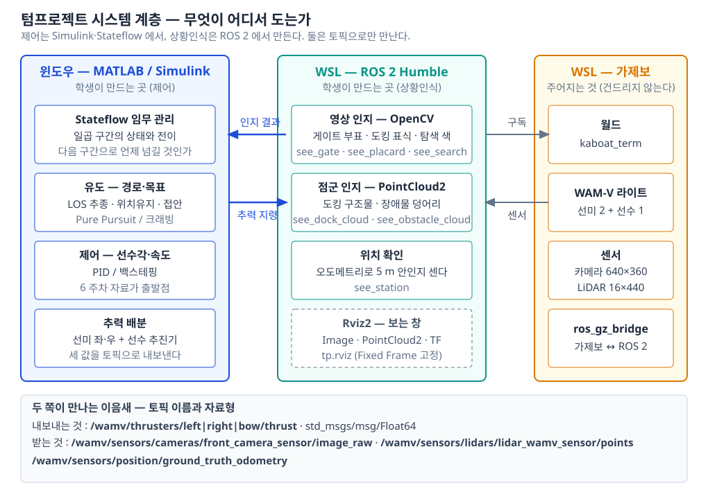

| 칸 | 누가 만드는가 | 무엇 |
|---|---|---|
| 윈도우 — MATLAB/Simulink | **학생** | 미션 판단(Stateflow) · 유도 · 제어 · 추력 배분 |
| WSL — ROS 2 | **학생** (시작점은 제공) | 영상 인지 · 점군 인지 · 위치 확인 · Rviz2 |
| WSL — 가제보 | 제공. 건드리지 않음 | 월드 `kaboat_term` · WAM-V 라이트 · 센서 · `ros_gz_bridge` |

- 두 쪽은 **토픽으로만** 만남. 내보내는 것은 추력 셋, 받는 것은 영상·점군·오도메트리임
- 이 이음새의 토픽 이름과 자료형이 그림 아래 칸에 적혀 있음. 7-1 절의 표와 같음

### 0-4. 프로그램 계층 — 어떤 파일을 어떤 순서로 쓰는가


| 단 | 언제 | 무엇 |
|---|---|---|
| 1 준비 | 학기에 한 번 | 월드와 배를 만듦 (`make_term_world.py` · `make_wamv_term.sh`) |
| 2 띄우기·끄기 | 실행할 때마다 | 터미널 셋 (`run_vrx_term.sh` · `rviz_term.sh` · `stop_vrx.sh`) |
| 3 자리 잡기 | 확인할 때만 | 배를 옮김(`goto.sh`) · 보는 눈만 옮김(`topview.sh`) |
| 4 인지 확인 예제 | 구간마다 | 공용부 `tp_percep.py` 위에 `see_*.py` 여섯 개 |
| 5 묶어 돌리기 | 증거를 남길 때 | `check_all.sh` · `rec_run.sh` · `xcap.py` · `rec_cam.py` |

> [!note] 3 단과 4 단의 선이 끊겨 있는 까닭
> - `goto.sh` 는 **물리를 건드림** — 배를 집어 옮김. 채점 시행에는 쓸 수 없음
> - `topview.sh` 는 **보는 카메라만** 옮김 — 물리에 손대지 않으므로 언제 써도 됨
> - `tp_percep.py` 는 단독으로 돌리지 않음. 여섯 예제가 함께 쓰는 토막임

---

## 1. 임무 사슬

| 순서 | 구간 | 성공 판정 | 주 센서 | 실패·감점 |
|---|---|---|---|---|
| 1 | 출발 → 항로추종 | 적·녹 게이트 8 쌍을 **순서대로** 통과 | 카메라 | 게이트 누락 1 개당 감점 |
| 2 | 위치유지 WP1 | 부표 반경 **5 m 이내**, 정지 후 **5 초** 유지 | GPS·IMU | 5 m 이탈 또는 정지 미달 |
| 3 | 도킹 | 지정 표식의 베이에 **옆걸음으로** 진입·정지 | 카메라 + 라이다 | 베이 오선택, 벽 접촉 |
| 4 | 탐색 | 지정 색 부표를 **규정 방향으로** 1 회전 | 카메라 | 방향 반대, 부표 접촉 |
| 5 | 위치유지 WP2 | 구간 2 와 같음 | GPS·IMU | 구간 2 와 같음 |
| 6 | 장애물회피 | 장애물 열을 무접촉 통과 | 라이다 | 접촉, **가상경계선 이탈은 실격** |
| 7 | 종료 게이트 | 적·녹 종료 게이트 통과 | 카메라 | 미통과 |

> [!important] 전 구간 연속 주행이 **필수 조건**임
> - 구간별로 따로 돌린 결과는 받지 않음. 출발선에서 한 번에 구간 7 까지 가야 함
> - 구간을 끊어 돌린 시행은 **0 점**으로 처리함. 규정 6.2(2) 와 같음
> - 중간에 멈추거나 수동 개입하면 그 시행은 끝난 것으로 봄

---

## 2. 규정에서 그대로 오는 조건

| 조건 | 값 | 출처 |
|---|---|---|
| 제한시간 | 15 분 | 규정 |
| 도전 횟수 | 5 회 | 규정 |
| 접촉 벌점 (종합임무) | 1 회당 **30 초** | 규정 |
| 임무점수 | 완료 시간(초) + 접촉 벌점. **낮은 쪽이 상위** | 규정 |
| 위치유지 점수 | $100 \times$ (성공 횟수 / 지정 위치 개수) | 규정 |
| 제어명령 위치 | 선체 내부 PC. 외부는 모니터링 전용 | 규정 4.2(12) |
| 탐색 선회 방향 | **빨강·초록 → 우현선회 / 노랑 → 좌현선회** | 규정 5.2(6) |
| 도킹 표식 | 모양 3 종 (삼각형·원형·네모) × 색 5 종 (빨강·초록·파랑·주황·노랑) 중 임의 조합 | 임무설명 Ⅲ |

> [!warning] 색만 보거나 모양만 보는 코드는 경기에서 깨짐
> - 표식은 모양과 색이 **임의로 조합**됨. "빨강이면 왼쪽 베이" 같은 규칙은 쓸 수 없음
> - 색과 모양을 **둘 다** 판정해야 함. 제공 예제 `see_placard.py` 가 둘을 모두 내놓음

> [!caution] 가상경계선 이탈은 실격임
> - 장애물 구간의 가상경계선(동 −594 ~ −560, 북 181 ~ 211)을 벗어나면 그 시행은 실격임
> - 감점이 아니라 실격임. 경계선 안쪽으로 여유를 두고 경로를 잡을 것

---

## 3. 구간별 요구조건

### 3-1. 항로추종 (구간 1)


- 그림 읽는 법 — 오른쪽 열이 빨강, 왼쪽 열이 초록임. 배는 아래(남)에서 위(북)로 지남
- 월드에 놓인 것 — 게이트 **8 쌍**. 빨강 열 동 −520·−522, 초록 열 동 −528·−530, 북 174 → 216 을 6 m 간격
- 통로 폭 8 m. 배 반폭 1.03 m 기준 한쪽 여유 약 3 m
- 진행 방향은 **북향**임. 따라서 **빨강이 우현**, 초록이 좌현임
- 성공 판정 — 게이트 중심선을 **순서대로** 지남. 순서가 어긋난 게이트는 불통과로 셈
- 학생이 만들 것 — 적·녹 쌍을 묶어 게이트 중심 방위를 내는 것, 그 방위를 따라가는 유도·제어
- 제공되는 것 — 색 덩어리 검출과 쌍 묶음까지 (`see_gate.py`)

### 3-2. 위치유지 (구간 2·5)


- 그림 읽는 법 — 가운데 주황 점이 부표, 그 둘레 얇은 원이 판정 링임. 링 안에 들어가 멈추면 됨
- 월드에 놓인 것 — 주황 부표 2 개와 **반경 5 m 링**. WP1 (−534, 226), WP2 (−553, 188)
- 링은 판정 영역을 눈으로 보이게 둔 것임. 가제보 화면과 Rviz2 양쪽에서 보임
- 성공 판정 — 부표 중심에서 **5 m 이내**에 들어간 뒤 **정지 상태로 5 초** 유지
  - 정지의 기준은 대지속력 **0.1 m/s 이하**로 둠
- 학생이 만들 것 — 정지 유지 제어 (3 자유도). 6 주차 선수추진기 모델을 그대로 쓸 수 있음
- 제공되는 것 — 거리·속력을 재고 5 초를 세는 판정기 (`see_station.py`)

### 3-3. 도킹 (구간 3)


- 그림 읽는 법 — 베이 셋이 동서로 늘어서 있고 입구가 모두 남쪽임. 배는 남쪽에서 북으로 들어감
- 월드에 놓인 것 — ⊔ 모양 3 베이. 베이 중심 동 −545 · −550.5 · −556, 입구 북 227, 뒷벽 북 232.25
- 베이 폭 5 m, 깊이 5 m, 벽 두께 0.5 m, **벽 높이 2.0 m**
- 표식은 뒷벽 안쪽 면, 중심 높이 1.2 m. 왼쪽 빨강 삼각형 · 가운데 초록 원형 · 오른쪽 파랑 네모
- 성공 판정 — **지정된 표식**의 베이에 선체가 들어가 정지함
- 방식 요건 — 진입은 **순수 옆걸음**으로 함. 선수각을 유지한 채 횡이동으로 들어감
  - 판정 문턱 — 옆걸음 구간 전체에서 자세오차 ≤ 5°, 최대 $\lvert u \rvert$ ≤ 0.25 m/s
- 학생이 만들 것 — 베이 선택 판단 (Stateflow), 옆걸음 추력 배분, 접근 경로
- 제공되는 것 — 표식 셋의 색·모양·방위 (`see_placard.py`), 점군으로 본 도크 방향 (`see_dock_cloud.py`)

### 3-4. 탐색 (구간 4)


- 그림 읽는 법 — 세 부표가 삼각으로 떨어져 있음. 오른쪽 위가 빨강, 아래가 초록, 왼쪽이 노랑임
- 월드에 놓인 것 — 부표 3 개. **빨강** (−542, 206) · **초록** (−550, 195) · **노랑** (−556, 205)
- 성공 판정 — 지정 색 부표를 중심으로 **1 회전**하고, 회전 방향이 규정과 같음
- 회전 방향은 규정 5.2(6) 을 따름 — 빨강·초록은 **우현선회**, 노랑은 **좌현선회**
- 학생이 만들 것 — 부표 중심 선회 궤적 생성과 추종 (로이터링)
- 제공되는 것 — 색 판정과 그에 따른 선회 방향 1 개 (`see_search.py`)

> [!warning] 세 번째 부표는 **노랑**임
> - 2025 년 판 문서의 "흰색 부표 반시계" 는 `경기규정-202611` 에서 **노랑 좌현선회**로 바뀜
> - 월드에도 노랑으로 넣어 두었음. 흰색을 찾는 코드는 아무것도 못 찾음

### 3-5. 장애물회피 (구간 6)


- 그림 읽는 법 — 기둥이 다섯 줄로 어긋나 있음. 둘레의 가는 선이 가상경계선이고 두 군데가 끊겨 있음
- 진행은 오른쪽(동)에서 왼쪽(서)으로임
- 월드에 놓인 것 — 기둥 12 개. 동 −564 ~ −588, 북 186 · 191 · 196 · 201 · 206 의 5 열 슬라럼
- 진입 게이트 (−560, 북 192 빨강 · 북 184 초록), 종료 게이트 (−594, 북 200 빨강 · 북 192 초록)
- 이 구간은 **서진**임. 따라서 우현이 북쪽이고, 빨강이 북(큰 북좌표)에 있음
- 가상경계선 — 동 −594 ~ −560, 북 181 ~ 211. 진입구·종료구 두 군데가 끊겨 있음
- 접촉 판정 거리 — 기둥 반지름 0.6 m + 배 반폭 1.03 m = **1.63 m**
- 성공 판정 — 무접촉 통과. 접촉 1 회당 벌점 30 초. **경계선 이탈은 실격**
- 학생이 만들 것 — 회피 경로 생성. 9 주차 VFH 결과물을 그대로 가져올 수 있음
- 제공되는 것 — 점군을 앞쪽 띠로 잘라 덩어리와 최근접 거리를 내는 것 (`see_obstacle_cloud.py`)

### 3-6. 공통 방식 요건

| 요건 | 내용 | 근거 |
|---|---|---|
| 미션 판단 | **Stateflow 차트 하나**가 전 구간을 돌림 | 8 주차 차트를 늘림 |
| 제어 | Simulink. 유도·제어·추력배분을 Simulink 쪽에 둠 | 5~8 주차 자료 |
| 인지 | ROS 2 쪽에 둠. 카메라는 OpenCV, 라이다는 점군 처리 | 이 문서 5 장 |
| 추진기 | 선미 좌·우 2 개 + **선수추진기 1 개** 3 추진기 | 6 주차 모델 |
| GCS | 지도 위 실시간 항적, 임무 상태, 접촉·게이트 집계 | A2 5 단 구조 |
| 제어명령 | 선체 내부 PC 에서 냄. GCS 는 모니터링만 | 규정 4.2(12) |

---

## 4. 채점 — 100 점

- 이 100 점은 성적의 **Term Project 데모·성능 35 %** 에 대응함. 보고서 15 % 는 따로임

### A. 임무 수행 — 45 점

| 항목 | 배점 | 재는 법 |
|---|---|---|
| A1 항로추종 | 9 | 통과한 게이트 수 / 8 × 9. 순서 어긋나면 그 게이트는 불통과 |
| A2 위치유지 (WP1·WP2) | 6 | 성공 횟수 / 2 × 6. 성공은 5 m 이내 · 정지 후 5 초 |
| A3 도킹 | 9 | 베이 진입·정지 6, 베이 선택 일치 3 |
| A4 탐색 | 9 | 1 회전 6, 규정 방향 일치 3 |
| A5 장애물회피 | 12 | 무접촉 통과 12. 접촉 1 회당 −3. 경계선 이탈은 이 항목 0 |

### B. 방식 요건 — 25 점

| 항목 | 배점 | 재는 법 |
|---|---|---|
| B1 순수 옆걸음 도킹 | 10 | 자세오차 ≤ 5° 4, 최대 $\lvert u \rvert$ ≤ 0.25 m/s 4, $\lvert v \rvert$ > 0.3 m/s 가 2 초 이상 2 |
| B2 Stateflow 미션판단 | 8 | 차트 하나가 전 구간을 돌림 4, 상태 전이 로그가 사슬 순서와 일치 4 |
| B3 GCS 모니터링 | 7 | 실시간 항적 3, 임무 상태 표시 2, 접촉·게이트 집계 2 |

### C. 측정과 검증 — 30 점

| 항목 | 배점 | 재는 법 |
|---|---|---|
| C1 반복 시행 집계표 | 10 | **5 회** 반복. 구간별 시각·접촉 횟수·성공 여부를 평균 ± 표준편차로 |
| C2 규정 식으로 점수 자동 집계 | 8 | 임무점수 = 완료 시간(초) + 접촉 × 30 초 를 로그에서 바로 뽑아내는가 |
| C3 실패 분석 | 7 | 실패 시행을 원인별로 분류, 상위 셋에 대책. **실패 사례가 없는 보고서는 감점** |
| C4 재현 절차 | 5 | README 로 설치 → 빌드 → 실행 → 결과 확인까지 따라갈 수 있는가 |

### D. 가산점 — 10 점

| 항목 | 가산 |
|---|---|
| 아지무스(A3) 배분으로 옆걸음 도킹 | +4 |
| 도크 표식을 매 시행 무작위로 지정하고도 성공 | +3 |
| 조류·파랑 외란을 켜고 반복 | +2 |
| 제한시간 15 분의 절반 이내에 완주 | +1 |

> [!important] 연속 완주는 가산점이 아니라 전제 조건임
> - 1 장의 조건과 같음 — 끊어 돌린 시행은 0 점임
> - 따라서 D 에 "연속 완주" 항목은 없음

---

## 5. 제공물

- 위치 — `60-텀프로젝트/TP_vrx_lite/`
- 모두 **실제로 돌려서 확인한 것**임. 확인 결과는 7 장에 있음

### 5-1. 월드와 배

| 파일 | 무엇 |
|---|---|
| `kaboat_term.sdf` | 텀프로젝트 월드. 모델 41 개. 월드 이름 `kaboat_term` |
| `make_term_world.py` | 학생 월드(`my_world_원본.sdf`)에서 위 월드를 만드는 스크립트 |
| `make_wamv_term.sh` | 배의 URDF 생성 — 선미 2 + 선수 1 추진기, 3D 라이다, 단안 카메라 |
| `wamv_term_components.xacro` | 센서 배치 파일 |
| `run_vrx_term.sh` | 월드를 띄움 |
| `rviz_term.sh` · `tp.rviz` | 확인용 Rviz2 |
| `stop_vrx.sh` | 끄기. **반드시 씀** |

### 5-2. 인지 확인 예제

| 파일 | 확인하는 것 | 내놓는 값 |
|---|---|---|
| `see_gate.py` | 적·녹 부표 한 쌍이 OpenCV 로 잡히는가 | 두 부표의 방위와 통과 방위 1 개 |
| `see_station.py` | 5 m 이내·정지 5 초를 셀 수 있는가 | 거리·속력·성공 여부 |
| `see_dock_cloud.py` | 도크 벽이 점군으로 보이는가 | 점 수·거리·방위폭 |
| `see_placard.py` | 표식 셋의 색과 모양이 갈리는가 | 색·모양·방위 셋 |
| `see_search.py` | 부표 색으로 선회 방향이 갈리는가 | 색과 선회 방향 1 개 |
| `see_obstacle_cloud.py` | 장애물이 점군으로 나오는가 | 덩어리 수·최근접 거리와 방위 |
| `tp_percep.py` | 위 여섯 개가 함께 쓰는 공통부 | HSV 표, 덩어리 찾기, 모양 판정 |

> [!important] 제공 코드의 범위
> - **인지의 시작점만**임. 알고리즘 전체가 아님
> - 모두 "값이 나오는지"를 한 번 찍어 보는 것임. 시간에 따라 쫓아가는 것(추적·필터)은 없음
> - 유도·제어·판단은 과제임. 제공 코드의 출력을 Simulink 로 넘기는 이음새부터 학생 몫임

### 5-3. 보조 도구

| 파일 | 무엇 |
|---|---|
| `check_all.sh` | 구간을 지정해 순간이동 → 예제 실행 → 캡처를 한 번에 함 |
| `goto.sh` | 배를 확인 지점으로 순간이동시킴. 지점 16 개가 등록돼 있음 |
| `topview.sh` | **보는 카메라만** 공중으로 올려 코스를 내려다봄. 자리 9 개 (0 장의 공중 사진들) |
| `rec_run.sh` | 추력을 주어 **움직이는 상태로** 세 화면을 동시 녹화함 |
| `xcap.py` | 가제보·Rviz2 창을 PNG·mp4 로 뜯어냄 |
| `rec_cam.py` | 카메라 영상에 탐지 결과를 얹어 녹화함 |

> [!warning] 순간이동은 확인용임
> - `goto.sh` 와 `check_all.sh` 는 지점을 건너뛰어 인지만 빨리 보는 도구임
> - **채점 시행에는 쓸 수 없음.** 출발선에서 연속으로 가야 함 (1 장)
> - `topview.sh` 는 다름 — 물리에 손대지 않으므로 **언제 써도 됨**

---

## 6. 실행 절차

### 6-0. 준비 — 한 번만

```bash
cd ~/Capstone-Design/1_2026-2학기_강의자료/60-텀프로젝트/TP_vrx_lite
```

```bash
bash make_wamv_term.sh lite
```

```bash
python3 make_term_world.py my_world_원본.sdf kaboat_term.sdf
```

> [!note] 월드를 다시 만들어야 하는 때
> - `kaboat_term.sdf` 는 이미 만들어 두었음. 학생 월드를 고쳤을 때만 다시 만듦
> - 이름을 바꾸면 안 됨 — 실행 스크립트가 `<world name="kaboat_term">` 과 파일명이 같아야 월드를 찾음

### 6-1. 터미널 셋 — 환경변수를 매번 줌

> [!warning] WSL 은 비대화형이라 `.bashrc` 를 건너뜀
> - `ROS_DOMAIN_ID` 와 `GZ_PARTITION` 을 **명령 안에 직접** 씀
> - 세 터미널의 두 값이 **같아야** 서로 보임. 다르면 토픽도 `gz service` 도 닿지 않음

**터미널 1 — 가제보**

```bash
export ROS_DOMAIN_ID=7; export GZ_PARTITION=tp1; bash run_vrx_term.sh lite gui
```

> [!caution] 인자 순서는 `<판> <모드>` 임
> - `bash run_vrx_term.sh gui` 는 "gui" 를 판 이름으로 읽고 **아무 말 없이 사용법만 찍고 끝남**
> - 가제보가 안 떴는데 떴다고 착각하게 됨. 뒤따르는 모든 `gz service` 가 시간 초과로 실패함

**터미널 2 — Rviz2**

```bash
export ROS_DOMAIN_ID=7; export GZ_PARTITION=tp1; bash rviz_term.sh
```

**터미널 3 — 확인 예제**

```bash
export ROS_DOMAIN_ID=7; export GZ_PARTITION=tp1; source /opt/ros/humble/setup.bash
```

### 6-2. 배를 풀기

```bash
export GZ_PARTITION=tp1; gz topic -t /vrx/release -m gz.msgs.Empty -p ""
```

- 풀지 않으면 순간이동시켜도 제자리에 떠 있기만 함

### 6-3. 구간별 확인 — `check_all.sh`

- 터미널 3 에서 씀. 구간 이름 하나를 줌

```bash
bash check_all.sh gate
```

| 인자 | 하는 일 |
|---|---|
| `start` | 출발선에서 첫 게이트를 봄 |
| `gate` | 항로추종 1 번·중간 게이트에서 적·녹 쌍을 봄 |
| `station` | WP1 에서 5 m·5 초 판정을 돌림 |
| `dock` | 도크 앞에서 점군과 표식을 봄 |
| `search` | 탐색 부표 셋을 차례로 봄 |
| `station2` | WP2 에서 판정을 돌림 |
| `obstacle` | 진입 게이트·선두·중앙에서 점군을 봄 |
| `goal` | 종료 게이트를 봄 |
| `all` | 위 전부를 차례로 |

- 남는 것 — `~/capstone_ws/tp_shots/` 에 구간마다 `*_gz.png` · `*_rviz.png` · `*_cam.png` · `*.log`

### 6-4. 녹화 — `rec_run.sh`

```bash
bash rec_run.sh gate1 01_gate 12 120 gate
```

- 인자는 `<지점> <태그> <초> <추력N> <오버레이>` 임
- 오버레이는 `none` · `gate` · `search` · `placard` 넷 중 하나임
- 추력 0 을 주면 정지 상태로 녹화함 (위치유지 구간)

| 쓴 명령 | 뜻 |
|---|---|
| `bash rec_run.sh gate1 01_gate 12 120 gate` | 항로추종. 120 N 으로 12 초 전진 |
| `bash rec_run.sh wp1 03_wp1 10 0 none` | 위치유지. 추력 없이 10 초 |
| `bash rec_run.sh dock 05_dock 10 60 placard` | 도킹. 60 N 으로 접근 |
| `bash rec_run.sh search_red 09_search 10 0 search` | 탐색. 정지 상태로 색 판정 |
| `bash rec_run.sh obs_front 12_obs 12 100 none` | 장애물 선두. 100 N 으로 진입 |
| `bash rec_run.sh goal 15_goal 10 100 gate` | 종료 게이트 |

> [!note] 추력을 주는 까닭
> - 순간이동만 하고 찍으면 파도만 흔들리는 정지 화면이 됨
> - 좌·우에 같은 추력을 주어 직진시키면 게이트가 다가오고 점군이 갱신되는 것이 영상에 남음
> - 조타는 하지 않음. 유도·제어는 Simulink 쪽 몫임

### 6-5. 예제를 따로 돌리기

- `check_all.sh` 를 거치지 않고 하나만 볼 때는 **ROS 를 먼저 소스함**

```bash
source /opt/ros/humble/setup.bash && python3 see_placard.py --out /tmp/dock.png
```

- 소스하지 않으면 `ModuleNotFoundError: No module named 'rclpy'` 가 남

### 6-6. 끝낼 때 — 반드시

```bash
bash stop_vrx.sh
```

> [!caution] 끄지 않으면 메모리를 62 GB 까지 먹음
> - 남은 `gz sim` 이 계속 자라 OOM 을 부름. 작업이 끝나면 바로 끔
> - 이 스크립트는 **프로세스 이름으로** 끔. 가제보를 둘 띄웠다면 남의 것까지 끔
> - 둘이 돌 때는 띄운 터미널에서 `Ctrl+C` 를 씀

---

## 7. 제공물 확인 결과

- 2026-11-16 에 위 절차대로 돌려 얻은 값임. `판 lite` · `ROS_DOMAIN_ID=7` · `GZ_PARTITION=tp1`

### 7-1. 센서 실측값

| 항목 | 값 |
|---|---|
| 카메라 | 640 × 360, 10 Hz, 수평화각 80° |
| 카메라 내부행렬 | $f_x = f_y = 381.4$ px, $c_x = 320$, $c_y = 180$ |
| 라이다 | 16 층 × 440, 10 Hz, 40 m. 한 스캔 **7040 점** |
| 라이다 위치 | 선체 기준 전방 0.70 m, 높이 **1.90 m** |
| 라이다 빔 간격 | 2.81°/층 → 보이는 거리 ≈ 물체 높이 / 0.049 |
| 추진기 토픽 | `/wamv/thrusters/{left,right,bow}/thrust`, `std_msgs/Float64` |
| Rviz2 Fixed Frame | `wamv/wamv/base_link` |

> [!warning] 카메라는 10 m 이상 떨어져서 봐야 함
> - 화각 80°, 4 m 거리에서 보이는 폭은 약 6.7 m 임. 폭 8 m 게이트가 **화면 밖으로 나감**
> - 종료 게이트를 4 m 앞에서 본 첫 시행은 빨강 0 개·초록 0 개였음
> - 10 m 로 물리고 다시 보니 빨강 +24.2°·초록 −24.1° 로 둘 다 잡혔음
> - `goto.sh` 의 게이트 지점은 모두 **10~12 m** 로 잡아 두었음

### 7-2. 구간별 결과

| 구간 | 지점 | 결과 |
|---|---|---|
| 출발선 | `start` | 빨강 +30.5°, 초록 −13.4°, 통과 방위 +8.5°. 빨강이 우현 |
| 항로추종 1 | `gate1` | 빨강 +15.0°, 초록 −24.5°, 통과 방위 −4.8°, 부표 간격 276 px |
| 항로추종 중간 | `gate4` | 빨강 +13.4°, 초록 −30.4°, 통과 방위 −8.5°, 314 px |
| 위치유지 WP1 | `wp1` | 거리 0.01~0.03 m, 속력 0.00~0.03 m/s, 5 m 안 + 정지 8.0 초 → **규정 통과** |
| 도킹 — 라이다 | `dock` | 7040 → 앞쪽 띠 278 점. 높이 1.0 m 초과 160 점(58 %), 거리 11.4~18.3 m, 방위폭 73.0° |
| 도킹 — 카메라 | `dock` | **빨강 삼각형 (−20.6°) \| 초록 원형 (−1.7°) \| 파랑 네모 (+17.5°)** — 월드 정답과 일치 |
| 도킹 — 근접 | `dock_C` | 표식 2 개. 중앙 베이 안이라 좌우가 가려짐 — 정상 |
| 탐색 빨강 | `search_red` | 7528 px, +0.2° → **우현선회** |
| 탐색 초록 | `search_grn` | 5760 px, +0.0° → **우현선회** |
| 탐색 노랑 | `search_ylw` | 7484 px, +0.2° → **좌현선회** |
| 위치유지 WP2 | `wp2` | 거리 0.07~0.10 m, 5 m 안 + 정지 7.7 초 → **규정 통과** |
| 장애물 진입 | `obs_gate` | 386 점, 덩어리 25 개, 최근접 5.91 m |
| 장애물 선두 | `obs_front` | 214 점, 덩어리 13 개, 최근접 **3.80 m @ −42.5°** |
| 장애물 중앙 | `obs_mid` | 242 점, 덩어리 9 개, 최근접 5.33 m |
| 종료 게이트 | `goal` | 빨강 +24.2°, 초록 −24.1°, 통과 방위 +0.1°, 342 px |

- 일곱 구간 모두 **값이 나옴**. 즉 요구조건이 이 월드·이 센서로 확인 가능함

> [!important] 도킹 스테이션은 점군으로 찾을 수 있음
> - 벽 높이 2.0 m 가 12~18 m 거리에서 라이다에 잡힘 — 높이 1.0 m 를 넘는 점이 160 개임
> - 즉 색을 보기 전에 **라이다로 도크 방향을 먼저 잡는** 길이 열려 있음
> - 파랑 표식은 물빛과 색이 겹침. 라이다로 방향을 좁힌 뒤 그 쪽만 보는 쪽이 안전함

### 7-3. 구간별 화면 — 이 화면이 뜨면 맞음

- 아래 화면은 모두 **실제로 돌려 찍은 것**임. 같은 명령을 치면 같은 꼴이 나와야 함
- 명령은 터미널 3 (예제용) 에서 침. 그 앞에 `source /opt/ros/humble/setup.bash` 가 되어 있어야 함
- 숫자는 7-2 절의 표와 같음. 여기서는 **화면의 생김새**만 봄
- Rviz2 왼쪽 위 작은 창이 **전방 카메라**, 오른쪽 큰 창이 **라이다 점군**임

#### 가. 항로추종 — 게이트 한 쌍

```bash
bash goto.sh gate1 && python3 see_gate.py
```

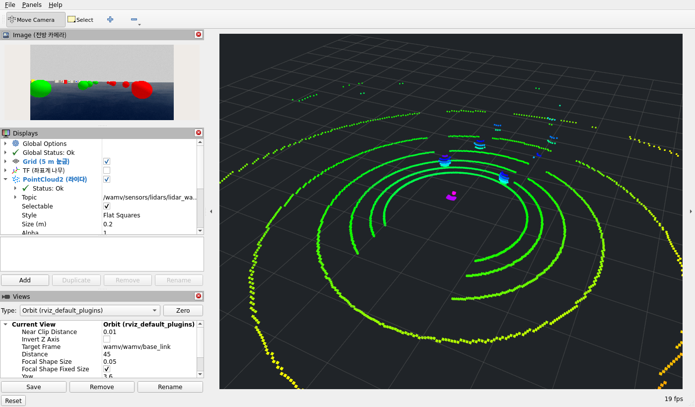

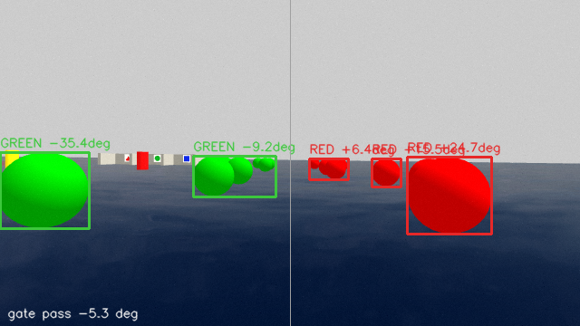

| 화면에서 볼 것 | 맞는 모습 |
|---|---|
| Rviz2 왼쪽 위 영상 | 수평선 아래에 빨강·초록 공 하나씩 |
| Rviz2 오른쪽 점군 | 배를 둘러싼 초록 고리(수면 반사) 사이에 작은 덩어리 둘 |
| 카메라 그림의 네모 | 적·녹 각각 하나씩. 셋 이상 잡히면 HSV 범위를 좁힘 |
| 터미널 | 두 부표 방위와 그 가운데값 한 줄 |

#### 나. 위치유지 — WP1

```bash
bash goto.sh wp1 && python3 see_station.py
```


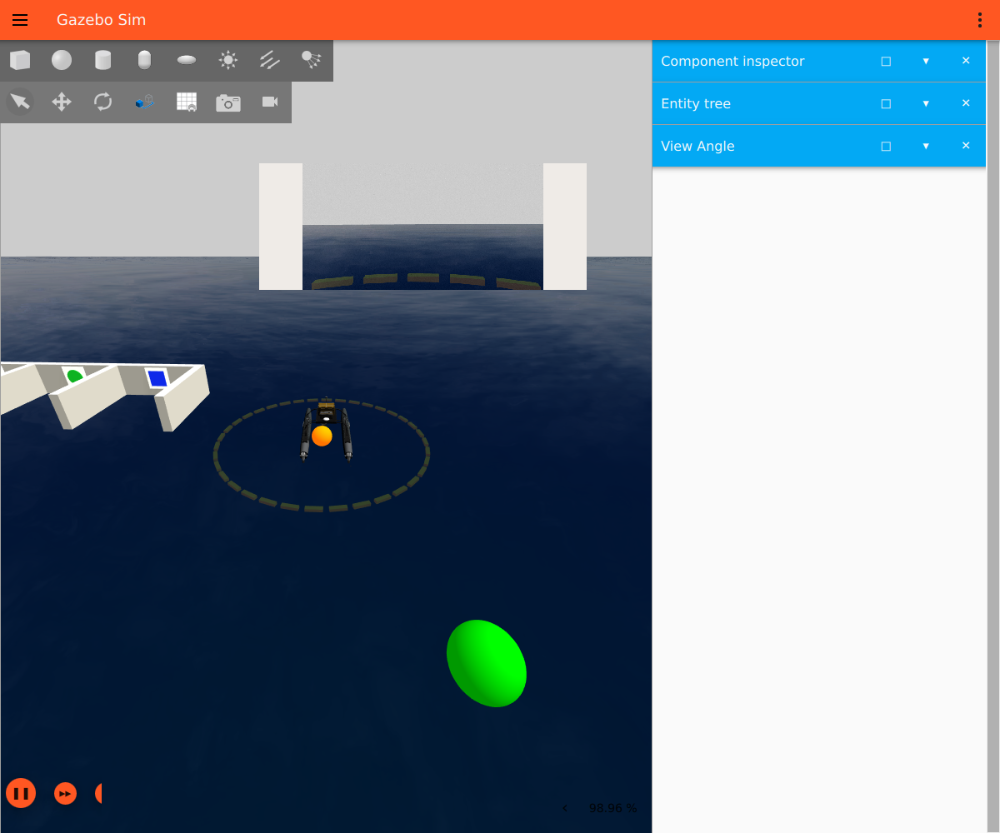

| 화면에서 볼 것 | 맞는 모습 |
|---|---|
| 가제보 | 배가 링 안에 있고 파도 말고는 움직이지 않음 |
| 터미널 | 거리 0.0x m 가 이어지고 **정지 경과 초**가 올라감 |
| 5 초를 넘긴 뒤 | `유지 성공` 이 뜸 |

#### 다. 도킹 — 라이다로 구조물을 봄

```bash
bash goto.sh dock && python3 see_dock_cloud.py
```

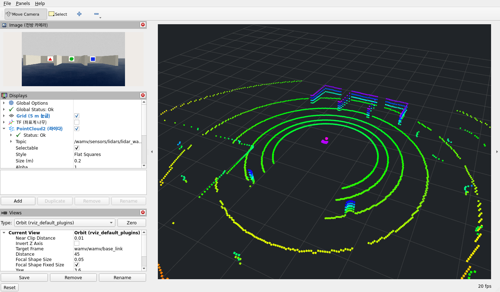

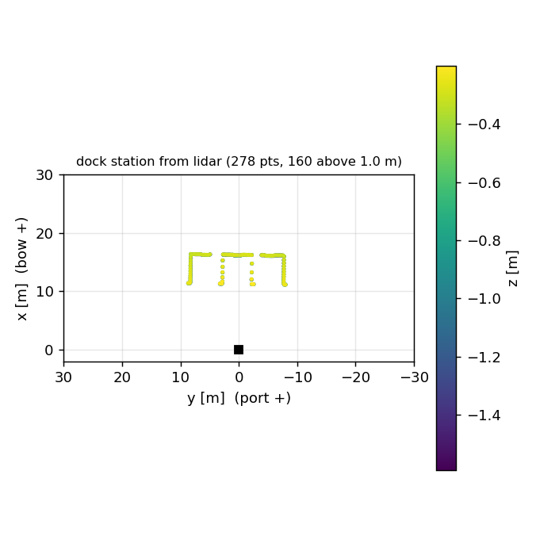

| 화면에서 볼 것 | 맞는 모습 |
|---|---|
| Rviz2 점군의 색 | 벽은 높이 2 m 라 **파랑·보라**로, 수면은 초록·노랑으로 나옴 |
| 덩어리 수 | 벽 셋이 가로로 늘어선 꼴. 하나로 뭉쳐 보이면 너무 가까움 |
| 터미널 | 1 m 초과 점 수와 거리 범위·방위폭 |

- 색이 높이를 뜻함 — 수면보다 높은 것만 골라내면 도크 방향을 **색을 보기 전에** 잡을 수 있음

#### 라. 도킹 — 카메라로 표식을 봄

```bash
bash goto.sh dock && python3 see_placard.py
```

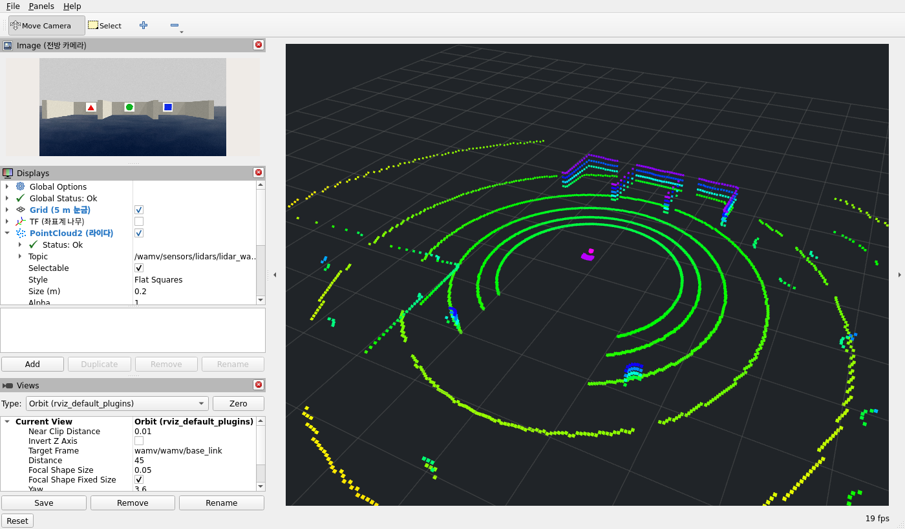

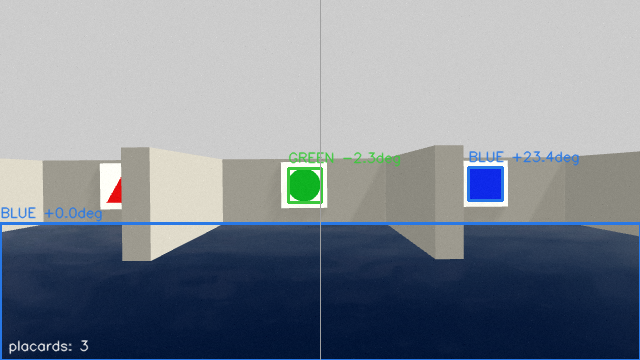

| 화면에서 볼 것 | 맞는 모습 |
|---|---|
| 표식 수 | **셋**이 다 잡힘. 둘만 잡히면 10~12 m 로 물러서서 다시 봄 |
| 왼쪽부터 | 빨강 삼각형 · 초록 원형 · 파랑 네모 |
| 터미널 | 색·모양·방위가 세 줄. 방위가 왼쪽 음수 → 오른쪽 양수로 늘어섬 |

#### 마. 탐색 — 색으로 선회 방향을 가름

```bash
bash goto.sh search_ylw && python3 see_search.py
```

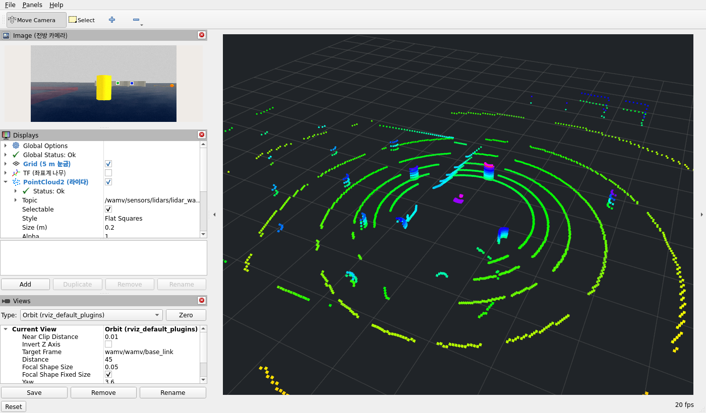

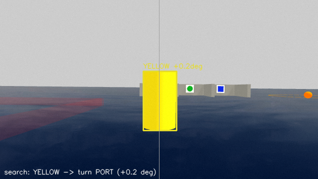

| 화면에서 볼 것 | 맞는 모습 |
|---|---|
| 잡힌 덩어리 | **하나**. 여러 개가 잡히면 다른 부표까지 화각에 든 것임 |
| 터미널의 선회 방향 | 노랑이면 `좌현선회`, 빨강·초록이면 `우현선회` |
| 바꿔 보기 | `search_red` · `search_grn` 으로 가면 방향이 뒤집혀야 함 |

#### 바. 장애물회피 — 점군으로 기둥을 봄

```bash
bash goto.sh obs_front && python3 see_obstacle_cloud.py
```


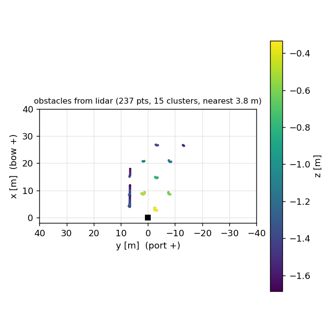

| 화면에서 볼 것 | 맞는 모습 |
|---|---|
| Rviz2 점군 | 초록 고리 바깥에 **작고 짙은 덩어리 여럿**. 그것이 기둥임 |
| 왼쪽 위 영상 | 주황 기둥이 줄지어 보임 |
| 터미널 | 덩어리 수와 최근접 거리·방위. 최근접이 1.63 m 아래면 접촉임 |

#### 사. 종료 게이트

```bash
bash goto.sh goal && python3 see_gate.py
```


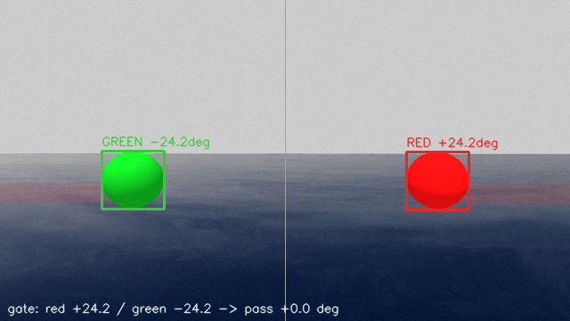

| 화면에서 볼 것 | 맞는 모습 |
|---|---|
| 적·녹 자리 | 이 구간은 **서진**이라 빨강이 화면 오른쪽(북)임 |
| 통과 방위 | 거의 0° — 게이트를 정면으로 보고 있다는 뜻 |

> [!warning] 화면이 안 바뀌면 Rviz2 를 의심하지 말 것
> - 배를 옮겼는데 점군이 그대로면, 배를 **풀지 않은** 것임 (6-2 의 `/vrx/release`)
> - Rviz2 자체는 멀쩡함. 창을 떠서 캡처할 때만 주의할 것이 있음 — 9 장 마지막 줄

### 7-4. 캡처와 녹화

- 위치 — `60-텀프로젝트/TP_vrx_lite/shots/`
- 구간마다 가제보 창·Rviz2 창·카메라 영상 셋을 같은 이름으로 남겼음

| 꼴 | 무엇 |
|---|---|
| `NN_<구간>_gz.png` | 가제보 창 |
| `NN_<구간>_rviz.png` | Rviz2 창 — 점군·레이저스캔·영상 |
| `NN_<구간>_cam.png` | 카메라 영상에 탐지 결과를 얹은 것 |
| `NN_<구간>_cloud.png` | 점군을 위에서 본 그림 (라이다 구간) |
| `NN_<구간>.log` | 예제가 찍은 숫자 전부 |

| 녹화 | 길이 | 내용 |
|---|---|---|
| `01_gate_{gz,rviz,cam}.mp4` | 12 초 | 항로추종 게이트 접근 |
| `03_wp1_{gz,rviz,cam}.mp4` | 10 초 | WP1 정지 유지 |
| `05_dock_{gz,rviz,cam}.mp4` | 10 초 | 도크 접근과 표식 판정 |
| `09_search_{gz,rviz,cam}.mp4` | 10 초 | 탐색 부표 색 판정 |
| `12_obs_{gz,rviz,cam}.mp4` | 12 초 | 장애물 구간 진입, 점군 갱신 |
| `15_goal_{gz,rviz,cam}.mp4` | 10 초 | 종료 게이트 통과 |

> [!note] 영상 길이가 실제 시간과 같음
> - 창을 뜯는 속도는 15 Hz 로 묶어 두었음. 카메라는 받는 대로 (약 6.5~7.2 Hz)
> - 둘 다 **실제로 뜯은 속도**로 저장하므로 빨리감기가 아님
> - 상한을 둔 까닭 — 상한 없이 뜯으면 100 Hz 가 나오는데, MPEG-4 코덱이 그 프레임률을 거부함

---

## 8. 제출물

| 번호 | 제출물 | 형식 |
|---|---|---|
| 1 | Simulink·Stateflow 모델 일체 | `.slx` + 생성 스크립트 `.m` |
| 2 | ROS 2 인지 패키지 | 소스 + `README.md` |
| 3 | GCS | 실행 가능한 꼴 + 화면 녹화 |
| 4 | 연속 완주 녹화 | 출발선부터 종료 게이트까지 **끊김 없는 영상** |
| 5 | 반복 시행 집계표 | 5 회. 구간별 시각·접촉·성공 여부 |
| 6 | 보고서 | 실패 분석과 재현 절차를 포함 |

> [!important] 4 번이 채점의 기준 증거임
> - 끊어 찍은 영상, 편집으로 이어 붙인 영상은 받지 않음
> - 화면에 경과 시간이 보이게 찍을 것

---

## 9. 자주 걸리는 곳

| 증상 | 까닭 | 할 일 |
|---|---|---|
| `gz service` 가 전부 시간 초과 | 가제보가 안 떠 있음 | 터미널 1 의 인자 순서 확인 — `lite gui` |
| 토픽이 하나도 안 보임 | `ROS_DOMAIN_ID` 가 다름 | 세 터미널에 같은 값을 줌 |
| 가제보가 둘 보이고 값이 튐 | `GZ_PARTITION` 이 같음 | 세션마다 다른 값을 줌 |
| `ModuleNotFoundError: rclpy` | ROS 를 소스하지 않음 | `source /opt/ros/humble/setup.bash` |
| Rviz2 가 전부 Status: Error | Fixed Frame 이 `map` 임 | `wamv/wamv/base_link` 로 바꿈 |
| 순간이동해도 제자리 | 배를 풀지 않음 | 6-2 의 `/vrx/release` |
| 게이트가 안 잡힘 | 너무 가까움 | 10 m 이상 물러서서 봄 |
| 파랑 표식 자리에 바다가 잡힘 | 물빛이 파랑임 | 라이다로 방향을 좁힌 뒤 그 쪽만 봄 |
| 캡처한 Rviz2 그림의 점군이 늘 같음 | 창을 뜯는 방법의 문제 | 아래 칸 참고 |

> [!caution] Rviz2 창을 떠서 캡처할 때 — 3 차원 화면이 얼어붙음
> - Rviz2 의 3 차원 화면은 **따로 떨어진 자식 창**에 OpenGL 로 그려짐
> - 본 창만 뜯으면 그 자리에 **맨 처음 장면**이 그대로 들어감. 배를 어디로 옮겨도 같은 그림이 나옴
> - 2026-11-17 에 이 문제로 캡처 19 장을 다시 찍었음 (3 차원 영역의 화소 차이가 **0.00** 이었음)
> - `xcap.py` 는 자식 창을 따로 뜯어 제자리에 얹도록 고쳤음. **이 스크립트를 쓰면 문제 없음**
> - 직접 캡처 도구를 만들 때는 자식 창까지 뜯을 것. 가제보는 창 하나라 이 문제가 없음

---

## 참고

- [[텀프로젝트_계획]] — 이 요구조건의 설계 근거와 실현 가능성 검토
- [[W06_선수추진기와_위치제어_접안]] — 선수추진기 3 추진기 모델
- [[W08_Stateflow_미션_웨이포인트와_로이터링]] — Stateflow 미션 차트
- [[W09_라이다_장애물회피_파이썬유도와_시뮬링크제어]] — 장애물회피
- `경기규정-202611` · `2025 KABOAT 임무설명 r1` — 상위 규정
